# 067 语法 文章

快速机器解析：语音为单模型转写，未进行独立交叉校对或人工复核；画面每秒采样并按变化选帧，短时文字和标记可能遗漏。截图时间约有 1 秒误差。图片有损压缩；遇到疑点请按时间查看 Google Drive 原视频。

## 00:00:00–00:00:30

Hello everyone, welcome to Capsule Academy. This is Leo. Today we're going to learn new concept in English book one lesson sixty-seven grammar and story.老习惯，进入正式课程之前，我们先看几个问题啊啊，否定疑问句啊，终于出现了一个很好玩的语法点，我们看一下它到底怎么去用。Hope you can enjoy it.好，那我们看一下文章啊，来了两个

### 画面 00:00:00

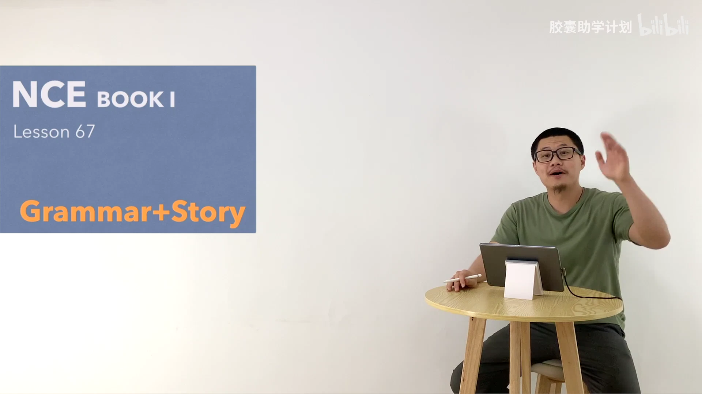

文字识别：胶囊助学计划 / NCE / BOOKI / Lesson 67 / Grammar+Story

### 画面 00:00:02

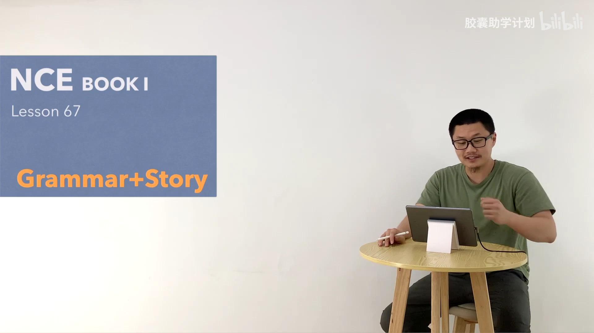

文字识别：胶囊助学计划 / Bilibi / NCE / BOOKI / Lesson 67 / Grammar+Story

### 画面 00:00:09

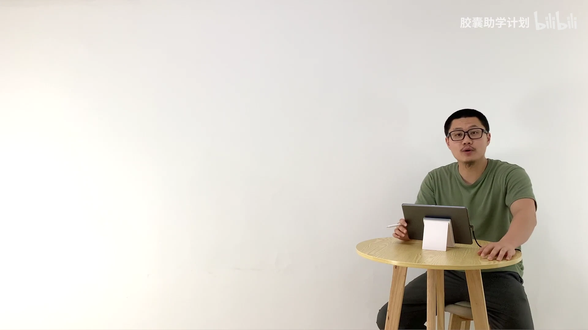

文字识别：胶囊助学计划bilbl

### 画面 00:00:12

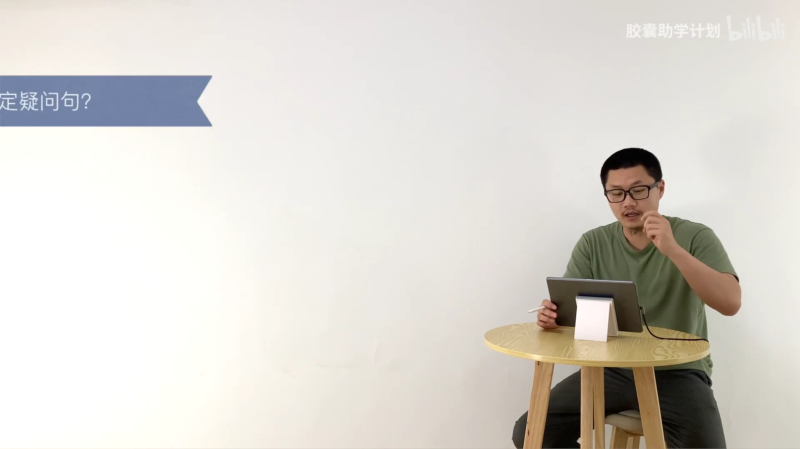

文字识别：胶囊助学计划 / 定疑问句？

### 画面 00:00:14

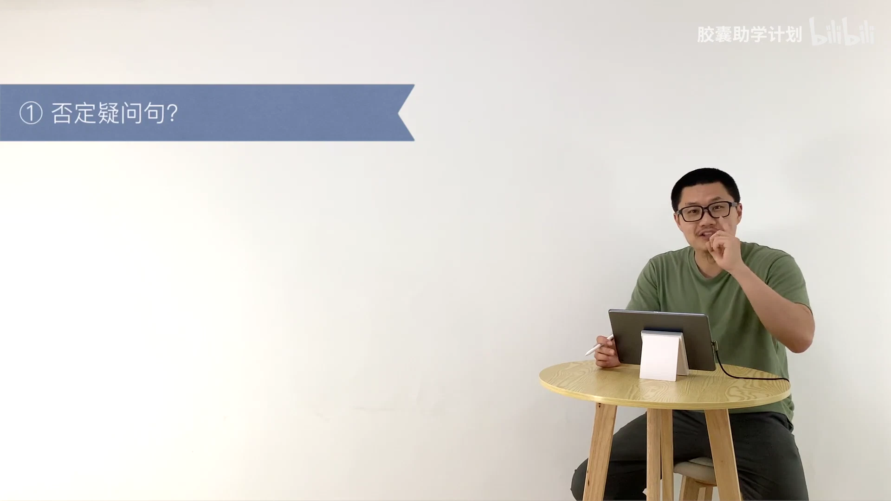

文字识别：胶囊助学计划 / ①否定疑问句？

### 画面 00:00:22

文字识别：胶囊助学计划bill / •

### 画面 00:00:25

文字识别：胶囊助学计划 / 胶囊助学计划

### 画面 00:00:27

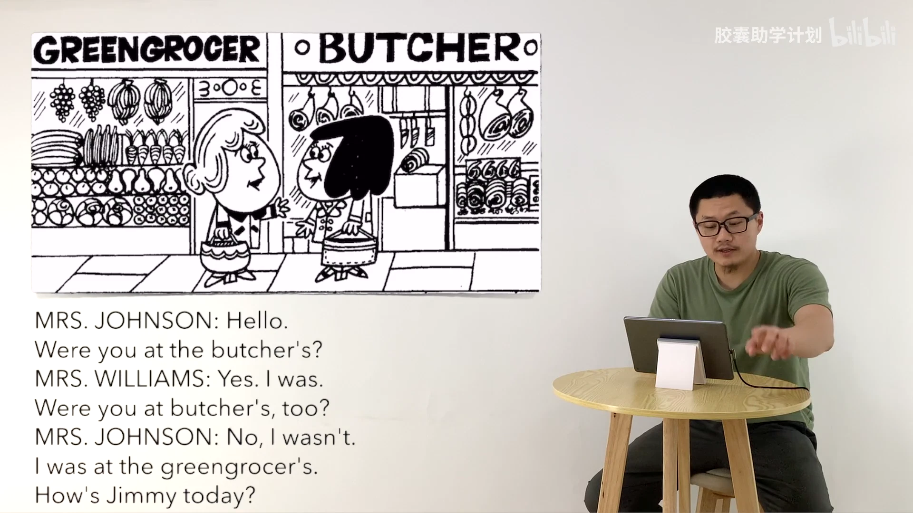

文字识别：胶囊助学计划 / GREENGROCER / BUTCHERo / B0O0E / MRS. JOHNSON: Hello. / Were you at the butcher's? / MRS. WILLIAMS: Yes.I was. / Were you at butcher's, too? / MRS. JOHNSON: No, Iwasn't. / I was at the greengrocer's. / How's Jimmy today?

## 00:00:30–00:01:00

人见面打招呼，hello hello啊，你好。Were you at the butchers？好，这是几个小点。第一，一般疑问句，were提到 you 的前面去了，对吧？好，你之前啊，were 是问之前的事儿，一般过去时。At the butchers，其实我们之前就已经学过了，我没记错的话是四十九课，对吧？叫做在屠夫的商店，撇 s 后面省略了一个单词叫做 shop，对

### 画面 00:00:50

文字识别：胶囊助学计划 / GREENGROCER / BUTCHERo / B000E / MRS. JOHNSON: Hello. / Were you at the butcher's? / MRS. WILLIAMS: Yes.I was. / Were you at butcher's, too? / MRS. JOHNSON: No, Iwasn't. / I was at the greengrocer's. / How's Jimmy today?

## 00:01:00–00:01:30

吧？叫做商店啊。At the butcher's shop, OK. 好，你之前是在屠肉店吗？Yes, I was. 是的，我之前是在。I was. Were you at the butcher's too? 你之前也在吗？No, I wasn't. 没有，我不在啊，之前不在。Wasn't. I was. 我之前 at the green grocers. 之前呢，哎俩就紧挨着是吧？这是 butcher's，这是 green grocers。我之前呢，在哪儿呢？在这个蔬菜店呢。

### 画面 00:01:05

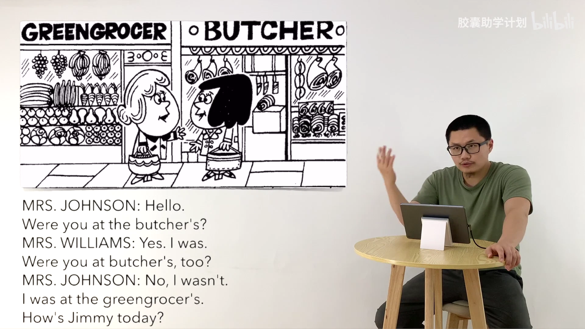

文字识别：胶囊助学计划 / GREENGROCER / BUTCHERo / B000E / MRS. JOHNSON: Hello. / Were you at the butcher's? / MRS. WILLIAMS: Yes.Iwas. / Were you at butcher's, too? / MRS. JOHNSON: No, I wasn't. / I was at the greengrocer's. / How's Jimmy today?

### 画面 00:01:27

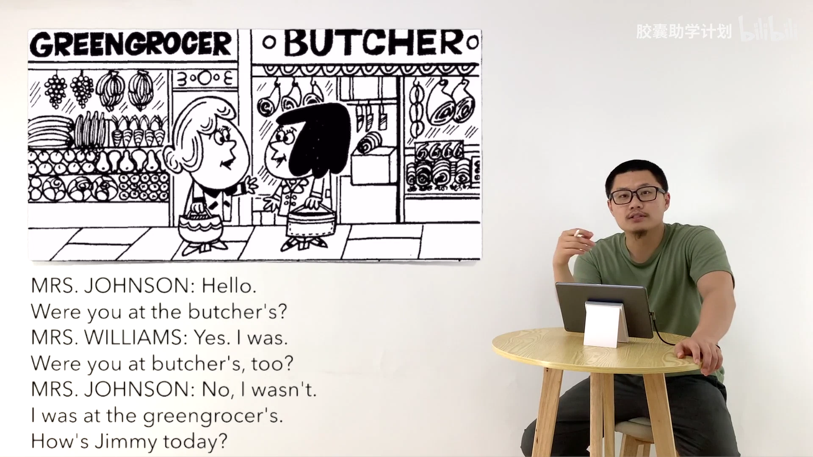

文字识别：胶囊助学计划 / GREENGROCER / BUTCHERo / B000E / MRS. JOHNSON: Hello. / Were you at the butcher's? / MRS. WILLIAMS: Yes.Iwas. / Were you at butcher's, too? / MRS. JOHNSON: No, I wasn't. / I was at the greengrocer's. / How's Jimmy today?

## 00:01:30–00:02:00

Okay, how's Jimmy today?问说Jimmy今儿怎么样了？就之前生病的那个小孩，不知道各位还记不记得？He's very well, thank you.他好多了，感谢你。Was he absent from school last week?注意last week这个小的短语，接下来我们会不停的遇见。今天各位见到他认识即可。Last week指的是上一周。Okay，上一周。那last night是什

### 画面 00:01:32

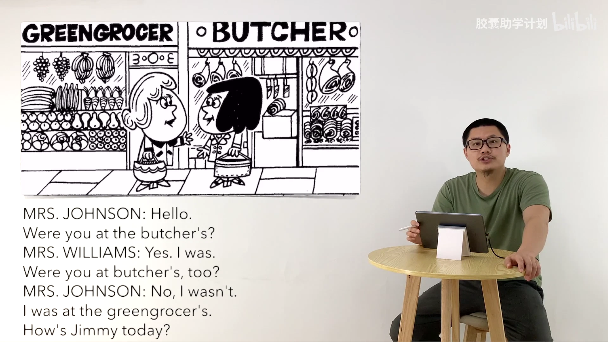

文字识别：胶囊助学计划 / GREENGROCER / BUTCHERo / B000E / MRS. JOHNSON: Hello. / Were you at the butcher's? / MRS. WILLIAMS: Yes.Iwas. / Were you at butcher's, too? / MRS. JOHNSON: No, Iwasn't. / I was at the greengrocer's. / How's Jimmy today?

### 画面 00:01:36

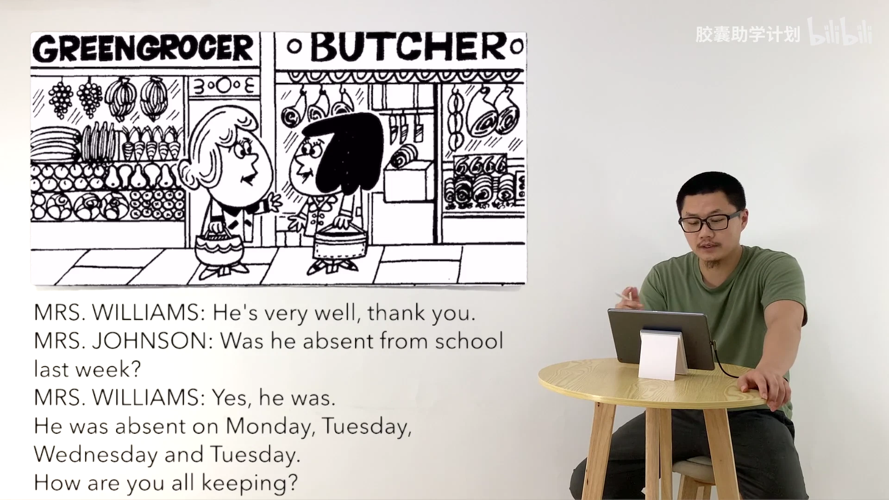

文字识别：胶囊助学计划 / GREENGROCER / BUTCHERo / B000E / MRS. WILLIAMS: He's very well, thank you. / MRS. JOHNSON: Was he absent from school / last week? / MRS. WILLIAMS: Yes, he was. / He was absent on Monday, Tuesday, / Wednesday and Tuesday. / How are you all keeping?

### 画面 00:01:54

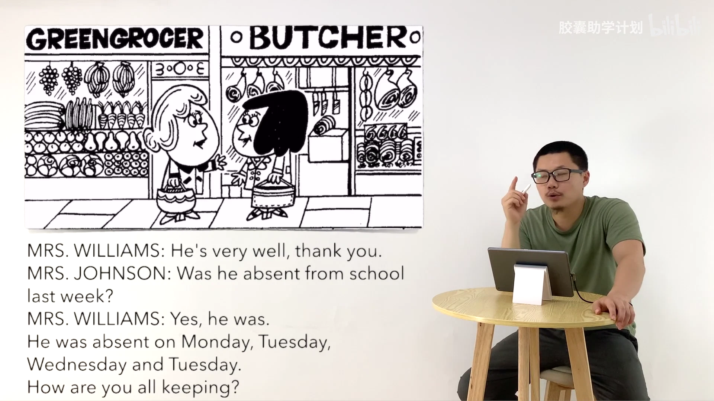

文字识别：胶囊助学计划 / GREENGROCER / BUTCHERo / B000E / MRS. WILLIAMS: He's very well, thank you. / MRS. JOHNSON: Was he absent from school / last week? / MRS. WILLIAMS: Yes, he was. / He was absent on Monday, Tuesday, / Wednesday and Tuesday. / How are you all keeping?

## 00:02:00–00:02:30

么意思？上一个夜晚，昨晚，对吧？好，那 be absent from 只不过变成了一般疑问句，was 提前了，对吧？你把它放回去就是肯定句了。他之前是不是上周是不是缺席学校？就是没上学呀？Yes, he was. 是的，he was absent. 他缺席了。在具体哪一天呢？On 具体哪一天呢？Monday, Tuesday, Wednesday, and Thursday. 周一、周二、周三、周四啊。

### 画面 00:02:03

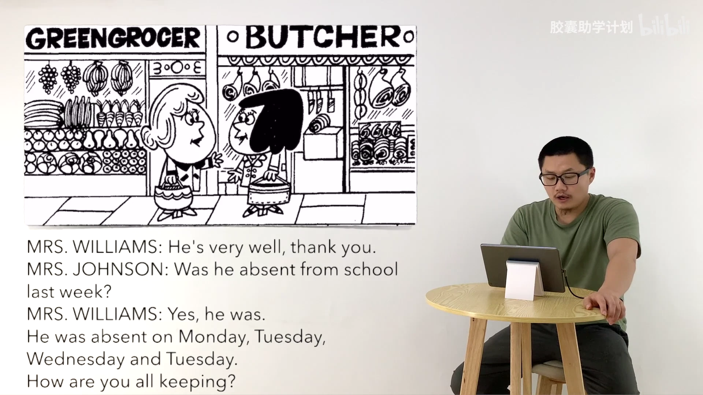

文字识别：胶囊助学计划 / GREENGROCER / BUTCHERo / B000E / MRS. WILLIAMS: He's very well, thank you. / MRS. JOHNSON: Was he absent from school / last week? / MRS. WILLIAMS: Yes, he was. / He was absent on Monday, Tuesday, / Wednesday and Tuesday. / How are you all keeping?

## 00:02:30–00:03:00

How are you all keeping?好，这句话啊，提一小句。首先，它的意思跟How are you一模一样，没什么本质的区别。其次，这句话实话实说啊，基本上我就没用过啊。我在新西兰待了小小三年，我也没听别人用过。然后我专门去搜了一下电影，是吧？也几乎没有电影当中会用到这句话啊。各位啊，这句话您知道它表示How are you就可以了啊。您不用专门去

### 画面 00:02:33

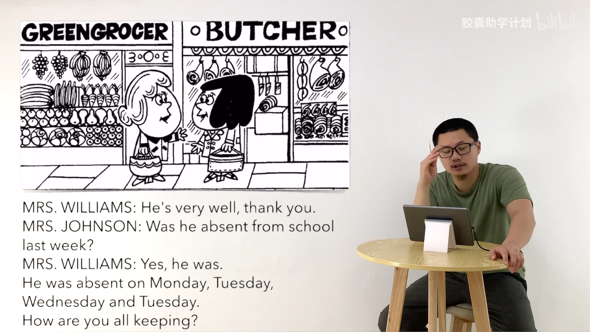

文字识别：胶囊助学计划 / GREENGROCER / BUTCHERo / B000E / MRS. WILLIAMS: He's very well, thank you. / MRS. JOHNSON: Was he absent from school / last week? / MRS. WILLIAMS: Yes, he was. / He was absent on Monday, Tuesday, / Wednesday and Tuesday. / How are you all keeping?

### 画面 00:02:55

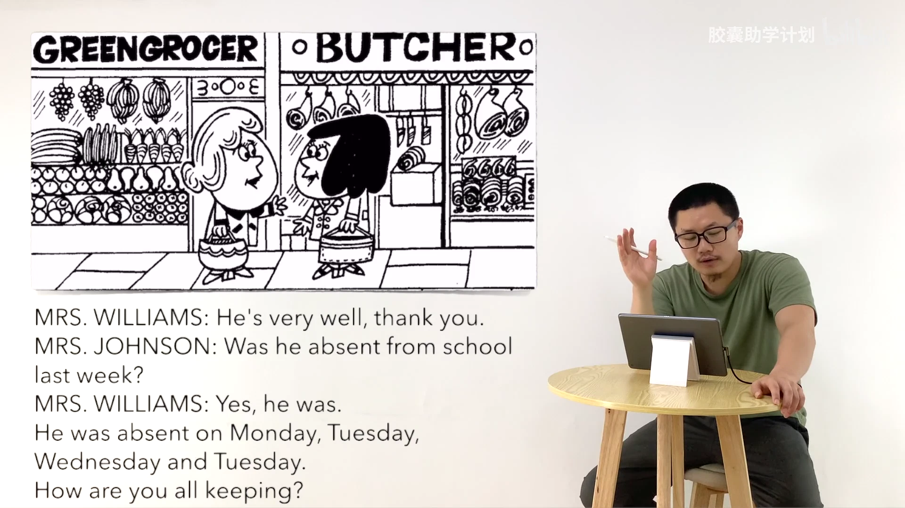

文字识别：GREENGROCER / BUTCHERo / 胶囊助学计划 / B000E / MRS. WILLIAMS: He's very well, thank you. / MRS. JOHNSON: Was he absent from school / last week? / MRS. WILLIAMS: Yes, he was. / He was absent on Monday, Tuesday, / Wednesday and Tuesday. / How are you all keeping?

## 00:03:00–00:03:30

把它背起来。How are you all keeping?啊，你知道这句话的意思就是你们家怎么样啊？你们最近怎么样？How are you?啊，continue very well. Thank you.啊，还不错，谢谢了。We are going to. We are going to be going to do.啊，三十七课咱们学过，叫即将一般将来时，对吧？我们打算 spend three days in the country.你看在讲 spend 的时候，我们就拿它造句了。如果您当时也做了家庭作业，那这儿应该非常清楚了。Some time,

### 画面 00:03:01

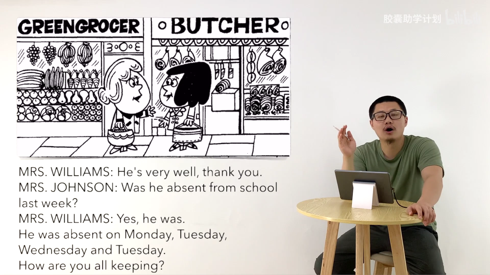

文字识别：胶囊助学计划 / GREENGROCER / BUTCHERo / B000E / MRS. WILLIAMS: He's very well, thank you. / MRS. JOHNSON: Was he absent from school / last week? / MRS. WILLIAMS: Yes, he was. / He was absent on Monday, Tuesday, / Wednesday and Tuesday. / How are you all keeping?

### 画面 00:03:05

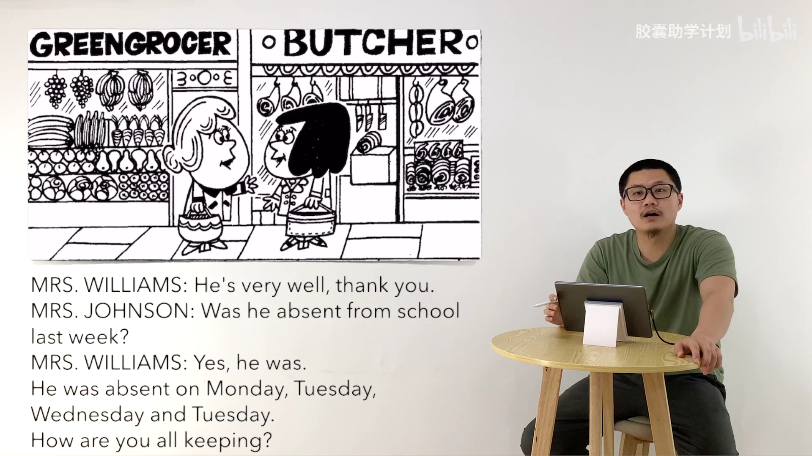

文字识别：胶囊助学计划 / GREENGROCER / BUTCHERo / B000E / MRS. WILLIAMS: He's very well, thank you. / MRS. JOHNSON: Was he absent from school / last week? / MRS. WILLIAMS: Yes, he was. / He was absent on Monday, Tuesday, / Wednesday and Tuesday. / How are you all keeping?

### 画面 00:03:08

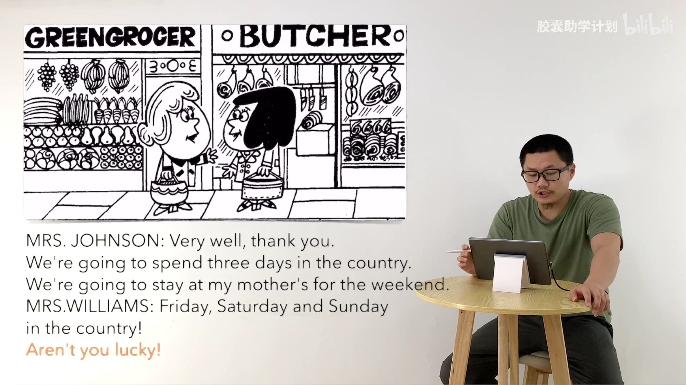

文字识别：胶囊助学计划 / GREENGROCER / BUTCHERo / 3000E / MRS. JOHNSON: Very well thank you. / We're going to spend three days in the country. / We're going to stay at my mother's for the weekend. / MRS.WILLIAMS: Friday, Saturday and Sunday / in the country! / Aren't you lucky!

### 画面 00:03:16

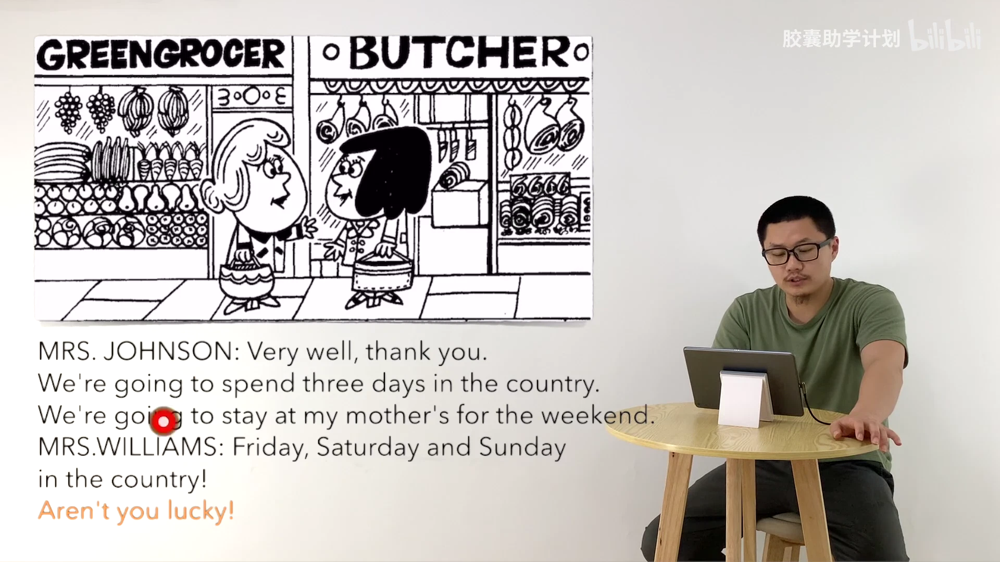

文字识别：胶囊助学计划 / GREENGROCER / BUTCHERo / B000E / MRS. JOHNSON: Very well, thank you. / We're going to spend three days in the country. / We're goi / to stay at my mother's for the weekend. / MRS.WILLIAMS: Friday, Saturday and Sunday / in the country! / Aren't you lucky!

## 00:03:30–00:04:00

somewhere, 对吧？我们打算花三天的时间去，哎，这个郊区乡，呃，乡村待一待. We're going to stay at my mother's. 我们打算停留在哪儿呢？At my mother's house, 啊，后边省略了个house，就在我妈妈那个地方停留一下. For the weekend, 哎，在周末的时候，Friday, Saturday, and Sunday in the country. 说周五、周六、周日在这个乡村度过啊.

### 画面 00:03:46

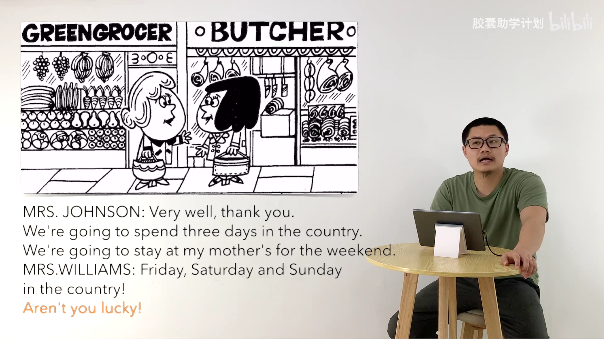

文字识别：胶囊助学计划 / GREENGROCER / BUTCHERo / 3000E / MRS. JOHNSON: Very well, thank you. / We're going to spend three days in the country. / We're going to stay at my mother's for the weekend. / MRS.WILLIAMS: Friday, Saturday and Sunday / in the country! / Aren't you lucky!

## 00:04:00–00:04:30

Aren't you lucky啊？难道你不是特别的幸运吗？你看一下这个句式，咱从来没见过，Aren't you lucky？啊，我想说你很幸运，就很简单，叫You are lucky，叫你很幸运。那你听一下这两个汉语的区别，叫你很幸运和难道你不幸运吗？各位能听出来这两个的区别吧？这应该是在我们小学语文就讲过了，对不对？反义疑问句嘛，对吧？就是有这样一种加强语气的作用啊。我如果没有记错的话，

### 画面 00:04:04

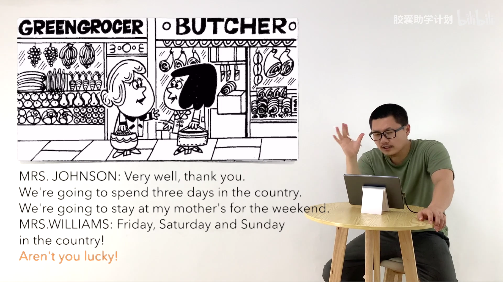

文字识别：胶囊助学计划 / GREENGROCER / BUTCHERo / B000E / MRS. JOHNSON: Very well thank you. / We're going to spend three days in the country. / We're going to stay at my mother's for the weekend. / MRS.WILLIAMS: Friday, Saturday and Sunday / in the country! / Aren't you lucky!

### 画面 00:04:10

文字识别：胶囊助学计划 / GREENGROCER / BUTCHERo / 3000ε / MRS. JOHNSON: Very well, thank you. / We're going to spend three days in the country. / We're going to stay at my mother's for the weekend. / MRS.WILLIAMS: Friday, Saturday and Sunday / in the country! / Aren't you lucky!

### 画面 00:04:28

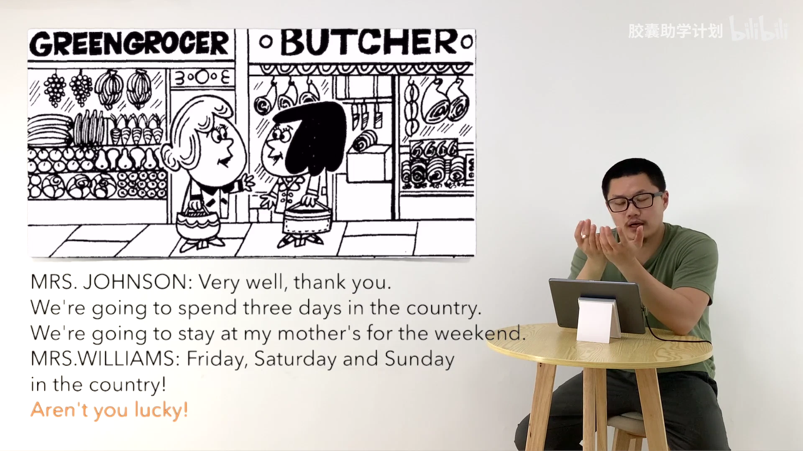

文字识别：胶囊助学计划 / GREENGROCER / BUTCHERo / B0O0E / MRS. JOHNSON: Very well, thank you. / We're going to spend three days in the country. / We're going to stay at my mother's for the weekend. / MRS.WILLIAMS: Friday, Saturday and Sunday / in the country! / Aren't you lucky!

## 00:04:30–00:05:00

叫反义疑问句是吧？我们汉语当中叫做“难道你不幸运吗？”那它是如何变过来的呢？我们看一下啊，我们先把这个去掉，叫做“Are you lucky？”然后我们给它来个问号，叫做“你幸运吗？”这个对于各位来说很容易理解的，对吧？一般疑问句“You are lucky”变成“Are you lucky”，各位很容易理解。然后我们现在做的事情是给它首字母又加了个“not”，给它来了，既否

### 画面 00:04:32

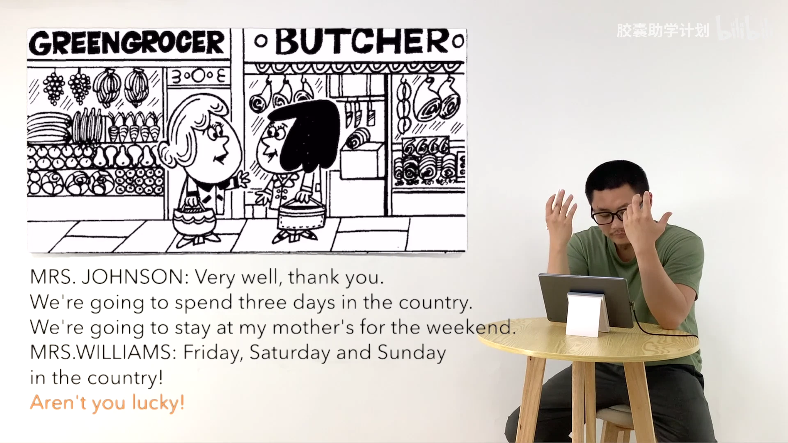

文字识别：胶囊助学计划 / GREENGROCER / BUTCHERo / B000E / MRS. JOHNSON: Very well, thank you. / We're going to spend three days in the country. / We're going to stay at my mother's for the weekend. / MRS.WILLIAMS: Friday, Saturday and Sunday / in the country! / Aren't you lucky!

### 画面 00:04:36

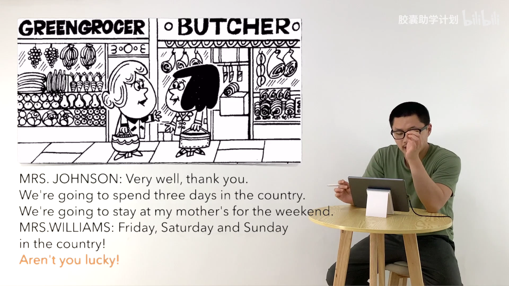

文字识别：胶囊助学计划 / GREENGROCER / BUTCHERo / B000E / MRS. JOHNSON: Very well thank you. / We're going to spend three days in the country. / We're going to stay at my mother's for the weekend. / MRS.WILLIAMS: Friday, Saturday and Sunday / in the country! / Aren't you lucky!

### 画面 00:04:41

文字识别：胶囊助学计划bilb出 / GREENGROCER / BUTCHERo / 3000E / MRS. JOHNSON: Very well thank you. / We're going to spend three days in the country. / We're going to stay at my mother's for the weekend. / MRS.WILLIAMS: Friday, Saturday and Sunday / in the country! / Aret you lucky!

### 画面 00:04:44

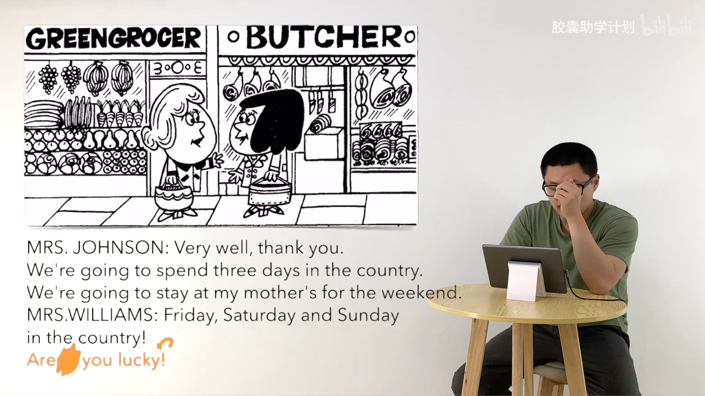

文字识别：胶囊助学计划 / GREENGROCER / BUTCHERo / 3000E / MRS. JOHNSON: Very well thank you. / We're going to spend three days in the country. / We're going to stay at my mother's for the weekend. / MRS.WILLIAMS: Friday, Saturday and Sunday / in the country! / Arel you lucky!

### 画面 00:04:47

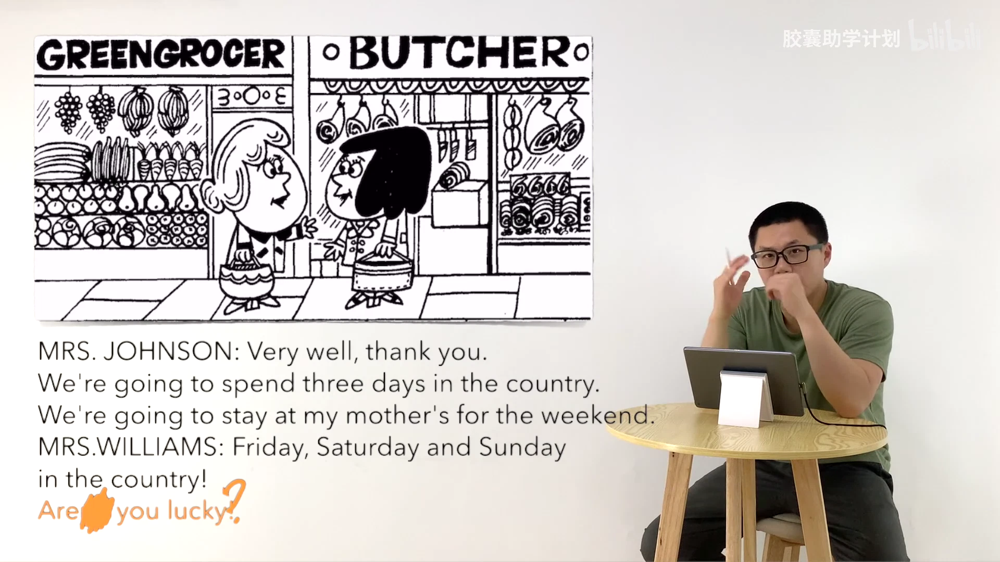

文字识别：胶囊助学计划 / GREENGROCER / BUTCHERo / B000E / MRS. JOHNSON: Very well thank you. / We're going to spend three days in the country. / We're going to stay at my mother's for the weekend. / MRS.WILLIAMS: Friday, Saturday and Sunday / in the country! / Are you lucky?

### 画面 00:04:51

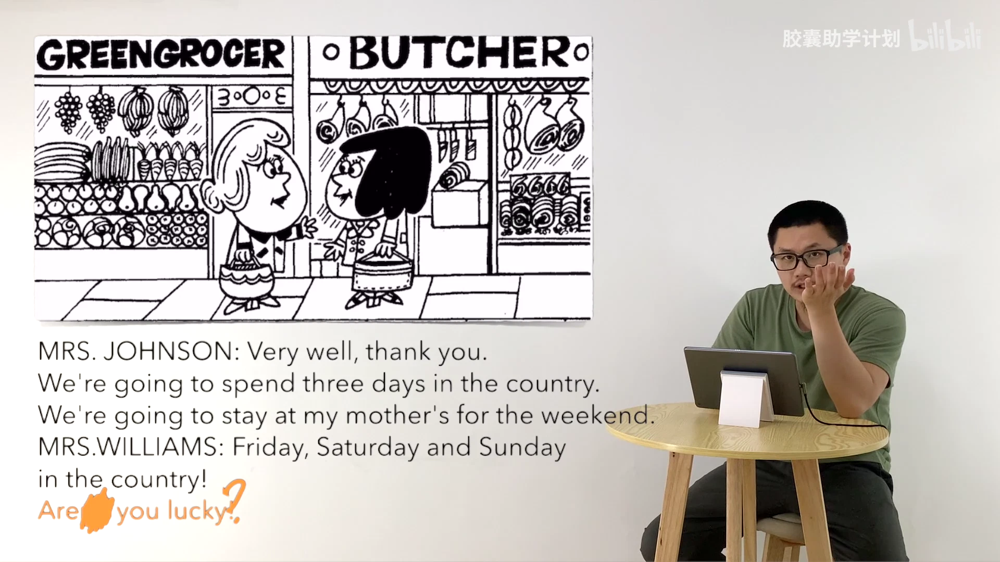

文字识别：胶囊助学计划 / GREENGROCER / BUTCHERo / B0O0E / MRS. JOHNSON: Very well, thank you. / We're going to spend three days in the country. / We're going to stay at my mother's for the weekend. / MRS.WILLIAMS: Friday, Saturday and Sunday / in the country! / Are you lucky?

### 画面 00:04:53

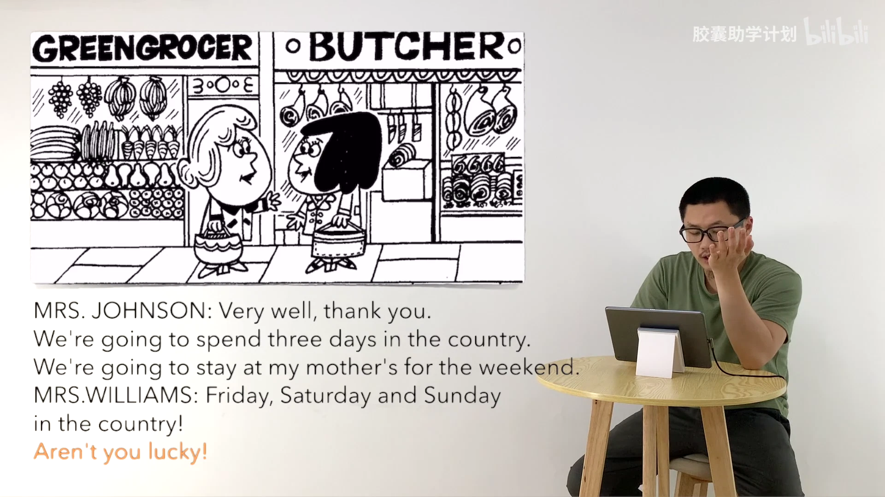

文字识别：胶囊助学计划 / GREENGROCER / BUTCHERo / B000E / MRS. JOHNSON: Very well, thank you. / We're going to spend three days in the country. / We're going to stay at my mother's for the weekend. / MRS.WILLIAMS: Friday, Saturday and Sunday / in the country! / Aren't you lucky!

### 画面 00:04:58

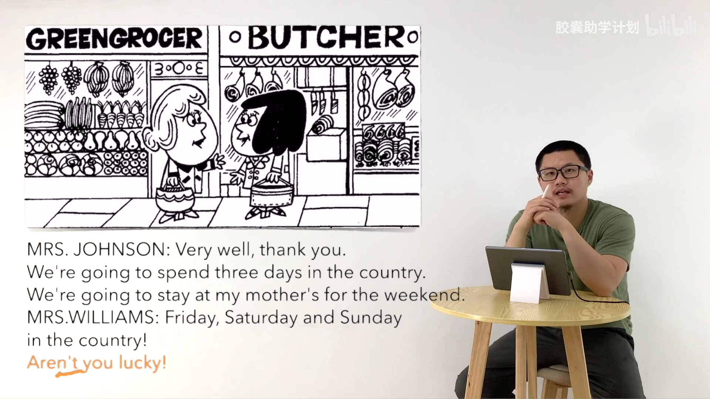

文字识别：胶囊助学计划 / GREENGROCER / BUTCHERo / 3000ε / MRS. JOHNSON: Very well thank you. / We're going to spend three days in the country. / We're going to stay at my mother's for the weekend. / MRS.WILLIAMS: Friday, Saturday and Sunday / in the country! / Aren'tyou lucky!

## 00:05:00–00:05:30

定他，又把它变成了疑问，所以叫否定疑问句。那否定疑问句怎么办呢？首先翻译，基本上你翻译成难道就行了，是吧？一种加强语气。好，比如说这句话，看怎么变过来的啊？我们先想肯定句，叫 He is Leo，他是 Leo，I am Leo，OK，He is Leo，Is he Leo？这句话您一定认得，前二十课学

### 画面 00:05:05

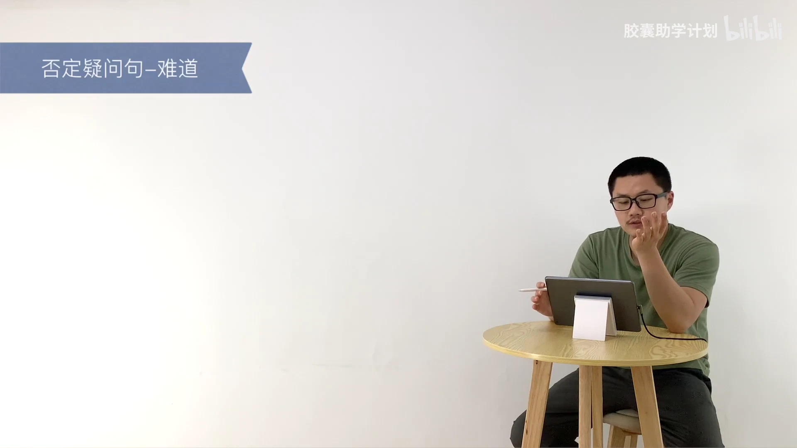

文字识别：胶囊助学计划 / 否定疑问句-难道 / O

### 画面 00:05:09

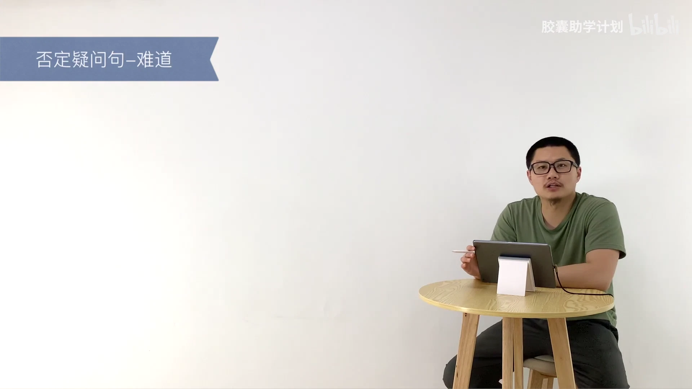

文字识别：胶囊助学计划 / 否定疑问句-难道

### 画面 00:05:14

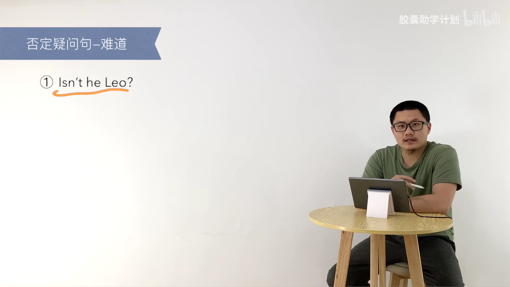

文字识别：胶囊助学计划 / 否定疑问句-难道 / ① Isn't he Leo?

### 画面 00:05:16

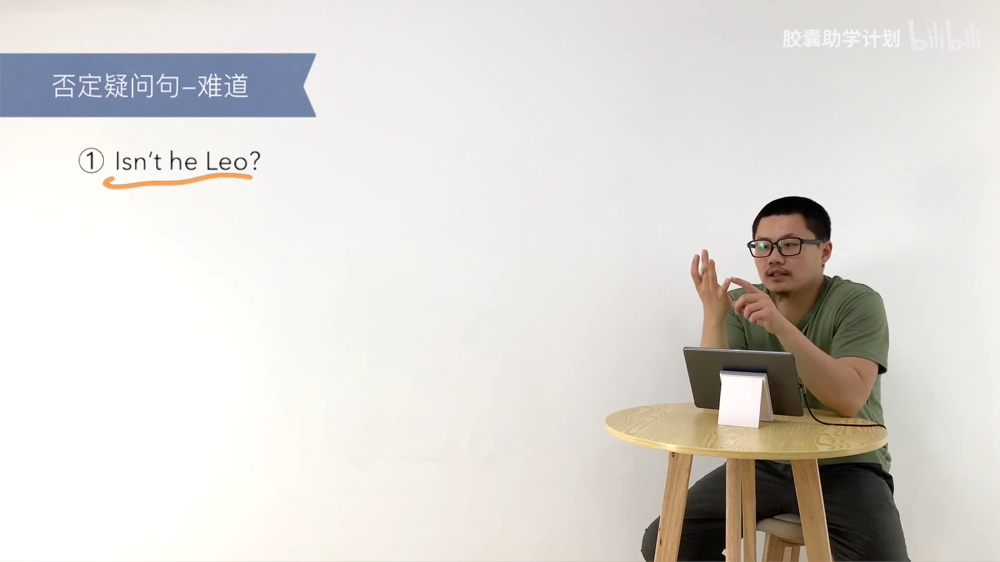

文字识别：胶囊助学计划 / 否定疑问句-难道 / ① Isn't he Leo?

### 画面 00:05:26

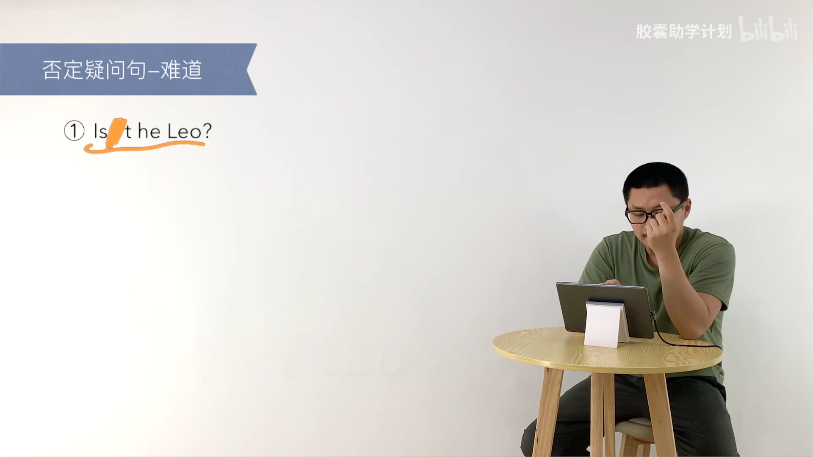

文字识别：胶囊助学计划 / 否定疑问句-难道 / ① Is t he Leo?

### 画面 00:05:28

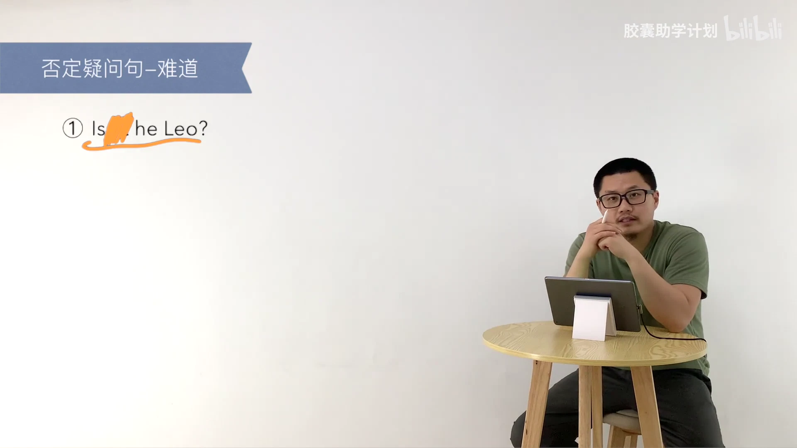

文字识别：胶囊助学计划 / biB / 否定疑问句-难道 / ① Ishe Leo?

## 00:05:30–00:06:00

的一般疑问句，然后再把它变成一般疑问句了之后呢，再给它来个否定，叫做 isn't he a六？说难道他不是六吗？他就是六吧。OK，好，接下来说 isn't there any tea in the kitchen？一个道理啊，对于各位来说，你把n撇t先去掉，这你就看得很清楚了，叫 is there any tea in the kitchen？厨房当中有茶吗？那 isn't there any tea in the kitchen？

### 画面 00:05:32

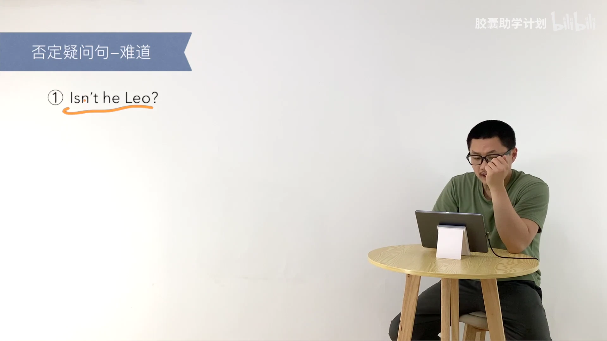

文字识别：胶囊助学计划 / 否定疑问句-难道 / ① Isn't he Leo?

### 画面 00:05:36

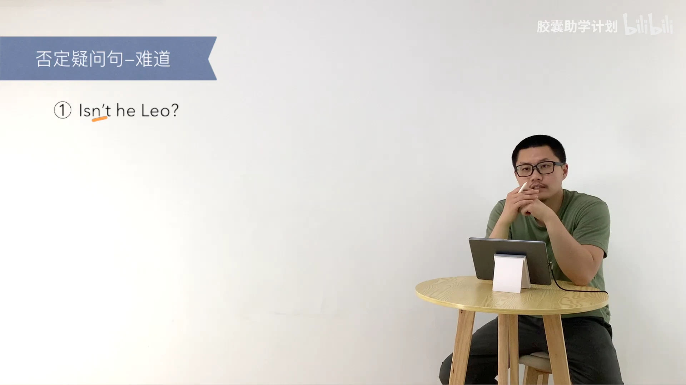

文字识别：Biltbili / 胶囊助学计划 / 否定疑问句-难道 / ① Isn't he Leo?

### 画面 00:05:38

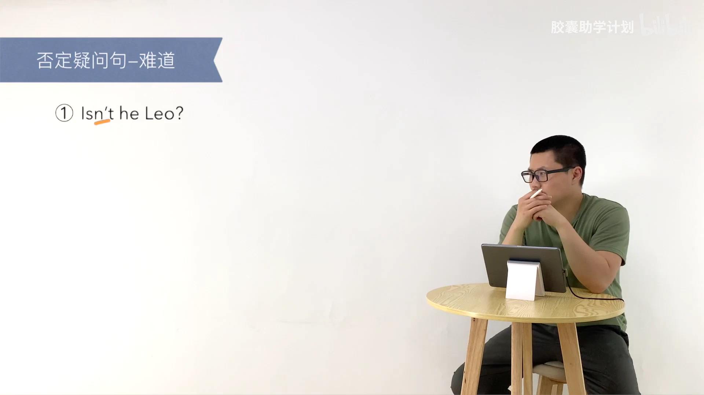

文字识别：胶囊助学计划 / 否定疑问句-难道 / ①Isn't he Leo?

### 画面 00:05:41

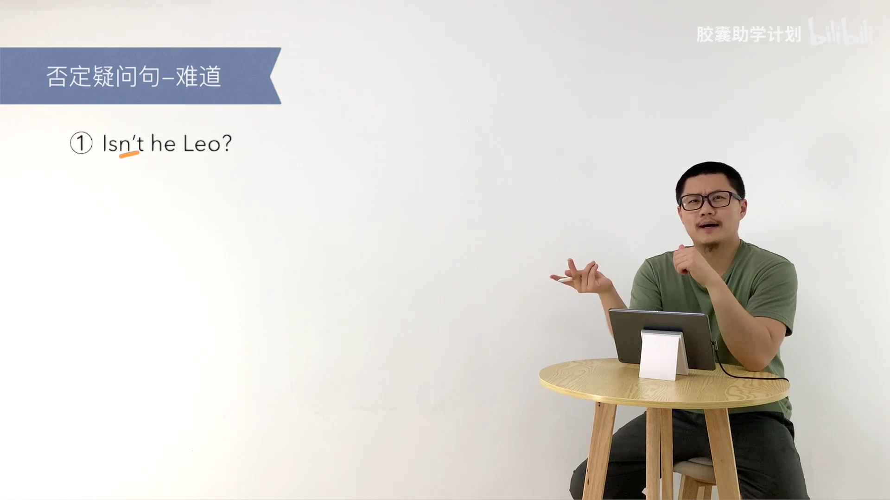

文字识别：胶囊助学计划 / 否定疑问句-难道 / ① Isn't he Leo?

### 画面 00:05:46

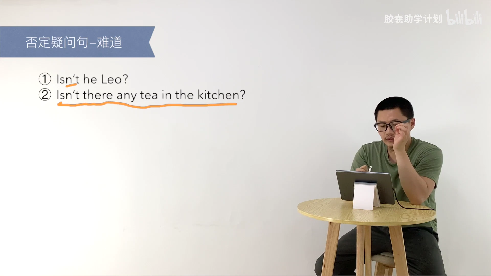

文字识别：胶囊助学计划 / 否定疑问句-难道 / ① Isn't he Leo? / Isn't there any tea in the kitchen?

### 画面 00:05:50

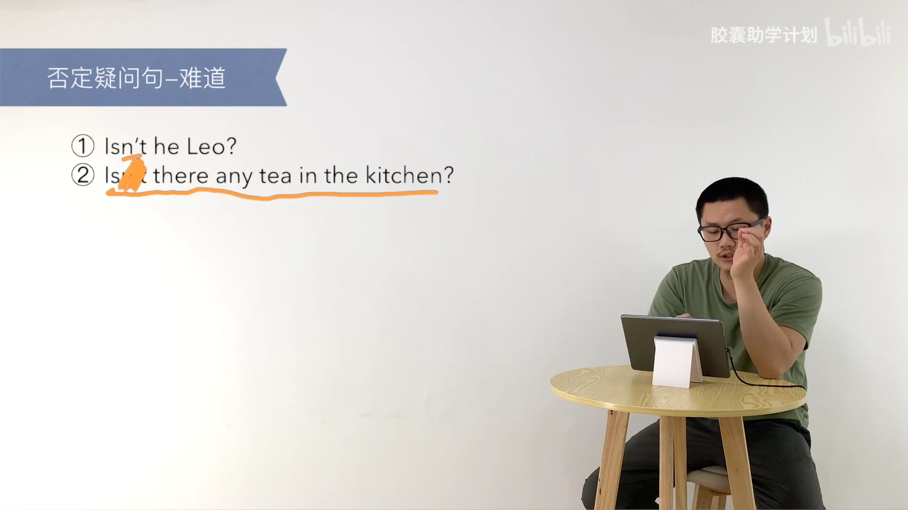

文字识别：胶囊助学计划 / 否定疑问句-难道 / ① Isn't he Leo? / there any tea in the kitchen?

### 画面 00:05:55

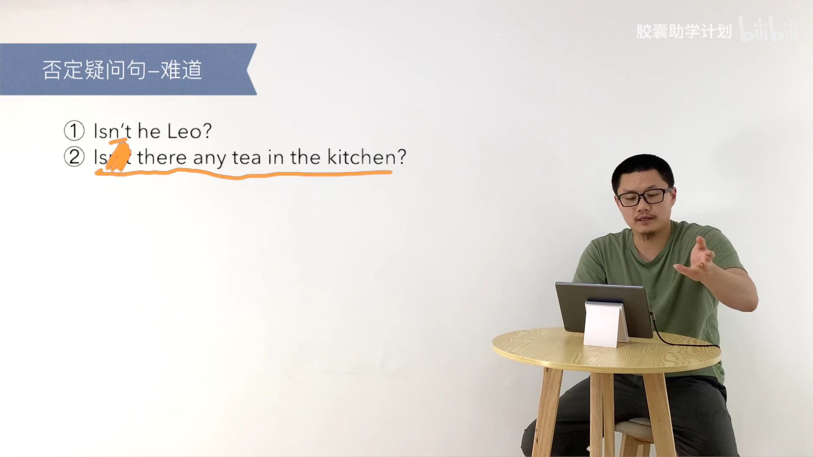

文字识别：胶囊助学计划 / 否定疑问句-难道 / ① Isn't he Leo? / there any tea in the kitchen?

## 00:06:00–00:06:30

That's not just. Is there any tea in the kitchen? That's not just. Is there any tea in the kitchen? That's not just. Is there any tea in the kitchen? That's not just. Is there any tea in the kitchen? That's not just. Is there any tea in the kitchen? That's not just. Is there any tea in the kitchen? That's not just. Is there any tea in the kitchen? That's not just. Is there any tea in the kitchen? That's not just. Is there any tea in the kitchen? That's not just.

### 画面 00:06:05

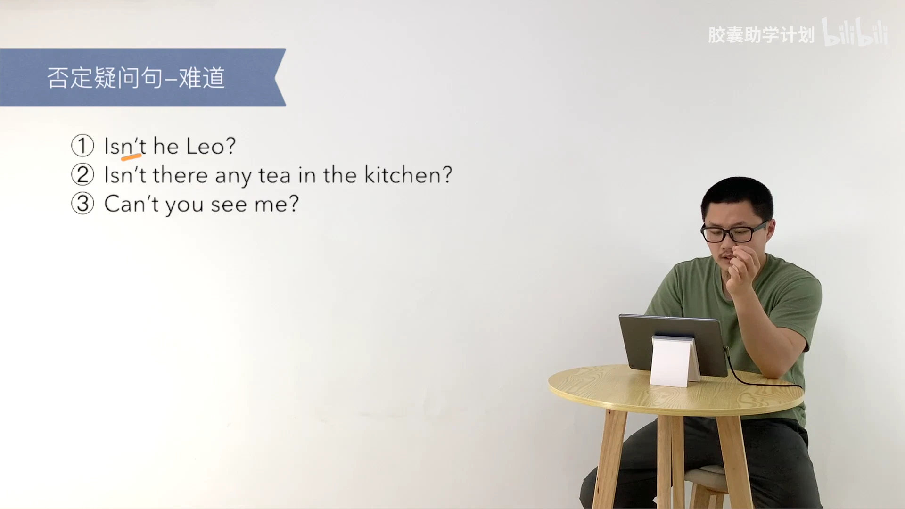

文字识别：胶囊助学计划 / 否定疑问句-难道 / ① Isn't he Leo? / ② Isn't there any tea in the kitchen? /  Can't you see me? / 3）

### 画面 00:06:07

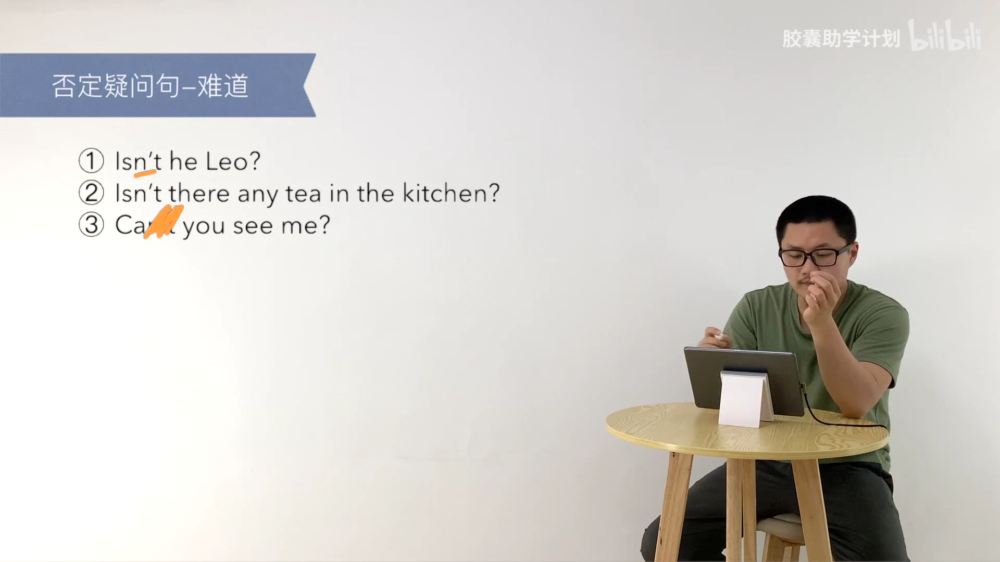

文字识别：biltbili / 胶囊助学计划 / 否定疑问句-难道 / ① Isn't he Leo? /  Isn't there any tea in the kitchen? / 2） / Cayou see me? / 3

### 画面 00:06:10

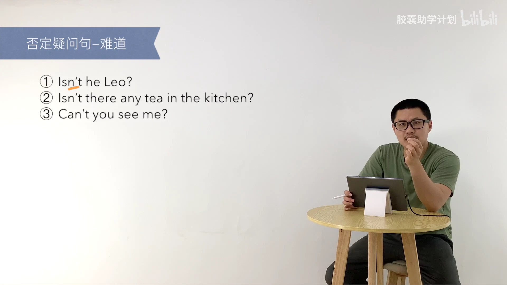

文字识别：胶囊助学计划bil出 / 否定疑问句-难道 / ① Isn't he Leo? /  Isn't there any tea in the kitchen? / 2） /  Can't you see me? / 3

### 画面 00:06:20

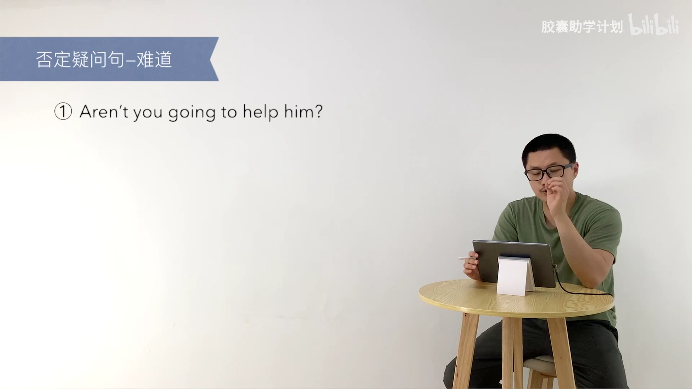

文字识别：Bibii / 胶囊助学计划 / 否定疑问句-难道 / ① / Aren't you going to help him?

### 画面 00:06:22

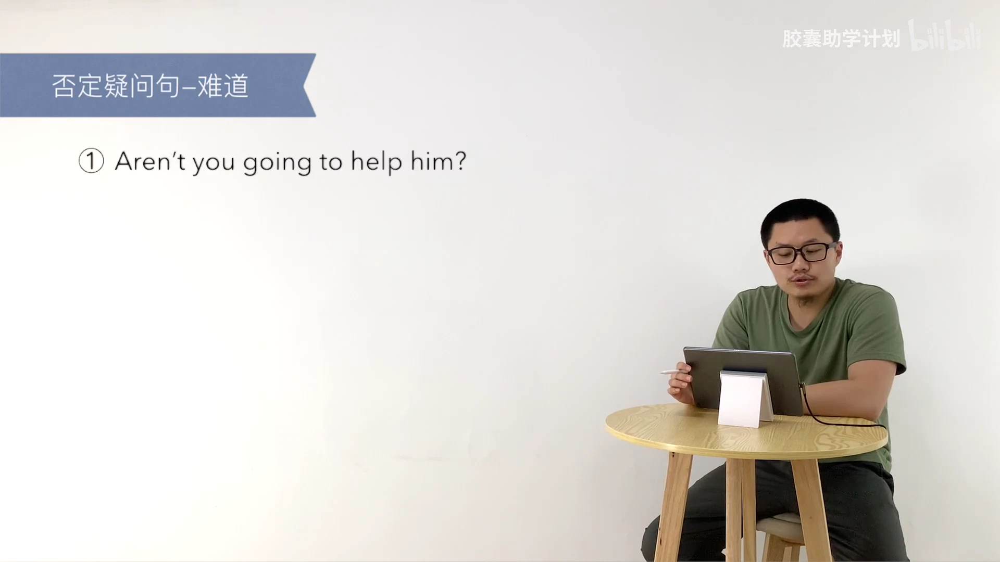

文字识别：胶囊助学计划 / 否定疑问句-难道 / ① / Aren't you going to help him?

### 画面 00:06:26

文字识别：胶囊助学计划 / 否定疑问句-难道 / ① Arer / ryou going to help him?

## 00:06:30–00:07:00

don't you like tea? Do you like tea?你喜欢茶吗？难道你不喜欢茶吗？Okay, doesn't he look ill? Does he look ill?他看起来病了吗？难道他看起来没生病？是吧？就这个样子了。Okay, very good.接下来我们看电影片段当中出现了叫Can't you hear yourself yourself？六十五克钢雪。难道你听不到自己在说什么吗？Don't you know？说难道你不知道怎么怎么样吗？Okay，来了啊。

### 画面 00:06:33

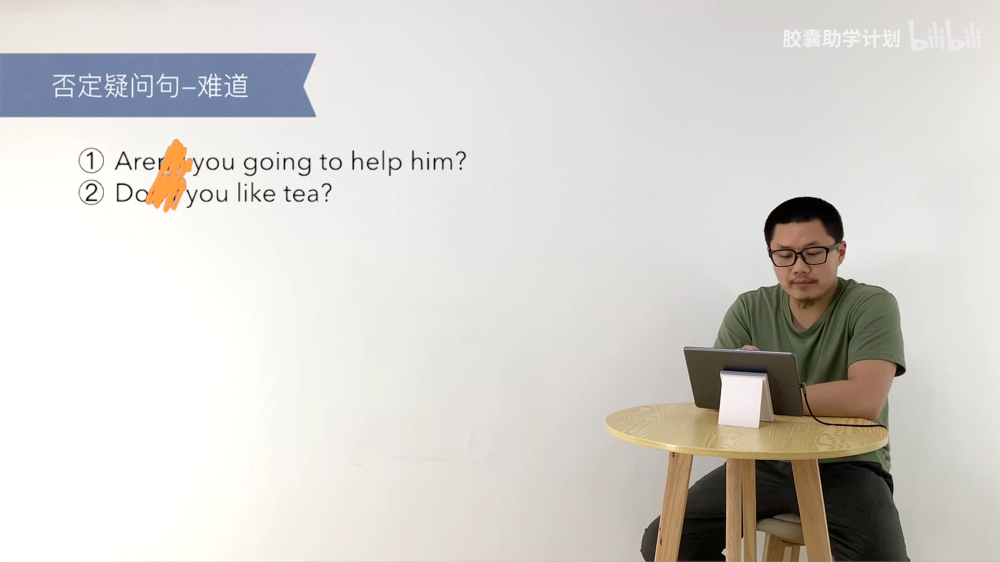

文字识别：胶囊助学计划 / 否定疑问句-难道 / ①Arer / you going to help him? / ② Do / you like tea?

### 画面 00:06:35

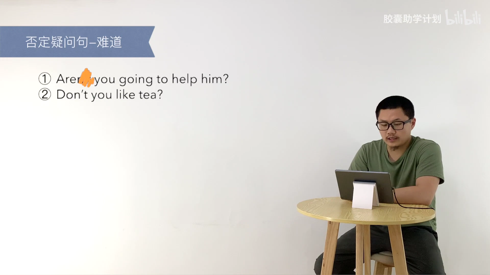

文字识别：胶囊助学计划 / 否定疑问句-难道 / ① Arer / you going to help him? / ② Don't you like tea?

### 画面 00:06:46

文字识别：胶囊助学计划 / Can't you hear yourself? / Don't you know... / ORDRRING / THETWOTOWERS / 指环王2：双塔奇兵The Lord of the Rings: The Two Towers(200 / THE IOURNEY CON

### 画面 00:06:48

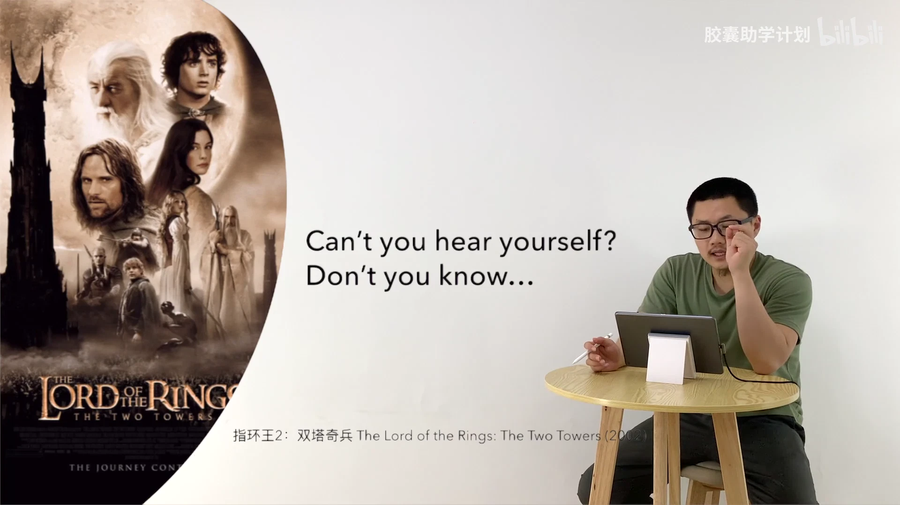

文字识别：胶囊助学计划 / Can't you hear yourself? / Don't you know... / ORDRLRING / THETWOTOWERS / 指环王2：双塔奇兵The Lord of the Rings: The Two Towers(200 / THE IOURNEY CON

### 画面 00:06:50

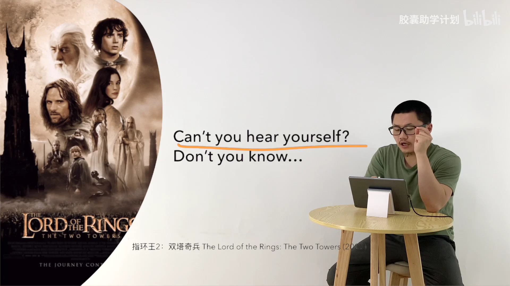

文字识别：胶囊助学计划 / Can't you hear yourself? / Don't you know... / ORDRRING / THETWOTOWERS / 指环王2：双塔奇兵The Lord of the Rings: The Two Towers(200 / THE IOURNEY CON

### 画面 00:06:52

文字识别：胶囊助学计划 / Can't you hear yourself? / Don't you / know... / ORDRERING / THETWOTOWERS / 指环王2：双塔奇兵The Lord of the Rings:The Two Towers(20 / THE IOURNEY CON

### 画面 00:06:55

文字识别：胶囊助学计划 / Can't you hear yourself? / Don't you / know... / ORDRING / THETWO / TOWERS / 指环王2：双塔奇兵The Lord of the Rings:The Two Towers(200 / THE IOURNEY CON

### 画面 00:06:58

文字识别：胶囊助学计划 / Can't you hear yourself? / Don't you / know... / ORDRRING / TH'ETWO / TOWERS / 指环王2：双塔奇兵The Lord of the Rings: The Two Towers(200 / THE IOURNEY CON

## 00:07:00–00:07:30

It's my task, mine, my own. Can you hear yourself? Don't you know who you sound like? OK，接下来，Can't you hear yourself?难道你听不到你自己吗？Don't you know?难道你不知道吗？OK，都符合这个对吧？接下来呢，我们再看一个电影片段，当中出现了叫“Are you rich?”你这样，你先自己翻译一下这句话怎么翻译？“Rich”叫富有。Are you rich?但是我们一般不会这么问别人，是吧？你你有钱不？是吧？你你

### 画面 00:07:00

文字识别：bilibli / 胶囊助学计划 / 魔戒托付给了我这是我的使命 / The Ring was entrusted to me. It's my task.

### 画面 00:07:02

文字识别：bilibili / 胶囊助学计划 / 我的我一个人的 / Mine! My own!

### 画面 00:07:04

文字识别：bilbli / 胶囊助学计划 / 听听你说的话 / Can't you hear yourself?

### 画面 00:07:06

文字识别：biibili / 胶囊助学计划 / 你知道你像谁吗 / Don't you know who you sound like?

### 画面 00:07:08

文字识别：biibili / 胶囊助学计划

### 画面 00:07:10

文字识别：胶囊助学计划 / Can't you hear yourself? / Don't you know... / ORDRING / THETWOTOWERS / 指环王2：双塔奇兵The Lord of the Rings: The Two Towers(200 / THE IOURNEY CON

### 画面 00:07:12

文字识别：胶囊助学计划 / Can't you hear yourself? / Don't you know... / ORDRRING / THETWO TOWERS / 指环王2：双塔奇兵The Lord of the Rings: The Two Towers(200 / THE IOURNEY CON

### 画面 00:07:15

文字识别：胶囊助学计划 / LOVE / And / Other / DRUGS / Aren't you rich? / Why / are / you / sleeping on my / couch? / 爱情与灵药Love &Other Drugs (2010)

### 画面 00:07:17

文字识别：胶囊助学计划 / LOVE / And / Other / DRUGS / Aren't you rich? / Why a / are you / sleeping on my / couch? / 爱情与灵药Love & Other Drugs (2010)

### 画面 00:07:19

文字识别：胶囊助学计划 / LOVE / And / Other / DRUGS / Aren't you rich? / Why / are / you / sleeping / on my / couch? / 爱情与灵药Love &Other Drugs (2010)

### 画面 00:07:22

文字识别：胶囊助学计划 / LOVE / And / Other / DRUGS / Aren't you rich? / Why / are / you / sleeping / on my / couch? / 爱情与灵药Love&Other Drugs (2010)

### 画面 00:07:25

文字识别：胶囊助学计划 / LOVE / And / Other / DRUGS / Aren't you rich? / Why / are / you / sleeping / on my / couch? / 爱情与灵药Love ＆Other Drugs (2010)

## 00:07:30–00:08:00

不当然不是那个，你能有钱吗？能借我点吗？这个指的是你是一个富豪嘛？啊，是吧？你是不是土豪啊？ Aren't you rich?难道你不是富？你不是很富有吗？是吧？啊，接下来他还立刻出现了一句话。哎，我觉得这句话各位能看懂，叫做 Why are you sleeping on my couch? Couch，各位可以自己去查，叫做沙发。说你为什么睡我沙发上呢？OK，来了啊。 Oh, she rejected you. That's why you want her. This is the first time in history that's ever happened. Excuse

### 画面 00:07:32

文字识别：胶囊助学计划 / LOVE / And / Other / DRUGS / Aren't you rich? / Why / are / you / sleeping / on my / couch? / 爱情与灵药Love &Other Drugs (2010)

### 画面 00:07:41

文字识别：胶囊助学计划 / LOVE / And / Other / DRUGS / Aren't you rich? / Why / are / you / sleeping / on my / couch? / 爱情与灵药Love &Other Drugs (2010)

### 画面 00:07:43

文字识别：bibili / 胶囊助学计划 / LOVE / And / Other / DRUGS / Aren't you rich? / Why / are / you / sleeping / on my / couch? / 爱情与灵药Love ＆Other Drugs (2010)

### 画面 00:07:45

文字识别：胶囊助学计划 / LOVE / And / Other / DRUGS / Aren't you rich? / Why / are / you / sleeping / on my / couch? / 爱情与灵药Love ＆Other Drugs (2010)

### 画面 00:07:47

文字识别：胶囊助学计划 / LOVE / And / Other / DRUGS / Aren't you rich? / Why / are / you / sleeping / on my / couch? / 爱情与灵药Love&Other Drugs(2010)

### 画面 00:07:49

文字识别：胶囊助学计划 / LOVE / And / Other / DRUGS / Aren't you rich? / Why / are / you / sleeping / on my / couch / 爱情与灵药Love & Other Drugs(2010)

### 画面 00:07:53

文字识别：Bilibili / 胶囊助学计划

### 画面 00:07:55

文字识别：Bilibili / 胶囊助学计划 / 她拒绝了你 / Oh, she rejected you!

### 画面 00:07:57

文字识别：bilibili / 胶囊助学计划 / 所以你想要得到她 / That's why you want her:

### 画面 00:07:59

文字识别：bilibili / 胶囊助学计划 / 她是第一个拒绝你的女人 / It's the first time in history that's ever happened.

## 00:08:00–00:08:30

me, excuse me. I was wondering something. Aren't you rich? Why are you sleeping on my couch? You're my big brother. Okay, unto rich. You're not rich.

### 画面 00:08:01

文字识别：bilibili / 胶囊助学计划 / 我在思考一个问题 / 你不是很有钱吗 / I was wondering something. Aren't you rich?

### 画面 00:08:03

文字识别：bilibili / 胶囊助学计划 / 为什么睡我的沙发 / Why are you sleeping on my couch?

### 画面 00:08:05

文字识别：bilibili / 胶囊助学计划

### 画面 00:08:07

文字识别：bilibili / 胶囊助学计划

### 画面 00:08:09

文字识别：bilibili / 胶囊助学计划

### 画面 00:08:11

文字识别：LOVE / And / Other / DRUGS / Aren't you rich? / Why / are / you / sleeping / on my / couch? / 爱情与灵药Love &Other Drugs (2010)

### 画面 00:08:14

文字识别：胶囊助学计划 / LOVE / And / Other / DRUGS / Aren't you rich? / Why / are you / sleeping on my / couch? / 爱情与灵药Love &Other Drugs (2010)

### 画面 00:08:19

文字识别：胶囊助学计划 / LOVE / And / Other / DRUGS / Aren't you rich? / Why / are / you / sleeping / on my / couch? / 爱情与灵药Love &Other Drugs (2010)

### 画面 00:08:23

文字识别：胶囊助学计划 / Comprehension

### 画面 00:08:25

文字识别：胶囊助学计划 / Comprehension

## 00:08:30–00:09:00

闭起来，是吧？看别的地方，要么看文章啊。来了，我先问。Was Mrs. Johnson at the butchers? Ah,这里有两个夫人，对吧？Johnson夫人和Williams夫人啊。你看一下Johnson夫人。No, she wasn't. Next one. Was she at the greengrocers? Yes, she was. Next one. Who was at the butchers? Mrs. Williams was.

### 画面 00:08:44

文字识别：胶囊助学计划 / Comprehension / 1 T: Was Mrs. Johnson at the butcher's? / S: No, she wasn't.

## 00:09:00–00:09:30

Next one, who was at the greengrocer's? Mrs. Johnson. How is Jimmy today? Very well. 不用整句话，不用非整句话啊。这给的答案是 He's very well. Next one, was Jimmy at school last week? No, he wasn't. When was he absent from school? He was absent

### 画面 00:09:13

文字识别：胶囊助学计划 / Comprehension / 5 T: How is Jimmy today? / S: He's very well.

### 画面 00:09:17

文字识别：胶囊助学计划 / Comprehension / 6 T: Was Jimmy at school last week?

### 画面 00:09:28

文字识别：胶囊助学计划 / Comprehension / 7 T: When was he absent from school? / S: He was absent on Monday, Tuesday, / Wednesday and Thursday.

## 00:09:30–00:10:00

on Monday, Tuesday, Wednesday, and Friday. Ah, and Thursday. Where are the Johnsons going to spend the weekend? At Mrs. Johnson's mother's. Ah, at her mother's, right? In the country. Which days are they going to spend in the country? Friday, Saturday, and Sunday. Continue.

### 画面 00:09:31

文字识别：胶囊助学计划 / Comprehension / 7 T: When was he absent from school? / S: He was absent on Monday, Tuesday, / Wednesday and Thursday.

### 画面 00:09:35

文字识别：胶囊助学计划 / Comprehension / 8 T: Where are the Johnsons going to spend the / weekend?

### 画面 00:09:54

文字识别：胶囊助学计划 / Comprehension / 9 T: Which days are they going to spend in / the country? / S: Friday, Saturday and Sunday.

### 画面 00:09:58

文字识别：胶囊助学计划 / Asking questions

## 00:10:00–00:10:30

Ask me if我问您给我答案啊，变一般疑问句和特殊疑问句来了。Ask me if Mrs. Johnson was at the butcher's. 一般疑问句Was Mrs. Johnson at the butcher's? 特殊疑问句Where was Mrs. Johnson? Okay, next one. Ask me if Jimmy is well today. 一般疑问句Is Jimmy well today?

### 画面 00:10:15

文字识别：胶囊助学计划 / Asking questions / 1 T: Ask me if Mrs. Johnson was at the butcher's. / S: Was Mrs. Johnson at the butcher's? / T:Where ...?

### 画面 00:10:22

文字识别：胶囊助学计划 / Asking questions / 2 T: Ask me if Jimmy is well today.

## 00:10:30–00:11:00

How How is Jimmy today? Next one, ask me if he was absent from school last week. 翻译问句 Was he absent from school last week? When When was he absent from school? Next one, ask me if they are all keeping well. 啊，他们健康保持的都还不错啊。 Are they all keeping well? How

### 画面 00:10:40

文字识别：胶囊助学计划 / Asking questions / 3 T: Ask me if he was absent from school / last week. / S: Was he absent from school last week?

### 画面 00:10:50

文字识别：胶囊助学计划 / Asking questions / 4 T: Ask me if they are all keeping well.

## 00:11:00–00:11:30

how are they all keeping? There you go,最后一个ask me if they're going to stay at their mother's.一般疑问句Are they going to stay at their mother's? Where?那肯定是对at their mother's提问了，叫Where are they going to stay?啊，你要停留在什么地方啊？你要住在哪儿呢？Okay, there you go.那recap本课关键点就是unlucky这个语

### 画面 00:11:10

文字识别：胶囊助学计划 / Asking questions / 5 T: Ask me if they're going to stay at her mother's. / S: Are they going to stay at her mother's?

### 画面 00:11:16

文字识别：胶囊助学计划 / Asking questions / 5 T: Ask me if they're going to stay at her mother's. / S: Are they going to stay at her mother's? / T: Where ...?

### 画面 00:11:24

文字识别：胶囊助学计划 / Recap / Patterns / Aren't you lucky! / Grammar / Words / Expression

### 画面 00:11:28

文字识别：胶囊助学计划 / Recap / Patterns / Aren't you lucky! / Grammar / Words / Expression

## 00:11:30–00:12:00

法点对吧？各位要知道它是怎么变过来的。肯定句变一般疑问句，再把一般疑问句的那个第一个单词给它变成否定，就出现了否定疑问句，就这么简单。 OK，好，家庭作业，首先绿皮书六十七课各位可以完成了。接下来呢，文章要跟读至熟读成诵，给自己讲解一遍今天的核心知识点，尤其是 aren't you lucky 否定疑问句的变化方式。 OK，不

### 画面 00:11:42

文字识别：胶囊助学计划 / Bilib

### 画面 00:11:53

文字识别：胶囊助学计划 / 绿皮书第67课的写作练习 / 文章跟读至熟读成诵 / 3.请给自己讲解一遍今天的 / 核心知识点

### 画面 00:11:55

文字识别：胶囊助学计划 / 绿皮书第67课的写作练习 / 文章跟读至熟读成诵 / 3.请给自己讲解一遍今天的 / 核心知识点

### 画面 00:11:58

文字识别：胶囊助学计划 / 绿皮书第67课的写作练习 / 文章跟读至熟读成诵 / 3.请给自己讲解一遍今天的 / 核心知识点

## 00:12:00–00:12:30

妨自己去多造几个句子。那如果大家喜欢我们的课程呢，欢迎大家关注、订阅、一键三连啊，分享给那些需要的朋友来支持我们。最后，我们再来看一句名人名言：A fool and his money are lucky enough to get together in the first place. See you next time.

### 画面 00:12:02

文字识别：bilibil / 胶囊助学计划

### 画面 00:12:05

文字识别：胶囊助学计划blb出 / 不

### 画面 00:12:08

文字识别：胶囊助学计划

### 画面 00:12:11

文字识别：胶囊助学计划 / A fool and his money are lucky enough to get / together in the first place. / someone on earth

### 画面 00:12:15

文字识别：bilbili / 胶囊助学计划 / A fool and his money are lucky enough to get / together in the first place. / someone on earth

### 画面 00:12:22

文字识别：CAPSULEACADEMY / 胶囊助学计划 / 小红书 / 证 / 品

### 画面 00:12:24

文字识别：CAPSULEACADEMY / 胶囊助学计划 / 小红书 / cturer / Leo

## 00:12:30–00:12:34

### 画面 00:12:30

文字识别：CAPSULEACADEMY / 胶囊助学计划 / 小红书 / Creator / □ / Leo & Berlin / OE

### 画面 00:12:32

文字识别：bilibili / 胶囊助学计划

### 画面 00:12:33

文字识别：bilibili / 胶囊助学计划

