# 067 语法 单词

快速机器解析：语音为单模型转写，未进行独立交叉校对或人工复核；画面每秒采样并按变化选帧，短时文字和标记可能遗漏。截图时间约有 1 秒误差。图片有损压缩；遇到疑点请按时间查看 Google Drive 原视频。

## 00:00:00–00:00:30

Hello, everyone. Welcome to Capsule Academy. This is Leo. Today, we're going to learn New Concept English Book One, Lesson Sixty Seven, Grammar and Words. 那老习惯进入正式课程之前，我们先看几个问题。好，祝贺大家，我们又要学一个新的时态了，叫一般过去时啊。今天我们先见一般过去时的前两个单词，叫 was 和 was。那他们如何去使用？第二呢？如何表达缺席了？比如说缺席某个会议，或者说缺席了

### 画面 00:00:00

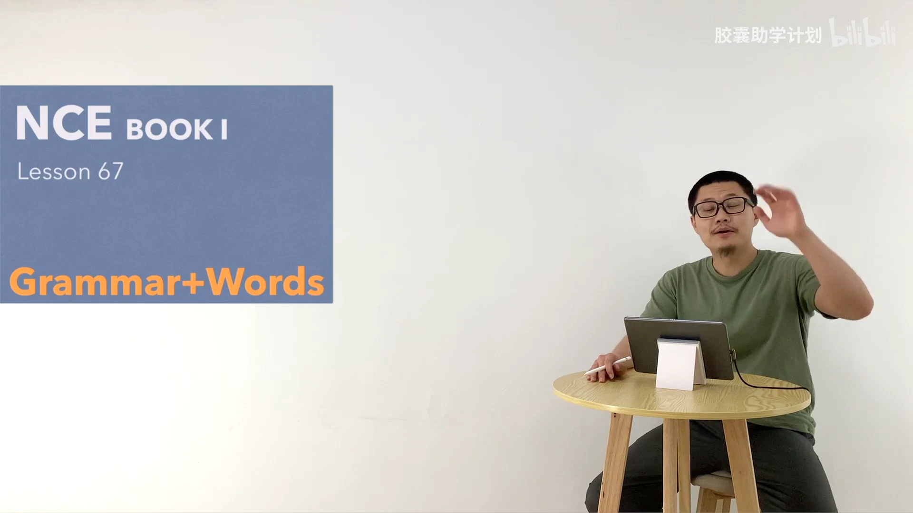

文字识别：胶囊助学计划 / NCE / BOOKI / Lesson 67 / Grammar+Words

### 画面 00:00:02

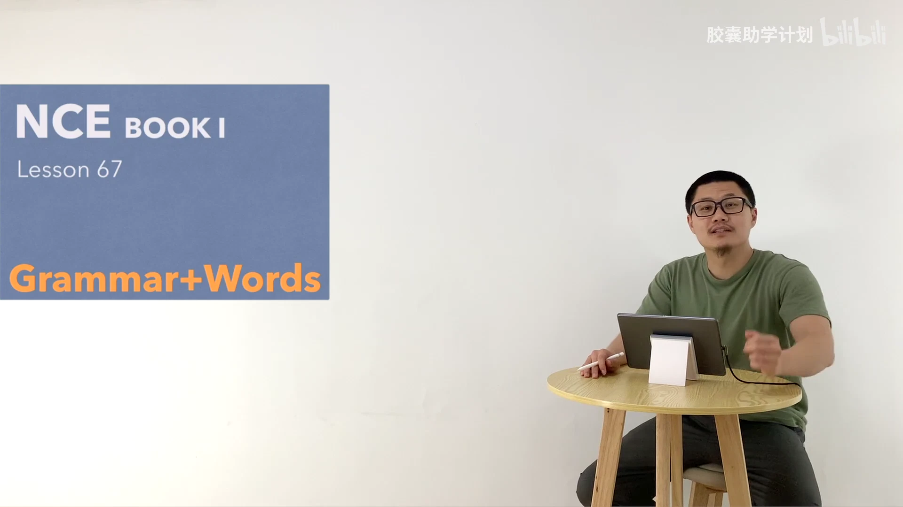

文字识别：胶囊助学计划 / NCE / BOOKI / Lesson 67 / Grammar+Words

### 画面 00:00:05

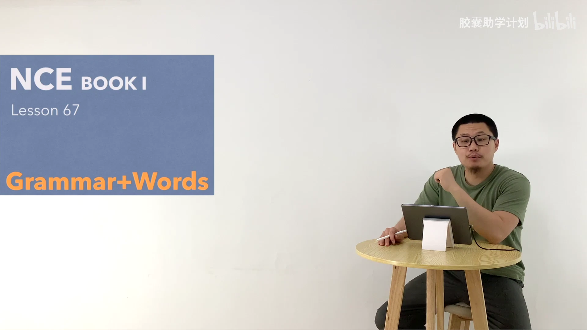

文字识别：胶囊助学计划 / DilBi / NCE / BOOKI / Lesson 67 / Grammar+Words

### 画面 00:00:11

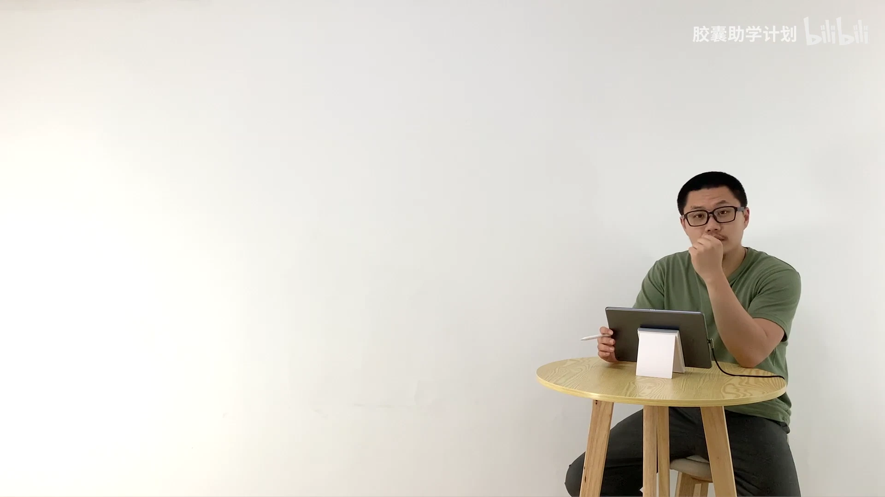

文字识别：胶囊助学计划bill

### 画面 00:00:13

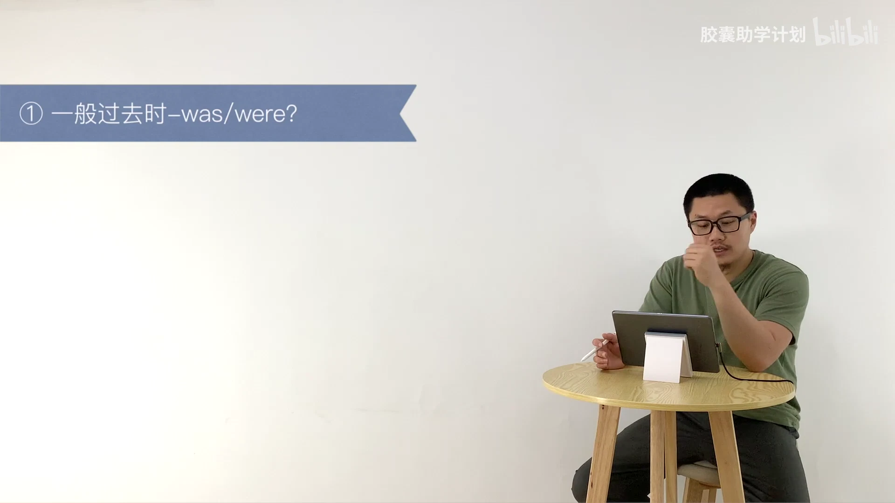

文字识别：胶囊助学计划 / ①一般过去时-was/were?

### 画面 00:00:19

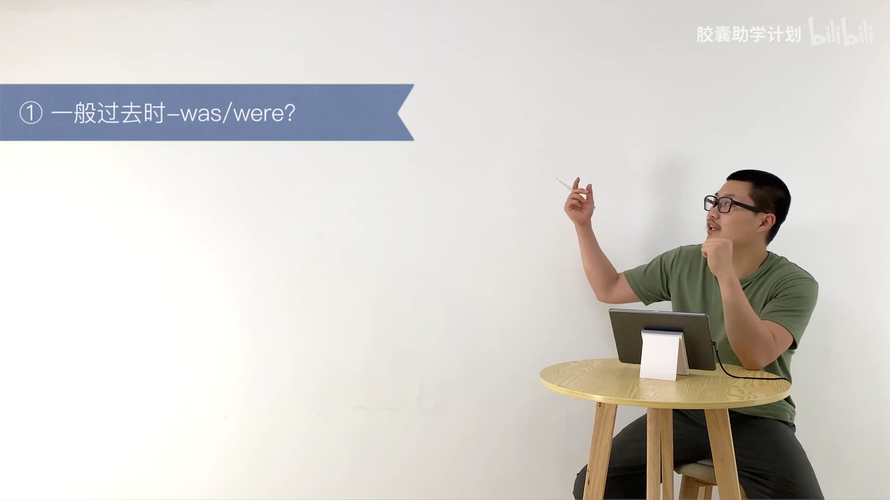

文字识别：胶囊助学计划 / ①一般过去时-was/were?

### 画面 00:00:24

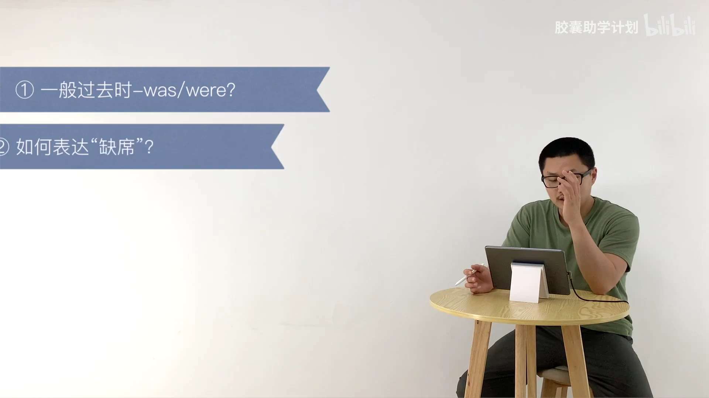

文字识别：胶囊助学计划 / )一般过去时-was/were? / 如何表达“缺席”

## 00:00:30–00:01:00

某个课程啊。那最后一个如何表达乡村音乐？带着这三个问题，Hope you get it. Enjoy it. 那既然本课我们要讲时态，对吧？我们就再次回顾一下何为时，何为态。时即动作发生的时间，态为动作发生时候的状态，对吧？好，那对于各位来说呢，时间主要有三类，对吧？现在、过去还有将来。有

### 画面 00:00:31

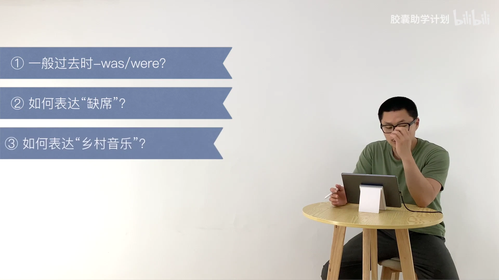

文字识别：胶囊助学计划 / ①一般过去时-was/were? / 如何表达“缺席”？ / 如何表达“乡村音乐”?

### 画面 00:00:35

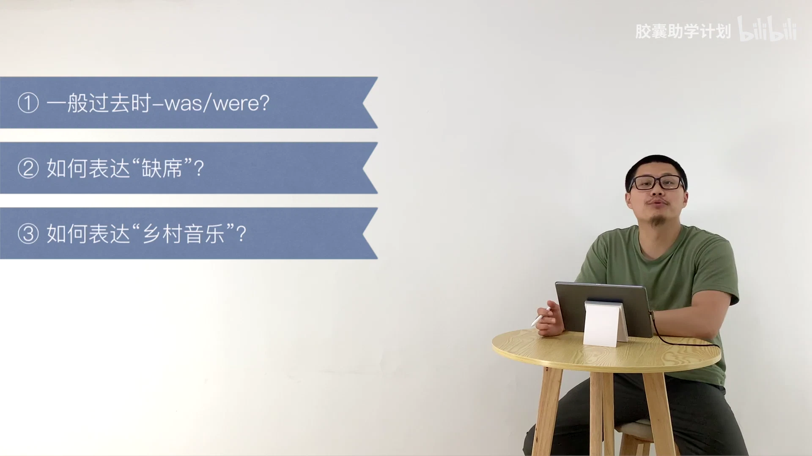

文字识别：胶囊助学计划 / )一般过去时-was/were? / 如何表达“缺席” / 如何表达“乡村音乐”?

### 画面 00:00:37

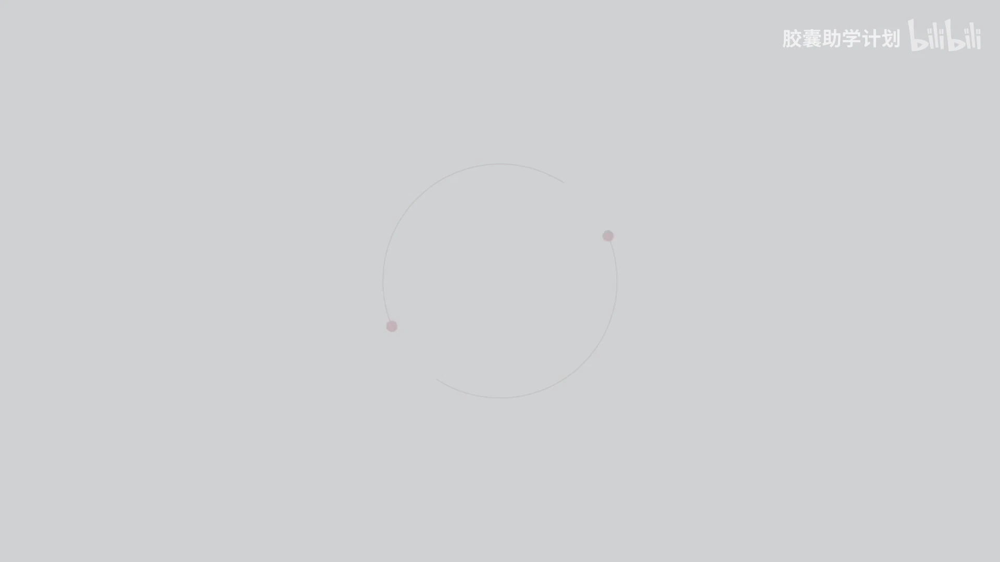

文字识别：胶囊助学计划 bilbl / •

### 画面 00:00:41

### 画面 00:00:43

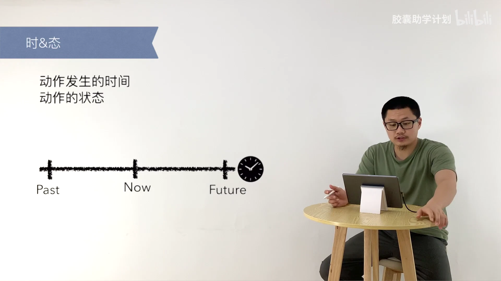

文字识别：胶囊助学计划 / 时&态 / 动作发生的时间 / 动作的状态 / Now / Past / Future

### 画面 00:00:49

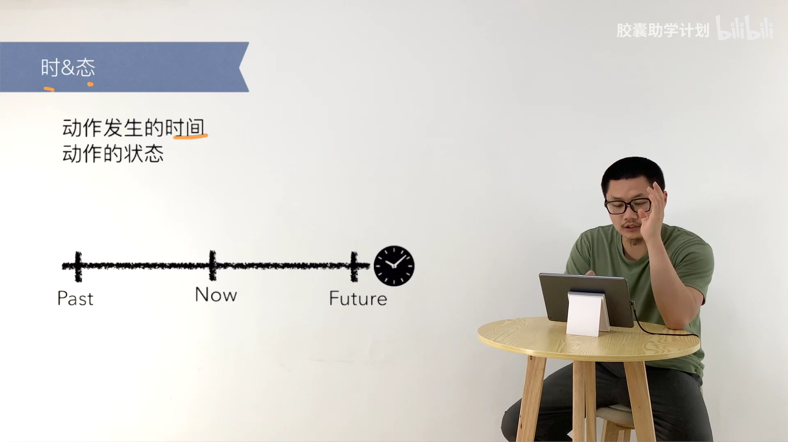

文字识别：胶囊助学计划 / 时&态 / 动作发生的时间 / 动作的状态 / Past / Now / Future

### 画面 00:00:58

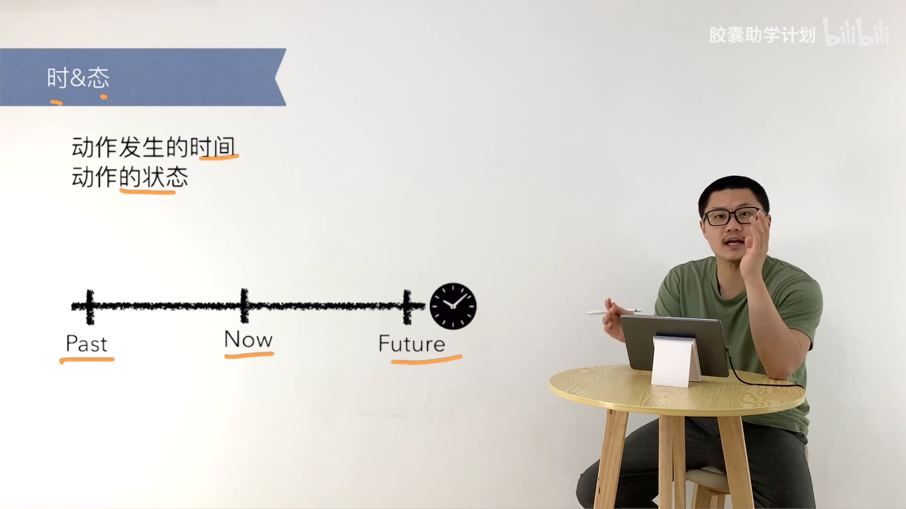

文字识别：胶囊助学计划 / 时&态 / 动作发生的时间 / 动作的状态 / Past / Now / Future

## 00:01:00–00:01:30

一类过去将来我们一般不提啊。OK，那本课我们要学的叫做一般过去时。一般过去时和一般现在时几乎是一一对应的。我简单来说一下，比如说过去的状态是我们六十七课到七十课会去学的，这叫过去的状态。其实前二十课啊，我是一个老师，陈述客观事实是现在的客观事实吧？这个其实也是算时态之中的，管它叫一般现在时，陈述客观事实嘛，

### 画面 00:01:03

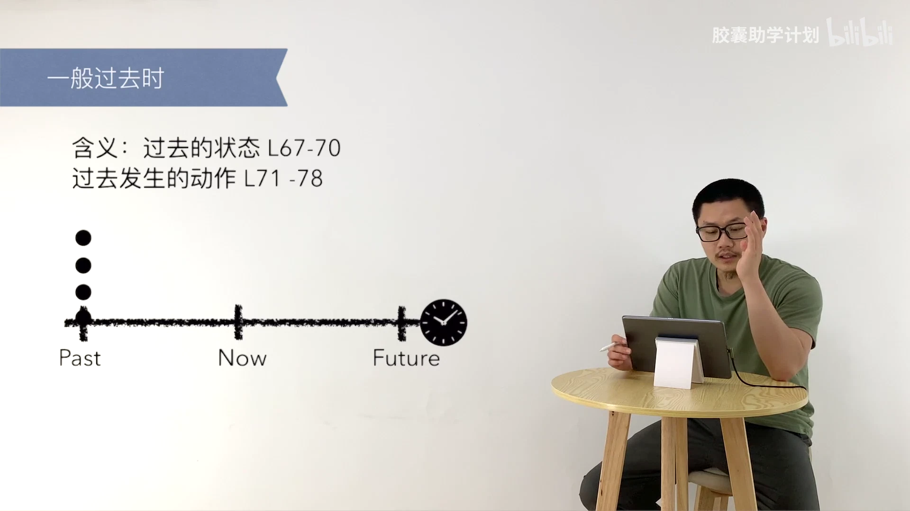

文字识别：胶囊助学计划 / 一般过去时 / 含义：过去的状态 L67-70 / 过去发生的动作 L71 -78 / Past / Now / Future

### 画面 00:01:13

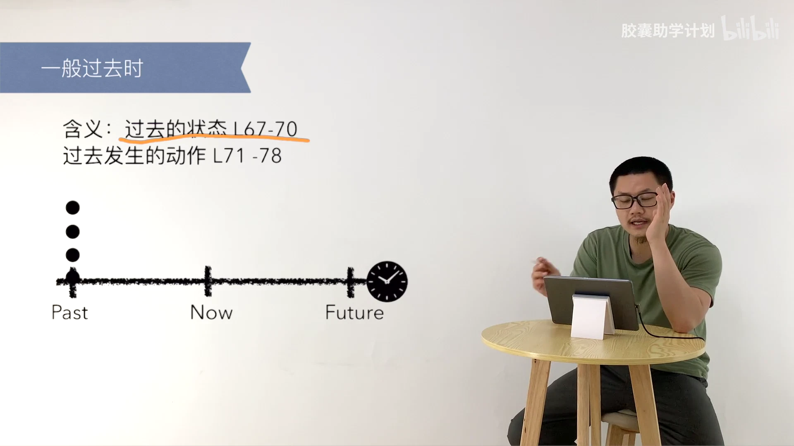

文字识别：胶囊助学计划 / 一般过去时 / 含义：过去的状态167-70 / 过去发生的动作 L71 -78 / Past / Now / Future

## 00:01:30–00:02:00

对吧？四十七课到六十课我们学的好。另外一个叫过去发生的动作，动作呢是七十一课到七十八课，是 do does 换成了另一个单词叫做 did 啊，它只不过是现在啊，我们陈述客观事实或生活习惯的时候叫一般现在时，对吧？那陈述过去发生的这个事实或者过去发生的这个动作的时候呢，叫做一般过去时。所以时间在过去，状态呢就是一般状态啊，无状态。

### 画面 00:01:34

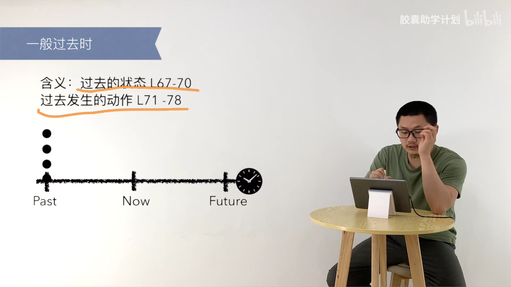

文字识别：胶囊助学计划 / 一般过去时 / 含义：过去的状态167-70 / 过去发生的动作L71 -78 / Past / Now / Future

### 画面 00:01:48

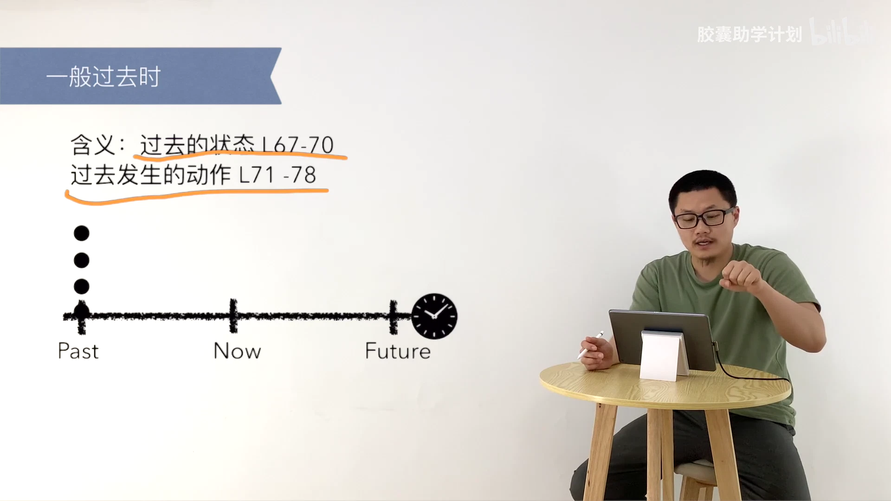

文字识别：胶囊助学计划 / 一般过去时 / 含义：过去的状态167-70 / 过去发生的动作L71-78 / Past / Now / Future

### 画面 00:01:56

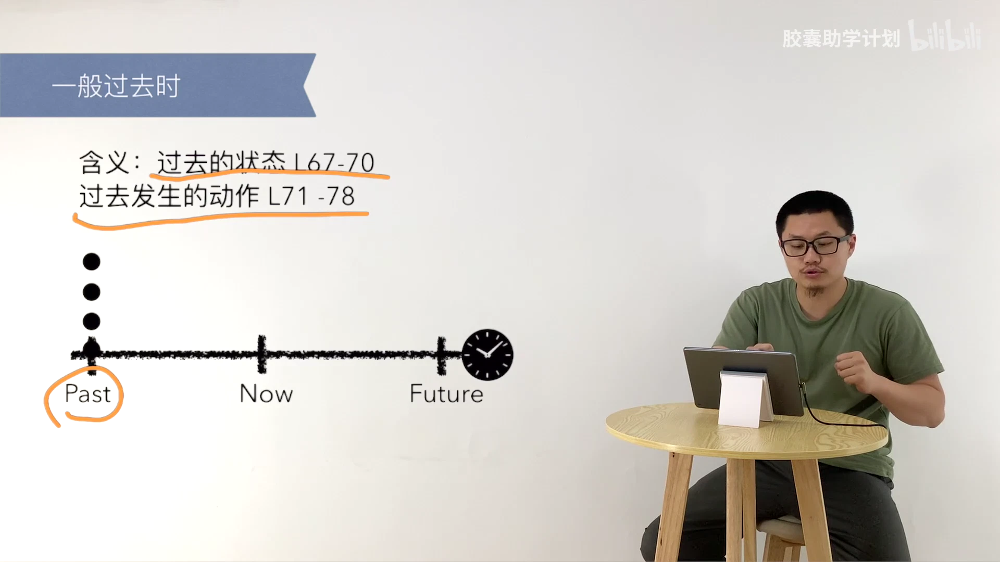

文字识别：胶囊助学计划 / 一般过去时 / 含义：过去的状态L67-70 / 过去发生的动作L71-78 / Past / Now / Future

## 00:02:00–00:02:30

OK，那本课我们先看 was were，was were 这两个单词是怎么来的呢？是由这三个单词，各位非常熟悉的三个单词变过来的。am 和 is 这两个单词变成了 was，而 are 这个单词变成了 were。好，比如说说你是叫做 you are，对吧？那你曾经是叫做 you were，好理解吧？说我是叫做 I am，陈述客观事实，一般现在时。说我曾经是叫做 I

### 画面 00:02:00

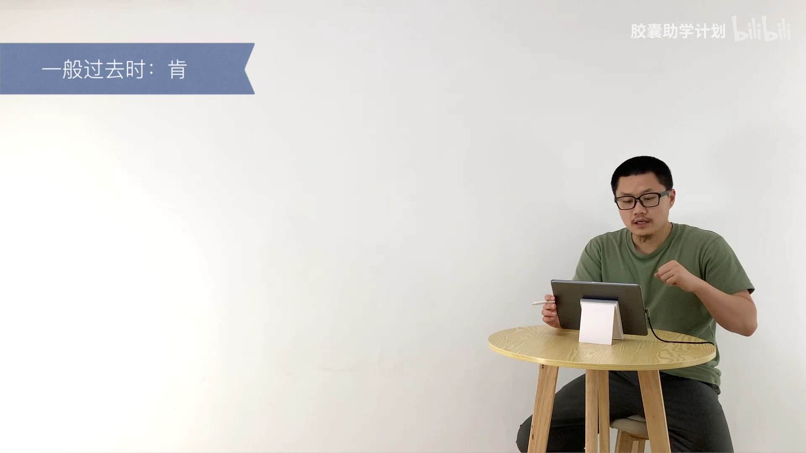

文字识别：胶囊助学计划 / 一般过去时：肯

### 画面 00:02:05

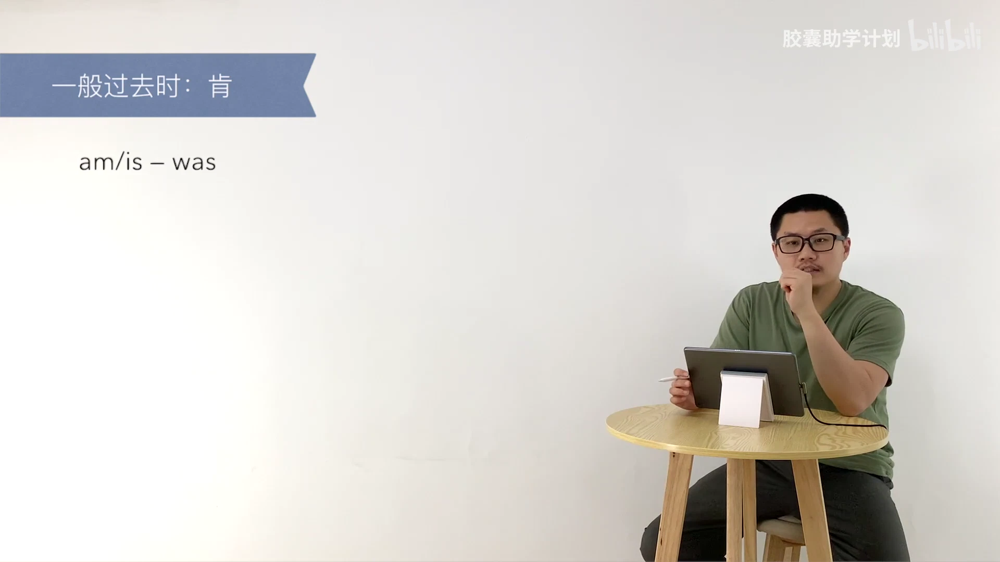

文字识别：胶囊助学计划 / 一般过去时：肯 / am/is - was

## 00:02:30–00:03:00

was 啊，说他是叫 He is，他曾经是叫 He was，那我相信各位应该懂了， OK，好，比如说说陈述个客观事实，一般现在时，他是个老师啊， I am a teacher 啊， He is a teacher， right？那如果我们说他现在不当老师了，卖保险去了，对吧？那叫做 He was a teacher，啊，他曾经是一名老师，好理解吧？ Am is 变成了 was were，对吧？ Am is 变 was，二变了 were， OK，好，这就

### 画面 00:02:35

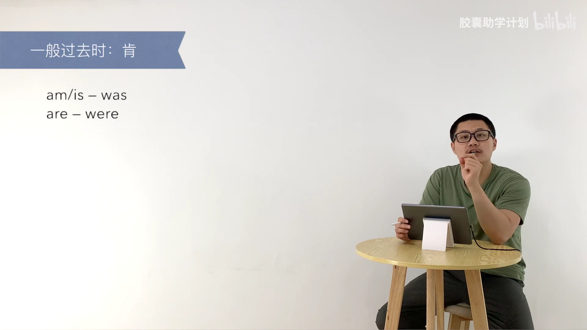

文字识别：胶囊助学计划bl山 / 一般过去时：肯 / am/is - was / are- were

### 画面 00:02:37

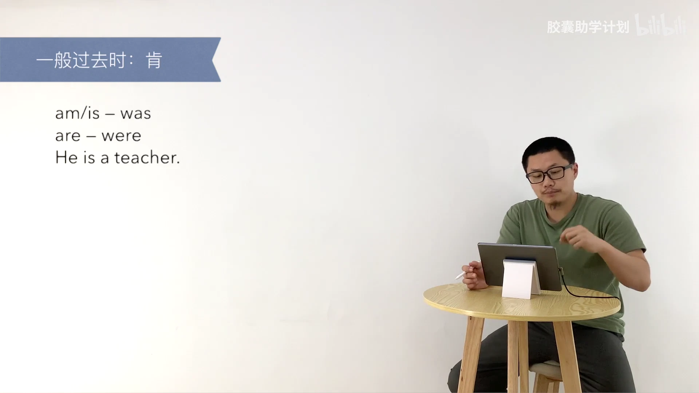

文字识别：胶囊助学计划 / 一般过去时：肯 / am/is - was / are — were / He is a teacher.

### 画面 00:02:42

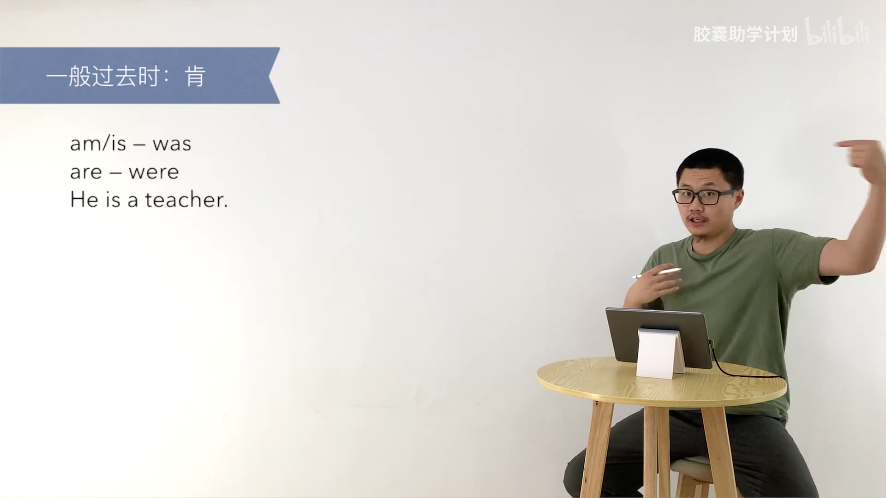

文字识别：胶囊助学计划 / 一般过去时：肯 / am/is - was / are— were / He is a teacher.

### 画面 00:02:45

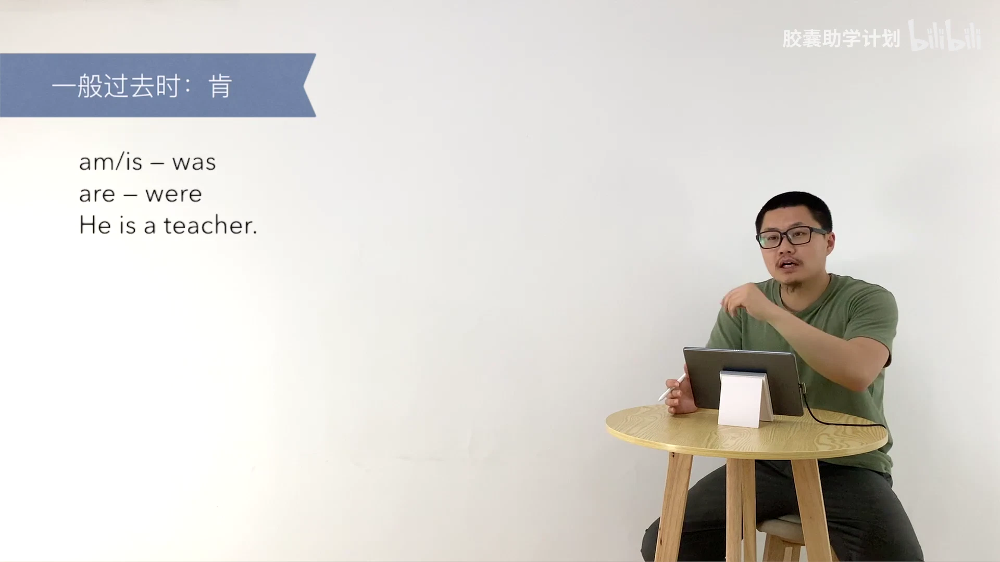

文字识别：胶囊助学计划 / 一般过去时：肯 / am/is - was / are - were / He is a teacher.

### 画面 00:02:50

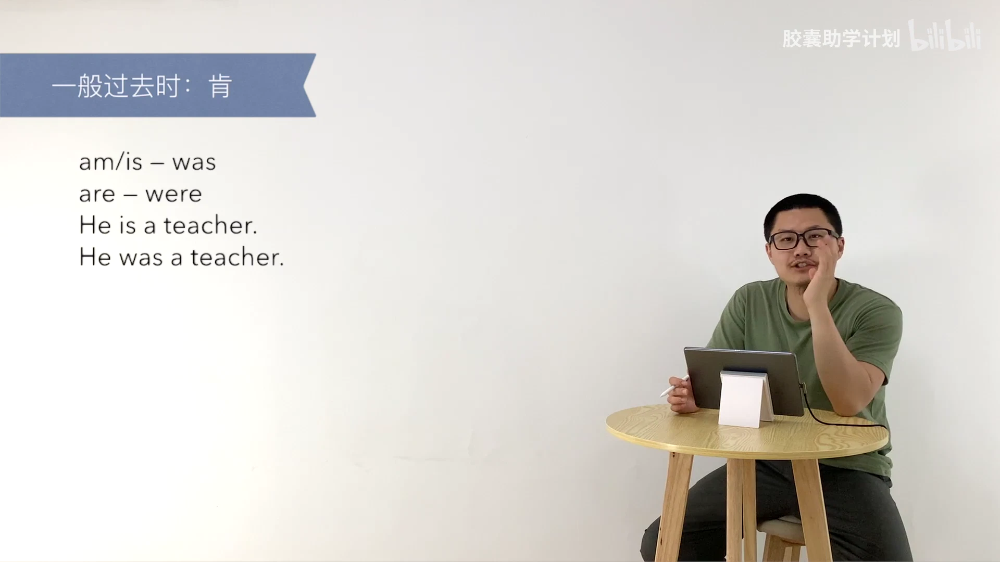

文字识别：胶囊助学计划 / 一般过去时：肯 / am/is - was / are - were / He is a teacher. / He was a teacher.

### 画面 00:02:56

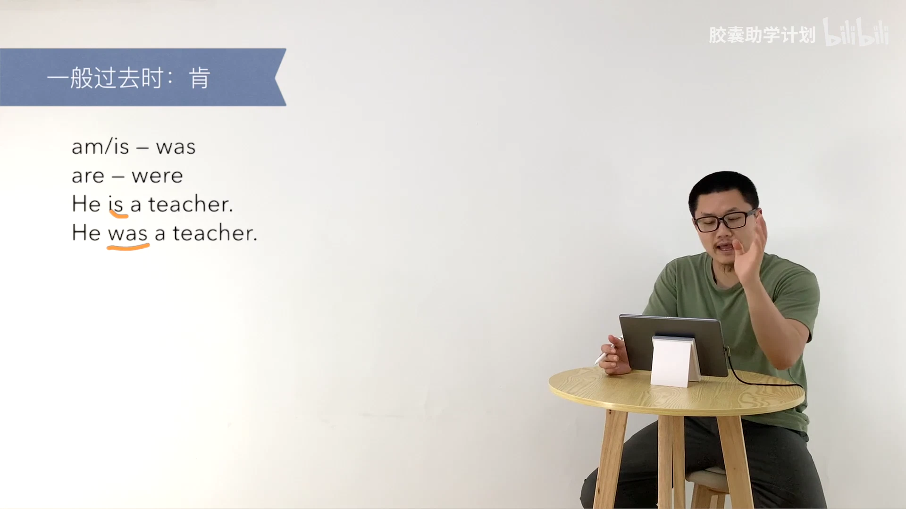

文字识别：胶囊助学计划 / 一般过去时：肯 / am/is - was / are - were / He is a teacher. / He was a teacher.

### 画面 00:02:59

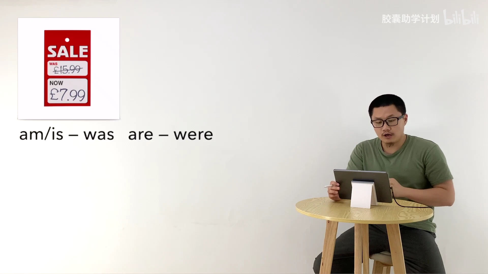

文字识别：胶囊助学计划 / SALE / WAS / E15.99 / NOW / £7.99 / am/is - was / are - were

## 00:03:00–00:03:30

是肯定句。那对于各位来说，最初期第一件事情就是要先认was加were。比如说，我们出国啊，不知道各位出国购物的时候遇没遇到过，比如说Black Friday or Boxing Day啊，就是这种类似于国内的双十一或六幺八这样的一些购物节，它就会大幅度打折嘛。它可能就出现的状态叫做was，曾经是十五块九毛九，now

### 画面 00:03:02

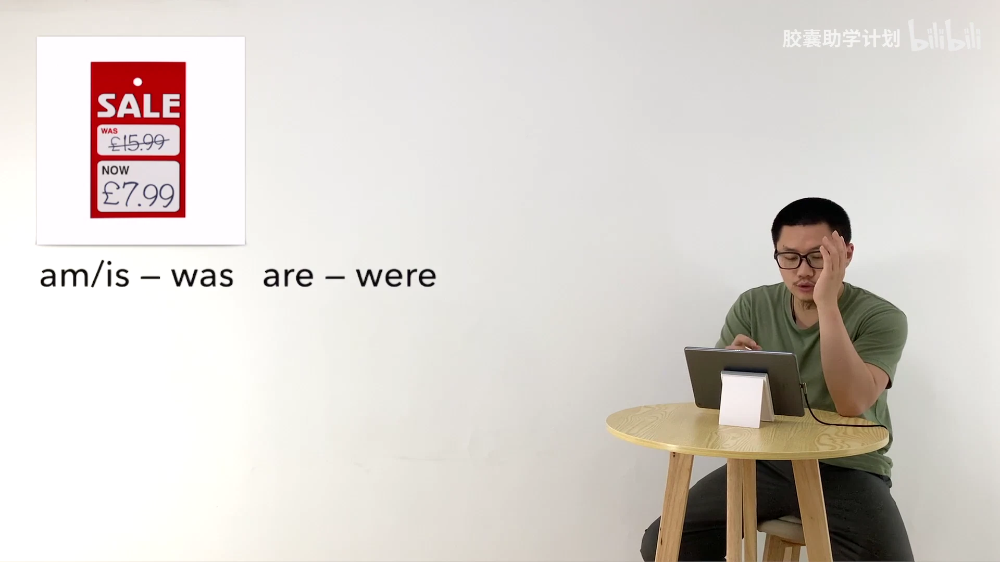

文字识别：胶囊助学计划 / SALE / WAS / E15.99 / NOW / £7.99 / am/is - was / are - were

### 画面 00:03:04

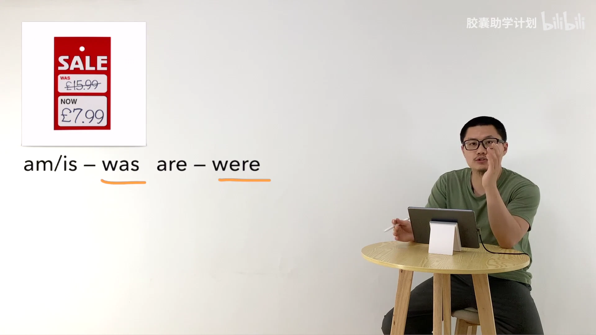

文字识别：bilbli / 胶囊助学计划 / SALE / WAS / E15.99 / NOW / £7.99 / am/is - was / are - were

## 00:03:30–00:04:00

现在是七块九毛九，你就明白了，它指的是曾经的价格和现在的价格啊，我说清楚了吧？这是一个非常容易，而且在现实生活当中我们也能见到的真真正正的语法点，对吧？OK，那我们接下来尝试造一个句子，比如说 He was ill，说他之前生病了。这句话一般来指的是他只说他过去，我们不知道他现在和未来，对吧？只是告诉你他之前

### 画面 00:03:33

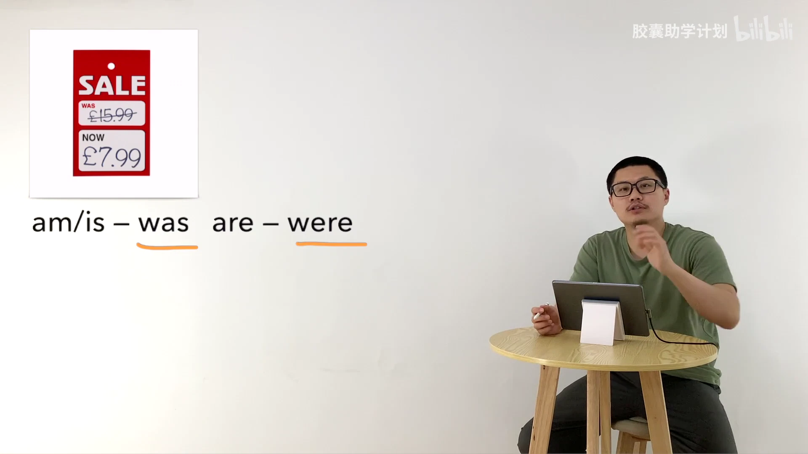

文字识别：胶囊助学计划 / SALE / WAS / £15.99 / NOW / £7.99 / am/is - was / are - were

### 画面 00:03:44

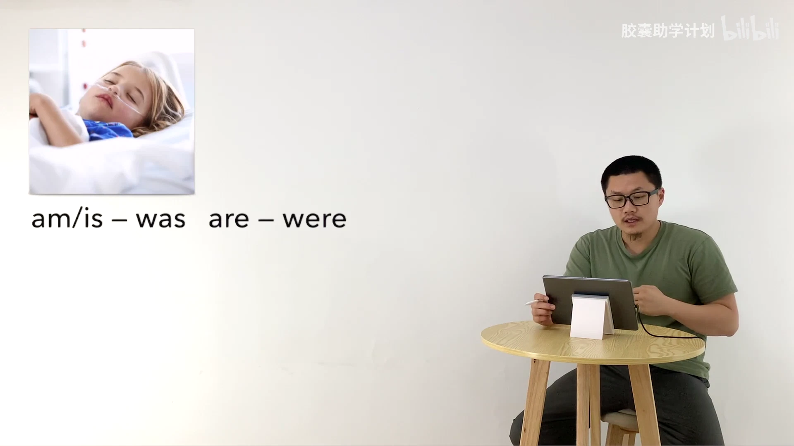

文字识别：胶囊助学计划 / am/is - was / are - were

### 画面 00:03:47

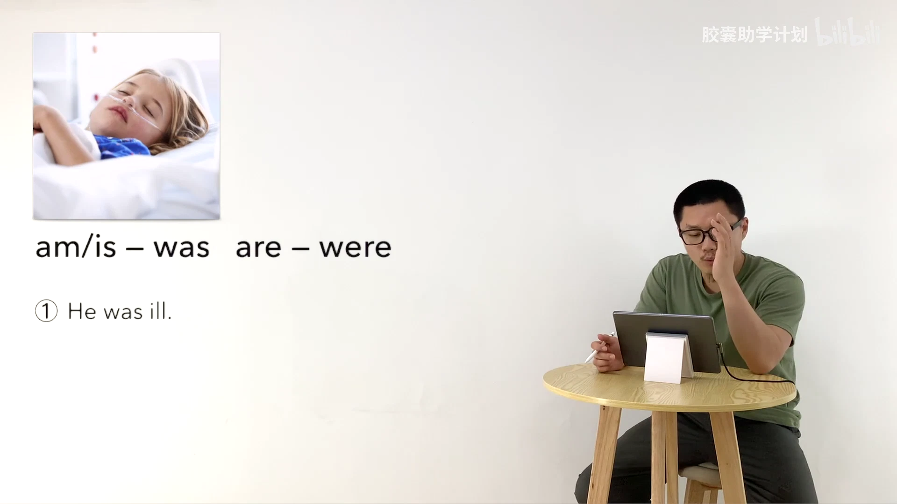

文字识别：胶囊助学计划 / am/is – was are — were / ①He was ill.

### 画面 00:03:54

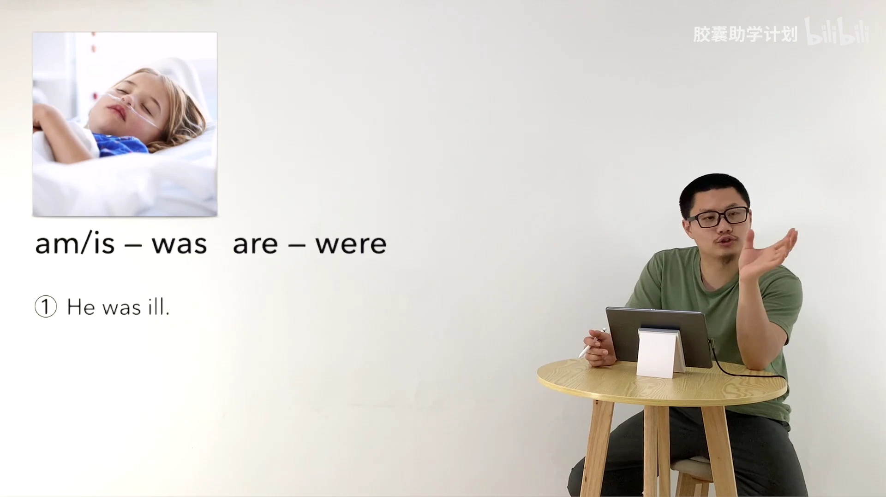

文字识别：胶囊助学计划 / am/is - was /  are - were / ① He was ill.

## 00:04:00–00:04:30

生病了。He was ill.你看，本来是如果说他现在生病了是 he is ill。那 am 和 is 变成 was 表示的是过去啊。英语就靠这种结构上或单词上的改变就可以体现这样的含义啊。这跟汉语是稍微不同的。比如说 he is better now。他现在好多了啊。他之前生病了，但他现在好多了。 Continue。说 we were at home in the morning。早晨的时候啊，我们在

### 画面 00:04:06

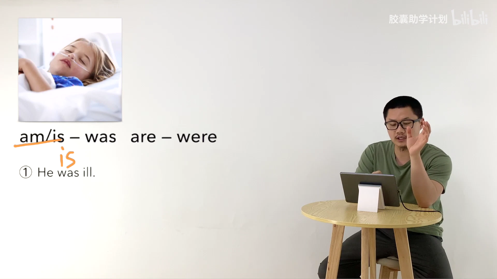

文字识别：胶囊助学计划 / am/is - was / are - were / IS / ① He was ill.

### 画面 00:04:13

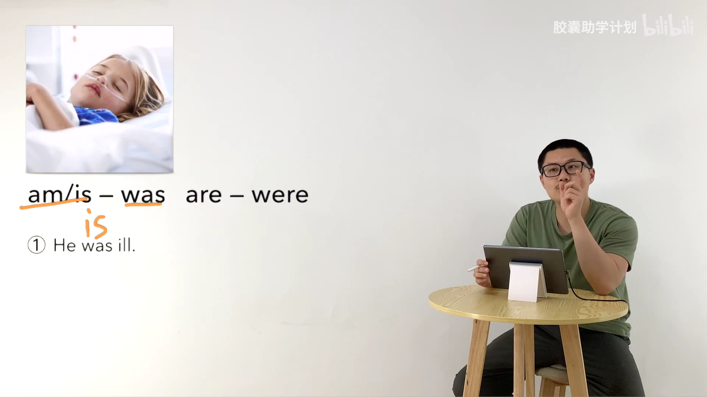

文字识别：胶囊助学计划 / am/is - was / are - were / IS / ① He was ill.

### 画面 00:04:18

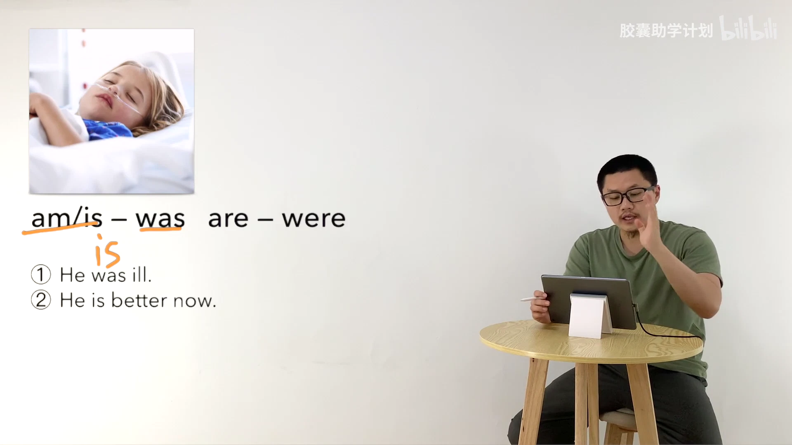

文字识别：胶囊助学计划 / am/is - was / are - were / IS / ① He was ill. / ② He is better now.

### 画面 00:04:24

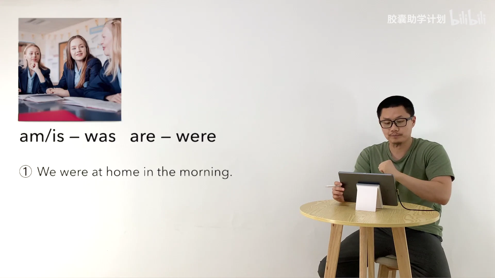

文字识别：胶囊助学计划 / am/is - was / are - were / ① We were at home in the morning.

### 画面 00:04:27

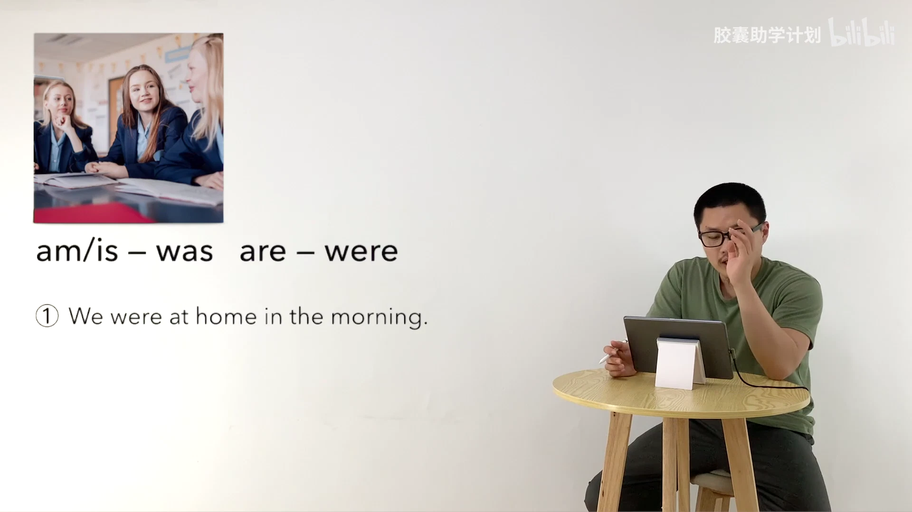

文字识别：胶囊助学计划 / am/is - was / s are - were / ① We were at home in the morning.

## 00:04:30–00:05:00

家里面呢。注意，你看，如果说我们现在在家叫 we are at home，但是说过去就把二换成了 were 这个单词。那现在的时间是什么呢？至少已经过了早晨了，对吧？现在是中午或者下午或者晚上啊。OK，好。说 now we are at school。说现在呀，我们已经在学校了，对吧？Continue，否定句，这个就完全取决于举一反三的能力了。Am is are，你会了，对吧？这是第

### 画面 00:04:33

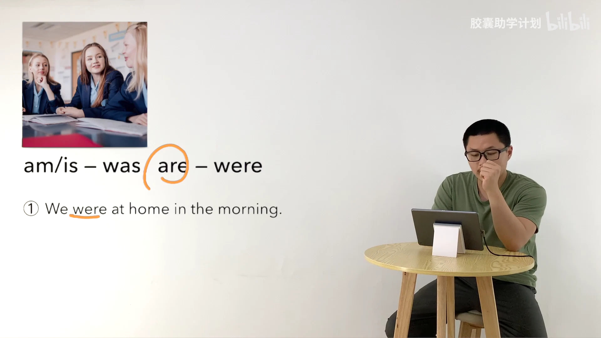

文字识别：胶囊助学计划 / am/is - was / are / were / ① We were at home in the morning.

### 画面 00:04:41

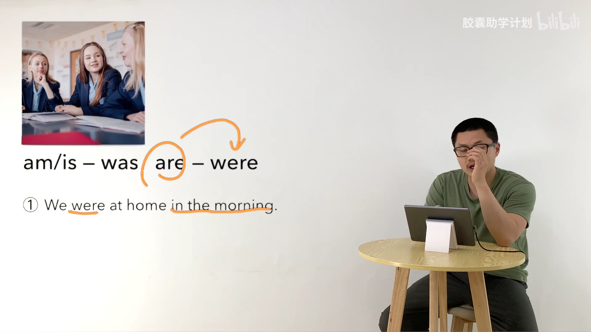

文字识别：胶囊助学计划b出b出 / am/is - was / are / were / ① We were at home in the morning.

### 画面 00:04:46

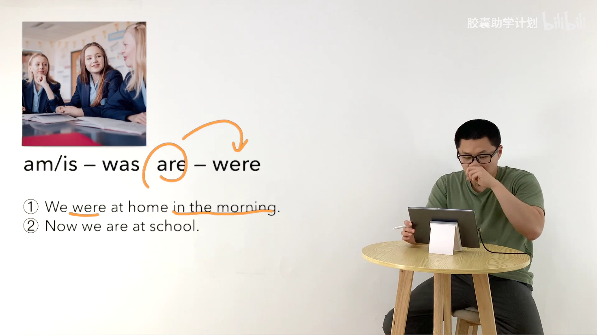

文字识别：胶囊助学计划 / am/is - was / are / were / ① We were at home in the morning / 2 /  Now we are at school.

### 画面 00:04:51

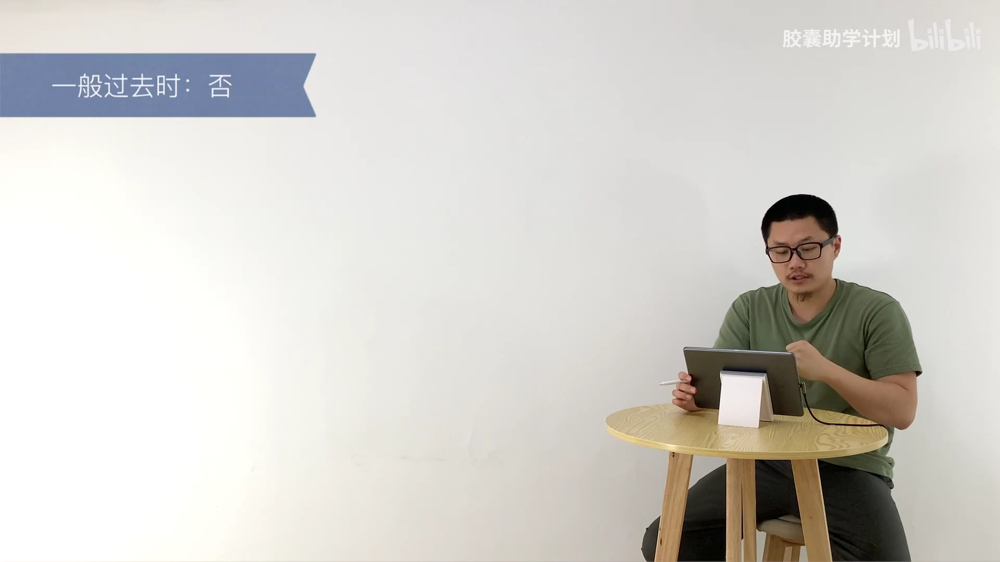

文字识别：胶囊助学计划bib / 一般过去时：否

### 画面 00:04:54

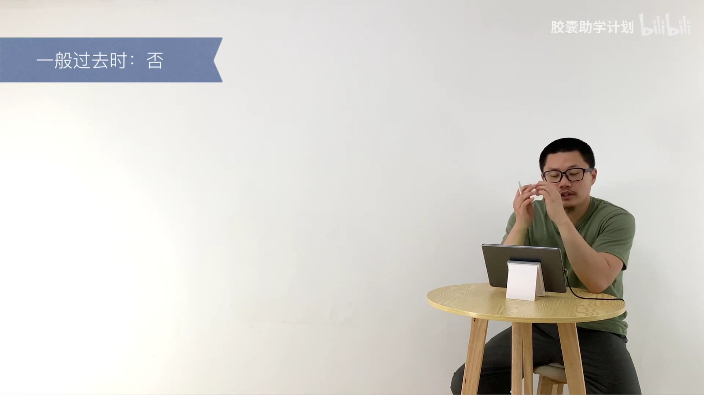

文字识别：胶囊助学计划blb出 / 一般过去时：否

## 00:05:00–00:05:30

一个条件。第二，你又知道 was were 是 m e r 变过来的。第三，你又知道 m e r 后边加 not 变否定。那结论是 was were 怎么变否定？ was were 后边加 not 很容易理解吧？对吧？结合我们之前已有的知识，在其基础之上做一点点哎新的推，就可以得出这个结论了啊。它有两个小的缩写，你看跟之前的缩写本

### 画面 00:05:01

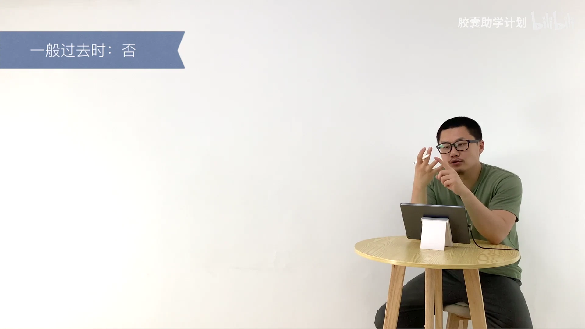

文字识别：胶囊助学计划 / 一般过去时：否

### 画面 00:05:12

文字识别：胶囊助学计划 / 一般过去时：否 / are/is/are + not

### 画面 00:05:14

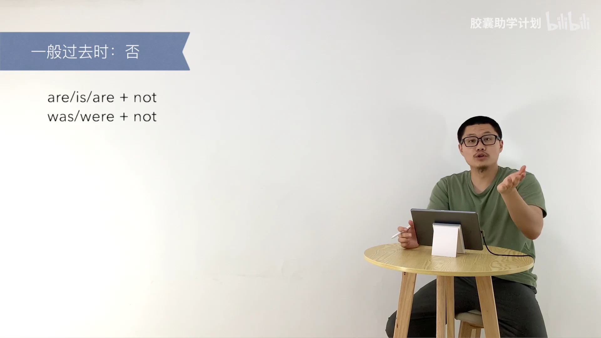

文字识别：胶囊助学计划 / 一般过去时：否 / are/is/are + not / was/were + not

### 画面 00:05:20

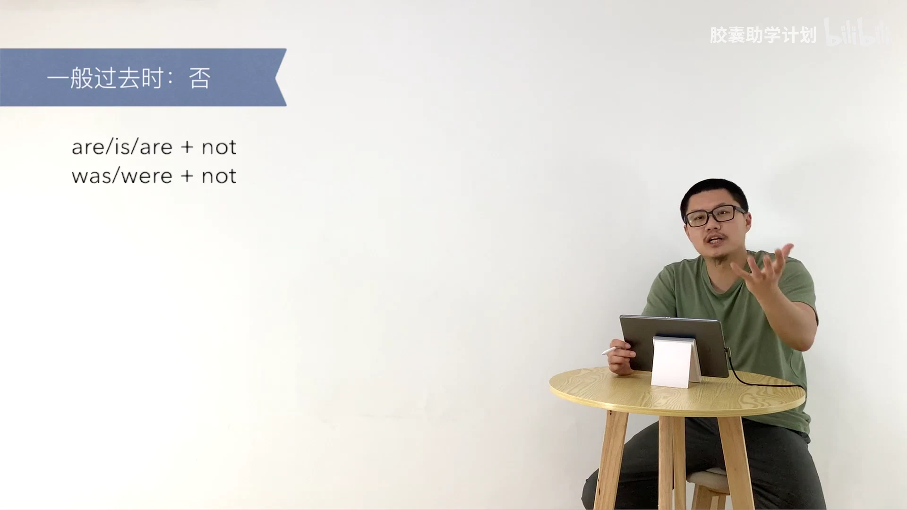

文字识别：胶囊助学计划 / 一般过去时：否 / are/is/are + not / was/were + not

### 画面 00:05:26

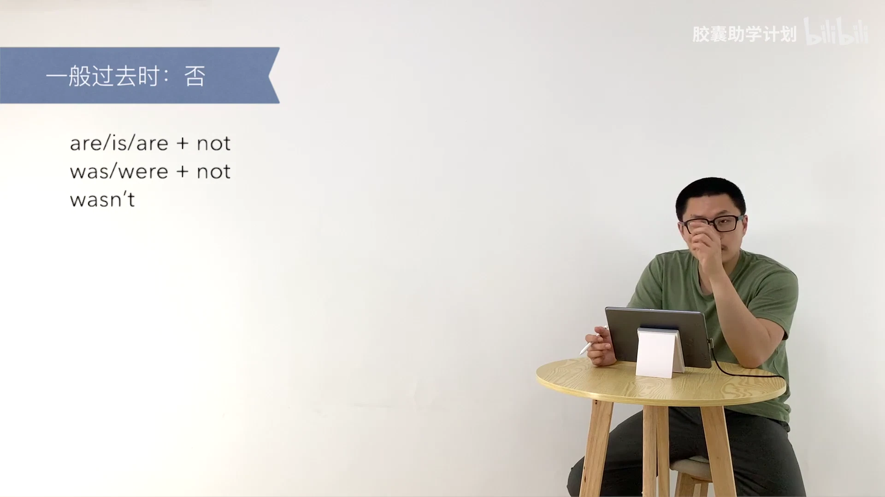

文字识别：胶囊助学计划 / 一般过去时：否 / are/is/are + not / was/were + not / wasn't

## 00:05:30–00:06:00

质上也没区别，就是 was 后边加了 n't 和 were 后边加了 n't，一个叫 wasn't，一个叫 weren't。 OK，好，比如说我们造句啊，叫 They were not at school。说他们之前没在学校里待着，对吧？注意为什么翻译成之前呢？我总因为这有一个 were，对吧？ OK，当然了，你结合上下文场景的时候，说他们之前在哪儿呢？说 They weren't at school，是吧？他们不在学校，这个你不用加上之前这两个字，因为之前问

### 画面 00:05:30

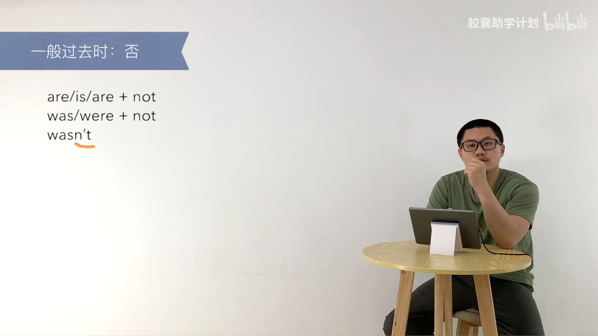

文字识别：bilbili / 胶囊助学计划 / 一般过去时：否 / are/is/are + not / was/were + not / wasn't

### 画面 00:05:38

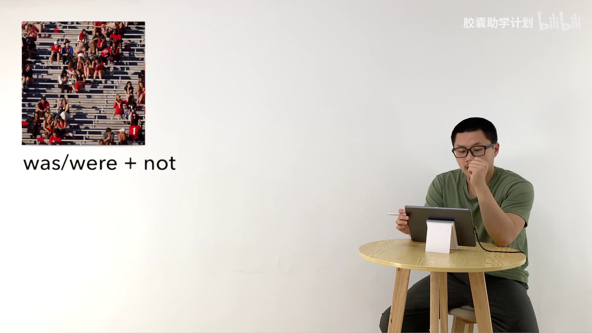

文字识别：胶囊助学计划bilbl / was/were + not

### 画面 00:05:48

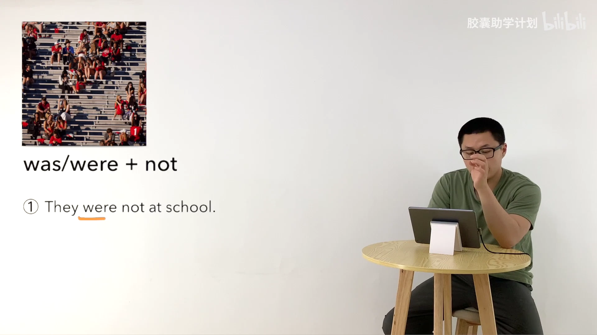

文字识别：胶囊助学计划 / was/were + not / ① They were not at school.

### 画面 00:05:54

文字识别：胶囊助学计划 / was/were + not / ① They were not at school.

## 00:06:00–00:06:30

了，对吧？好，比如说 she was not thirsty. 她之前呢，为什么翻译之前 was，对吧？好，她之前并不渴。你看 was 后边加 not，表示否定，非常舒服。最后一个 this wasn't us，是吧？这是我觉得挺好玩的，两个小狗是吧？把家里边霍霍成这个样子了。然后呢，我们以狗的口吻啊，跟主人，主人一回家是吧？我们假设这两条狗会说话，那就 this wasn't us，说这个不是我们弄的，是吧？其实是

### 画面 00:06:00

文字识别：胶囊助学计划 / was/were + not / ① They were not at school.

### 画面 00:06:02

文字识别：胶囊助学计划 / was/were + not / ① She was not thirsty.

### 画面 00:06:04

文字识别：胶囊助学计划 / was/were + not / ① She was not thirsty.

### 画面 00:06:11

文字识别：胶囊助学计划 / was/were + not

### 画面 00:06:16

文字识别：胶囊助学计划 / was/were + not / ① This wasn't us.

### 画面 00:06:18

文字识别：胶囊助学计划 / was/were + not / ① This wasn't us.

### 画面 00:06:20

文字识别：胶囊助学计划 / was/were + not / ① This wasn't us.

### 画面 00:06:22

文字识别：胶囊助学计划 / was/were + not / ① This wasn't us.

### 画面 00:06:25

文字识别：胶囊助学计划 / was/were + not / ① This wasn't us.

## 00:06:30–00:07:00

是啊，所以 wasn't us. This wasn't us. 是这个事儿啊，是之前的事儿，对吧？不是我们干的。OK，好，这儿一个。那一般疑问句，举一反三。am is are是提前，am is are变成了was were. Was were怎么变一般疑问句？好，was were提到句首变一般疑问句，非常舒服，对吧？好，比如说，she was hungry，叫她饿了。她之前饿了吗？或者说那个

### 画面 00:06:30

文字识别：胶囊助学计划 / was/were + not / ① This wasn't us.

### 画面 00:06:40

文字识别：胶囊助学计划 / 一般过去时：一般

### 画面 00:06:43

文字识别：胶囊助学计划 / 一般过去时：一般

### 画面 00:06:50

文字识别：胶囊助学计划 / 一般过去时：一般 / am/is/are 提句首 / was/were 提句首

### 画面 00:06:52

文字识别：胶囊助学计划 / was/were 提句首

### 画面 00:06:55

文字识别：胶囊助学计划blil / was/were 提句首 / ① She was hungry.

## 00:07:00–00:07:30

时候她饿了吗？叫 Was she hungry? Hungry? Okay, very good. Next one, he was at work. 啊，他那个时候在上班呢呀。他那时候在上班了吗？一般疑问句 Was he at work? Okay, very good. 接下来 We were happy. 啊啊，这两个可能是两个，比如说一对情侣对吧？然后分手了，然后两个人在一起复盘啊。林分手之前去聊天，说哎呀，我们曾经是那么的幸福

### 画面 00:07:04

文字识别：胶囊助学计划b出出 / was/were 提句首

### 画面 00:07:15

文字识别：胶囊助学计划bl / was/were 提句首 / ① We were happy.

### 画面 00:07:18

文字识别：胶囊助学计划bi出 / was/were 提句首 / ① We were happy.

### 画面 00:07:24

文字识别：胶囊助学计划 / was/were 提句首 / ① We were happy.

### 画面 00:07:27

文字识别：胶囊助学计划 / was/were 提句首 / ① We were happy.

## 00:07:30–00:08:00

啊，听起来是个悲伤的故事，叫 We were happy. 它往往指的是 Now we're not happy, 对吧? We're not happy any all, ah, anymore, 或者 at all. Okay, 还有一个叫 Were you happy? 啊，你和他在一起的时候，这可能是闺蜜问她的，说你跟他分开了，对吧？说那你现在很难受。那先问的一个问题是你跟他在一起的时候，你开心吗？Were you happy? 还有一个 were 提前，对吧？特殊疑问句啊，特殊疑问句呢，就还是这样

### 画面 00:07:34

文字识别：胶囊助学计划 / was/were 提句首 / ① We were happy.

### 画面 00:07:39

文字识别：胶囊助学计划 / was/were 提句首 / ① We were happy.

### 画面 00:07:42

文字识别：胶囊助学计划 / was/were 提句首 / We were happy. / Were you happy? / 2

### 画面 00:07:49

文字识别：胶囊助学计划 / was/were 提句首 / We were happy. / Were you happy?

### 画面 00:07:55

文字识别：胶囊助学计划 / 一般过去时：特殊

## 00:08:00–00:08:30

啊，叫特殊疑问句等于特殊疑问词加一般疑问句，你只要满足这个就行了。只不过 was 换成了 was，本质上没有太多的差别。比如说，He was at work in the morning. 变一般疑问句 was 提前，这就不多说了啊。好，接下来无非就是你用各种特殊疑问词了。原来你学的特殊疑问词在这儿之前怎么用，在这儿还怎么用？比如说对 he 提问用 who，对 at work 提问用 where，对 in the morning 提问用 when。那你在这儿就还

### 画面 00:08:02

文字识别：胶囊助学计划 / 一般过去时：特殊 / 特殊疑问句=特殊疑问词+一般疑问句

### 画面 00:08:04

文字识别：胶囊助学计划 / 一般过去时：特殊 / 特殊疑问句=特殊疑问词+一般疑问句

### 画面 00:08:06

文字识别：胶囊助学计划 / 特殊疑问词+一般疑问句

### 画面 00:08:12

文字识别：胶囊助学计划 / 特殊疑问词+一般疑问句 /  He was at work in the morning. / 1 / Was he at work in the morning?

### 画面 00:08:17

文字识别：胶囊助学计划 / 特殊疑问词+一般疑问句 / D He was at work in the morning. / 1 / Was he at work in the morning?

### 画面 00:08:25

文字识别：胶囊助学计划 / 特殊疑问词+一般疑问句 / He was at work in the morning. / 1 /  Was h& at work in the morning? / 2

### 画面 00:08:27

文字识别：胶囊助学计划 / 特殊疑问词+一般疑问句 / 1 / He wasat work / the / morning. / Was hS at work in the / morning? / 2

## 00:08:30–00:09:00

是这个逻辑。 When was he at work? 他之前什么时候在上班？对吧？ Okay, 下一个。下一个。 She was at school. 一般疑问句。 Was 是 am/is/are 变过来的，提前呗。 Was she at school in the morning? 哎， in the afternoon? 我加了个时间，对吧？那 Where? Where was she in the afternoon? 下午的时候，他人在哪儿了？现在是不是下午？不

### 画面 00:08:31

文字识别：胶囊助学计划 / 特殊疑问词+一般疑问句 / 1 / He was at work / the / morning. / Was h& at work in the morning? / 2 / When was he at work?

### 画面 00:08:35

文字识别：胶囊助学计划 / 特殊疑问词+一般疑问句 / 1 / He was at work / the morning. / Was h& at work in the morning? / 2 / When was he at work?

### 画面 00:08:37

文字识别：胶囊助学计划 / Session5 / eted / DDELUN_H / NTIUM~ / RIVER / CHAIR / 特殊疑问词+一般疑问句 / ① She was at school.

### 画面 00:08:51

文字识别：胶囊助学计划 / Session / pted / ODELUN_HS / VTIUM~ / RIVER / CHAIR / 特殊疑问词+一般疑问句 / 1 / She was at school. / Was she at school in the afternoon? / Where was she in the afternoon?

## 00:09:00–00:09:30

是晚上了，至少对吧？OK，Kanini说They were friends。这个单词一出来，were不是说的They are friends，说的是They were friends。想说什么？他们曾经是好朋友，至少比如说拍这张照片的时候，对吧？后来比如说这是高中拍的，后来上了大学，后来又进入步入了工作，慢慢慢慢大家联系就少了，就失去了联络。所以说的是

### 画面 00:09:03

文字识别：胶囊助学计划 / 特殊疑问词+一般疑问句 / ① They were friends.

### 画面 00:09:15

文字识别：胶囊助学计划b山业 / 特殊疑问词+一般疑问句 / ① They were friends.

### 画面 00:09:17

文字识别：胶囊助学计划 / 特殊疑问词+一般疑问句 / ① They were friends.

### 画面 00:09:19

文字识别：胶囊助学计划 / 特殊疑问词+一般疑问句 / ① They were friends.

### 画面 00:09:22

文字识别：胶囊助学计划 / 特殊疑问词+一般疑问句 / ① They were friends.

## 00:09:30–00:10:00

they were friends. Okay,好，那一般疑问句 were they friends?说特殊疑问句叫 why were they friends?比如说咱们每个人性格都很不一样，他们当时怎么能做成朋友了呢？Why? Okay, and一个那各位可以看到，特殊疑问句它永远就是特殊疑问词加一般疑问句，这不变，跟你换什么结构，换什么情态动词，换什么时态没有关系，对吧？好，那 they are from different places.啊，他们

### 画面 00:09:35

文字识别：胶囊助学计划 / 特殊疑问词+一般疑问句 / They were friends. / 1 / Were they friends? / Why were they friends?

### 画面 00:09:41

文字识别：胶囊助学计划 / 特殊疑问词+一般疑问句 / They were friends. / Were they friends? / Why were they friends?

### 画面 00:09:57

文字识别：胶囊助学计划 / 特殊疑问词+一般疑问句 / へ / They were friends. / Were they friends? / Why were they friends? / They are from different places.

## 00:10:00–00:10:30

从不同的地方来，对吧？他们怎么能成为朋友呢？好，这不多说了。接下来我们看一个小的电影片段，连着出现了两句话。Where were you?你之前人在哪儿呢？I was out.我之前在外面呀。啊，当然这句话是废话，对吧？一，他刚刚回家啊。各位接下来看到这个电影片段，刚刚回家啊，这个女人问了一句叫做Where were you? OK，来了。

### 画面 00:10:03

文字识别：Bilibil / 胶囊助学计划 / Where / : were you? / I was out. / THE / AMPNING / SPIOER-M / BO.reQLD3DNoIMAX / 超凡蜘蛛侠The Amazing Spider-Man (2012)

### 画面 00:10:07

文字识别：胶囊助学计划 / Where / were / e you? / I was out. / THE / AMRNING / SPIOER-M / 3口.rQLD3DNDIMAX / 超凡蜘蛛侠The Amazing Spider-Man (2012)

### 画面 00:10:25

文字识别：biibili / 胶囊助学计划

### 画面 00:10:27

文字识别：biibili / 胶囊助学计划

### 画面 00:10:29

文字识别：Bilbii / 胶囊助学计划

## 00:10:30–00:11:00

You don't have to wait up for me, you know. Yes, I do. No, you don't. Yes, I do. Where were you? I was out. Did you get the eggs? Nope, forgot the eggs. I'm gonna get them up. No, you will certainly will not.那当然了，这地方除了 Where were you 和 I was out，各位可以回去再看一下，还有一个叫 I'm gonna get them，是吧？

### 画面 00:10:31

文字识别：bilibili / 胶囊助学计划

### 画面 00:10:33

文字识别：Bilibili / 胶囊助学计划

### 画面 00:10:35

文字识别：Bilibili / 胶囊助学计划

### 画面 00:10:37

文字识别：Bilibili / 胶囊助学计划

### 画面 00:10:39

文字识别：biibili / 胶囊助学计划 / -不有必要-真没必要 / -Yes, I do.-No, you don't.

### 画面 00:10:41

文字识别：Bilibili / 胶囊助学计划 / 有必要 / Yes,I do.

### 画面 00:10:43

文字识别：Bilbii / 胶囊助学计划 / 在外面 / Iwas out.

### 画面 00:10:45

文字识别：bilibili / 胶囊助学计划 / 你帮我买鸡蛋了吗 / Did you get the eggs?

### 画面 00:10:47

文字识别：Bilibili / 胶囊助学计划

### 画面 00:10:49

文字识别：bilibili / 胶囊助学计划 / 没忘了 / Nope. Forgot the eggs.

### 画面 00:10:51

文字识别：biibili / 胶囊助学计划 / 你现在绝对不能去 / No, you most certainly will not.

### 画面 00:10:53

文字识别：胶囊助学计划 / Where were you? / I was out. / THE / AMPZING / SPIOER-M / reaLD3DANIMAX / 超凡蜘蛛侠The Amazing Spider-Man (2012)

## 00:11:00–00:11:30

哎，我要去买它。OK，玩一个。接下来我们进入单词部分。第一个单词呢，实际上是两个单词组成的，一个叫 green 绿色的，一个叫 grocer 啊，绿色的。那 grocer 是什么？grocer green 绿色的 grocer 指的是这种什么杂货商？注意它是个人啊，一二结尾啊，杂货商。green 绿色的杂货商，其实指的是蔬卖蔬菜水果的杂货商。OK，好，所以你能看到它是两个单词

### 画面 00:11:02

文字识别：胶囊助学计划 / /'griinｇrａｕｓａ/ / greengrocer

### 画面 00:11:06

文字识别：胶囊助学计划 / /'gri:ngrａusａ/ / greengrocer

### 画面 00:11:08

文字识别：胶囊助学计划 / /'griingrａusａ/ / greengrocer

## 00:11:30–00:12:00

词组成的。那我们在这儿提前学一个单词，马上我们也会学到，就是grocer后边加了一个y，叫做grocery啊，y变e的音，grocery，grocery就不是食品杂货商了，就是食品杂货店啊，几乎就是stores或shops类似的意思，或者说严格一点，约等于啊，不是只等于，对吧？约等于，各位知道这个单词就可以了。Green grocer，

### 画面 00:11:31

文字识别：胶囊助学计划 / /'griingrａusａ/ / greengrocer / ①  / green + grocer / grocery = stores = shops / 2

### 画面 00:11:44

文字识别：胶囊助学计划 / /'griingrausa/ / greengrocer / 1 / green + grocer / grocery = stores = shops

### 画面 00:11:50

文字识别：胶囊助学计划 / /'griｉnｇrａusａ/ / greengrocer / ① / green + grocer / grocery = stores = shops

### 画面 00:11:57

文字识别：胶囊助学计划 / /'griｉngrａusａ/ / greengrocer / green + grocer / grocery stores shops

### 画面 00:11:59

文字识别：胶囊助学计划 / O / /'æbsant/ / absent

## 00:12:00–00:12:30

下一个单词，我们看一下它的音标。a啊，absent, absent. OK，玩一个。你看，b发b的音，s发s的音，n发n的音，n对吧？发n的音，t发t的音。你基本上只需要背一个a，背一个e，单词就会了。自然拼读法则，去看我们录的视频啊。Absent叫缺席。那这地方有一个小的短语叫be absent from。某人从某地缺席

### 画面 00:12:17

文字识别：胶囊助学计划biL / /æbsant/ / Dbsent / •

### 画面 00:12:26

文字识别：胶囊助学计划 / /æbsant/ / Dbsent / • / ① be absent from

## 00:12:30–00:13:00

了。比如说，我们造一句话叫做 "Tim is absent from school again." 你今天到学校发现 Tim 又没来上学啊，这是陈述客观事实。Be absent from 某人缺席了某地，对吧？好，那如果我们想把它变成一般过去时，我不是说陈述现在的客观事实了，说昨天他就没来。Tim was absent from school yesterday. 你看，把 is 换成了 was，就

### 画面 00:12:32

文字识别：胶囊助学计划 / /æbsant/ / ∂bsent / ① be absent from / Tim is absent from school again.

### 画面 00:12:37

文字识别：胶囊助学计划 / /æbsant/ / bsent / ① be absent from /  Tim is absent from school again.

### 画面 00:12:41

文字识别：胶囊助学计划 / /æbsant/ / ∂bsent / ① be absent from / Tim is absent from school again.

### 画面 00:12:43

文字识别：胶囊助学计划 / /æbsant/ / ∂bsent / be absent from / is absent from school again. / Tim

### 画面 00:12:46

文字识别：胶囊助学计划 / /æbsant/ / bsent / • / be absent from / Tim i / is absent from / schoolagain.

### 画面 00:12:48

文字识别：胶囊助学计划 / /æbsant/ / ∂bsent / be absent from / is absent from school again. / Tim / Tim was absent from school / yesterday.

### 画面 00:12:50

文字识别：胶囊助学计划 / /æbsant/ / ∂bsent / ① be absent from / Tim is absent from school again. / Tim was absent from school / yesterday.

### 画面 00:12:57

文字识别：胶囊助学计划 / /æbsant/ / ∂bsent / ① be absent from / Tim is absent from school again. / Tim was absent from school / yesterday.

## 00:13:00–00:13:30

变过去了，对吧？我们刚刚学过的语法。There you go. Next one，下一个单词，张嘴跟我读，叫做spend，对吗？要变成不浊化，对吧？浊化现象，对吧？Spend，OK，叫做啊，这地方就度过啊。当然它也有花费的意思，以后我们再讲，它叫度过时间啊。所以我们可以说spend some time somewhere，some time s t点儿就是某

### 画面 00:13:00

文字识别：胶囊助学计划 / /ebsant/ / ∂bsent / ① be absent from / ②Timabsent from school again. / 2 / Tim wad absent from school / yesterday.

### 画面 00:13:03

文字识别：胶囊助学计划 / /spend / / spend v.

### 画面 00:13:10

文字识别：胶囊助学计划 / /spend / / spend v.

## 00:13:30–00:14:00

些时间啊，一些时间。Somewhere就是某地，比如说，The students spend five days in the school every week. 学生们接下来 spend some time somewhere，对吧？哎，每周都会花五天的时间在学校里面上学。当然了，我也可以说 I spend two hours. 时间地点每一天

### 画面 00:13:31

文字识别：胶囊助学计划 / / spend / / spend v. / ① spend st. sw.

### 画面 00:13:42

文字识别：胶囊助学计划 / / spend / / spend v. / spend st. sw. / The students spend five days in the / school every week.

### 画面 00:13:45

文字识别：胶囊助学计划 / / spend / / spend / I v. / spend st. sw. / The students / spend five days in the / schoole / every week.

### 画面 00:13:48

文字识别：胶囊助学计划 / / spen d / / spend / V. / spend st. sw. / The s / students / spend five days in the / school / every week.

### 画面 00:13:52

文字识别：胶囊助学计划 / / spend / / spend / V. / spend st. sw. / 1 / The s / students / spend five days in the / school / every / week. / Tspend / 2 hours in t / the / gym every / day.

### 画面 00:13:57

文字识别：胶囊助学计划 / / spend / / spend / V. / spend st. sw. / 1 / The / students / spend five days in the / school / every / week. / i spend / 2 hours / in / the / gym every / day.

### 画面 00:13:59

文字识别：胶囊助学计划 / / spend / / spend / V. / 1 / spend s / st.sw. / The / students / spend five / days in the / school / every / week. / Ispend / 2 hours / in t / the / gyme / every / day.

## 00:14:00–00:14:30

陈述客观事实。我们还没学一般过去时呢，对吧？啊，我们还没学一般过去时的动词呢。等我们学到这就，我们可以说我昨天怎么怎么样了。现在我们只能表达每天怎么怎么样，一般现在时，对吧？Continue，下一个单词叫做country。这个单词大家比较熟悉的意思是什么呢？指的是乡村，对吧？哎，应该不，sorry，我剧透了啊，应该指的是城市啊。那还有另一个意思，指的是乡村啊

### 画面 00:14:13

文字识别：胶囊助学计划blb出 / /'kantri/ / country

### 画面 00:14:18

文字识别：胶囊助学计划 / /'kΛntri/ / country

### 画面 00:14:24

文字识别：胶囊助学计划 / / 'k Λ n t r i / / country / □误：country 另一个意思是“国家”

### 画面 00:14:29

文字识别：胶囊助学计划 / /'kΛntri/ / country

## 00:14:30–00:15:00

啊！比如说，我们还是结合 spend some time somewhere 造一句话，说 We're gonna spend five days in the country. 啊， in the country 不是说在这个国家，就指的是我们要去乡村啊，花五天的时间度一下假，是吧？哎，去那儿待五天。那把它变一般疑问句： Are you gonna spend five days in the country? OK，结合了一个一般将来时。其次呢，你看这句话，我们是不是就可以把它变成各种特

### 画面 00:14:33

文字识别：胶囊助学计划 / / 'kΛn tri / / country / ① spend st. sw. / We're gonna spend five days in / the country.

### 画面 00:14:43

文字识别：胶囊助学计划 / / ' k Λntri / / country / spend st. sw. / We're gonna spend five days in / the country.

### 画面 00:14:54

文字识别：胶囊助学计划 / / 'kΛntri / / country / ① spend st. sw. / We're gonna spend five days in / the country. / Are you gonna spend five days / in the country? / why/who/where

### 画面 00:14:57

文字识别：胶囊助学计划 / / ' kΛn tri / / country / ① / spend st. sw. / We're gonna spend five days in / the country. / 3Are you gonna spend five days / 3 / in the country? / why/who/where

### 画面 00:14:59

文字识别：胶囊助学计划 / Dilibl / /'kΛntri / / country / 1 / spend st. sw. / We're gonna spend five days in / the country /  you gonna spend five days / 3 / Are / in the country? / why/who/where

## 00:15:00–00:15:30

殊疑问句了。哎，各位暂停屏幕，张开嘴，啪，做一遍这个练习，对吧？互带进去，why带进去，where带进去。最后补充一个很小的短语，这俩单词我相信各位，那一个是刚学的，一个是之前您会的啊，叫做country music啊，叫做乡村音乐啊。OK，那一个接下来下一个单词，张嘴跟我读lucky啊，lucky，lucky就幸运的啊，lucky。比如说

### 画面 00:15:17

文字识别：胶囊助学计划 / /'kΛntri/ / country / 1 / spend st. sw. / We're gonna spend five days in / the country / 3 / Are / you gonna / a spend five days / in the country? / why/who/where / country music

### 画面 00:15:20

文字识别：胶囊助学计划 / / 'laki/ / lucky

## 00:15:30–00:16:00

lucky number 啊，它是一个形容词啊，各位可以理解为它是一个形容词。那找名词 lucky number 就是幸运数字啊。比如说你的幸运数字是六啊，幸运数字是八，幸运数字是三啊。 Lucky number，那我就可以问叫 What's your lucky number 啊？你的这个幸运数字是多少呢？ Okay, one again. 那我们也可以说 He was very lucky. 你看，这又是一个悲伤的故事啊。 He was very lucky. 当然不一定是悲伤了，可能是

### 画面 00:15:33

文字识别：胶囊助学计划 / / 'la ki/ / adj / lucky / ① lucky number

### 画面 00:15:35

文字识别：胶囊助学计划 / / 'la ki/ / adj / lucky / ① lucky number

### 画面 00:15:43

文字识别：胶囊助学计划 / / 'la ki/ / adj / lucky / ① lucky number / What's your lucky number?

### 画面 00:15:45

文字识别：胶囊助学计划 / / 'la k i/ / adj / lucky / ① lucky number / What's your lucky number?

### 画面 00:15:50

文字识别：胶囊助学计划 / / 'la ki/ / ad / lucky / ① lucky number / What's your lucky number? / He was very lucky.

### 画面 00:15:53

文字识别：胶囊助学计划 / / 'la ki/ / adi / lucky / ① lucky number / What's your lucky number? / He was very lucky.

### 画面 00:15:57

文字识别：胶囊助学计划 / / 'la ki/ / adj / lucky / ① lucky number / What's your lucky number? / He wasvery lucky.

## 00:16:00–00:16:30

他那个时候特别的幸运，买张彩票中了五百万，对吧？但是呢，现在把这些钱败完了，是吧？OK，好，接下来啊，我们要把从周一、周二一直讲到周日这些单词，不要求今天把它全背下来啊。各位今天要做的事情就是看着音标能把它读下来就够了。接下来我们通过反复的练习，一点一点把它记住啊。

### 画面 00:16:08

文字识别：胶囊助学计划 / MON / FRI / SAT / SUN / /'mandeI//'t∫u:zdei/ / Monday / Tuesday

### 画面 00:16:14

文字识别：胶囊助学计划 / FRI / SAT / SUN / /'mandeI//'t∫uizdei/ / Monday / Tuesday

### 画面 00:16:17

文字识别：胶囊助学计划 / MO / TUE / FRI / SAT / SUN / /mandeI//'t∫u:zdei/ / Monday / Tuesday

## 00:16:30–00:17:00

好，不管是周一还是周二，您都能看到最后是 D A Y 结尾的 day 表示天，张嘴跟我读就行了啊！来 Monday Monday 玩一个下一个 Tuesday Tuesday 好，这儿我提一个小点啊，我发现了到今天啊，我们在各大平台上还有一些老师他是这样去教的，叫做 Monday，

### 画面 00:16:34

文字识别：胶囊助学计划 / MO / TUE / FRI / SAT / SUN / mΛndeI//'t∫u:zdel/ / Monday / Tuesday

### 画面 00:16:47

文字识别：胶囊助学计划 / MO / TUE / FRI / SAT / SUN / man / dei/ /'tfuizdei/ / Monday / Tuesday

### 画面 00:16:53

文字识别：胶囊助学计划 / MO / TUE / FRI / SAT / SUN / mΛn / dei//'t∫u:z / dei/ / Monday / Tuesday

### 画面 00:16:57

文字识别：胶囊助学计划 / MO / TUE / FRI / SAT / SUN / man / deI/ / /'t∫u:zdei/ / Monday / Tuesday

## 00:17:00–00:17:30

他用谐音教，比如说忙啊啊叫忙嘛是吧？忙 Monday， OK，他叫 Monday 啊。你如果在汉旁边标了一个汉字，就意味着几乎啊，你挺好，这个音你永远发的是错的，因为你永远往忙那个地方去发，对吧？Monday 就这天特别忙嘛。哦，记下来了，注意啊，听上去好像挺好使的啊。这个是非常落后的一种英语学习方法，各位千万不要用

### 画面 00:17:04

文字识别：胶囊助学计划 / FRI / SAT / SUN / man / deI/ / /'t∫u:zdei/ / Monday / Tuesday

### 画面 00:17:11

文字识别：胶囊助学计划 / MOy / TUE / WED / FRI / SAT / SUN / /mΛn / deI/ / /'t∫u:z / dei/ / Monday / Tuesday

### 画面 00:17:13

文字识别：胶囊助学计划 / MON / TUE / FRI / SAT / SUN / man / deI/ / /'t∫u:zdei/ / Monday / Tuesday

### 画面 00:17:15

文字识别：胶囊助学计划 / MO / TUE / FRI / SAT / SUN / man / deI/ / /'t∫u:zdei/ / Monday / Tuesday

### 画面 00:17:19

文字识别：胶囊助学计划 / FRI / SAT / SUN / man / deI/ / /'t∫u:zdei/ / Monday / Tuesday

## 00:17:30–00:18:00

啊！就是看音标加自然拼读法则，把这两个东西学扎实了，自然而然你就会了啊！来，Monday， next one，周二来，Tuesday， Tuesday，玩一个，自己去看音标啊！好，接下来周三来，Wednesday， Wednesday，好，接下来周四，Thursday， Thursday， OK，注意啊！你看它的缩写 T H U，对吧？

### 画面 00:17:31

文字识别：胶囊助学计划 / MO / TUE / FRI / SAT / SUN / man / deI/ / /'t∫u:zdel/ / Monday / Tuesday

### 画面 00:17:36

文字识别：胶囊助学计划 / FRI / SAT / SUN / man / deI/ / /'t∫u:zdei/ / Monday / Tuesday

### 画面 00:17:45

文字识别：胶囊助学计划 / MON / SAT / SUN / / wenzdeI//θ3 :z dei/ / Wednesday / y Thursday

### 画面 00:17:53

文字识别：胶囊助学计划 / MON / FRI / SUN / SAT / wenz / deI/ / /θ3:zdel/ / Wednesday / Thursday

## 00:18:00–00:18:30

T H 字母组合要咬舌对吧？Thursday，周四。OK，周五还是看音标来。Friday，Friday。OK，我们在这儿只学音标啊，今天。来，周六 Saturday 连起来 Saturday，Saturday。周日 Sunday，Sunday。OK，啊，太阳日啊，这个你倒是可以这么去记啊，Sun，太阳是吧？当然跟这

### 画面 00:18:06

文字识别：胶囊助学计划 / MON / FRI / SAT / SUN / /'fraidei/ / Friday

### 画面 00:18:13

文字识别：胶囊助学计划 / MON / FRI / SUN / SAT / /s ætadei//s Λndei/ /'wi :kend / / Saturday / Sunday weekend

### 画面 00:18:26

文字识别：胶囊助学计划 / T WED / MON / FRI / SAT / SUN / /'sæetadei/ / /sAn / d / eI/ / /'wi:kend/ / Saturday / Sunday / weekend

## 00:18:30–00:19:00

没有必然的联系啊。OK，周日最后一个就是周六和周日合起来叫weekend。weekend这儿是可以这么记的，因为week指的是什么呢？一周end叫做结束，一周结束的时候周末，你在这儿记了将近三个单词。week叫做一周啊，周end叫做结束，weekend叫做一周的结束，周末好理解哈。OK，本

### 画面 00:18:35

文字识别：胶囊助学计划 / MON / FRI / SAT / SUN / /'sætadei/ / /sAn / d / eI/ / / 'wi:ken d / / Saturday / Sunday / weekend

### 画面 00:18:41

文字识别：胶囊助学计划 / T WEDC / MON / FRI / SUN / SAT / /'sæeta / deI/ / /sΛn / eI/ / k / e / nd/ / Saturday / Sunday / week / end

### 画面 00:18:44

文字识别：胶囊助学计划 / TUE WED / MON / THU / FRI / SUN / SAT / /'sæta / deI/ / /sΛn / eI/ / Saturday / Sunday / week / end

### 画面 00:18:46

文字识别：胶囊助学计划 / TUE WED / MON / THU / FRI / SAT / SUN / /'sæta / deI/ / /sAn / eI/ / Saturday / Sunday / week / end

### 画面 00:18:50

文字识别：胶囊助学计划 / MON / FRI / SAT / SUN / /'sæeta / deI/ / /sΛn / eI/ / Saturday / Sunday / week / end

### 画面 00:18:52

文字识别：胶囊助学计划 / MON / FRI / SAT / SUN / /'sæeta / deI/ / sAn / eI/ / Saturday / Sunday / week / end

### 画面 00:18:58

文字识别：Recap / 胶囊助学计划 / Patterns / 一般过去时 / was/were / Grammar / Words / Expression

## 00:19:00–00:19:30

课 recap 除了单词，每课的单词固定很重要以外，我们就是学了一般过去时 was were 这两个单词的用法，无非就是 mezer 变过来的，只是含义不同，结构的变化上，所谓四句型的结构变化上一模一样，没区别。OK。好，家庭作业单词造句三个，除了周一到周日这几个单词，您剩下都尝试造一些句子，对吧？然后呢，利用我们的索引或者目录，

### 画面 00:19:03

文字识别：胶囊助学计划 / Recap / Patterns / 一般过去时 / was/were / Grammar / Words / Expression

### 画面 00:19:07

文字识别：Bilbili / 胶囊助学计划 / Recap / Patterns / 一般过去时 / 一 / was/were / Grammar / Words / Expression

### 画面 00:19:11

文字识别：bibili / 胶囊助学计划 / Recap / Patterns / 一般过去时 / was/were / Grammar / Words / Expression

### 画面 00:19:19

文字识别：胶囊助学计划 / 单词造句3

### 画面 00:19:29

文字识别：胶囊助学计划 / 单词造句3 / 尝试利用索引/目录在红皮 / 书中查找到was/were

## 00:19:30–00:20:00

在红皮书当中查到 was 和 were 这两个单词，您试着看看左边的讲解，再做一下右边的练习，能做哪些做哪些，因为它单词量比较大，对于各位来说可能稍微有一点点难度啊。OK，然后呢，给自己讲解一遍今天的核心知识点，关上课程，立刻回忆一遍，这会非常好的提升大家的吸收效率。OK，那如果大家喜欢我们的课程呢，欢迎大家关注、订阅、一键三连支持，并分享

### 画面 00:19:39

文字识别：胶囊助学计划 / 单词造句3 / 尝试利用索引/目录在红皮 / 书中查找到was/were

### 画面 00:19:54

文字识别：胶囊助学计划

## 00:20:00–00:20:27

享给那些需要的朋友。最后，我们再来看一句名人名言：If you love someone, set them free. If they come back, they're yours. If they don't, they never were. See you next time.

### 画面 00:20:01

文字识别：胶囊助学计划 / If you love someone, set them free. If they / come back they're yours; if they don't they / never were. / Richard Bach

### 画面 00:20:04

文字识别：胶囊助学计划 / If you love someone, set them free. If they / come back they're yours; if they don't they / never were. / Richard Bach

### 画面 00:20:12

文字识别：胶囊助学计划 / If you love someone, set them free. If they / come back they're yours; if they don't they / never were. / Richard Bach

### 画面 00:20:15

### 画面 00:20:17

文字识别：CAPSULEACADEMY / 胶囊助学计划 / 小红书 / Lecturer / □ / 口 / Leo / OE

### 画面 00:20:19

文字识别：CAPSULEACADEMY / 胶囊助学计划 / 小红书 / Photographer / Berlin / OE

### 画面 00:20:21

文字识别：CAPSULEACADEMY / 胶囊助学计划 / 小红书 / Editor / □ / Berlin / OE

### 画面 00:20:24

文字识别：CAPSULEACADEMY / 胶囊助学计划 / 『 / 小红书

### 画面 00:20:26

文字识别：bilibili / 胶囊助学计划

