# 069 语法 单词

快速机器解析：语音为单模型转写，未进行独立交叉校对或人工复核；画面每秒采样并按变化选帧，短时文字和标记可能遗漏。截图时间约有 1 秒误差。图片有损压缩；遇到疑点请按时间查看 Google Drive 原视频。

## 00:00:00–00:00:30

Hello everyone, welcome to Capsule Academy. This is Leo. Today we're going to learn New Concept English Book One Lesson Sixty Nine Grammar and Words. 那老习惯呢，进入正式课程之前，我们先看几个小的问题。第一，如何表达明年啊？如何表达去年？OK，这样两个小的时间。第二呢，如何表达一大群人？最后一个问题，如何表达在回家的路上？这个短语。那带着这三个问题，Hope you gonna enjoy it.

### 画面 00:00:00

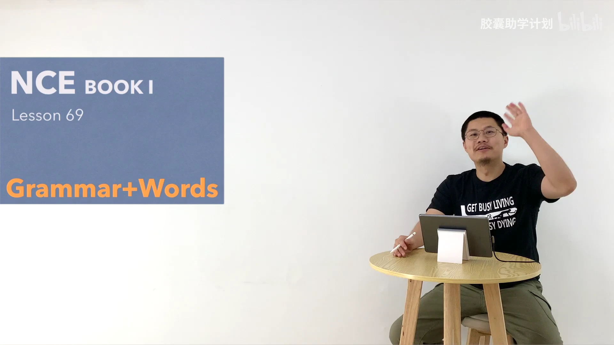

文字识别：胶囊助学计划 / NCE / BOOKI / Lesson 69 / Grammar+Words / GET BUSY LIVING / SY DYING

### 画面 00:00:03

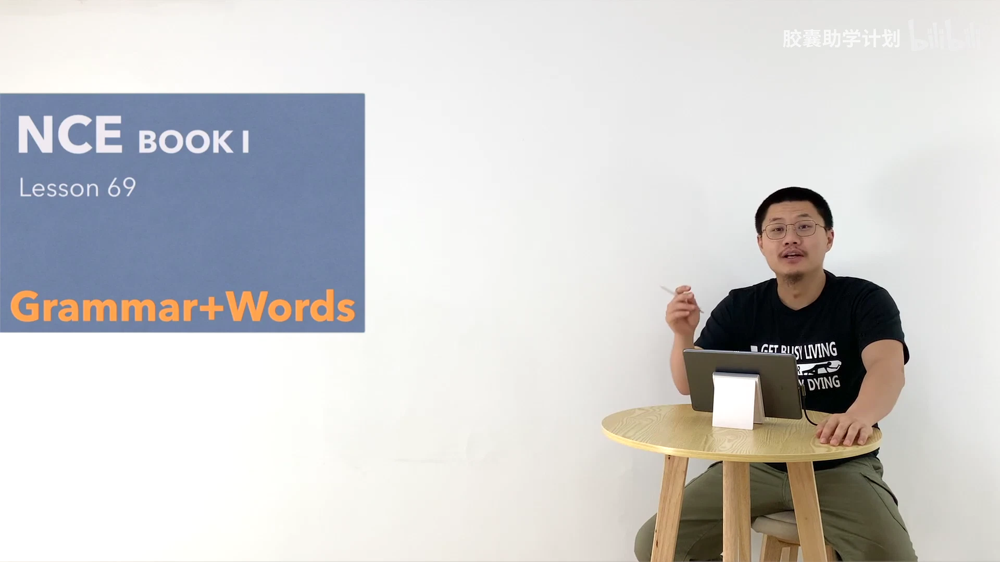

文字识别：胶囊助学计划 / NCE / BOOKI / Lesson 69 / Grammar+Words / GET RISY LIVING / MDYING

### 画面 00:00:11

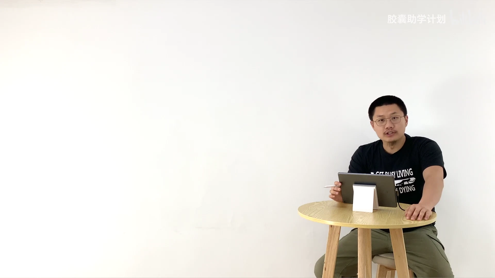

文字识别：胶囊助学计划 / 9 / MDYING

### 画面 00:00:13

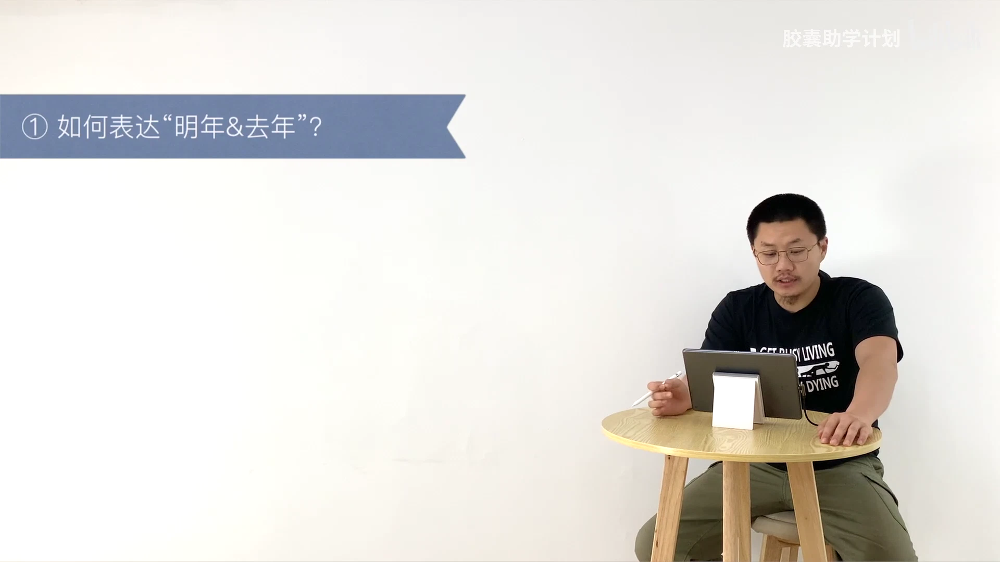

文字识别：①如何表达“明年＆去年”？ / DYING

### 画面 00:00:15

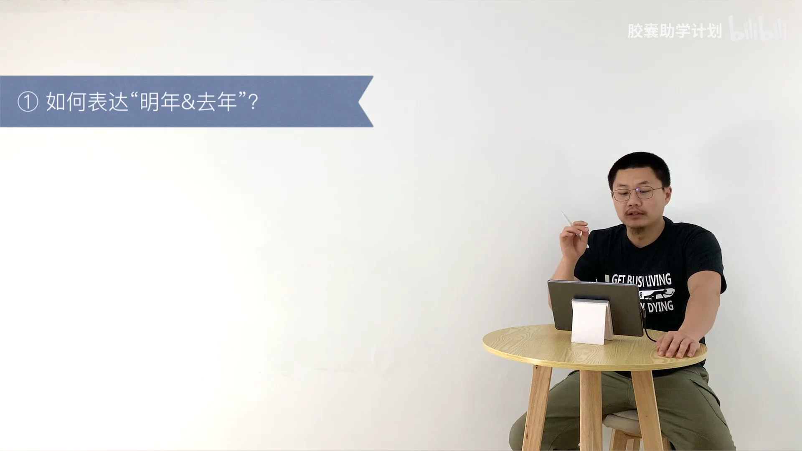

文字识别：胶囊助学计划 / ①如何表达“明年＆去年”? / 9 / IGFT RISUVING / R / YDYING

### 画面 00:00:19

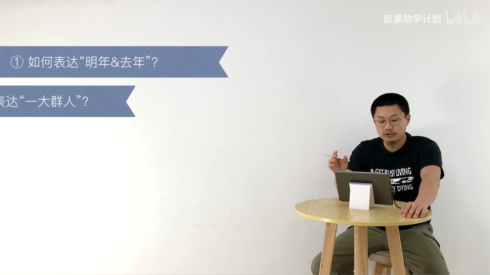

文字识别：胶囊助学计划 / ①如何表达“明年＆去年”？ / 長达“一大群人”？ / IGETDISILNNG / YDYING

### 画面 00:00:21

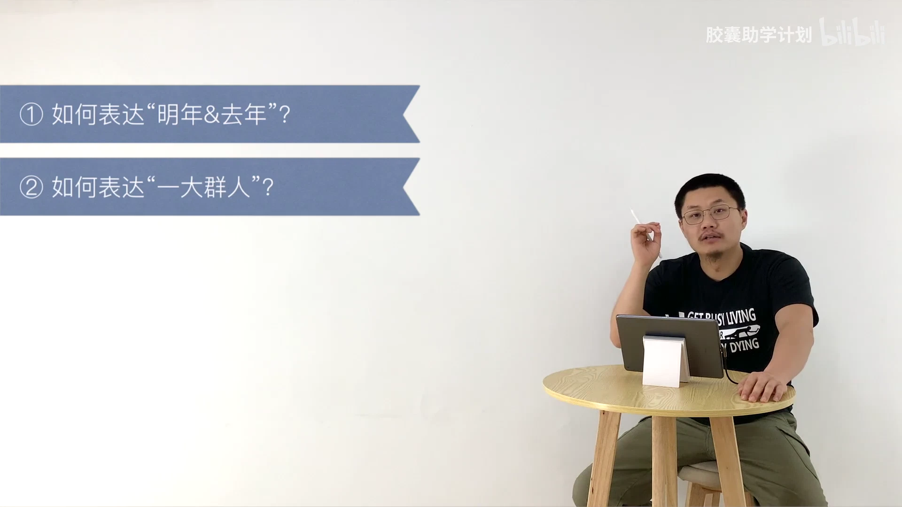

文字识别：胶囊助学计划 / ①如何表达“明年＆去年”？ / 如何表达“一大群人”? / CETDLISY LVING / YDYING

### 画面 00:00:23

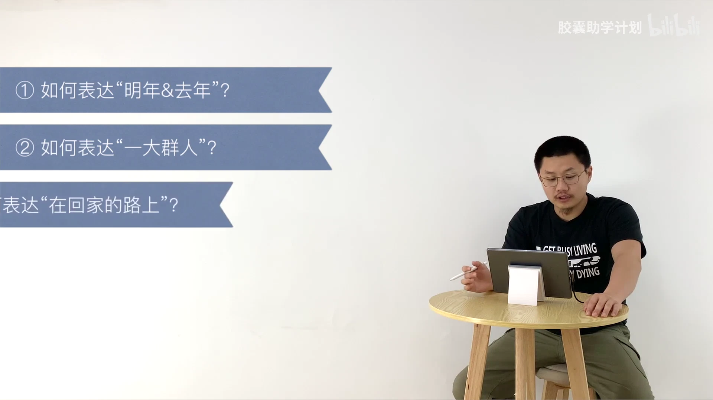

文字识别：胶囊助学计划 / ①如何表达“明年＆去年”？ / 如何表达“一大群人”? / 表达“在回家的路上”? / GET DISY LVING / DYING

### 画面 00:00:25

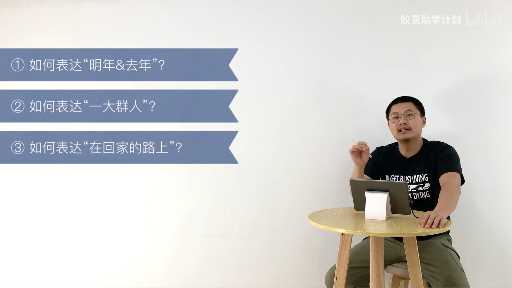

文字识别：胶囊助学计划 / ①如何表达“明年＆去年”？ / 如何表达“一大群人”？ / 如何表达“在回家的路上”? / IGFT RISIUVING / YDYING

## 00:00:30–00:01:00

好，那我们本课的语法其实和 there be 这个句型是紧密相连的。我们先回顾第一件事情，就是我们早在二十五课、二十七课就学过的 there be 句型，我们管它叫做某地有某物，对吧？比如说我们造一句话啊，说 there is。当然了，你是用 is 还是用 are，由后边这个是单数还是复数确定，对

### 画面 00:00:30

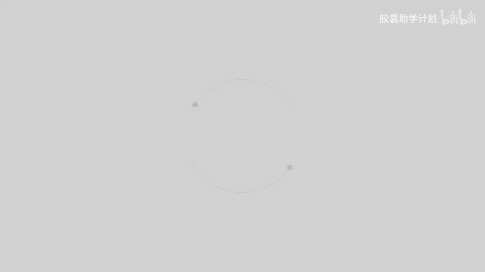

文字识别：胶囊助学计划b出出

### 画面 00:00:34

### 画面 00:00:36

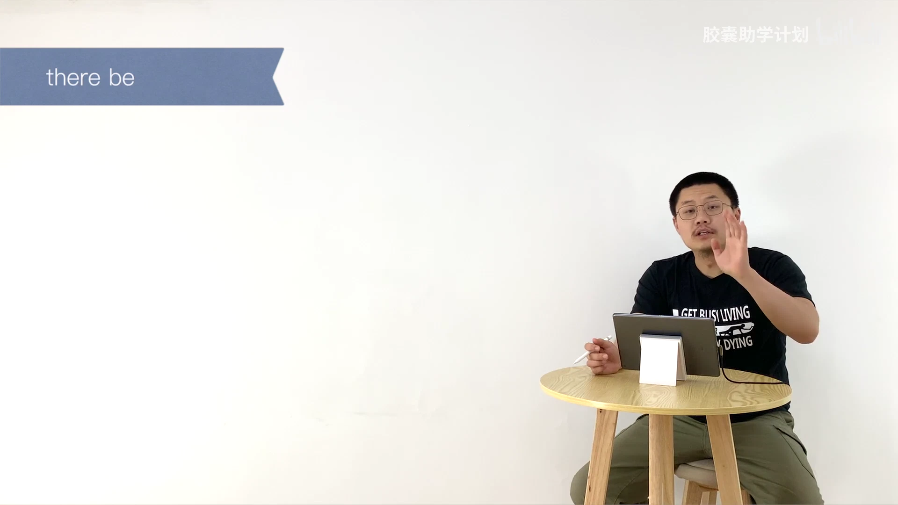

文字识别：there be / GET RISYLVING / KDYING

### 画面 00:00:38

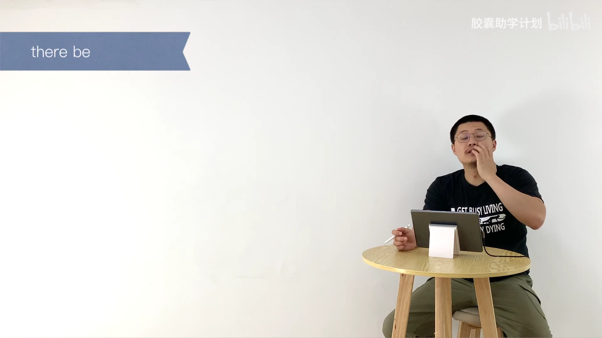

文字识别：胶囊助学计划 / there be / GET RIISY LVING / YDYING

### 画面 00:00:58

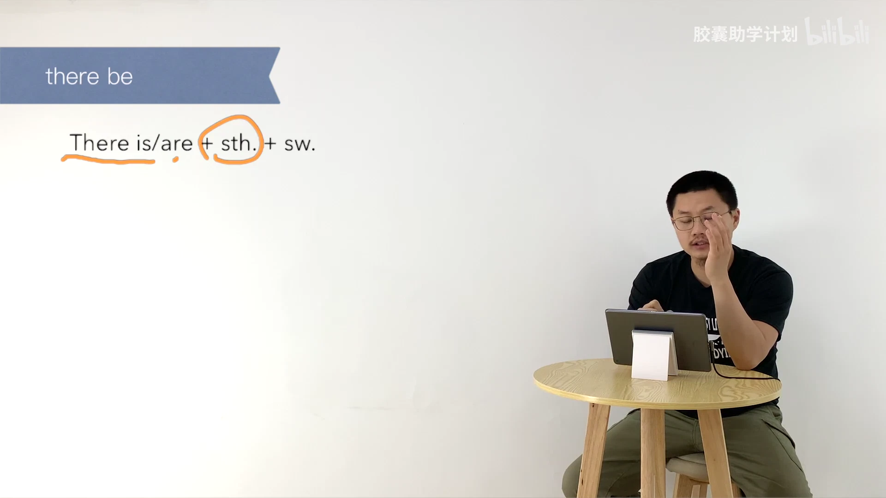

文字识别：胶囊助学计划 / there be / There is/are / + / sth. / + SW.

## 00:01:00–00:01:30

吧？比如说 there is a pen，有这么一个东西，有一根笔。地点呢 s w 点就 somewhere 对吧？某地，我们可以管它叫，比如说 on the table 啊。 There is a pen on the table. Okay，叫做在桌子上有一根笔。某地有某物。那各位再想一下，我们在六十七课刚刚学过了把 am is are 对吧？这三个单词换成 was were，就表示这个状态发生在

### 画面 00:01:28

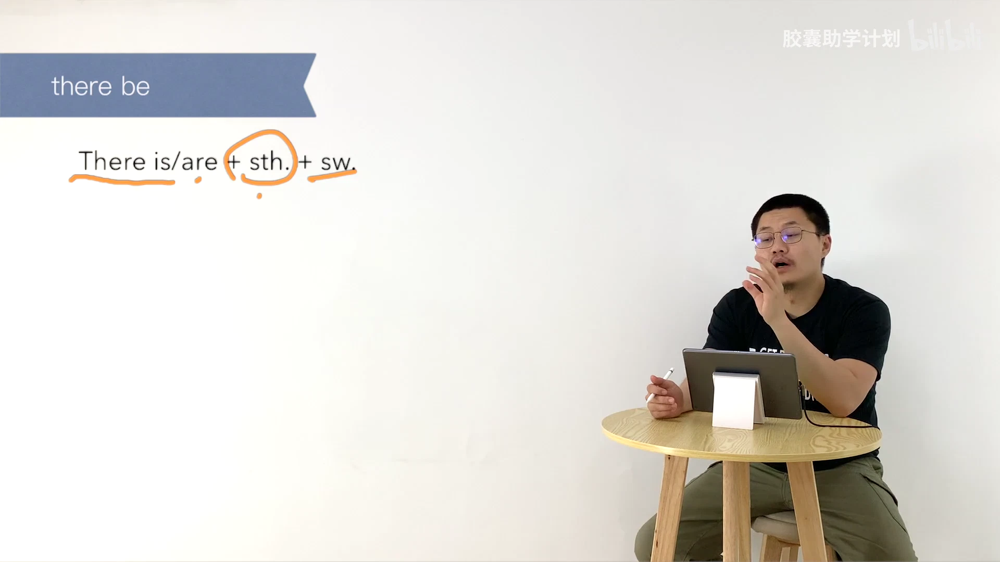

文字识别：胶囊助学计划 / there be / There is/are / + / sth. / + SW.

## 00:01:30–00:02:00

过去了，对不对？那很简单，我们举一反三，我们把 is 给它换成了 was，把 are 换成了 were，在这个地方就出来了一个新的，看似是新的句型，对吧？叫 there was 或 there were，然后 something 在某地。原来上面第一句话指的是现在的一个情况，那第二句话还是某地有某物，只不过变成了叫做过去某地

### 画面 00:01:36

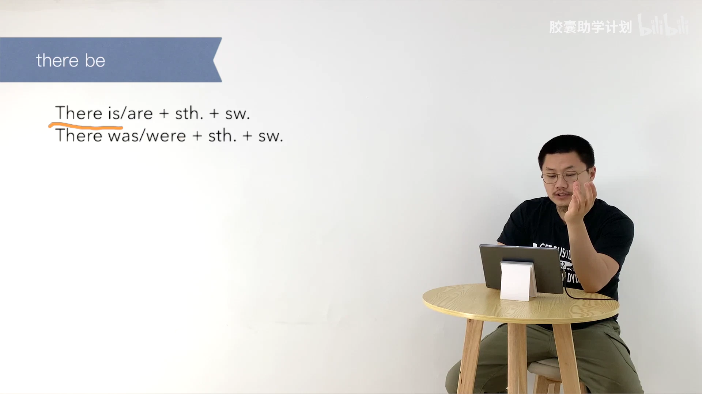

文字识别：胶囊助学计划 / there be / There is/are + sth. + sw. / There was/were + sth. + sw. / SIV

### 画面 00:01:57

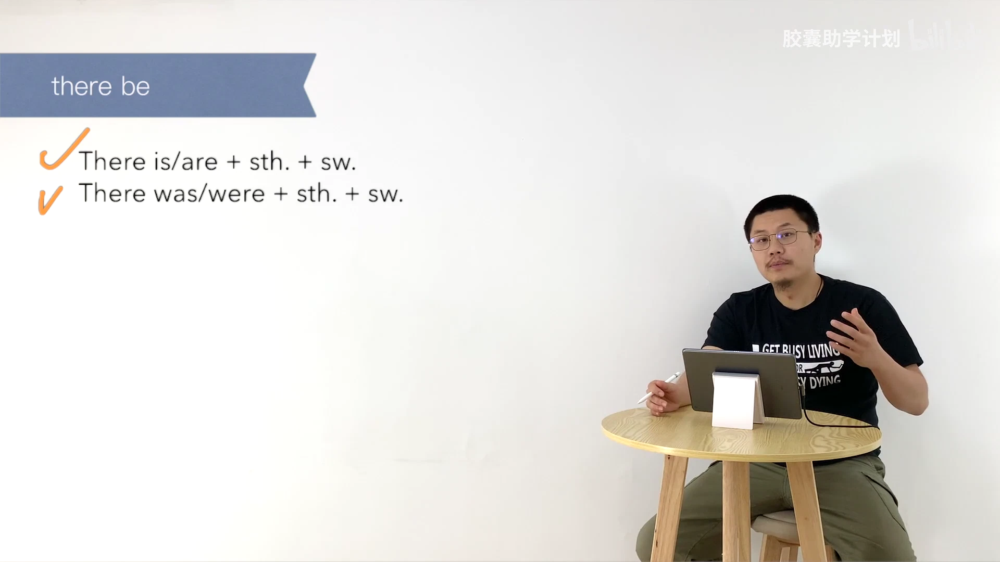

文字识别：胶囊助学计划 / there be / There is/are + sth. + sw. / There was/were + sth. + sw. / GET RIISY LVINC / Y DYING

## 00:02:00–00:02:30

有某物了，各位好理解吧？比如说，我们造几个小的例子啊，比如说 Where is the pen？说这个笔在哪儿？我问现在这个笔在哪儿？然后你说我不记得了，但是呢，说刚才啊，在桌子上是有一根笔的，我刚才看见在桌子上有一根笔。说 There was a pen on the table, but it's not here now，是吧？但是它现在不在这个地方了，我们也不清楚，对吧？但我们说的是刚才这个桌子上是有一根笔的。OK，那这个语法

### 画面 00:02:08

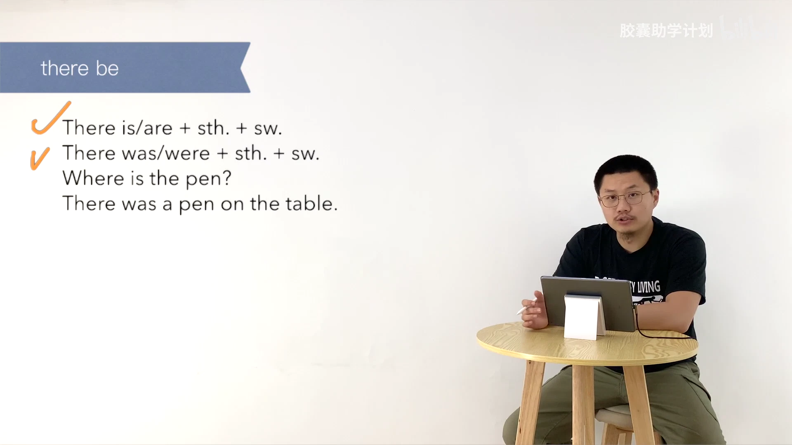

文字识别：胶囊助学计划 / there be / There is/are + sth. + sw. / There was/were + sth. + sw. / Where is the pen? / There was a pen on the table. / YLWING

### 画面 00:02:12

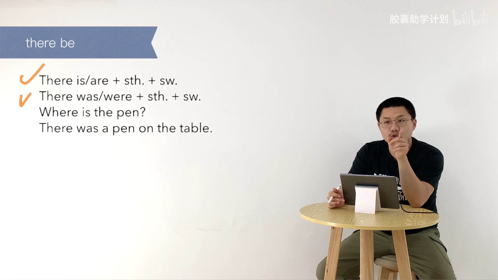

文字识别：胶囊助学计划 / there be / There is/are + sth. + sw. / There was/were + sth. + sw. / Where is the pen? / There was a pen on the table.

### 画面 00:02:26

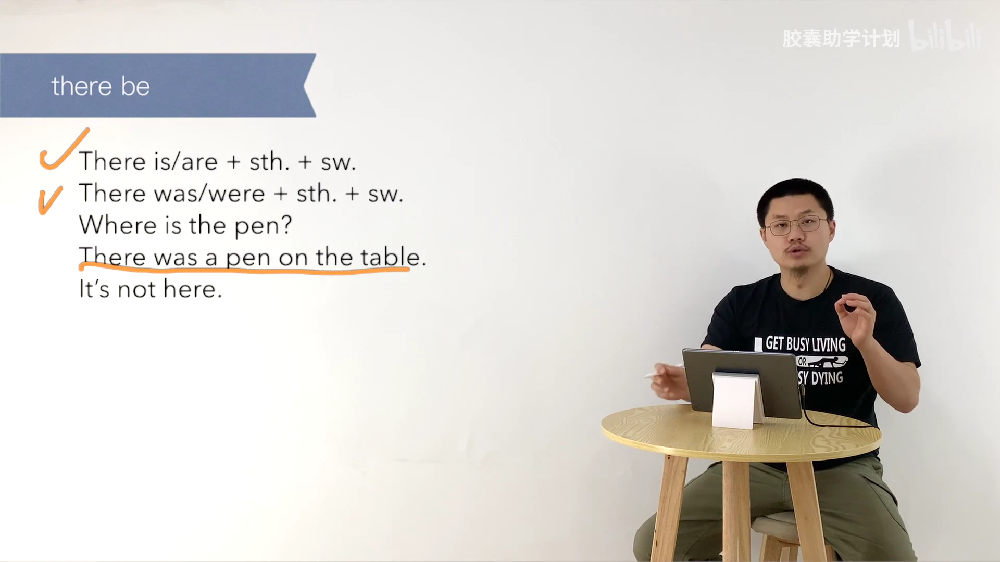

文字识别：胶囊助学计划 / there be / There is/are + sth. + sw. / There was/were + sth. + sw. / Where is the pen? / There was a pen on the table. / It's not here. / GET BUSY LIVING / ORI / SY DYING

## 00:02:30–00:03:00

点其实还是很简单的啊，我们就不做过多的解释了。各位注意几个小点就行了。第一，肯定句已经放在这儿了，对吧？单数用 was，复数用 were。其次呢，它怎么变否定句？各位，你看啊，你已经学过了 was were 变否定句是在后边加 not，那在这儿没有任何区别，was were 后边加 not 就可以了。怎么变一般疑问句？was were 提到句首就可以了，也没有什么太困难的事情。接下来我

### 画面 00:02:56

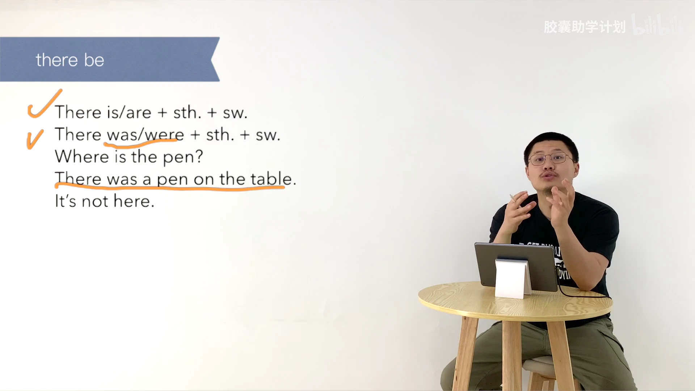

文字识别：胶囊助学计划 / there be / There is/are + sth. + sw. / There was/were + sth. + sw. / Where is the pen? / There was a pen on the table. / It's not here.

## 00:03:00–00:03:30

们在练习的过程当中带着他们啊，见到他们懂就可以了。OK，好，那不多说，我们直接进入单词。各位张嘴跟我去读啊。首先第一个叫年啊，年月日的年来张开嘴读 year year。OK，年份。那如果说 next year next 叫下一个对吧？next year 叫下一年啊，就是明年。明年往往跟什么时态连起来？一般现在时。哎，我

### 画面 00:03:05

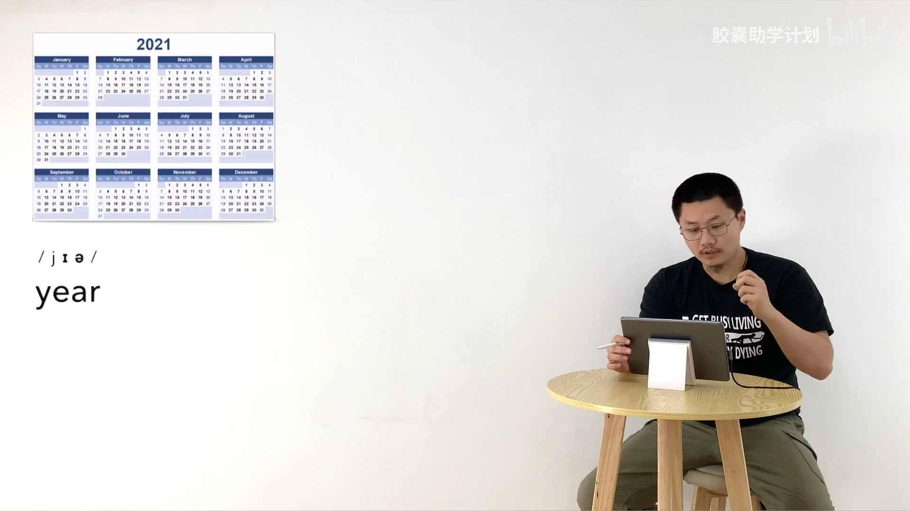

文字识别：胶囊助学计划 / 2021 / January / February / March / April / 9 / 10 / 11 / 12 / 12 / 12 / 13 / 14 / 18 / 18 / 1% / 17 / 18 / 19 / 20 / 14 / 15 / 16 / 17 / 18 / 1 / 20 / 11 / 12 / 13 / 14 / 15 / 1 / 7 / 22 / 23 / 21 / 22 / 20 / 24 / 25 / 24 / 27 / 21 / 22 / 23 / 24 / 26 / 2% / 27 / 18 / 19 / 20 / 21 / 22 / 2 / 24 / 29 / 20 / 28 / 29 / 30 / 31 / 25 / 2 / 27 / 28 / 2930 / June / Juy / August / 10 / 11 / 12 / 7 / 10 / 10 / 11 / 12 / 13 / 14 / 10 / 12 / 13 / 13 / 14 / 15 / 16 / 17 / 1 / 19 / 12 / 13 / 14 / 18 / 16 / 15 / 1 / 17 / 1 / 19 / 20 / 21 / 1 / 20 / 21 / 22 / 20 / 21 / 22 / 23 / 24 / 24 / 26 / 10 / 19 / 20 / 21 / 22 / 20 / 24 / 22 / 23 / 24 / 25 / 24 / 27 / 28 / 24 / 25 / 2 / 27 / 28 / 29 / 27 / 28 / 30 / 26 / 2 / 27 / 2 / 30 / 31 / 29 / 30 / 31 / September / October / November / December / 2 / 3 / 10 / 11 / 11 / 13 / 7 / 10 / 11 / 12 / 13 / 14 / 16 / 16 / 13 / 14 / 14 / 16 / 17 / 1 / 20 / 12 / 13 / 14 / 15 / 14 / 17 / 1 / 20 / 21 / 22 / 23 / 23 / 21 / 22 / 23 / 25 / 27 / 19 / 20 / 21 / 22 / 23 / 24 / 29 / 28 / 29 / 30 / 2$ / 24 / 29 / 30 / 31 / /j1a/ / year / CRT DIISIUVING / DYING

### 画面 00:03:19

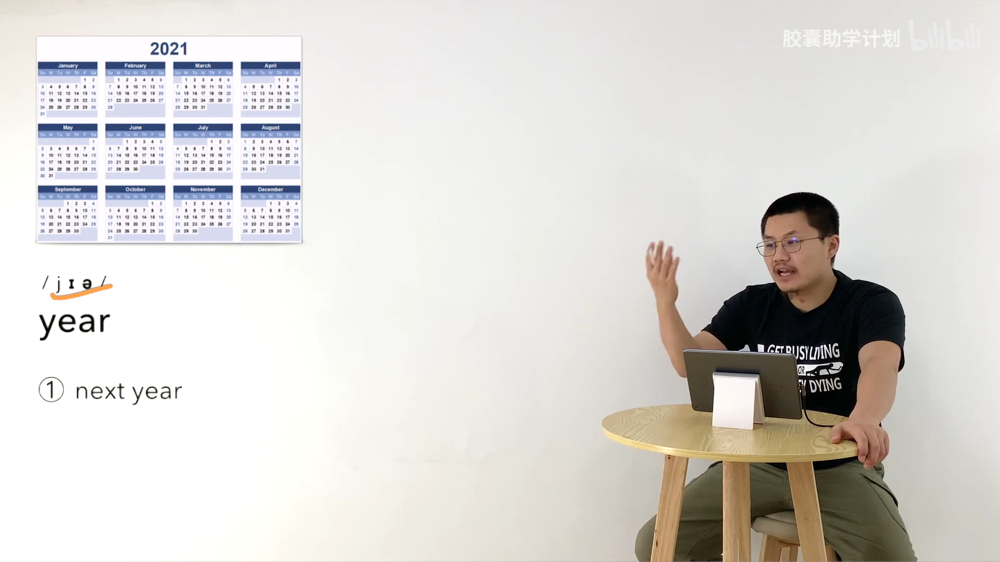

文字识别：胶囊助学计划 / 2021 / January / February / March / April / 2 / 10 / 11 / 12 / 13 / 14 / 14 / 16 / 16 / 9 / 17 / 10 / 11 / 12 / 10 / 14 / 15 / 16 / 9 / 10 / 17 / 11 / 18 / 12 / 19 / 13 / 20 / 11 / 12 / 13 / 14 / 15 / 16 / 17 / 10 / 17 / 1 / 20 / 22 / 23 / 21 / 22 / 20 / 24 / 26 / 21 / 22 / 23 / 24 / 2 / 26 / 27 / 18 / 19 / 20 / 21 / 22 / 23 / 24 / 23 / 20 / 29 / 20 / 28 / 29 / 30 / 31 / 25 / 26 / 27 / 28 / 29 / June / July / August / 11 / 12 / 7 / 10 / 10 / 11 / 12 / 13 / $4 / 10 / 12 / 13 / 14 / 15 / 16 / 17 / 18 / 12 / 13 / 14 / 15 / 16 / 17 / 15 / 16 / 17 / 18 / 19 / 20 / 21 / 14 / 17 / 18 / 19 / 20 / 21 / 22 / 21 / 22 / 20 / 24 / 25 / 18 / 19 / 20 / 21 / 22 / 23 / 24 / 22 / 23 / 24 / 25 / 24 / 27 / 20 / 23 / 24 / 2 / 27 / 28 / 29 / 27 / 20 / 2 / 24 / 27 / 2 / 31 / 29 / 30 / 31 / 31 / September / October / November / December / 9 / 10 / 11 / 10 / 11 / 12 / 13 / 10 / 11 / 12 / 13 / 15 / 16 / 17 / 12 / 13 / 16 / 14 / 15 / 17 / 20 / 12 / 13 / 14 / 10 / 16 / 17 / 2 / 21 / 22 / 23 / 22 / 23 / 21 / 22 / 23 / 19 / 20 / 21 / 22 / 23 / 24 / 25 / 2 / 20 / 2 / 30 / 26 / 27 / 28 / 29 / 0 / /j1a/ / year / GETBUSYLZING / next year / YDYING / 7

### 画面 00:03:22

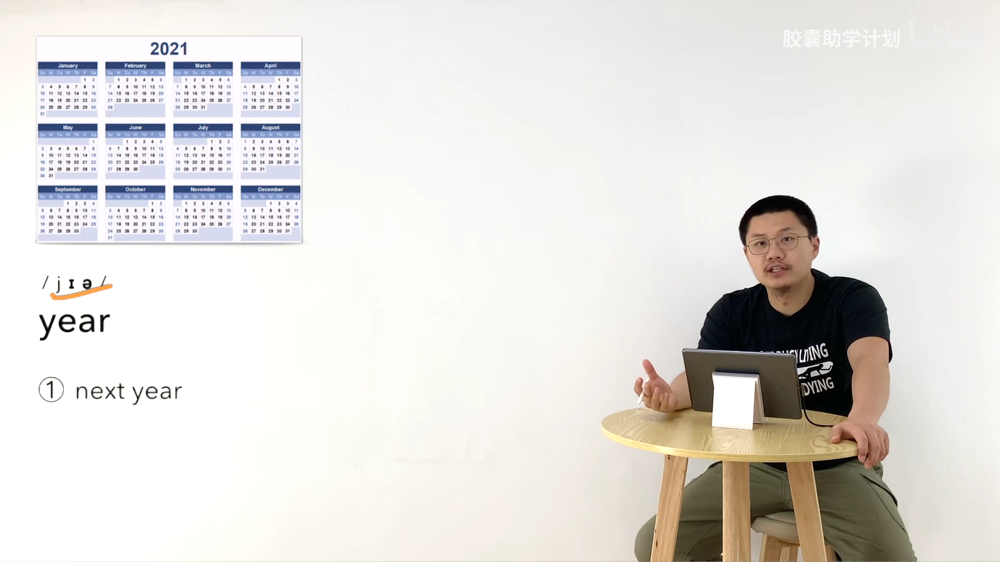

文字识别：胶囊助学计划 / 2021 / January / February / March / April / 10 / 11 / 9 / 10 / 11 / 12 / 13 / 9 / 50 / 10 / 17 / 11 / 18 / 12 / 13 / 14 / 22 / 15 / 23 / 21 / 14 / 22 / 18 / 16 / 23 / 17 / 24 / 18 / 25 / 26 / 19 / 27 / 21 / 14 / 22 / 15 / 23 / 16 / 17 / 24 / 2 / 18 / 2% / 19 / 27 / 20 / 11 / 18 / 19 / 12 / 13 / 20 / 14 / 21 / 15 / 22 / 23 / 16 / 24 / 17 / 28 / 20 / 28 / 29 / 30 / 31 / 25 / 26 / 27 / 28 / 29 / June / July / August / 11 / 12 / 7 / 9 / 10 / 10 / 11 / 12 / 13 / 14 / 10 / 11 / 12 / 13 / 14 / 13 / 14 / 15 / 17 / 18 / 12 / 14 / 15 / 16 / 17 / 15 / 16 / 17 / 18 / 19 / 20 / 21 / 17 / 11 / 19 / 20 / 21 / 22 / 20 / 21 / 22 / 18 / 19 / 20 / 21 / 22 / 23 / 24 / 22 / 23 / 24 / 25 / 24 / 27 / 28 / 24 / 25 / 2 / 27 / 28 / 29 / 27 / 28 / 29 / 20 / 25 / 26 / 27 / 28 / 2 / 80 / 31 / 29 / 31 / September / October / November / December / 10 / 10 / 11 / 12 / 13 / 9 / 10 / 11 / 12 / 1$ / 13 / 21 / 14 / 15 / 22 / 16 / 22 / 21 / 22 / 23 / 17 / 19 / 12 / 13 / 20 / 13 / 21 / 14 / 15 / 22 / 16 / 23 / 17 / 24 / 18 / 30 / 29 / 28 / 2 / 30 / 26 / 27 / 28 / 29 / 30 / 31 / /jia/ / year / 1 / next year / DYING

## 00:03:30–00:04:00

造一个句子叫 I'm gonna buy a new car next year. 啊，明年我要去买一辆新车了。 Be gonna do, 对吧？ Okay, be gonna. 啊，这个是我们 be going to do 的口语的一个用法。其次， last year, 哎，这个我们之前见过， last 叫呃上一个，对吧？ Last year 叫上一年，也就是去年啊，前一年。好，那它往往跟什么时态连起来？一般过去时连起来，对吧？比如说 I was

### 画面 00:03:52

文字识别：胶囊助学计划 / 2021 / January / February / March / April / 10 / 9 / 10 / 11 / 12 / 13 / 9 / 12 / 14 / 16 / 16 / 17 / 18 / 14 / 15 / 16 / 17 / 18 / 19 / 20 / 11 / 12 / 13 / 14 / 15 / 16 / 17 / 23 / 21 / 22 / 21 / 22 / 23 / 24 / 25 / 2 / 27 / 18 / 19 / 20 / 21 / 22 / 23 / 24 / 28 / 29 / 30 / 31 / 25 / 26 / 27 / 28 / 29 / 30 / June / July / August / 10 / 11 / 9 / 10 / 10 / 11 / 12 / 13 / 14 / 10 / 12 / 14 / 15 / 15 / 17 / 18 / 12 / 13 / 14 / 15 / 16 / 17 / 15 / 16 / 17 / 18 / 19 / 20 / 21 / 17 / 19 / 20 / 21 / 22 / 20 / 21 / 22 / 22 / 18 / 19 / 20 / 21 / 22 / 23 / 24 / 22 / 23 / 24 / 25 / 24 / 27 / 24 / 2 / 2 / 27 / 28 / 29 / 28 / 29 / 25 / 2 / 31 / 29 / 31 / September / October / November / December / 10 / 10 / 10 / 11 / 12 / 13 / 13 / 16 / 16 / 12 / 14 / 15 / 16 / 17 / 22 / 23 / 23 / 21 / 22 / 23 / 15 / 21 / 22 / 23 / 30 / 20 / 20 / 26 / 29 / /jia/ / year / SYLING / next year / IDYING /  I'm gonna buy a new car next year. / 2 / 3 / last year

## 00:04:00–00:04:30

in Auckland last year，是吧？我去年刚毕业嘛，对吧？OK，那我就说，I was in Auckland。我，I，I am in Beijing right now，对吧？But but I was in Auckland。啊，我之前去年啊在奥克兰啊，一般过去式。OK，there you go。接下来下一个单词跟我去读，叫做race，race啊。那car race就是赛车比赛，对吧？哎，车的比赛啊，赛

### 画面 00:04:17

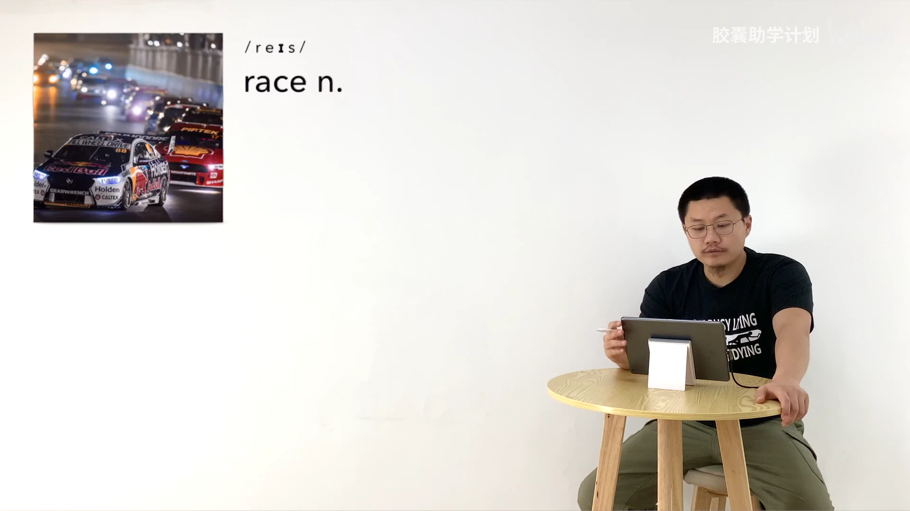

文字识别：胶囊助学计划 / /reis/ / race n. / 9 / lder / Holden / CALTEX / SYLING / IDYING

## 00:04:30–00:05:00

车比赛，car race， race是比赛的意思。我们造一个句子说，We gonna watch a car race tonight. Be going to do啊，还是这是口语的表达，gonna，对吧？啊，各位如果去考试的话，尤其是在写作当中，尽量不要写gonna啊啊，还是要学be going to do啊。We are gonna watch a car race tonight.今天晚上我们打算去看一个赛车比赛啊。以及We must leave now.我们现在必须

### 画面 00:04:39

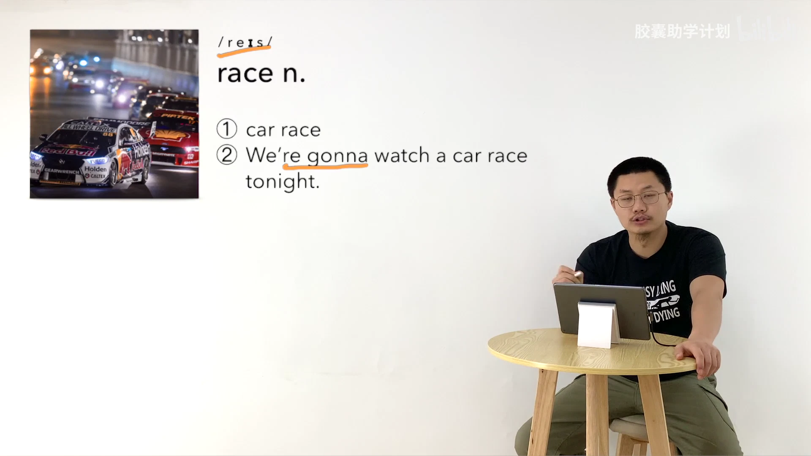

文字识别：胶囊助学计划 / /reis/ / race n. / car race / We're gonna watch a car race / lderi / Holden / CALTEX / tonight. / SYLING / IDYING

## 00:05:00–00:05:30

要离开了。注意 must 加 leave. OK. 说 the car race is at eight. 这个汽车比赛呀是在八点钟啊。OK. 好，接下来下一个小的单词 t 发 t, n 发 n 啊，自然拼读法则，再配合一个音标叫做 l, 连起来读叫做 town, town 啊，小镇啊，小城镇，小村村庄啊。哎，对，不能叫村庄了，村庄我们一般叫

### 画面 00:05:09

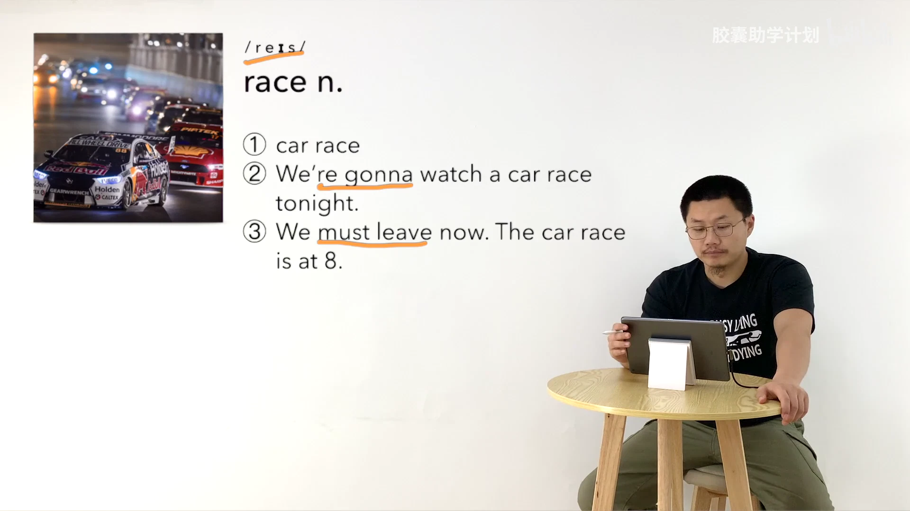

文字识别：/reis/ / race n. / car race / We're gonna watch a car race / lder / Holden / CALTEX / tonight. / We must leave now. The car race / is at 8. / SYLING / DYING

### 画面 00:05:11

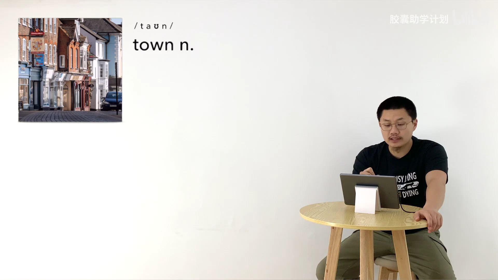

文字识别：胶囊助学计划 / /taun/ / town n. / SYLING / DYING

## 00:05:30–00:06:00

countryside，是吧？Country啊，这是我们六十七课刚学的，就小镇就可以了啊。说 this is a small town，这是一个很小的镇。OK，好，或者说我们结合五十五课学的，说 she lives in a small town。然后这儿注意一个时态的问题，陈述客观事实用的是一般现在时啊。她住在一个小镇上，肯定句有了。那我们试着造一些别的句型，张开嘴跟我读。Does she live in a

### 画面 00:05:41

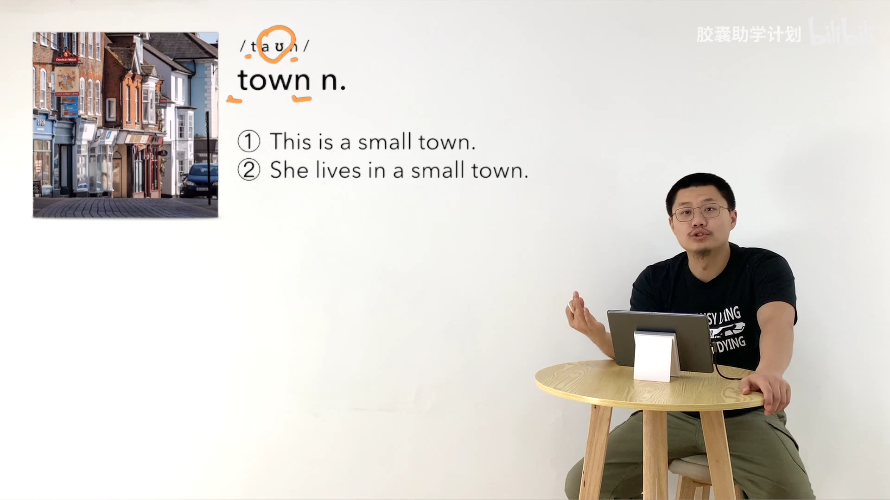

文字识别：胶囊助学计划 / tau / town n. / This is a small town. / She lives in a small town. / SYLING / DYING

## 00:06:00–00:06:30

small town?好，为什么用 does 呢？动词是哎三单形式，对吧？好， does 提前，动词换回原形。那如果我现在对 in a small town 提问，就用 where，于是就变成了 where does she live？啊，她住在什么地方？OK， here we go. 那以及 Can you find that town on the map? 好，这个句子我是怎么造出来的呢？各位回想一下四十三课咱们学到的，叫做 Can

### 画面 00:06:08

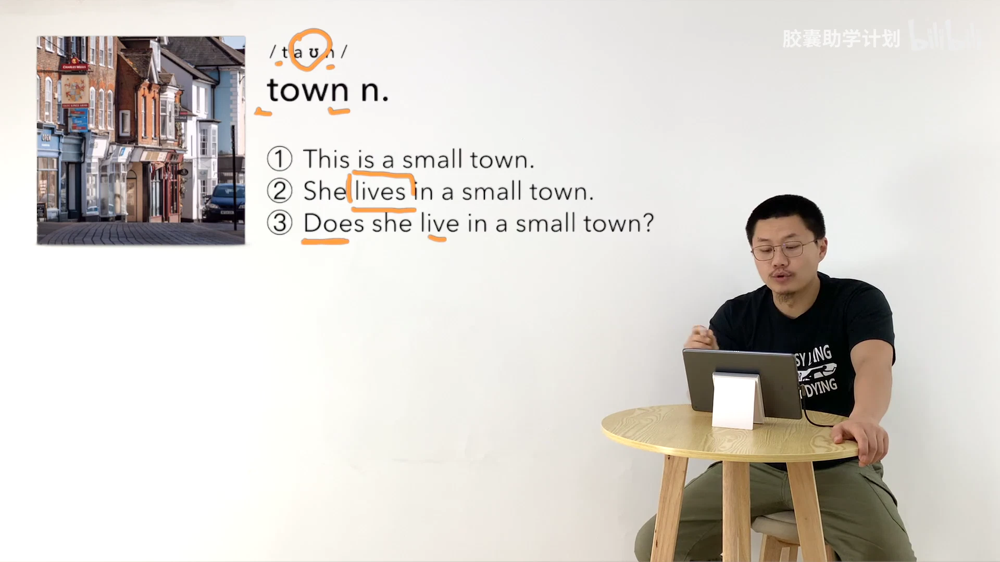

文字识别：胶囊助学计划 / au / town n. / This is a small town. / Shellives in a small town. / 9 / Does she live in a small town? / SYING / DYING

### 画面 00:06:17

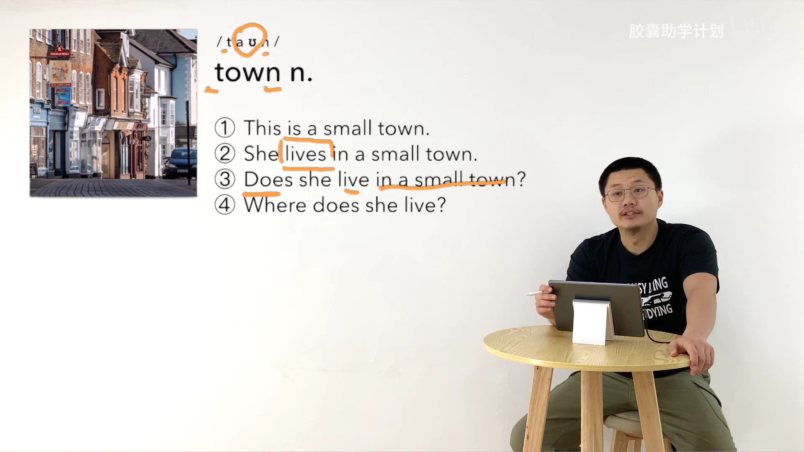

文字识别：胶囊助学计划 / /tau / town n. / This is a small town. / Shel / (lives in a small town. / Does she / live / in a small town? / Where / does she live? / SYLING / IDYING

### 画面 00:06:29

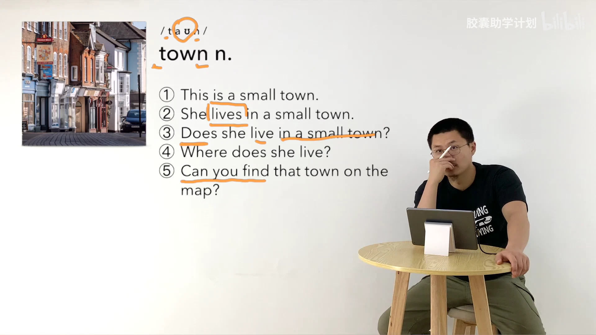

文字识别：胶囊助学计划 / /tau / town n. / This is a small town. / Shellives in a small town. / Does she / live / ina small town? / Where / does / she live? / Can you find / that town on the / map? / VING / NING

## 00:06:30–00:07:00

you find the teapot, 对吧？啊，我们学 can 那一课学到你能找到什么什么东西吗？我们无非是把后面的东西做了一点点小的调整，叫做 That town on the map. 你能在地图上找到那个小镇吗？OK，好，以及我们刚刚学过，各位想一下，六十三课、六十一课、六十三课啊、六十五课那几课叫做 Can you remember？那当时我们学到的叫 Can you remember the doctor's

### 画面 00:06:59

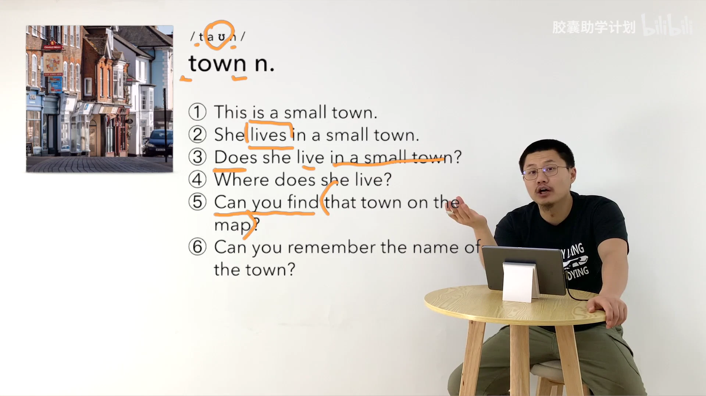

文字识别：胶囊助学计划 / /tauy / town n. / This is a small town. / Shellives in a small town. / Does she live in a small town? / Where does she live? / Can you findthat town on the / map / ⑥ Can you remember the name of / YUING / the town? / DYING

## 00:07:00–00:07:30

ah, telephone number? 那我们现在要问的是 Can you remember the name of the town? 啊，你能记起来这个小镇的名字吗？ Okay, one,下一个单词，张嘴跟我读，叫做 crowd。 好，这儿注意几个小点：第一，c放在单词当中去发k；第一，放在单词当中去发的是d啊。那r放在单词当中去发的就是我们说卷舌音啊，有点像儿化音啊，r是吧？ Crowd,

### 画面 00:07:06

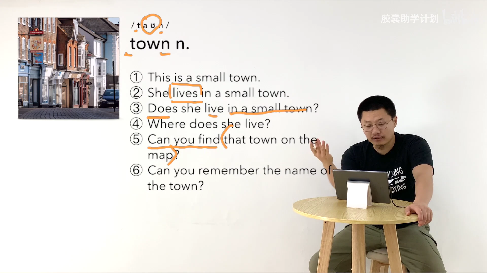

文字识别：胶囊助学计划 / /tau / town n. / This is a small town. / Shellives in a small town. / Does she live in a small town? / Where does she live? / Can you findthat town on the / map / Can you remember the name of / YUING / the town? / DYING

### 画面 00:07:12

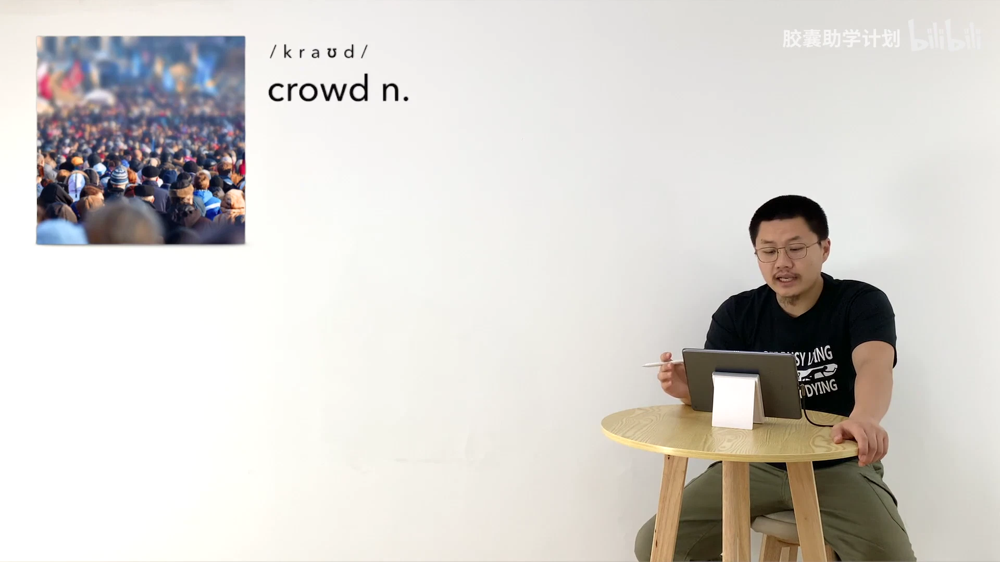

文字识别：胶囊助学计划 / / kraud/ / crowd n. / ® / SYUING / IDYING

## 00:07:30–00:08:00

Crowd, crowd. Okay, one, one,就是一大群啊，它往往指的是可以指人啊。比如说, a large crowd of people, a large crowd of people,一大群人。那我们造句子啊，叫做You can see啊，这很简单，你能看到看到的是什么呢？叫做a large crowd of people，一大群人在什么地方呢？On the street. Okay, one, one,好。那你看肯定句出来

### 画面 00:07:31

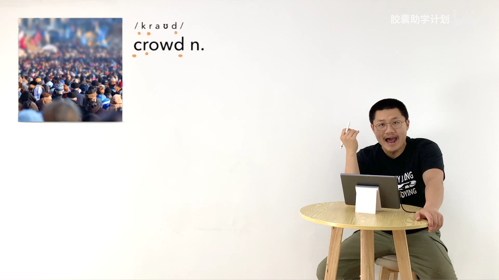

文字识别：/kraud/ / crowd n. / YLING / DYING

### 画面 00:07:43

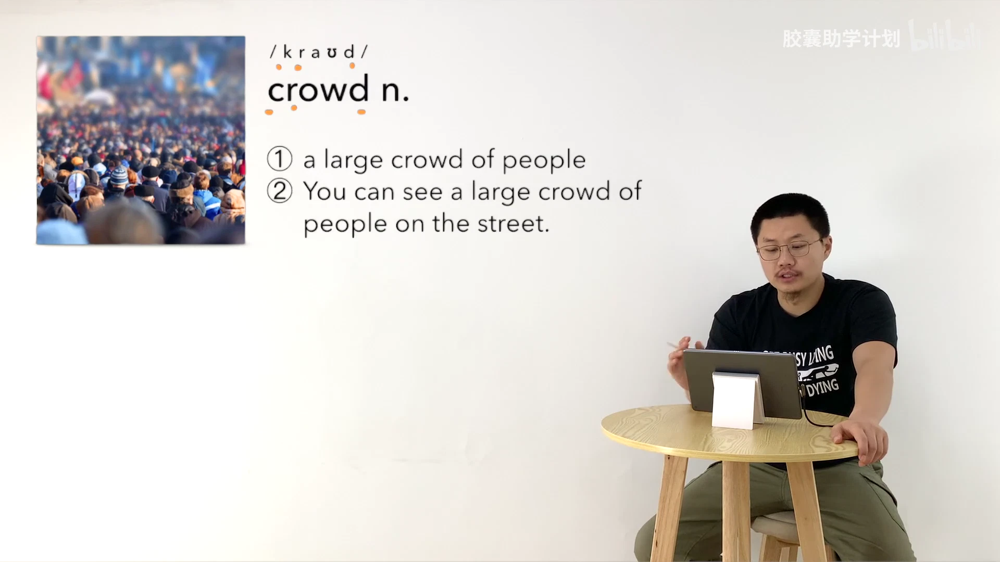

文字识别：胶囊助学计划 / / kraud/ / crowd n. / ① a large crowd of people / )You can see a large crowd of / 9 / people on the street. / SYUING / DYING

### 画面 00:07:50

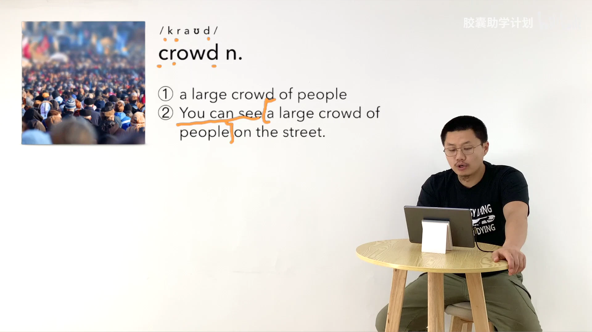

文字识别：/ kraud/ / • / crowd n. / ① a large crowd of people / You can seea large crowd of / peopleon the street. / YUING / IDVING

### 画面 00:07:59

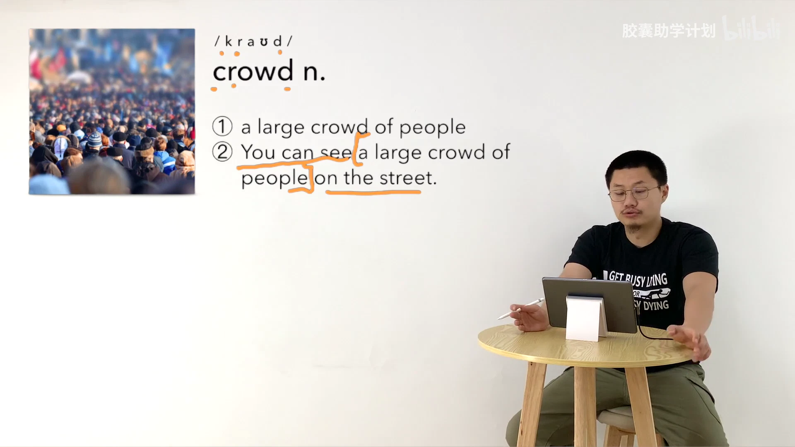

文字识别：胶囊助学计划 / / kraud/ / crowd n. / ① a large crowd of people / You can seea large crowd of / people / on the / street. / IGET RUSY LING / ORLIU / YDYING

## 00:08:00–00:08:30

了，你是不是就可以？比如说我看不到，I can't see a large crowd of people on the street. Okay, 那以及你能看到一大群人吗？叫 Can you see a large crowd of people on the street? 对吧？Okay, 以及 Where can I see a large crowd of people? 我去哪儿能看到一大群人呢？On the street. Okay, definitely not at your house, 对吧？一定不是在你家里面。下一个单词是我们见过很多遍了，Sit, stand, 对吧？Okay, I'm sitting now

### 画面 00:08:23

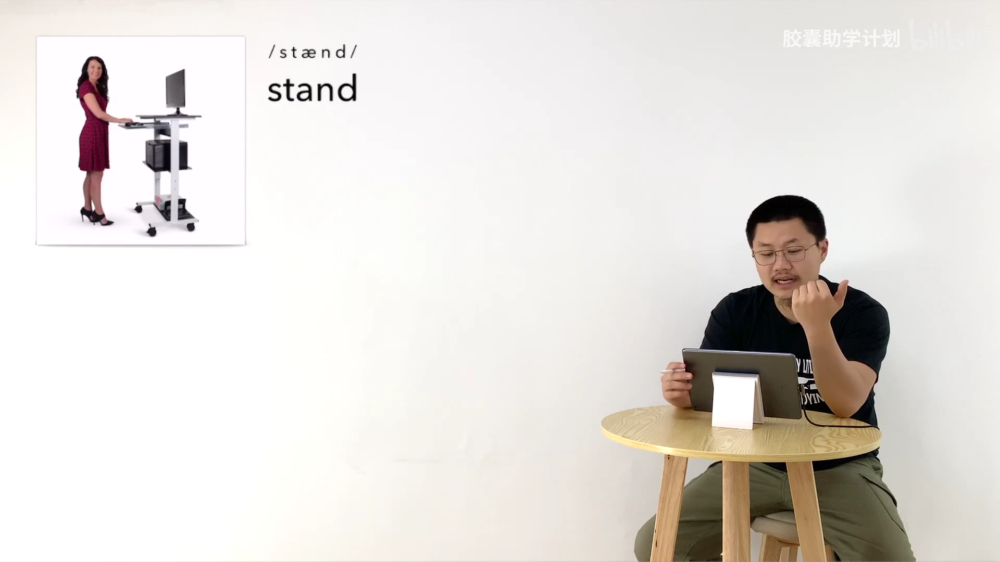

文字识别：胶囊助学计划 / /stæend/ / stand

## 00:08:30–00:09:00

and I'm standing now,对吧？啊，我们正在站着。好，张开嘴，跟我张嘴读就可以了。来，She is standing.啊，现在进行时，她正在站着。一般疑问句，Is she standing？然后特殊疑问句，我就把它变成了叫Why is she standing？啊，她为什么正在站着呢？We have a lot of chairs.我们有很多的椅子呀。啊，他就回答你，It's for my health，是吧？是为了我健康着想啊。我要站着去办公。Okay, so呃，I

### 画面 00:08:39

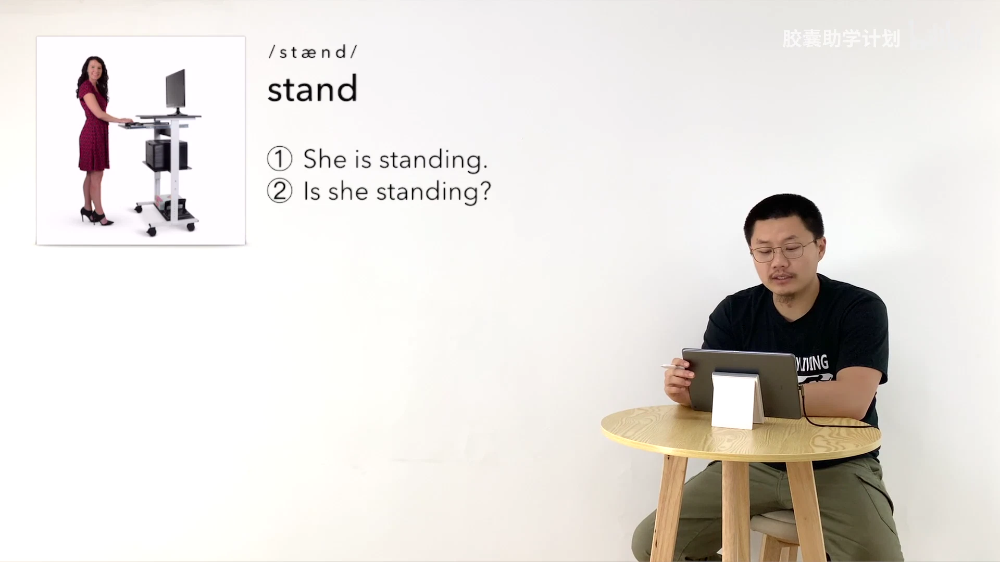

文字识别：/stæend/ / stand / ① She is standing. / ②Is she standing? / WING

### 画面 00:08:55

文字识别：胶囊助学计划 / / stæend / / stand / ① She is standing. / ② Is she standing? / Why is she standing? We have a / lot of chairs. / SUING

### 画面 00:08:59

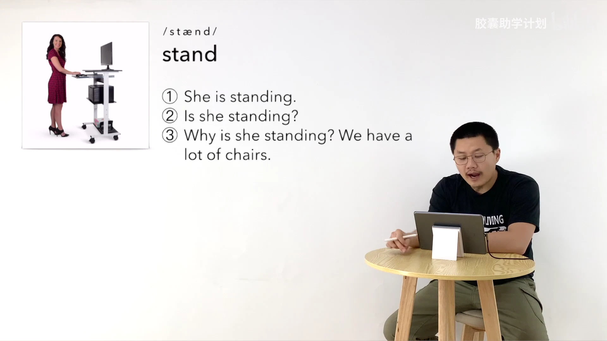

文字识别：胶囊助学计划 / /stænd/ / stand / ① She is standing. / ②Is she standing? / Why is she standing? We have a / lot of chairs. / YUVING

## 00:09:00–00:09:30

am standing right now. Okay, one, one, good.接下来下一个单词，看一下音标啊, exciting啊，令人兴奋的，令人激动的，叫做exciting. Okay,好，那我们造一个非常小的句子，经常用的叫This is exciting啊，这个事儿还挺有，还挺刺激的啊，挺令人激动的，叫做This is exciting.当然了，它也能变成叫做This was或That啊，那

### 画面 00:09:03

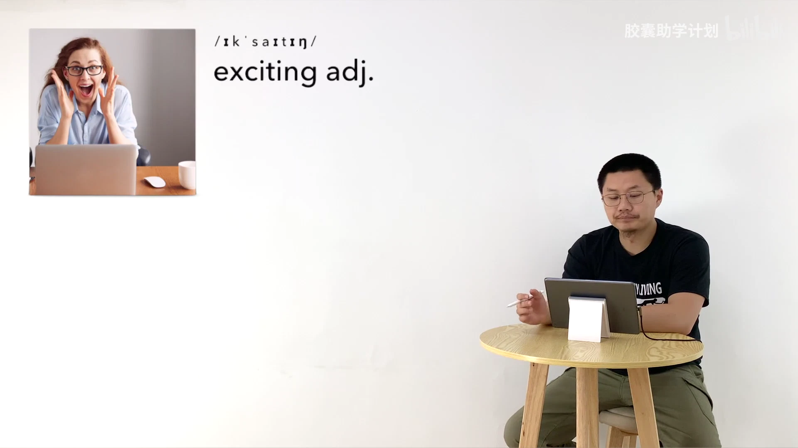

文字识别：胶囊助学计划 / /ik'saitin/ / exciting adj. / WVING

### 画面 00:09:26

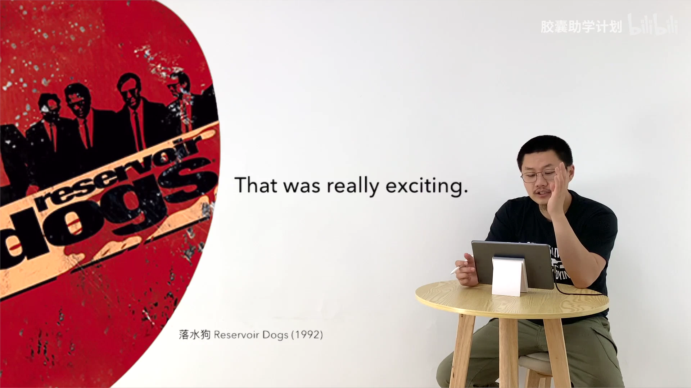

文字识别：胶囊助学计划 / That was really exciting. / 落水狗Reservoir Dogs(1992)

## 00:09:30–00:10:00

this that无所谓，您用哪个？还可以用was exciting.它和this is exciting的区别是什么呢？你想一下，他们俩最简单的区别就是一个陈述客观事实，一个说的是过去的事儿，对吧？如果刚才这件事情发生了、结束了，然后你现在对刚才这件事情做一个反馈，说刚才这件事情还挺令人激动的，那就变成了叫做this was exciting.好理解吧？OK，

### 画面 00:09:32

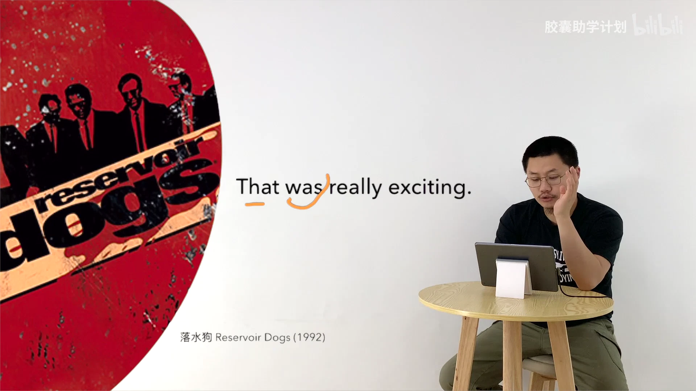

文字识别：胶囊助学计划 / That wasreally exciting. / - / 落水狗Reservoir Dogs (1992)

### 画面 00:09:44

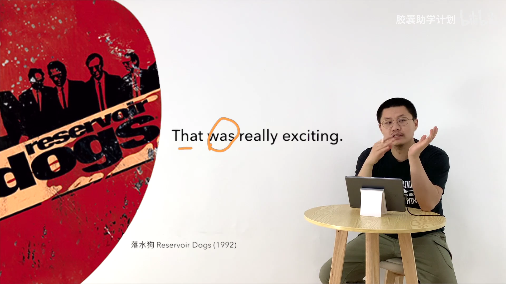

文字识别：胶囊助学计划 / That / wasreally exciting. / 落水狗Reservoir Dogs (1992)

## 00:10:00–00:10:30

好了啊，来，那我们接下来看一个小电影片段，就用到了这句话。各位做一些听力训练。Wow, that was really exciting. I bet you're a big Lee Marvin fan, aren't you? Yeah, me too. I love that game. OK,很简单是吧？That was really exciting.啊，因为电影片段的截取，您不知道前面他们发生了什么，是

### 画面 00:10:01

文字识别：胶囊助学计划 / That / wasreally exciting. / 际 / 落水狗 Reservoir Dogs (1992)

### 画面 00:10:06

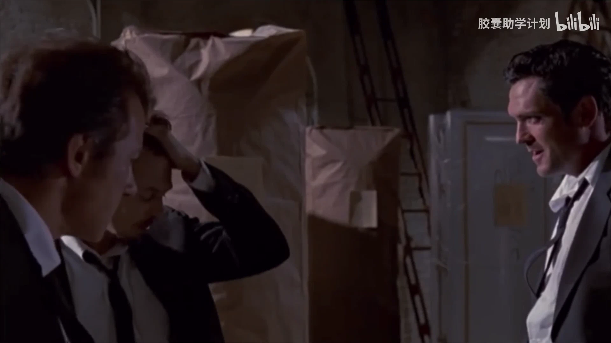

文字识别：Bilbii / 胶囊助学计划

### 画面 00:10:08

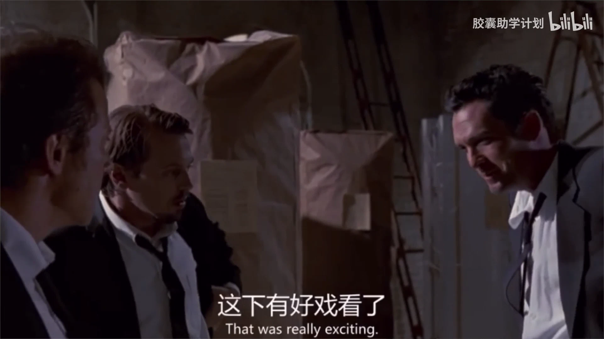

文字识别：Bilibili / 胶囊助学计划 / 这下有好戏看了 / That was really exciting.

### 画面 00:10:10

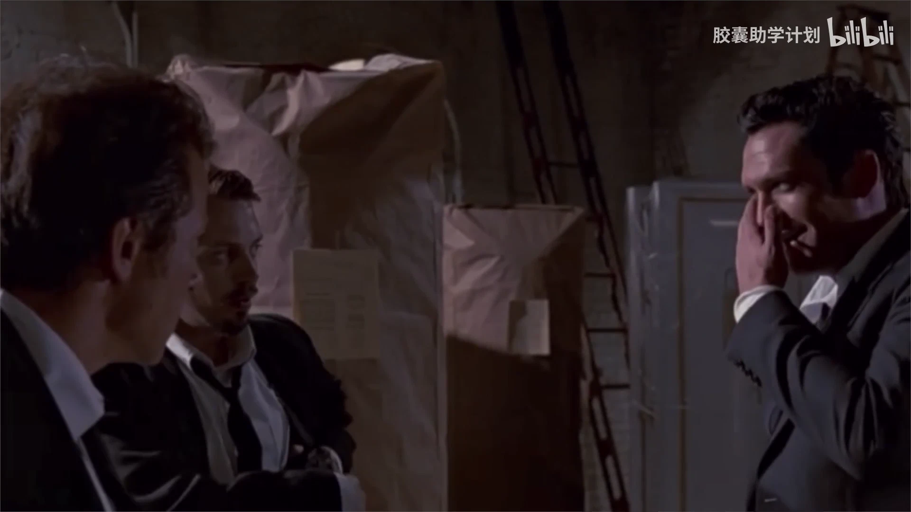

文字识别：Bilbii / 胶囊助学计划

### 画面 00:10:12

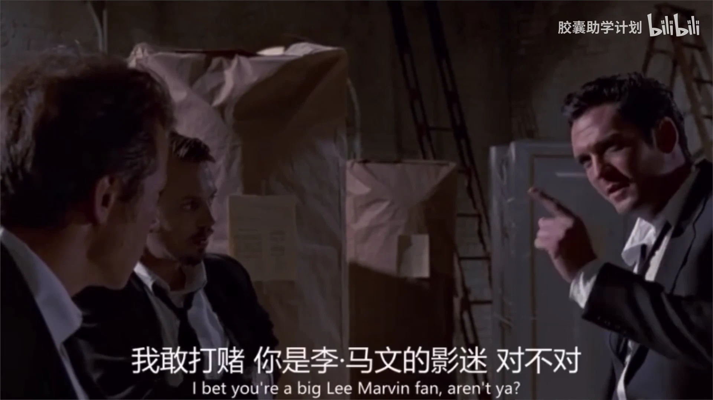

文字识别：bilibili / 胶囊助学计划 / 我敢打赌 你是李·马文的影迷 对不对 / I bet you're a big Lee Marvin fan, aren't ya?

### 画面 00:10:14

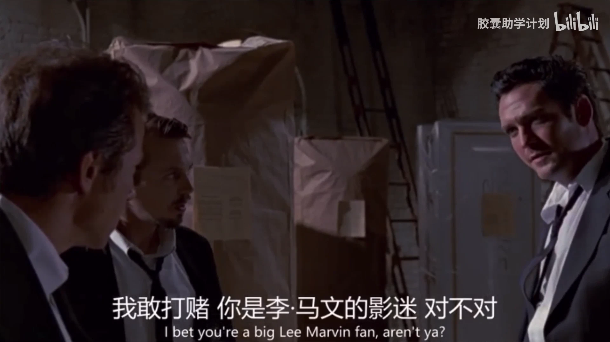

文字识别：bilibli / 胶囊助学计划 / 我敢打赌你是李·马文的影迷对不对 / I bet you're a big Lee Marvin fan, aren't ya?

### 画面 00:10:16

文字识别：Bilbili / 胶囊助学计划

### 画面 00:10:18

文字识别：bilibili / 胶囊助学计划 / 我也是 我喜欢那家伙 / Yeah, me too.I love that guy.

### 画面 00:10:20

文字识别：Bilibili / 胶囊助学计划

### 画面 00:10:22

文字识别：胶囊助学计划 / That was really exciting. / 落水狗Reservoir Dogs (1992)

## 00:10:30–00:11:00

吧？Okay,但是你至少知道前面发生了一些让他们觉得 exciting 的事情，对吧？令人激动的事情，所以他才说的是 that was really exciting. Okay,下一个下一个单词，来张嘴跟我读。这个单词我们见过太多遍了，叫做 behind，叫在什么什么的后面，对吧？Okay,那 Can you see the boy? 张嘴跟我读。He is standing behind the tree. 啊，站在正正站在树的

### 画面 00:10:38

文字识别：胶囊助学计划 / That wasreally exciting. / 落水狗Reservoir Dogs (1992)

### 画面 00:10:41

文字识别：胶囊助学计划 / /br'haind/ / behind prep.

### 画面 00:10:54

文字识别：胶囊助学计划 / /br'haind/ / behind prep. / ①Can you see the boy? / He is standing behind the tree. / SYUING

## 00:11:00–00:11:30

后面，来，Why is he standing behind the tree？他为什么正站在树的后面呢？OK，接下来三个小的单词我们放到一起去讲啊。首先第一个叫做 finish，finish 它最常见的意思词性我先说有两个，一个叫名词，一个叫动词，但意思呢都可以理解为是结束、完成、终点啊。当然你说终点的时候，可能更像是名词而不是动词，是吧？但是结束、完

### 画面 00:11:06

文字识别：胶囊助学计划 / /'fini∫/ / /'wlna/ / /d3ast/ / finish n.v. winner n. just / SYZING

### 画面 00:11:10

文字识别：胶囊助学计划 / /fini∫/ / /'winal / /d3ast/ / finish n. V. winner n. just / SYZING

### 画面 00:11:14

文字识别：胶囊助学计划 / /'fIni∫/ / /'wǐnəl / /d3ast/ / finish n. V. winner n. just / LTING

## 00:11:30–00:12:00

成呢，就是名词动词都可以了。OK，您只要知道它有这个终点、结束、完成的这个最基本的意思就可以了。OK，以及下一个单词，哎，winner，来跟我读一下，winner。OK，那这个单词各位注意一小下，其实W-I-N就表示我获胜了，它只不过双写了N加了E-R，表示做这件事情的人就是获胜者。OK，好，接下来下最后一个单词叫做

### 画面 00:11:44

文字识别：胶囊助学计划 / /'fini∫/ / /'wīnal / /d3ast/ / finish n. V. winner n. just / YUING

### 画面 00:11:50

文字识别：胶囊助学计划 / /'finiS/ / wina/ / /d3ast/ / finish n. v. / .winner n. just / SYLING

## 00:12:00–00:12:30

它是一个很小的单词，就表示仅仅刚刚，是吧？它有很多的意思啊。好，恰好它有很多很多的意思，我们由句子当中去判断。比如说 they are running，说他们正在跑。Team is the winner，这个很容易造出来，对吧？说 team 是 winner。那我问谁获胜了？怎么问？各位想一下。现在你知道 team 是获胜者，怎么说了？那我现在想问谁获胜了？怎么说？我是不是把 team 直

### 画面 00:12:20

文字识别：胶囊助学计划 / /'finiS/ / 1wina/ / /d3ast/ / finish / n n.v. / winner n. / just / They are running. / Tim is the winner. / LING

## 00:12:30–00:13:00

接取消掉，用一个 who 去替代就行了？当然要大写啊，叫做 Who is the winner？是吧？谁获胜了？OK，下一个，接下来说 This is an exciting finish。好，注意 exciting 它是一个形容词，形容词，然后后边紧跟了一个名词，对吧？Exciting finish，令人激动的一个终点。比如说大家冲刺啊，这个前后顺序都非常的靠近

### 画面 00:12:32

文字识别：胶囊助学计划 / /'fini∫/ / 'wina/ / /d3ast/ / finish / n.v. / winner n. / just / They are running. / SYING

### 画面 00:12:42

文字识别：胶囊助学计划 / / fini∫/ / wina/ / /d3ast/ / finish / n.v. / winner n. / just / They are running. / Tim is the winner. / This is an exciting finish. / SYAING

### 画面 00:12:45

文字识别：胶囊助学计划 / /'fini∫/ / wina/ / /d3ast/ / finish / n n.v. / winner n. / just / ： / They are running. / Tim is the winner. / This is an exciting finish. / YUING

### 画面 00:12:49

文字识别：胶囊助学计划 / /'fini∫/ / 1wina/ / /d3ast/ / finish / n.v. / winner n. / just / ： / They are running. / Tim is the winner. / This is an exciting / finish. / YUING

### 画面 00:12:56

文字识别：胶囊助学计划 / /'fini∫/ / 1wina/ / /d3ast/ / finish / n.v. / winner n. / just / ： / They are running. / Tim is the winner. / This is an exciting / finish. / ING

## 00:13:00–00:13:30

啊，非常的令人激动，叫 this is an exciting finish. Okay, 好，我们继续说说 two people are just behind him. 说有两个人，我们现在不要 just 说 behind him. 你看有一些小单词它的作用在哪儿，对吧？以及为什么要学习新的单词？学习它最本质的原因就是我们想把表达变得更加的准确和更加的多样性啊。两个人如果不加 just 就是两个人在他身

### 画面 00:13:07

文字识别：胶囊助学计划 / /'finiS/ / 'wina/ / /d3ast/ / finish / i n.v. / winner n. / just / ： / They are running. / Tim is the winner. / This is an exciting / y finish. / Two peopleike / just behind him.

### 画面 00:13:10

文字识别：胶囊助学计划 / /finiS/ / /'wIna/ / /d3ast/ / finish n. v. / winner n. / just / ： / They are running. / Tim is the winner. / This is an exciting finish. / Two people are just behind him.

### 画面 00:13:13

文字识别：胶囊助学计划 / /'finiS/ / 1wina/ / /d3ast/ / finish /  n.V. / winner n. / just / ： / They are running. / Tim is the winner. / This is an exciting finish. / Two people are / behind him. / st

### 画面 00:13:20

文字识别：胶囊助学计划 / /'fInIS/ / wina/ / /d3ast/ / finish / i n.V. / winner n. / just / ： / They are running. / Tim is the winner. / This is an exciting finish. / Two people are / st / : behind him.

## 00:13:30–00:14:00

后啊，这个身后可以是，比如说可以，比如说如果是百米的话，在他身后，这个身后可以是四十米，可以是六十米，对吧？也可以是二十米，当然也可以是两厘米。那你想，如果我说 this is an exciting finish，百米，对吧？百米大战的时候，你想一下，如果是在他身后两厘米和在他身后二十米，这个一是否影响它是不是一

### 画面 00:13:45

文字识别：胶囊助学计划 / /'fIniS/ / 'wina/ / /d3ast/ / finish / n.V. / winner n. / just / •e / They are running. / Tim is / the / winner. / This / is / an / exciting / finish. / Two people / are / Xst behind him.

### 画面 00:13:52

文字识别：胶囊助学计划 / /fInIS/ / wina/ / /d3ast/ / finish / n.v. / winner n. / just / •e / They are running. / Tim is t / the / winner. / This / is an exciting / finish. / Two people / are / Xst behind him.

## 00:14:00–00:14:30

个 exciting finish呢？这是不是就很有意思了？如果你在身后紧挨着啊，就两厘米，对吧？那叫做 just behind him，那它才是一个 exciting finish。如果离得很远，那明显就不是 exciting finish了，对吧？所以这个 just 就起到了这样一个作用，就是紧紧的跟着他们，紧随其后啊，恰恰好就在他们的后面。 Okay, very good. 最后一个小的单词来跟我一起读一下，

### 画面 00:14:00

文字识别：胶囊助学计划 / /'fInIS/ / 'wina/ / /d3ast/ / finish / n.v. / winner n. / just / They are running. / Tim is / the / winner. / This / is / an / exciting / finish. / Two people / are / Xst behind him.

### 画面 00:14:17

文字识别：胶囊助学计划 / /'finiS/ / wina/ / /d3ast/ / finish / n.V. / winner n. / just / ： / They are r / : running. / Tim is / the / winner. / This / exciting tinish. / is / an / Two people / ar / Xstbehind him.

### 画面 00:14:27

文字识别：胶囊助学计划 / /wei/ / way / CET DISUVING / DYING

## 00:14:30–00:15:00

叫做 way way。这个单词最基本的意思呢有很多啊，其中一个叫做路。那 on the way home 啊 on the way 叫在路上 home 叫回家，叫做在回家的路上，这是一个小的短语。以后呢我们造句子的时候会用得到啊。OK，那不多说了，recap一下本课的几个关键点。第一，如果是语法的话，就是 there be 句型，只不过把 is 和 are 换成了 was were，非常的简单

### 画面 00:14:35

文字识别：胶囊助学计划 / /weI/ / way / SYNNG / DYING

### 画面 00:14:40

文字识别：胶囊助学计划 / /wei/ / way / ①on the way home / SZING / DYING

### 画面 00:14:49

文字识别：胶囊助学计划 / Recap / Patterns / there was/were / Grammar / Words / YING / on the way home / Expression / next year/lasty / tyear / DYING / a / alarge / crowd / ofpeople

### 画面 00:14:54

文字识别：胶囊助学计划 / Recap / Patterns / there / was/were / Grammar / Words / on the / way / home / SYZING / Expression / next year/l / 'last year / DYING / a / large / crowd / ofpeople

### 画面 00:14:58

文字识别：胶囊助学计划 / Recap / Patterns / there / was/were / Grammar / Words / on thel / way / home / Expression / next year/l / last year / DYING / a / large / crowd / of people

## 00:15:00–00:15:30

啊，以及几个小的短语表达 on the way home， next year， last year 和 large crowd of people。 OK，好，接下来本课家庭作业单词造句是老习惯了，红皮书各位自己现在试着去查找一下，您能不能查找到 there was 或者 there were 啊，试一下自己，然后给自己讲解一遍今天的核心知识点，其实特别的简单，就是 there be 句型，某地有某物，二十五课、二十七课您学的很

### 画面 00:15:04

文字识别：胶囊助学计划 / Recap / Patterns / there / was/were / Grammar / Words / LUING / on the / way / home / Expression / nexty / year/l / last year / VING / a / large / crowd / ofpeople

### 画面 00:15:10

文字识别：胶囊助学计划 / DYING

### 画面 00:15:17

文字识别：胶囊助学计划 / 单词造句3 / 2.红皮书查找there+was / LNG / ENING

### 画面 00:15:21

文字识别：胶囊助学计划 / 单词造句3 / 2.红皮书查找there+was / 3.请给自己讲解一遍今天的 / 核心知识点 / 9 / SY/ANG / DYING

## 00:15:30–00:16:00

好啊。然后呢，你要做的事情就是把 is 换成了 was， are 换成了 were，然后否定句 was were 后边加 not，一般疑问句 was were 提到句首去，含义指的是曾经这个地方有一个东西。哎，讲完了，就这么简单。OK，好，那如果大家喜欢我们的课程啊，欢迎大家关注、订阅、一键三连，支持给啊，分享给那些需要的朋友来支持我们。啊，最后我们再来看一句名人名言：Defeat doesn't finish a man,

### 画面 00:15:44

文字识别：胶囊助学计划 / YLING / VING

### 画面 00:15:54

文字识别：胶囊助学计划 / Defeat doesn't finish a man, quit does. A / YLING / man is not finished when he's defeated. / DYING / He's finished when he quits. / Richard M. Nixon

## 00:16:00–00:16:21

Quit does. A man is not finished when he's defeated. He's finished when he quits. Okay. See you next time.

### 画面 00:16:09

文字识别：CAPSULEACADEMY / 胶囊助学计划 / 『 / 小红书

### 画面 00:16:11

文字识别：CAPSULEACADEMY / 胶囊助学计划 / 小红书

### 画面 00:16:17

文字识别：CAPSULEACADEMY / 胶囊助学计划 / 小红书 / Creator / □ / Leo & Berlin / OE

### 画面 00:16:19

文字识别：bilibili / 胶囊助学计划

### 画面 00:16:20

文字识别：bilibili / 胶囊助学计划

