# 069 文章

快速机器解析：语音为单模型转写，未进行独立交叉校对或人工复核；画面每秒采样并按变化选帧，短时文字和标记可能遗漏。截图时间约有 1 秒误差。图片有损压缩；遇到疑点请按时间查看 Google Drive 原视频。

## 00:00:00–00:00:30

Hello everyone, welcome to Capsule Academy. This is Leo. Today we're going to learn New Concept English Book One Lesson Sixty Nine Story. Hope you gonna enjoy it.好，那我们直接进入文章啊。来说，There is，哎，注意，你看他上来用的是 is，表示的是一个客观事实，对吧？说 a car race，一个汽车比赛 near our

### 画面 00:00:00

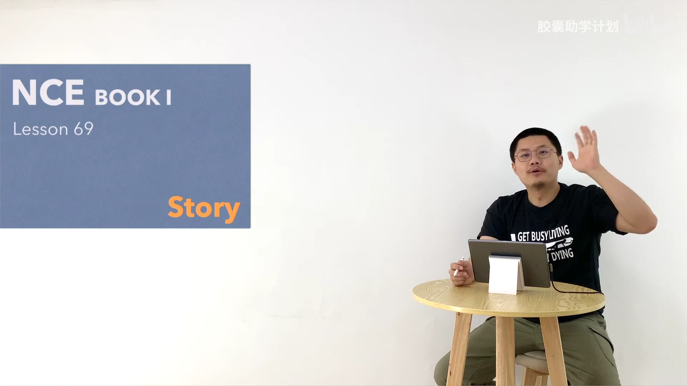

文字识别：胶囊助学计划 / NCE / BOOKI / Lesson 69 / Story / GET BUSYLVING / DYING

### 画面 00:00:08

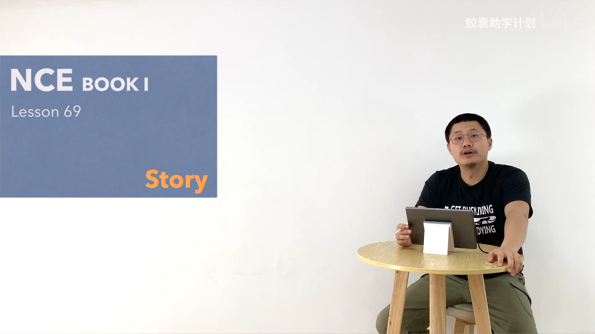

文字识别：胶囊助学计划 / NCE / BOOKI / Lesson 69 / Story / DYING

### 画面 00:00:10

文字识别：胶囊助学计划bll / •

### 画面 00:00:14

### 画面 00:00:16

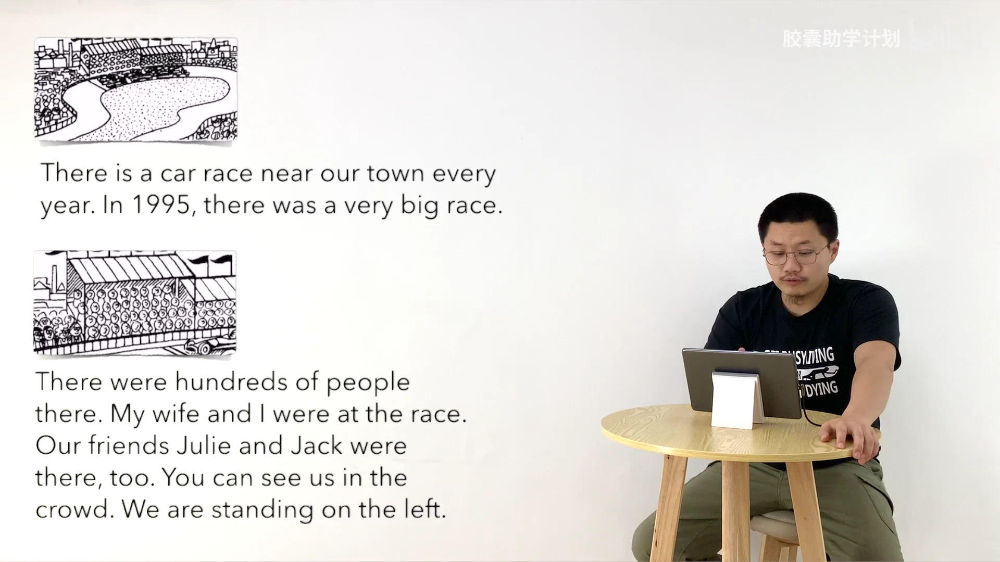

文字识别：There is a car race near our town every / year. In 1995, there was a very big race. / 'SYIING / There were hundreds of people / DYING / there. My wife and I were at the race. / Our friends Julie and Jack were / there, too. You can see us in the / crowd. We are standing on the left.

## 00:00:30–00:01:00

town，在我们小镇的附近 every year，哎，这好像又有点像一个习惯。这个小镇每年都会举办这样一个汽车比赛，对吧？OK，所以它用的是 there is，陈述客观事实嘛，一般现在时，以及生活习惯嘛，一般现在时。In nineteen ninety five，好，这儿提一个小点，一九九五年怎么读呢？先读十九，再读九十五，

### 画面 00:00:44

文字识别：胶囊助学计划 / There is a car race near our town every / year. In 1995, there was a very big race. / SYIING / There were hundreds of people / IDYING / there. My wife and I were at the race. / Our friends Julie and Jack were / there, too. You can see us in the / crowd. We are standing on the left.

### 画面 00:00:59

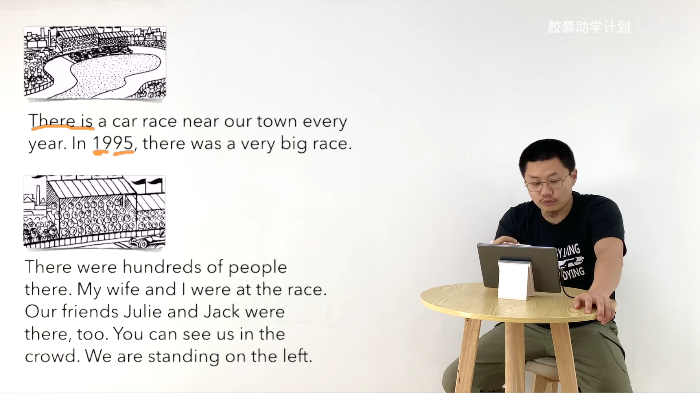

文字识别：胶囊助学计划 / There is a car race near our town every / year. In 1995, there was a very big race. / YLING / There were hundreds of people / OYING / there. My wife and I were at the race. / Our friends Julie and Jack were / there, too. You can see us in the / crowd. We are standing on the left.

## 00:01:00–00:01:30

十九 nineteen九十五 ninety five okay好在一九九五年 there was a very big race你注意这就是一般过去时了说当时啊 there was当时有一个非常大的比赛 okay然后开始说过去一九九五年那次比赛的事了 there were hundreds of people there好注意这开头是一个 there 结尾是一个 there

### 画面 00:01:29

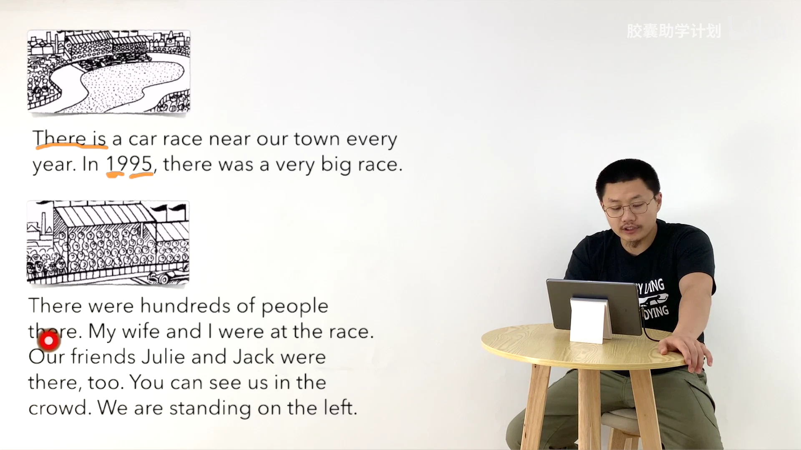

文字识别：There is a car race near our town every / year.In 1995, there was a very big race. / YAING / There were hundreds of people / DYING / re. My wife and I were at the race. / Our friends Julie and Jack were / there, too. You can see us in the / crowd. We are standing on the left.

## 00:01:30–00:02:00

但这两个 there 不是一码事儿。开头的这个 there 是 there be 句型的这个 there，不单独翻译这个 there，啊，不翻译成那里，就 there be 句型合起来翻译成有就行了。所以 there were 叫做有，当时有 hundreds of people。好了，注意 hundred 这个小单词啊，各位可以记一下叫百。那 hundreds of 这个小的短语，各位也可以直接记在您的课本旁边，它表示的是数以百

### 画面 00:01:32

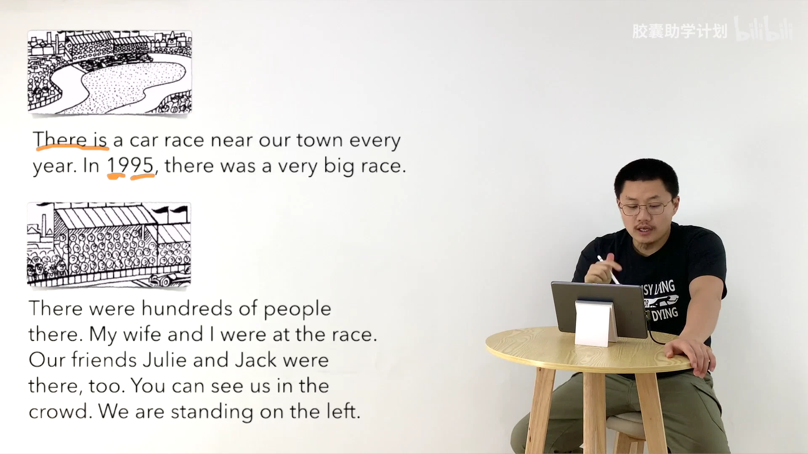

文字识别：胶囊助学计划 / There is a car race near our town every / year.In 1995, there was a very big race. / SYLING / There were hundreds of people / DYING / there. My wife and I were at the race. / Our friends Julie and Jack were / there, too. You can see us in the / crowd. We are standing on the left.

### 画面 00:01:59

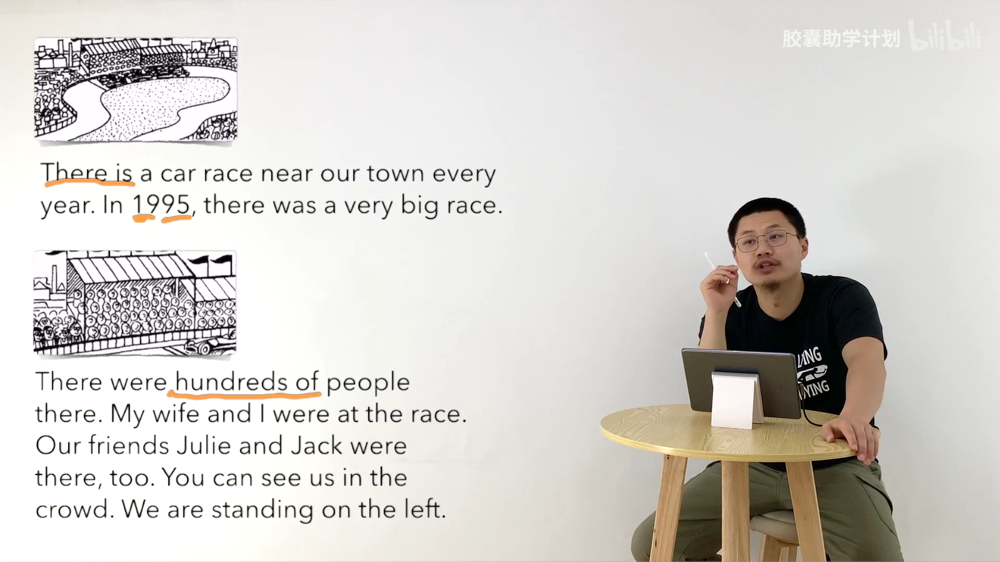

文字识别：胶囊助学计划 / There is a car race near our town every / year.In 1995, there was a very big race. / LING / There were hundreds ofpeople / NING / there. My wife and I were at the race. / Our friends Julie and Jack were / there, too. You can see us in the / crowd. We are standing on the left.

## 00:02:00–00:02:30

计的，OK，数以百计的人，注意这个there就不是我们说there be句型的there了，它就是单独的一个小的单词here there啊，here这里，there那里啊，就是说那里当时有数以百计的人啊。My wife and I说，我妻子和我呀，were at the race，说当时呢也在这个比赛这个地方。Our friends Julie and Jack说，我们的朋友Julie和Jack

### 画面 00:02:14

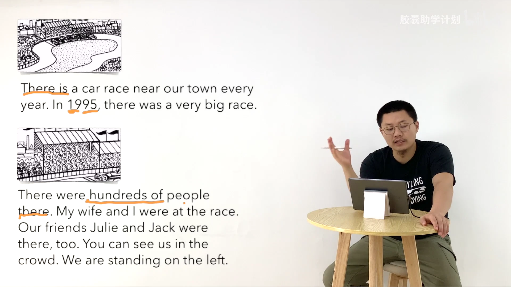

文字识别：胶囊助学计划 / There is a car race near our town every / year.In 1995, there was a very big race. / YLING / There were hundreds of people / DYING / there. My wife and I were at the race. / Our friends Julie and Jack were / there, too. You can see us in the / crowd. We are standing on the left.

### 画面 00:02:19

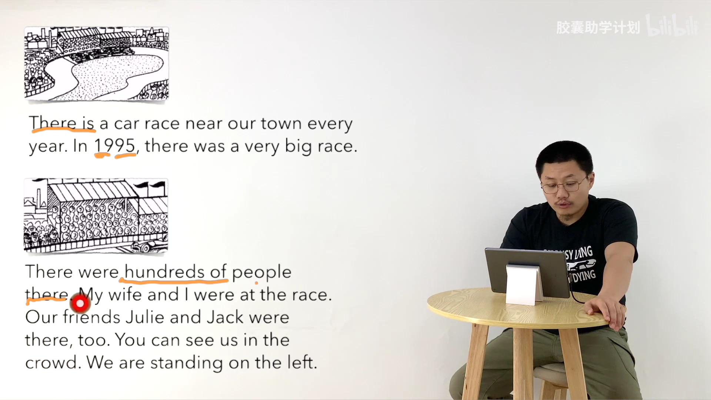

文字识别：胶囊助学计划 / There is a car race near our town every / year.In 1995, there was a very big race. / SYLING / There were hundreds of people / IDYING / there / My wife and I were at the race. / Our friends Julie and Jack were / there, too. You can see us in the / crowd. We are standing on the left.

## 00:02:30–00:03:00

呢 were there too. 说当时啊也在那里. You can see us in the crowd. 说你们能在注意你能看到我们 us 对吧? Our 啊 a we 啊 our us 啊这是那一排我让大家整理过了对吧？六十五课 in the crowd 在人群当中你能看到我们. We are standing on the left. 注意理论上来说啊，我个人觉得这个地方用 we were standing 好一

### 画面 00:02:49

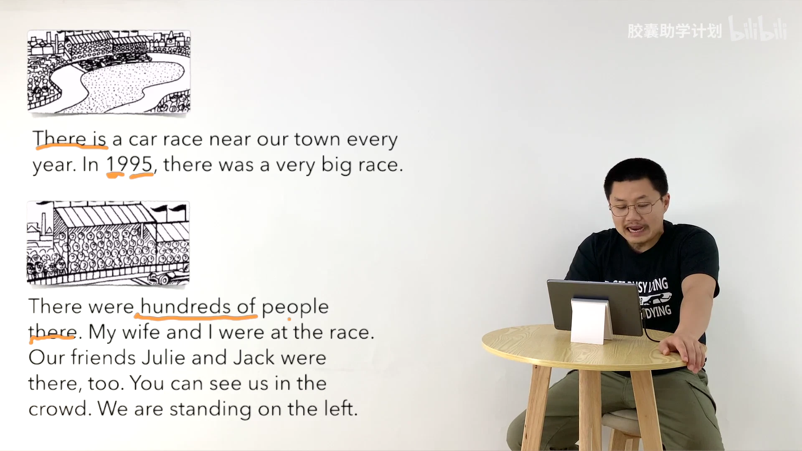

文字识别：胶囊助学计划 / There is a car race near our town every / year.In 1995, there was a very big race. / 'SYLING / There were hundreds of people / MIDYING / there. My wife and I were at the race. / Our friends Julie and Jack were / there, too. You can see us in the / crowd. We are standing on the left.

## 00:03:00–00:03:30

点点，它叫做过去进行时，对吧？但是因为到现在还没学到呢，这个应该是新概念一册一百一十七课才学呢，所以呢，呃，他没用，那我也能理解，毕竟是教材，对吧？说我们啊正站在 on the left，二十五课咱们就学过了，叫做在左手边啊，我们正站在左手边来了。 There were twenty cars in the race. 说有啊二十辆车在比赛里。 There were

### 画面 00:03:19

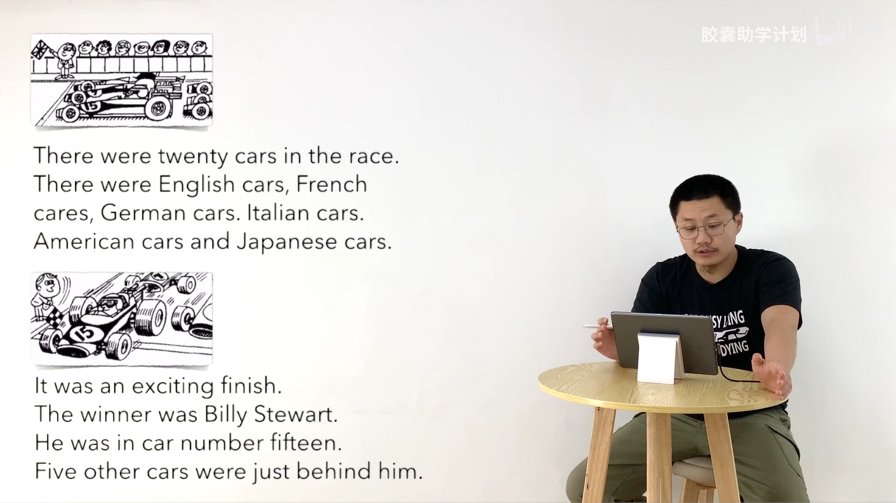

文字识别：胶囊助学计划 / han / There were twenty cars in the race. / There were English cars, French / cares, German cars. Italian cars. / American cars and Japanese cars. / SYLING / IDYING / It was an exciting finish. / The winner was Billy Stewart. / He was in car number fifteen. / Five other cars were just behind him.

### 画面 00:03:21

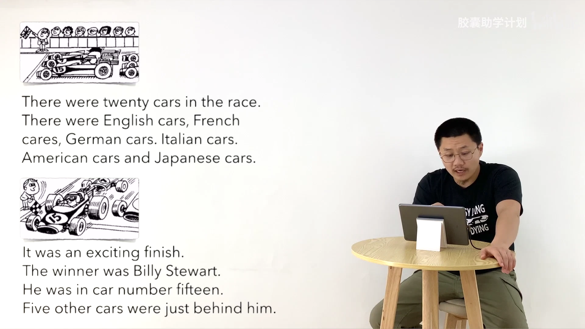

文字识别：胶囊助学计划 / 7010 / han / There were twenty cars in the race. / There were English cars, French / cares, German cars. Italian cars. / American cars and Japanese cars. / SYLANG / DYING / It was an exciting finish. / The winner was Billy Stewart. / He was in car number fifteen. / Five other cars were just behind him.

## 00:03:30–00:04:00

English cars,英产的车, French cars,啊法产的车, German cars,德产的车, Italian cars,意大利车, American cars,美国车, Japanese cars,啊日本车,啊这都是比较常见的几个国家曝光率啊在新闻啊报纸当中是比较多的,各位不妨到时候可以记一下啊。说It was an exciting finish.说这个呀是一个特别令人激动的结尾。

### 画面 00:03:51

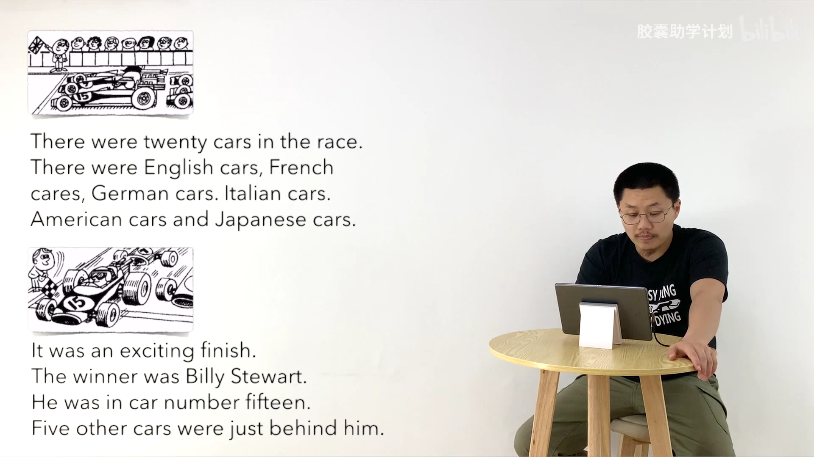

文字识别：胶囊助学计划 / han / 5 / There were twenty cars in the race. / There were English cars, French / cares, German cars. Italian cars. / American cars and Japanese cars. / SYANG / 7DYING / It was an exciting finish. / The winner was Billy Stewart. / He was in car number fifteen. / Five other cars were just behind him.

## 00:04:00–00:04:30

The winner was Billy Store.获胜者是 Billy Store 这个人。He was in car number fifteen.说他在车十五号当中。Five other cars.五辆。注意 other 就是其他的。五辆其他的车呢 were just behind him.注意你如果说 behind him 这句话就有点废话了。为什么？因为他是 winner，他是获胜者。那所有的车都

### 画面 00:04:21

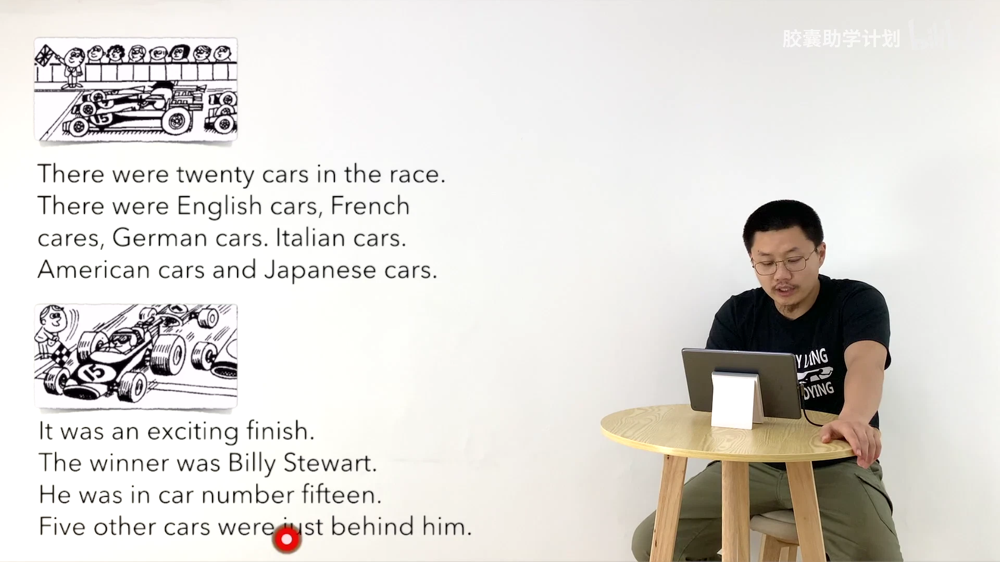

文字识别：胶囊助学计划 / 7010 / han / 5 / There were twenty cars in the race. / There were English cars, French / ® / cares, German cars. Italian cars. / American cars and Japanese cars. / YLING / DVING / It was an exciting finish. / The winner was Billy Stewart. / He was in car number fifteen. / Five other cars were iyst behind him.

## 00:04:30–00:05:00

一定是 behind him了。这是获胜者的定义。你想一下，对吧？好，那他说又说了是 exciting finish，还用了一个 just behind him，特别令人兴奋。大家相继撞线，所以才是 exciting finish，所以才叫做 just behind him，紧随其后。这个逻辑才是对的，对吧？这种表述方式才是对的。OK，好。On the way home，在回家的路上，my wife said to me，好

### 画面 00:04:51

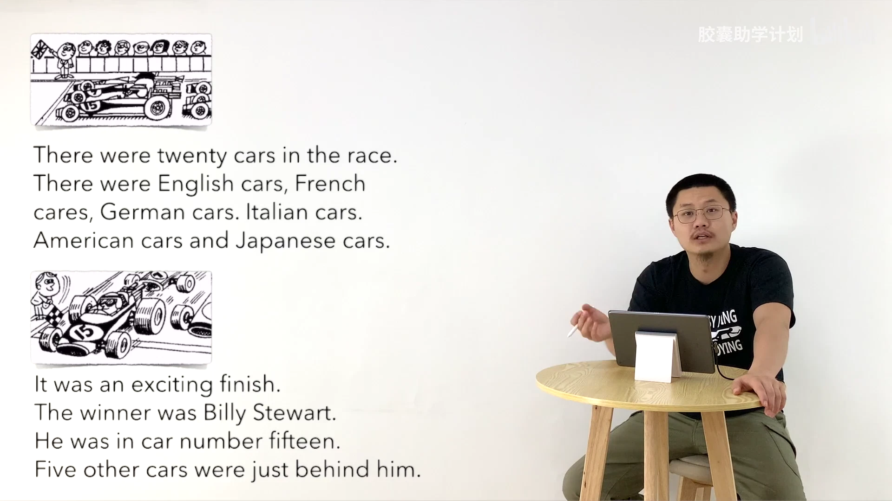

文字识别：胶囊助学计划 / han / There were twenty cars in the race. / There were English cars, French / cares, German cars. Italian cars. / American cars and Japanese cars. / YANG / YING / It was an exciting finish. / The winner was Billy Stewart. / He was in car number fifteen. / Five other cars were just behind him.

### 画面 00:04:54

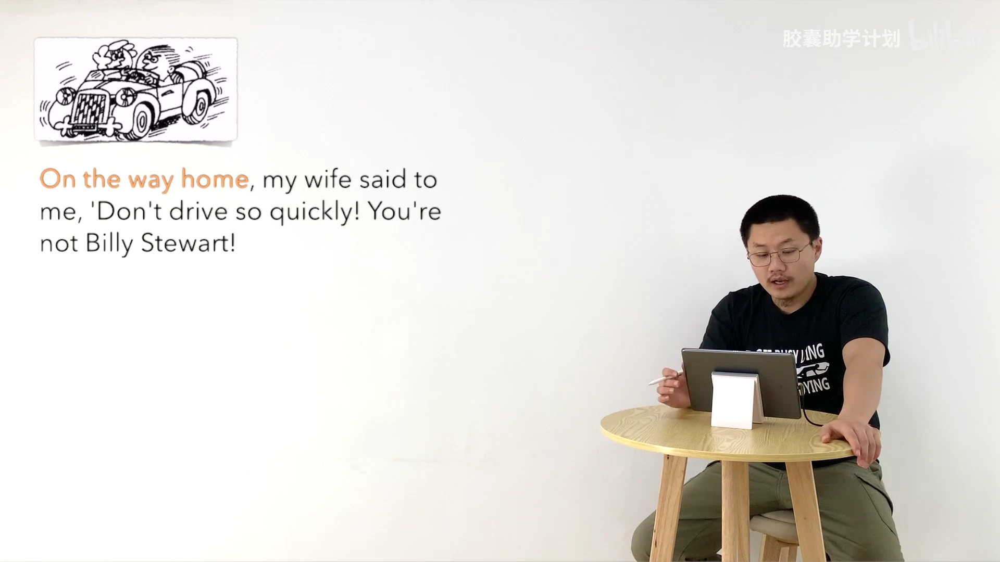

文字识别：胶囊助学计划 / On the / way / home, my / wife / said / to / me, / 'Don't / drive / sO / quickly! You're / not Billy / Stewart! / YLING / DYING

## 00:05:00–00:05:30

了，注意一个小的单词出来了，叫做 said。这个单词咱们还没学过，当然您基础好可能认得，基础不好我简单提一句，各位不用着急。七十一课马上咱们就学。Say said是say这个单词的过去式，动词也有过去式啊。说这个动作发生在过去啊。我们现在只学了am is are变成was were这个状态发生在过去，马上就学这个动作发生在过去了。来

### 画面 00:05:06

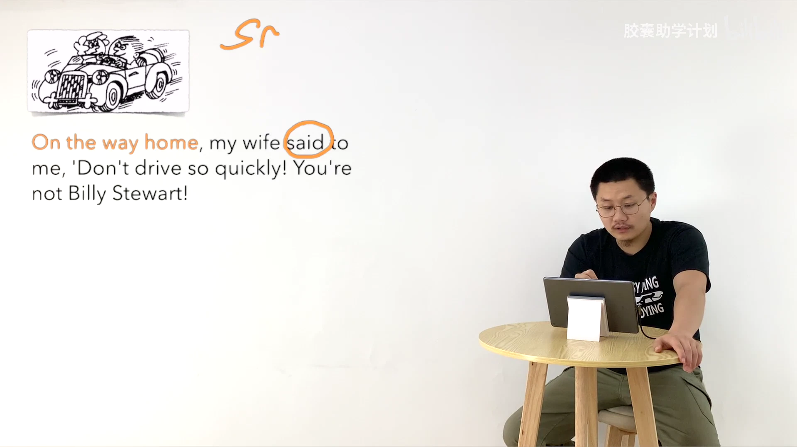

文字识别：Sr / 胶囊助学计划 / On the / way / home, my / wife / said / O / me, / 'Don't / drive / sO / quickly! You're / not / Billy / Stewart! / YANG / DYING

### 画面 00:05:16

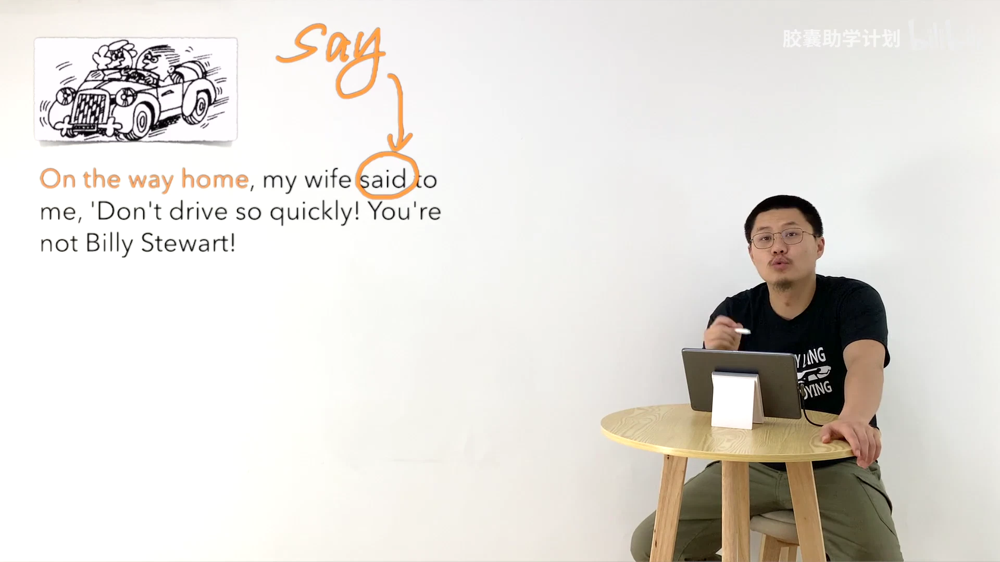

文字识别：Say / 胶囊助学计划 / On the / way / home, my / wife / said / O / me, / 'Don't / drive / sO / quickly! You're / notl / Billy / Stewart! / YLING / YING

### 画面 00:05:23

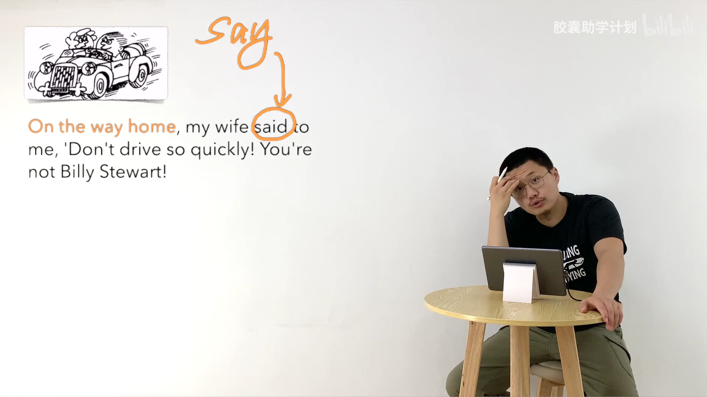

文字识别：Say / 胶囊助学计划 / On the / way / home, my / wife / saidt / me, / 'Don't / drive / SO / quickly! You're / notE / Billy / Stewart! / LING / NING

## 00:05:30–00:06:00

了，My wife said to me，对我说道，Don't drive so quickly，不要开的如此的快啊。这次我们在Must那个地方就学过了。You are not Billy Store，啊，扎心了，说你别开这么快回家的路上啊。你又不是那个Billy Store获胜者，对吧？比赛那个Car Race的Winner of the that Car Race，啊，对吧？The race，OK。好，那接下来呢，我们看一下这个Comprehension这个练习啊。

### 画面 00:05:33

文字识别：Say / 胶囊助学计划 / On the / way / home, my / wife / said / O / me, / 'Don't / drive / sO / quickly! You're / notl / Billy / Stewart! / SYLING / DYING

### 画面 00:05:35

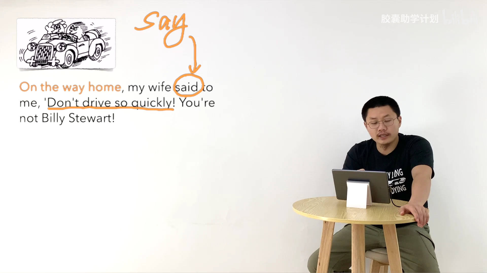

文字识别：Say / 胶囊助学计划 / On the / way / home, my / wife / said / me, / 'Don't drive so auickly! / !You're / not / Billy / Stewart! / 9 / YLING / DYING

### 画面 00:05:54

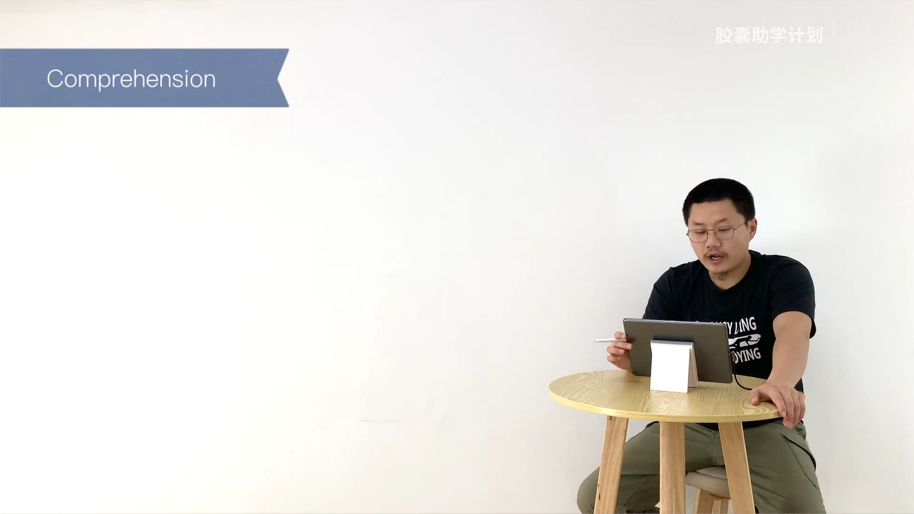

文字识别：胶囊助学计划 / Comprehension / YLING / DYING

## 00:06:00–00:06:30

recording. Transcribe the exact words in their original spoken languages. Never translate. Preserve repetitions, questions and examples. This is a Chinese-English teaching recording. Transcribe the exact words in their original spoken languages. Never translate. Preserve repetitions, questions and examples.

### 画面 00:06:06

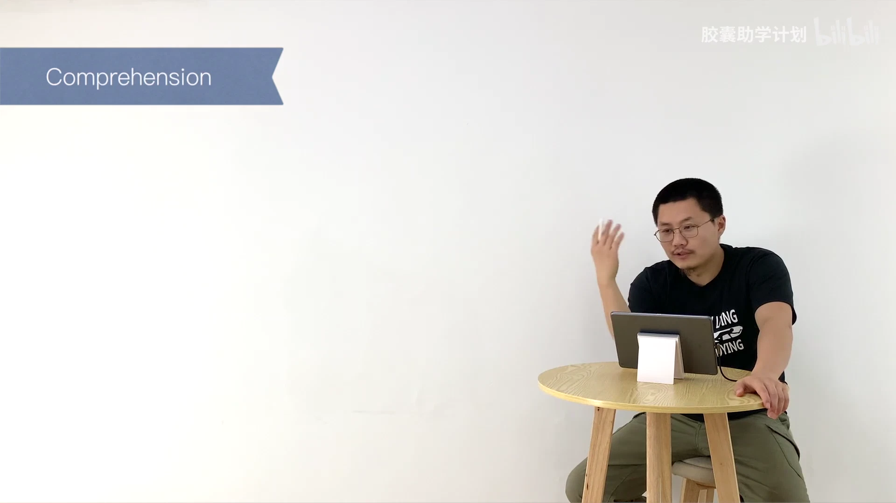

文字识别：胶囊助学计划 / Comprehension / LING / MINING

### 画面 00:06:10

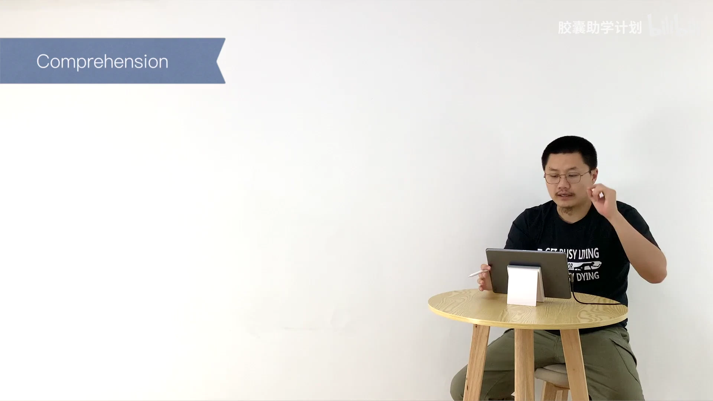

文字识别：胶囊助学计划 / Comprehension / ISYLING / ORA / YDYING

### 画面 00:06:12

文字识别：胶囊助学计划 / Comprehension / 1 T: Where is there a car race every year?

### 画面 00:06:22

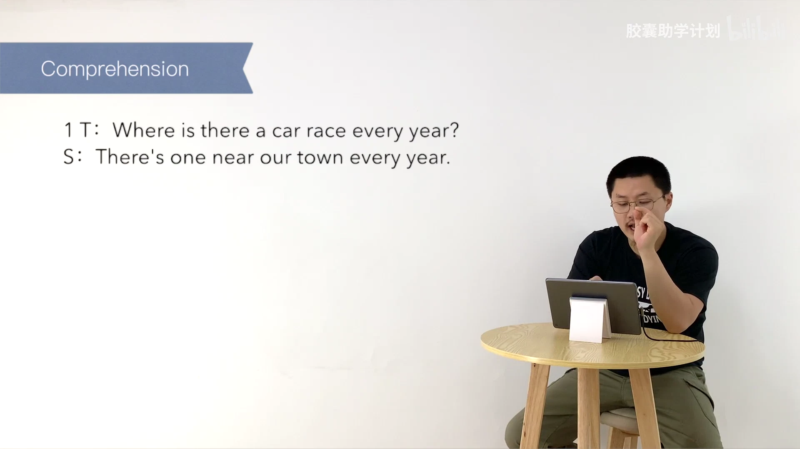

文字识别：胶囊助学计划 / Comprehension / 1 T: Where is there a car race every year? / S: There's one near our town every year.

## 00:06:30–00:07:00

Next one, when was there a very big car race? In 1995. Next one, how many people were there? Hundreds of people. Okay. Next one, were our friends Julie and Jack at the race? Yes, they were. Next one, how many cars were there in the race? Twenty cars in the

### 画面 00:06:30

文字识别：胶囊助学计划 / Comprehension / 2 T: When was there a very big car race?

### 画面 00:06:40

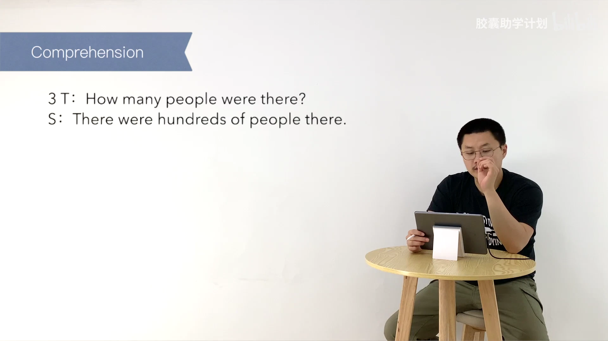

文字识别：胶囊助学计划 / Comprehension / 3 T: How many people were there? / S: There were hundreds of people there.

### 画面 00:06:44

文字识别：胶囊助学计划 / Comprehension / 4 T: Were our friends, Julie and Jack, at the race?

### 画面 00:06:57

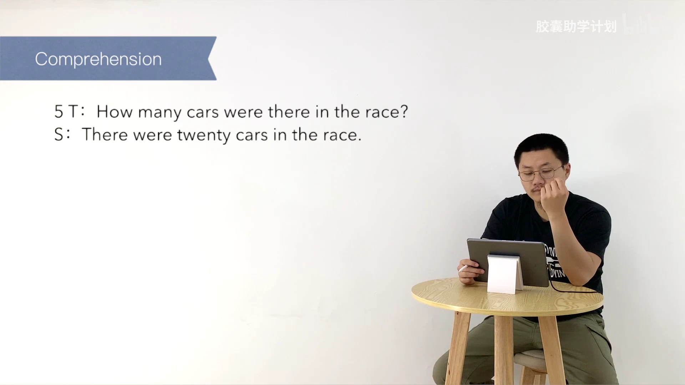

文字识别：胶囊助学计划 / Comprehension / 5 T: How many cars were there in the race? / S: There were twenty cars in the race.

## 00:07:00–00:07:30

race. Next one. What cars? What cars were there in the race? English cars, French cars, German cars, Italian cars, of course, American cars and Japanese cars, 对吧？还有两个，我记得. Okay. Next one. Ask me if肯定句，您变一般疑问句，特殊疑问句来了. Ask me if the car race is every year. 答案

### 画面 00:07:02

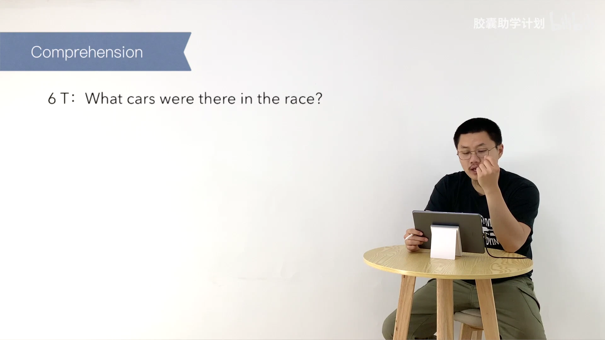

文字识别：胶囊助学计划 / Comprehension / 6 T: What cars were there in the race?

### 画面 00:07:13

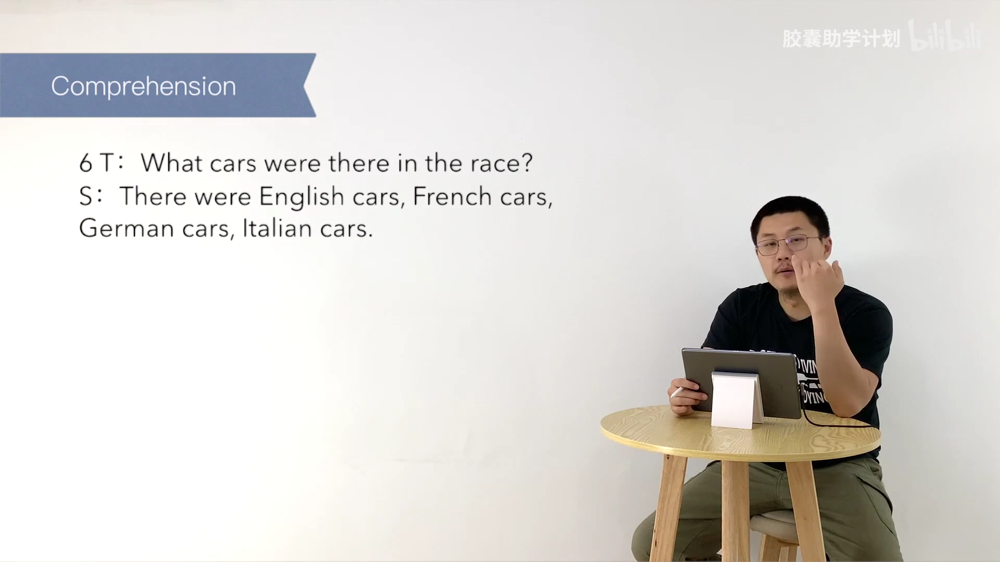

文字识别：胶囊助学计划 / Comprehension / 6 T: What cars were there in the race? / S: There were English cars, French cars, / German cars, ltalian cars. / 标

### 画面 00:07:18

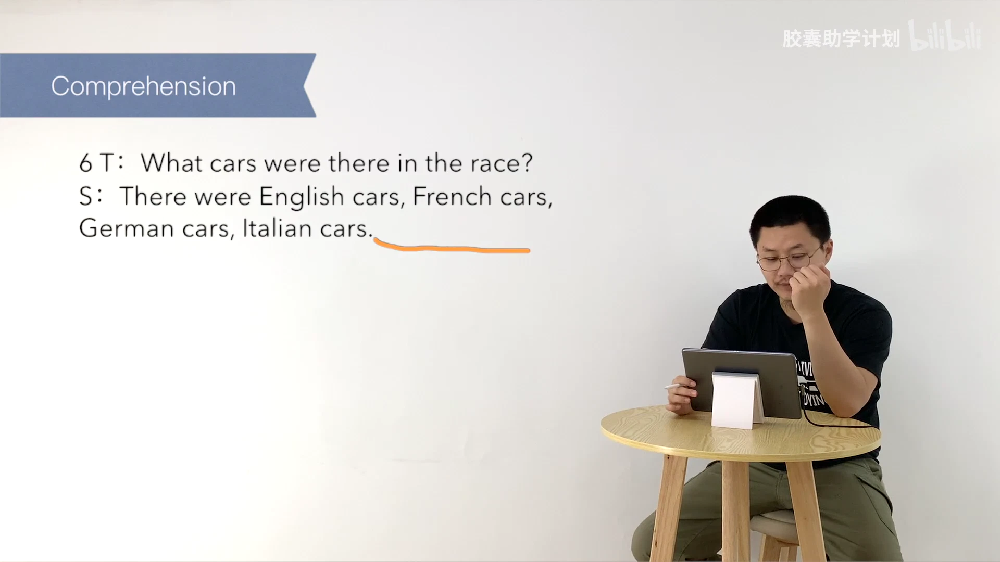

文字识别：胶囊助学计划 / Comprehension / 6 T: What cars were there in the race? / S: There were English cars, French cars, / German cars, ltalian cars.

### 画面 00:07:20

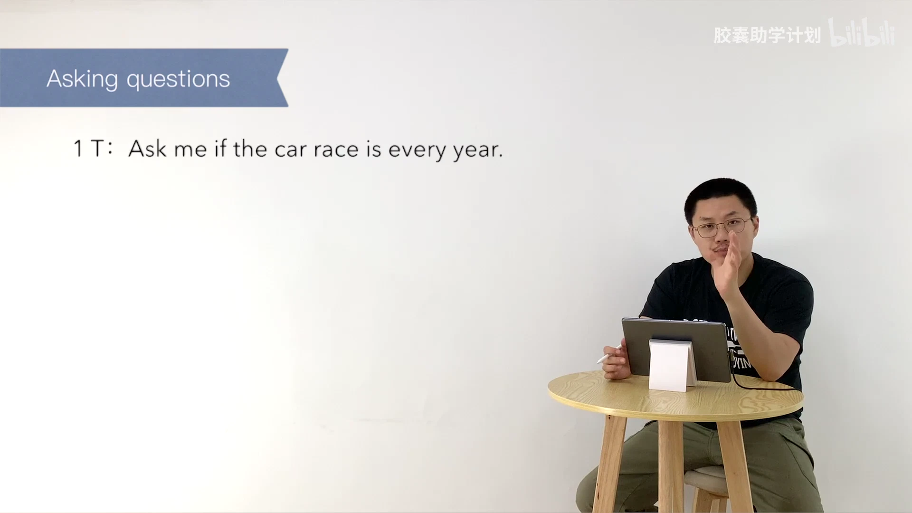

文字识别：胶囊助学计划 / Asking questions / 1 T: Ask me if the car race is every year.

## 00:07:30–00:08:00

is the car race every year. When? When is the car race? Okay. Certainly, you can use a how often. We haven't learned it yet. Ah, we'll come back to it later. Next one. Ask me if there was a very big race in 1995. Was there a very big race in 1995? When? When was there a very big race?

### 画面 00:07:33

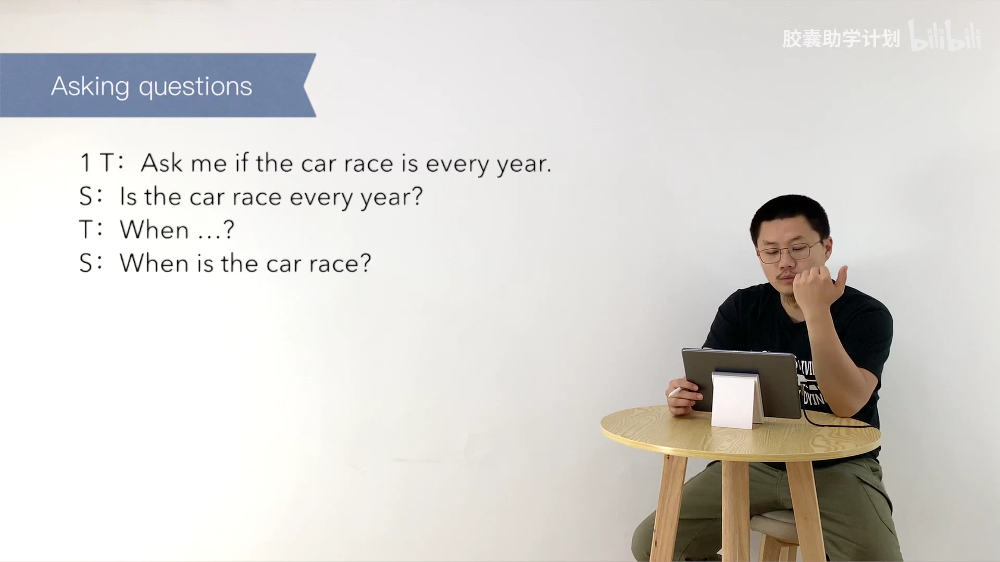

文字识别：胶囊助学计划 / Asking questions / 1 T: Ask me if the car race is every year. / S: Is the car race every year? / T: When ...? / S: When is the car race?

### 画面 00:07:39

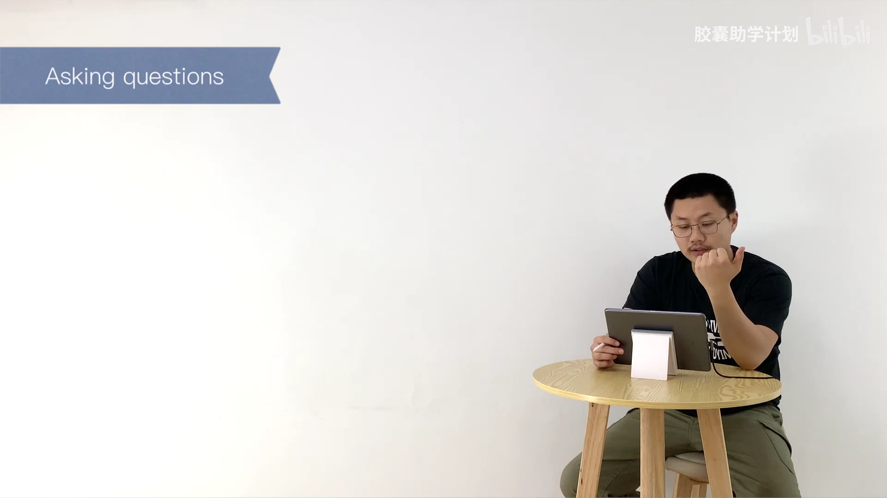

文字识别：胶囊助学计划 / Asking questions

### 画面 00:07:43

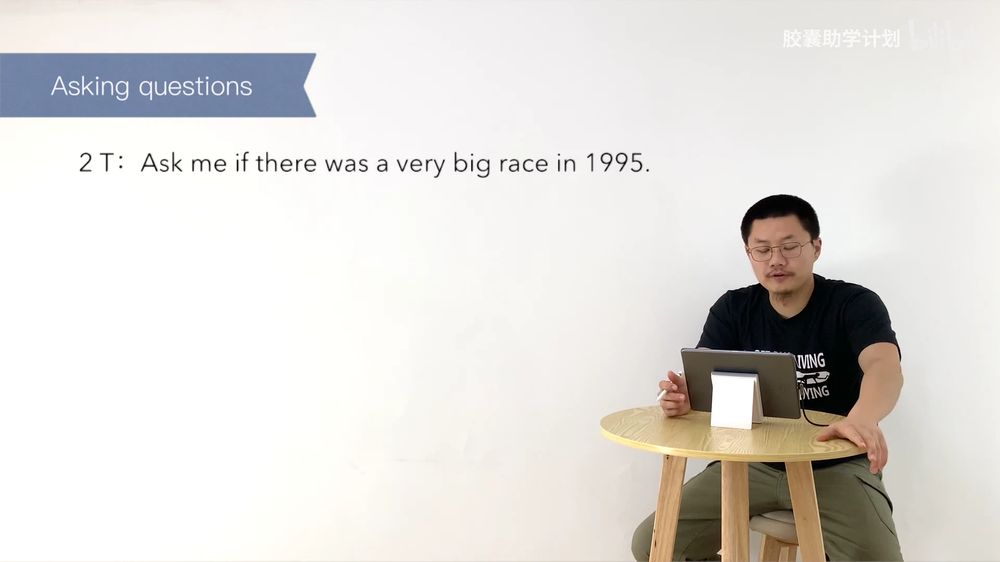

文字识别：胶囊助学计划 / Asking questions / 2 T: Ask me if there was a very big race in 1995. / VING / UVING

### 画面 00:07:48

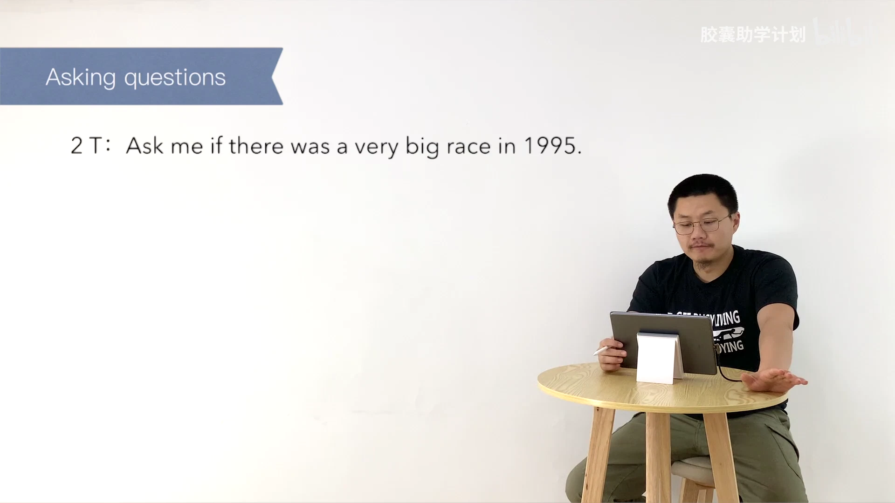

文字识别：胶囊助学计划 / Asking questions / 2 T: Ask me if there was a very big race in 1995. / YIING / DYING

### 画面 00:07:56

文字识别：胶囊助学计划 / Asking questions / 2 T: Ask me if there was a very big race in 1995. / S: Was there a very big race in 1995? / T: When ...? / S: When was there a very big race? / YING / YING

## 00:08:00–00:08:30

Next one, ask me if my wife and I were at the race. Were your wife and you at the race? Where? Where were your wife and you? Next one, ask me if there were twenty cars in the race. Were there twenty cars in the race? How many? How many cars were there

### 画面 00:08:00

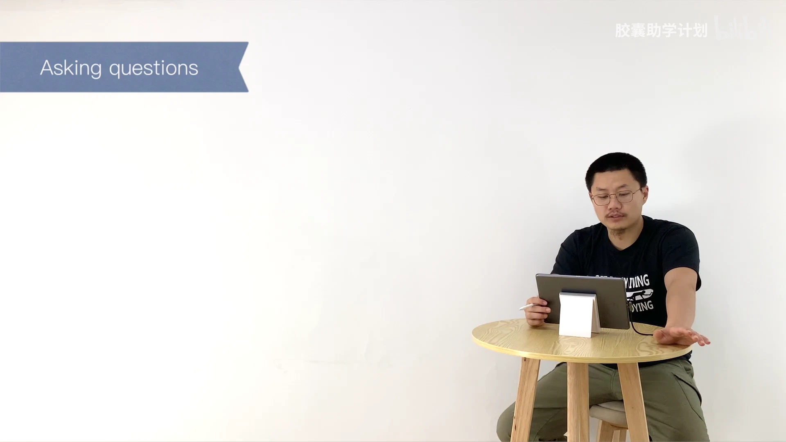

文字识别：胶囊助学计划 / Asking questions / YIING / DYING

### 画面 00:08:11

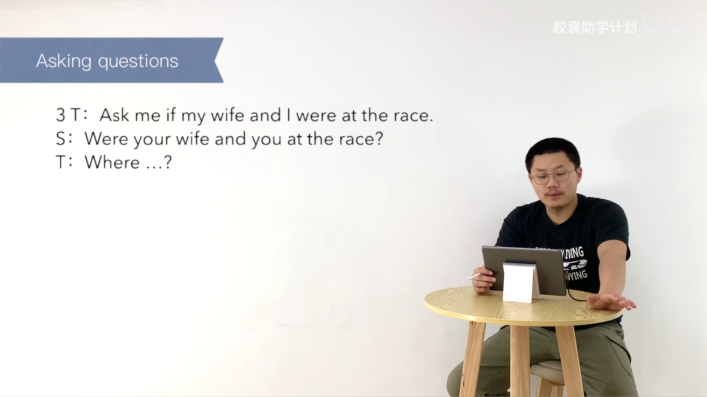

文字识别：胶囊助学计划 / Asking questions / 3 T: Ask me if my wife and I were at the race. / S: Were your wife and you at the race? / 9 / T:Where ..? / YUING / NING

### 画面 00:08:18

文字识别：胶囊助学计划 / Asking questions / 4 T: Ask me if there were twenty cars in the race. / YIING / YING

### 画面 00:08:27

文字识别：胶囊助学计划 / Asking questions / 4 T: Ask me if there were twenty cars in the race. / S: Were there twenty cars in the race? / T: How many …? / S: How many cars were there in the race? / MUNG / VING

## 00:08:30–00:09:00

in the race? Okay, next one. Ask me if the winner was Billy Store. Was提前was the winner Billy Store? Who?这就您可以选择对主语提问，也可以对Billy Store提问了，对吧？都可以。我们给一个答案叫Who was the winner?啊，谁是获胜者？啊，你答案就是Billy Store。那你说Who is? Who was Billy Store? Billy Store是谁？就

### 画面 00:08:33

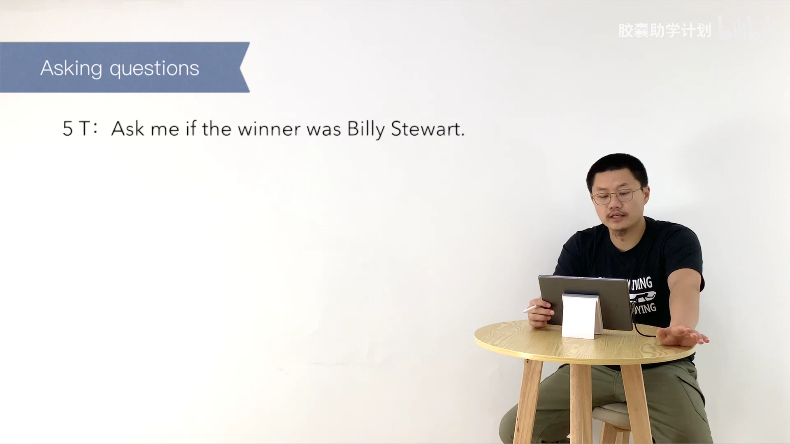

文字识别：胶囊助学计划 / Asking questions / 5 T: Ask me if the winner was Billy Stewart. / YIVING / MING

### 画面 00:08:45

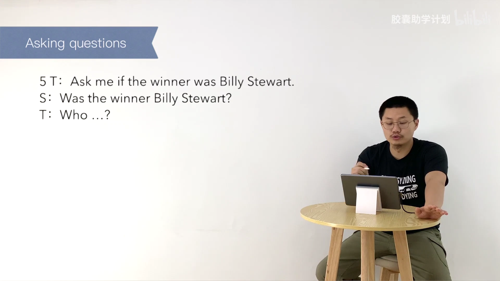

文字识别：胶囊助学计划 / Asking questions / 5 T: Ask me if the winner was Billy Stewart. / S: Was the winner Billy Stewart? / T: Who ..? / SYMING / DYING

### 画面 00:08:47

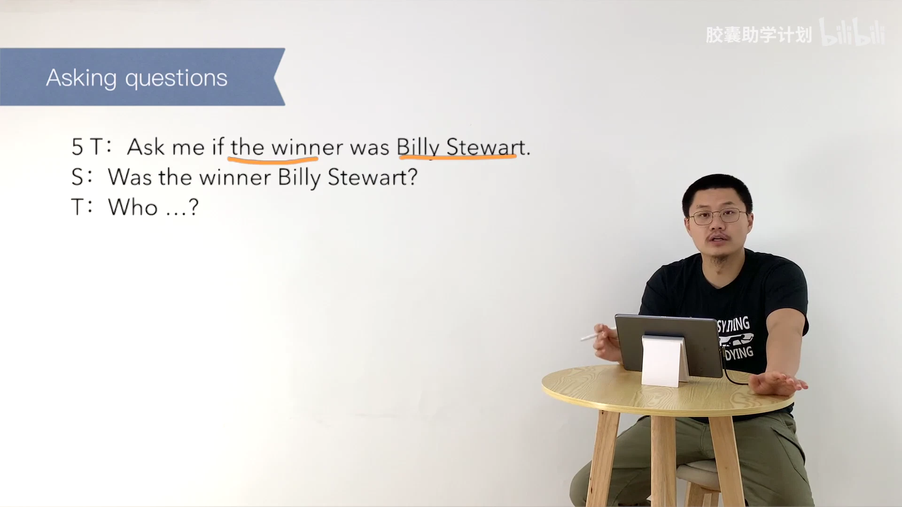

文字识别：胶囊助学计划 / Asking questions / 5 T: Ask me if the winner was Billy Stewart. / S: Was the winner Billy Stewart? / T: Who ...? / SYING / DYING

### 画面 00:08:49

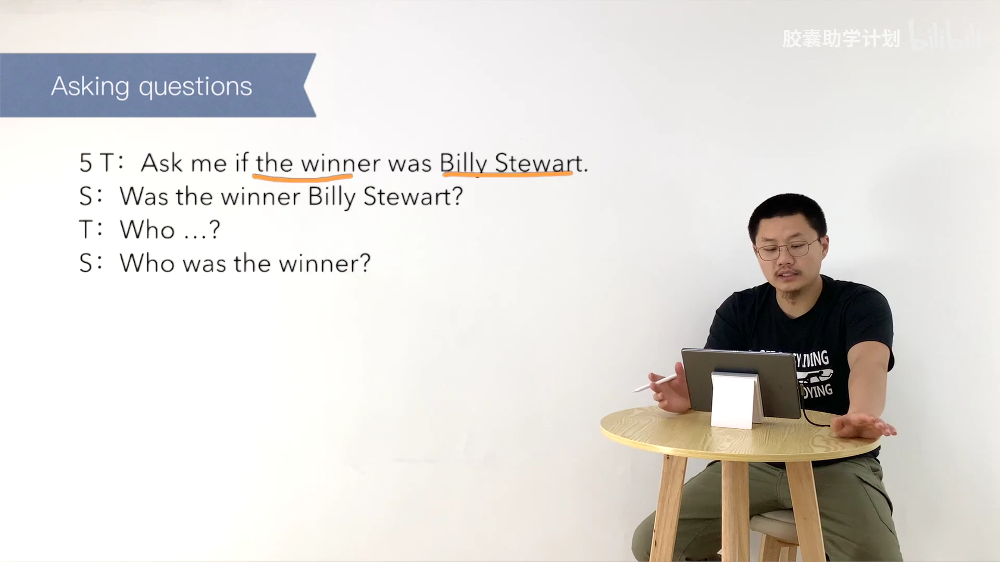

文字识别：胶囊助学计划 / Asking questions / 5 T: Ask me if the winner was Billy Stewart. / S: Was the winner Billy Stewart? / T:Who .? / S: Who was the winner? / YIING / DYING

### 画面 00:08:52

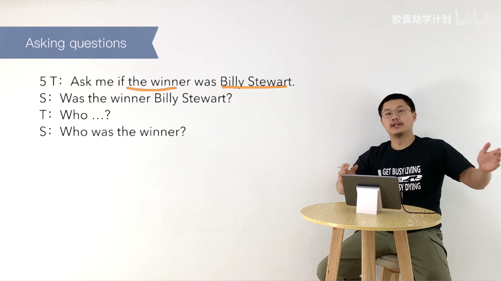

文字识别：胶囊助学计划 / Asking questions / 5 T: Ask me if the winner was Billy Stewart. / S: Was the winner Billy Stewart? / T: Who …? / S: Who was the winner? / GET BUSYLIVING / ORAIU / SYDYING

## 00:09:00–00:09:30

答案就是The Winner呗，对吧？OK, Recap.本课没有太多新的东西，无非就是还是There be句型的过去式啊，把is are换成了was were，就这么简单。家庭作业，绿皮书六十九课，各位可以去写了。文章要跟读至熟读成诵，给自己讲解一遍今天的核心知识点。那如果大家喜欢我们的课程呢，欢迎大家关注、订阅、一键三连来支持我们啊，并分享给那些需要的朋友

### 画面 00:09:02

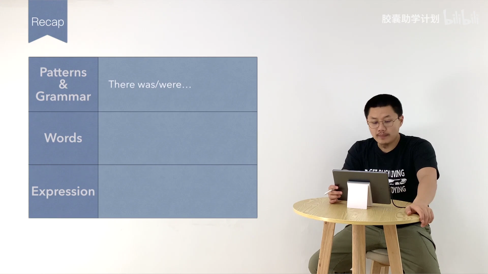

文字识别：Recap / 胶囊助学计划 / Patterns / & / There was/were... / Grammar / Words / Expression / DYING

### 画面 00:09:05

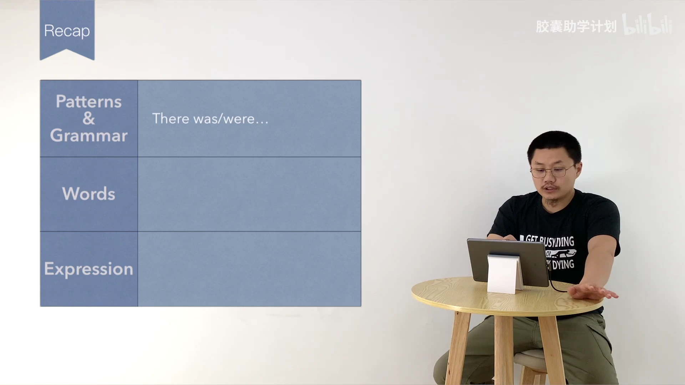

文字识别：Recap / 胶囊助学计划 / Patterns / There was/were... / Grammar / Words / GET BUSYIVING / Expression / MDYING

### 画面 00:09:07

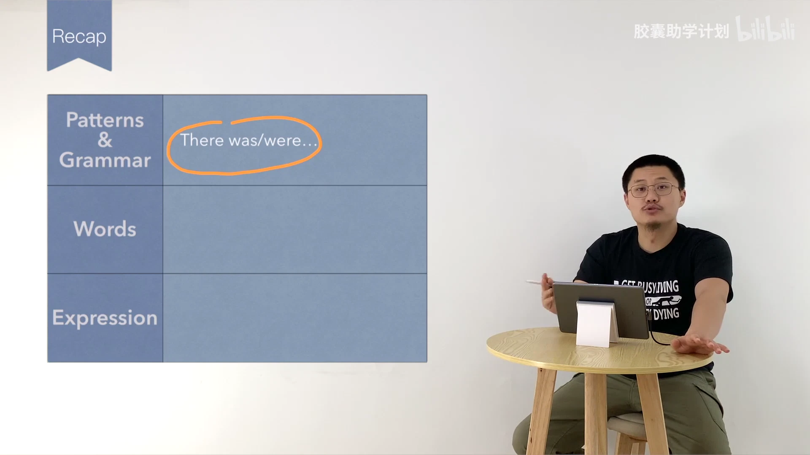

文字识别：胶囊助学计划 / Recap / Patterns / & / There was/were. / Grammar / Words /  CET USYINING / Expression / DYING

### 画面 00:09:10

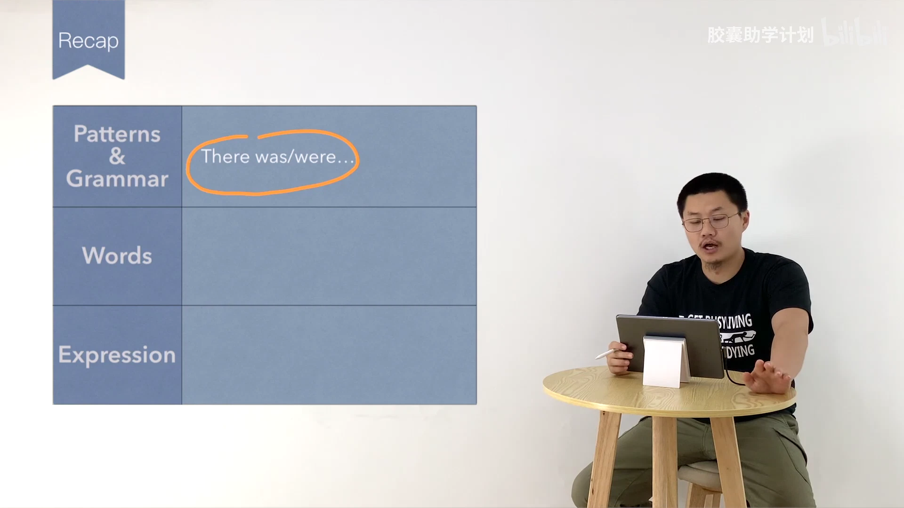

文字识别：胶囊助学计划 / Recap / Patterns / There was/were. / Grammar / Words / Expression / IDYING

### 画面 00:09:12

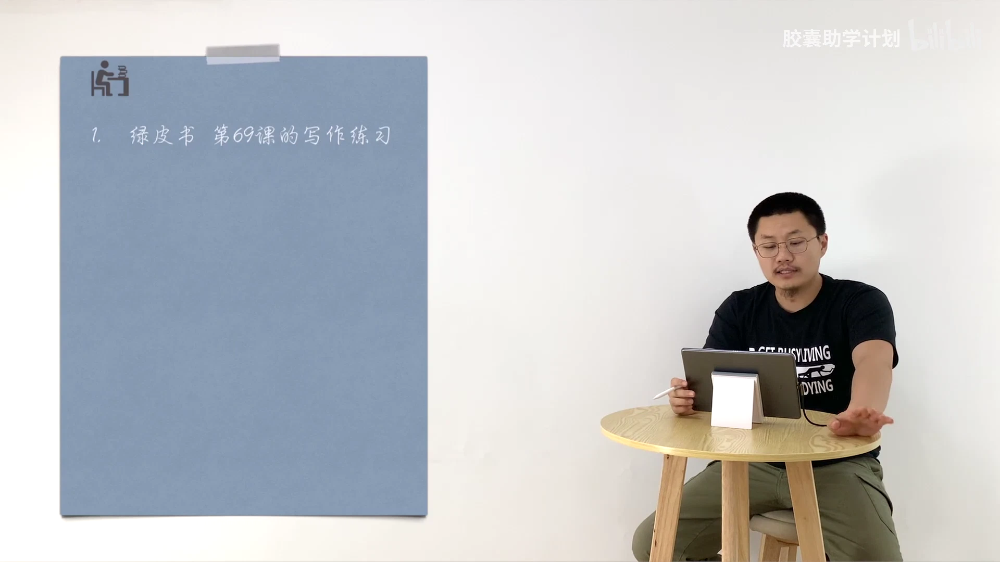

文字识别：胶囊助学计划 / 绿皮书第69课的写作练习 /  PISYING / DYING

### 画面 00:09:21

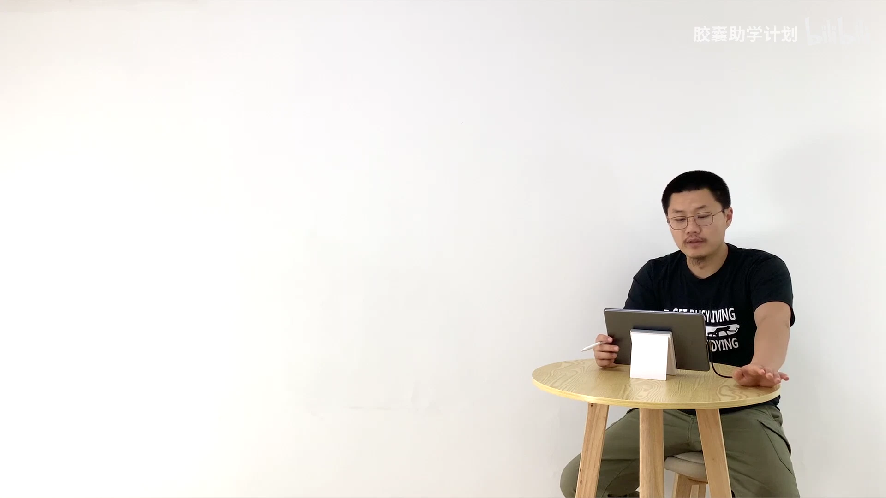

文字识别：胶囊助学计划 / 9 / DYING

### 画面 00:09:24

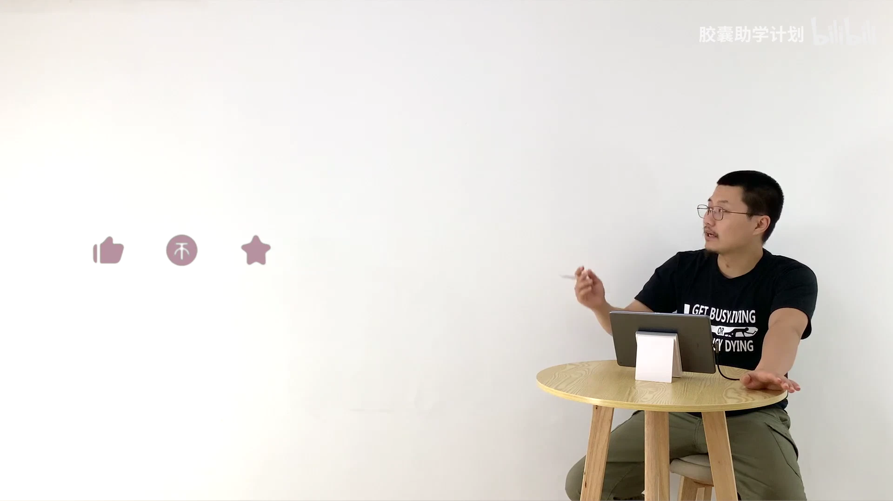

文字识别：胶囊助学计划 / GFTBUSYIVING / YDYING

## 00:09:30–00:09:52

们。Okay,那最后我们看一句名人名言。You cannot be a winner without maturity and consistency. See you next time.

### 画面 00:09:31

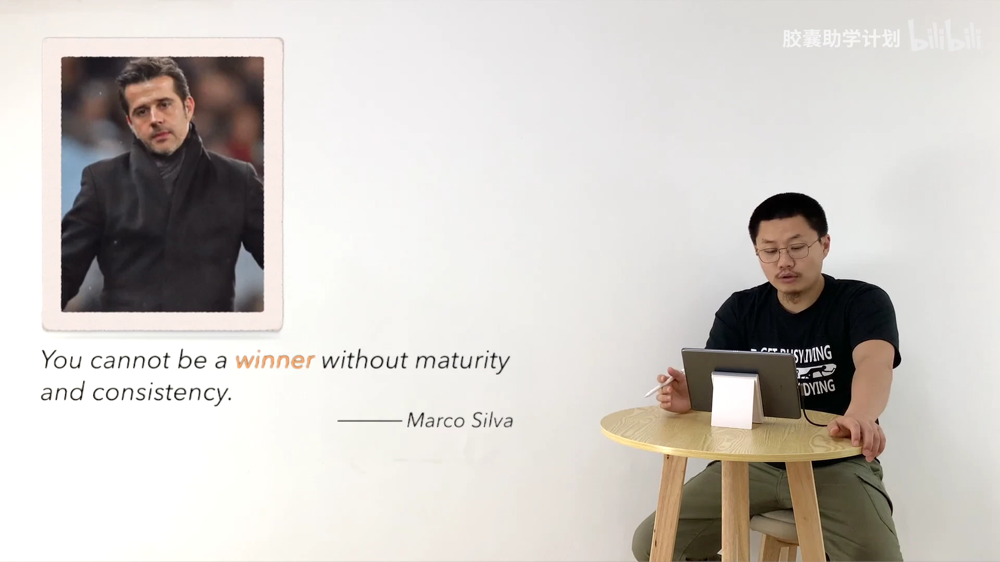

文字识别：胶囊助学计划 / You cannot be a winner without maturity / SYING / and consistency. / DYING / Marco Silva

### 画面 00:09:40

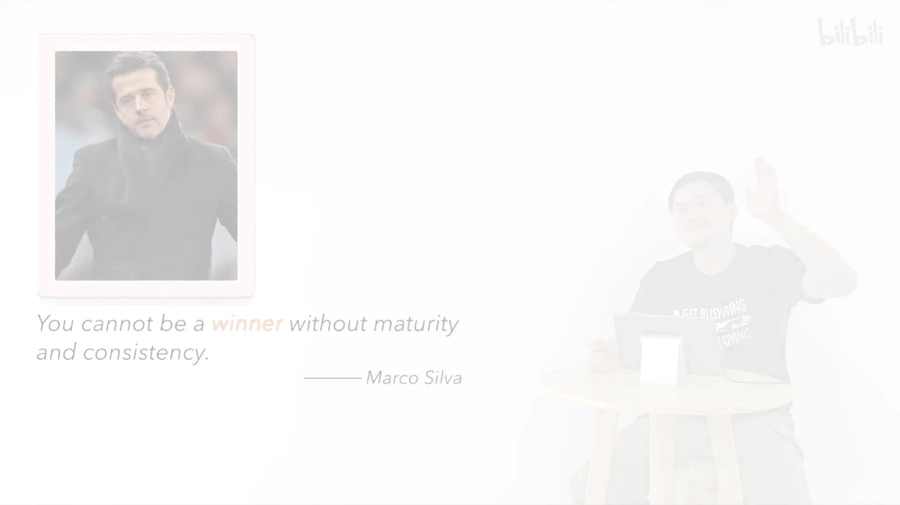

文字识别：You cannot be a winner without maturity / and consistency. / Marco Silva

### 画面 00:09:42

文字识别：CAPSULEACADEMY / 胶囊助学计划 / 『 / 小红书 / Lecturer / Leo / OE

### 画面 00:09:45

文字识别：CAPSULEACADEMY / 胶囊助学计划 / 小红书 / Edita. / OE

### 画面 00:09:48

文字识别：CAPSULEACADEMY / 胶囊助学计划 / 小红书 / Creator / □ / Leo & Berlin / OE

### 画面 00:09:50

文字识别：bilibili / 胶囊助学计划 / APSULEACA / 胶囊助学计划 / 小红书 / OE

### 画面 00:09:52

文字识别：bilibili / 胶囊助学计划

