# 070 单词 练习

快速机器解析：语音为单模型转写，未进行独立交叉校对或人工复核；画面每秒采样并按变化选帧，短时文字和标记可能遗漏。截图时间约有 1 秒误差。图片有损压缩；遇到疑点请按时间查看 Google Drive 原视频。

## 00:00:00–00:00:30

Hello everyone, welcome to Capsule Academy. This is Leo. Today we're going to learn new concept English book one lesson seventy practices and words. Hope you gonna enjoy it.好，那我们上来啊，先看本课的几个小单词啊啊，注意我们先读一下第一个，来叫做着画啊，变得来 stationary, stationary. Okay, 那

### 画面 00:00:00

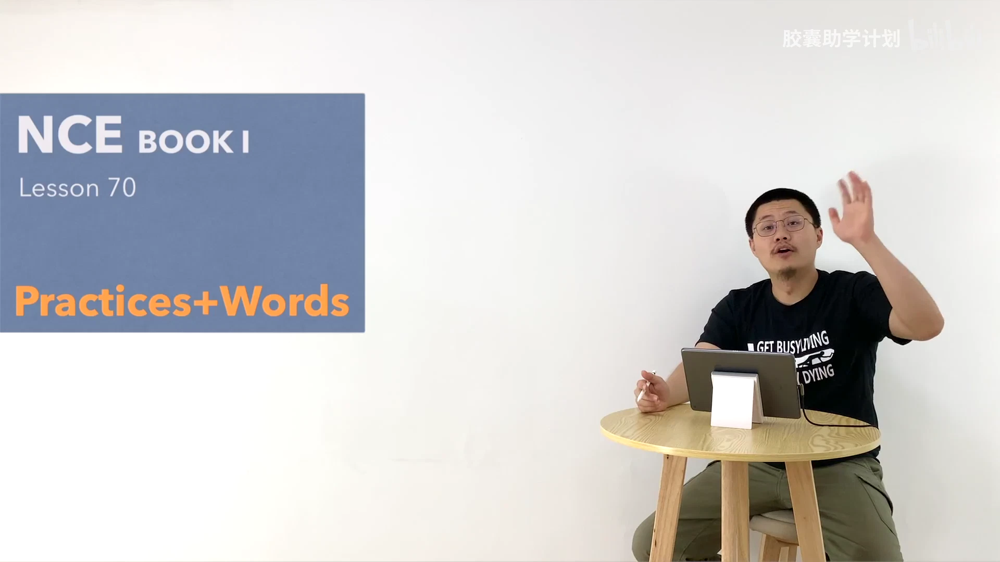

文字识别：胶囊助学计划 / NCE / BOOKI / Lesson 70 / Practices+Words / GFT BUSYIZING / DYING

### 画面 00:00:12

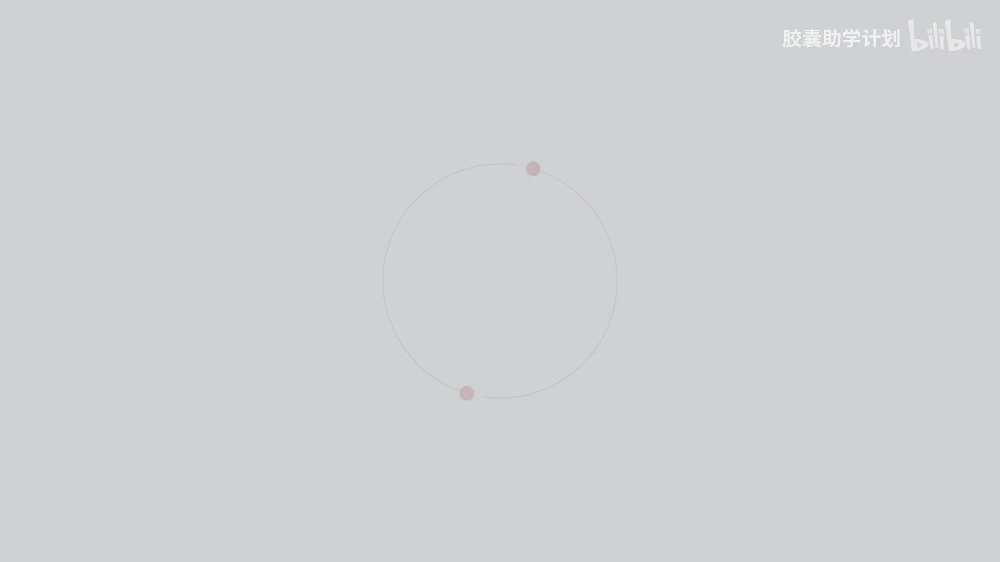

文字识别：胶囊助学计划bll

### 画面 00:00:15

文字识别：胶囊助学计划 / 胶囊助学计划

### 画面 00:00:17

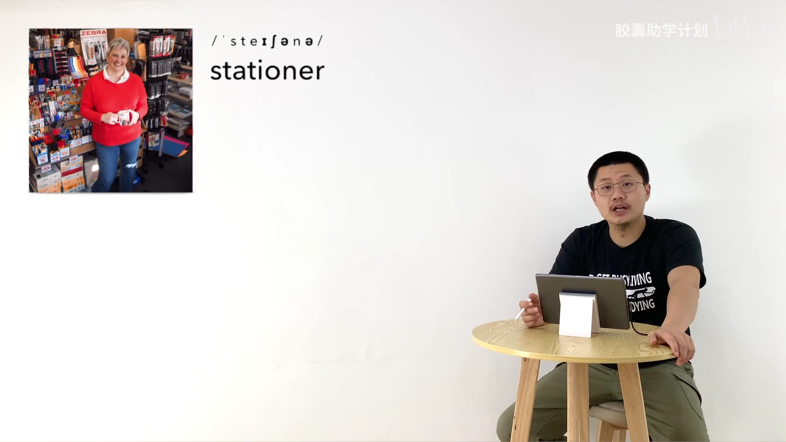

文字识别：胶囊助学计划 / ZEBRA / /'stei∫anal / stationer / DYING

### 画面 00:00:25

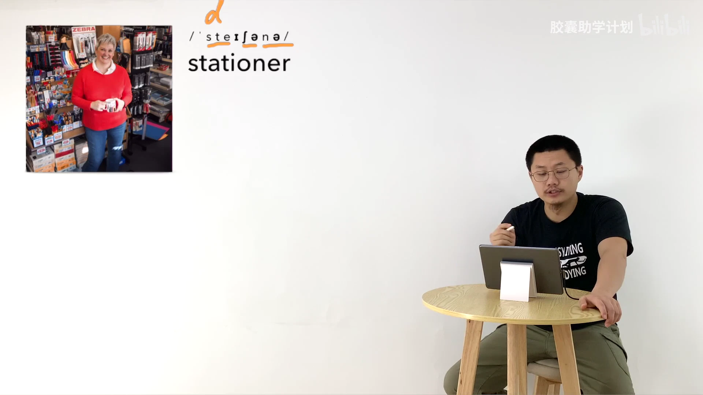

文字识别：胶囊助学计划 / ZEBRA / /'steifana/ / stationer / 9 / SYZING / DYING

## 00:00:30–00:01:00

stationer,注意它的意思指的是文具商啊，主指的是人啊，做这件事的人啊，卖文具的人叫做stationer。那你如果说在他那个地方呢，对吧？叫做at the stationers。各位应该还记得at the butchers吧？六十七课我们刚刚学过的，对吧？那at the stationers就是在文具店，对吧？Okay.那造一个简单的句子叫Were you at the stationers?你想一下，不就是六十七课的那个句话吗？叫Were you at the

### 画面 00:00:55

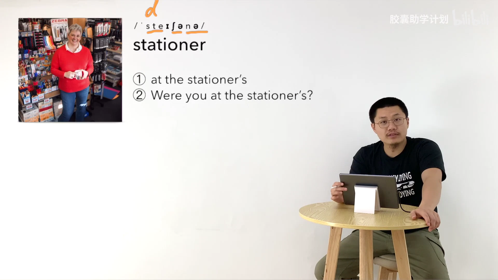

文字识别：胶囊助学计划 / ZEBRA / /'sterfana/ / stationer / at the stationer's / Were you at the stationer's? / YMING / DYING

## 00:01:00–00:01:30

butchers? Okay, 意思是一模一样的啊. Where were you? 你在哪？那你的回答就是 I was at the stationers, 对吧？我之前在文具店呢。下一个单词，其实它虽然这一课刚出现，但我们之前已经学过了丹丹麦，对吧？好，我们就读它一下就行了。来，Denmark, Denmark. Okay, 那单词最重要的一项就是造句啊。我们张开嘴来读一下。来，She comes from

### 画面 00:01:10

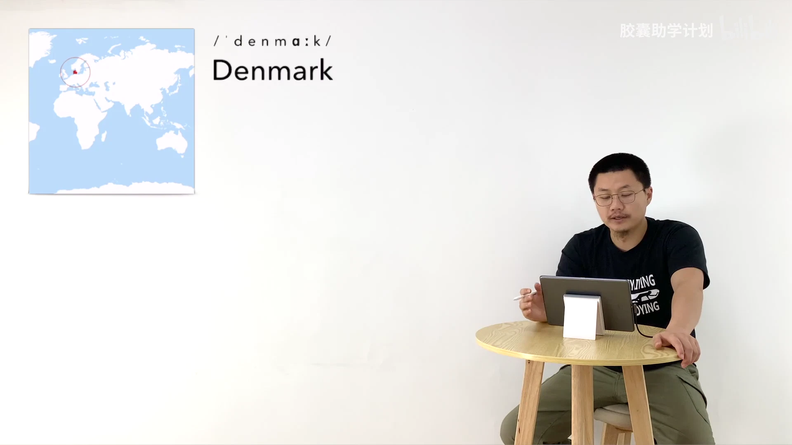

文字识别：胶囊助学计划 / /'denma:k/ / Denmark / YNING / DYING

## 00:01:30–00:02:00

Does she come from Denmark? Where does she come from? Okay,这是复习一下我们五十一课五十三课的关键句型。Okay,好，那接下来各位张开嘴跟我张嘴去跟读就可以了啊。来，Where were Sam and Penny? When were Sam and Penny at the stationers? They were at the stationers on Monday.注意全是过去的事儿啊。

### 画面 00:01:31

文字识别：胶囊助学计划 / /'d enm a:k/ / Denmark / ①She comes from Denmark. / Does she come from Denmark? / YUZING / DYING

### 画面 00:01:40

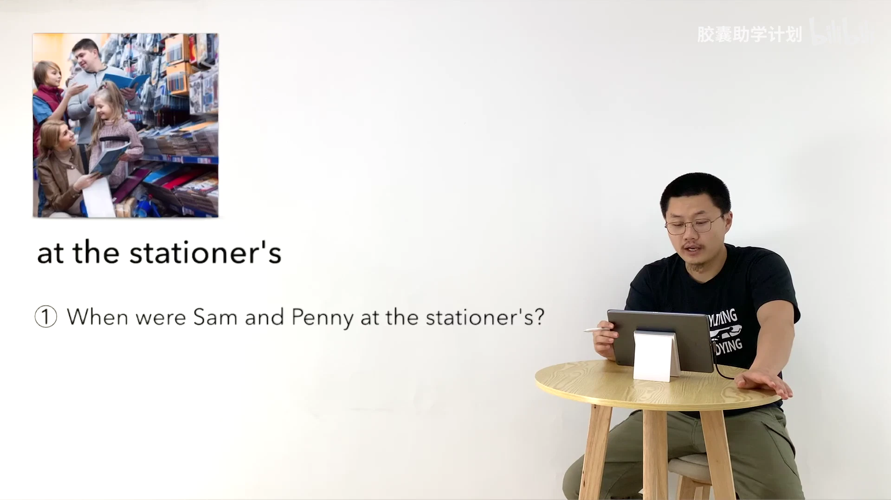

文字识别：胶囊助学计划 / at the stationer's /  When were Sam and Penny at the stationer's? / YUZING / DYING

### 画面 00:01:43

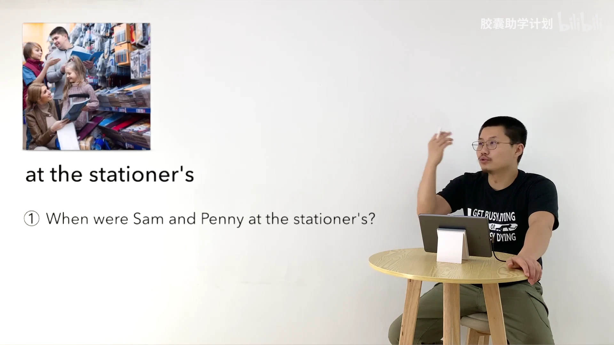

文字识别：胶囊助学计划 / at the stationer's / IGETRUSZING /  When were Sam and Penny at the stationer's? / OR / SYDYING

### 画面 00:01:47

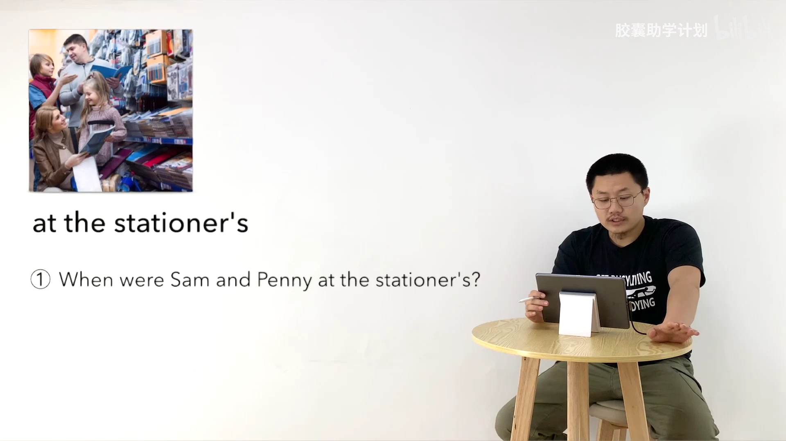

文字识别：胶囊助学计划 / at the stationer's /  When were Sam and Penny at the stationer's? / YUING / DYING

### 画面 00:01:53

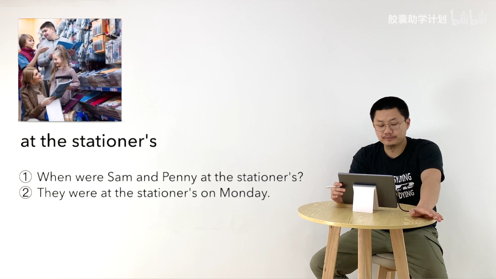

文字识别：胶囊助学计划 / at the stationer's / When were Sam and Penny at the stationer's? / SYUZING / They were at the stationer's on Monday. / DYING

## 00:02:00–00:02:30

Next one at the office. When were you and Susan at the office? We were at the office on March twenty-third. Next one. When was I in India? Ah, I what什么时候在印度来着？Okay, you were in India in nineteen eighty-five.先读十九，再读八十五。Okay，就这么简单。Next one. When were you and Penny in Australia?

### 画面 00:02:00

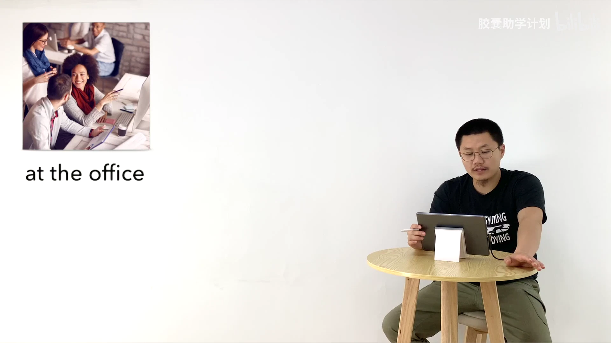

文字识别：胶囊助学计划 / at the office / SYZING / DYING

### 画面 00:02:07

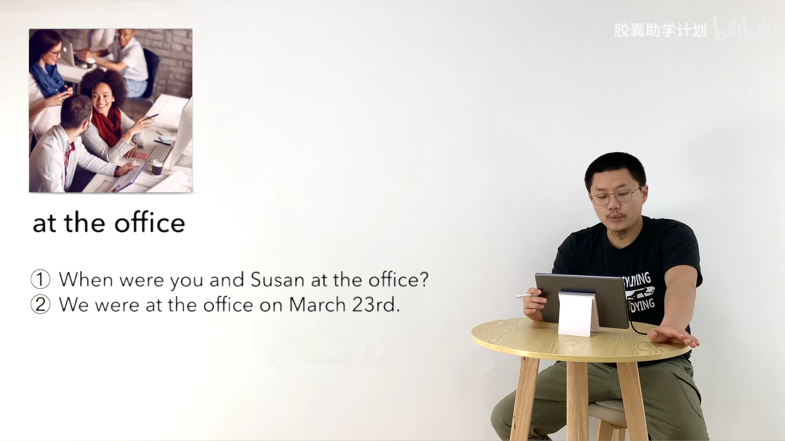

文字识别：胶囊助学计划 / at the office / When were you and Susan at the office? / YUING / We were at the office on March 23rd. / DYING

### 画面 00:02:12

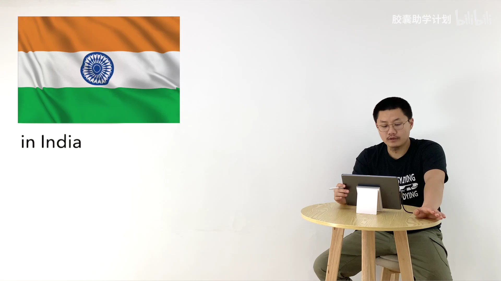

文字识别：胶囊助学计划 / in India / YNING / DYING

### 画面 00:02:25

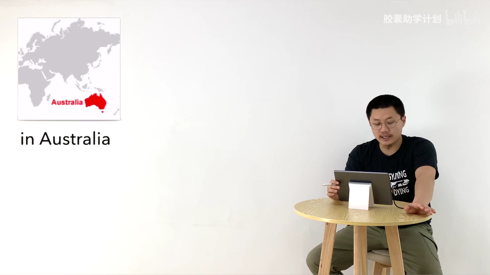

文字识别：胶囊助学计划 / Australia / in Australia / SYZING / DYING

## 00:02:30–00:03:00

We were in Australia in July. Okay, next one. When was I at the dairy? 哎，在这个乳制品店。You were at the dairy on Saturday. 呃，周六。Next one. In Austria. 注意这是奥地利啊。来，When were George and I in Austria? Next one. You were in Austria

### 画面 00:02:32

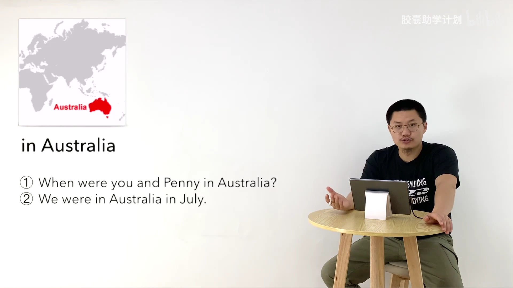

文字识别：胶囊助学计划 / Australia / in Australia / When were you and Penny in Australia? / SYZING / We were in Australia in July. / DYING

### 画面 00:02:36

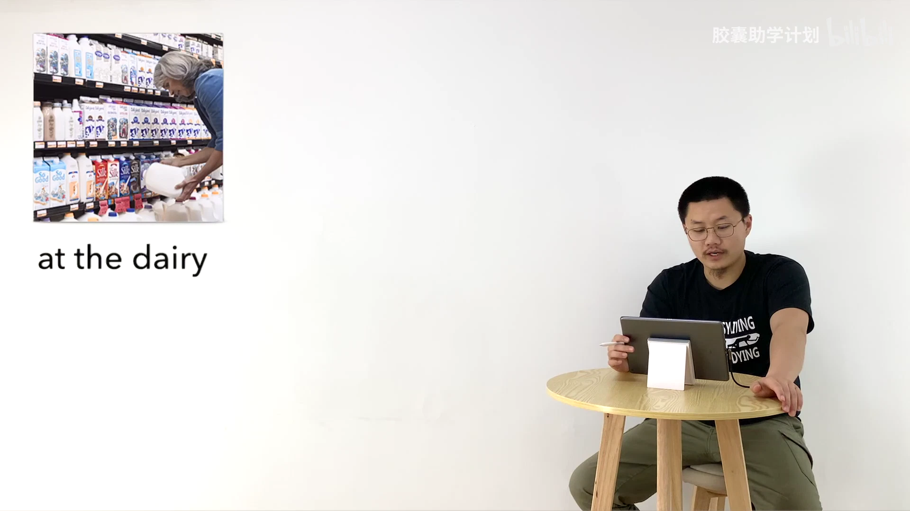

文字识别：胶囊助学计划 / at the dairy / SYZING / DYING

### 画面 00:02:48

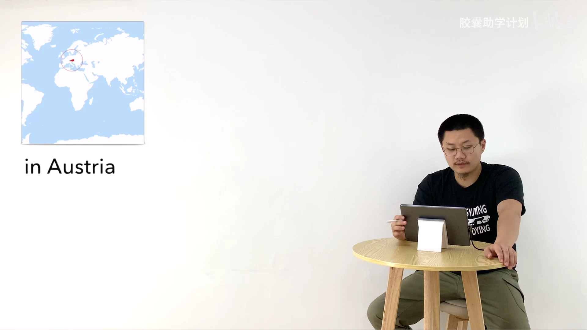

文字识别：胶囊助学计划 / in Austria / SMZING / DVING

### 画面 00:02:58

文字识别：胶囊助学计划 / in Austria / When were George and Iin Austria? / SYNING / You were in Austria in August. / DYING

## 00:03:00–00:03:30

in August. Okay, at home,在家啊。来, when were they all at home? They were at home on May twenty fifth.好，注意一个小点在这儿，顺便就可以提一句。首先，具体在几月几号啊？一月四号，八月十号，四月二十一号，全是用on这个小的介词。这个点各位要注意一下啊。我们以后新二会继续讲，接下来见到

### 画面 00:03:03

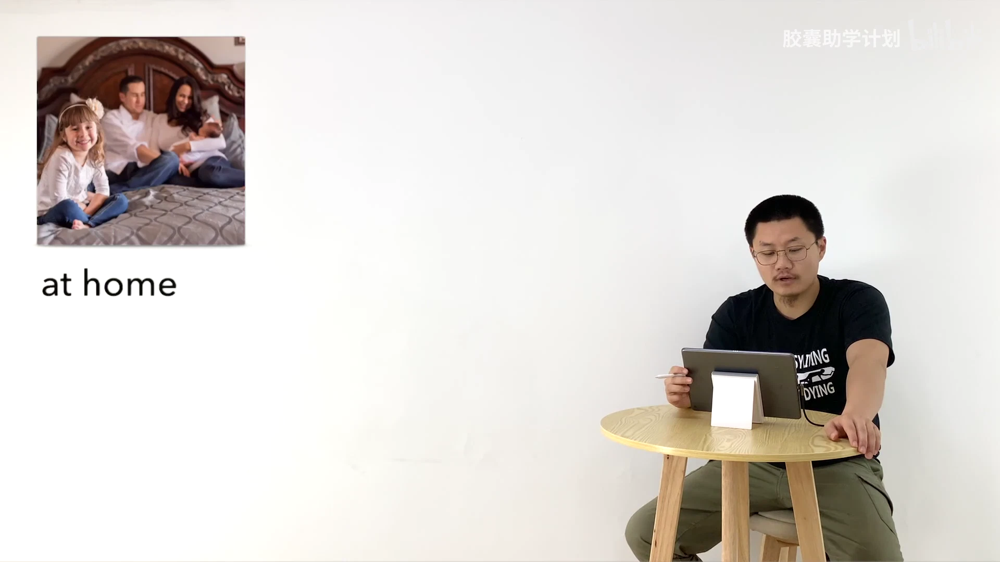

文字识别：胶囊助学计划 / at home / SYZING / DYING

### 画面 00:03:12

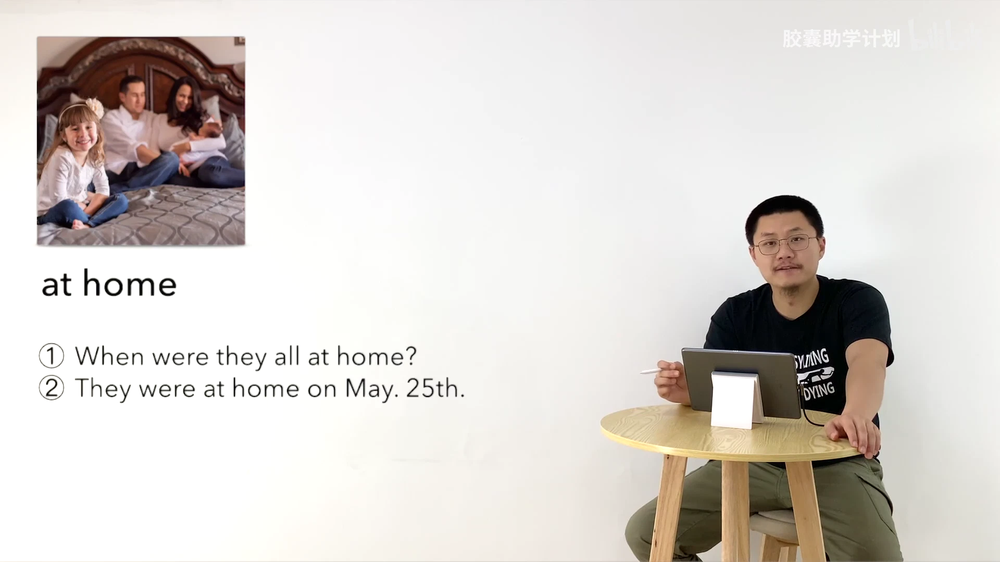

文字识别：胶囊助学计划 / at home / When were they all at home? / SMINING / They were at home on May. 25th. / DYING

## 00:03:30–00:04:00

也会继续提，在这儿您注意一下就行了。其次几月几号，前面是一到十二月，后面是几号，对吧？叫 twenty fifth，第二十五天，所以不是 twenty five，而是 twenty fifth，对吧？OK，好，接下来 When was I at the hairdressers? You were at the hairdressers on Wednesday. OK, in Finland, Finland.

### 画面 00:03:35

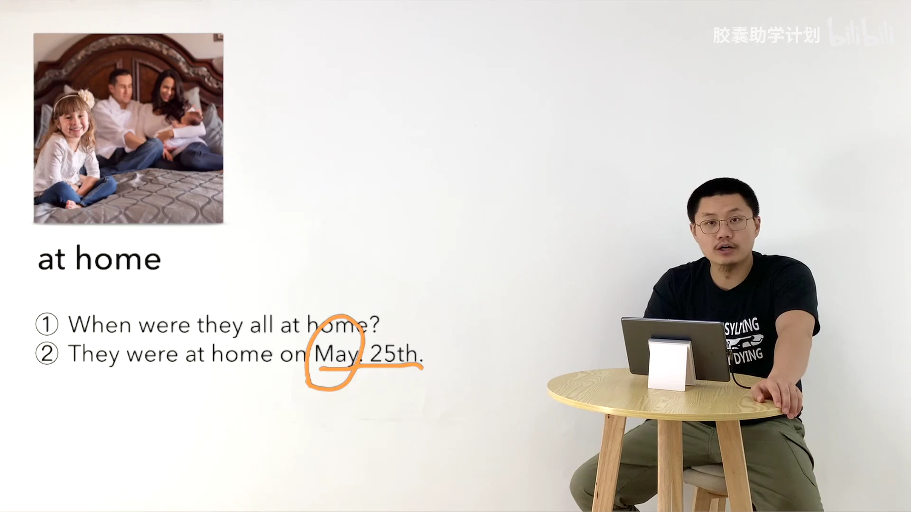

文字识别：胶囊助学计划 / at home / When were they all at home? / SYLING / They were at home onMay.25th. / DYING

### 画面 00:03:45

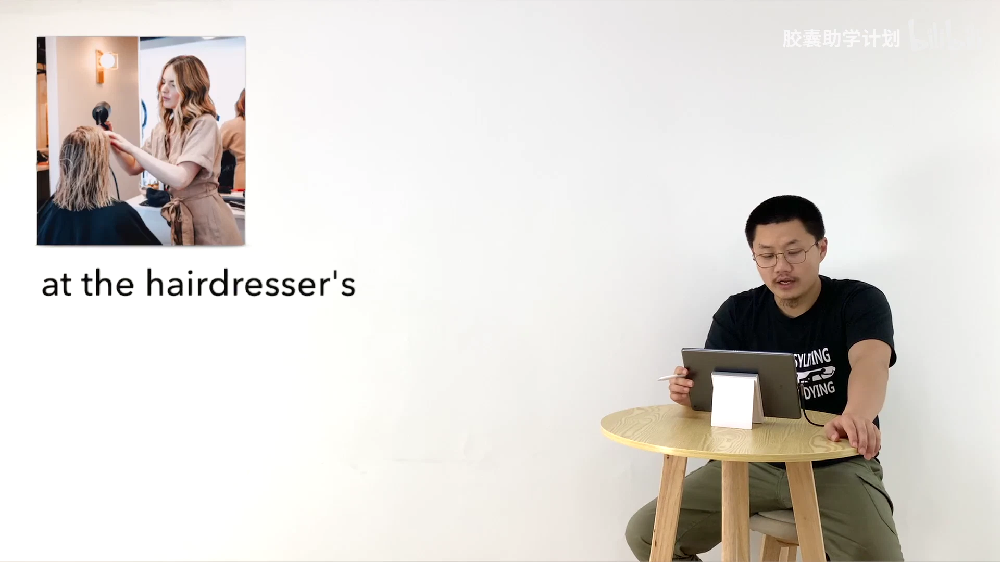

文字识别：胶囊助学计划 / at the hairdresser's / SYLZING / DYING

### 画面 00:03:52

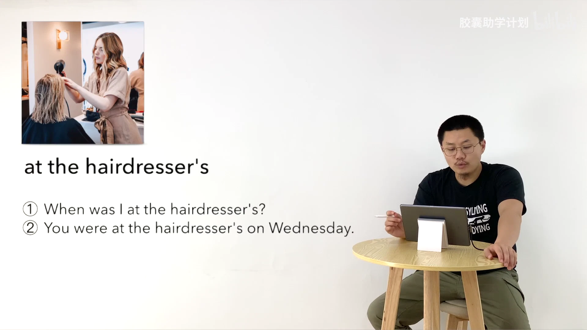

文字识别：胶囊助学计划 / at the hairdresser's / When was I at the hairdresser's? / SYLZING /  You were at the hairdresser's on Wednesday. / DYING

### 画面 00:03:56

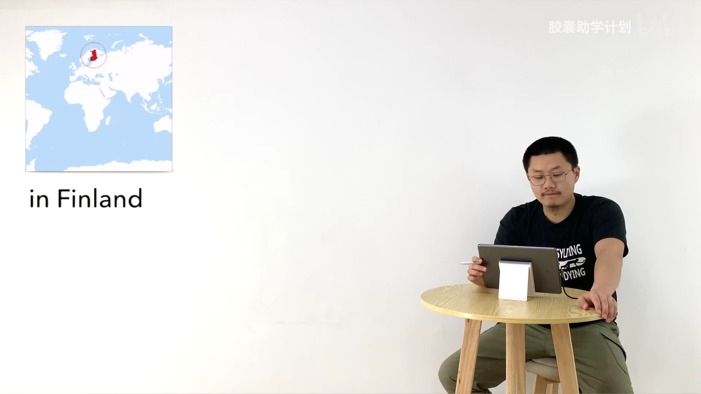

文字识别：胶囊助学计划 / in Finland / SYLZING / DYING

## 00:04:00–00:04:30

When were you and David in Finland? We were in Finland in December. Okay, that recap is very simple. Practice, this is nothing but was/were, right? Soon we will learn new ones. So before we learn new ones, we need to consolidate was and were. We have used four lessons: 67, 68, 69, 70. We have used four lessons to consolidate was and were. Homework: Green Book, 70. You can write it. Secondly, you can write it.

### 画面 00:04:03

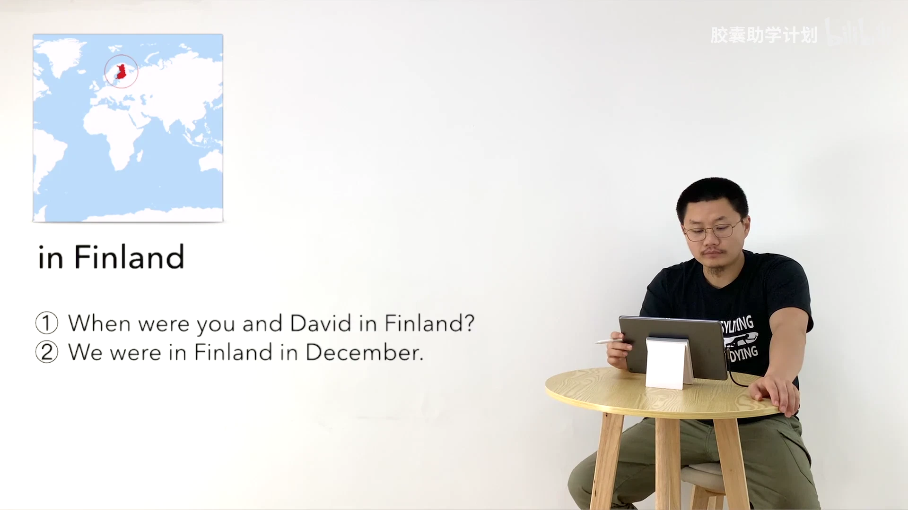

文字识别：胶囊助学计划 / in Finland / When were you and David in Finland? / SYLZING / We were in Finland in December. / DYING

### 画面 00:04:08

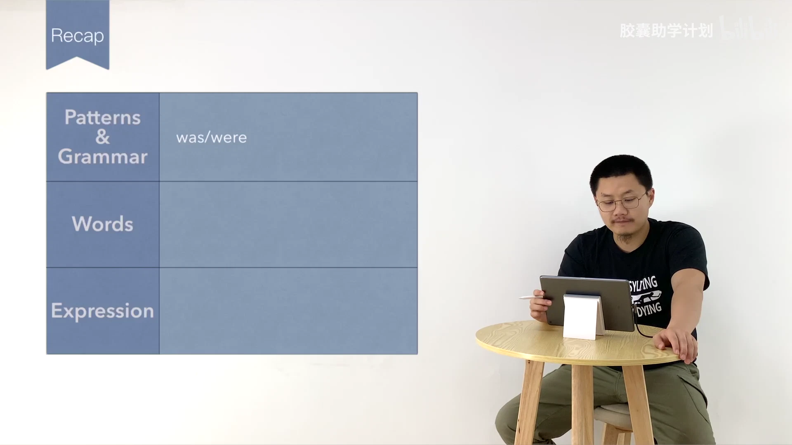

文字识别：Recap / 胶囊助学计划 / Patterns / was/were / Grammar / Words / SYLZING / Expression / DYING

### 画面 00:04:12

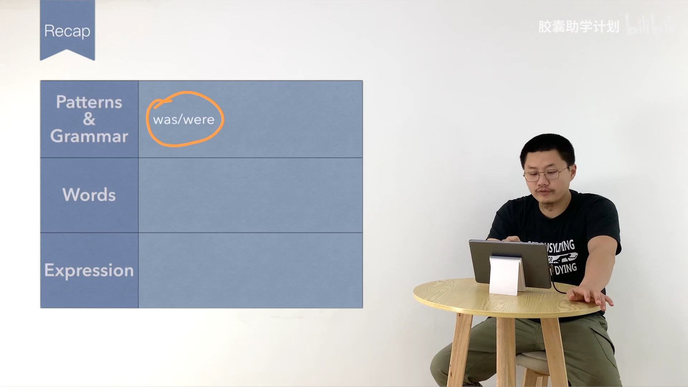

文字识别：胶囊助学计划 / Recap / Patterns / & / was/were / Grammar / Words / SYLMING / Expression / DYING

### 画面 00:04:26

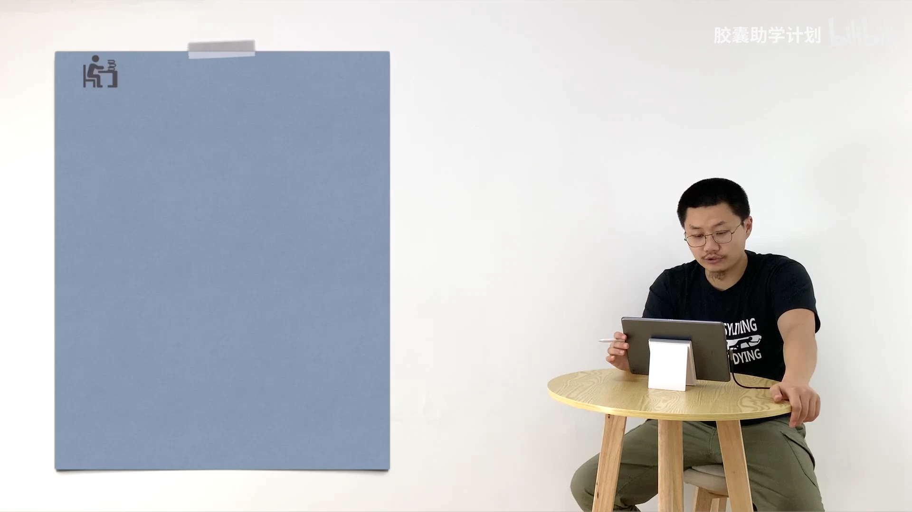

文字识别：胶囊助学计划 / SYUNING / DYING

## 00:04:30–00:05:00

以写了。其次呢，各位可以给自己讲解一遍今天的核心知识点。那如果大家喜欢我们的课程呢，欢迎大家关注、订阅、一键三连支持，并分享给那些需要的朋友啊，这对我们非常的重要。感谢各位。那接下来呢，我们最后看一句名人名言：If you change the way you look at things, the things you look at change. See you next time.

### 画面 00:04:34

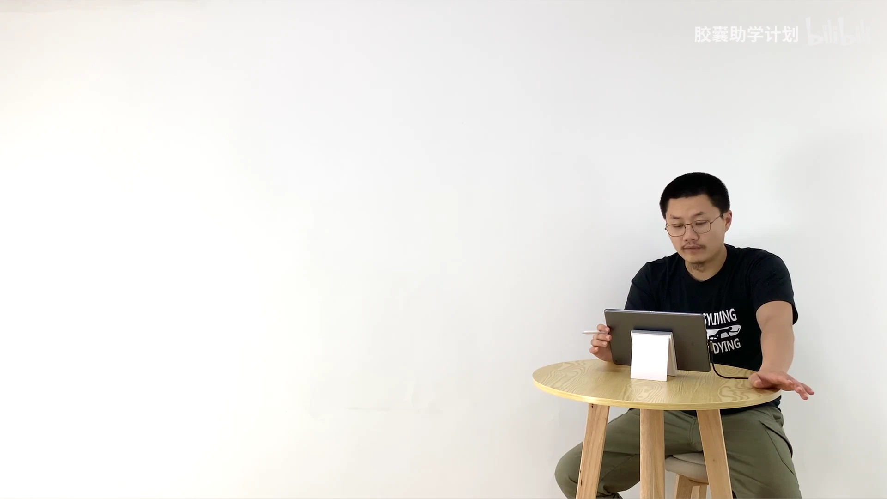

文字识别：胶囊助学计划 / YUING / DYING

### 画面 00:04:45

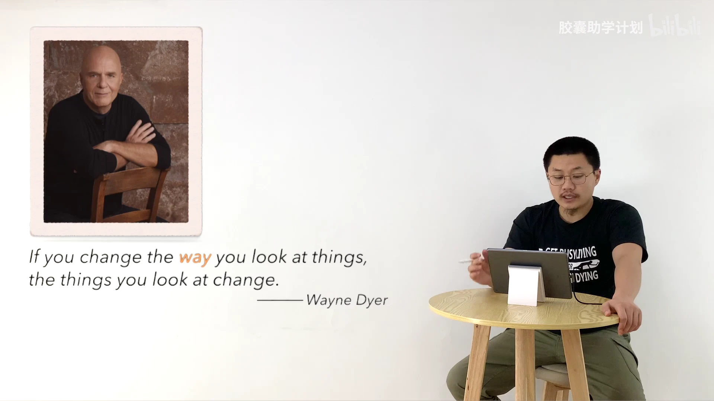

文字识别：胶囊助学计划 / If you change t /  the way you look at things, / 'SYUING / the /  things you look at change. / DYING / - Wayne Dyer

### 画面 00:04:55

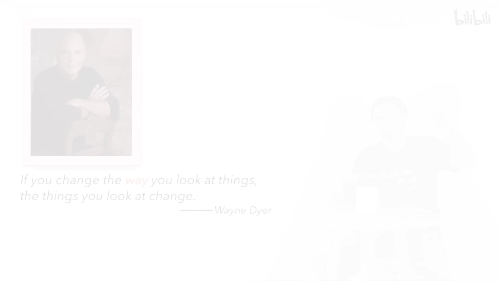

文字识别：If you change the way you look at things, / the things you look at change. / Wayne Dyer

### 画面 00:04:57

文字识别：CAPSULEACADEMY / 胶囊助学计划 / 小红书 / Lecturer / Leo / OE

## 00:05:00–00:05:07

### 画面 00:05:00

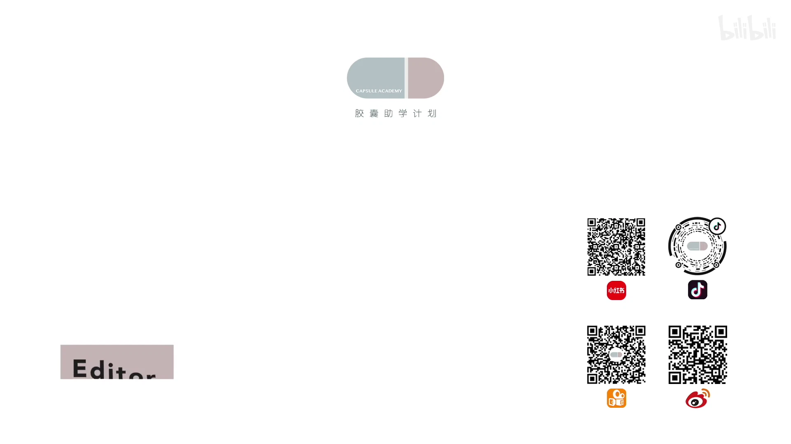

文字识别：CAPSULEACADEMY / 胶囊助学计划 / 小红书 / Editor / OE

### 画面 00:05:03

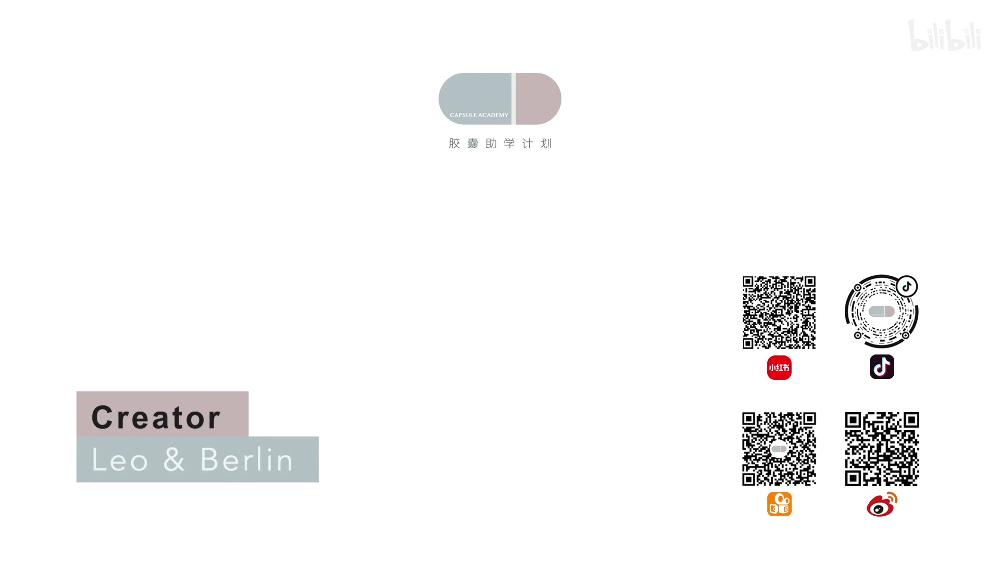

文字识别：CAPSULEACADEMY / 胶囊助学计划 / 小红书 / Creator / □ / Leo & Berlin / OE

### 画面 00:05:05

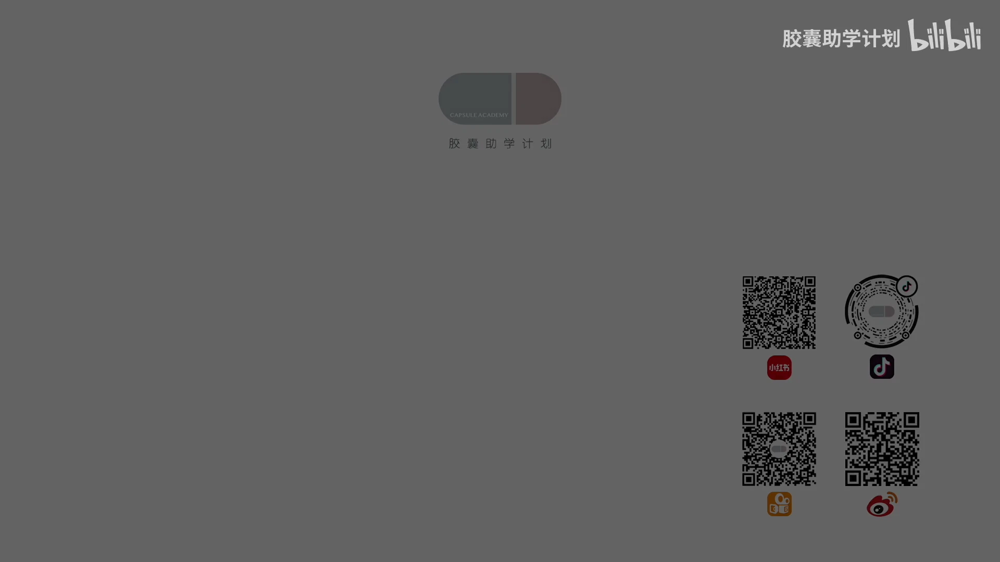

文字识别：bilibili / 胶囊助学计划 / 胶囊助学计划 / 小红书 / 品 / OE

### 画面 00:05:07

文字识别：bilibili / 胶囊助学计划

