# 071 文章

快速机器解析：语音为单模型转写，未进行独立交叉校对或人工复核；画面每秒采样并按变化选帧，短时文字和标记可能遗漏。截图时间约有 1 秒误差。图片有损压缩；遇到疑点请按时间查看 Google Drive 原视频。

## 00:00:00–00:00:30

Hello everyone, welcome to Capsule Academy. This is Leo. Today we're going to learn Concept English Book One Lesson Seventy One Story. Hope you gonna enjoy it. Okay,好，那我们直接进入文章啊，看一下两个人去聊天。Jane上来问了一句话叫做 What's wrong, Marson? Like Pauline? 各位回想一下，五十一课叫做

### 画面 00:00:00

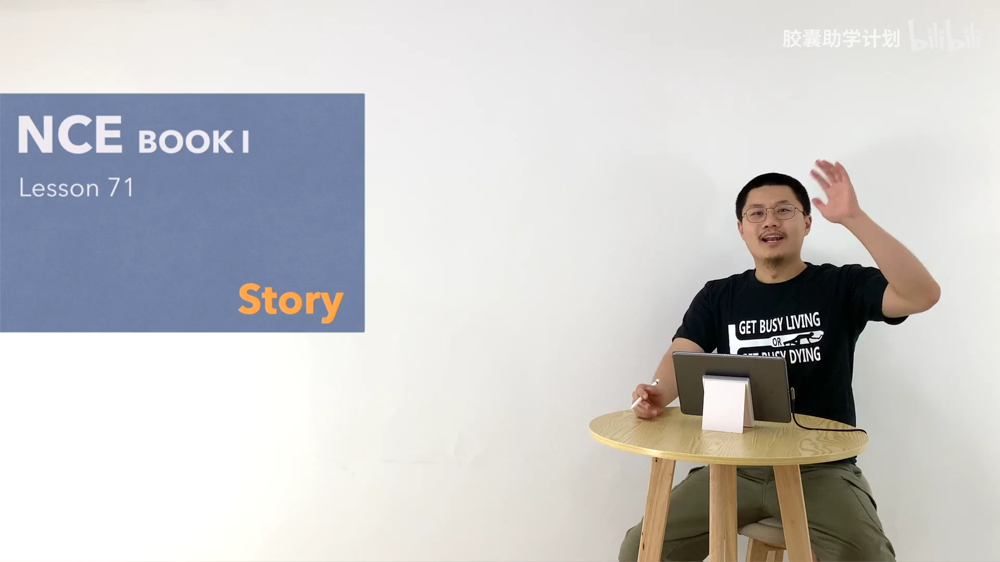

文字识别：胶囊助学计划 / NCE / BOOKI / Lesson 71 / Story / GET BUSY LIVING / RAU / RIICV / DYING

### 画面 00:00:02

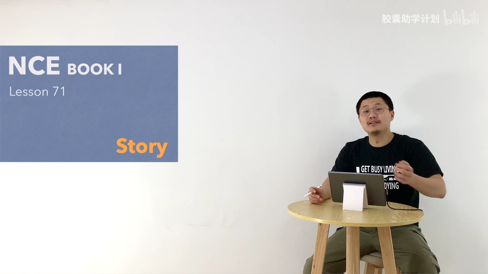

文字识别：胶囊助学计划 / NCE / BOOKI / Lesson 71 / Story / GET BUSYLIVIN / DYING

### 画面 00:00:08

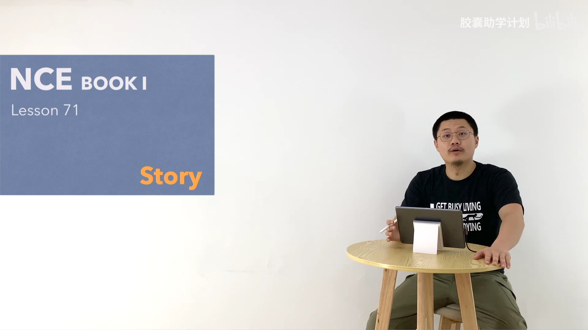

文字识别：胶囊助学计划 / NCE / BOOKI / Lesson 71 / Story / GET RUSY LIVING / PYING

### 画面 00:00:11

文字识别：胶囊助学计划bl出 / •

### 画面 00:00:14

文字识别：胶囊助学计划 / 胶囊助学计划

### 画面 00:00:16

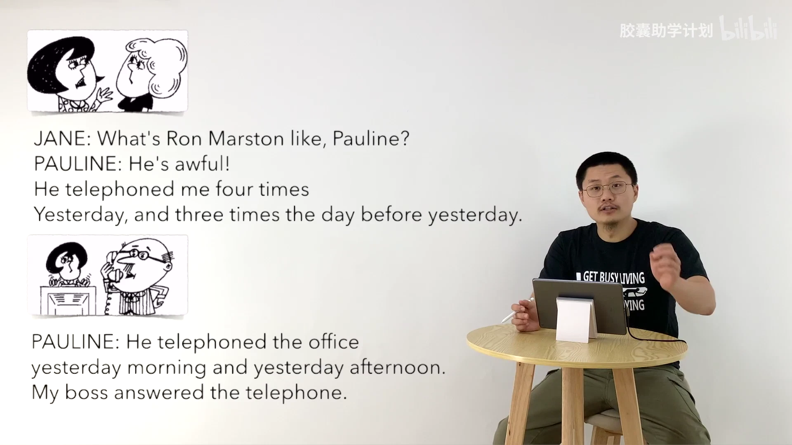

文字识别：胶囊助学计划 / JANE: What's Ron Marston like, Pauline? / PAULINE: He's awful! / He telephoned me four times / Yesterday, and three times the day before yesterday. / GET BUSYUVING / MING / PAULINE: He telephoned the office / yesterday morning and yesterday afternoon. / My boss answered the telephone.

### 画面 00:00:22

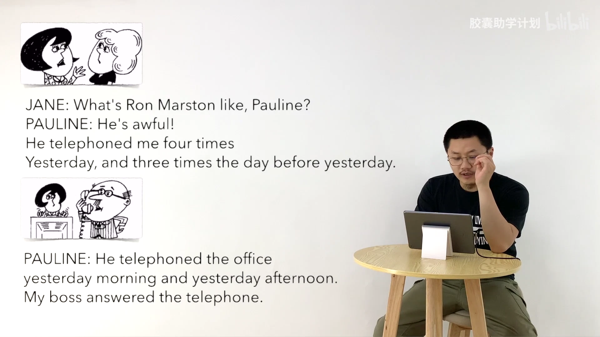

文字识别：胶囊助学计划 / JANE: What's Ron Marston like, Pauline? / PAULINE: He's awful! / He telephoned me four times / Yesterday, and three times the day before yesterday. / PAULINE: He telephoned the office / yesterday morning and yesterday afternoon. / My boss answered the telephone.

### 画面 00:00:26

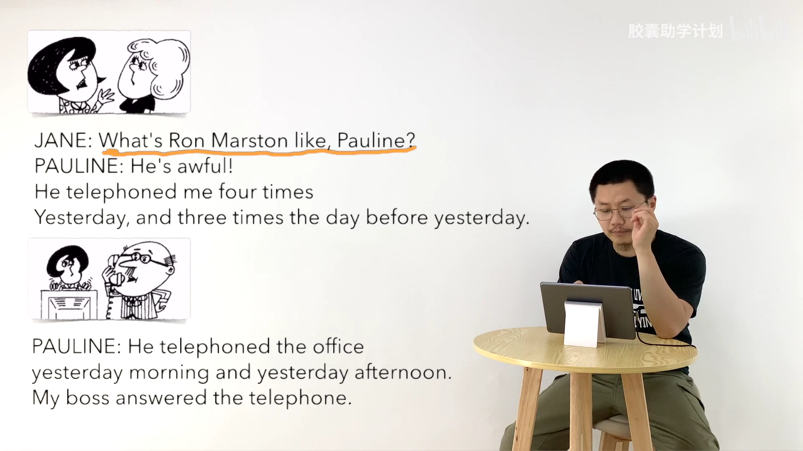

文字识别：胶囊助学计划 / JANE: What's Ron Marston like, Pauline? / PAULINE: He's awful! / He telephoned me four times / Yesterday, and three times the day before yesterday. / PAULINE: He telephoned the office / yesterday morning and yesterday afternoon. / My boss answered the telephone.

### 画面 00:00:29

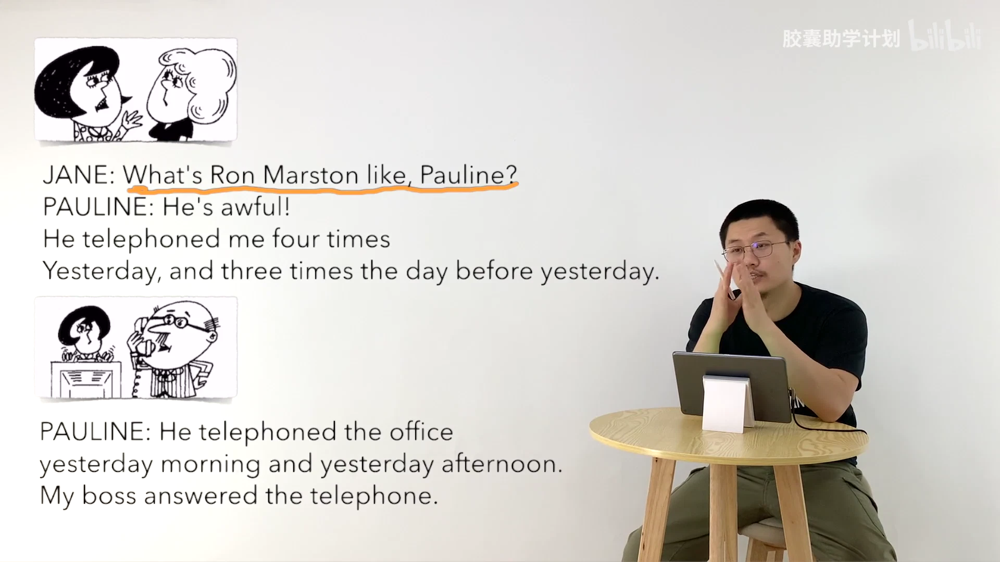

文字识别：胶囊助学计划 / JANE: What's Ron Marston like, Pauline? / PAULINE: He's awful! / He telephoned me four times / Yesterday, and three times the day before yesterday. / PAULINE: He telephoned the office / yesterday morning and yesterday afternoon. / My boss answered the telephone.

## 00:00:30–00:01:00

What's the weather like 的那个 like 是一个喜欢的意思吗？和这儿的 like 一模一样，只不过就是把 weather 换成了 Ron Mason，对吧？他这个人怎么样？天气怎么样？他这个人怎么样？OK，答案是 he's awful。说这个人差太差劲了，是吧？OK，糟糕透顶。He telephoned me four times yesterday. 好了，注意几个小点啊！你看 telephoned 后边加 e

### 画面 00:00:39

文字识别：胶囊助学计划 / JANE: What'sRon Marston like, Pauline? / PAULINE: He's awful! / He telephoned me four times / Yesterday, and three times the day before yesterday. / PAULINE: He telephoned the office / yesterday morning and yesterday afternoon. / My boss answered the telephone.

### 画面 00:00:47

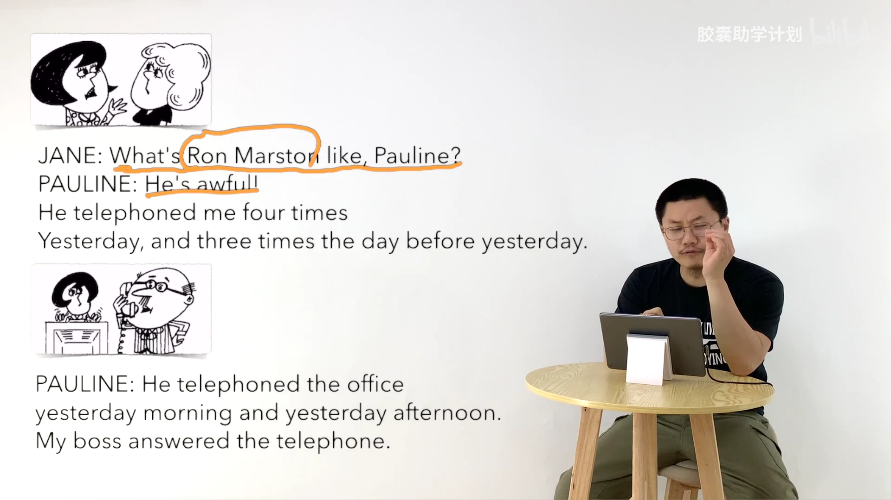

文字识别：胶囊助学计划 / JANE: What's Ron Marstor like, Pauline? / PAULINE: He's awfull / He telephoned me four times / Yesterday, and three times the day before yesterday. / PAULINE: He telephoned the office / yesterday morning and yesterday afternoon. / My boss answered the telephone.

## 00:01:00–00:01:30

了，表示这个事儿动作发生在过去。哎，时间也告诉你了，yesterday，对吧？And three times，三次。The day before yesterday，好了，这个你要去想一下，它是哪一天了？Yesterday叫昨天，before yesterday叫在昨天之前。The day叫做这样一天，在一天这一天是在昨天之前的一天。汉语叫前天，对吧？各位，您每

### 画面 00:01:17

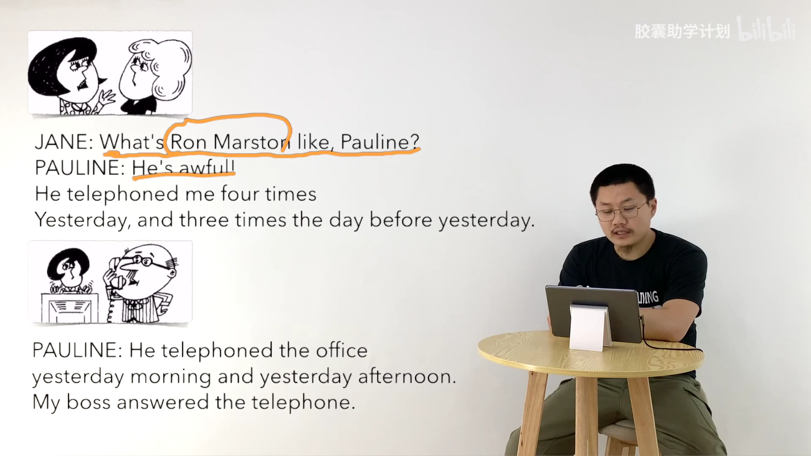

文字识别：胶囊助学计划 / JANE: What'sRon Marstor like, Pauline? / PAULINE: He's awfull / He telephoned me four times / Yesterday, and three times the day before yesterday. / UING / PAULINE: He telephoned the office / yesterday morning and yesterday afternoon. / My boss answered the telephone.

## 00:01:30–00:02:00

以后再见到它，不是当语法去分析的，是把这个短语直接记下来，表示前天啊，叫 the day before yesterday，叫表示的是前天啊，这个短语各位给它单独在书当中一画记下来，前天 continue. He telephoned the office yesterday morning. 他打电话给到办公室 yesterday morning，昨天早晨 and yesterday afternoon，以及昨天下午都是过去嘛，所以动词是过去式的。 My boss

### 画面 00:01:41

文字识别：胶囊助学计划 / JANE: What's Ron Marstor like, Pauline? / PAULINE: He's awfull / He telephoned me four times / Yesterday, and three times the day before yesterday. / PAULINE: He telephoned the office / yesterday morning and yesterday afternoon. / My boss answered the telephone.

### 画面 00:01:43

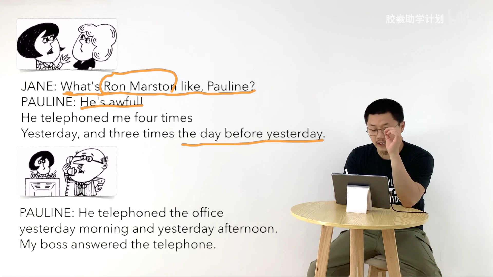

文字识别：胶囊助学计划 / JANE: What'sRon Marstor like, Pauline? / PAULINE: He's awfull / He telephoned me four times / Yesterday, and three times the day before yesterday. / PAULINE: He telephoned the office / yesterday morning and yesterday afternoon. / My boss answered the telephone.

## 00:02:00–00:02:30

answered the telephone.我说我老板啊接了这个电话。你看answer后边加ed了，对吧？动作发生在过去。What did your boss say to him?哎，注意一特殊疑问句，对吧？用did提前了，对吧？跟did有关系。说你老板对他说什么了？He said, say, said。他说的是，注意你看这儿有一个引号，这有一个引号，告诉你的是他现在在描述他当时说的是原话，对吧？

### 画面 00:02:07

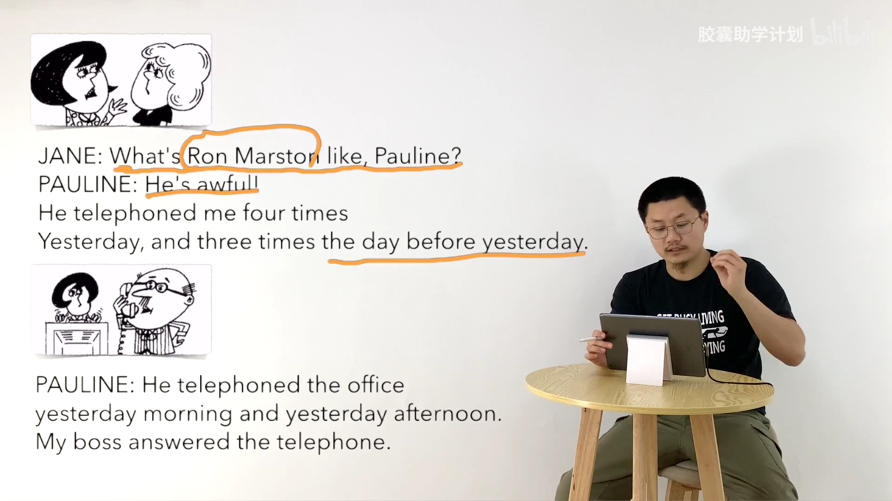

文字识别：胶囊助学计划 / JANE: What'sRon Marstor like, Pauline? / PAULINE: He's awfull / He telephoned me four times / Yesterday, and three times the day before yesterday. / IVMING / YING / PAULINE: He telephoned the office / yesterday morning and yesterday afternoon. / My boss answered the telephone.

### 画面 00:02:09

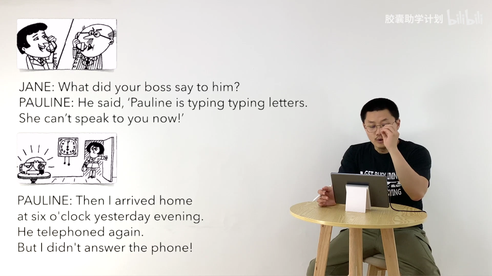

文字识别：胶囊助学计划 / JANE: What did your boss say to him? / PAULINE: He said, 'Pauline is typing typing letters. / She can't speak to you now!' / YING / PAULINE: Then I arrived home / at six o'clock yesterday evening. / He telephoned again. / But I didn't answer the phone!

### 画面 00:02:21

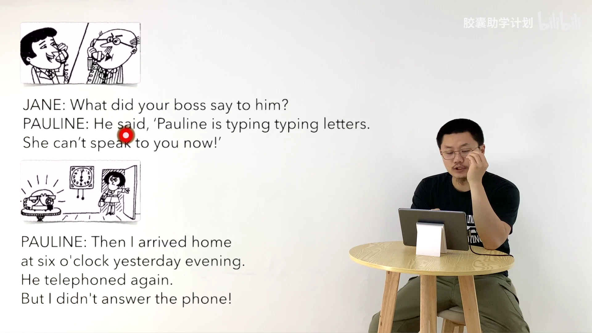

文字识别：胶囊助学计划 / JANE: What did your boss say to him? / PAULINE: He said, 'Pauline is typing typing letters. / She can't speak to you now!' / PAULINE: Then I arrived home / at six o'clock yesterday evening. / He telephoned again. / But I didn't answer the phone!

## 00:02:30–00:03:00

当时说的原话是 Pauline is typing letters. Pauline啊，正在啊，啊，这个应该是 typing，一个就OK了啊，这有一个小的 typo啊。Is typing letters，正在打信啊，正在打字。说She can't speak to you now.她现在没办法和你说话。Then然后I arrived home.然后我就到家了。At six o'clock yesterday evening.注意提供了一个过去的时间，

### 画面 00:02:40

文字识别：胶囊助学计划 / JANE: What did your boss say to him? / PAULINE: He said, 'Pauline is typing typing etters. / She can't speak to you now!' / YLDING / PAULINE: Then I arrived home / at six o'clock yesterday evening. / He telephoned again. / But I didn't answer the phone!

## 00:03:00–00:03:30

所以 arrived。你仔细去想一下，它的原型是不是 a r r i v e？ e 不发音，直接加了个 d，表示动词的过去式了，对吧？我昨天晚上六点到家，你看后边加了 e d。 He telephoned again。他又打了一次电话。 But，但是 I didn't answer the phone。各位，现在你要做到的事情就是看到 didn't 再加动词原形，明白这个事儿发生在过去啊？我们的语法就算是学

### 画面 00:03:10

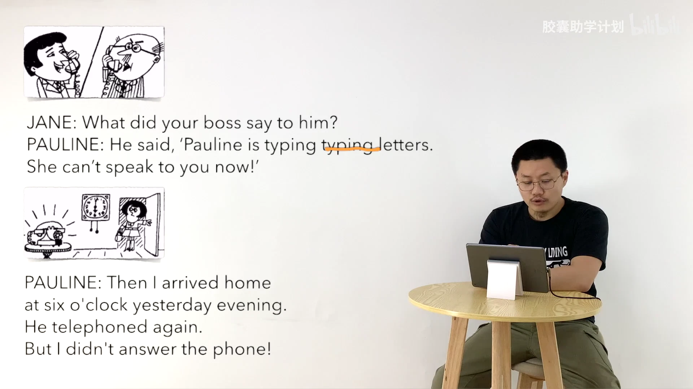

文字识别：胶囊助学计划 / JANE: What did your boss say to him? / PAULINE: He said, 'Pauline is typing typing letters. / She can't speak to you now!' / YLING / PAULINE: Then I arrived home / at six o'clock yesterday evening. / He telephoned again. / But I didn't answer the phone!

## 00:03:30–00:04:00

懂了一部分了啊。Okay, did he telephone again last night?昨晚，所以 did 提前动词还原形啊。他昨天晚上又打了一次电话吗？Yes, he did.是的，他打了。He telephoned at nine o'clock.啊，这都算骚扰了，已经，是吧？他在九点钟又打了一次电话。What did you say to him?你对他说什么了？I said.我说的是，注意引号，引号当时说的原

### 画面 00:03:31

文字识别：胶囊助学计划 / JANE: Did he telephone again last night? / PAULINE: Yes, he did. / He telephoned at nine o'clock. / YLING / DYING / JANE: What did you say to him? / PAULINE: I said, 'This is Pauline's / mother. Please don't telephone / my daughter again!'

## 00:04:00–00:04:30

话，This is Pauline's mother.啊，他模仿他母亲是吧？他说啊，这是Pauline的母亲。Please don't telephone my daughter again.拜托了，不要再给我女儿打电话了。Okay, continue.说Did he telephone again?然后他后来又打了吗？No, he didn't.没有，他就不再打了。Okay，注意你注意看啊，Did didn't，对吧？都是这样一些关于过去

### 画面 00:04:01

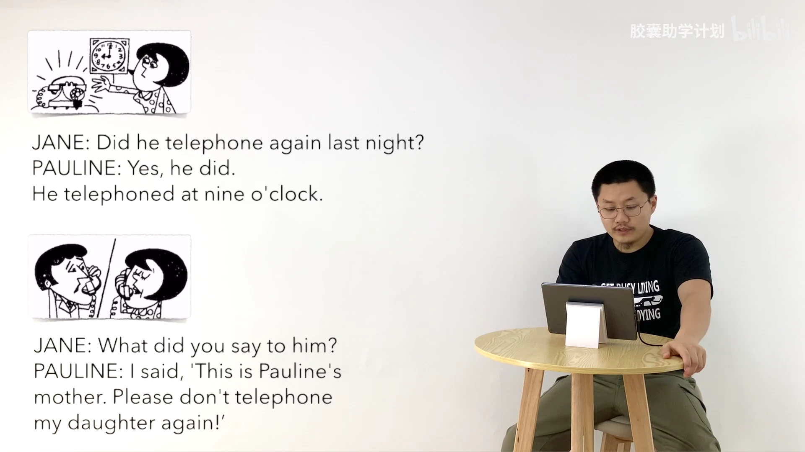

文字识别：胶囊助学计划 / JANE: Did he telephone again last night? / PAULINE: Yes, he did. / He telephoned at nine o'clock. / MY LDING / DYING / JANE: What did you say to him? / PAULINE: I said, 'This is Pauline's / mother. Please don't telephone / my daughter again!'

### 画面 00:04:16

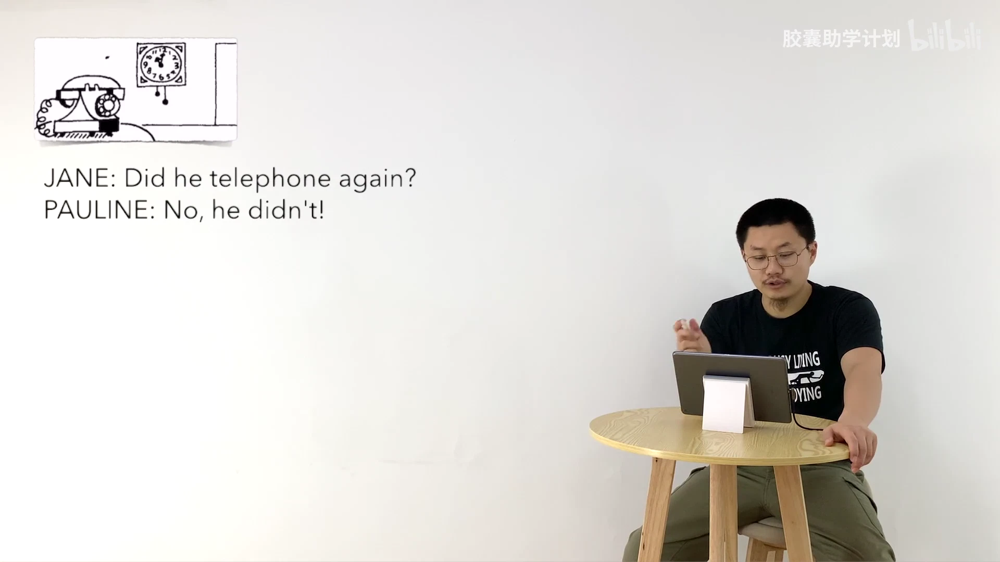

文字识别：胶囊助学计划 / JANE: Did he telephone again? / PAULINE: No, he didn't! / YLDING / YING

### 画面 00:04:29

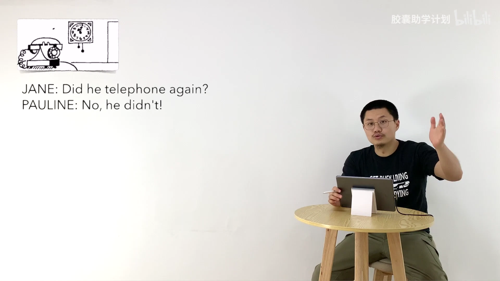

文字识别：胶囊助学计划 / JANE: Did he telephone again? / PAULINE: No, he didn't! / YING

## 00:04:30–00:05:00

相关的，一般过去时这个时态之下最关键的单词 did 以及动词的原形。OK，那接下来我们做 comprehension 练习的时候，你会听到，肯定会听到不少用 did 去问的。OK，因为是过去嘛。来了，第一题，Is Ron Marson nice? No, he isn't. He's awful，对吧？下一题，What's he like? 注意这个撇 s 是 is

### 画面 00:04:36

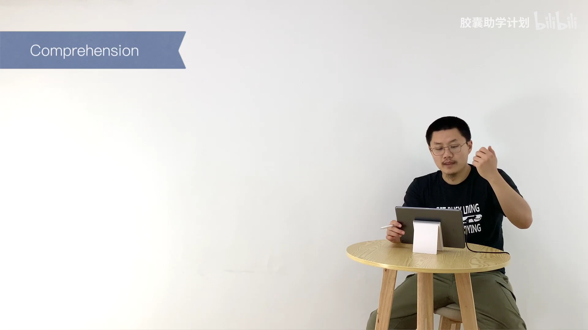

文字识别：胶囊助学计划 / Comprehension / LDING / YING

### 画面 00:04:39

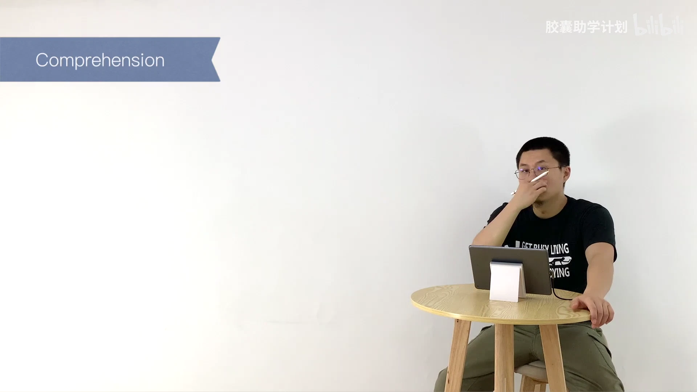

文字识别：胶囊助学计划 / Comprehension /  GET DLEV DING / AYING

## 00:05:00–00:05:30

啊，不是does。那What does he like是问他喜欢什么？What is he like是问的是这个人怎么样？答案叫He's awful. Continue. What did Ron Marsden do yesterday?昨天他做什么了？He telephoned Pauline four times.打了四次电话。Continue. How many times did he telephone the day before yesterday? Three times. Continue. When

### 画面 00:05:09

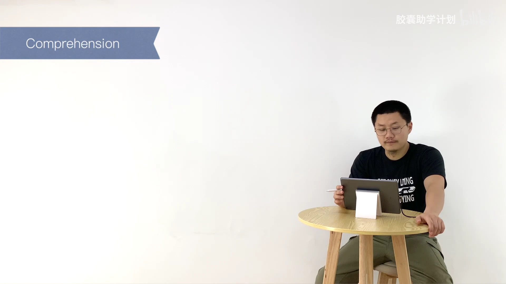

文字识别：胶囊助学计划 / Comprehension / LZING / YING

### 画面 00:05:12

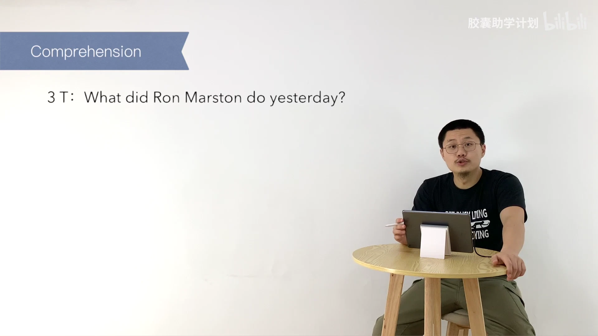

文字识别：胶囊助学计划 / Comprehension / 3 T: What did Ron Marston do yesterday? / LDING / MING

### 画面 00:05:20

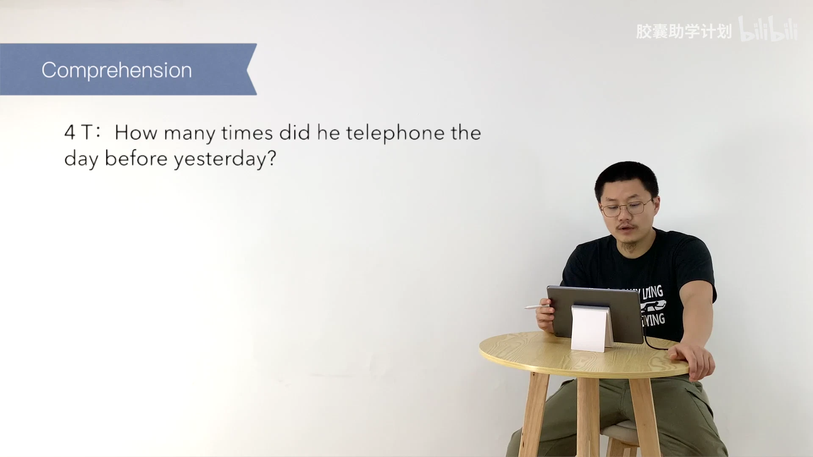

文字识别：胶囊助学计划 / Comprehension / 4 T: How many times did he telephone the / day before yesterday? / 9 / UING / TING

### 画面 00:05:28

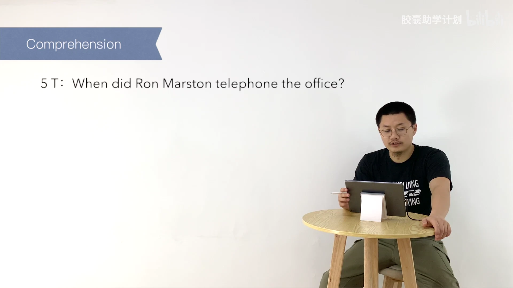

文字识别：胶囊助学计划 / Comprehension / 5 T: When did Ron Marston telephone the office? / YLING / IVING

## 00:05:30–00:06:00

did Ron Marsden telephone the office? Yesterday morning and yesterday afternoon. Next one. Who answered the telephone? Pauline's boss. Next one. What time did Pauline arrive home yesterday evening? At six o'clock. Next one. Did she answer the phone?

### 画面 00:05:42

文字识别：胶囊助学计划 / Comprehension / 6 T: Who answered the telephone? / S: Pauline's boss did. / LING / VING

### 画面 00:05:47

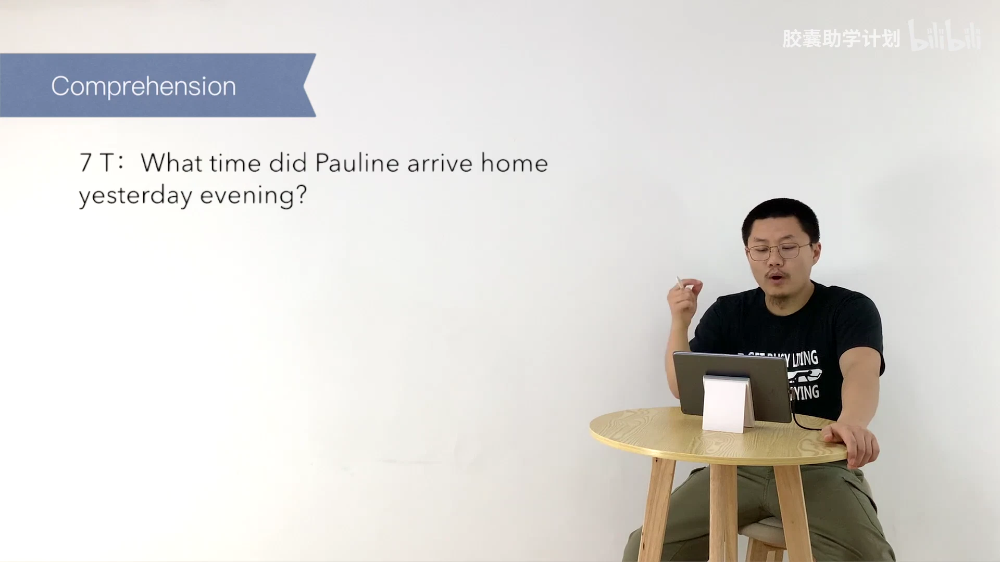

文字识别：胶囊助学计划 / Comprehension / 7 T: What time did Pauline arrive home / yesterday evening? / ""YLDING / HYING

### 画面 00:05:56

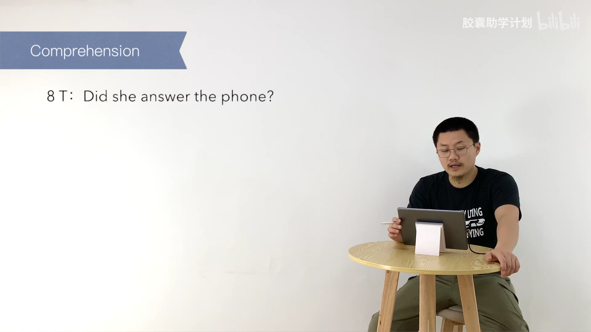

文字识别：胶囊助学计划 / Comprehension / 8 T: Did she answer the phone? / YUING / VING

## 00:06:00–00:06:30

No, she didn't. Continue. What time did Ron Marson telephone last night? At nine o'clock. Next one. Did he telephone Pauline again? Ah,你想一下，最后啊，他装完他母亲了之后，No, he didn't,对吧？OK，玩一个。接下来 asking questions肯定句变一般疑问句，这个我们一起看着变一下，因为今天刚学嘛。

### 画面 00:06:06

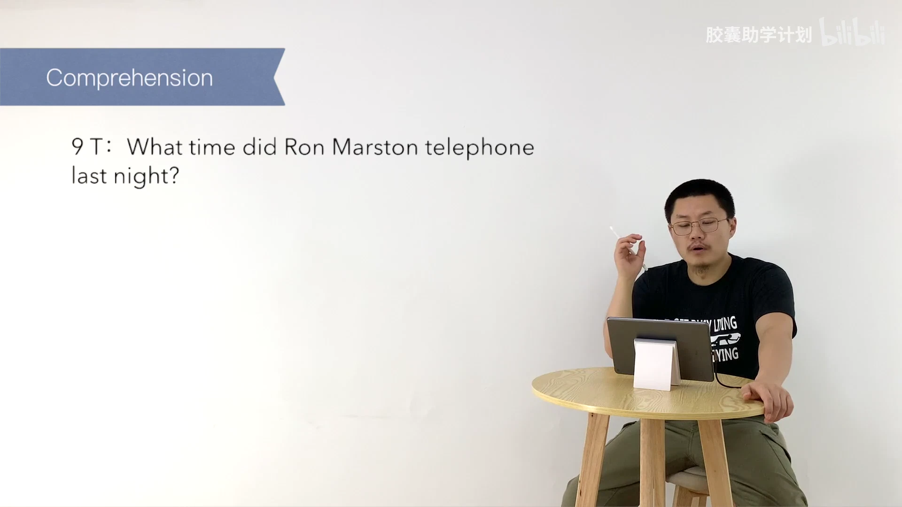

文字识别：胶囊助学计划 / Comprehension / 9 T: What time did Ron Marston telephone / last night? / YLDING / YING

### 画面 00:06:12

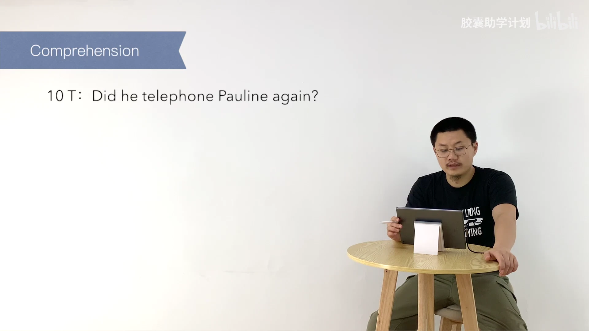

文字识别：胶囊助学计划 / Comprehension / 10 T: Did he telephone Pauline again? / YLUING / VING

### 画面 00:06:23

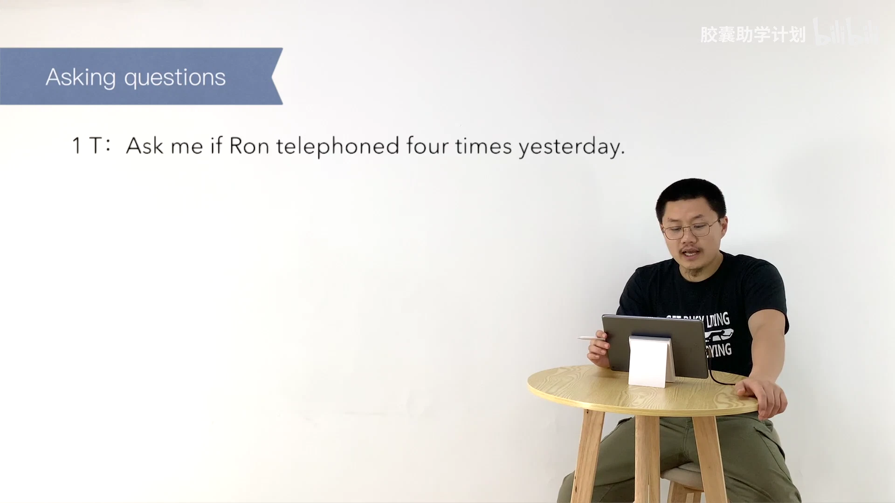

文字识别：胶囊助学计划 / Asking questions / 1 T: Ask me if Ron telephoned four times yesterday. / AILAY LDING / ANING

### 画面 00:06:25

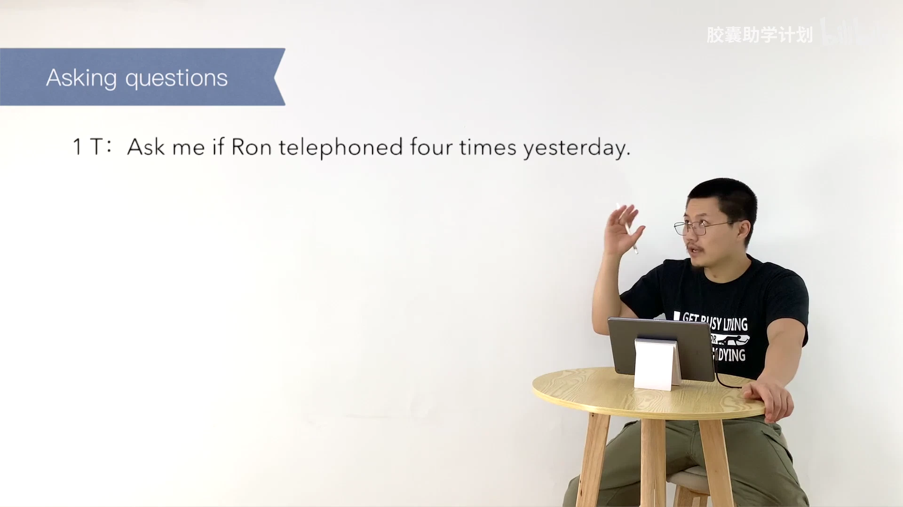

文字识别：胶囊助学计划 / Asking questions / 1 T: Ask me if Ron telephoned four times yesterday. / GETDISYLDING / R / HDYING

## 00:06:30–00:07:00

Ron Mason, a wrong telephoned four times yesterday. 注意这 telephone 加 e d 了，变成 did 提前，对不对？叫做 did wrong telephone four times yesterday. Did 往前一提，再然后 how many times 对 four times 提问就变成了 how many times did wrong telephone yesterday. Okay, next one, ask me if the boss answered the phone. Did 提前, did the

### 画面 00:06:38

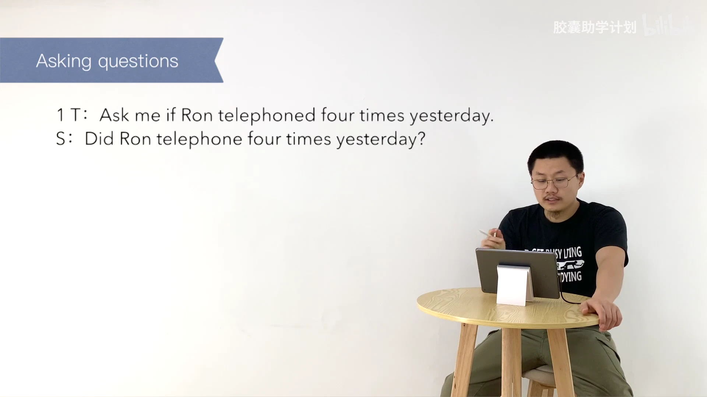

文字识别：胶囊助学计划 / Asking questions / 1 T: Ask me if Ron telephoned four times yesterday. / S: Did Ron telephone four times yesterday? / USY ING / DYING

### 画面 00:06:47

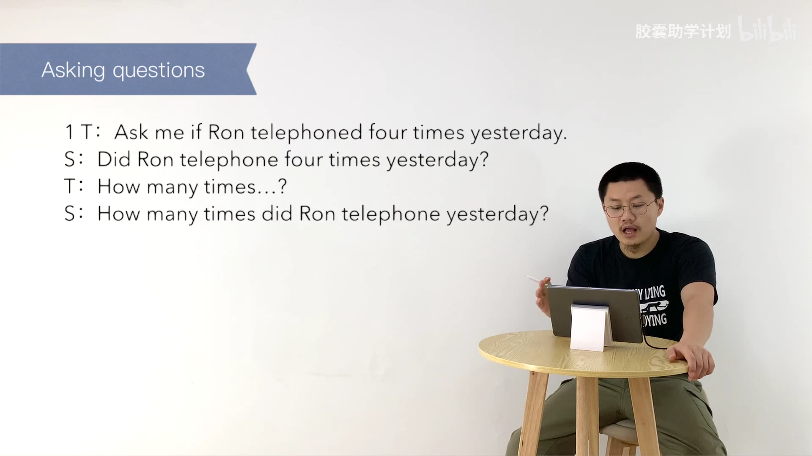

文字识别：胶囊助学计划 / Asking questions / 1 T: Ask me if Ron telephoned four times yesterday. / S: Did Ron telephone four times yesterday? / T: How many times..? / S: How many times did Ron telephone yesterday? / YUING / OVING

### 画面 00:06:52

文字识别：胶囊助学计划 / Asking questions / YLING / OVING

## 00:07:00–00:07:30

boss answer the phone? Who, OK,那就是who answer the phone?谁接了这个电话? Answer,注意啊,看对主语提问,我们之前就学过,对主语提问不要变一般疑问句,直接替代。所以你看没有变一般疑问句,没有出现did这个单词,这个点要注意一下啊。接下来, ask me if I arrive home at six. 我

### 画面 00:07:04

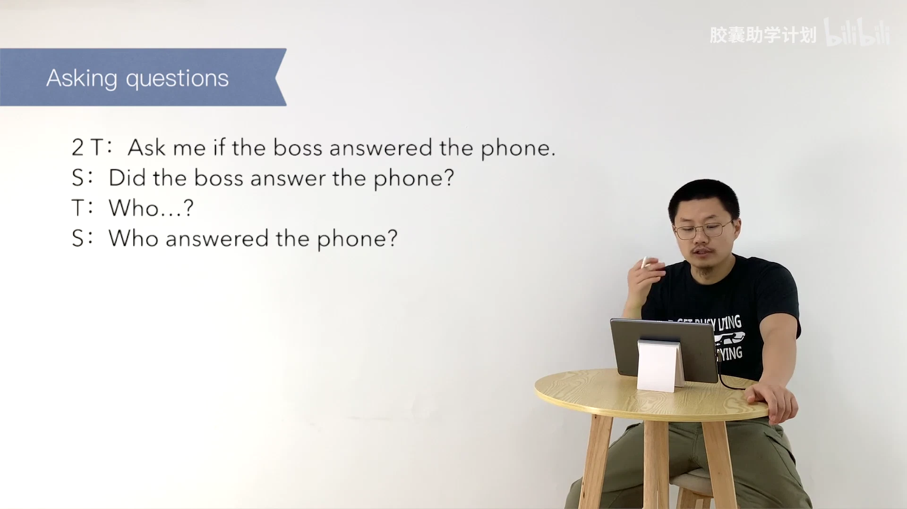

文字识别：胶囊助学计划 / Asking questions / 2 T: Ask me if the boss answered the phone. / S: Did the boss answer the phone? / T: Who...? / S: Who answered the phone? / SLY LING / AYING

### 画面 00:07:06

文字识别：胶囊助学计划 / Asking questions / 2 T: Ask me if the boss answered the phone. / S: Did the boss answer the phone? / T: Who...? / S: Who answered the phone? / YVING / IYING

### 画面 00:07:15

文字识别：胶囊助学计划 / Asking questions / 2 T: Ask me if he boss answered the phone. / S: Did the boss answer the phone? / T: Who...? / S: Who answered the phone? / YUING / OVING

### 画面 00:07:17

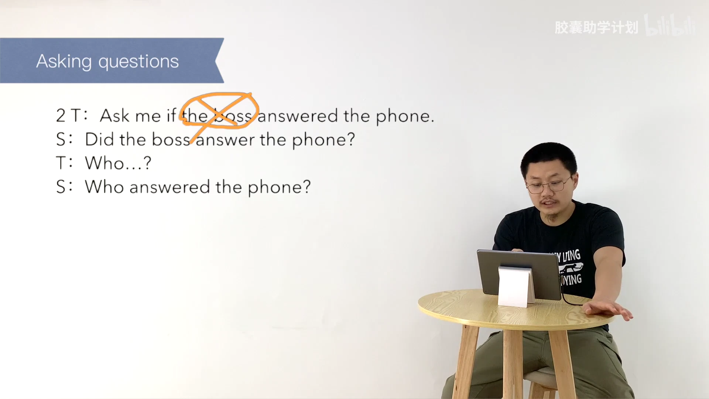

文字识别：胶囊助学计划 / Asking questions / 2T: Ask me ifthe / ossanswered the phone. / S: Did the boss answer the phone? / T: Who...? / S: Who answered the phone? / YUING / OYING

### 画面 00:07:20

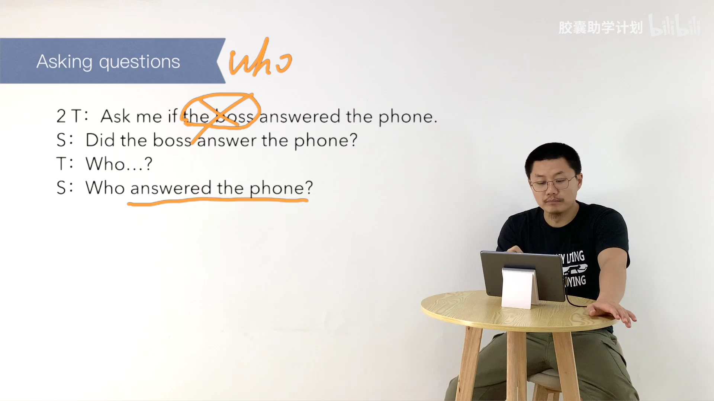

文字识别：胶囊助学计划 / who / Asking questions / 2T: Ask me ifhe / ossanswered the phone. / S: Did the bossanswer the phone? / T: Who...? / S: Who answered the phone? / YUING / OYING

### 画面 00:07:24

文字识别：胶囊助学计划 / Asking questions / YUING / YING

## 00:07:30–00:08:00

在六点钟到家的。Did提前。Did you arrive home at six? Okay. 接下来，When对谁提问？At six提问，对吧？啊，When did you arrive home? 你什么时候到家的？Next one. Ask me if I answered the phone. 啊，我接了这个电话。Did提前。啊，Did you answer the phone? 然后 Why didn't? 这个我们可讲过。我们讲过，没讲过 Why didn't? 但是讲过 Why can't? 对

### 画面 00:07:32

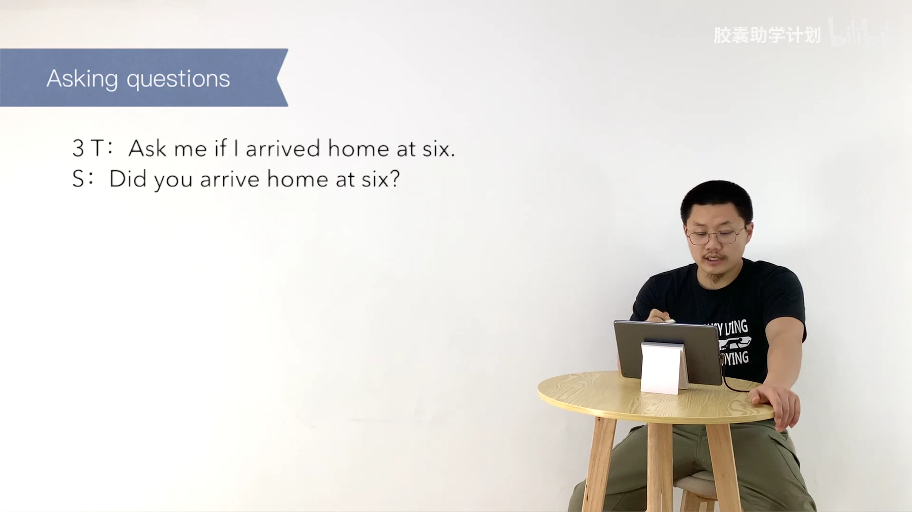

文字识别：胶囊助学计划 / Asking questions / 3 T: Ask me if I arrived home at six. / S: Did you arrive home at six? / "YUING / OYING

### 画面 00:07:40

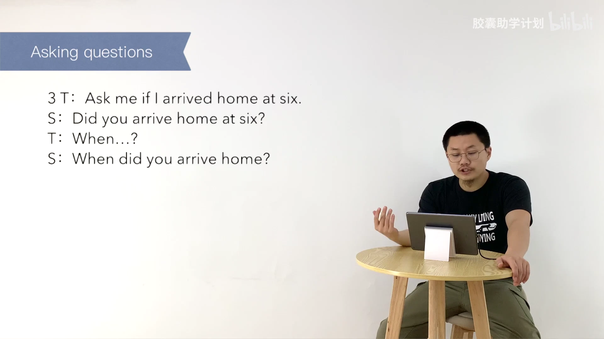

文字识别：胶囊助学计划 / Asking questions / 3 T: Ask me if l arrived home at six. / S: Did you arrive home at six? / T: When...? / S: When did you arrive home? / YLZING / IVING

### 画面 00:07:43

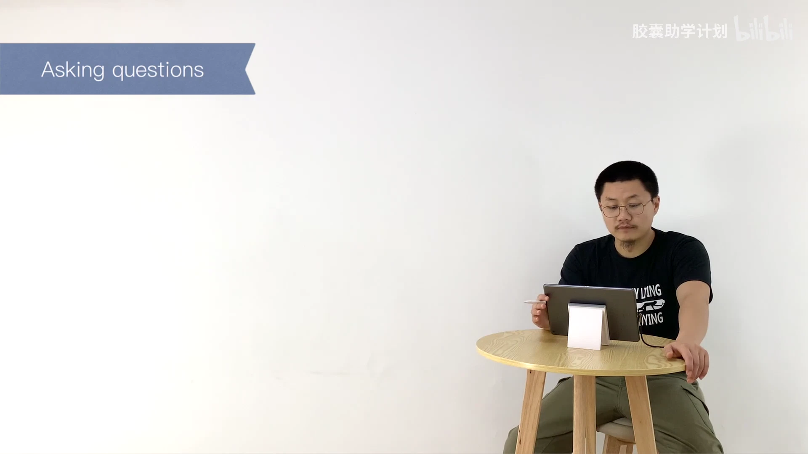

文字识别：胶囊助学计划 / Asking questions / YLING / NING

### 画面 00:07:53

文字识别：胶囊助学计划 / Asking questions / 4 T: Ask me if I answered the phone. / S: Did you answer the phone? / T:Why didn't..? / YUING / HYING

## 00:08:00–00:08:30

吧？啊 why don't why don't you like me？啊一码事儿，对吧？你要做的事情就是把 did 变成一般疑问句，把 did 一取消，why didn't 后边照抄啊？Why didn't you answer the phone？为什么你不接电话？对吧？He's awful，啊，他太这个人太糟糕了，不停的骚扰我。OK， continue，接下来 ask me if he telephoned again， did 提前 did he telephoned again？以及 why didn't，跟刚才一样，把它一取

### 画面 00:08:08

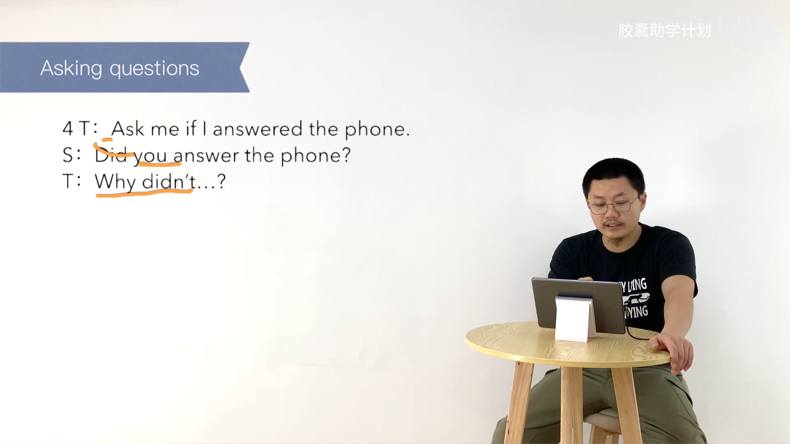

文字识别：胶囊助学计划 / Asking questions / 4 T: _Ask me if I answered the phone. / Dic you answer the phone? / S: / T: Why didn't...? / YUING / YING

### 画面 00:08:10

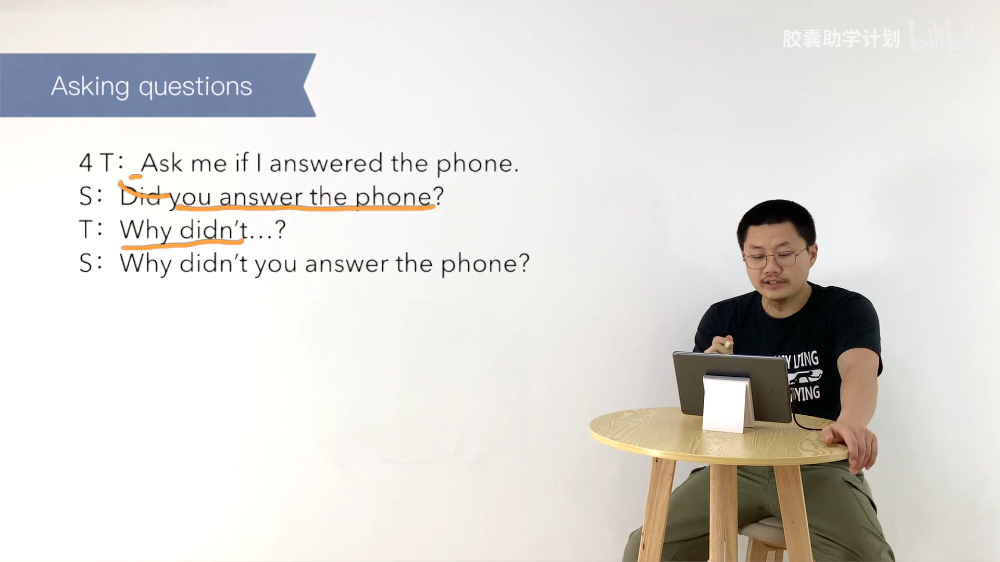

文字识别：胶囊助学计划 / Asking / questions / 4 T: Ask me if I answered the phone. / Did you answer the phone? / S: / T: / Why / didn't...? / S：Why / didn't you answer the phone? / YVING / OYING

### 画面 00:08:19

文字识别：胶囊助学计划 / Asking questions / "Y VING / AYING

### 画面 00:08:29

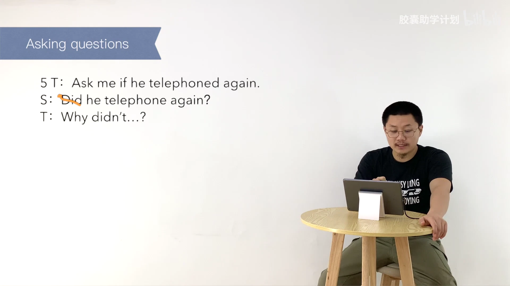

文字识别：胶囊助学计划 / Asking questions / 5 T: Ask me if he telephoned / d again. / S: Did he telephone again? / T：Why / didn't...? / 'SYUING / DYING

## 00:08:30–00:09:00

消。Why didn't he telephone again? Okay,那本课我们关键点还是复习啊，还是学习练习一般过去时这个时态之下，did啊，他们相关的一些用法啊，四个句型。家庭作业绿皮书七十一课可以去写了，文章跟读至熟读成诵啊，然后给自己讲解一遍今天的核心知识点。如果大家喜欢我们的课程呢，欢迎大家

### 画面 00:08:34

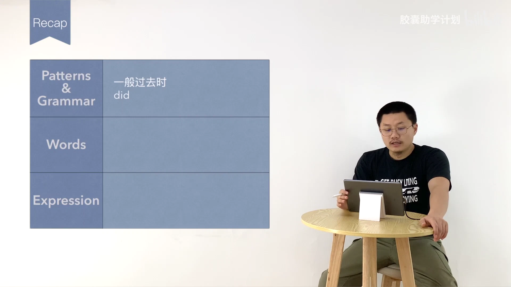

文字识别：Recap / 胶囊助学计划 / Patterns / 一般过去时 / did / Grammar / Words / ART RIICV DING / Expression / AYING

### 画面 00:08:36

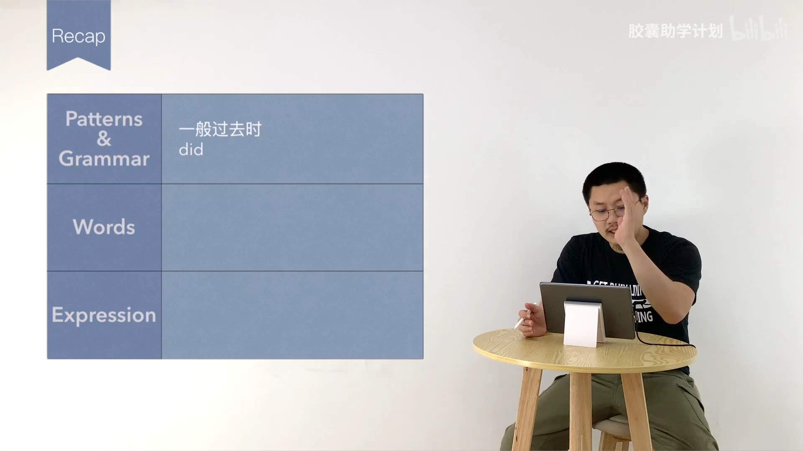

文字识别：Recap / 胶囊助学计划 / Patterns / 一般过去时 / & / did / Grammar / Words / Expression / HING

### 画面 00:08:43

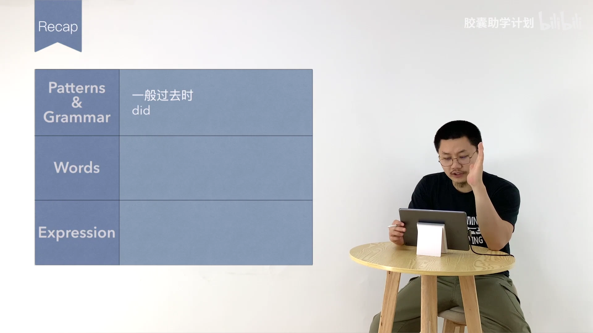

文字识别：Recap / 胶囊助学计划 / Patterns / 一般过去时 / did / Grammar / Words / Expression

### 画面 00:08:47

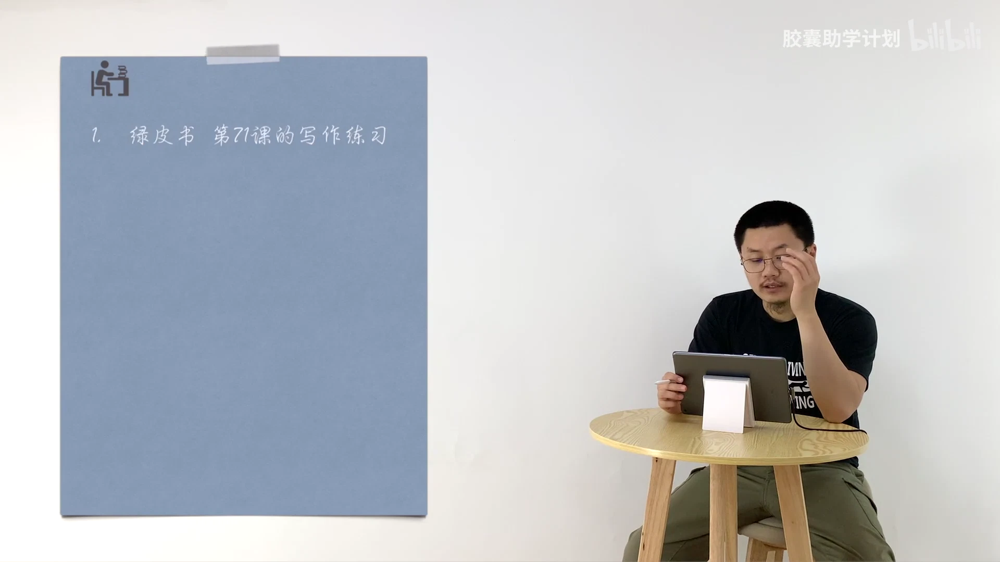

文字识别：胶囊助学计划 / 绿皮书第71课的写作练习

### 画面 00:08:57

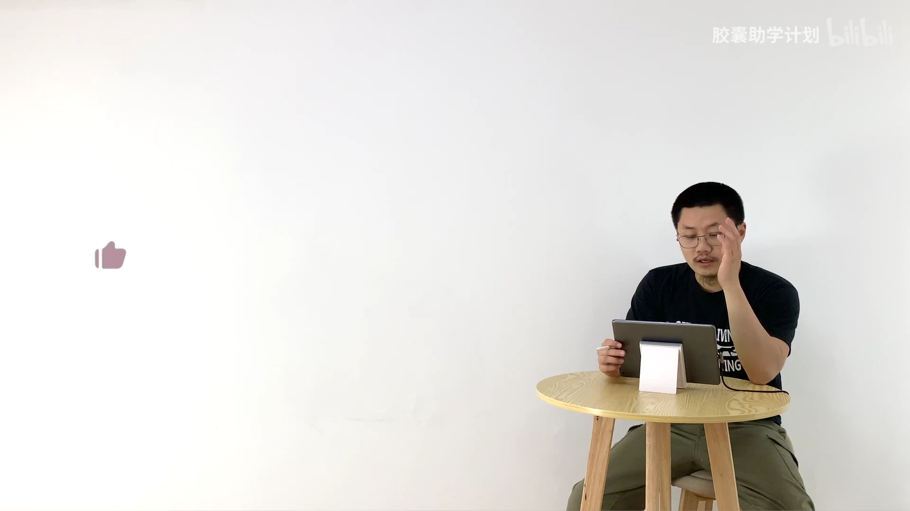

文字识别：胶囊助学计划 / 👍

## 00:09:00–00:09:28

关注、订阅、一键三连啊，分享给那些需要的朋友来帮助我们啊，去支持我们。OK，那最后我们再来看一句名人名言：A positive attitude can really make dreams come true. It did for me. See you next time.

### 画面 00:09:05

文字识别：胶囊助学计划 / A positive attitude can really make dreams / come true - it did for me. / David Bailey

### 画面 00:09:08

文字识别：胶囊助学计划 / A positive attitude can really make dreams / come true - it did for me. / INC / David Bailey

### 画面 00:09:15

文字识别：胶囊助学计划 / A positive attitude can really make dreams / CET DIISY LINING / come true - it didfor me. / PYING / David Bailey

### 画面 00:09:17

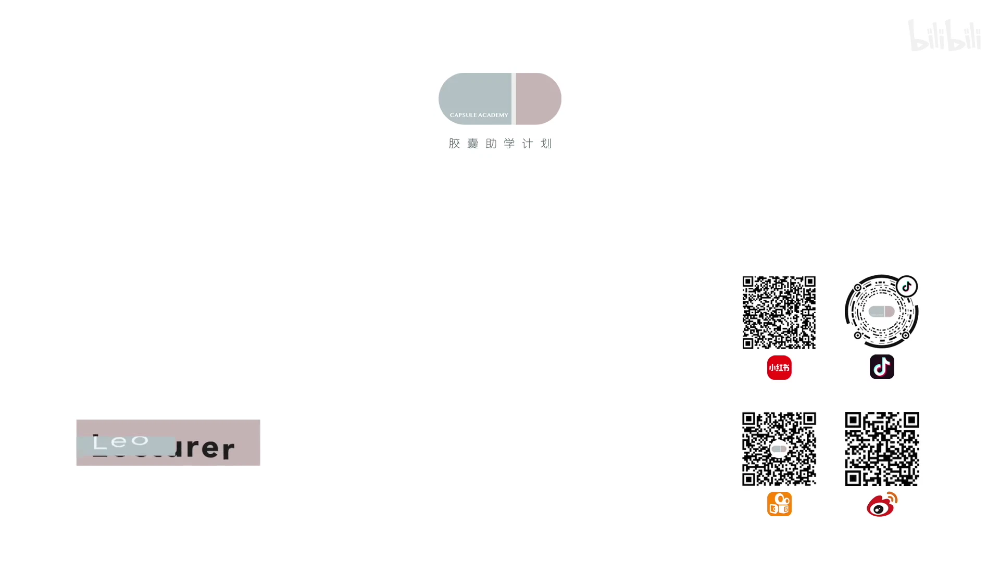

文字识别：CAPSULEACADEMY / 胶囊助学计划 / 小红书 / 口 / Leo irer / OE

### 画面 00:09:19

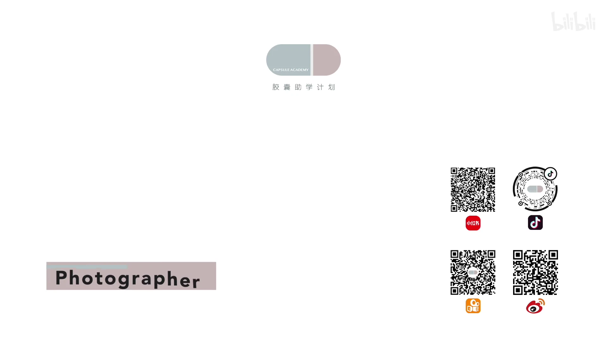

文字识别：CAPSULEACADEMY / 胶囊助学计划 / 小红书 / Photographer / OE

### 画面 00:09:22

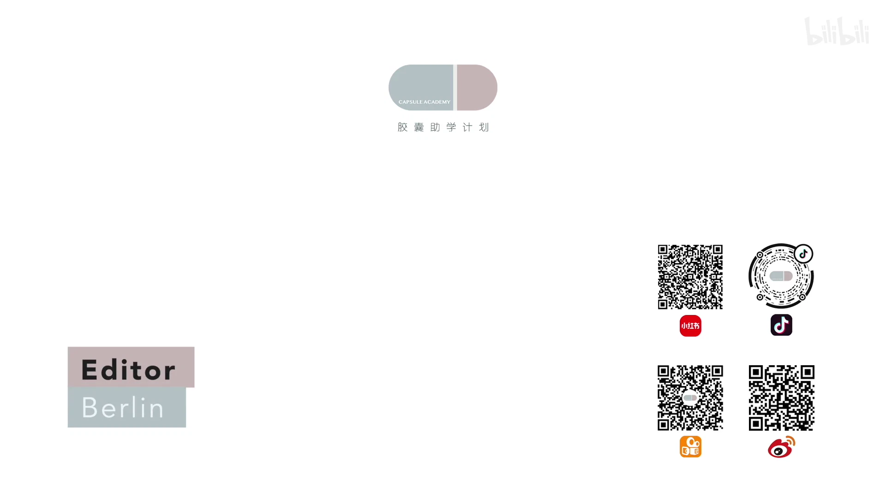

文字识别：CAPSULEACADEMY / 胶囊助学计划 / 小红书 / Editor / □ / Berlin / OE

### 画面 00:09:25

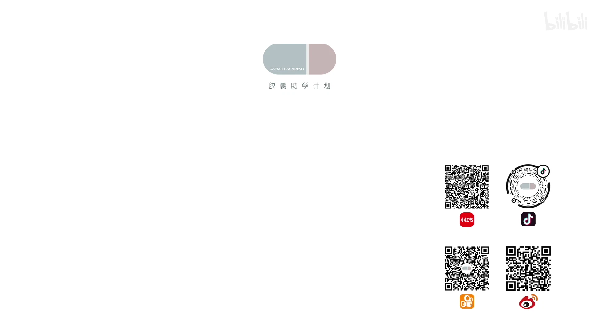

文字识别：CAPSULEACADEMY / 胶囊助学计划 / 小红书

### 画面 00:09:27

文字识别：bilibili / 胶囊助学计划

### 画面 00:09:28

文字识别：bilibili / 胶囊助学计划

