# 072 练习

快速机器解析：语音为单模型转写，未进行独立交叉校对或人工复核；画面每秒采样并按变化选帧，短时文字和标记可能遗漏。截图时间约有 1 秒误差。图片有损压缩；遇到疑点请按时间查看 Google Drive 原视频。

## 00:00:00–00:00:30

Hello everyone, welcome to Capsule Academy. This is Leo. Today we're going to learn new concept English book one lesson seventy two practices. Hope you gonna enjoy it.那本课各位要做的事情就是张开嘴啊，跟我大声去朗读练习，然后呢，重点注意一些动词，哎，变成过去式啊，对吧？以及什么时候换回原形啊，以及什么时候用 did，

### 画面 00:00:00

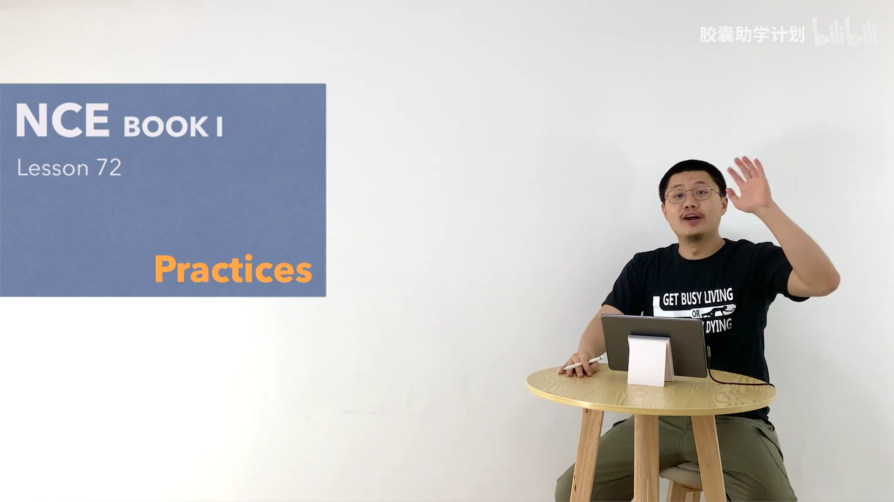

文字识别：胶囊助学计划 / NCE / BOOKI / Lesson 72 / Practices / GET BUSY LIVING / OR. / DYING

### 画面 00:00:02

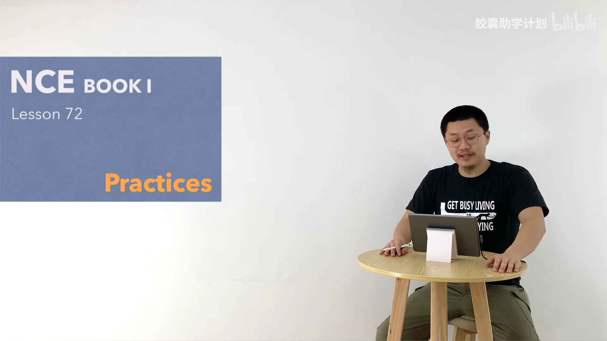

文字识别：胶囊助学计划 / NCE / BOOKI / Lesson 72 / Practices / GET BUSY LIVING / YING

### 画面 00:00:11

文字识别：胶囊助学计划bll / •

### 画面 00:00:14

文字识别：胶囊助学计划 / 胶囊助学计划

### 画面 00:00:16

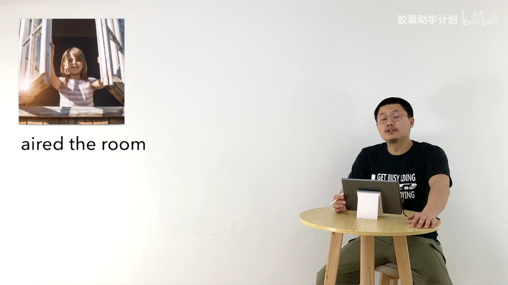

文字识别：胶囊助学计划 / aired the room /  GET BUSY LIING / DYING

### 画面 00:00:22

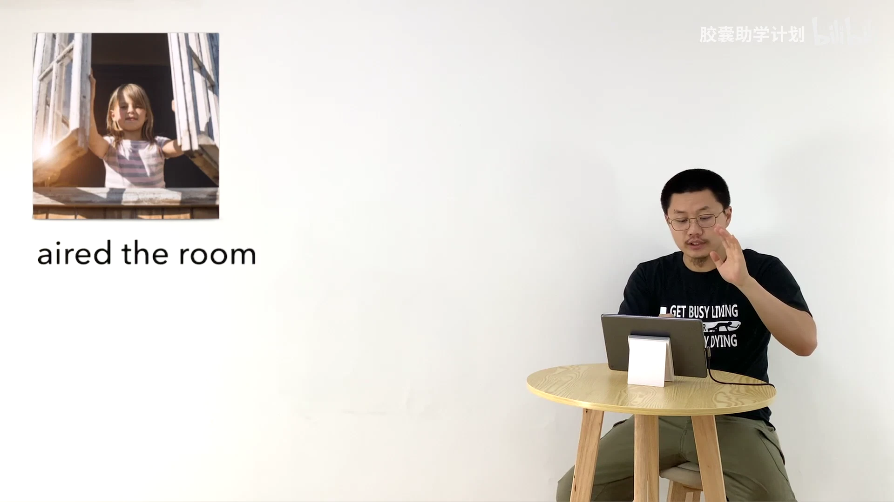

文字识别：胶囊助学计划 / aired the room / GET BUSY LIMING / R / YDYING

### 画面 00:00:27

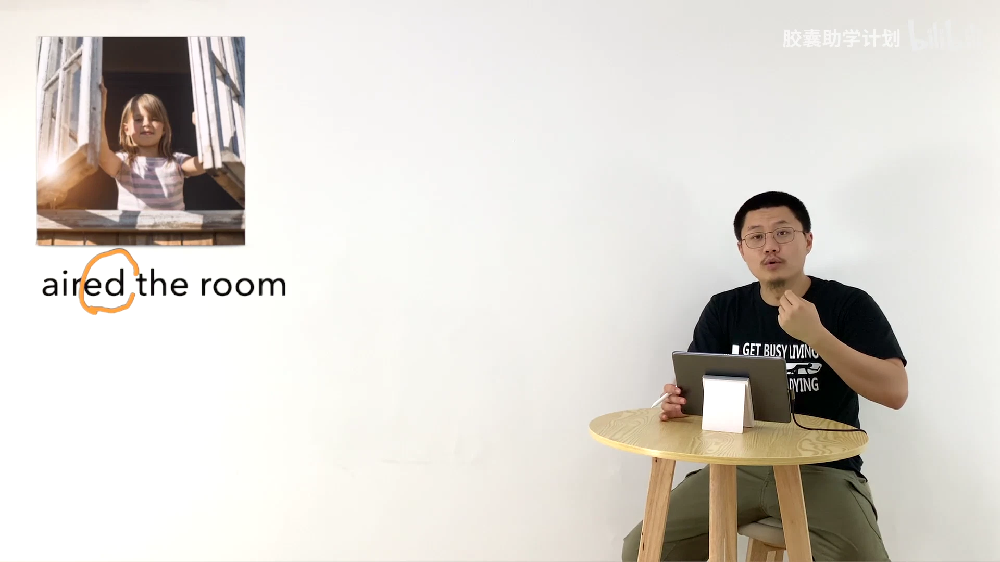

文字识别：胶囊助学计划 / aired the room / GET BUSYUIVINO / DYING

## 00:00:30–00:01:00

什么时候用 didn't 啊，来了，跟我读，Why did What did you do yesterday? I aired the room yesterday. 哎，是吧？Did you air the room yesterday? Did. When did you air the room? 答案就是 yesterday，对吧？Continue. Listen to the stereo. 都是我们前七十二课学的单词啊。What did she

### 画面 00:00:38

文字识别：胶囊助学计划 / 9 / aired the room / What did you do yesterday? / GET RIISY UIMING / ②I aired the room yesterday. / 2）

### 画面 00:00:52

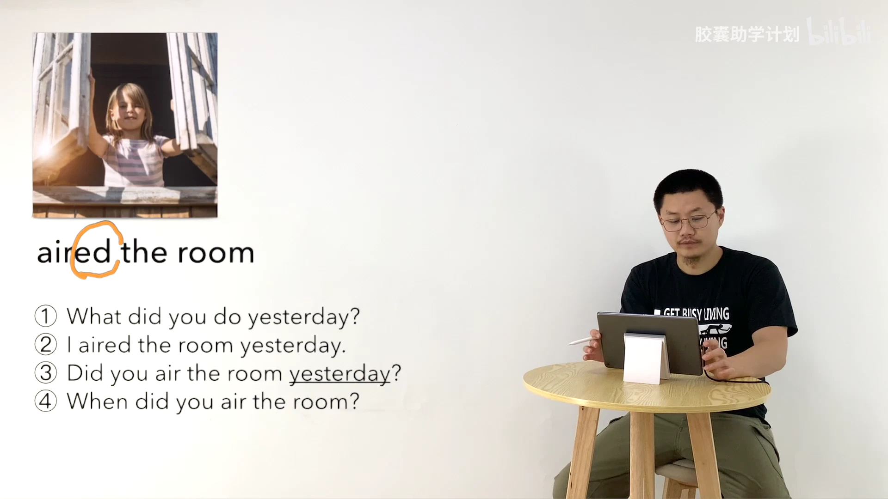

文字识别：胶囊助学计划 / 9 / aired the room / What did you do yesterday? / GET RIISY UIVING / I aired the room yesterday. / Did you air the room yesterday? / When did you air the room?

### 画面 00:00:54

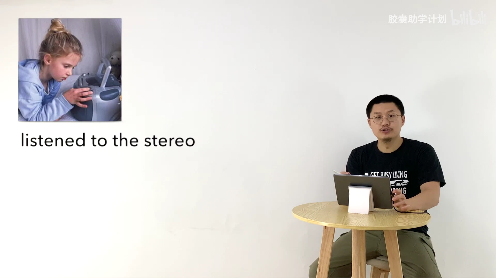

文字识别：胶囊助学计划 / listened to the stereo / GET RISYLUVING / G

## 00:01:00–00:01:30

do last night?昨天晚上做什么了？She listened to the stereo last night. Did she listen to the stereo last night? When did she listen to the stereo?注意啊，看，只有在肯定句当中啊，在这个地方用的是原形，在别的地方你看啊，用的是过去式，对吧？别的地方都是用原形了，对吧？因为你变成一般

### 画面 00:01:03

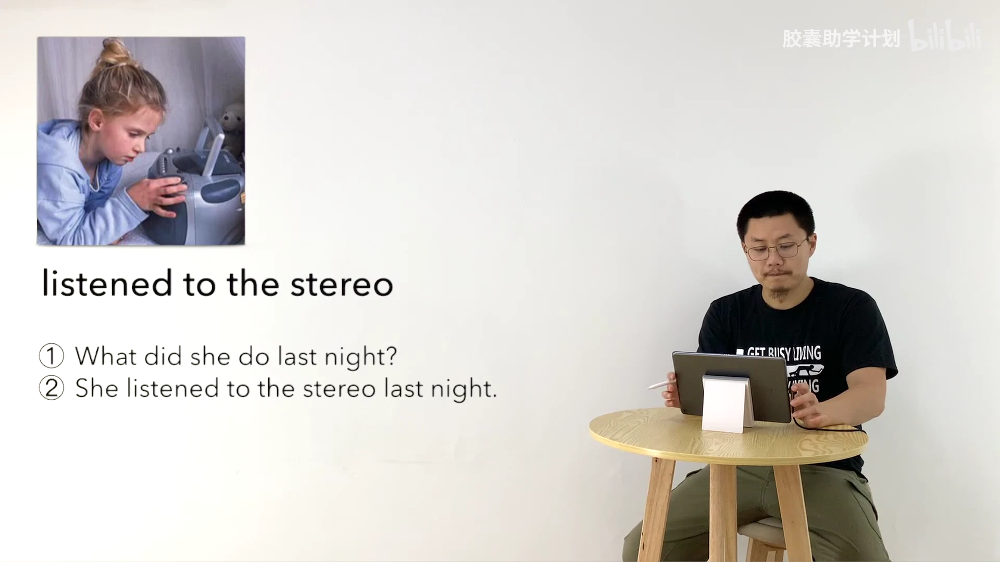

文字识别：胶囊助学计划 / listened to the stereo / What did she do last night? / GET RISY UIMING /  She listened to the stereo last night. / G

### 画面 00:01:12

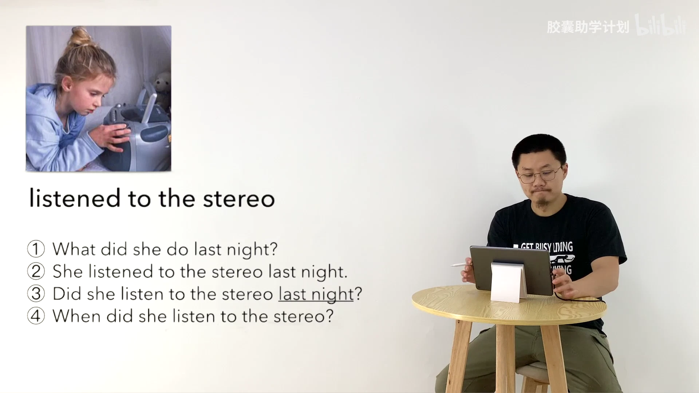

文字识别：胶囊助学计划 / listened to the stereo / What did she do last night? / GET RISY UIMNG / She listened to the stereo last night. / Did she listen to the stereo last night? / When did she listen to the stereo?

## 00:01:30–00:02:00

疑问句或否定句了嘛，对吧？ Continue shaved. What did he do this morning? He shaved this morning. Did he shave this morning? When did he shave? 啊，他什么时候刮的胡子？ Continue telephone.打电话，对吧？ What did she do the night before last night? 啊， the night before last. 你想一下什么意思啊？

### 画面 00:01:31

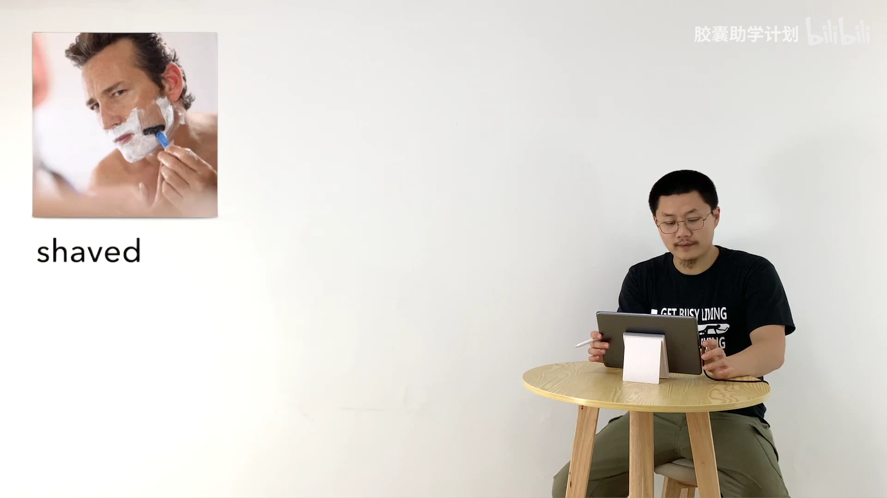

文字识别：胶囊助学计划 / 9 / shaved / GET RIISY LIING

### 画面 00:01:38

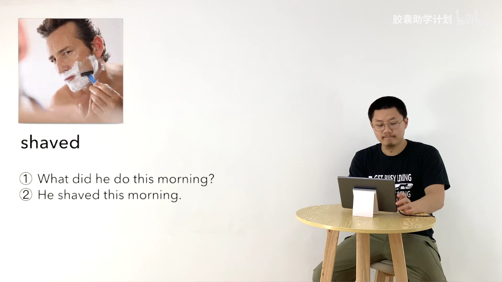

文字识别：胶囊助学计划 / shaved / What did he do this morning? / CET DICY UMNG / ) He shaved this morning.

### 画面 00:01:48

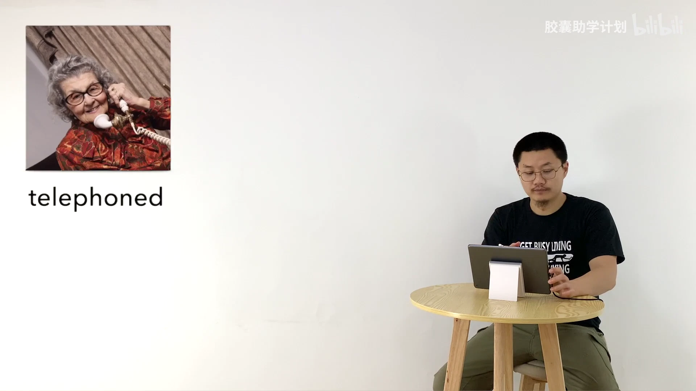

文字识别：胶囊助学计划 / telephoned / CET RISY LIING / NG

## 00:02:00–00:02:30

Last night叫昨晚，the night before last night啊，其实这地方省略了一个night，就是前一天晚上，对吧？Okay, she telephoned her husband the night before last. Did she telephoned her husband the night before last?以及When did she telephoned her husband? Okay, call the doctor给医生打电话来了。What did you do last night?

### 画面 00:02:07

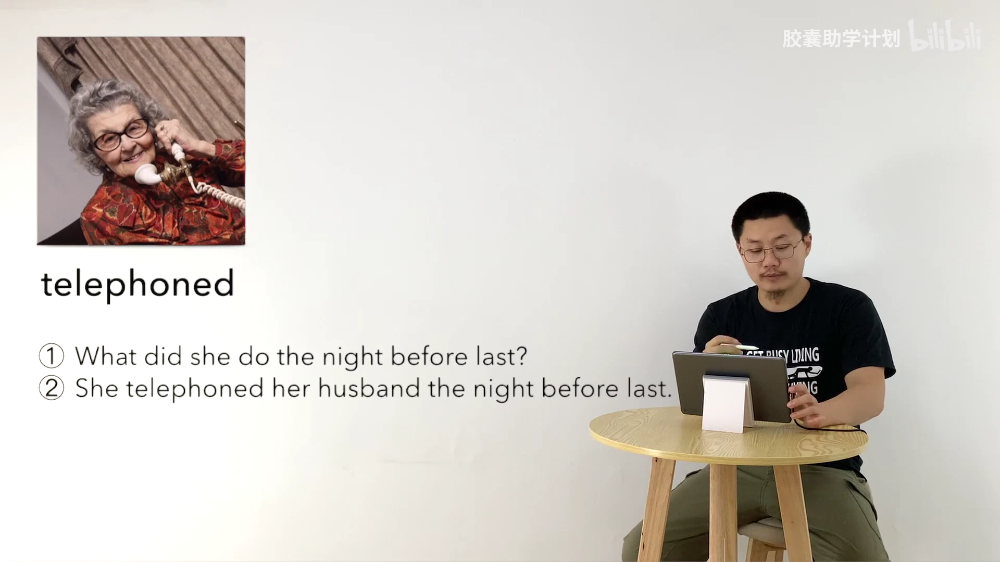

文字识别：胶囊助学计划 / telephoned / What did she do the night before last? / ART DIICY LIING / She telephoned her husband the night before last.

### 画面 00:02:17

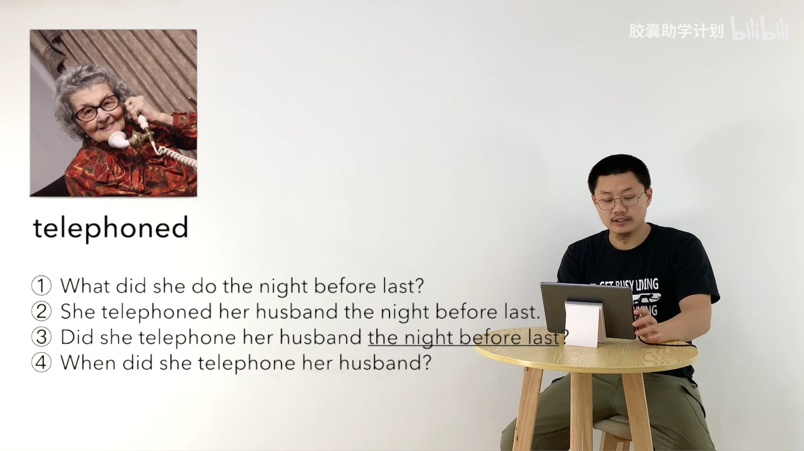

文字识别：胶囊助学计划 / telephoned /  What did she do the night before last? / 1 / ART DIICY LIMING / She telephoned her husband the night before last. / Did she telephone her husband the night before last? / When did she telephone her husband?

### 画面 00:02:22

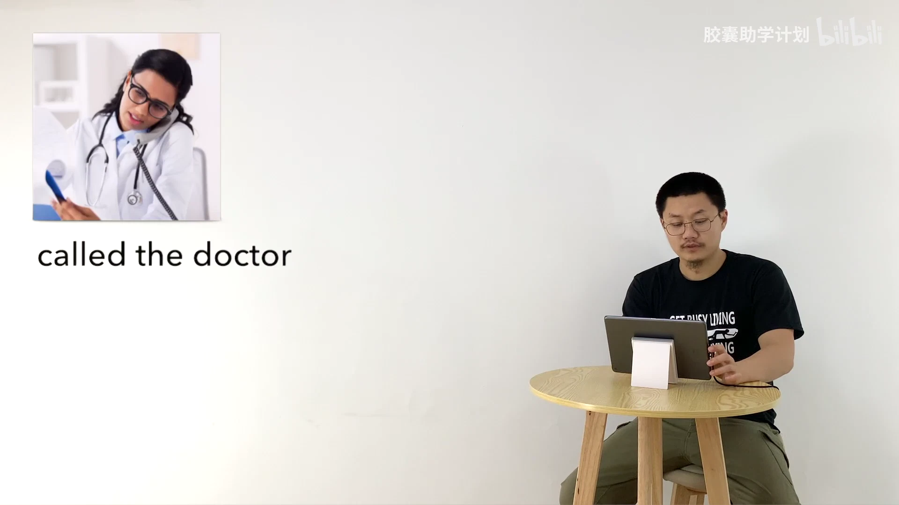

文字识别：胶囊助学计划 / called the doctor / AT DIICV LIMING

### 画面 00:02:29

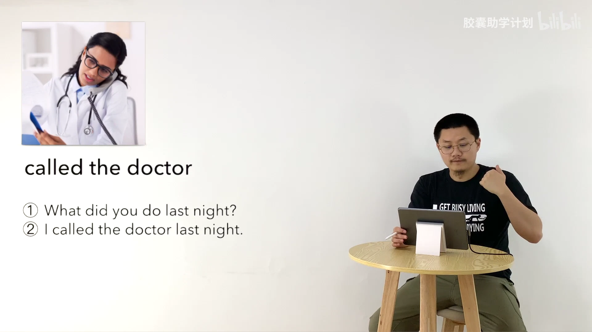

文字识别：胶囊助学计划 / called the doctor /  What did you do last night? / GET RUISY LING / ② I called the doctor last night. / DYING

## 00:02:30–00:03:00

I called the doctor last night. Did you call the doctor last night? 对 last night 提问肯定是用 when，对吧？我们把它提到前面去，叫做 When did you call the doctor? 答案是 last night. Continue. What did she do the night before yesterday? That the day before yesterday. She emptied the basket the day before yesterday. Did she empty the basket the day before yesterday?

### 画面 00:02:39

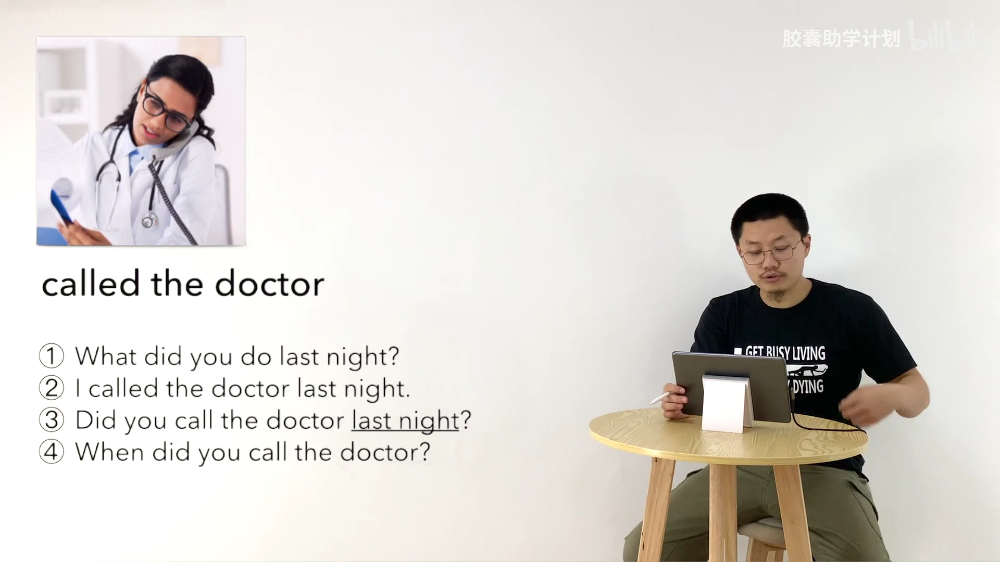

文字识别：胶囊助学计划 / called the doctor /  What did you do last night? / GFT RIISY LIVING / 2 /  I called the doctor last night. / DYING / Did you call the doctor last night? / 3 / When did you call the doctor?

### 画面 00:02:44

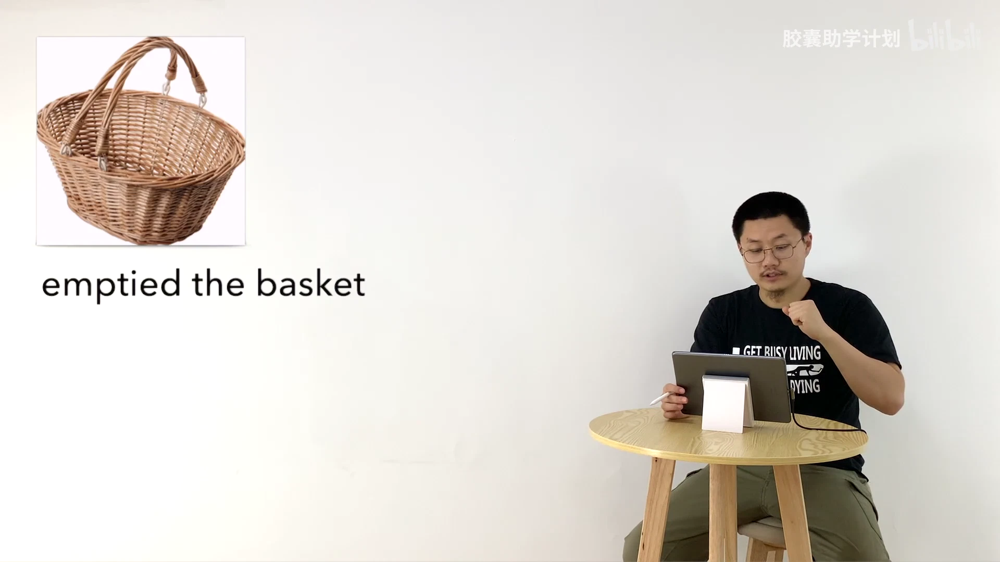

文字识别：胶囊助学计划 / emptied the basket / GET RIISY LIVING / DYING

### 画面 00:02:51

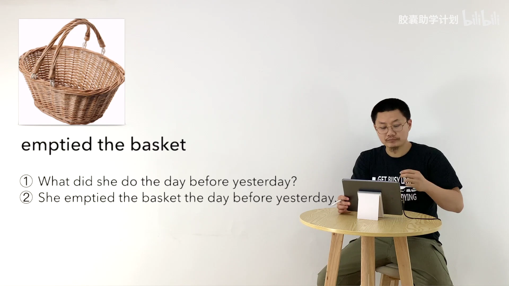

文字识别：胶囊助学计划 / emptied the basket / What did she do the day before yesterday? / GET RIISVU / She emptied the basket the day before yesterday / ) / AYING

### 画面 00:02:59

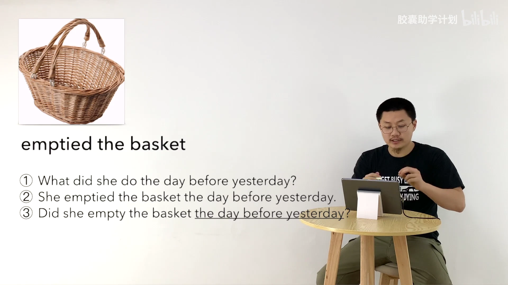

文字识别：胶囊助学计划 / emptied the basket / What did she do the day before yesterday? / CETRIISY / She emptied the basket the day before yesterday. / 2 / YDYING / Did she empty the basket the day before yesterday?

## 00:03:00–00:03:30

意，你看这儿用的是过去式，这儿用的就换回原形了，对吧？以及最后一个叫做 When did she empty the basket? Continue. What did I do yesterday morning? You boiled an egg yesterday morning. Did I boil an egg yesterday morning? 我自己都忘了，对吧？好， When did I boil an egg? 我怎么不记得了？ Continue. Clean our shoes. 擦鞋.

### 画面 00:03:08

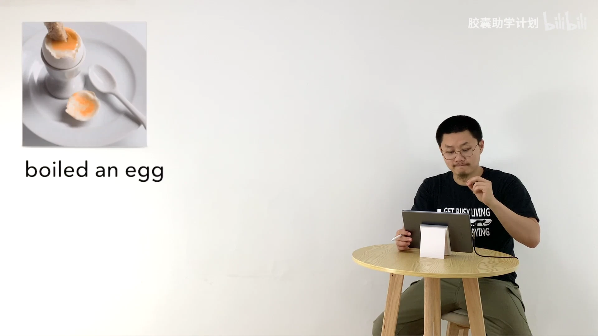

文字识别：胶囊助学计划 / boiled an egg / GET DIICVLIVING / AYING

### 画面 00:03:16

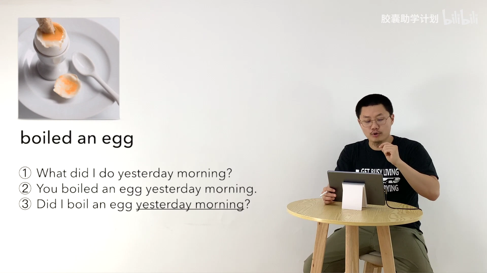

文字识别：胶囊助学计划 / boiled an egg / What did I do yesterday morning? / GET RIISV LING / You boiled an egg yesterday morning. / AYING / Did I boil an egg yesterday morning?

### 画面 00:03:26

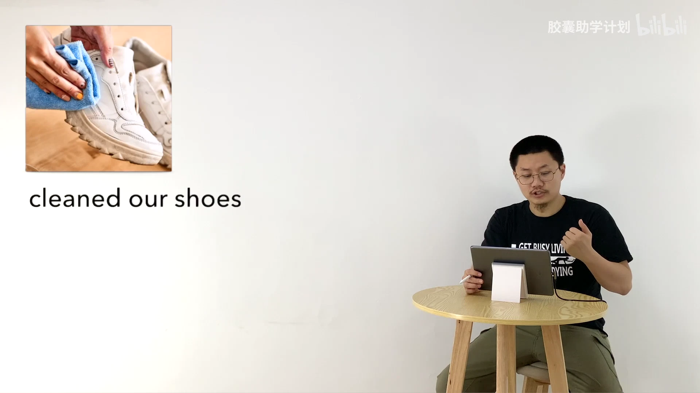

文字识别：胶囊助学计划 / cleaned our shoes / AYING

## 00:03:30–00:04:00

What did you and Tom do yesterday? We cleaned our shoes yesterday. Did you clean your shoes yesterday? When did you clean your shoes? There you go. Continue. What did the children do yesterday afternoon? They played in the garden yesterday afternoon. Did they play in the garden yesterday afternoon?和When did they play

### 画面 00:03:33

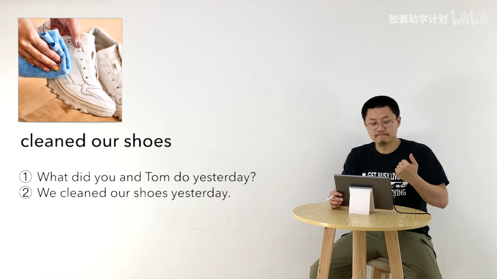

文字识别：胶囊助学计划 / cleaned our shoes / What did you and Tom do yesterday? / We cleaned our shoes yesterday. / AYING

### 画面 00:03:39

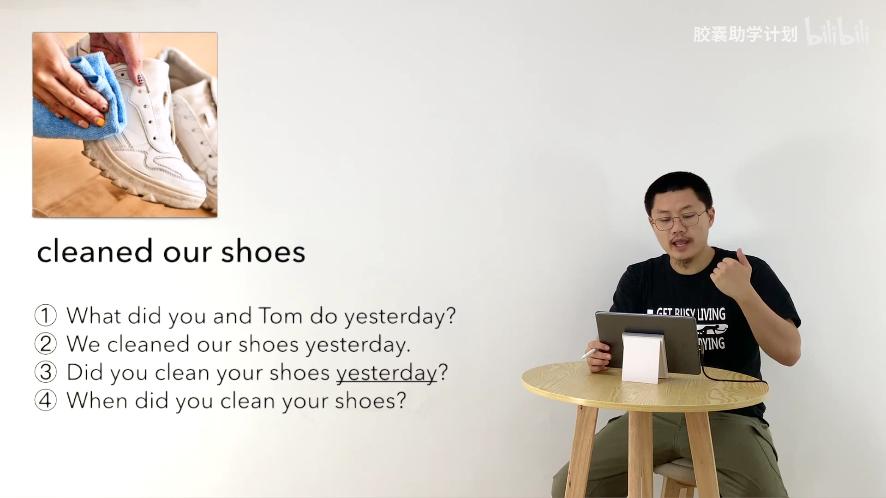

文字识别：胶囊助学计划 / cleaned our shoes / What did you and Tom do yesterday? / GET RIISV UIVING / We cleaned our shoes yesterday. / AYING / Did you clean your shoes yesterday? / When did you clean your shoes?

### 画面 00:03:44

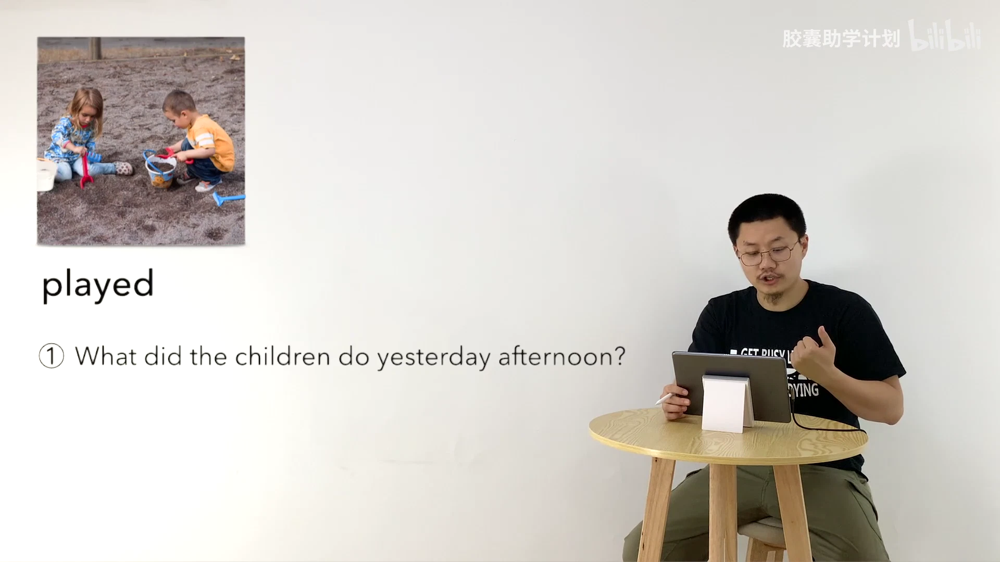

文字识别：胶囊助学计划 / played /  What did the children do yesterday afternoon? / CET DIICV / YING

### 画面 00:03:53

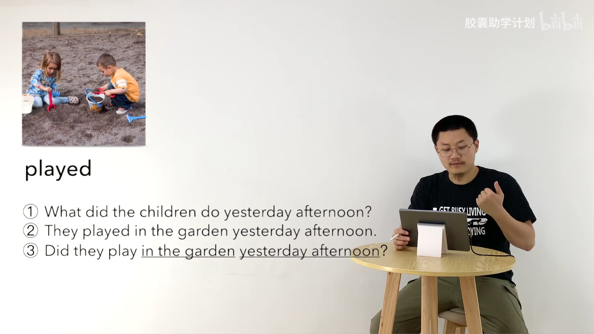

文字识别：胶囊助学计划 / played / What did the children do yesterday afternoon? / CET BIICVLVIN / They played in the garden yesterday afternoon. / AYING / Did they play in the garden yesterday afternoon?

## 00:04:00–00:04:30

in the garden? Ah,当然了，您是不是对 in the garden 提问的时候还可以用 where，对吧？你看我造一句叫做 Where did they play yesterday afternoon? Ah,昨天下午他们在哪玩的？Okay, stay in bed. What did he do today? He stayed in bed today. Did he stay in bed today? When did he stay in bed? Okay, recap.本课就是很快的一个

### 画面 00:04:04

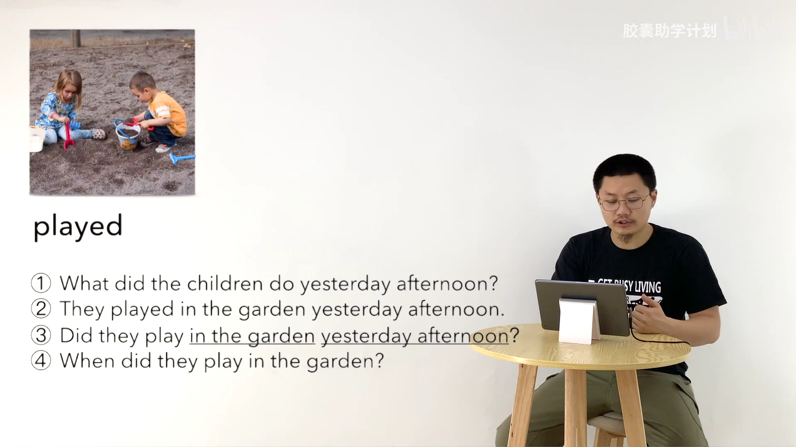

文字识别：胶囊助学计划 / played / What did the children do yesterday afternoon? / - CRT PUSY LIVING / They played in the garden yesterday afternoon. / 2 / Did they play in the garden yesterday afternoon? / When did they play in the garden?

### 画面 00:04:07

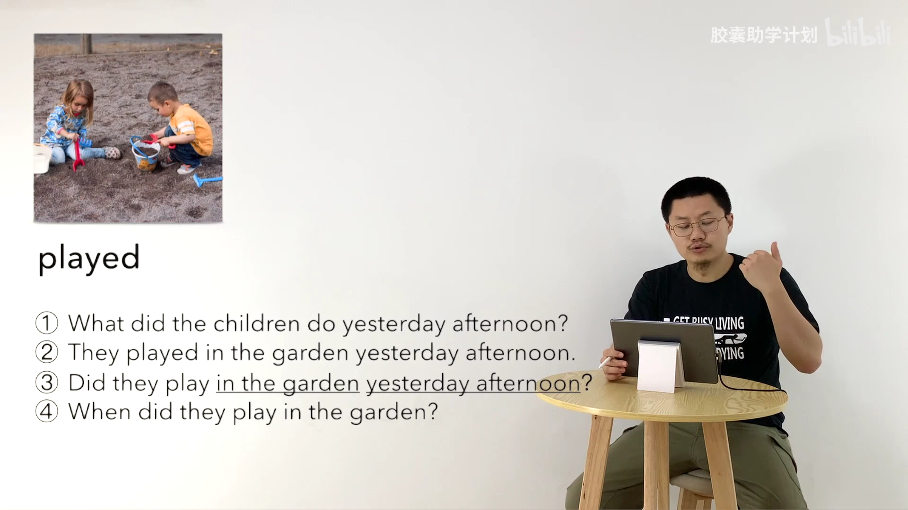

文字识别：胶囊助学计划 / played / What did the children do yesterday afternoon? /  CET DIV LING / They played in the garden yesterday afternoon. / 2 / PYING / Did they play in the garden yesterday afternoon? / When did they play in the garden?

### 画面 00:04:14

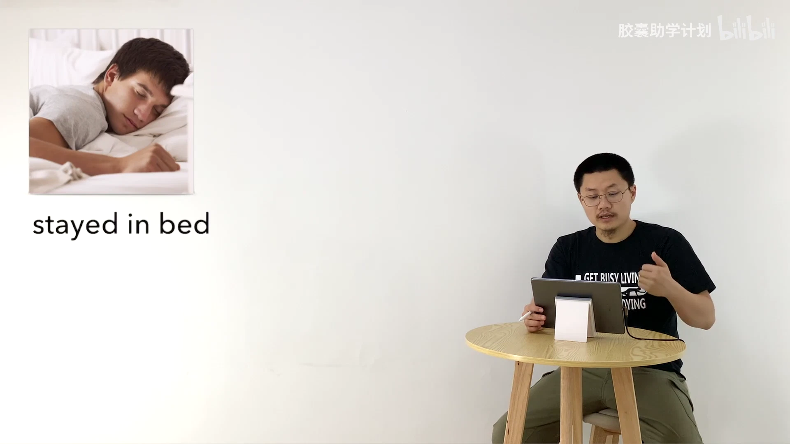

文字识别：胶囊助学计划 / stayed in bed / GET RUISY LIVIN / DYING

### 画面 00:04:22

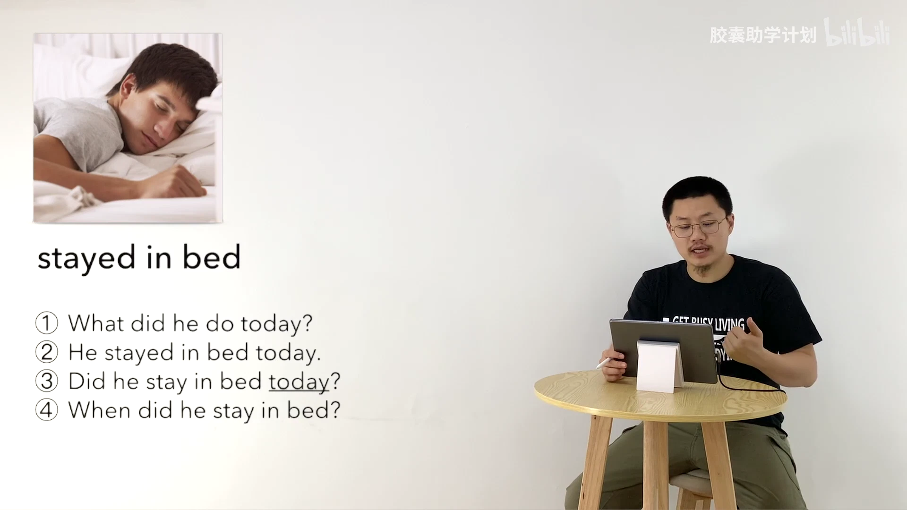

文字识别：胶囊助学计划 / stayed in bed / What did he do today? / GET DIICV / KLIVING / He stayed in bed today. / Did he stay in bed today? / When did he stay in bed?

### 画面 00:04:26

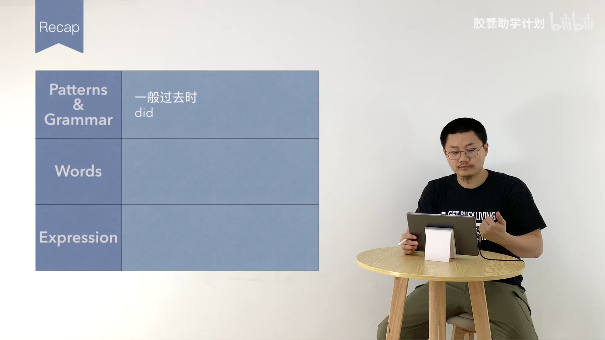

文字识别：胶囊助学计划 / Recap / Patterns / 一般过去时 / did / Grammar / Words / CET DIICV / JAIG / Expression

## 00:04:30–00:05:00

习啊，我念一句，您念一句，大概张开大家张开嘴就好了。练习的还是关于一般过去时 did 这个单词的用法。 OK，家庭作业绿皮书七十二课，各位可以完成了，给自己讲解一遍今天的核心知识点。那如果各位喜欢我们的课程，欢迎大家关注、订阅、一键三连支持，并分享给那些需要的朋友。 See you next time.

### 画面 00:04:34

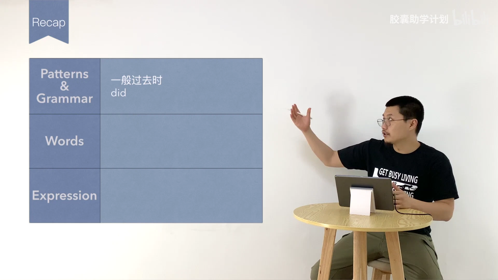

文字识别：胶囊助学计划 / Recap / Patterns / 一般过去时 / did / Grammar / Words / GET BUSY LIVING / Expression

### 画面 00:04:36

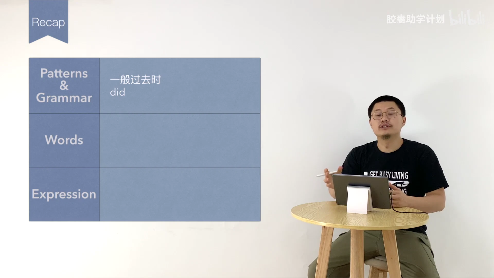

文字识别：胶囊助学计划 / Recap / Patterns / 一般过去时 / did / Grammar / Words / GET RISY LIVING / Expression

### 画面 00:04:38

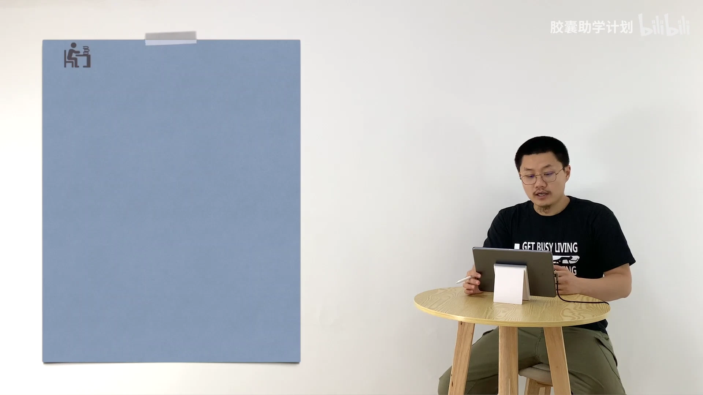

文字识别：胶囊助学计划 / GFT BUSY LIVING

### 画面 00:04:42

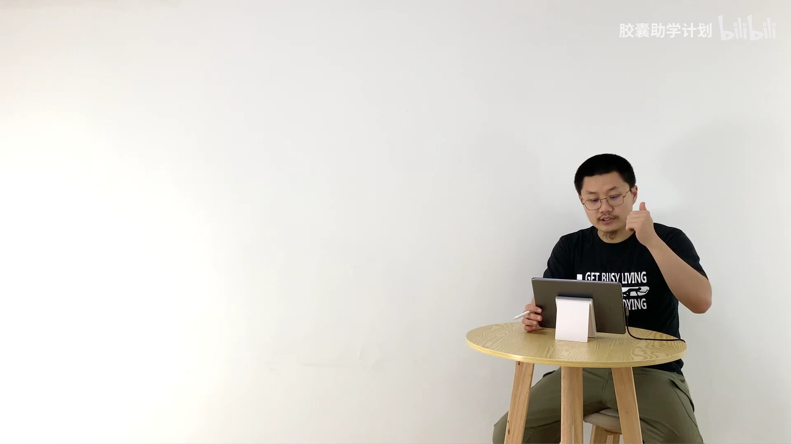

文字识别：胶囊助学计划 /  GET RISV LIVING / DYING

### 画面 00:04:53

### 画面 00:04:55

文字识别：CAPSULEACADEMY / 胶囊助学计划 / 『 / 小红书 / Lecturer / □ / Leo / OE

### 画面 00:04:58

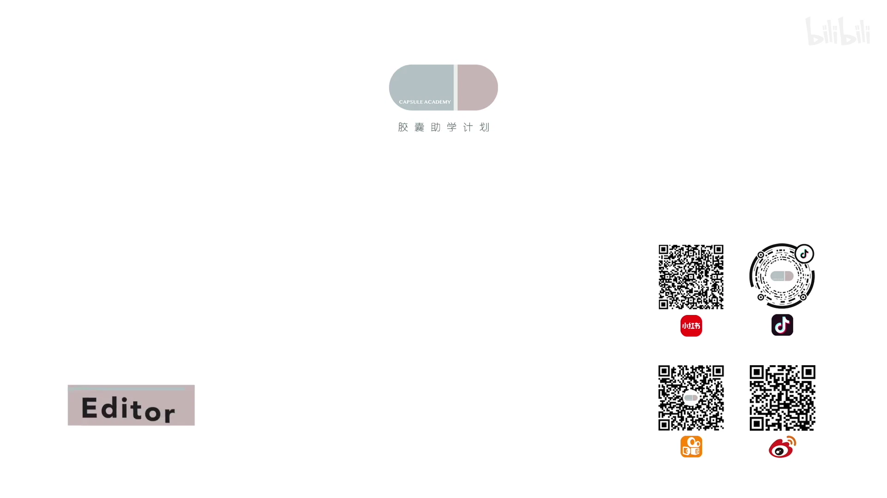

文字识别：CAPSULEACADEMY / 胶囊助学计划 / 『 / 小红书 / □ / Editor / OE

## 00:05:00–00:05:05

### 画面 00:05:01

文字识别：CAPSULEACADEMY / 胶囊助学计划 / 『 / 小红书 / Creator / Leo & Berlin / OE

### 画面 00:05:03

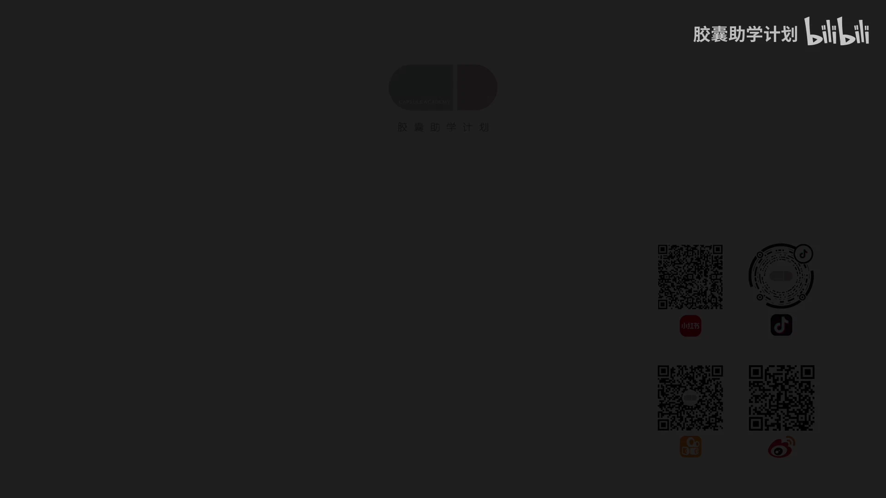

文字识别：BiliBili / 胶囊助学计划 / 小红书

### 画面 00:05:05

文字识别：bilibili / 胶囊助学计划

