# 073 语法 单词

快速机器解析：语音为单模型转写，未进行独立交叉校对或人工复核；画面每秒采样并按变化选帧，短时文字和标记可能遗漏。截图时间约有 1 秒误差。图片有损压缩；遇到疑点请按时间查看 Google Drive 原视频。

## 00:00:00–00:00:30

Hello everyone, welcome to Capsule Academy. This is Leo. Today we're going to learn New Concept English Book One Lesson Seventy Three Grammar and Words. 那老习惯进入正式课程之前呢，我们先看几个小的问题。第一，如何使用副词？那它的缩写是 adv. 点 OK。那第二呢，如何表达紧密相连？最后一个问题，如何表达我不懂啊？那带着这三个问题， hope you gonna enjoy it.

### 画面 00:00:00

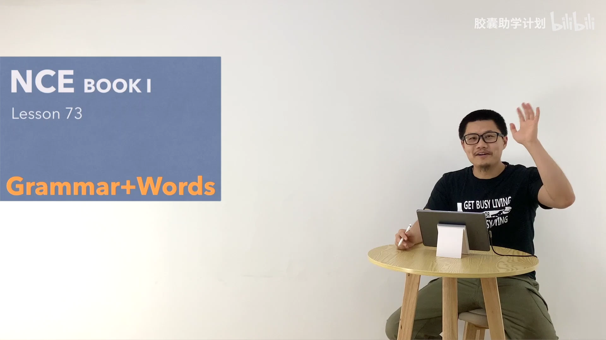

文字识别：biltbili / 胶囊助学计划 / NCE / BOOKI / Lesson 73 / Grammar+Words / GET BUSY LIVING / OR- / SYING

### 画面 00:00:10

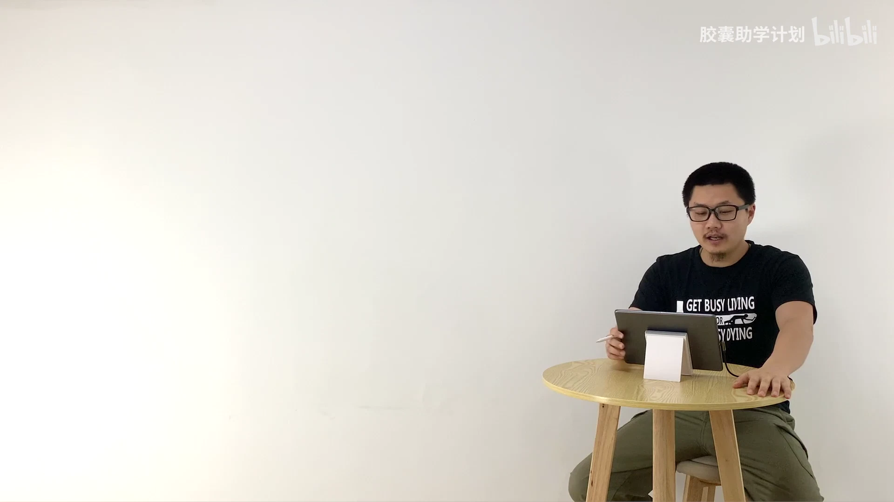

文字识别：胶囊助学计划bilbl / GET BUSY LIVING / R. / SYOVING

### 画面 00:00:12

文字识别：胶囊助学计划 il出 / ①如何使用副词adv.? / GET BUSY LIVING / R / YDVING

### 画面 00:00:19

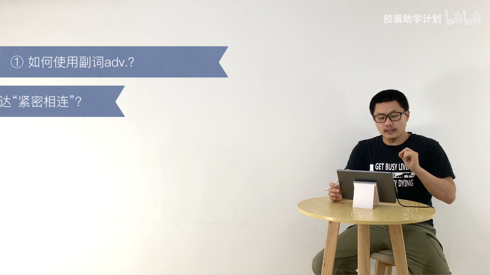

文字识别：胶囊助学计划 / ①如何使用副词adv.? / 达“紧密相连” / GET BUSY LIV / R / YDYING

### 画面 00:00:21

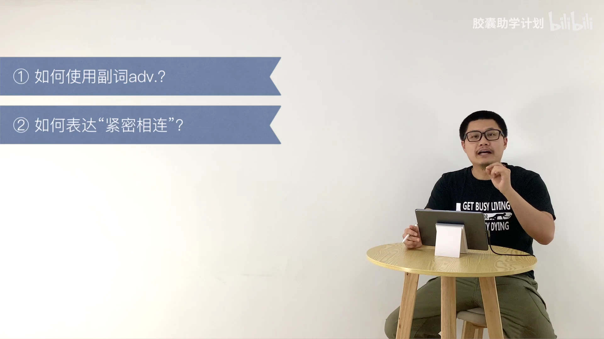

文字识别：胶囊助学计划 / ①如何使用副词adv.? / 如何表达“紧密相连” / GET BUSY LIVING / RAU / YDYING

### 画面 00:00:23

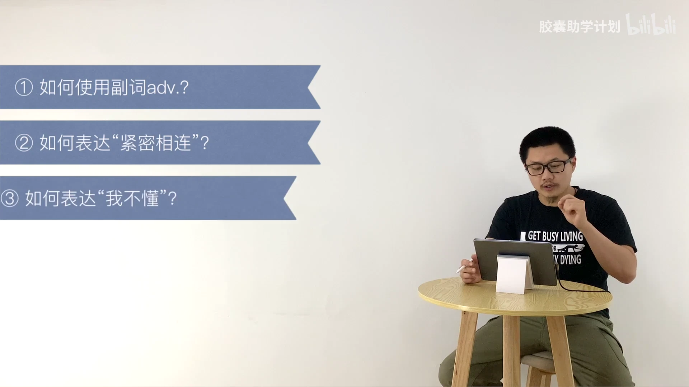

文字识别：胶囊助学计划 / ①如何使用副词adv.? / 如何表达“紧密相连” / 如何表达“我不懂”? / GET BUSY LIVING / YDYING

### 画面 00:00:29

文字识别：胶囊助学计划 bilbl

## 00:00:30–00:01:00

### 画面 00:00:32

文字识别：胶囊助学计划 / 胶囊助学计划

### 画面 00:00:34

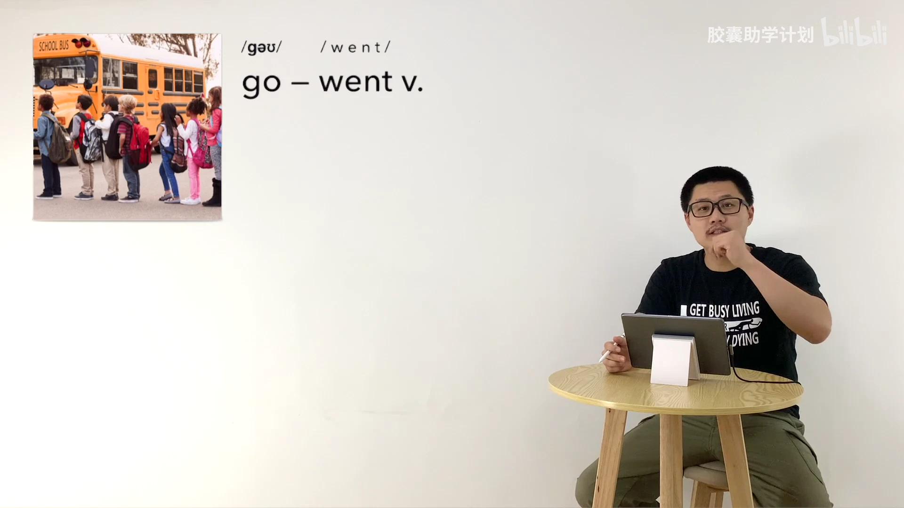

文字识别：胶囊助学计划 / SCHOOLBUS / /gau/ / /went/ / go - went v. / GET BUSY LIING / PDYING

### 画面 00:00:53

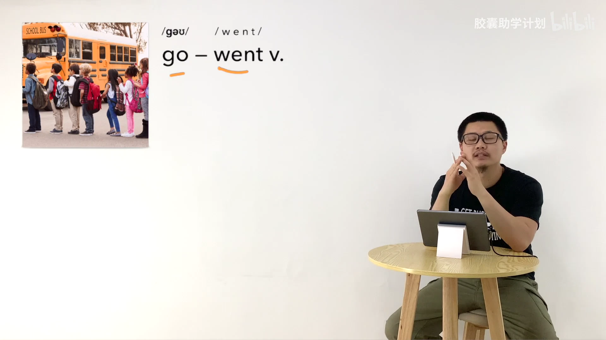

文字识别：胶囊助学计划 / SCHOOLBUSO / /gau/ / /went/ / go - went v.

## 00:01:00–00:01:30

变化规则，对吧？它变成过去有两种不同的规则，一种叫做规则的，对吧？啊，rules. There are two rules there. Okay,一种叫做规则的，一种叫做不规则的。规则就是各种变化后边加ed，对吧？表示这个动作发生在过去。那现在各位看到了啊，一个不规则的样子就是go。如果说我曾经去了某个地方，那就要用went。你看，它完全真的就是不规则的，没有什么逻辑联系的，对吧？Okay,

### 画面 00:01:23

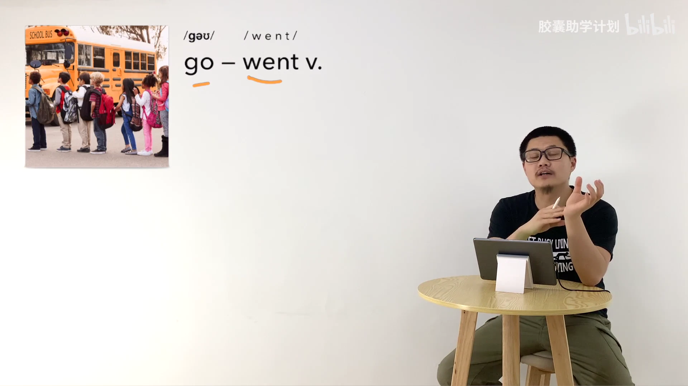

文字识别：胶囊助学计划 / SCHOOL USO / /gau/ / /went/ / go - went v. / CTNIIAY / UDIN / ING

## 00:01:30–00:02:00

比如说 they go to school every day，这是我们在四十七课一直到六十课学的一般现在时的时候就学过这样一句话，叫做他们每天都要去学校。一般现在时陈述客观事实，对吧？接下来，如果我说我昨天也去学校了，你就不能用 go 了。汉语不管什么时候去学校，这个去这个字儿是永远不变的。我们不会在去这个字儿后边加个 s 啊，加个 i n g 啊，加个 e d 啊，等等等等，

### 画面 00:01:44

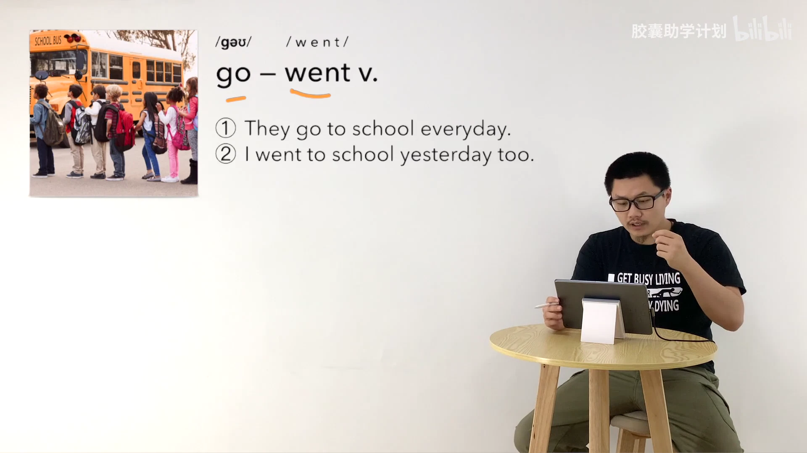

文字识别：胶囊助学计划 / SCHOOL BUSO / /gau/ / /went/ / go - went v. / ① They go to school everyday. /  I went to school yesterday too. / GET BUSY LNING / VDVING

## 00:02:00–00:02:30

对吧？那英文当中go啊会产生各种各样的变化，比如说goes to school对吧？goes to school以及go以及going啊，今天各位见到它它的第四个形式叫做went very good。说I went to school yesterday too。好，首先肯定句给各位了，变一般疑问句的时候，那虽然它的动词现在是不规则的，但是变一般疑问句还是把did提前，动词换原形，这个是没有任何变化的，叫做

### 画面 00:02:14

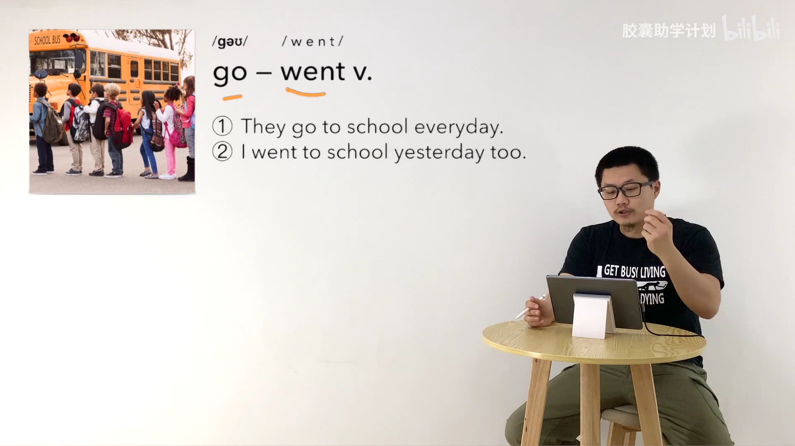

文字识别：胶囊助学计划 / SCHOOL BUSO / /gau/ / /went/ / go - went v. / ① They go to school everyday. / ② I went to school yesterday too. / GET BUSYLIVING / DYING

## 00:02:30–00:03:00

Did you go to school yesterday? Okay, another one. 那接下来呢？如果我们老习惯，如果比如说对 yesterday 提问啊，那你就要用 when 变成了 When did you go to school? 你什么时候去学校？对吧？ Okay, 啊，那它没有什么太大的变化了，在这个地方。 Okay, 注意小夏就可以了。 Continue week. 下一个小的单词叫做一周啊。这个单词我们应该见过很多次了啊。比如说，哎，我们从周日开始一直到周一，

### 画面 00:02:36

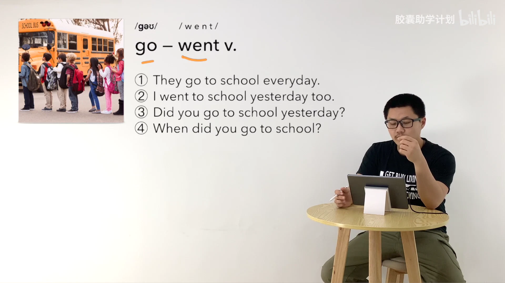

文字识别：胶囊助学计划 / SCHOOL BUSO / /gau/ / /went/ / go - went v. / ① They go to school everyday. / ② I went to school yesterday too. / Did you go to school yesterday? / 3 / When did you go to school? / LMIN / YIN

### 画面 00:02:40

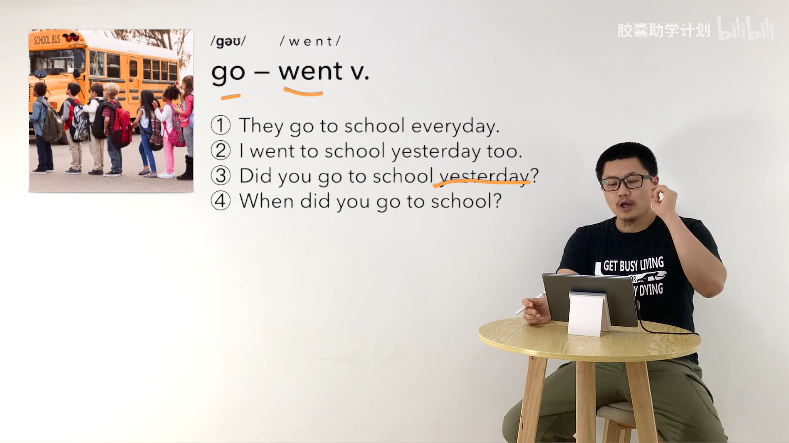

文字识别：胶囊助学计划 / SCHOOL BUSO / /gau/ / /went/ / go - went v. / ① They go to school everyday. / I went to school yesterday too. / Did you go to school yesterday? / When did you go to school? / GET BUSY LIVING / R / YDYING

### 画面 00:02:49

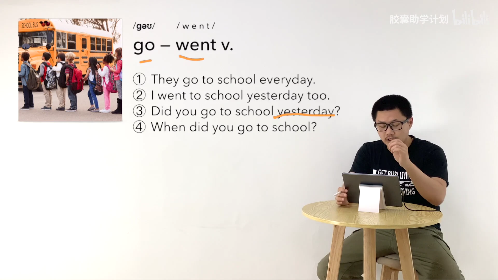

文字识别：胶囊助学计划 / SCHOOL BUSO / /gau/ / /went/ / go - went v. / ① They go to school everyday. / I went to school yesterday too. / Did you go to school yesterday? / 3 / When did you go to school? / GET RIICV / M / SYING

### 画面 00:02:51

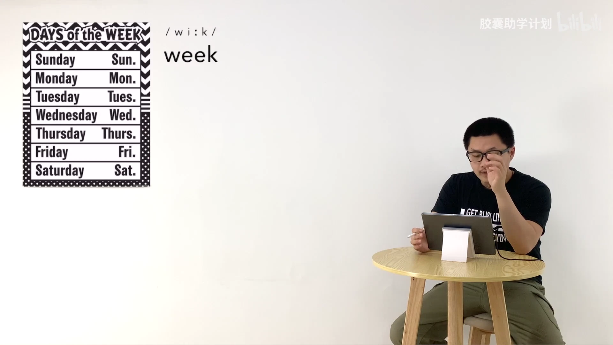

文字识别：CDAYSofthe WEER / 胶囊助学计划 / / w i : k / / week / Sunday / Sun. / Monday / Mon. / Tuesday / Tues. / Wednesday / Wed. / Thursday / Thurs. / Friday / Fri. / Saturday / Sat.

### 画面 00:02:58

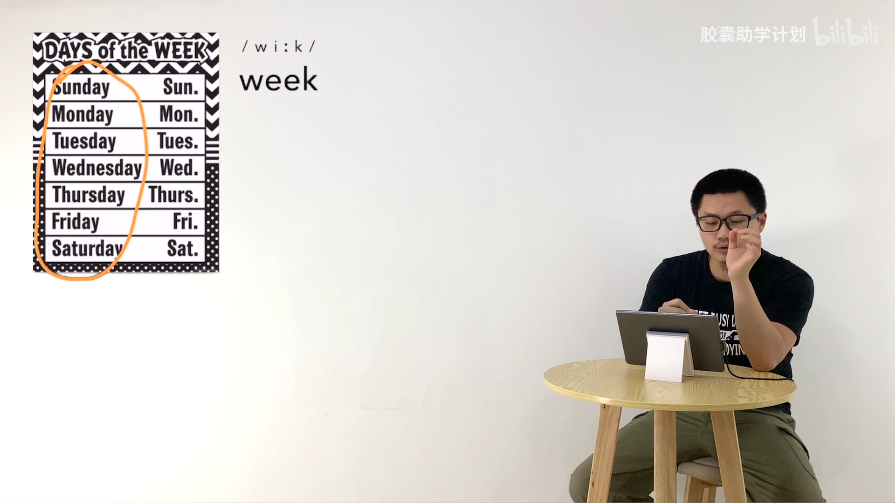

文字识别：DAYSofthe WEER / 胶囊助学计划 / / w i : k 1 / week / sunday / Sun. / Monday / Mon. / Tuesday / Tues. / Wednesday / Wed. / Thursday / Thurs. / Friday / Fri. / Saturday / Sat.

## 00:03:00–00:03:30

对吧？啊，周六啊，那周周日就是 Sunday， OK？那周一 Monday，周二 Tuesday，啊，张嘴可以跟我读，复习一下。周三 Wednesday，周四 Thursday，啊，别忘了要咬一下舌。周五 Friday，周六 Saturday， OK？Very good。那跟它经常连在一起，组成了新的单词的这个两个单词，第一个叫做 week day，周一到周五工作日，以及

### 画面 00:03:10

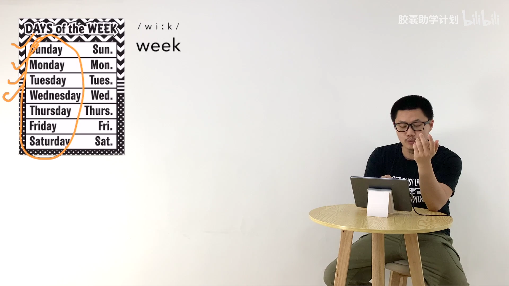

文字识别：胶囊助学计划 / YDAYSofthe WEER / / w i : k / / week / Kunday / Sun. / Monday / Mon. / Tuesday / Tues. / Wednesday / Wed. / Thursday / Thurs. / Friday / Fri. / Saturday / Sat. / SYUI

### 画面 00:03:22

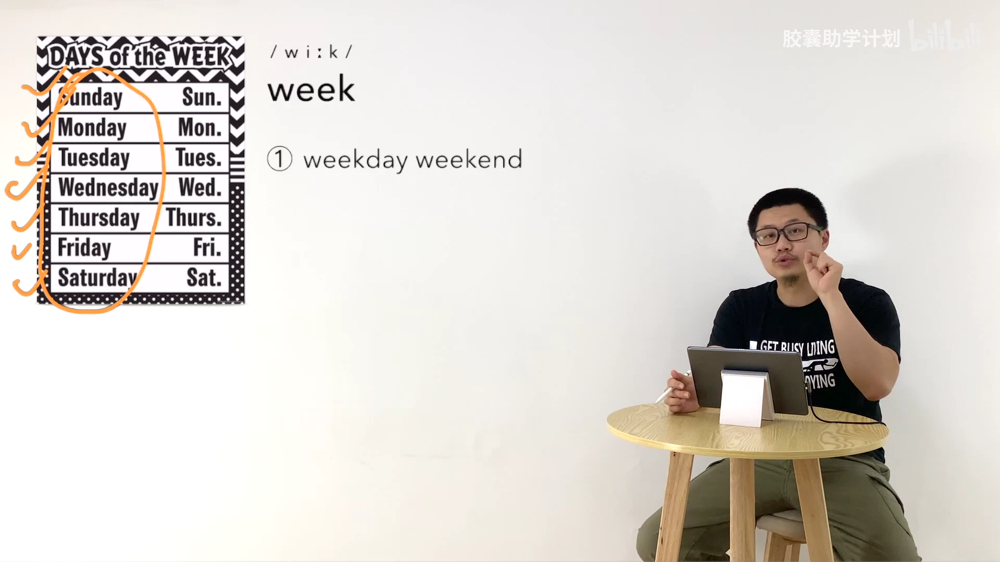

文字识别：胶囊助学计划 / YDAYsofthe WEERY / / w i : k 1 / week / Munday / Sun. / Monday / Mon. / Tuesday / Tues. / weekday weekend / Wednesday / Wed. / Thursday / Thurs. / Friday / Fri. / Saturday / Sat. / GET RIISY LING / AYING

### 画面 00:03:25

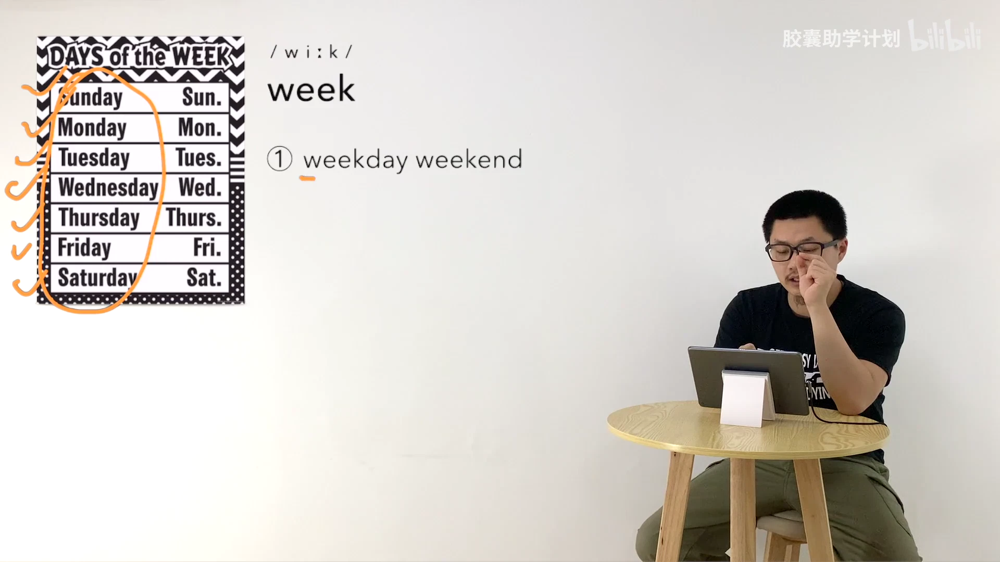

文字识别：胶囊助学计划 / DAYSof the WEEKY / / w i : k / / week / Munday / Sun. / Monday / Mon. / Tuesday / Tues. / weekday weekend / Wednesday / Wed. / Thursday / Thurs. / Friday / Fri. / Saturday / Sat. / SYL

## 00:03:30–00:04:00

weekend，我们管它叫做周末啊，一周的结束的时间，周六周日，我们管它叫 weekend。 OK，这是一个。那我们造几句话，举举个例子啊，比如说 you called me last week，你上周给我打了个电话，你看这儿就是一个规则的，一般过去时，对吧？表示这个动作发生在过去，于是 call 这个单词是原形，后边要加上 e d，变一般疑问句和特殊疑问句，和我们之前在

### 画面 00:03:34

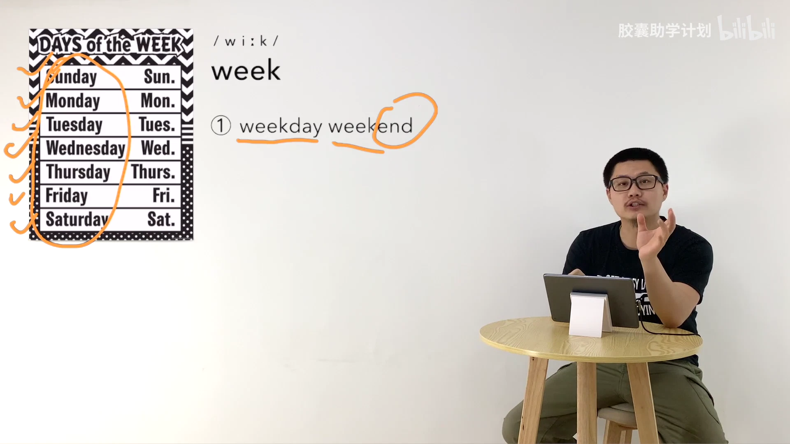

文字识别：胶囊助学计划 / DAYsofthe WEERY / / w i : k 1 / week / Munday / Sun. / Monday / Mon. / Tuesday / Tues. / weekday weekend / Wednesday / Wed. / Thursday / Thurs. / Friday / Fri. / Saturday / Sat.

### 画面 00:03:39

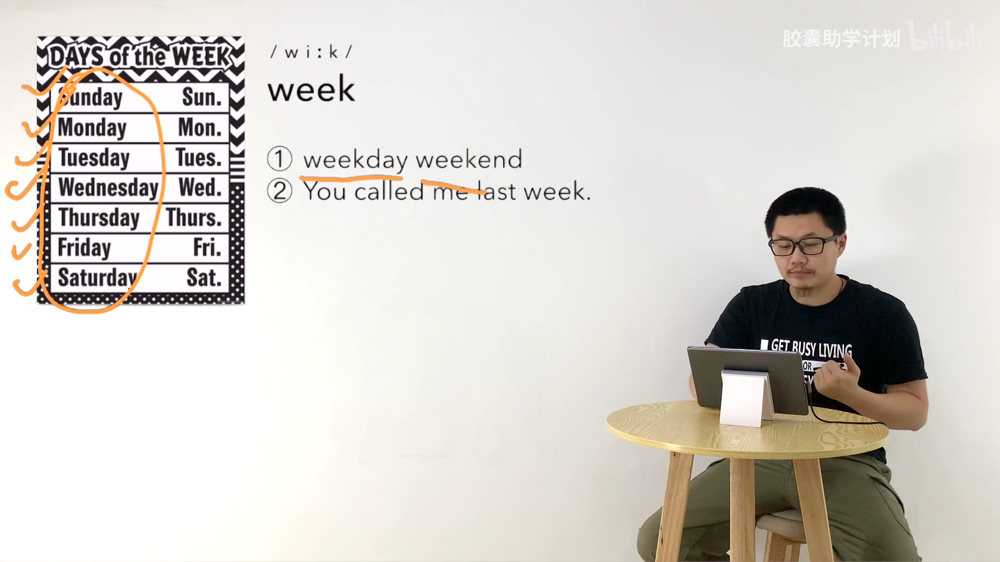

文字识别：胶囊助学计划 / YDAYSof the WEEKy / / w i : k 1 / week / Munday / Sun. / Monday / Mon. / Tuesday / Tues. / weekday weekend / Wednesday / Wed. / You called me last week. / Thursday / Thurs. / Friday / Fri. / Saturday / Sat. / GET RUSY LIVING / OR

### 画面 00:03:41

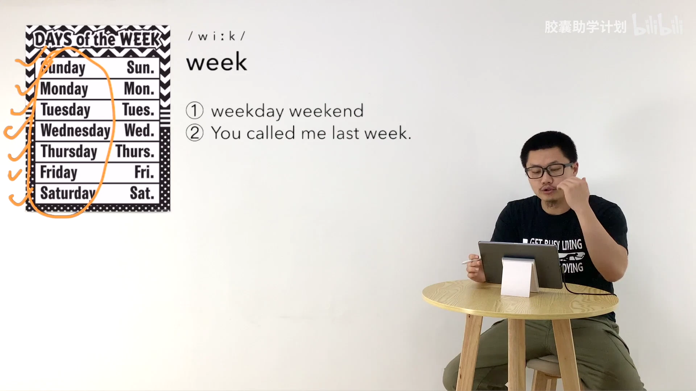

文字识别：YDAYsofthe WEEkY / 胶囊助学计划 / / w i : k 1 / week / Munday / Sun. / Monday / Mon. / Tuesday / Tues. / weekday weekend / Wednesday / Wed. / You called me last week. / Thursday / Thurs. / Friday / Fri. / Saturday / Sat. / GET DILY LNING / DYING

### 画面 00:03:56

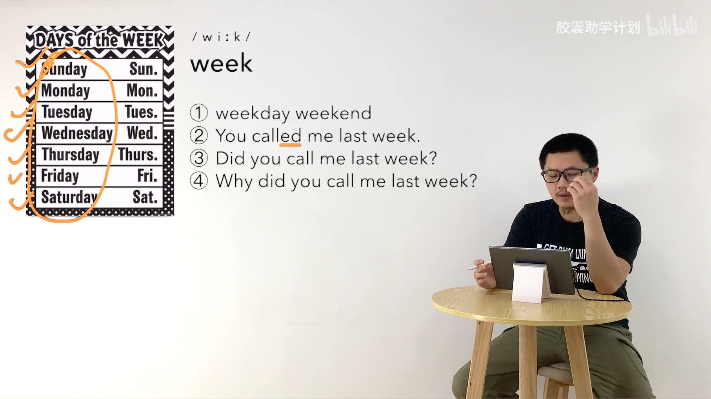

文字识别：胶囊助学计划 / YDAYS of the WEERY / / w i : k 1 / week / Munday / Sun. / Monday / Mon. / Tuesday / Tues. / weekday weekend / 1 / Wednesday / Wed. / You called me last week. / 2 / Thursday / Thurs. / Did you call me last week? / 3 / Friday / Fri. / Why did you call me last week? / 4 / Saturday / Sat.

## 00:04:00–00:04:30

七十一课讲的没有任何的变化。Did you call me last week?以及Why did you call me last week?啊，你为什么上个礼拜要给我打电话呢？OK，好，下一个单词我们读一下，叫做London啊，这个单词可能很多同学应该是认识的，管它叫伦敦啊，这是一个城市的名字，所以注意首字母是要大写的，就像咱们Beijing那个B啊，首字母也是应该大写的。OK，注意一下。那我们做一个小的短语，叫Go to London，

### 画面 00:04:10

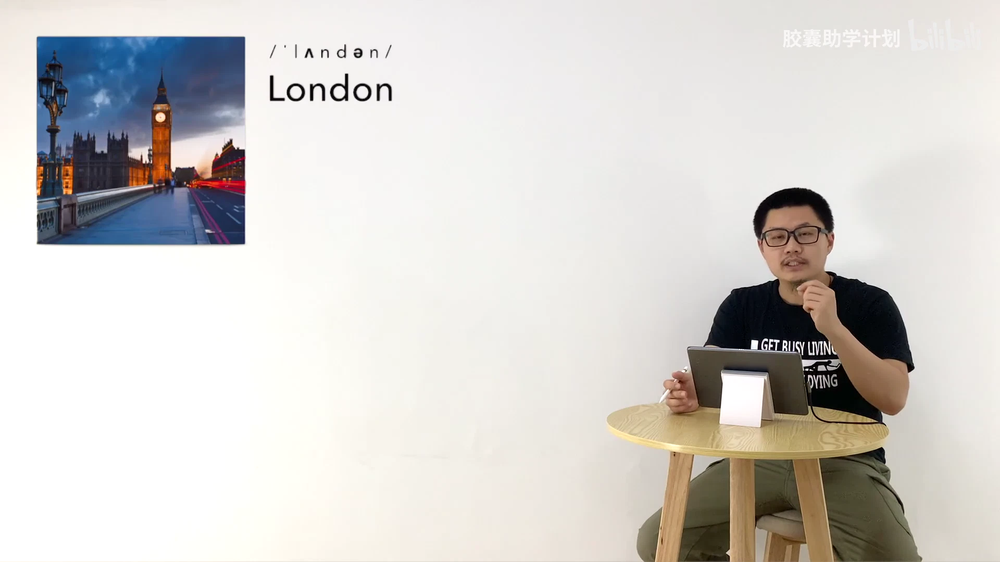

文字识别：胶囊助学计划 / /'lΛndan/ / London / GET RLISY LVIN / PYING

### 画面 00:04:15

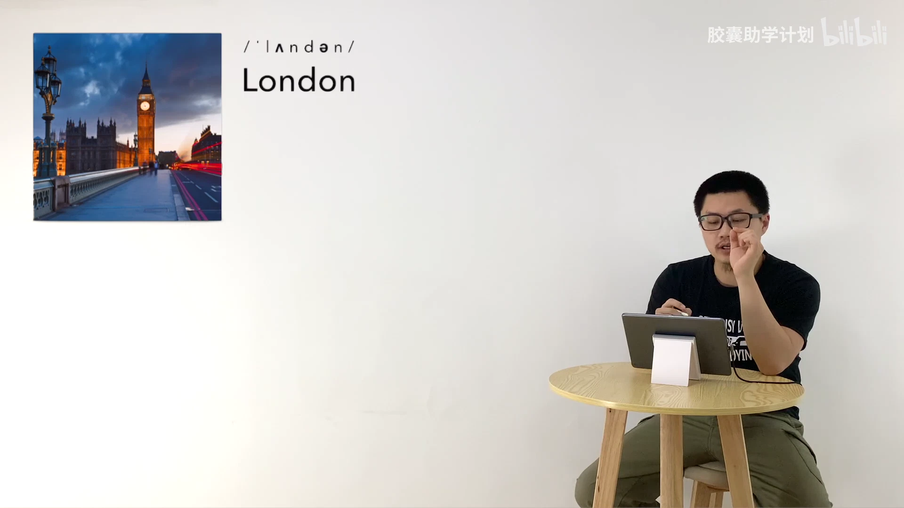

文字识别：胶囊助学计划blb鼎 / /'lΛndan/ / London

### 画面 00:04:24

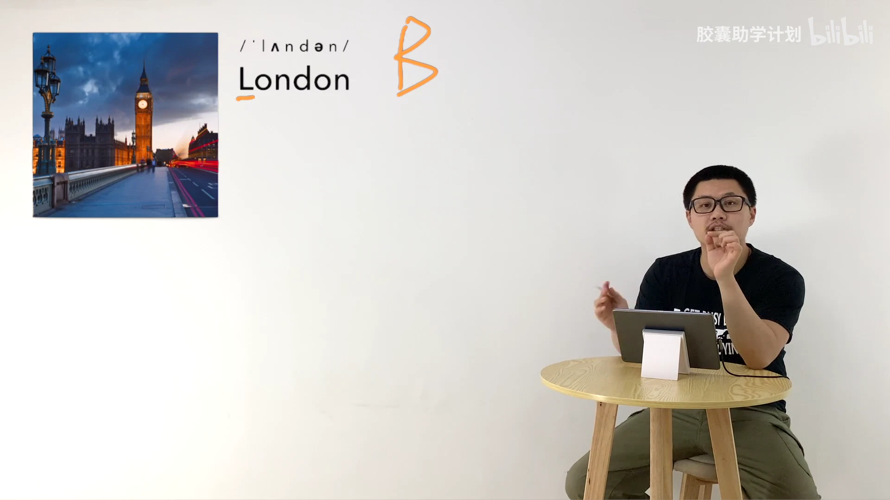

文字识别：胶囊助学计划b出出 / /'landan/ / London

## 00:04:30–00:05:00

叫做去伦敦了。那我们造句叫做 she went to London last weekend。好，我们把刚学的两个单词都给它连起来了。她上周末去了伦敦。变一般疑问句，Did she go to London？这个是各位初期非常容易忘记的一件事情，就是把 went 换回原形。如果变一般疑问句的时候，不要忘了。OK，那以及如果我对 last weekend 提问，用 when 后

### 画面 00:04:37

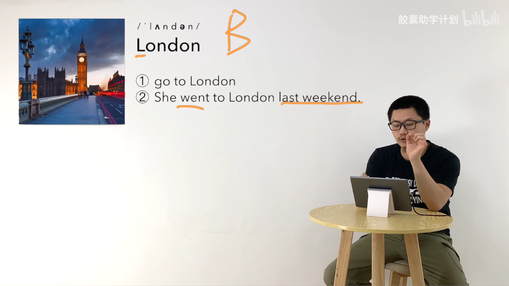

文字识别：胶囊助学计划 / /  lΛndan/ / London / ① go to London / ② She went to London last weekend.

### 画面 00:04:51

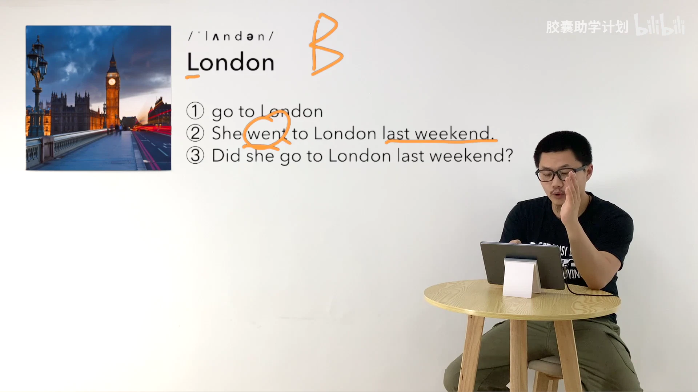

文字识别：胶囊助学计划 / /'landan/ / London / ① / go tolgndon / ② SheWen'to London last weekend. / Did she go to London last weekend?

### 画面 00:04:57

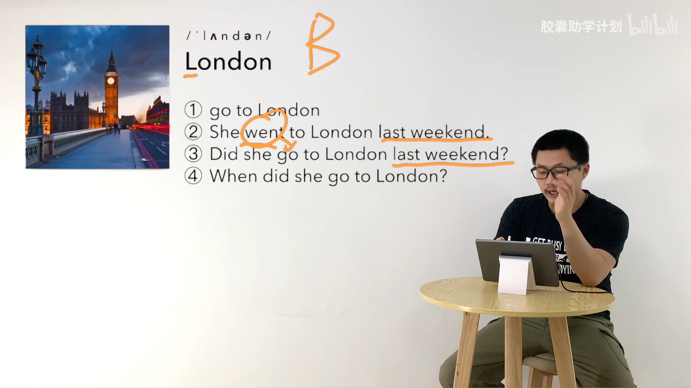

文字识别：胶囊助学计划 / /'lΛndan/ / London / ① / go tolndon / 2 / SheWen' to London last weekend. / Did she go to London last weekend? / When did she go to London?

## 00:05:00–00:05:30

边加一般疑问句，叫做When did she go to London?就这么简单. Continue.接下来，首先啊，虽然它是两个单词，但放在这个地方，我们把它当一个词组去处理，叫做bus stop. OK，连起来bus stop. OK，好，bus stop就是停公交车的地方。我们管它理解为就是这个站台、站点就可以了，对吧？OK，站牌bus stop.那Suddenly就是我们提的第一个问题，

### 画面 00:05:01

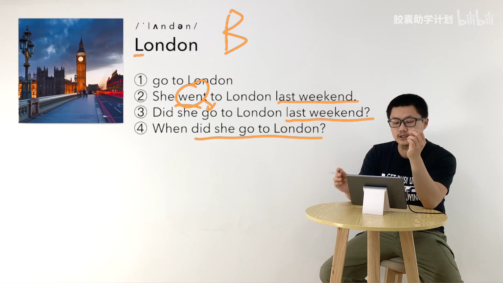

文字识别：胶囊助学计划 / / lΛndan/ / London / go tolndon / 2 / Shewenl to London last weekend. / Did she go to London last weekend? / When did she go to London? / SYU

### 画面 00:05:05

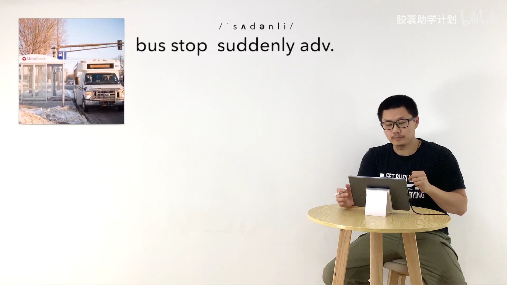

文字识别：胶囊助学计划 / / 'sΛ d an li / / bus stop suddenly adv. / MeimTrar / 9 / DYING

### 画面 00:05:08

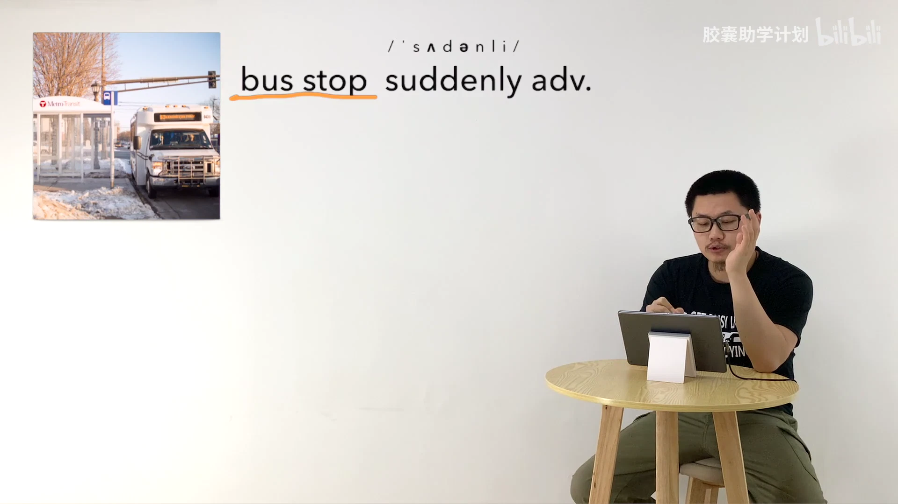

文字识别：胶囊助学计划 / / 's Λ d an li / / bus stop suddenly adv. / MeioTrans

### 画面 00:05:16

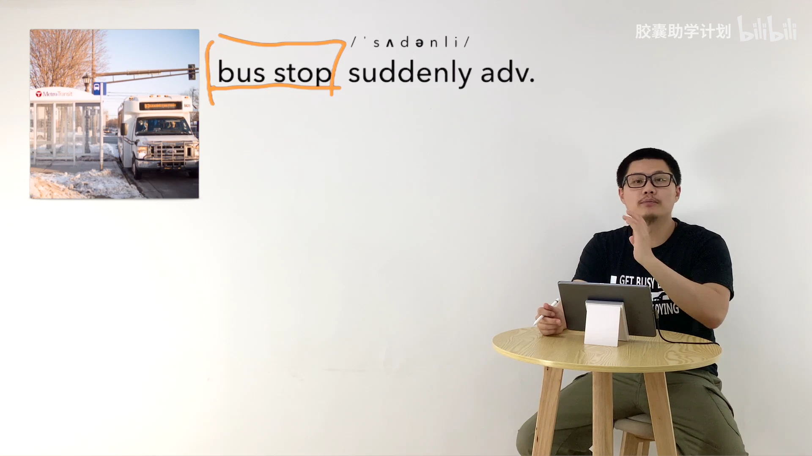

文字识别：胶囊助学计划bil出 / /'sΛdanli / / bus stop / suddenly adv. / MetoTransit / GETR

## 00:05:30–00:06:00

叫 A D V 点啊。我们正好回顾一下这些缩写，比如说 N 点表示的是名词，对吧？啊，锅碗瓢盆，形容词是 A D， sorry A D 这点对吧？我们管它叫形容词。那 V 点呢，是我们从啊二十九课开始，一直到今天，一直在围绕着它去讲的一个词性，叫做动词。这是英文当中非常重要的一个词性，对吧？管它叫动词。那今

### 画面 00:05:36

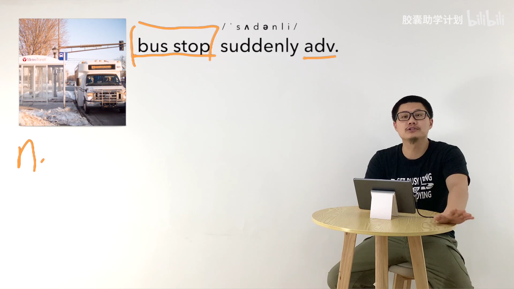

文字识别：胶囊助学计划 / /'sadanli / / bus stop / suddenly adv. / MeimoTransit / USYIENG / OYING

### 画面 00:05:40

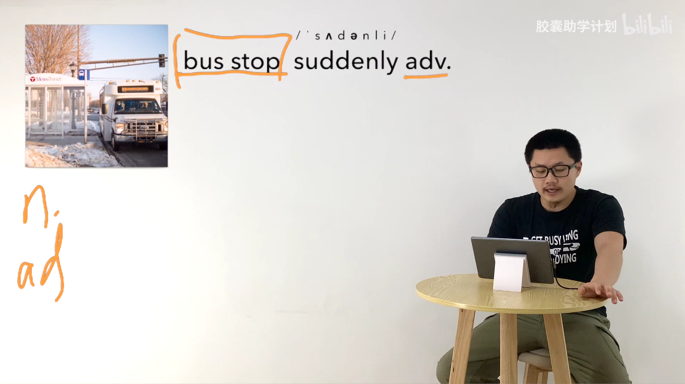

文字识别：BilBil / 胶囊助学计划 / 'sΛdanli/ / bus stop / suddenly adv. / MeinoTrar / OYING / ad

### 画面 00:05:43

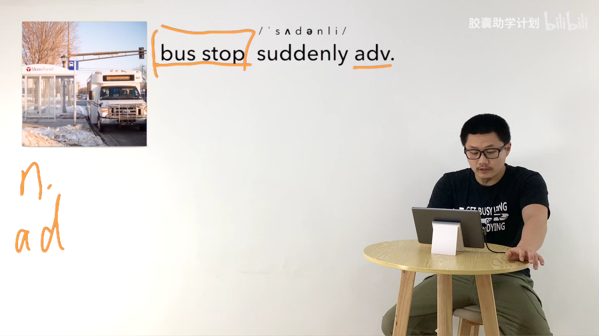

文字识别：胶囊助学计划 / 'sΛdanli/ / bus stop / suddenly adv. / MeinoTrane / CFBUSYING / aΛ / KOYING

### 画面 00:05:51

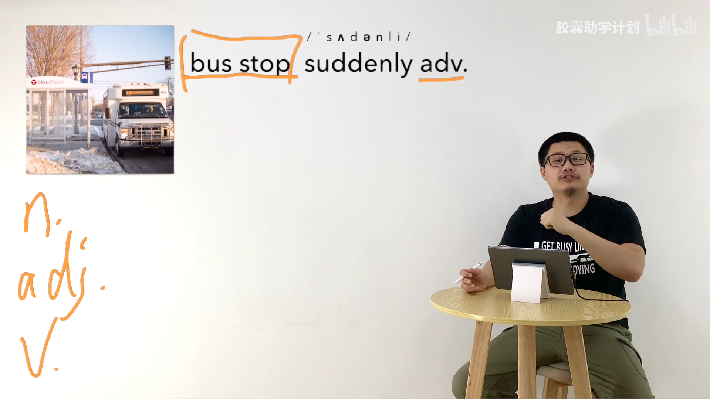

文字识别：胶囊助学计划 / / 's Λdan li / / bus stop / suddenly adv. / MeiroTran / an / PYING

## 00:06:00–00:06:30

天我们又看到了一个新的常用词性，叫 A D V 点，管它叫做副词。副词最主要的一个用途是什么呢？各位记住啊，用途之一就是说这个动作的。比如说，我们先不看前面的 suddenly，suddenly 叫做突然地，对吧？The car stopped near the bus stop。说这辆车呀，啊，你注意它不是公交车，对吧？一个小汽车停在了这个公交站附近。

### 画面 00:06:01

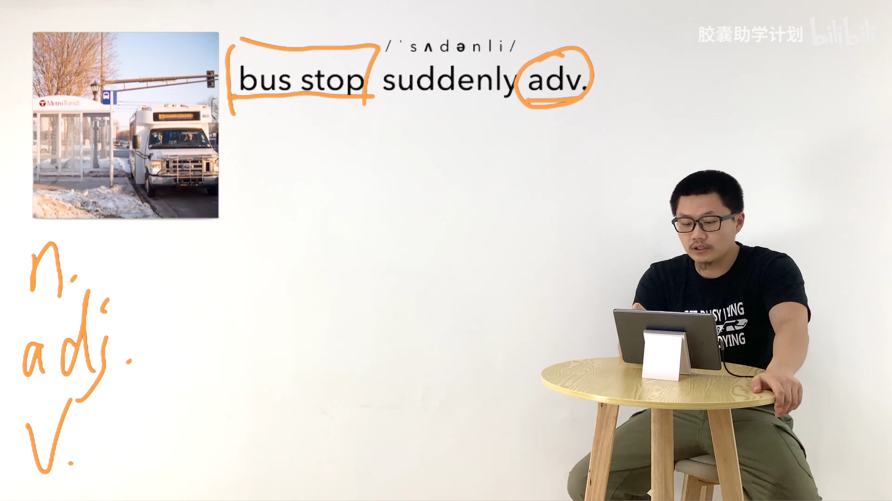

文字识别：胶囊助学计划 / 'sadanli/ / bus stop / suddenly adv. / MetmoTrar / SY ING / an / AVING

### 画面 00:06:08

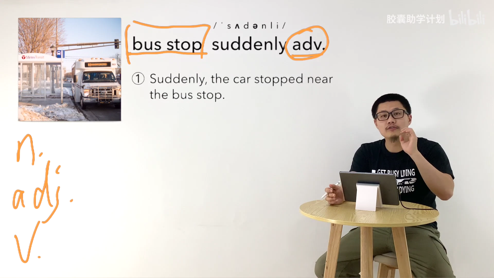

文字识别：胶囊助学计划 / / ' s Λ d a n l i / / bus stop / suddenlyadv. / MeiroTre / ① Suddenly, the car stopped near / the bus stop. / GET DISY LDING / an / DYING

### 画面 00:06:15

文字识别：胶囊助学计划 / / ' s Λ d a n l i / / bus stop / suddenlyadv. / MetoTrar /  Suddenly, the car stopped near / the bus stop. / SYLING / ans / SYING

### 画面 00:06:24

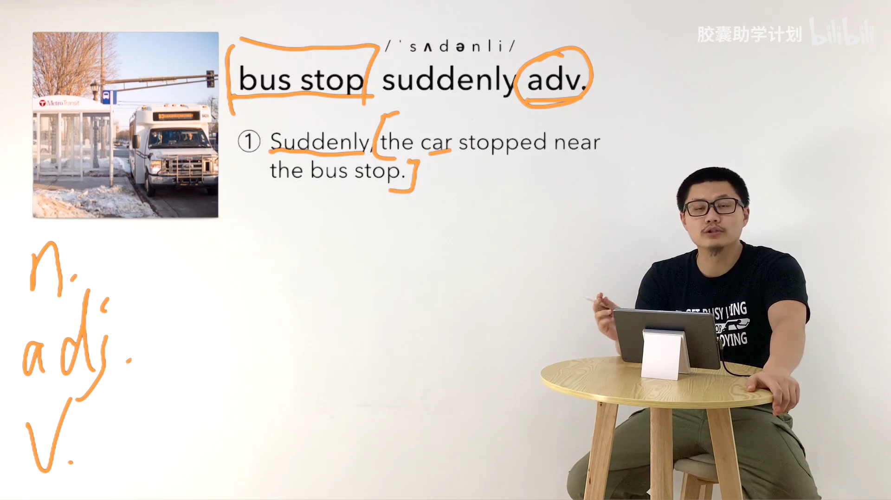

文字识别：胶囊助学计划 / 1 's Λ d an li / / bus stop / suddenly / adv. / MetoTrans / Suddenlythe car stopped near / the bus stop.7 / an / PVING

## 00:06:30–00:07:00

注意这只如果没有 suddenly 只告诉你它停在这个位置了，平铺直叙一件事情，但突然来了个 suddenly 就会告诉你，哎，有点好像怪，有点奇怪，说为什么它突然就停在了这个公交站的这个地方了？是他遇到了什么熟人吗？对吧？二十年没见面的老朋友嘛，突然在公交站见到了嘛，所以他突然竟然停车在了这个地方。所以 suddenly 起到的最重要的一个作用就是副词，它

### 画面 00:06:33

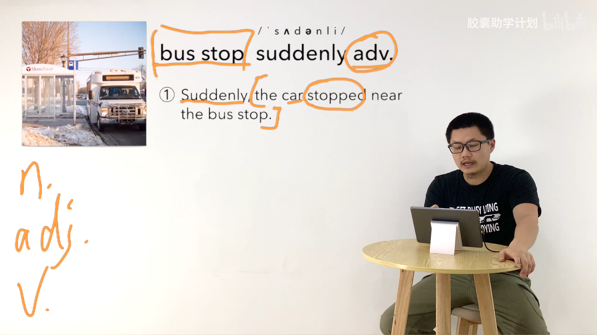

文字识别：胶囊助学计划 / / ' s Λ d an li / / bus stop / suddenly / adv. / MetoTrar / Suddenly the car stopped / near / the bus stop.7 / ART RUSY VING / an / SYING

## 00:07:00–00:07:30

是在去形容啊，或者再去修饰啊，不能叫形容，去修饰这个动词是如何发生的。OK，以及我们把它变一般疑问句和特殊疑问句。Why did the car stop near the bus stop suddenly？它为什么突然间就停在了公交站台这个地方了呢？对，公交站这个地方了呢。Continue，接下来，哎，我们把副词跟动词就放在一起去学了啊。先来一个最简单的单词叫做smile。

### 画面 00:07:00

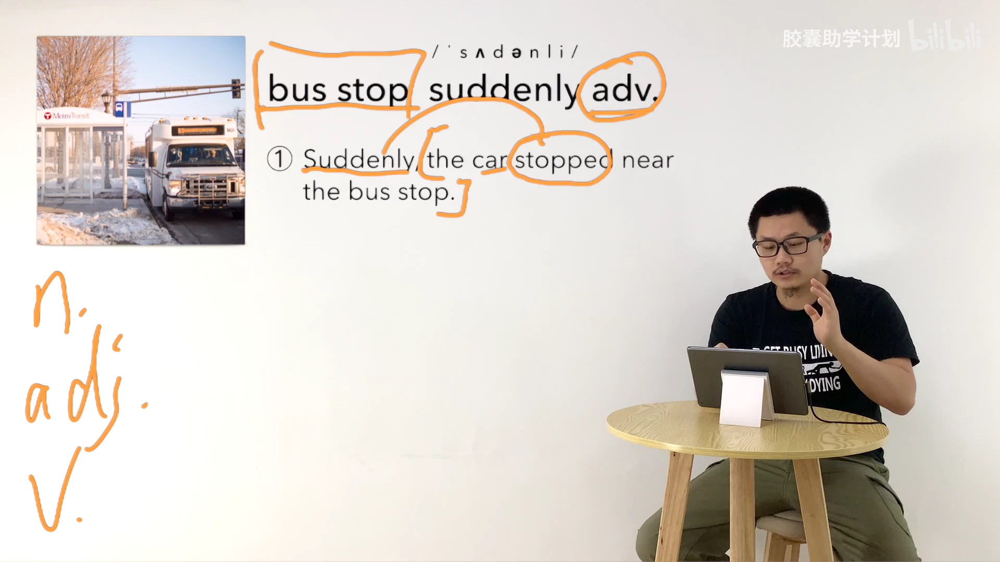

文字识别：胶囊助学计划 / /'sΛdanli/ / bus s / stop / suddenly / adv / MetroTrar / Suddenly / the carstoppeo / near / the l /  bus stop.7 / an / DYING

### 画面 00:07:19

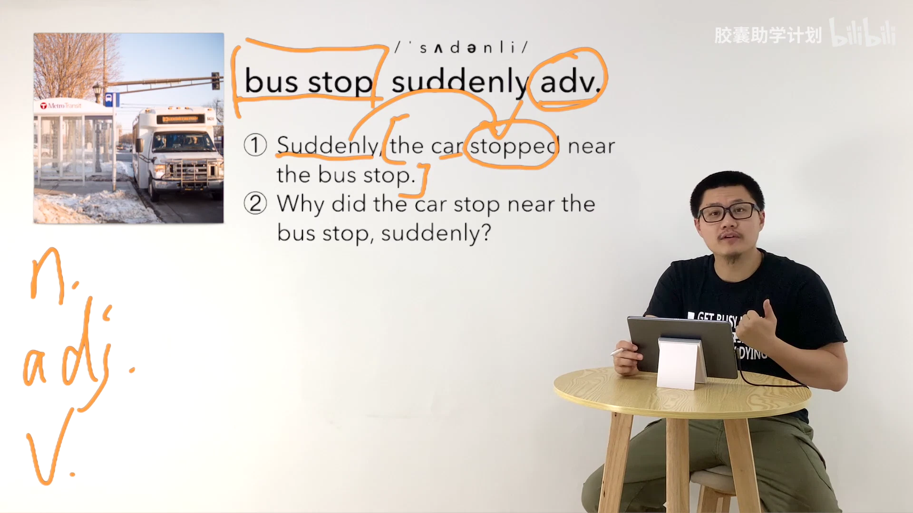

文字识别：胶囊助学计划 / / 's λ d an l i / / bus stop / suddenly / yadv. / MetroTrar / Suddenly / the car stopped / near / the bus stop.7 / Why / did the car s /  stop near the / bus stop, suddenly? / an

### 画面 00:07:21

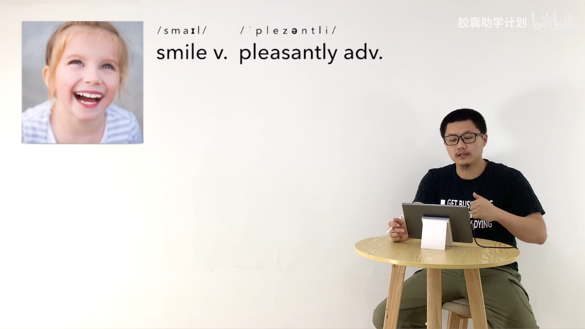

文字识别：胶囊助学计划 / /smail/ / /'plezantli/ / smile v. pleasantly adv. / GET RIISY / DYING

## 00:07:30–00:08:00

最后不要忘了，因为有这个 l，像 l 这个字母的音标对吧？你舌尖要顶到上牙龈，看我的嘴啊，smile， OK，不是 smile 啊，各位能听出区别吧？如果没有最后这个舌尖顶上牙龈，叫做 smile，对吧？看我的嘴啊，然后如果舌尖顶上牙龈，叫做 smile， OK， very good。后面这个单词啊，读一下叫 pleasantly，pleasantly，pleasantly

### 画面 00:07:33

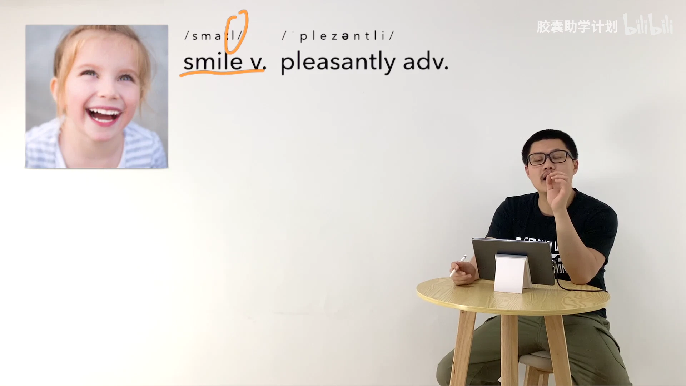

文字识别：胶囊助学计划 / / sma / /'plezantli/ / smile v. / pleasantly adv.

### 画面 00:07:53

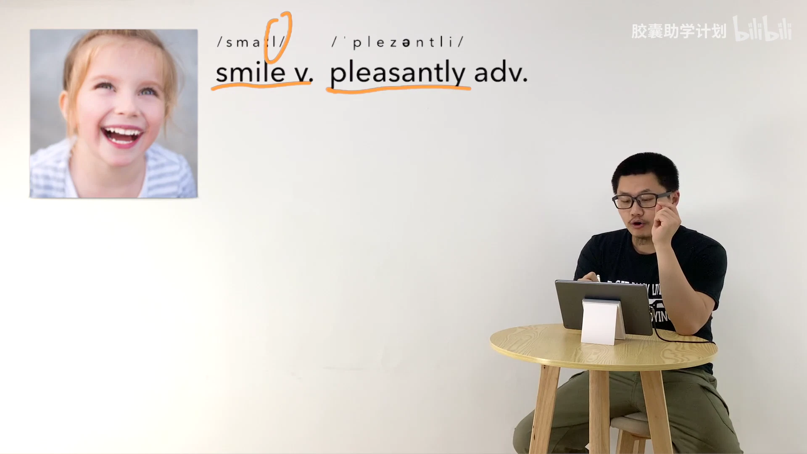

文字识别：胶囊助学计划bi出 / / sma / /'plezantli/ / smile v. / pleasantly adv.

## 00:08:00–00:08:30

连起来 pleasantly啊叫做愉悦的啊愉悦的 OK 它是一个副词，那它最主要的作用就是形容这个笑的，就是我们笑有很多方式，有嘲笑，有苦笑，对吧？有苦中作乐的笑啊，当然还有非常愉悦开心的笑。 OK 好，比如说 Look, the little girl is smiling pleasantly. 说你瞧这小姑娘笑的多么的开心呢？ OK 好，比如说啊，刚才这个时态我们用的是复习

### 画面 00:08:03

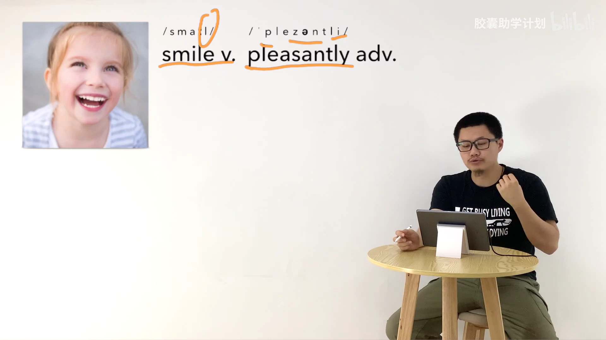

文字识别：胶囊助学计划 / /sma / /'plezantlil / pleasantly adv. / smile v. / GET DIISY LING / DYING

### 画面 00:08:06

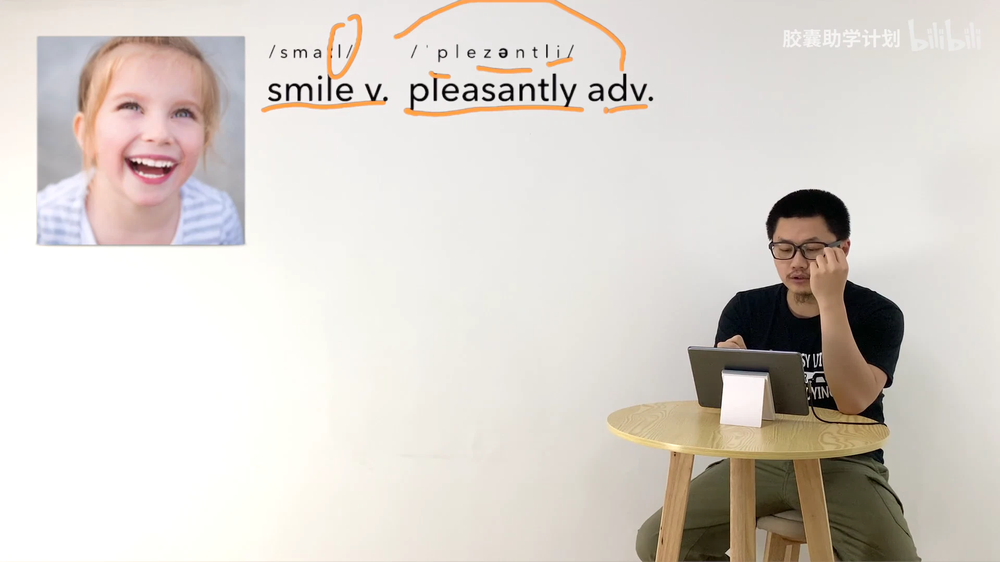

文字识别：胶囊助学计划 / / sma / /plezant lil / pleasantly adv. / smile v.

### 画面 00:08:27

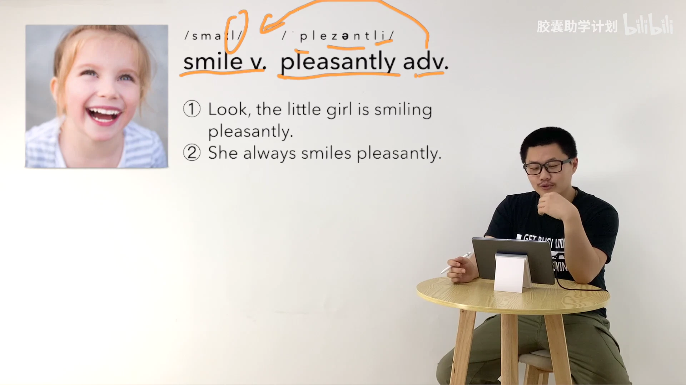

文字识别：胶囊助学计划blbl / / sm a / p lezant li/ / smile v. / pleasantly adv. / ① Look, the little girl is smiling / pleasantly. / She always smiles pleasantly.

## 00:08:30–00:09:00

了一下现在进行时。那我们接下来呢，再换一个时态，叫做 She always smiles pleasantly. Every time I see her, she smiles pleasantly. 啊，每次我见她，她总是笑的非常的开心。这个叫 pleasantly，对吧？那苦笑就是另一种表情了，对不对？OK，所以副词很重要的一个作用就是在去哎这个修饰动词，说明这个动词是如何发

### 画面 00:08:32

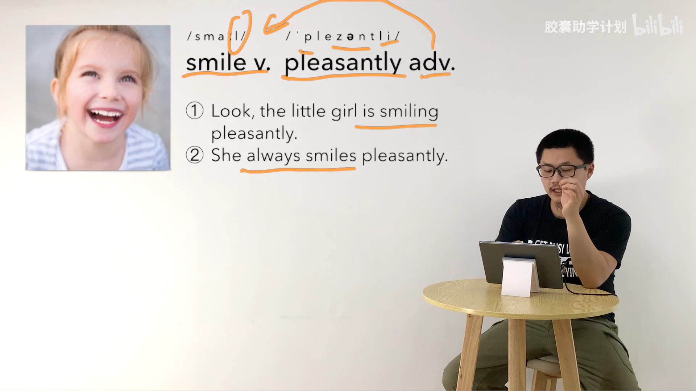

文字识别：biltbli / 胶囊助学计划 / / s ma / p le z an t l i l / pleasantly adv. / smile v. / ① Look, the little girl is smiling / pleasantly. / She a / always smiles pleasantly.

### 画面 00:08:41

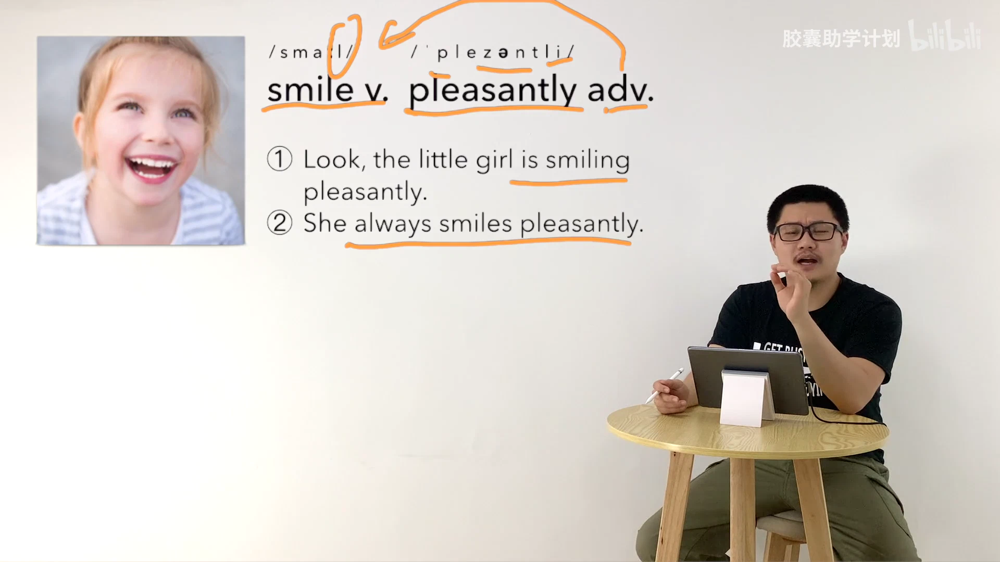

文字识别：胶囊助学计划 / / sm a / p lezant li/ / pleasantly adv. / smile v. / ① Look, the little girl is smiling / pleasantly. / She a /  always smiles pleasantly.

### 画面 00:08:47

文字识别：胶囊助学计划 / / sma /  lezant li/ / smile v. / preasantly / adv. / ① Look, the / little / girl is smiling / pYeasantly. / She / always / smiles / pleasantly. / GETRUSY LMI / OR / TYDYING

## 00:09:00–00:09:30

生的？OK，那我们在下一课会重点继续带着大家讲这个知识点。Continue，下一个小的单词非常常用，叫做 understand。这个地方注意浊化要变成的，对吧？好，连起来读一下，叫做 understand，understand。注意重音在最后一个音节。那后面这个猜应该也能猜出来了，它是这个动词的过去式，对吧？说我曾经懂了，叫做 I understood。

### 画面 00:09:05

文字识别：胶囊助学计划 / /Λnd a'st ænd / / /Λnda'stud / / understand v. understood / GET RIISY / DYING

### 画面 00:09:09

文字识别：胶囊助学计划 / /Λnd a'st ænd / / /Λnda'stud / / understand v. understood

### 画面 00:09:21

文字识别：胶囊助学计划 / / Λn d a's t æn d / / /Λnda'stud/ / understand v. understood

## 00:09:30–00:10:00

这个是啊，这个点我提一下，是各位在学习英文，尤其是初期会遇到一个比较麻烦的事情，因为咱们汉语没有动词变化，而英文到目前为止，各位已经见过四个了，对吧？原形、三单、现在分词、过去式，在八十三课我们还会见到最后一个叫过去分词。你想一下，对于各位来说，初期学习这个是相对比较困难的，我们要额外多花一点点时间在这个事情上。OK，

### 画面 00:09:51

文字识别：胶囊助学计划 / / Λn d a's t æ n d / / /Λnda'stud / / understand v. understood

## 00:10:00–00:10:30

好，那我们先造一句话，说 I didn't understand it at first。注意这有一个小的连读，不是 understand it，你这样读没有错，没有人会说你是错，对吧？你读的是 I didn't understand it，没有错啊。但是英语为母语的人可能不是这样聊天的，他说的是 I didn't understand it did。OK，有一个小的连读啊，at first 叫最初我不懂，but now 但是现在呢 I understand。

### 画面 00:10:05

文字识别：胶囊助学计划 / / Λn d a's t æ n d / / /nndastud / / understand v. understood / ① I didn't understand it at first. But / now I understand.

### 画面 00:10:26

文字识别：胶囊助学计划 / / Λ n d a's t æn d / / /Λnda'stud / / understand v. understood / ① I didn't understand it at first. But / now I understand.

### 画面 00:10:29

文字识别：胶囊助学计划b出b出 / / Λn d a's t æn d / / /Λndａ'stud/ / understand v. understood / ① I didn't understand it at first. But / I understand. / nov

## 00:10:30–00:11:00

之前我不懂，但现在我懂了。OK，以及，那你可以说别人跟你说一个事儿，你懂了吗？你可以说 I understand, I understand. OK，以及那我不懂啊，你现在跟我说这个东西我不懂，I don't understand.以及你看肯定句否定句有了，我想问你懂了吗？叫做 Do you understand? OK, very good.后面这个叫做 understood.啊，注意一个小点，continue.接下来说话，

### 画面 00:10:33

文字识别：胶囊助学计划 / / Λ n d a's t æn d / / /Λnda'stu d / / understand v. understood / ① I didn't understand it at first. But / nov / I understand. / ® / Iunderstand.

### 画面 00:10:40

文字识别：胶囊助学计划blb出 / / Λn d a's t æn d / / /Λnda'stud/ / understand v. understood / ① I didn't understand it at first. But / I understand. / nov / Iunderstand. / ③ I don't understand. / GET BUSY LIVING / YDYING

### 画面 00:10:56

文字识别：胶囊助学计划 / / spi: k / / /spauk/ / speak v. spoke / GET RIISY LIVING

## 00:11:00–00:11:30

我们先读一下，不是 speak 啊，要着话对不对？要变成 speak，跟我读一下 speak。那后面就是它的过去式，读的叫做 spoke。啊，各位能看到这两个还好，稍微有一点点联系，对吧？至少 s p 和 k 这几个字母还是留着的，对吧？包括 e 这个字母，对吧？Spoke 就是之前说了什么事情，比如说非常常用的一句话叫做 Do you speak English or do you

### 画面 00:11:04

文字识别：Bilbil / 胶囊助学计划 / / sp i : k / / /spauk/ / speak v. spoke / SYVI

### 画面 00:11:23

文字识别：胶囊助学计划 / / sp i : k / / /spaukl / speak v. spoke / GFT RUISY LIVING / RARU / YDYING

### 画面 00:11:28

文字识别：胶囊助学计划 / / s pi : k / / /spauk/ / speak v. spoke / ① Do you speak English/Chinese?

## 00:11:30–00:12:00

speak Chinese?好，我在这儿给大家分享一个小的知识点啊。呃，一七年我去新西兰旅游的时候啊，我当时啊，有你知道，我们很多中国人去海外的时候看到亚裔啊，你有的时候下意识的可能就想跟他用汉语去沟通。你看他非常像中国人，然后你用汉语就直接跟人家说话了，这是一个不是特别礼貌的行为，因为人家可能是韩国人、日本人或东南亚人，或者从小在海外长大的，对

### 画面 00:11:35

文字识别：胶囊助学计划 / / s pi : k / / / spauk/ / speak v. spoke / ① Do vou speak English/Chinese?

### 画面 00:11:55

文字识别：胶囊助学计划 / / s pi : k / / /spauk/ / speak v. spoke / ① Do you speak English/Chinese?

## 00:12:00–00:12:30

吧？他并不懂汉语，所以这个时候为了保险起见，你用英语先问一句，叫做 Do you speak Chinese？啊，你看有一次我印象当中，一个韩国姑娘啊，她长得非常像中国大学生，怎么看怎么像，但我不敢完全确定，我就问了她一句，叫做 Where are you from？ Do you speak Chinese？ OK，她跟我说，Actually I don't speak Chinese. I'm Korean，是吧？我实际上不会汉语，我是韩国人。OK，所以为了礼貌，

### 画面 00:12:25

文字识别：胶囊助学计划 / / spi : k / / /spauk/ / speak v. spoke / ① Do you speak English/Chinese?

## 00:12:30–00:13:00

say a sentence called "Do you speak Chinese?" Then, if someone says it, you can continue the conversation. Okay, next, say "She spoke so quickly." You see, I use the simple past tense to say that she spoke so quickly. I didn't understand at all, right? I didn't understand at all, right? I didn't understand at all, right? I didn't understand at all, right? I didn't understand at all, right? I didn't understand at all, right? I didn't understand at all, right? I didn't understand at all, right? I didn't understand at all, right? I didn't understand at all, right? I didn't understand at all, right? I didn't understand at all, right? I didn't understand at all, right? I didn't understand at all, right? I

### 画面 00:12:55

文字识别：Bilbil / 胶囊助学计划 / / s pi : k / / /spauk/ / speak v. spoke / ①Do you speak English/Chinese? / She spoke so quickly.I didn't / understand.

## 00:13:00–00:13:30

章的语速，还要再快几个小的节奏，OK。所以那 she spoke so quickly, I didn't understand. Very good, continue. 下一个小的单词，我觉得你会是吧？第一课我们就学过叫 hand bag, hand plus bag 啊，hand 加 bag 合起来就知道是什么意思了，对吧？那 hand 就是我们的手，我们拿它造句。I cleaned my hands. OK，你看啊，这是我们其实新二会不停的讲这些知识。呃，那现

### 画面 00:13:08

文字识别：胶囊助学计划 / /hæend/ / hand n. / M / GET DHSY LIVN / DYING

## 00:13:30–00:14:00

在我简单的先提一下，就是你名词想去造句的时候，那必然是要找动词的，对吧？那如果想，然后你找完动词之后，你还要想它表达的是一个什么时态啊？我是表示我正在洗，要去洗，每天都洗，还是之前洗了？你看四个时态，我给您说出来了。那如果你说之前洗了，叫做 I cleaned my hands。注意这个地方是有一个小的 E D 的，对不对？那一般疑问句说 Did you clean your hands？你洗手了吗？

### 画面 00:13:34

文字识别：胶囊助学计划b出出 / /hæend/ / hand n. / ① hand+bag / ② I cleaned my hands.

### 画面 00:13:41

文字识别：胶囊助学计划 / /hænd/ / hand n. / ① hand+bag / ② I cleaned my hands.

### 画面 00:13:55

文字识别：胶囊助学计划b鼎b出 / /hænd/ / hand n. / ① hand+bag / ② I cleaned my hands. / ③ Did you clean your hands?

## 00:14:00–00:14:30

问的是之前，对不对？Okay, there you go.以及为什么你没洗手啊？Why didn't you clean your hands? I told you to clean your hands.啊，我告诉你要洗手，你为什么不洗手？Why didn't you clean your hands? Okay, there you go.接下来呢，我给大家补充一个生活当中啊，当然我指的是英文世界生活当中非常常用的一个小的idiom或者slang啊，一个小的俚语或习语，叫做

### 画面 00:14:03

文字识别：胶囊助学计划 / /hæend/ / hand n. / ① hand+bag / ② I cleaned my hands. / Did you clean your hands? / 3 /  Why didn't you clean your hands? / GET RUISY LVINC / PDYING

### 画面 00:14:16

文字识别：DGLEY / EMMA STONE / 胶囊助学计划 / go hand in hand / [closely connected] / GET RIISY LVING / EASY / 绯闻计划 Easy A(2010) / 00:23:35

### 画面 00:14:18

文字识别：DGLEY / EMMA STONE / 胶囊助学计划 / go hand in hand / [closely connected] / EASY / 绯闻计划Easy A(2010) / 00:23:35

### 画面 00:14:26

文字识别：DGLEY / EMMA STONE / 胶囊助学计划 / go hand in hand / [closely connected] / EASY / 绯闻计划Easy A(2010) / 00:23:35

## 00:14:30–00:15:00

go hand in hand，非常常用。它的意思叫 closely connected，叫做紧密相连。你看 go 走，你不用管它 hand in hand 啊，手连着手，紧密相连，对吧？来了，各位注意。Okay, they go hand in hand, 是吧？他们两者是紧密相连的。他在这个语境之下说的是，我有的时候都没

### 画面 00:14:30

文字识别：DGLEY / EMMA STONE / 胶囊助学计划 / go hand in hand / [closely connected] / EASY / 绯闻计划 Easy A(2010) / 00:23:35

### 画面 00:14:32

文字识别：DGLEY / EMMA STONE / 胶囊助学计划 / go hand in hand / [closely connected] / EASY / 绯闻计划 Easy A(2010) / 00:23:35

### 画面 00:14:34

文字识别：DGLEY / EMMA STONE / 胶囊助学计划 / go hand in hand / [closely connected] / EASY / 绯闻计划 Easy A(2010) / 00:23:35

### 画面 00:14:37

文字识别：DGLEY / EMMA STONE / 胶囊助学计划 / go hand in hand / [closely connected] / GET BUSY LIVING / YDYING / EASY / 绯闻计划 Easy A(2010) / 00:23:35

### 画面 00:14:43

文字识别：Bilibili / 胶囊助学计划 / G

### 画面 00:14:45

文字识别：胶囊助学计划 blibil / 真不知道你到底是天才还是疯子 / I can't decide if you're a genius or a lunatic.

### 画面 00:14:47

文字识别：胶囊助学计划blibil / 天才和疯子不正是一线之隔吗 / Well, don't they sort of go hand in hand?

### 画面 00:14:49

文字识别：bilibili / 胶囊助学计划 / 天才和疯子不正是一线之隔吗 / Well, don't they sort of go hand in hand?

### 画面 00:14:51

文字识别：DGLEY / EMMA STONE / 胶囊助学计划 / go hand in hand / [closely connected] / G57 / 6DYIN / EASY / 绯闻计划 Easy A(2010) / 00:23:35

### 画面 00:14:53

文字识别：DGLEY / EMMA STONE / 胶囊助学计划 / go hand in hand / [closely connected] / GET RUSY LIVING / RAU / YDYING / EASY / 绯闻计划 Easy A(2010) / 00:23:35

### 画面 00:14:56

文字识别：DGLEY / EMMA STONE / 胶囊助学计划bilb出 / go hand in hand / [closely connected] / IET DIS LING / DYING / EASY / 绯闻计划Easy A(2010) / 00:23:35

## 00:15:00–00:15:30

办法判断 you are a genius or lunatic，是吧？你是一疯子还是一天才？然后他的回答是 don't they sort of go hand in hand？那他们不是说紧密相连的吗？这二者，OK，genius。下一个单词跟我读一下，叫做 pocket， pocket，啊，是我们衣服的口袋，我们管它叫做 pocket，啊，它是一个名词。好，很常用的一个小的短语叫 in the pocket，在这个口袋的里面，啊，也很简单。那我

### 画面 00:15:00

文字识别：DGLEY / EMMA STONE / Bilbil / 胶囊助学计划 / go hand in hand / [closely connected] / GET BUSY LI / YDYING / EASY / 绯闻计划 Easy A(2010) / 00:23:35

### 画面 00:15:11

文字识别：DGLEY / EMMA STONE / 胶囊助学计划bil出 / go hand in hand / [closely connected] / GET BUSY LNING / DR. / YDYING / EASY / 绯闻计划 Easy A(2010) / 00:23:35

### 画面 00:15:13

文字识别：胶囊助学计划 / / 'ρpkIt/ / pocket n. / GET RIIS DING / VDYING

### 画面 00:15:15

文字识别：胶囊助学计划 / /'ρpkIt/ / pocket n. / SYU

### 画面 00:15:21

文字识别：胶囊助学计划 / / 'ppkIt/ / pocket n. / GET BUSY LIVING / YDVING

### 画面 00:15:25

文字识别：胶囊助学计划 / / 'ppkit/ / pocket n. / ① in the pecket

## 00:15:30–00:16:00

们造一句话说，He always puts his phone in the pocket. 他总是把他的手机放在口袋里面。我再给大家一句话叫，He put his phone in the pocket. 好，这个地方 put 这个单词啊，我们很久之前就学了，叫做放置。这两句话的区别是什么？这就是一个非常扎实的语法基础会给我们带来的好处。我们看第二句话，你这个地方首先有 always，其次 put 后边加了

### 画面 00:15:38

文字识别：胶囊助学计划 / /'ppkit/ / pocket n. / in the peeket / 1 / He always puts his phone in the / pocket. /  He put his phone in the pocket.

### 画面 00:15:44

文字识别：胶囊助学计划 / Bilbil / / 'pokIt/ / 7V / pocket n. / ① / in the poeket / He always puts his phone in the / pocket. /  He put his phone in the pocket.

### 画面 00:15:55

文字识别：put / 胶囊助学计划 / /'pokIt/ / pocket n. / in the poeket / He always puts his phone in the / pocket. /  He put his phone in the pocket. / 3

## 00:16:00–00:16:30

as，这都提醒你这是什么动作，经常发生的，一个习惯，管它叫做一般现在时。所以如果想把它变一般疑问句，把谁提前呢？把does提前。Does he always put his phone in the pocket?对吧？OK。那这个地方注意的另一个事情是，你看后面第三句话，He put his phone in the pocket。这句话当中是没有任何always这样的单词，

### 画面 00:16:10

文字识别：put / 胶囊助学计划 / /'pokIt/ / pocket n. / in the pecket / 1 / He always / puts his phone in the / pocket. /  He put his phone in the pocket. / 3

### 画面 00:16:18

文字识别：put / 胶囊助学计划 / /'pokIt/ / pocket n. / in the pecket / 1 / He always / puts his phone in the / pocket. /  He put his phone in the pocket. / 3

### 画面 00:16:22

文字识别：bibili / put / 胶囊助学计划 / / 'pokIt/ / pocket n. / in the peeket / He always / puts his phone in the / pocket. /  He put his phone in the pocket. / 3

## 00:16:30–00:17:00

sometimes对吧？表频率的单词，并且呢，put看似貌似用的是原形。你看啊，这是不可能存在的。他he这个做主语的时候，后面他就不用原形，所以是告诉各位什么呢？Put这个原形，它的过去式说这个动作在过去发生，过去放置的，它还是put。它的过去式跟它的原形长得是一样的，所以这个动作表示的是之前，

### 画面 00:16:48

文字识别：put / 胶囊助学计划 / /'pokit/ / pocket n. / V / in the peeket / 1 / He / always / puts his phone in the / pocket. / He / e put his phone in the pocket. / 3

### 画面 00:16:52

文字识别：put / put / 助学计划 / / 'pokIt/ / pocket n. / V / in the poeket / 1 / He / always / puts H /  his phone in the / pocket. / He / put his / phone in the pocket.

### 画面 00:16:54

文字识别：put / 助学计划 / BiliBil / put / / ^pokit/ / pocket n. / V / in the peeket / 1 / He / always / puts H /  his phone in the / pocket. / He / put h / his / phone in the pocket. / 3

### 画面 00:16:58

文字识别：put / 助学计划 /  bilfbli / put / /'pokIt/ / pocket n. / V / in the poeket / 1 / He always / puts his phone in the / pocket. / He / put his phone in the pocket. / ISYU.

## 00:17:00–00:17:30

之前他把他的手机放在了他的口袋里面。OK，注意这个地方。Continuing，下面两个单词我们放到一起去讲，因为这两个单词各位会一个，两个就都会了。第一个叫phrase，叫做短语，比如说刚才我教大家的那个go hand in hand，你就可以理解为是某种程度上的一个phrase。OK，管它叫一个短语。那Facebook指的就是包含这些短语的书啊，这个东西经常在

### 画面 00:17:01

文字识别：put / 助学计划 / qut / / 'pDkIt/ / pocket n. / V / in the peeket / 1 / He / always / puts his phone in the / pocket. / He / put his phone in the pocket. / GET BUSY LING / YDYING

### 画面 00:17:06

文字识别：胶囊助学计划 / / f r e i z / / China / phrase n. phrasebook / PHRASEBOOK & DICTIONARY

### 画面 00:17:15

文字识别：Bilbil / 胶囊助学计划 / / fr el z / / China / phrase n. phrasebook / PHRASEBOOK& DICTIONARY / GET RIISY LI / DYING

### 画面 00:17:24

文字识别：Bilibli / 胶囊助学计划 / / f r e Ⅰ z / / China / phrase n. phrasebook / PHRASEBOOK& DICTIONARY / GET RUSY LIVING / MDYIN

### 画面 00:17:29

文字识别：胶囊助学计划 / / fr eⅠ z / / China / phrase n. phrasebook / PHRASEBOOK& DICTIONARY

## 00:17:30–00:18:00

机场啊，尤其是国际机场，你往国外飞，比如说你现在要飞去德国，有的地方，尤其像啊，有的地方的书店就会卖这个东西。呃，上边是汉语啊，你吃了吗？然后底下呢是德语的这个原文，然后用汉语拼音或者什么汉字儿给你标注一下，然后你按照这个汉语拼音或汉字读一遍呢，然后别人就大概知道你是想问他你吃了吗？这个东西我们管它叫 phrase book 短语书，对吧？OK，往往

### 画面 00:17:42

文字识别：胶囊助学计划 / / fr eⅠ z / / China / phrase n. phrasebook / PHRASEBOOK & DICTIONARY

### 画面 00:17:50

文字识别：胶囊助学计划 / / fr eⅠ z / / China / phrase n. phrasebook / PHRASEBOOK & DICTIONARY

### 画面 00:17:57

文字识别：胶囊助学计划 / / f r eⅠ z / / China / phrase n. phrasebook / PHRASEBOOK& DICTIONARY

## 00:18:00–00:18:30

是救急用的啊。来说，I have a phrase book。那你有吗？很简单，一般疑问句。Do you have a phrase book？很简单啊。Continue，以及我马上就要去德国了，是吧？我没有时间学德语了啊！我要去那儿出差两周，那怎么办呢？I must buy a phrase book。啊，这是我们刚刚学过的，must buy，六十一课对吧？不远啊，六十一、六二、六三、六四。Continue，说 I buy a phrase book yesterday。我为什么在这儿

### 画面 00:18:25

文字识别：胶囊助学计划 / / fre Ⅰ z / / China / phrase n. phrasebook / PHRASEBOOK& DICTIONARY / ① I have a phrasebook. / ② I must buy a phrasebook. / I buy a phrasebook yesterday. / 3

## 00:18:30–00:19:00

给你加了个下划线？你看，那你知道 by 的原形是 by，它的过去式是不是 by 呢？就不能完全确定了，对吧？所以今天给大家留一个家庭作业。你看，他这儿用的是 yesterday 嘛，所以这儿的 by 一定是用 by 的过去式。留一个作业就是，我之前在开篇就跟各位提了，你一定要下一个手机词典，然后并且我不停的在反复提，你的这个手机词典，尤

### 画面 00:18:33

文字识别：胶囊助学计划 / / freiz / / China / phrase n. phrasebook / PHRASEBOOK & DICTIONARY / ① I have a phrasebook. / ② I mustbuya phrasebook. / ③ I buy a phrasebook yesterday. / YVING

### 画面 00:18:35

文字识别：胶囊助学计划 / / fre Ⅰ z / / China / phrase n. phrasebook / PHRASEBOOK & DICTIONARY / ① I have a phrasebook. / ② I must buya phrasebook. / ③ I buy a phrasebook yesterday. / LZING

### 画面 00:18:41

文字识别：胶囊助学计划 / / fre Ⅰ z / / China / phrase n. phrasebook / PHRASEBOOK & DICTIONARY / ① I have a phrasebook. / ② I mustbuya phrasebook. / ③ I buy a phrasebook yesterday. / 'SY VING

### 画面 00:18:43

文字识别：胶囊助学计划 / / freⅠz / / China / phrase n. phrasebook / PHRASEBOOK & DICTIONARY / ① I have a phrasebook. / ② I mustbuya phrasebook. / ③ I buy a phrasebook yesterday. / SYVING / R

### 画面 00:18:45

文字识别：胶囊助学计划 / / freⅠ z / / China / phrase n. phrasebook / PHRASEBOOK & DICTIONARY / ① I have a phrasebook. / ② I must buya phrasebook. /  I buy a phrasebook yesterday. / 3 / 'SY VING

## 00:19:00–00:19:30

其是查动词的时候，一定要告诉你它的三单长什么样，对吧？它的现在分词长什么样？它的这个过去式长什么样？等等等等。那您今天查一下 by 的过去式长成什么样子，是不是 by 的原形，对吧？OK，那这儿应不应该用 by？OK，好，下一个单词跟我读一下，叫做 slowly，叫做缓慢的，对吧？OK，那我们读一下，呃，配合一个动词叫 walk slowly，这是非常容

### 画面 00:19:00

文字识别：胶囊助学计划 / / fre Ⅰ z / / China / phrase n. phrasebook / PHRASEBOOK & DICTIONARY / ① I have a phrasebook. / ② I must buya phrasebook. / I buy a phrasebook yesterday. / 3 / YVING

### 画面 00:19:11

文字识别：胶囊助学计划 / / freⅠ z / / China / phrase n. phrasebook / PHRASEBOOK & DICTIONARY / ① I have a phrasebook. / I must buya phrasebook. / buya phrasebook yesterday. / SY LZING

### 画面 00:19:20

文字识别：胶囊助学计划 / / 'slauli/ / slowly adv.

## 00:19:30–00:20:00

易理解的，走的很慢，对吧？形容走的啊啊，continue说 he is old，看图他很老了，he is walking slowly，他走的非常的慢。当然，我们如果说 walk quickly呢，那给人造成的感受又不一样了啊，走步带风是吧？OK啊，走的非常的快。OK，那这个叫做 walk quickly，对不对？Recap本课几个小的点，第一，动词

### 画面 00:19:50

文字识别：胶囊助学计划 / / ^slauli/ / slowly adv. / walk slowly / He is old, and he is walking slowly.

### 画面 00:19:54

文字识别：Recap / 胶囊助学计划 / Patterns / & / v.+adv. / Grammar / Words / go-went / speak-spoke / Expression / go hand in hand / DYING

### 画面 00:19:56

文字识别：胶囊助学计划 / Recap / Patterns / v.+adv. / Grammar / Words / go-went / speak-spoke / GET BUSY LING / OR. / KDYING / Expression / go hand in hand

### 画面 00:19:59

文字识别：Bilbili / 胶囊助学计划 / Recap / Patterns / y.+adv. / Grammar / Words / go-went / speak-spoke / Expression / go hand in hand

## 00:20:00–00:20:30

加副词，下一课我们继续研究啊，继续研究，继续练习。接下来我们现在初期已经见到了几个动词不规则的那些过去式，进入文章你会见到更多不规则的，是吧？所以不规则真的就是完全没有什么规则可言，各位只能一个一个的记，对吧？一个一个的看啊，没有更多的别的办法，是吧？好，go hand in hand expression啊，那这个地方是告诉大家叫紧密

### 画面 00:20:06

文字识别：Bilbili / 胶囊助学计划 / Recap / Patterns / y.+adv. / Grammar / Words / go-went / speak-spoke / Expression / go hand in hand

### 画面 00:20:25

文字识别：Bibili / 胶囊助学计划 / Recap / Patterns / y.+adv. / Grammar / Words / go-went / speak-spoke / Expression / go hand in han

## 00:20:30–00:21:00

相连。好，我在这儿要再纠正一个小的点。我刚才说没有什么更多别的好的办法，错，有更多别的好的办法。我们给大家录制了一些英文原著的故事，那些故事当中会反复不停的出现各种动词的过去式，这是非常好的一个地方，帮助大家去把这些动词不规则的过去式夯实扎实的一个地方。各位不妨可以去看一下。OK，好，呃，家庭作业第一个单词造句，这是咱们老

### 画面 00:20:33

文字识别：Bilbili / 胶囊助学计划 / Recap / Patterns / y.+adv. / Grammar / Words / go-went / speak-spoke / Expression / go / hand in l / han

### 画面 00:20:56

文字识别：胶囊助学计划blb出

## 00:21:00–00:21:30

生常谈的了。然后给自己讲解一遍今天的核心知识点，尤其是动词的不规则过去式到底是什么，爱那个东西到底过去式长什么样子，对吧？你要去查一下，以及副词到底是如何去用的。OK，呃，那如果大家喜欢我们的课程呢，欢迎大家关注、订阅、一键三连啊。然后呢，分享给那些需要的人来支持我们，帮助我们成长。最后，我们再来看一句名人名言：It does not matter how slowly

### 画面 00:21:13

文字识别：胶囊助学计划blb出 / LIN

### 画面 00:21:24

文字识别：胶囊助学计划blb业 / GETBL / It does not matter how slowly you go as / SYDYING / long as you do not stop. / Confucius

## 00:21:30–00:21:41

you go, as long as you do not stop. See you next time.

### 画面 00:21:35

文字识别：GET BUSY LING / It does not matter how slowly you go as / RAA / SYDYING / long as you do not stop. / Confucius

### 画面 00:21:37

文字识别：胶囊助学计划bill

### 画面 00:21:40

文字识别：胶囊助学计划

