# 073 语法 文章

快速机器解析：语音为单模型转写，未进行独立交叉校对或人工复核；画面每秒采样并按变化选帧，短时文字和标记可能遗漏。截图时间约有 1 秒误差。图片有损压缩；遇到疑点请按时间查看 Google Drive 原视频。

## 00:00:00–00:00:30

Hello everyone, welcome to Capsule Academy. This is Leo. Today we're going to learn New Concept English Book One Lesson Seventy Three Grammar and Story. 那老习惯的，进入正式课程之前，我们要先看一个问题，就是我们在单词部分已经讲过了，叫做动词不规则的过去式到底是什么样子啊？我们已经其实提到了，对吧？那带着这些问题，Hope you gonna enjoy. 好，那

### 画面 00:00:00

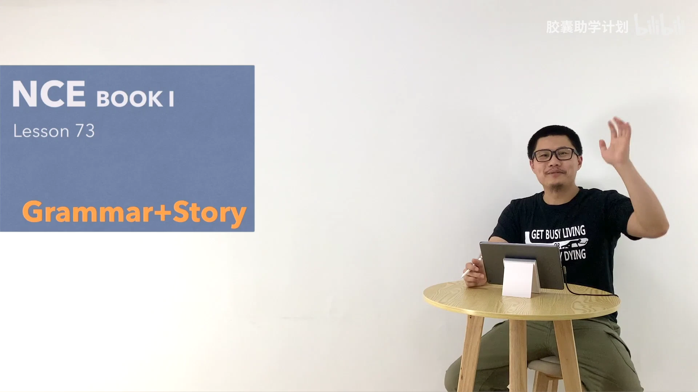

文字识别：胶囊助学计划 / NCE / BOOKI / Lesson 73 / Grammar+Story / GET BUSY LIVING / YDYING

### 画面 00:00:02

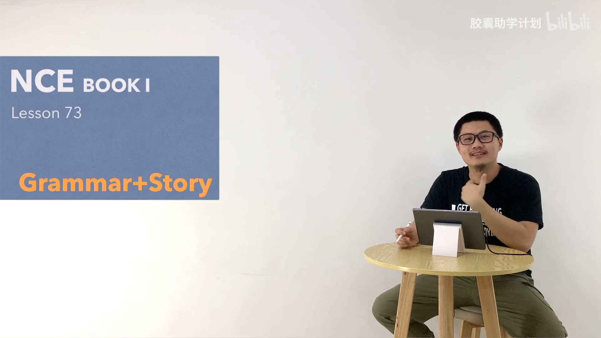

文字识别：胶囊助学计划 / NCE / BOOKI / Lesson 73 / Grammar+Story / GFTK

### 画面 00:00:05

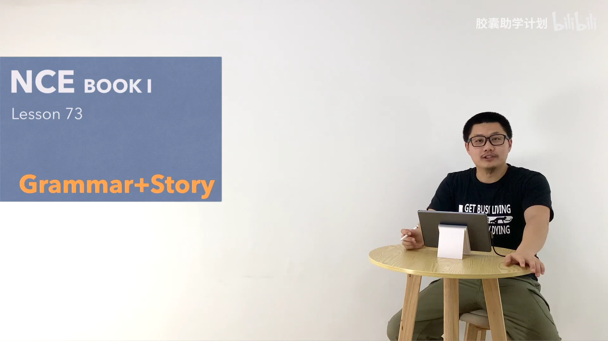

文字识别：胶囊助学计划 / NCE / BOOKI / Lesson 73 / Grammar+Story / GET BUSY LIVING / DVING

### 画面 00:00:10

文字识别：胶囊助学计划 / GET BUSY UVING / OVING

### 画面 00:00:12

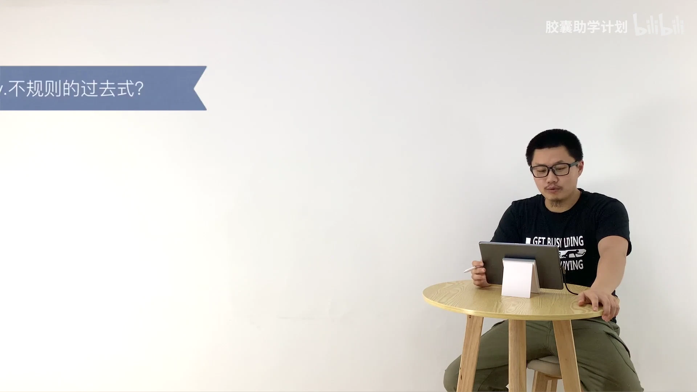

文字识别：胶囊助学计划 / 不规则的过去式? / GFT RIISY UING / OYING

### 画面 00:00:14

文字识别：胶囊助学计划 / ① / 动词v.不规则的过去式? / GET RUSY UDING / R / VOYING

### 画面 00:00:25

文字识别：胶囊助学计划b出l

### 画面 00:00:29

## 00:00:30–00:01:00

好，那我们直接进入文章啊。来了，说 last week 好了，两个单词一出，非常的神奇，已经告诉各位一件事情，接下来所有的事情发生的都是在上一周，所以很可能会用到各种动词，以及这些动词都会出现的形式都是他们的过去式，对吧？说 Mrs. Mills went to London 啊， Mills 妇人去了伦敦。好，went 不用提了，它是 go

### 画面 00:00:31

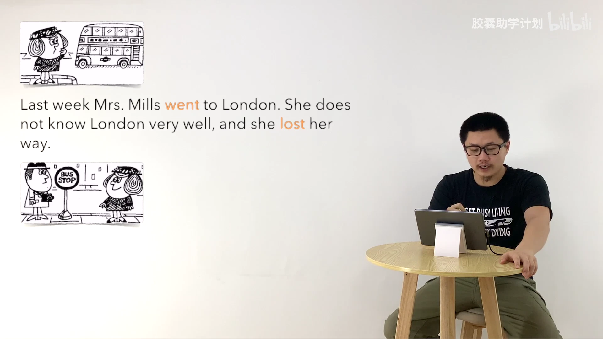

文字识别：胶囊助学计划 / Last week Mrs. Mills went to London. She does / not know London very well, and she lost her / way. / BUS / STOP / SET DISY LVING / OR. / YDYING

### 画面 00:00:34

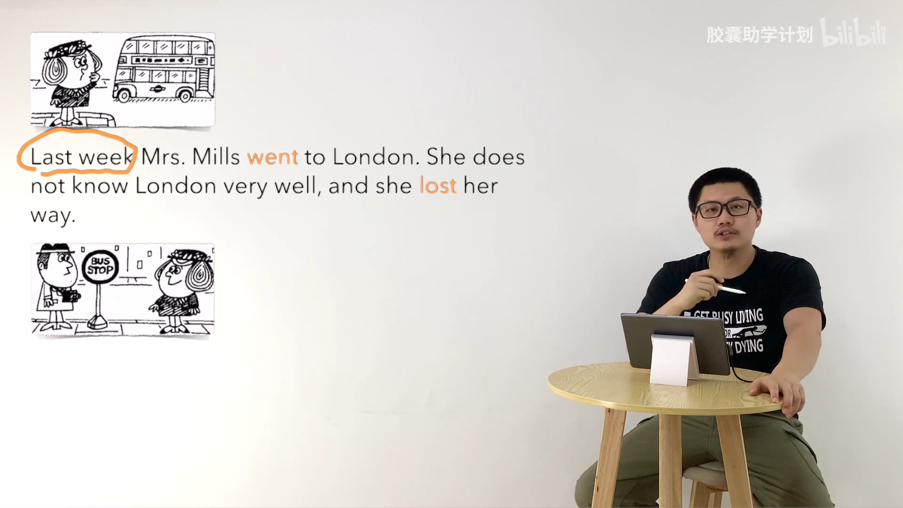

文字识别：胶囊助学计划 / Last weeR /  Mrs. Mills went to London. She does / not know London very well, and she lost her / way. / BUS / STOP / □ / CE DISY LVING / R / YDVING

## 00:01:00–00:01:30

的过去式。我如果是您啊，我会在went的旁边写一个单词叫做go。OK，您现在就可以写在书上了。She does not know London very well. 哎，你看他说上周他去了伦敦，然后紧跟着来了一句话，说does not know London very well。这不是一个典型的一般现在时吗？陈述客观事实，对不对？我们看一下这句话什么意思。说他不是非常了解伦敦。那know有

### 画面 00:01:04

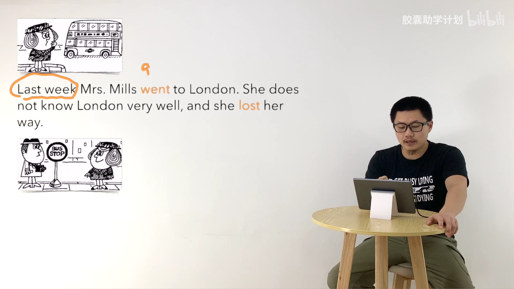

文字识别：Bilbili / 胶囊助学计划 / Last weeR / Mrs. Mills went to London. She does / not know London very well, and she lost her / way. / D / 0 / BUS / STOP / □ / IDYING

### 画面 00:01:13

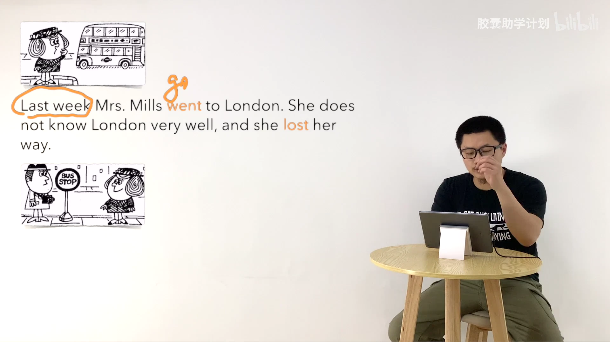

文字识别：胶囊助学计划 / Last weeR /  Mrs. Mills Went to London. She does / not know London very well, and she lost her / way. / BUS / STOP / IYING

## 00:01:30–00:02:00

了解的意思，还有认识的意思，对吧？他并不是非常了解伦敦，陈述的是客观事实，所以他用了一般现在时，而没用当时不太了解，后来了解了，对吧？ And she lost her way。好，这儿提一个小点， lost 是谁的过去式呢？ L O S E， lose 叫做失去。那失去了他的路，你想一下是什么意

### 画面 00:01:43

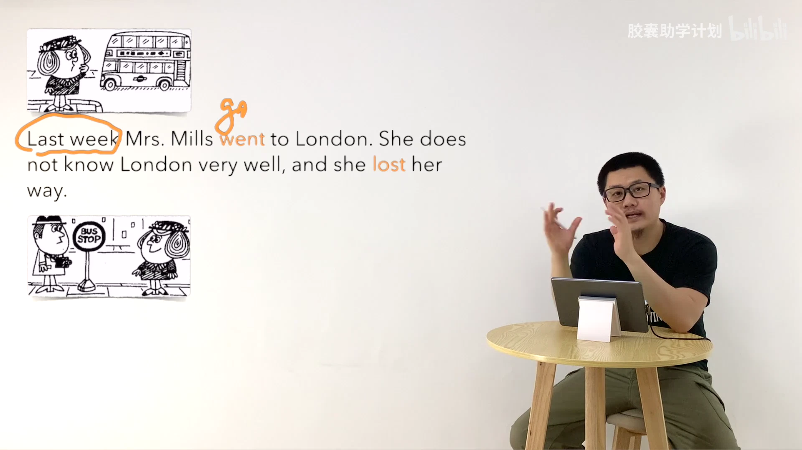

文字识别：胶囊助学计划 / Last weel Mrs. Mills Went to London. She does / not know London very well, and she lost her / way. / BUS / STOP / □

### 画面 00:01:47

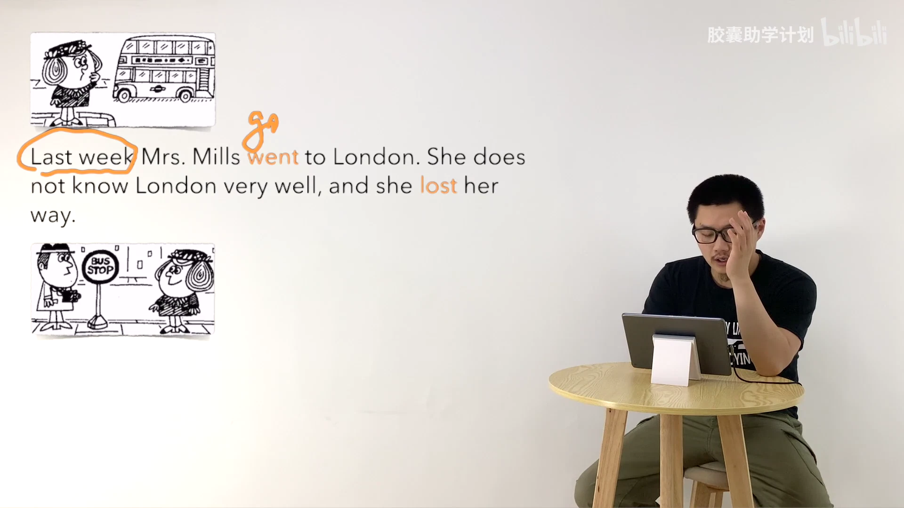

文字识别：胶囊助学计划 / Last weel Mrs. Mills Went to London. She does / not know London very well, and she lost her / way. / BUS / STOP / □

### 画面 00:01:53

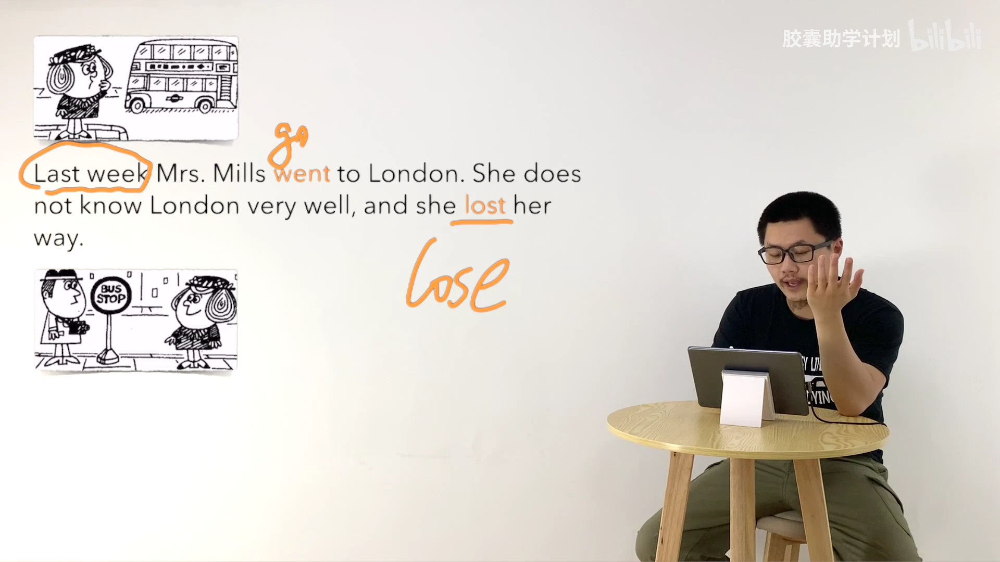

文字识别：胶囊助学计划 / Last week /  Mrs. Mills Went to London. She does / not know London very well, and she lost her / way. / lose / BUS / STOP

## 00:02:00–00:02:30

思？失去了他的路，其实就是两个字叫迷路啊。所以各位在这儿可以把 lose one's way 或者 lose somebody's way 当一个小的习惯用法记下来。Continue, suddenly，突然间，she saw a man near a bus stop. 好了，这个地方的 saw actually 它是谁的过去式呢？是 see 啊，您写在旁边是吧？他突然看到

### 画面 00:02:13

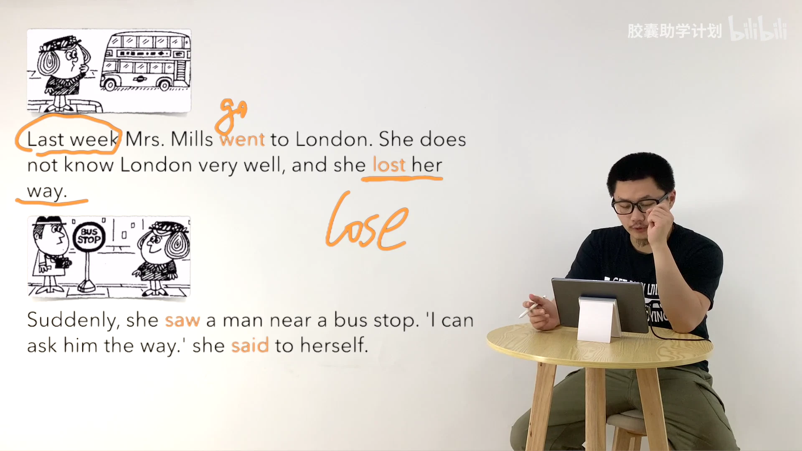

文字识别：胶囊助学计划 / Last weel Mrs. Mills Went to London. She does / not know London very well, and she lost her / way. / lose / D / BUS / STOP / Suddenly, she saw a man near a bus stop.'I can / ask him the way.' she said to herself.

### 画面 00:02:16

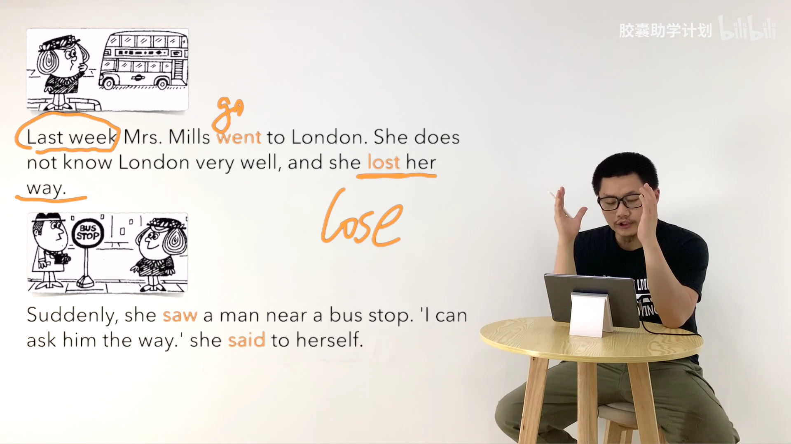

文字识别：胶囊助学计划 / Last weel Mrs. Mills Went to London. She does / not know London very well, and she lost her / way. / lose / BUS / STOP / Suddenly, she saw a man near a bus stop.'I can / ask him the way.'she said to herself.

### 画面 00:02:21

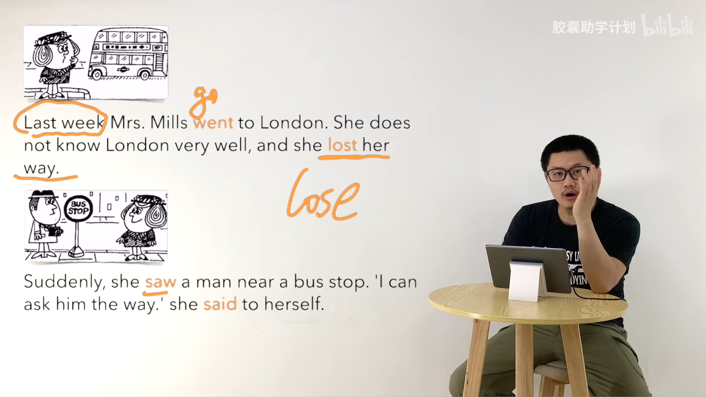

文字识别：胶囊助学计划 / Last weeR /  Mrs. Mills Went to London. She does / not know London very well, and she lost her / way. / lose / BUS / STOP / SYUI / Suddenly, she saw a man near a bus stop.'I can / ask him the way.'she said to herself.

### 画面 00:02:27

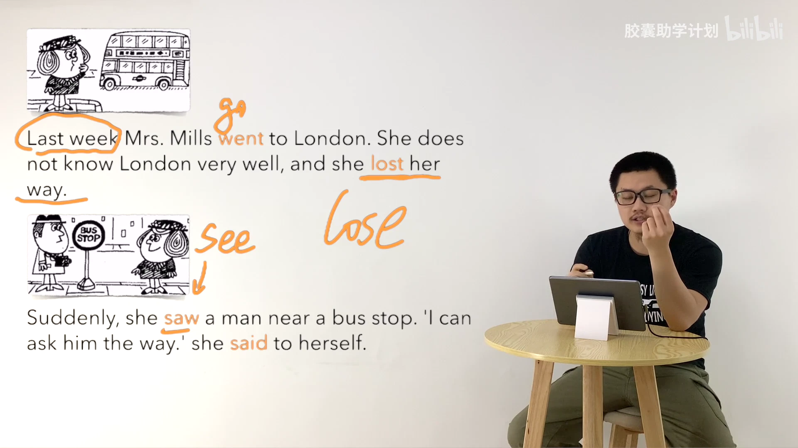

文字识别：Bilbili / 胶囊助学计划 / Last weel /  Mrs. Mills Went to London. She does / not know London very well, and she lost her / way. / lose / BUS / See / STOP / Suddenly, she saw a man near a bus stop.'I can / ask him the way.'she said to herself.

## 00:02:30–00:03:00

了一个男子 near a bus stop 在这个公交站啊旁边看到了。I can ask him the way。我能问他路啊？Way是路对吧？She said to herself。她对自己自言自语道。Okay，那said其实一课我们就见过了。您也是写在旁边。它是say的过去式对吧？Continue。Excuse me。第一课咱们就学过了。打扰别人之前先说这句话。不好意思，

### 画面 00:02:37

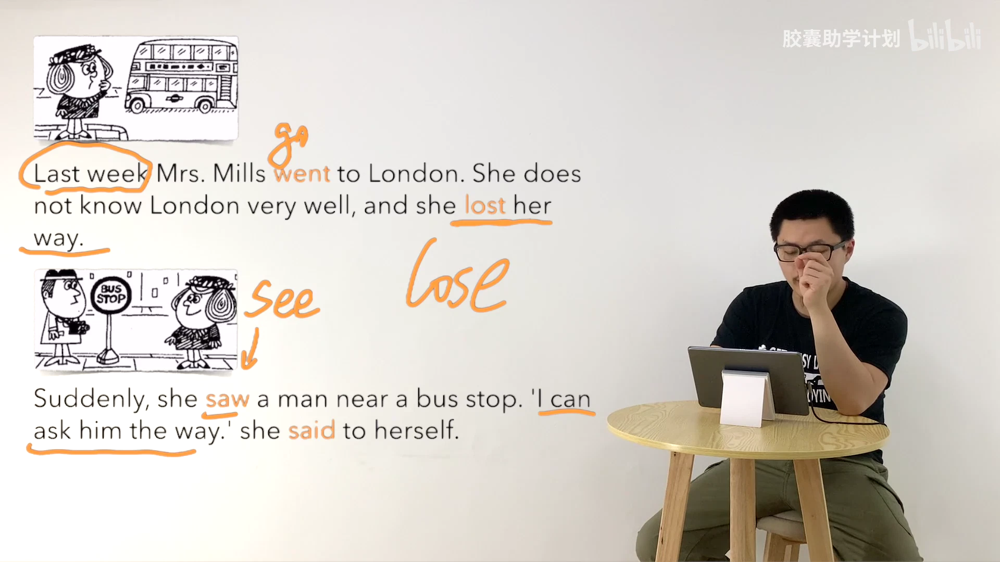

文字识别：bibil / 胶囊助学计划 / Last weeR /  Mrs. Mills Went to London. She does / not know London very well, and she lost her / way. / lose / D / See / BUS / STOP / □ / Suddenly, she saw a man near a bus stop.'l can / ask him the way.' she said to herself.

### 画面 00:02:42

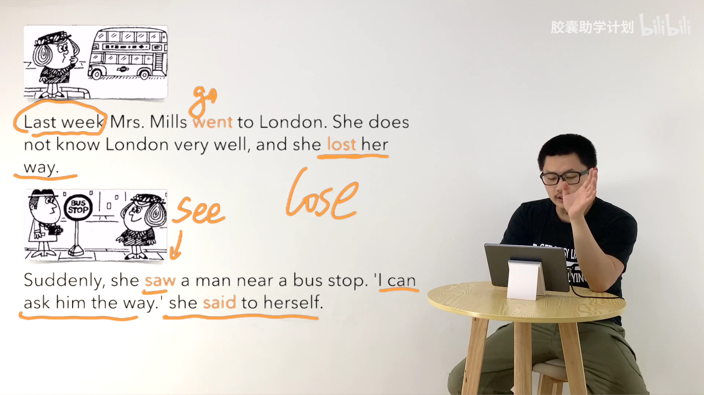

文字识别：Bilbili / 胶囊助学计划 / Last week / Mrs. Mills / Went to London. She does / not know London very well, and she lost her / way. / lose / D / D / See / STOP / BUS / Suddenly, she saw a man near a bus stop.'l can / ask him the way.'she said to herself.

### 画面 00:02:50

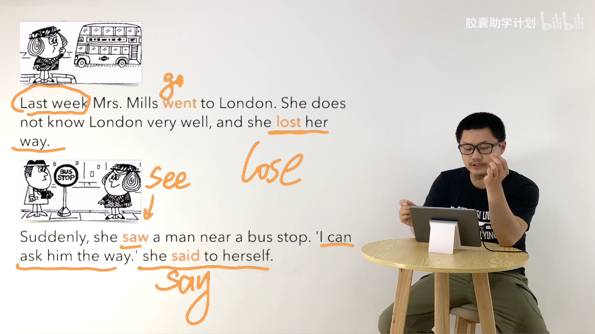

文字识别：biltbili / 胶囊助学计划 / Last week / Mrs. Mills / Went to London. She ( / does / not /  know London very well, / and she lost her / way. / lose / D / 0 / See / STOP / BUS / Suddenly, / she / saw / a man near a bus stop.'l can / ask him the way.' she / said to herself. / Say

### 画面 00:02:53

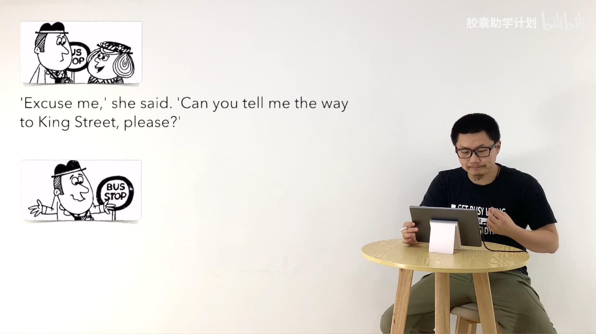

文字识别：胶囊助学计划 / 'Excuse me,' she said.'Can you tell me the way / to King Street, please?' / BUS / STOP

## 00:03:00–00:03:30

打扰一下。She said，她说到，Can you tell me the way to King Street？好，在这儿我提一个小点，各位把 King Street 直接加一个下划线。比如说，我现在想问，说您能告诉我去天坛的路怎么走吗？Can you tell me the way to Tian Tan？对吧？你能告诉我雍和宫怎么走吗？Can you tell me the way to Lama Temple？对吧？你能告诉我某个地方怎么走吗？Can you tell me the way to 加上这个地点？各

### 画面 00:03:03

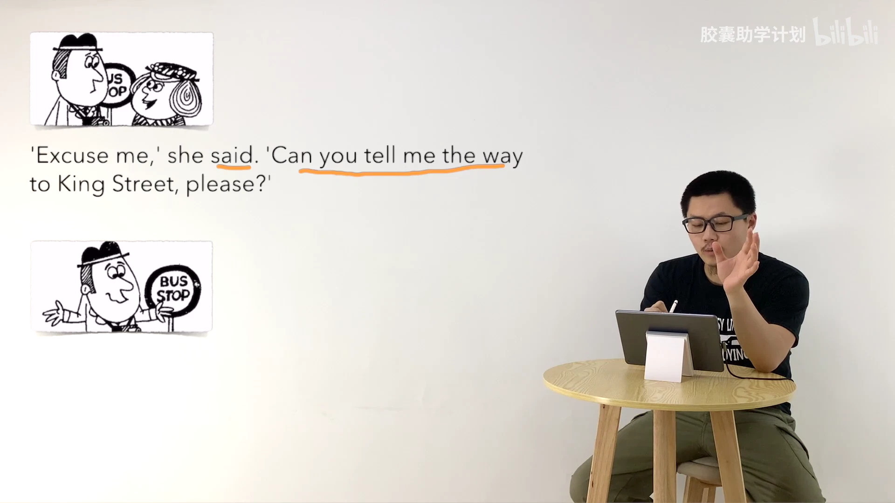

文字识别：胶囊助学计划 / bilibil / 'Excuse me,' she said.'Can you tell me the way / to King Street, please?' / BUS / STOP

### 画面 00:03:08

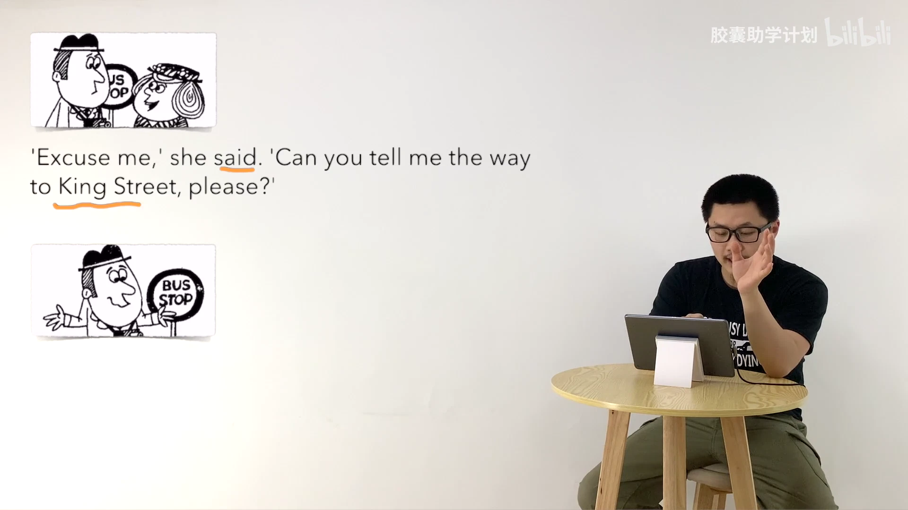

文字识别：BiliBil / 胶囊助学计划 / 'Excuse me,' she said.'Can you tell me the way / to King Street, please?' / BUS / STOP / ISYL

### 画面 00:03:11

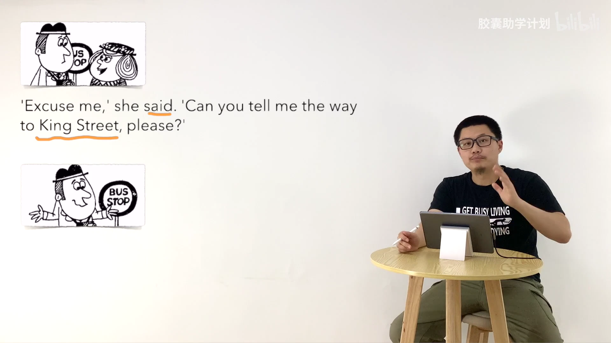

文字识别：胶囊助学计划 / 'Excuse me,'she said.'Can you tell me the way / to King / Street, please?' / BUS / STOP / GET RUISY LIVING / RYING

### 画面 00:03:18

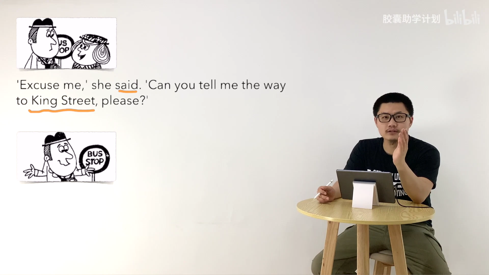

文字识别：胶囊助学计划 / 'Excuse me,' she said.'Can you tell me the way / to King S / Street, please?' / BUS / STOP

## 00:03:30–00:04:00

位回去带几个试一下啊！Please，拜托了。The man smiled pleasantly.啊，这个男的很愉快的笑了笑，是吧？但是耸了个肩，是吧？耸肩是什么意思？您知道对吧？就是后边这句话叫做He did not understand English. Sorry, I can't help you. I don't understand. I, I, I don't understand English,是吧？他并不懂英文。He spoke German.啊，spoke您在旁边写上，他是

### 画面 00:03:33

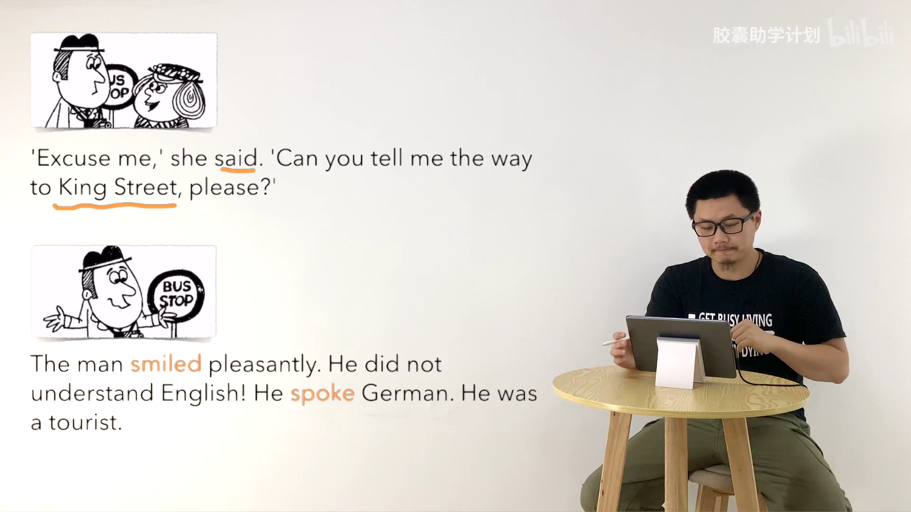

文字识别：胶囊助学计划 / 'Excuse me,' she said.'Can you tell me the way / to King / Street, please?' / BUS / STOP / GET DIISYIING / The man smiled pleasantly. He did not / understand English! He spoke German. He was / a tourist.

### 画面 00:03:46

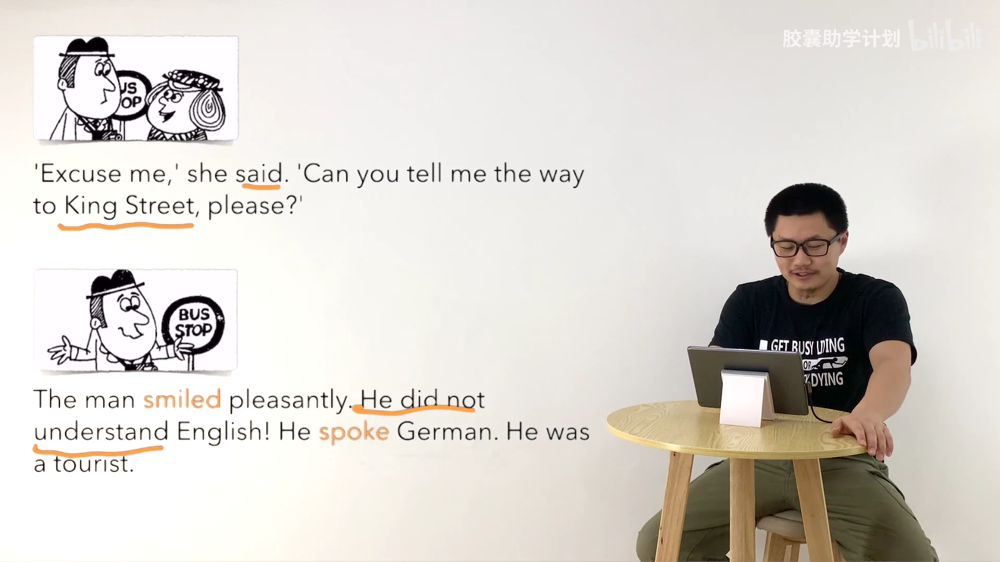

文字识别：胶囊助学计划 / she said.'Can you tell me the way / 'Excuse / me,' / to King / Street, please?' / BUS / STOP / GFT BUSY DING / OR / KDYING / The man smiled pleasantly. He did not / understand English! He / e spoke German. He Was / a tourist.

### 画面 00:03:49

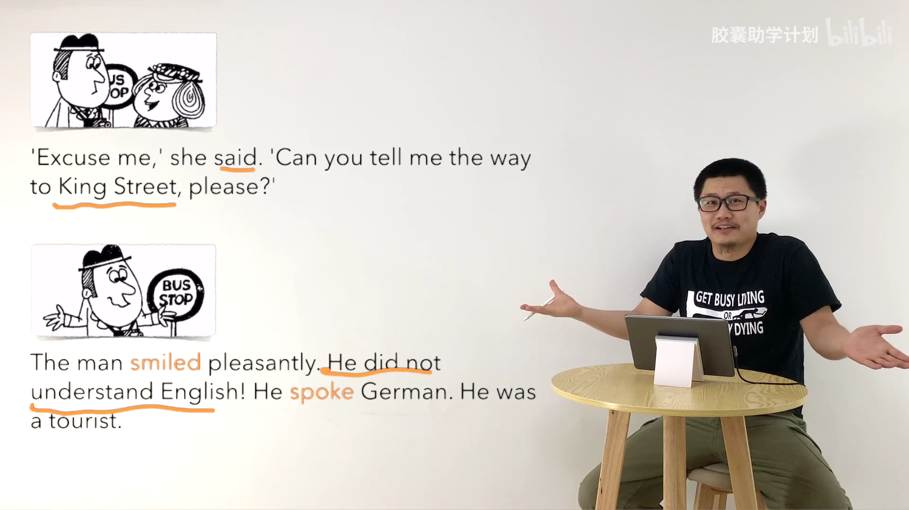

文字识别：胶囊助学计划 /  me,'she said. 'Can you tell me the way / 'Excuse / to King / Street, please?' / BUS / STOP / GET BUSY LING / OR / YDVING / The man smiled pleasantly.He did not / understand English! He spoke German. He was / a tourist.

### 画面 00:03:53

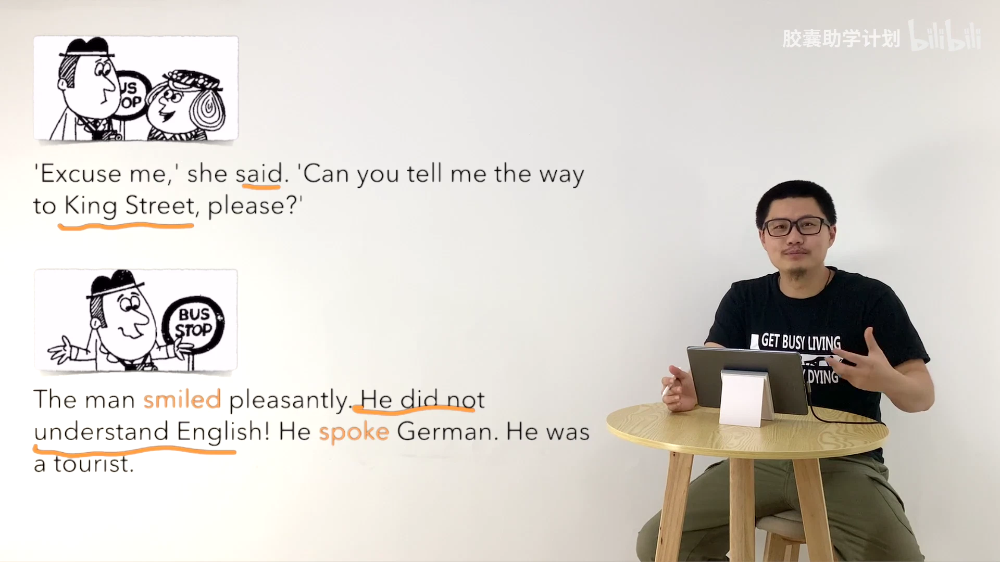

文字识别：胶囊助学计划 / 'Excuse / me,'she said.'Can you tell me the way / to King / Street, please?' / BUS / STOP / GET BUSY LIVING / DYING / The man smiled pleasantly.He did not / understand English! He spoke German. He was / a tourist.

## 00:04:00–00:04:30

speak 的过去式。他说德语，He was a tourist。他是一个什么呢？Tourist，十五课我们就学过了，他是一个来旅游的人，对吧？旅行者、旅客啊。Then 然后 he put his hand into his pocket。他把他的手揣到兜里面。OK，注意这儿的 put 是 put 这个单词的过去式，只

### 画面 00:04:00

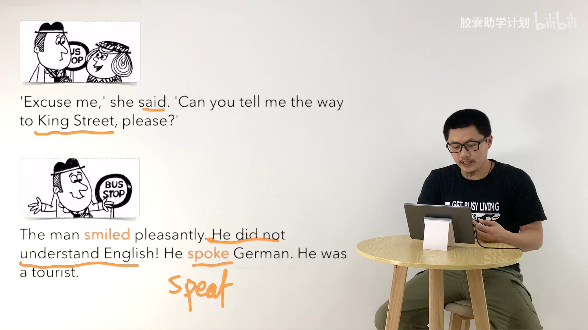

文字识别：BilBili / 胶囊助学计划 / 'Excuse / me,' / she / e said.'Can you tell me the way / to / King / Street, please?' / BUS / STOP /  GET BISY LIVING / The man smiled pleasantly.He did not / understand English! He / spoke / German. He Was / a tourist. / Speaf

### 画面 00:04:14

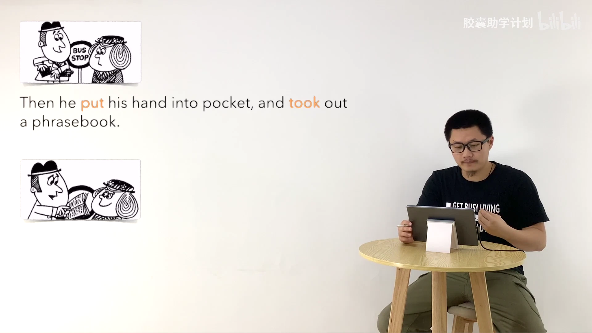

文字识别：胶囊助学计划 / BUS / STOP / Then he put his hand into pocket, and took out / a phrasebook. /  GET RLISY IVING

### 画面 00:04:26

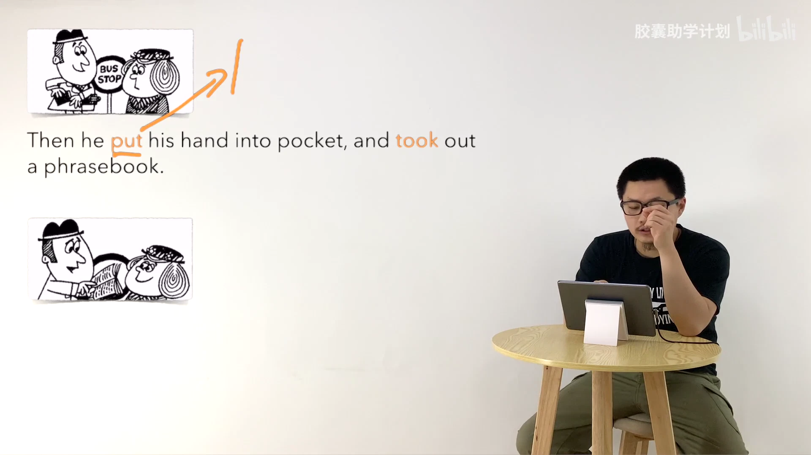

文字识别：胶囊助学计划 / BUS / STOP / Then he put his hand into pocket, and took out / a phrasebook.

## 00:04:30–00:05:00

是它们长得是一样的，但变一般疑问句的时候，您是把谁提前？注意是把 D 的提前哈，不是提别的。And took out a phrase book，啊，took 是什么呢？是 take，你写旁边 T A K E，是拿拿出了一个短语书。刚才我给各位解释了什么叫短语书，对吧？我们在单词部分 continue 说 he opened the book，打开了书，你看过去式 and found a

### 画面 00:04:36

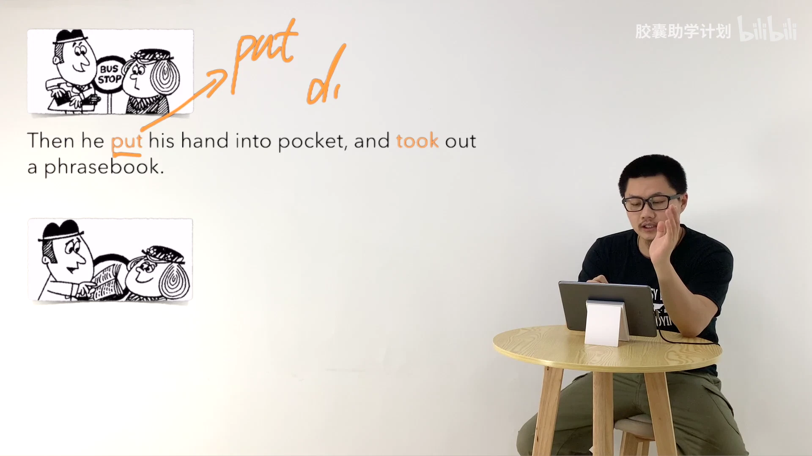

文字识别：put / 胶囊助学计划 / Bibil / BUS / STOP / Then he put his hand into pocket, and took out / a phrasebook.

### 画面 00:04:40

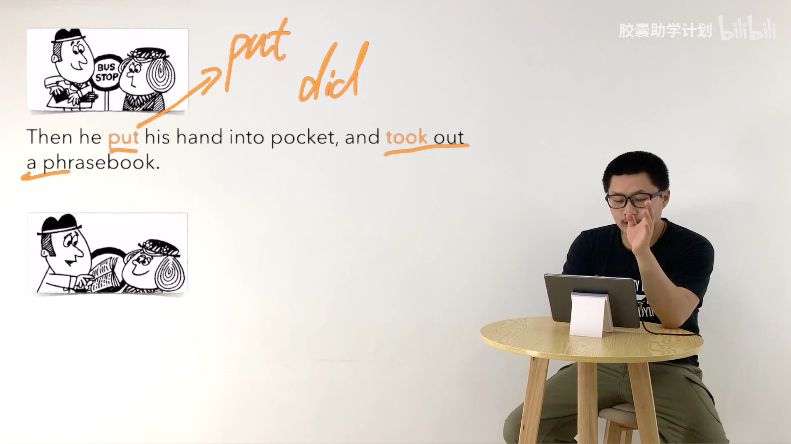

文字识别：put / Bibili / 胶囊助学计划 / dicd / BUS / STOP / Then he /  put his hand into pocket, and took out / a phrasebook.

### 画面 00:04:45

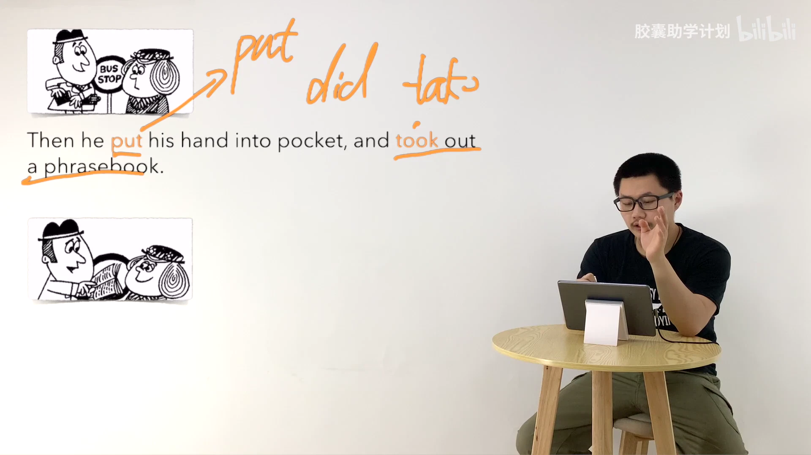

文字识别：put / 胶囊助学计划 / bilbl / did / lat / BUS / STOP / Then he / e put his hand into pocket, and took out / a phrasebook.

### 画面 00:04:49

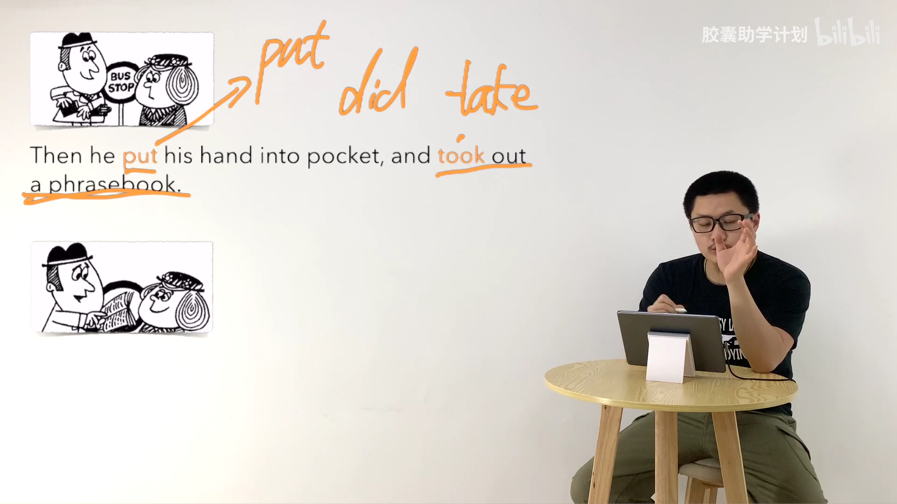

文字识别：put / 胶囊助学计划 / dicd / lake / BUS / STOP / Then he / put his hand into pocket, and took out / a phrasebook.

### 画面 00:04:53

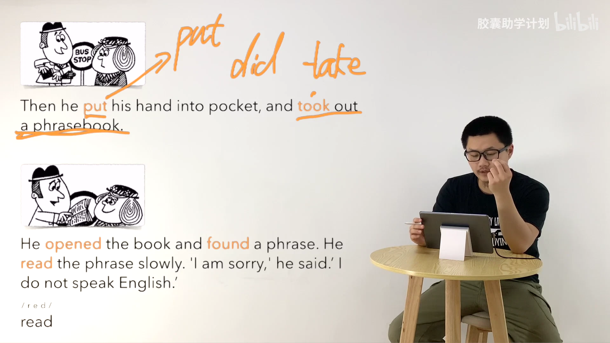

文字识别：put / Bilbi / 胶囊助学计划 / dicd / lake / BUS / STOP / Then he put his hand into pocket, and took out / a phrasebook. / He opened the book and found a phrase. He / read the phrase slowly.'I am sorry,' he said.'I / do not speak English.' / e / read

### 画面 00:04:59

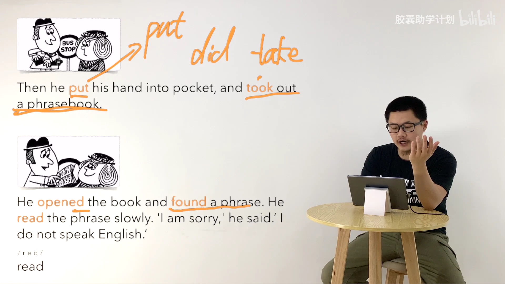

文字识别：put / 胶囊助学计划 / Bilibil / dlid / lake / BUS / STOP / Then he put his hand into pocket, and took out / a phrasebook. / He opened the book and found a phrase. He / read the phrase slowly. / 1.'I am sorry,' he said.'I / do not speak English.' / e / read

## 00:05:00–00:05:30

phrase. Found是谁的过去式呢？是find. Okay,是find的过去式. Found a phrase. He,你看后边这个单词是不是就是读大家非常熟悉叫做read对吧？注意这儿首先它不是read，它是read的过去式啊。虽然两者长得是一样的。其次这个地方注意一下，它不读read了，在过去式的时候，它读的是read

### 画面 00:05:04

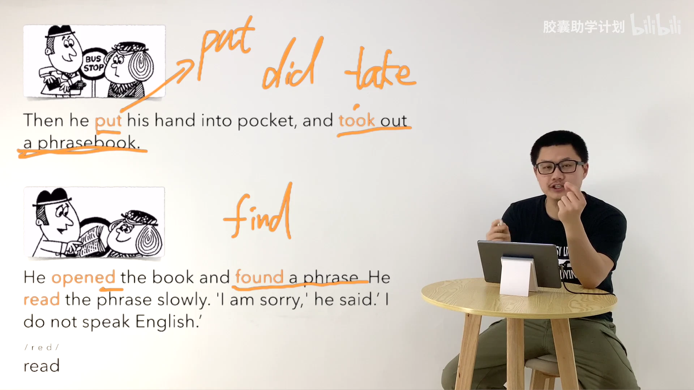

文字识别：put / 胶囊助学计划 / dlid / lake / BUS / STOP / Then he / put his hand into pocket, and  / took out / a phrasebook. / find / He opened the book and found a phrase He / read the phrase slowly. / .'"I am sorry,' he said.'I / do not speak English. / e / read

### 画面 00:05:22

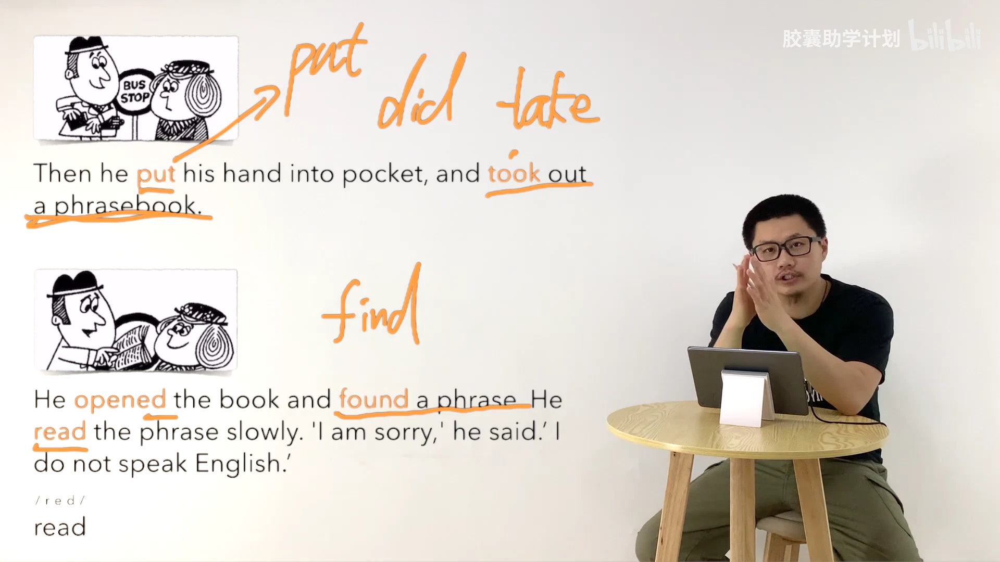

文字识别：put / 胶囊助学计划 / did / lake / BUS / STOP / Then he / put his hand into pocket, and / took out / a phrasebook. / find /  opened the book and found a phrase He / He / read / the phrase slowly. / 'I am sorry,' he said.'I / do not speak English.' / e / read

### 画面 00:05:25

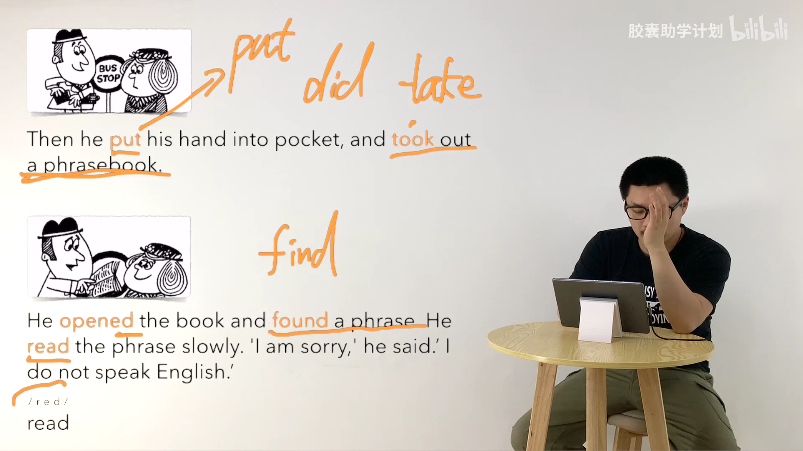

文字识别：put / 胶囊助学计划 / bilbii / dicd / lake / BUS / STOP / Then he / put his hand into pocket, and / d took out / a phrasebook. / find / He / e opened the book and found a phrase He / read / the phrase slowly. / 1.'I am sorry,' he said'I / do not speak English.' / /red/ / read

### 画面 00:05:28

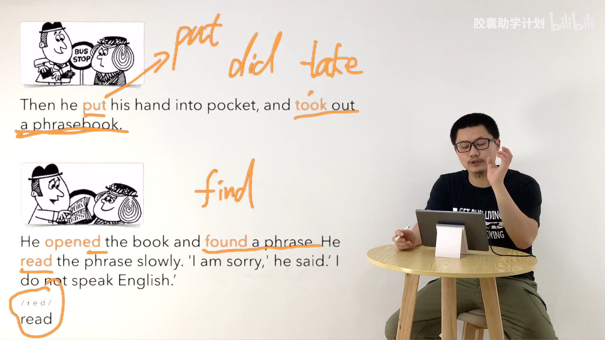

文字识别：put / 胶囊助学计划 / dicd / lake / BUS / STOP / Then he / put his hand into pocket, and / took out / a phrasehook. / find / LMING / He / opened the book and found a phrase He / read / the phrase slowly. / 'I am sorry,' he said.'I / do rot speak English.' / read

## 00:05:30–00:06:00

啊，这个听上去是有一些烦躁的，是吧？好，我能理解，但是你相信我看多了，这种语音变化并不多啊，没几个。你连让我想，我可能掰手指头都能给你数出来，是吧？所以不用担心啊。 He read the phrase slowly. 他缓慢的读着这个 phrase 这个短语。 I'm sorry, he said. I do not speak English. 啊，抱歉，他说道，我不说英文

### 画面 00:05:31

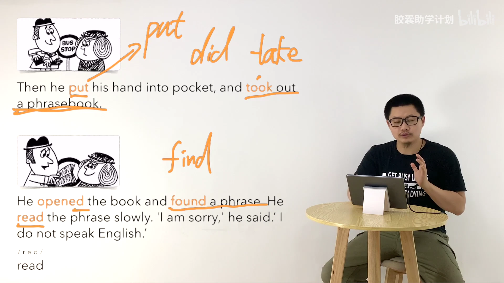

文字识别：put / 胶囊助学计划 / dicd / lake / BUS / STOP / Then he / put his hand into pocket, and / Itook out / a phrasebook. / find / GET BUISYL / DR- / YDYING / He / opened the book and found a phrase He / read / the / phrase slowly. / 'I am sorry,' he said.'I / do not speak English.' / e / read

### 画面 00:05:37

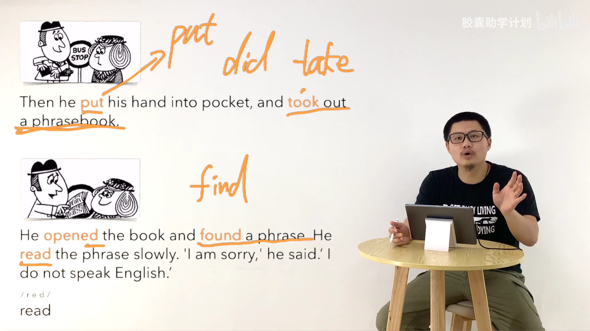

文字识别：put / 胶囊助学计划 / dicd / lake / BUS / STOP / Then he / put his hand into pocket, andt / took out / a phrasebook. / find / YLIVING / He /  opened the book and found a phrase He / DVING / read / the phrase slowly. / .'I am sorry,' he said'I / do not speak English.' / e / read

### 画面 00:05:46

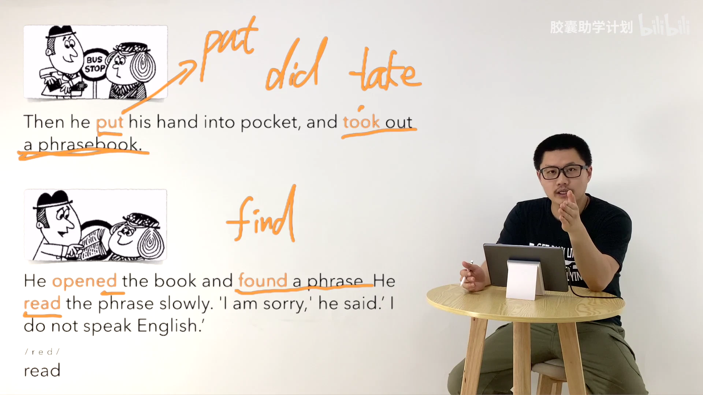

文字识别：put / 胶囊助学计划 / dicd / lake / BUS / STOP / e put his hand into pocket, and took out / Then he / a phrasebook. / find / He opened the book and found a phrase He / read / the phrase slowly. / .'I am sorry,' he said.'I / do not speak English.' / e / read

## 00:06:00–00:06:30

啊，我不懂英文，对吧？好，那你看这地方提一个小点，叫做 He read the phrase slowly. 这个地方如果变一般疑问句，把谁提前？你要自己去想。哦，一定是 D 的提前。 OK，好。接下来各位看着文章啊，我开始给大家做一些口语听力练习。我问问题，您回答。如果我这儿速度比较快呢，您就暂停一下屏幕。来了，What

### 画面 00:06:06

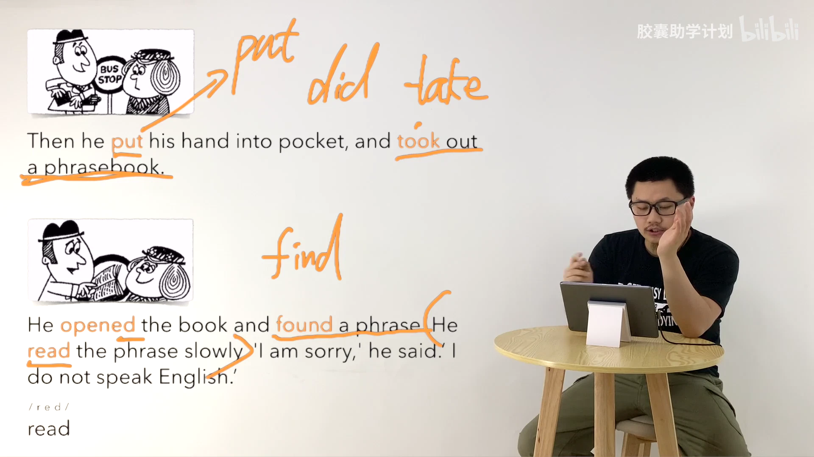

文字识别：put / 胶囊助学计划 / dlid / lake / BUS / STOP / Then he / put his hand into pocket, and / took out / a phrasebook. / find / He /  opened the book and found a phrase He / phrase slowly'I am sorry,' he said' I / read / the / do not speak Englisn.' / e / read

### 画面 00:06:14

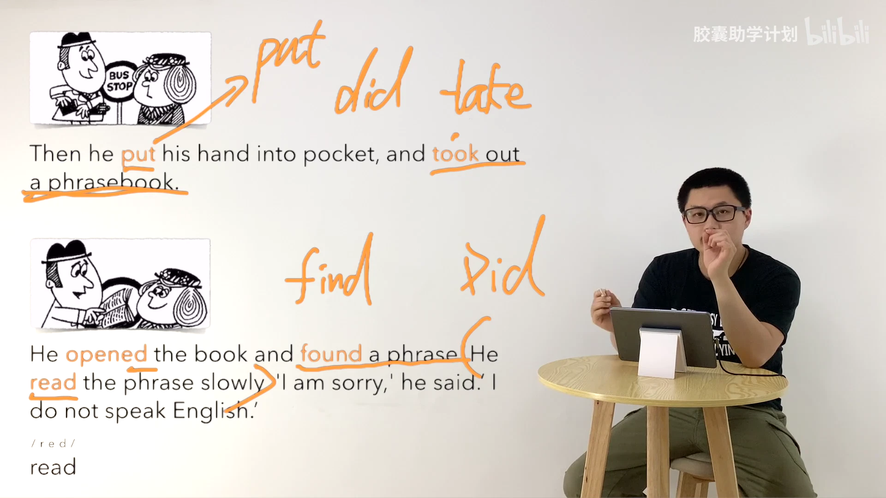

文字识别：put / Bilbli / 胶囊助学计划 / dicd / lake / BUS / STOP / Then he / put his hand into pocket, and / Itook out / a phrasehook. / Xid / find / He / opened the book and found a phrase He / phrase slowly'l am sorry,' he said' I / read / the / do not speak Englisn.' / e / read

### 画面 00:06:16

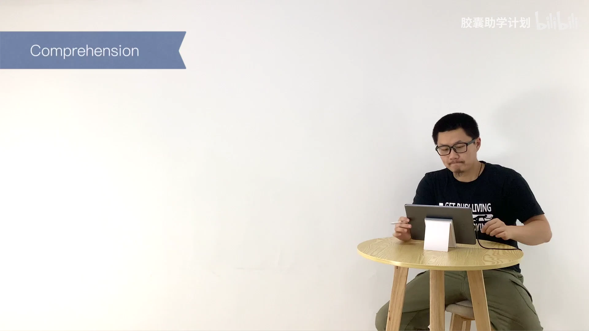

文字识别：胶囊助学计划 / Comprehension / CET DUENYLVING

### 画面 00:06:19

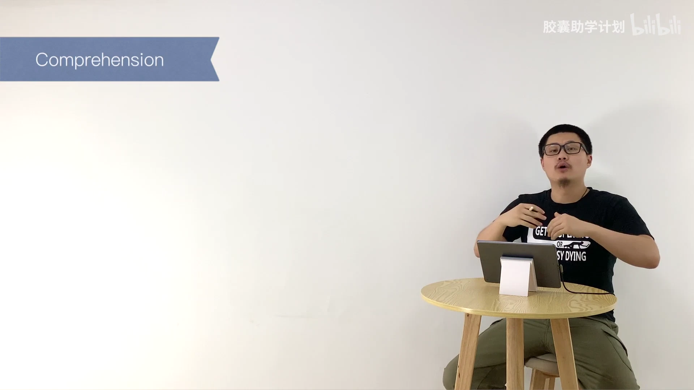

文字识别：胶囊助学计划 / Comprehension / GET / OR / SYDYING

## 00:06:30–00:07:00

did Mrs. Miles do last week? She went to London. Next one, does she know London well? No, she doesn't. Did she lose her way? Yes, she did. Where did she see a man? Near a bus stop.

### 画面 00:06:34

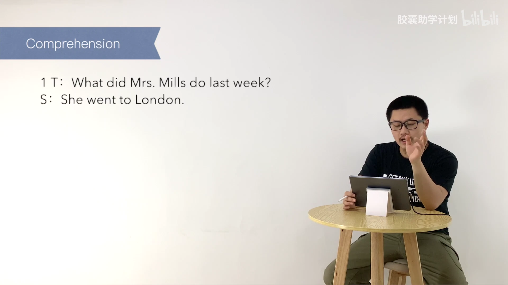

文字识别：胶囊助学计划 / Comprehension / 1 T: What did Mrs. Mills do last week? / S: She went to London.

### 画面 00:06:42

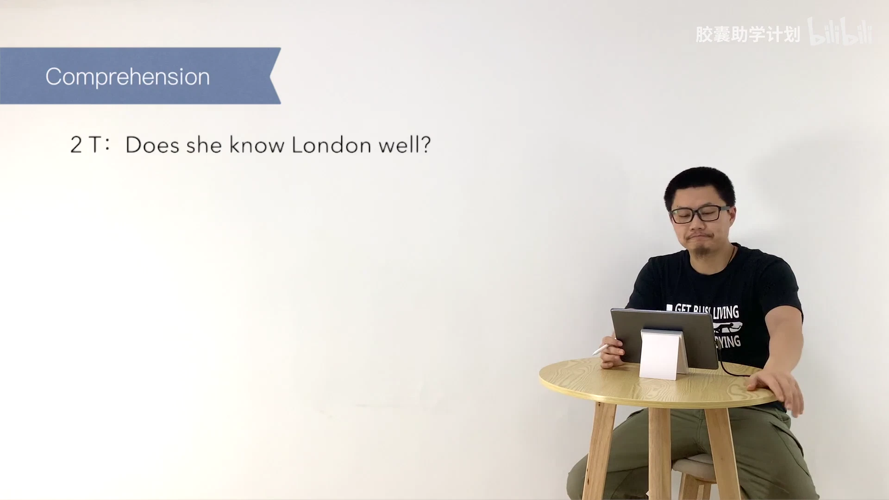

文字识别：胶囊助学计划 / Comprehension / 2 T: Does she know London well? / GET BILE LINING / SNING

## 00:07:00–00:07:30

What did she say to him? She said, "Excuse me, can you tell me the way to King Street, please?" Next one. Did the man smile? Yes, he did. Did the man understand English? No, he didn't. Next one. What did the man do?

### 画面 00:07:04

文字识别：胶囊助学计划 / Comprehension / 5 T: What did she say to him? / S: She said,'Excuse me. Can you tell me the / way to King Street, please?' / - R DLISY VING / YING

### 画面 00:07:10

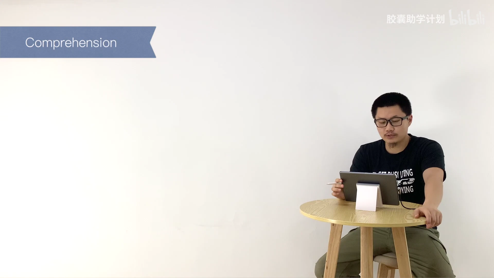

文字识别：胶囊助学计划 / Comprehension / A RUSY VING / DYING

## 00:07:30–00:08:00

He put his hand into his pocket and took out a frisbee. Next one. Did he speak English? No, he didn't. Next one. Was he a tourist? Yes, he was. Okay,下一题asking questions肯定句，您把它变一般疑问句，我给特殊疑问词，您变特殊疑问句啊。练习的是我们能说出来一般疑问句和特殊疑问句的能力啊

### 画面 00:07:30

文字识别：bilbil / 胶囊助学计划 / Comprehension / 8 T: What did the man do? / S: He put his hand into his pocket and took / out a phrase book. /  GET PUY ING / DYING

### 画面 00:07:37

文字识别：胶囊助学计划 / Comprehension / 9 T: Did he speak English? /  CRT PISY UING / DYING

### 画面 00:07:51

文字识别：胶囊助学计划 / Asking questions / GET RUSY LDING / DYING

### 画面 00:07:58

文字识别：胶囊助学计划 / Asking questions /  CET DUIS LDING / HDYING

## 00:08:00–00:08:30

啊啊，换成人话是吧？换成大白话，就是各位将来能提问了，对吧？来了，Ask me if Mrs. Mills went to London last week. Did Mrs. Mills go to London last week? When? When did Mrs. Mills go to London? Next one. Ask me if she saw a man near a bus stop. Saw. Did she see a man near a bus stop?

### 画面 00:08:06

文字识别：胶囊助学计划 / Asking questions / 1 T: Ask me if Mrs. Mills went to London last week. / GET DUISY VING / DYING

### 画面 00:08:12

文字识别：Biltbli / 胶囊助学计划 / Asking questions / 1 T: Ask me if Mrs. Mills went to London last week. / S: Did Mrs. Mills go to London last Week? / GET DIISY VING / NYING

### 画面 00:08:20

文字识别：biltbili / 胶囊助学计划 / Asking questions / 2 T: Ask me if she saw a man near a bus stop. / CrT PISY VING / DYING

## 00:08:30–00:09:00

Where? Where did she see a man? Ask me if she said. Excuse me. Did she say? Excuse me. What? What did she say? Ask me if he spoke German. Did he speak German? What language?

### 画面 00:08:31

文字识别：bib / 胶囊助学计划 / Asking questions / 2 T: Ask me if she saw a man near a bus stop. / S: Did she see a man near a bus stop? / T:Where...? / S: Where did she see a man? /  CET DUIS ING / YING

### 画面 00:08:35

文字识别：bitbli / 胶囊助学计划 / Asking questions / CT PUISY UING / YING

### 画面 00:08:46

文字识别：Biltbili / 胶囊助学计划 / Asking questions / 3 T: Ask me if she said'Excuse me'. / S: Did she say'Excuse me'? / T: What...? / S: What did she say? /  CRT PUIY ING / DYING

### 画面 00:08:49

文字识别：Bifbili / 胶囊助学计划 / Asking questions / 4 T: Ask me if he spoke German. /  CET USY VING / YING

### 画面 00:08:59

文字识别：胶囊助学计划 / Asking questions / 4 T: Ask me if he spoke German. / S: Did he speak German? / T:What language.? / S: What language did he speak? /  T RUSY ING / DYING

## 00:09:00–00:09:30

What language did he speak? Next one. Ask me if he took a phrase book out of his pocket. Did he take a phrase book out of his pocket? What What did he take out of his pocket? Okay,玩一个recap本课文章当中各位一定要读的非常非常的熟，因为它包含了

### 画面 00:09:03

文字识别：胶囊助学计划 / Asking questions / 5 T: Ask me if he took a phrase book out of his pocket. /  A USY VING / DYING

### 画面 00:09:17

文字识别：胶囊助学计划 / Asking questions / 5 T: Ask me if he took a phrase book out of his pocket. / S: Did he take a phrase book out of his pocket? / T: What...? / S: What did he take out of his pocket? / CET PISY UING / DYING

### 画面 00:09:21

文字识别：Recap / 胶囊助学计划 / Patterns / v.不规则过去式 / Grammar / Words / GET PLISY UING / DYING / Expression

### 画面 00:09:29

文字识别：胶囊助学计划 / Recap / Patterns / v.不规则过去式 / Grammar / Words / SYL / Expression

## 00:09:30–00:10:00

诸多动词不规则的过去式，OK，这个点各位要注意一下。好，家庭作业绿皮书七十三课，各位可以写了文章。刚才我讲了，您一定要熟读成诵，因为最初这一批动词不规则的过去式，您读熟了就文章读熟，必然记下来了，对吧？总结动词不规则的过去式，这个不光是今天这一课的作业，是未来好几课的作业。您把它都总结到自己的一个小笔记本里面，然后时不

### 画面 00:09:34

文字识别：胶囊助学计划 / 绿皮书第73课的写作练习

## 00:10:00–00:10:30

时拿出来看一下，因为马上八十三课，我们就还会见到动词的最后一个形式叫过去分词，很容易跟过去式混了，是吧？OK，那最后呢，给自己讲解一遍今天的核心知识点。如果大家喜欢我们的课程呢，欢迎大家关注、订阅、一键三连，分享给那些需要的朋友来支持、帮助我们成长。最后，我们再来看一句名人名言：Learning and innovation go hand in hand.

### 画面 00:10:04

文字识别：bilbli / 胶囊助学计划 / 绿皮书第73课的写作练习 / 文章跟读至熟读成诵 / 3.总结u不规则过去式

### 画面 00:10:14

文字识别：Bilbili / 胶囊助学计划

### 画面 00:10:23

文字识别：Bilbili / 胶囊助学计划 / GET BUSY / Learning and innovation go hand in hand. The / R / YDYING / arrogance of success is to think that what you did / yesterday will be sufficient for tomorrow. / William Pollard

## 00:10:30–00:10:51

The arrogance of success is to think that what you did yesterday will be sufficient for tomorrow. See you next time.

### 画面 00:10:39

### 画面 00:10:41

文字识别：CAPSULEACADEMY / 胶囊助学计划 / 小红书 / Lecturer / Leo / OE

### 画面 00:10:43

文字识别：CAPSULEACADEMY / 胶囊助学计划 / 小红书 / Photographer / Berlin / OE

### 画面 00:10:46

文字识别：CAPSULEACADEMY / 胶囊助学计划 / 小红书 / Creator / OE

### 画面 00:10:49

文字识别：bilibili / 胶囊助学计划

### 画面 00:10:51

文字识别：bilibili / 胶囊助学计划

