# 074 单词 语法

快速机器解析：语音为单模型转写，未进行独立交叉校对或人工复核；画面每秒采样并按变化选帧，短时文字和标记可能遗漏。截图时间约有 1 秒误差。图片有损压缩；遇到疑点请按时间查看 Google Drive 原视频。

## 00:00:00–00:00:30

Hello, everyone. Welcome to Castle Academy. This is Leo. Today, we're going to learn new concept English book one lesson seventy four practices and words. 那老习惯进入正式课程之前，我们先看一个问题。我们再次回顾一下，到底如何去使用副词啊？那本课会带着大家不停的练。 Hope you guys enjoyed. 我们先看本课的第一个小的副词，读一下叫做

### 画面 00:00:00

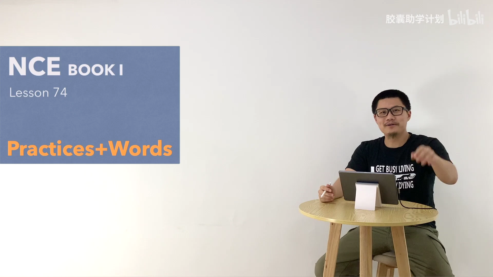

文字识别：biltbili / 胶囊助学计划 / NCE / BOOKI / Lesson 74 / Practices+Words / GET BUSY LIVING / DYING

### 画面 00:00:03

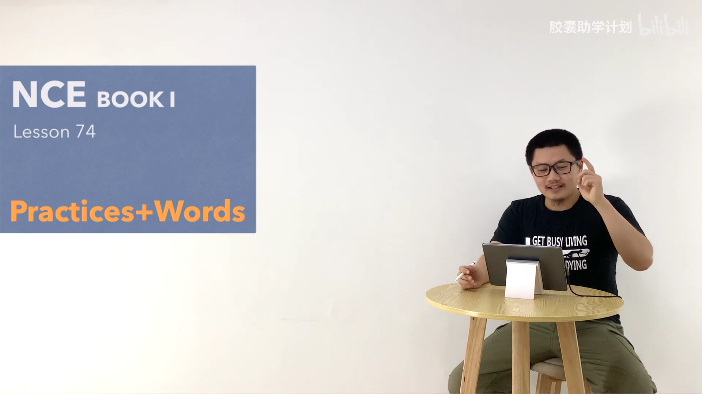

文字识别：胶囊助学计划 / NCE / BOOKI / Lesson 74 / Practices+Words / GET BUSY LVING / PYING

### 画面 00:00:11

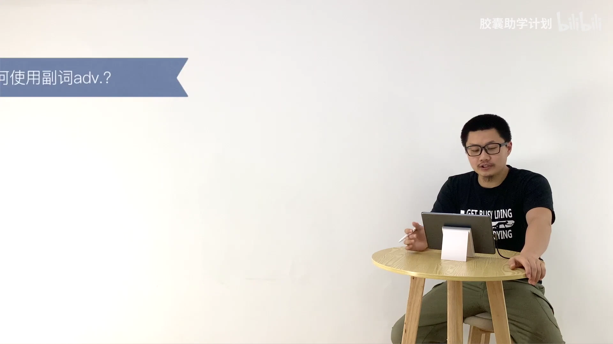

文字识别：胶囊助学计划 / 可使用副词adv.？ / GET BLICY ING / DYING

### 画面 00:00:13

文字识别：胶囊助学计划 / ①如何使用副词adv.? / GET DLLCYLING / DYING

### 画面 00:00:15

文字识别：胶囊助学计划 / ①如何使用副词adv.? / GET RIISY LING / PYING

### 画面 00:00:18

文字识别：胶囊助学计划 / ①如何使用副词adv.？ / GET RIISY LING / PYING

### 画面 00:00:22

文字识别：胶囊助学计划bilbl / •

### 画面 00:00:26

### 画面 00:00:28

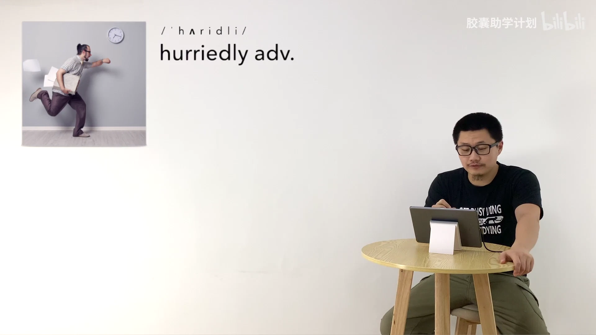

文字识别：胶囊助学计划 / /' hΛri d l i / / hurriedly adv. / ISY VING / DYING

## 00:00:30–00:01:00

hurriedly。好，hurry up，各位可能还记得，叫快一点，对吧？我印象当中是我们四十三课学的，hurry up， the kettle is boiling，对吧？那我们把那个 hurry 快一点拿过来，变成了副词，叫 hurriedly。好，各位注意一小下。好，hurriedly 表示的是迅速一点，快一点。你看啊，它是以 ly 结尾的。啊，我们今天先感受一下，回想一下我们在七十三课

### 画面 00:00:49

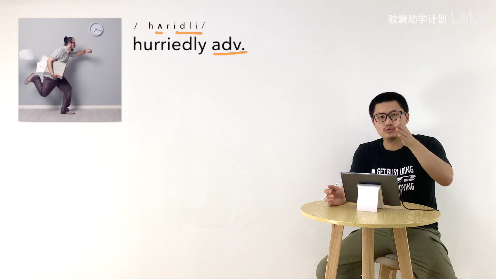

文字识别：胶囊助学计划 / /'harid li / / hurriedly adv. /  GFT RUSY LDING / DYING

### 画面 00:00:57

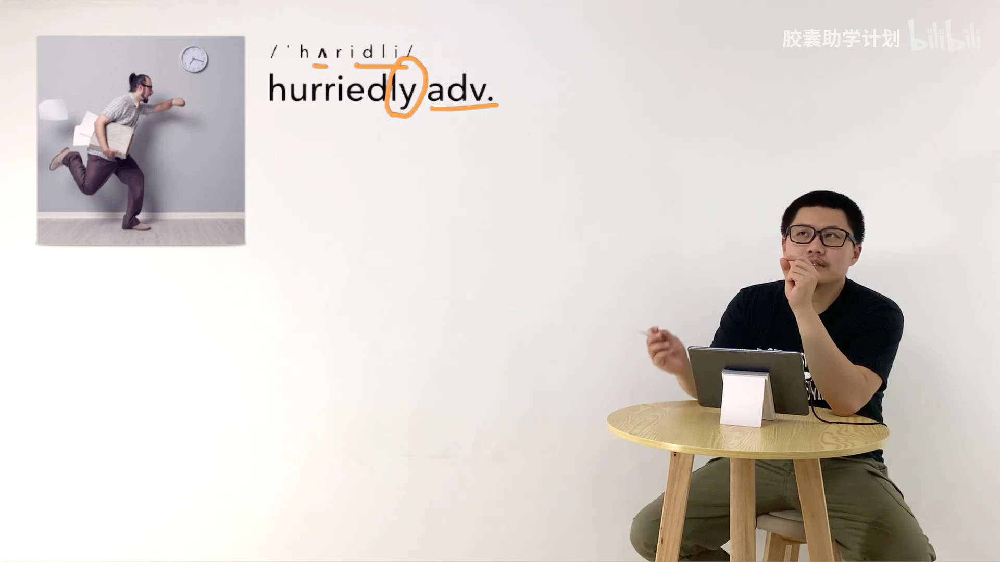

文字识别：胶囊助学计划 / /hari d li / hurriedtyadv.

## 00:01:00–00:01:30

刚刚学过的这一课当中，我们学到的slowly l y结尾的，呃quickly l y结尾的，对吧？呃pleasantly l y结尾的等等，以及接下来我们看到的剩下很多副词都是l y结尾的。至少目前啊，我们好像能得出来一个结论，就是如果一个单词l y结尾的，它很可能就是副词。注意我说的是很可能，因为它还可能是形容词，不一定，

### 画面 00:01:04

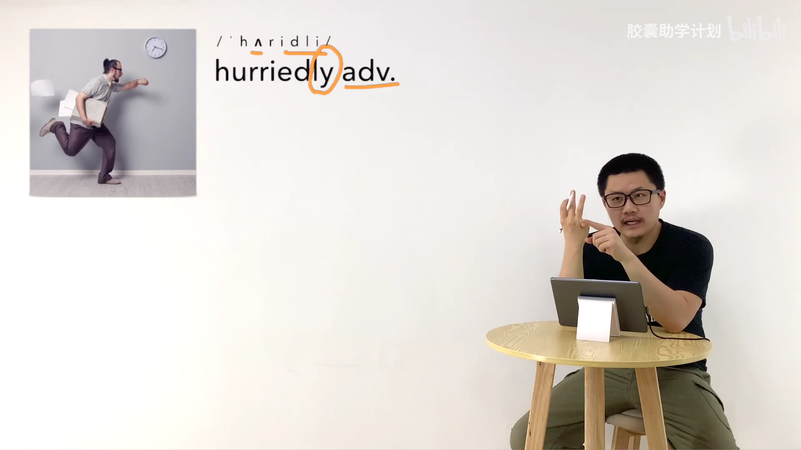

文字识别：胶囊助学计划 / /harid li / hurriedlyadv.

## 00:01:30–00:02:00

对吧？但是至少大部分情况下它是副词。OK，那我们又讲到了副词最重要的一个作用，就是修饰谁啊？就是在去修饰动词，说动词是如何发生的。Shave，哎，shave，那你如果悠闲的、非常享受的、慢慢的刮，对吧？和 hurriedly 造成的结果可能是不一样的。比如说，如果你太快了，是不

### 画面 00:01:33

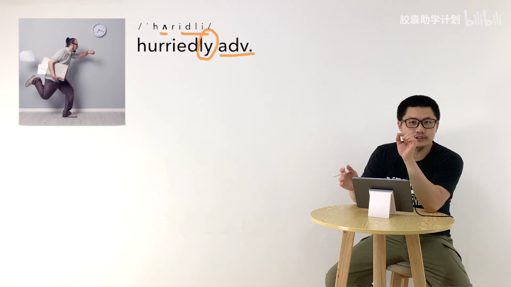

文字识别：胶囊助学计划 / /·hΛridl / hurriedlyadv.

### 画面 00:01:35

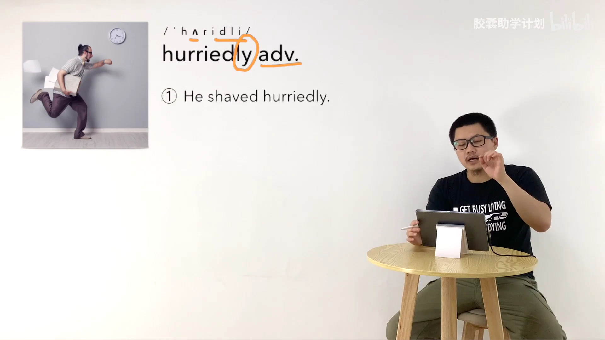

文字识别：胶囊助学计划 / /'haridli / hurriedtyadv. / ① He shaved hurriedly. /  GET BUSY LDING / DYING

### 画面 00:01:38

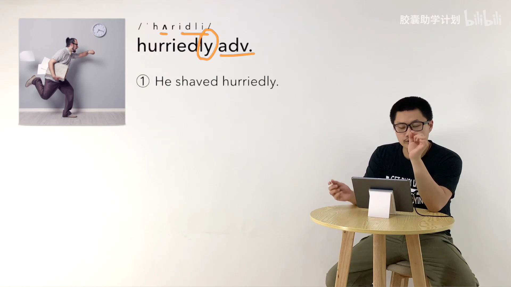

文字识别：Bilibi / 胶囊助学计划 / /'har i d l i / hurriedlyadv. / ① He shaved hurriedly.

### 画面 00:01:41

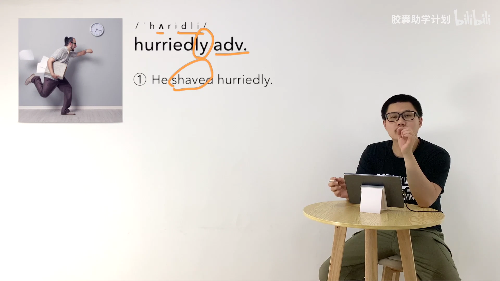

文字识别：胶囊助学计划blb出 / /'hari d l i / hurriedlyadv. / ① Heshavea hurriedly.

### 画面 00:01:47

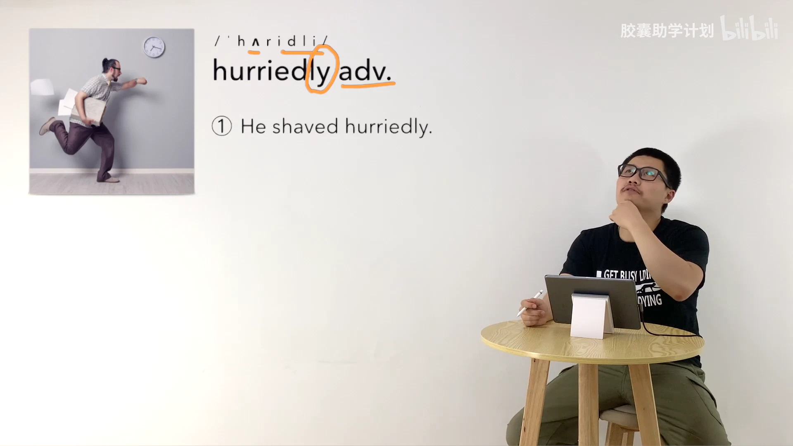

文字识别：胶囊助学计划bl鼎 / /'haridli / hurriedtyadv. / ① He shaved hurriedly. / DVING

## 00:02:00–00:02:30

是可能就会割一个口子？这个口子是怎么出现的呢？跟 cut 本身关系不是最紧密的，跟 hurriedly 是最紧密的。因为如果你慢慢刮，可能就不会有口子，对吧？OK，以及 he left the house hurriedly。好，你看他非常匆忙的 left 这个 house 了。那 left 是什么意思呢？各位拿出您的笔记本总结一下，告诉各位 leave 叫离开。如果说过去

### 画面 00:02:17

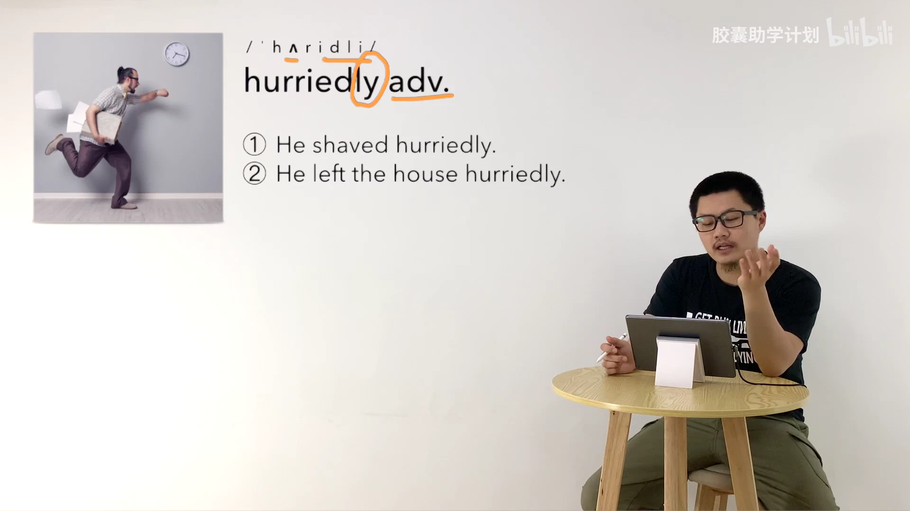

文字识别：胶囊助学计划blb出 / / ' h Λ r i d l i / hurriedtyadv. / ① He shaved hurriedly. / He left the house hurriedly.

## 00:02:30–00:03:00

离开就不能用 leave 了，我们要用的就是 left，对吧？过去离开了。同理，hurriedly 对 left 会产生哪些影响呢？很匆忙，对吧？可能您忘带了钥匙，忘关了水龙头，忘关了灯，忘关了空调，对吧？这个就是 left house hurriedly。甚至你可能门儿都忘了关了。来，这个是 hurriedly 再去修饰 left，再说这个动作是如何

### 画面 00:02:31

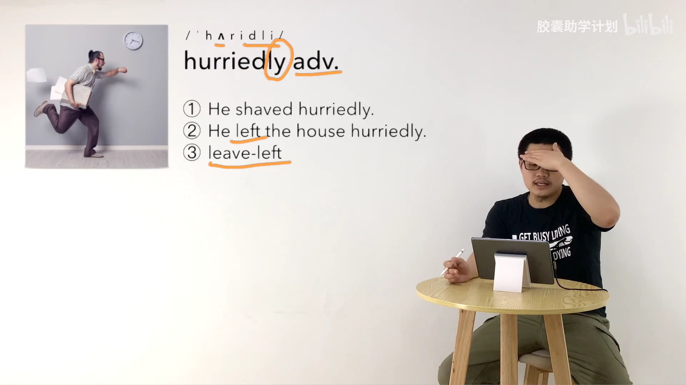

文字识别：胶囊助学计划 / /hari d li / hurriedlyadv. / ① He shaved hurriedly. / He left the house hurriedly. / leave-left / GFT BUSY LING / DYING

### 画面 00:02:39

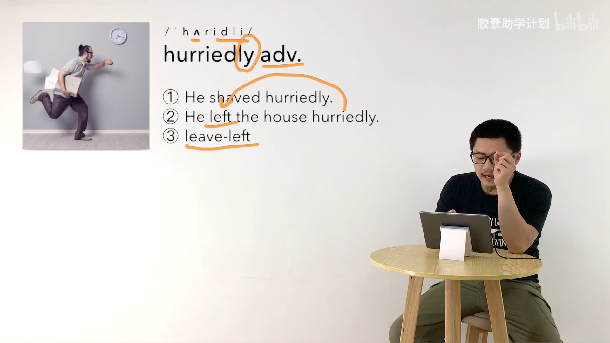

文字识别：胶囊助学计划 / / ' h Λr i d l i / hurriedtyadv. / ① He shived hurriedly. / He left the house hurriedly. / leave-left

### 画面 00:02:47

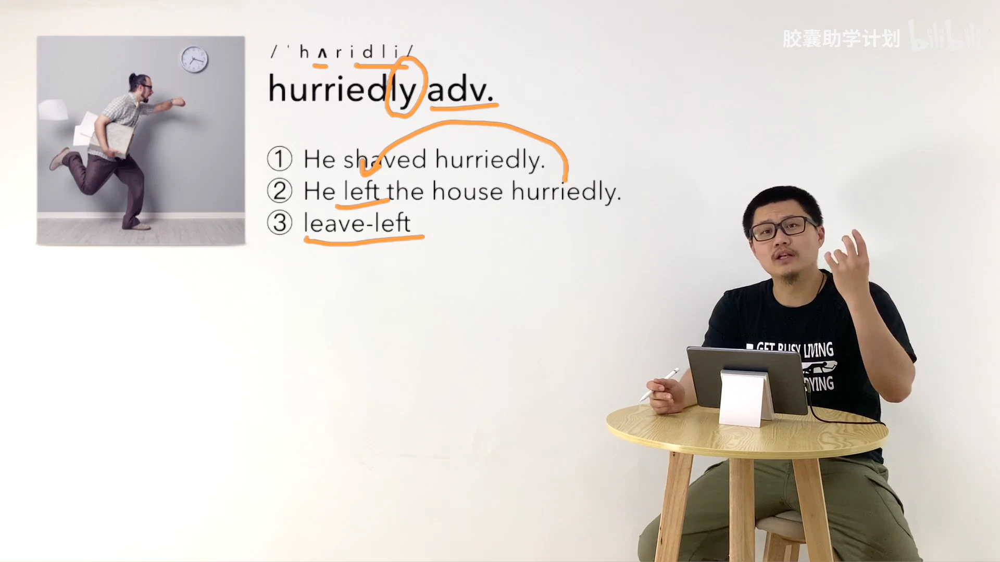

文字识别：胶囊助学计划 / / 'h Λ r i d l i / hurriedlyadv. / ① He shived hurriedly. / He left the house hurriedly. / leave-left / GET DIV LVING / YING

## 00:03:00–00:03:30

发生的. Continue,下一个单词是一个小的动词.那各位，你看前面一个cut，后边一个cut，是想告诉各位什么呢？回想一下，前面一个put，后边一个put，对吧？前面一个speak，后边一个spoke，告诉各位这个单词的过去式还是cut，长得一模一样，发音也没有变化. OK，好，比如说Be careful, don't cut yourself.这就是原型，对吧？小心啊，三十九和四十课咱们就学了。小心啊，别切

### 画面 00:03:01

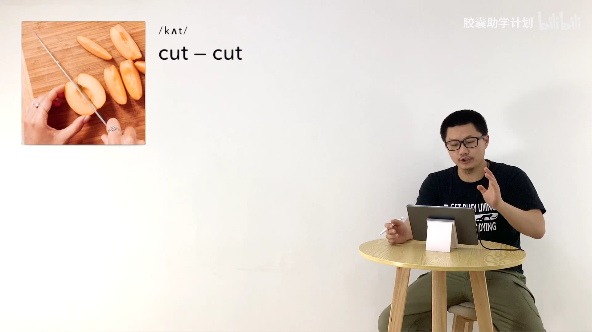

文字识别：胶囊助学计划 / /knt/ / cut — cut / LVIN / DYING

### 画面 00:03:04

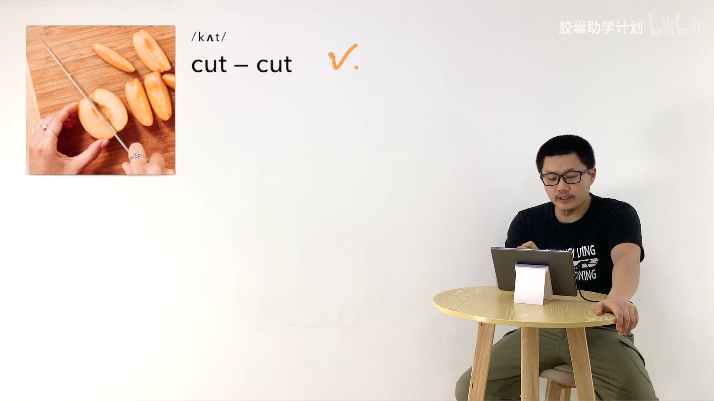

文字识别：胶囊助学计划 / /knt/ / cut — cut / YVING / YING

### 画面 00:03:08

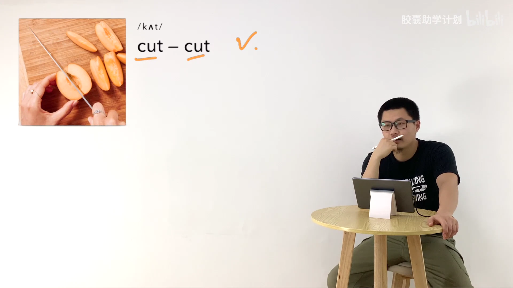

文字识别：胶囊助学计划 / /knt/ / cut — cut / V / VING / BITING

### 画面 00:03:16

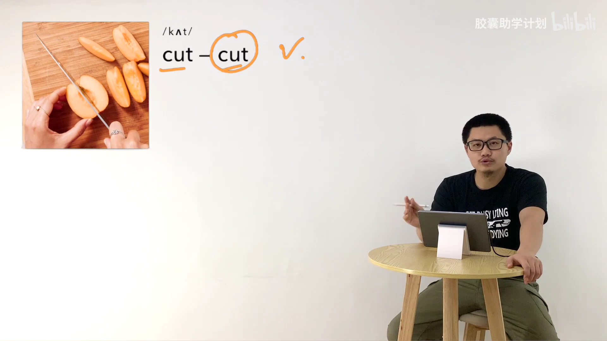

文字识别：胶囊助学计划 / /kat/ / cut / cut / SYVING / DYING

### 画面 00:03:24

文字识别：胶囊助学计划 / /kat/ / cut / cut / ① Be careful. Don't cut yourself. / CFT PUISY LING / DYING

### 画面 00:03:27

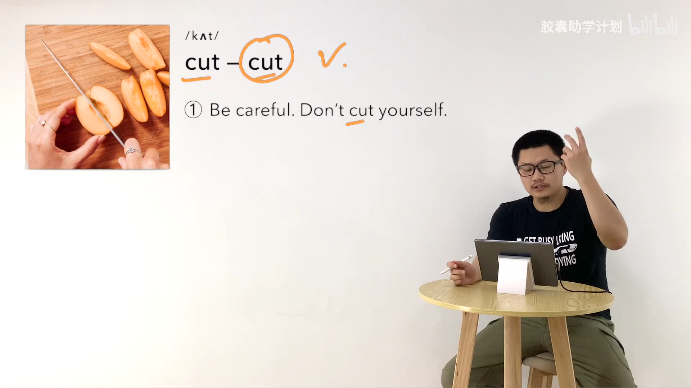

文字识别：胶囊助学计划 / /kat/ / cut / cut / ① Be careful. Don't cut yourself. /  CET DLICY VING / RVING

## 00:03:30–00:04:00

到你自己啊！别伤到你自己。比如说，Can you cut it for me？你能帮我把它切一下吗？啊，假设您想您去海外国外啊，一个超市是吧？然后买了块肉，呃，你自己没法切对吧？你问他，你能帮我切一下吗？当然，这你可能去的不是超市，你可能去的应该是叫Butchers啊，去的是那种专门的肉店啊。超市都是塑封的了啊。好，Next one. I cut myself yesterday morning.你注意，

### 画面 00:03:57

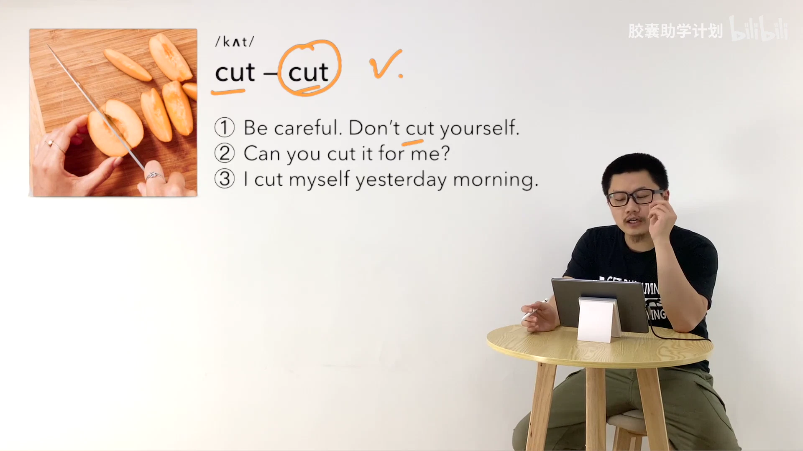

文字识别：胶囊助学计划 / /kat/ / cut / cut / ① Be careful. Don't cut yourself. / Can you cut it for me? / 2 / ③ I cut myself yesterday morning. / 3 / M

## 00:04:00–00:04:30

你看yesterday morning和cut，你要迅速反应过来，它不是前面这个，它是后边这个，对吧？好，虽然长得是一样的，这影响了什么呢？影响了变一般疑问句的时候，谁提前？是do提前还是did提前？在这儿是did提前，因为这个事儿发生在昨天早晨。Very good. 下一个单词，你看thirsty这个单词，你应该是认识的。在这里边，你应该能看出来有一个单词叫thirsty，对吧？

### 画面 00:04:01

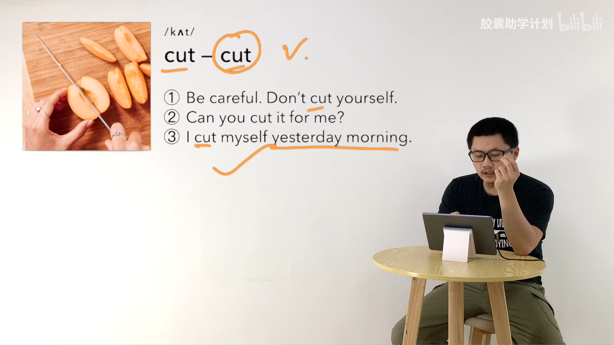

文字识别：胶囊助学计划 / /kat/ / cut / cut / ① Be careful. Don't cut yourself. / Can you cut it for me? / 2 / ③ I cut myself yesterday morning. / 3

### 画面 00:04:06

文字识别：胶囊助学计划 / Dilibil / /knt/ / cut / cut / ① Be gareful. Don't cut yourself. / Cyou cut it for me? / Cut myself yesterday morning.

### 画面 00:04:16

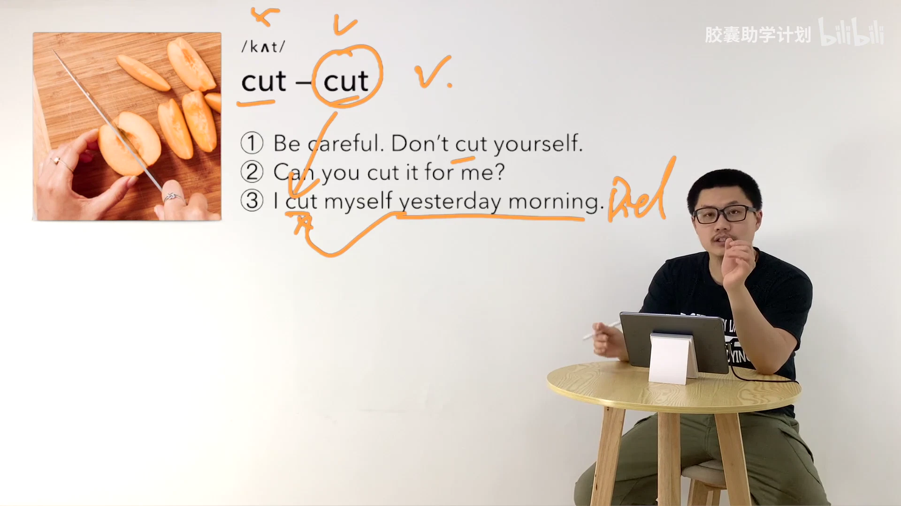

文字识别：Bilbl / 胶囊助学计划 / /knt/ / cut / cut / ① Be gareful. Don't cut yourself. / Ceyou cut it for me? / Be / Cut myself yesterday morning.

### 画面 00:04:20

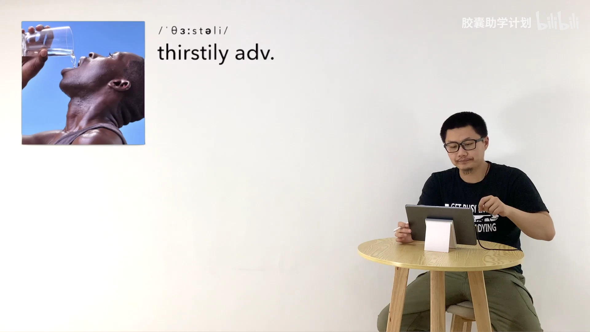

文字识别：胶囊助学计划 / /'θ3:stali/ / thirstily adv. / DYING

### 画面 00:04:25

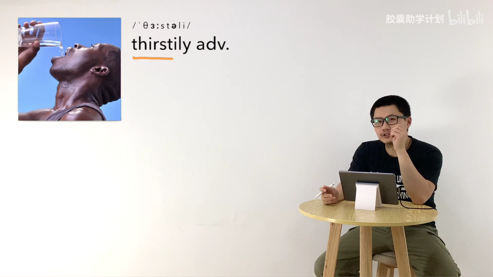

文字识别：胶囊助学计划blbil / /'θ3:stali/ / thirstily adv.

## 00:04:30–00:05:00

现在它是副词，叫做 thirstily，thirstily。 Okay，表示的是非常渴的，对吧？汉语当然不怎么这么聊，是吧？如饥似渴的，有点是这种感觉。但如饥似渴呢？它其实表示的是什么？呃，比如说我们读书，是吧？获取知识是这种感觉，它不是物理意义上我口渴了。比如说我现在上课口很渴，我想去喝口水，是吧？He is drinking the water thirstily. 啊，他太渴了，他正在

### 画面 00:04:37

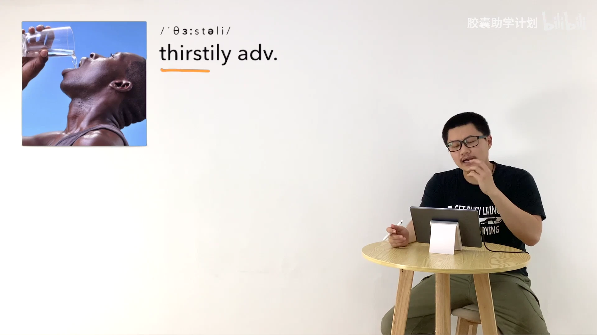

文字识别：胶囊助学计划 / /'θ3istali/ / thirstily adv. / YLVIN / DYING

### 画面 00:04:42

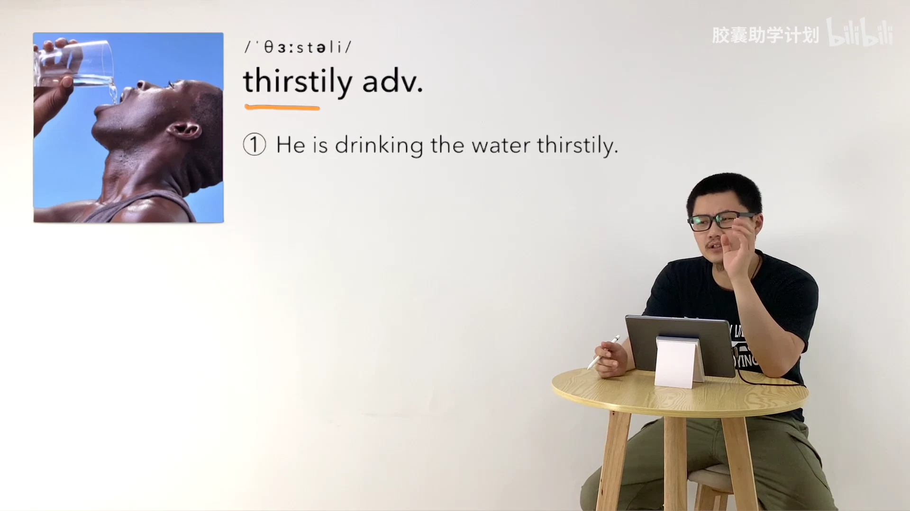

文字识别：胶囊助学计划 / / 'θ3:stali/ / thirstily adv. / ① He is drinking the water thirstily.

## 00:05:00–00:05:30

光光光的往里猛干这个水，是吧？Thirstily表示非常的口渴。OK，下一个单词我们读叫做Great啊，叫打招呼啊，打招呼。那Warmly是什么意思呢？你看Warm，我觉得你可能还是有印象的，表示的是天气的时候很温暖，对吧？你看我现在就很Warm是吧？很Hot。OK，好，Warm指的是很温暖，那Warmly指的就是热情的。OK，那很热情的跟别人

### 画面 00:05:05

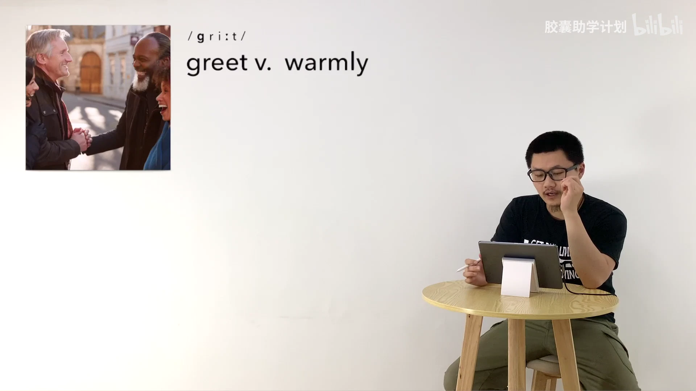

文字识别：胶囊助学计划biil / /gri:t/ / greet v. warmly

### 画面 00:05:10

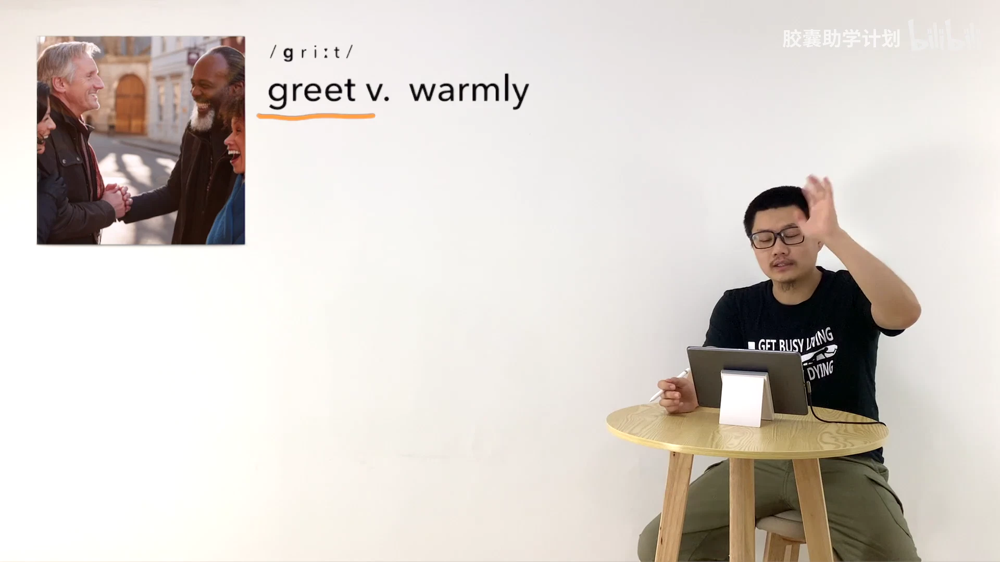

文字识别：胶囊助学计划 / /gri:t/ / greet v. warmly / GFT BUISY LING / DYING

### 画面 00:05:13

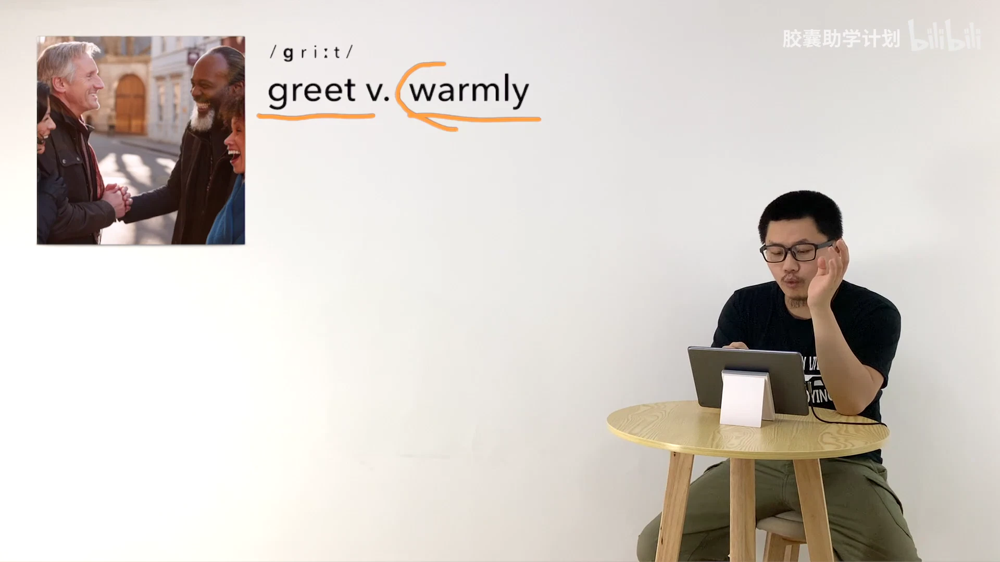

文字识别：胶囊助学计划 / /gri:t/ / warmly / greet v.

### 画面 00:05:21

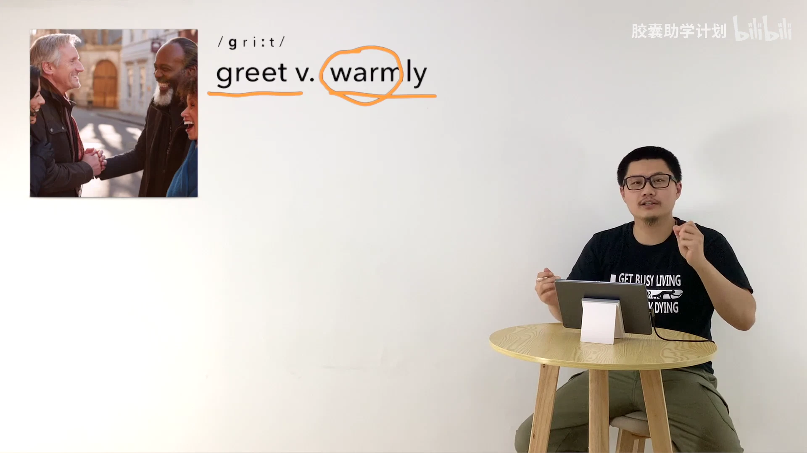

文字识别：胶囊助学计划bil出 / /gri:t/ / greet v. / warm / Iy / GET RUISY LIVING / R / YDYING

## 00:05:30–00:06:00

人打了招呼。比如说，我们看图，叫做They are greeting each other warmly.啊，他们正在非常热情的互相打招呼，对吧？哎，这个great和warmly，warmly是在说great的形式的，因为打招呼还可以非常的冷的。Hi,啊啊哦啊你啊，嗯，是吧？这个叫great就不是warmly的，就是coldly，对不对？Okay,那还可以，我们

### 画面 00:05:33

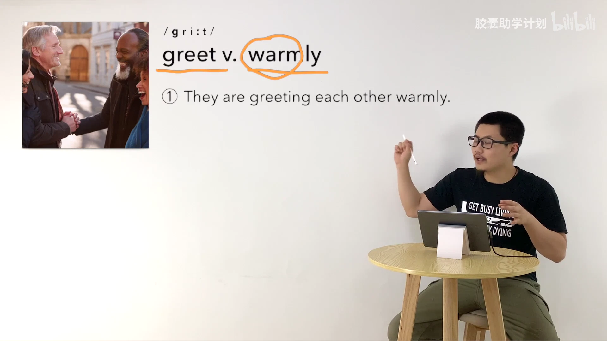

文字识别：Bilbil / 胶囊助学计划 / / gri:t/ / ly / greet v. / warm / D They are greeting each other warmly. / GET BUSY LIVIN / RNA / YDYING

### 画面 00:05:44

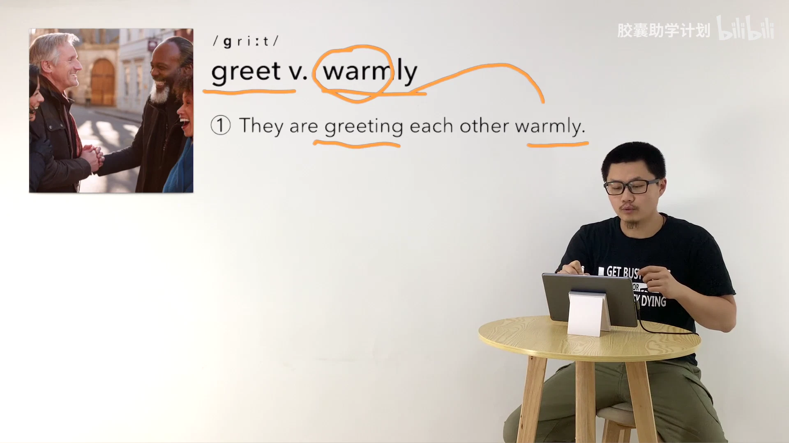

文字识别：bilbili / 胶囊助学计划 / / gri:t/ / greet v. / warm / Iy / ) They are greeting each other warmly. / GET BUS / OR- / KDYING

### 画面 00:05:47

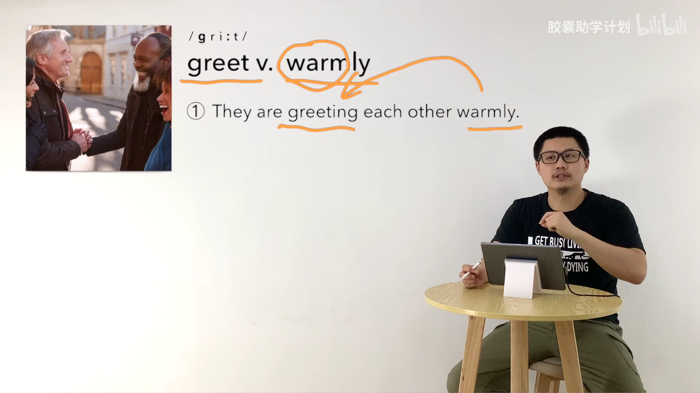

文字识别：bilbli / 胶囊助学计划 / /gri:t/ / greet v. / warm / They are greeting each other warmly. / GET BUSYLIV / YDYING

## 00:06:00–00:06:30

再造一句话叫做He saw me and greeted me warmly.他之前看见我了，然后非常热情的和我打了打招呼，握了握手，甚至来了个拥抱，对吧？啊，greeted me warmly, very good.接下来我们要做的事情是什么呢？就是您张开嘴，我读句子，您跟着读。这里边重点看两个点，第一个点是动词用的几乎全是过去式，第二你要看的是副词，它是

### 画面 00:06:00

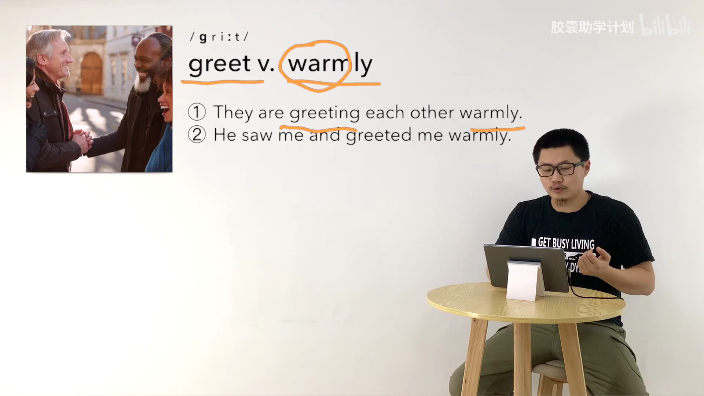

文字识别：胶囊助学计划 / / gri:t/ / greet v. / warm / ly / They are greeting each other warmly. / He / saw / me and greeted me warmiy. / GET BUSY LIVING

### 画面 00:06:04

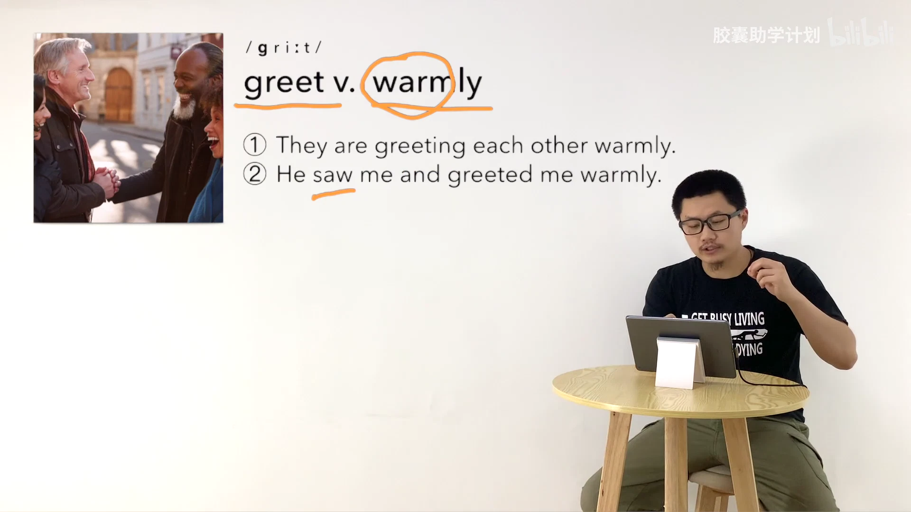

文字识别：胶囊助学计划 / /gri:t/ / greet v. / warm / ly / They are greeting each other warmly. / He saw me and greeted me warmly. / - GET DIICY LIVING / DVING

### 画面 00:06:07

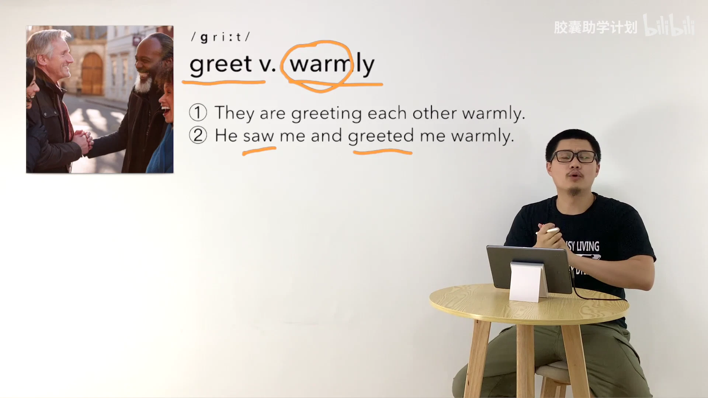

文字识别：胶囊助学计划 / /gri:t/ / ly / greet v. / warm / They are greeting each other warmly. / He saw me and greeted me warmly. / SY LIVING

### 画面 00:06:13

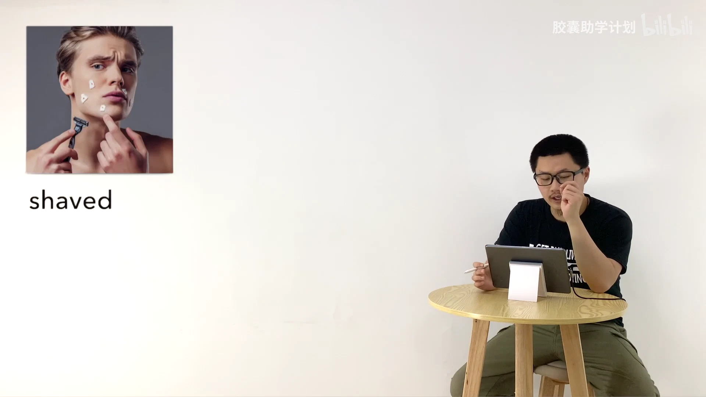

文字识别：胶囊助学计划 / shaved / TIN

### 画面 00:06:29

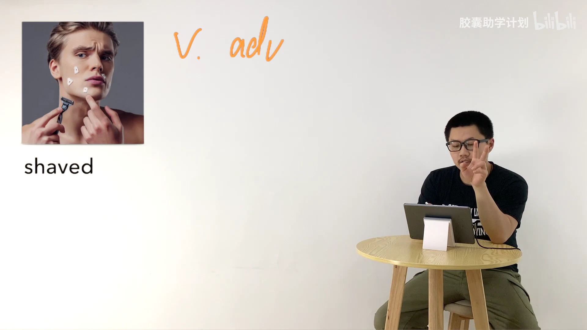

文字识别：胶囊助学计划bl出 / V / adv / shaved

## 00:06:30–00:07:00

在这个句子当中如何修饰动词的。来了，我读，您跟我读。Why did he cut himself this morning? Because he shaved hurriedly. What did he take? He took a cake. Took a cake. What did he do with it? He ate it quickly.好，赶

### 画面 00:06:34

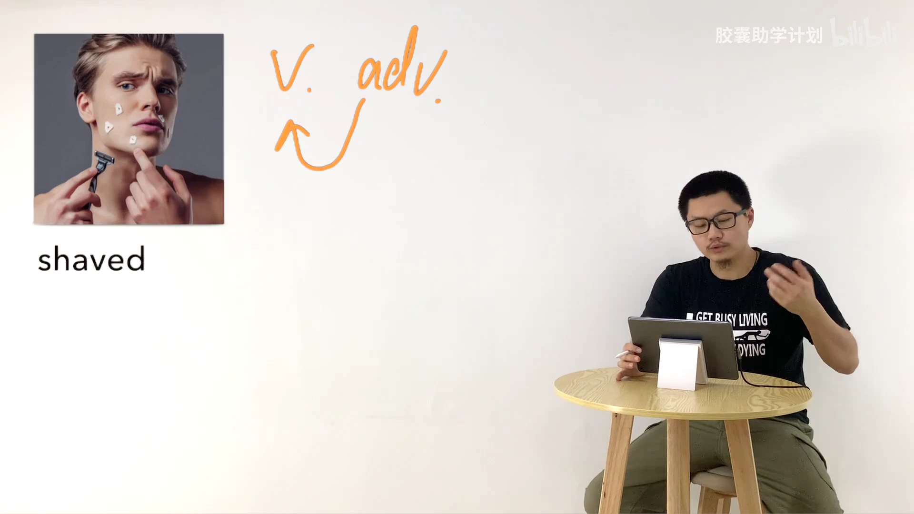

文字识别：adlv. / 胶囊助学计划 / V. / shaved / GET RIISY LIVING / PYING

### 画面 00:06:41

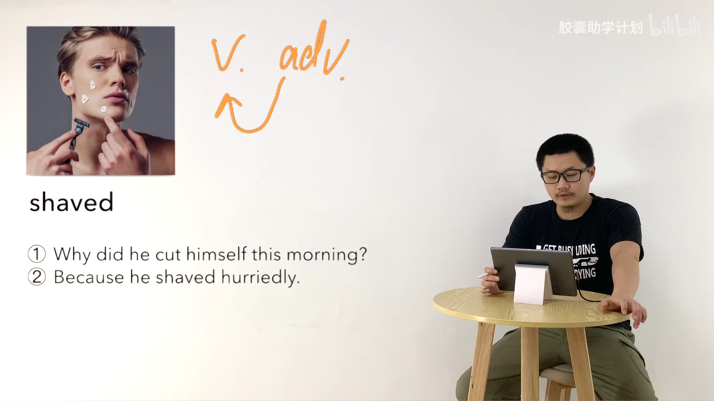

文字识别：adlv. / 胶囊助学计划 / V / shaved / Why did he cut himself this morning? / GET DLLY LVING / Because he shaved hurriedly. / AYING

### 画面 00:06:46

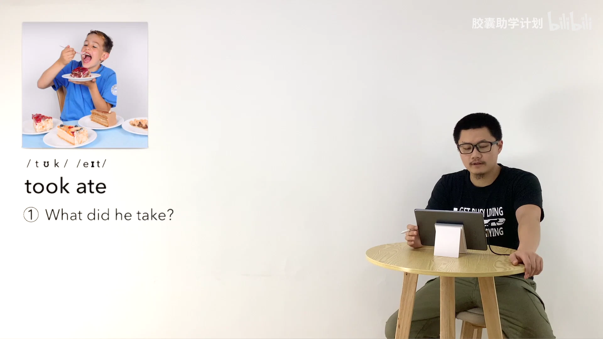

文字识别：胶囊助学计划 / /tuk/ /eit/ / took ate / What did he take? /  CET HY LING / AYING

### 画面 00:06:59

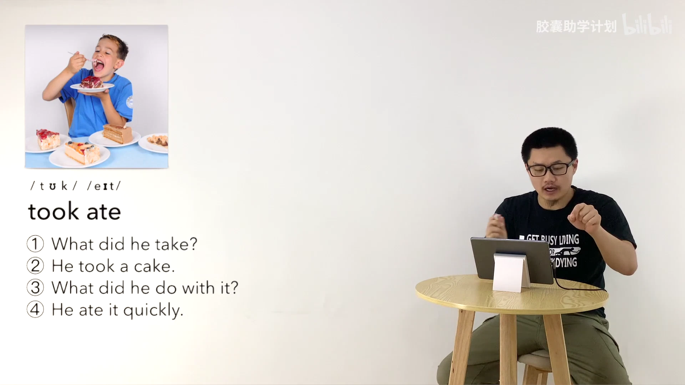

文字识别：胶囊助学计划 / /tuk/ /eit/ / took ate / What did he take? / GET RISY LVING / He took a cake. / DYING / What did he do with it? / He ate it quickly.

## 00:07:00–00:07:30

紧拿出你的笔记本。Eat,过去式，啊，eat原形，这个是它的过去式啊。迅速的给吃掉。Continue. What did you give him?你给他什么了？I gave, gave him a glass of water.赶紧拿出本儿记下来。他give是原形，gave是过去式。What did he do with it?

### 画面 00:07:03

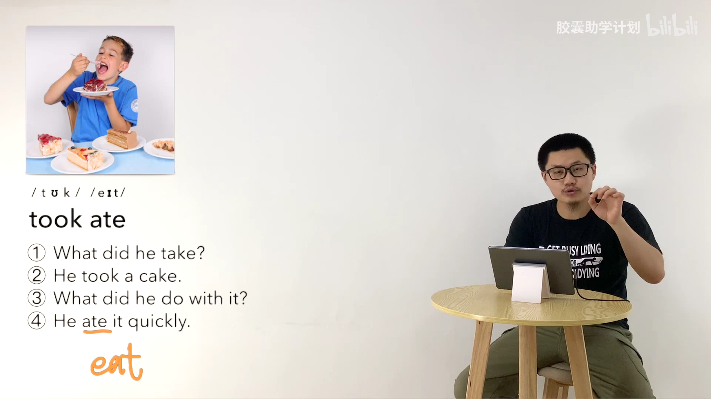

文字识别：胶囊助学计划 / /tuk/ /eit/ / took ate / What did he take? / -ART PUSY LING / ORA / He took a cake. / MIDYING / What did he do with it? / He ate it quickly. / eat

### 画面 00:07:10

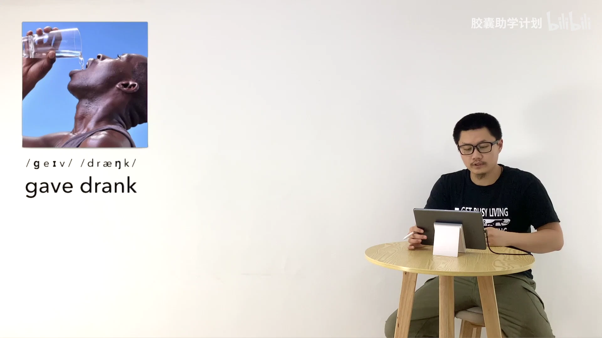

文字识别：胶囊助学计划 / /geiv/ /drænk/ / gave drank / CET PISY LVING

### 画面 00:07:17

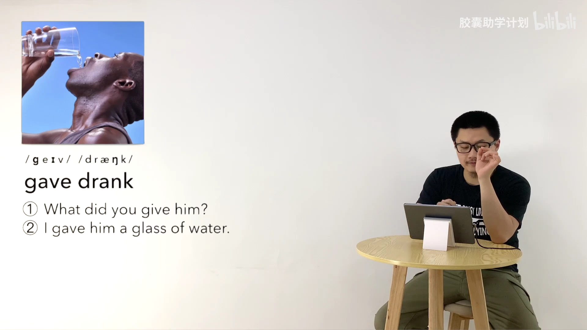

文字识别：胶囊助学计划 / /geiv/ /drenk/ / gave drank / What did you give him? / ② I gave him a glass of water.

## 00:07:30–00:08:00

He drank it thirstily. How drank? 加上图，加上您又认识它的原型，我觉得你能猜出来它是什么意思了。喝，对吧？Drink的过去式，赶紧写旁边。Met, greeted. When did you meet her? I met her. Meet的过去式，the day before yesterday. How did she

### 画面 00:07:37

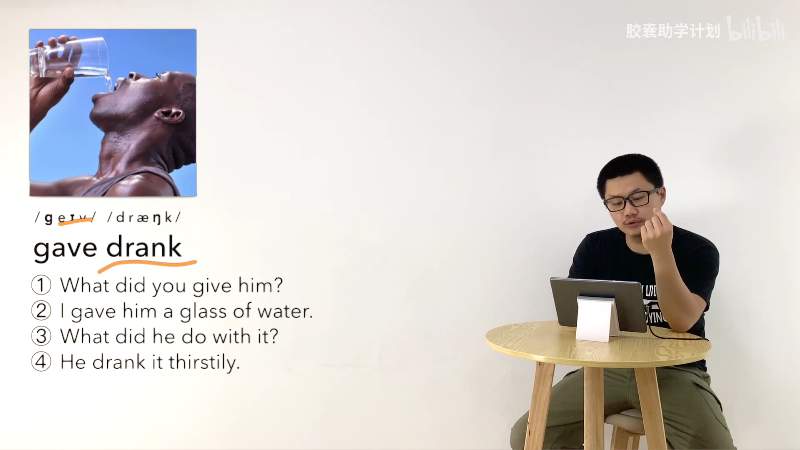

文字识别：胶囊助学计划 / eiv /drænk/ / g / gave drank / What did you give / e him? / 2 / Igave / him a glass of water. / What did he do with it? / He drank it thirstily.

### 画面 00:07:41

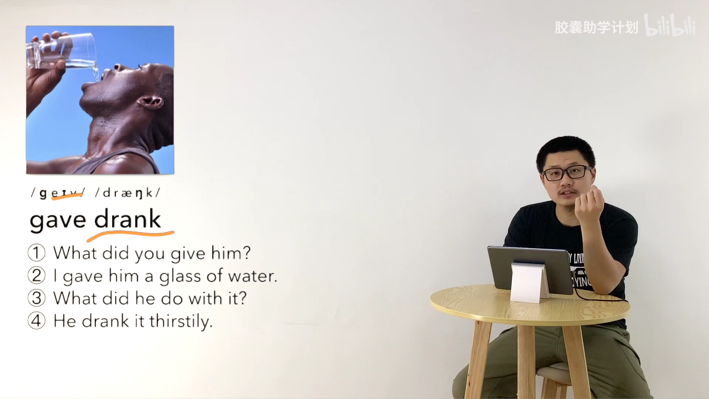

文字识别：胶囊助学计划 / //drenk/ / g / gave drank / What did you give / him? / 2 / Igave / him a glass of water. / What did he do with it? / He drank it thirstily.

### 画面 00:07:44

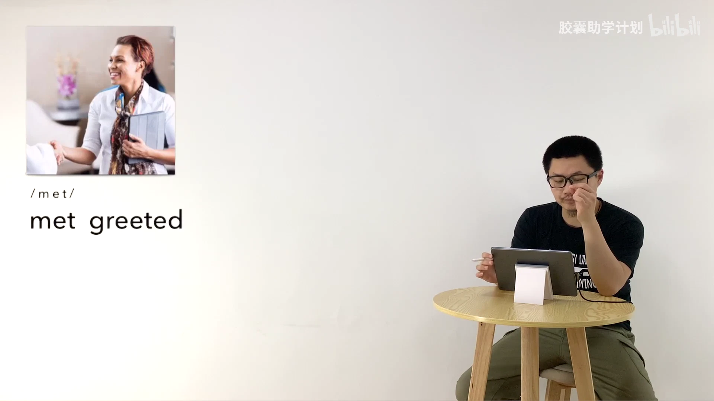

文字识别：Bibil / 胶囊助学计划 / /met/ / met greeted / SYLI

### 画面 00:07:50

文字识别：胶囊助学计划 / /met/ / met greeted / ① When did you meet her? / ② I met her the day before yesterday.

### 画面 00:07:53

文字识别：胶囊助学计划 / Biltbil / /met/ / met / greeted / ① Wher did you meether? / SYU / ② I met her the day before yesterday.

## 00:08:00–00:08:30

greet you? She greeted me warmly. Next one went slowly. Why did you both arrive home late? Because the bus went slowly. Enjoyed. How did you enjoy yourselves last night?就昨晚玩的开心吗你们? We enjoyed ourselves

### 画面 00:08:05

文字识别：bilbii / 胶囊助学计划 / IVIA MASSAVE / went slowly

### 画面 00:08:18

文字识别：胶囊助学计划bl出 / enjoyed

### 画面 00:08:25

文字识别：胶囊助学计划 / enjoyed / ① How did you enjoy yourselves last night? / VTING

## 00:08:30–00:09:00

very much, ah, very happy. Ah, thank you very much. Swim, 配合图再加 swim, 你应该知道是谁的过去式了啊。 How did she swim this afternoon? She swam very well. Okay, recap. 本课各位拿住两个点就够了。第一，我们在不停的给大家讲副词跟动词，副词跟动词，对吧？第二，本课又出

### 画面 00:08:30

文字识别：胶囊助学计划 / 出 / enjoyed /  How did you enjoy yourselves last night? / We enjoyed ourselves very much.

### 画面 00:08:34

文字识别：胶囊助学计划 / / s w ae m / / swam / VIN

### 画面 00:08:43

文字识别：胶囊助学计划 / / s w aæe m/ / swam / ① How did she / this afternoon? / wim / YW / 流

### 画面 00:08:48

文字识别：Bitbil / 胶囊助学计划 / Recap / Patterns / v.+adv. / v.不规则过去式 / Grammar / Words / Expression / YIN

### 画面 00:08:54

文字识别：胶囊助学计划 / Recap / Patterns / v.+adv / v.不规则过去式 / Grammar / Words / ISY UL / Expression

## 00:09:00–00:09:30

现了一些新的动词不规则的过去式，我让各位总结到您自己的笔记本里了。OK，家庭作业，绿皮书七十四课单词，您要去尝试造句啊。然后动词不规则的过去式，您要去总结。我一边上课就让各位一边总结了。最后给自己讲解一遍今天的这个核心知识点。OK，好，那如果大家喜欢我们的课程呢，欢迎大家关注、订阅、一键三连，分享给那些需要的

### 画面 00:09:04

文字识别：bilibili / 胶囊助学计划 / Recap / Patterns / v.+adv / & / v.不规则过去式 / Grammar / Words / LIIN / Expression

### 画面 00:09:06

文字识别：胶囊助学计划

### 画面 00:09:18

文字识别：胶囊助学计划 / 绿皮书第74课的写作练习 / 2.单词造句 / 3.u.过去式（不规则）总结 / 请给自己讲解一遍今天的 / 核心知识点 / CET DIISY LING / PYING

### 画面 00:09:22

文字识别：胶囊助学计划 / 绿皮书第74课的写作练习 / 单词造句 / 3.u过去式（不规则）总结 / 请给自己讲解一遍今天的 / 核心知识点

### 画面 00:09:24

文字识别：胶囊助学计划

## 00:09:30–00:09:57

朋友，来帮助我们成长啊，来支持我们。OK，那最后我们再来看一句名人名言：You can cut all the flowers, but you cannot keep spring from coming. See you next time.

### 画面 00:09:33

文字识别：胶囊助学计划 / You can cut all the flowers but you cannot / keep spring from coming. / -Pablo Neruda

### 画面 00:09:44

文字识别：- CET DUCY LMIN / You can cut all the flowers but you cannot / DYING / keep spring from coming. / Pablo Neruda

### 画面 00:09:46

文字识别：CAPSULEACADEMY / 胶囊助学计划 / 小红书 / Lecturer / Leo / OE

### 画面 00:09:49

文字识别：CAPSULEACADEMY / 胶囊助学计划 / 小红书 / OE

### 画面 00:09:52

文字识别：CAPSULEACADEMY / 胶囊助学计划 / 『 / 小红书 / Creator / □ / Leo & Berlin / OE

### 画面 00:09:54

文字识别：bilbili / 胶囊助学计划 / CAPSULEACADEMY / 胶囊助学计划 / 小红书 / OE

### 画面 00:09:56

文字识别：bilibili / 胶囊助学计划

