# 075 单词 文章

快速机器解析：语音为单模型转写，未进行独立交叉校对或人工复核；画面每秒采样并按变化选帧，短时文字和标记可能遗漏。截图时间约有 1 秒误差。图片有损压缩；遇到疑点请按时间查看 Google Drive 原视频。

## 00:00:00–00:00:30

Hello, everyone. Welcome to Capsule Academy. This is Leo. Today, we're going to learn New Concept English Book One, Lesson Seventy Five, Words and Story. That old habit. Enter formal class. Before, we will look at a few questions. First, how to express three years ago. Second, how to express buy for someone or something. The last question is how to express a pair or a pair. With these three questions, I hope you have enjoyed.

### 画面 00:00:00

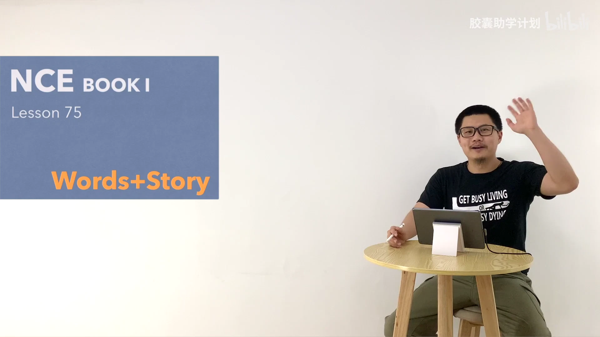

文字识别：胶囊助学计划 / NCE / BOOKI / Lesson 75 / Words+Story / GET BUSY LIVING / SYDYIN'

### 画面 00:00:03

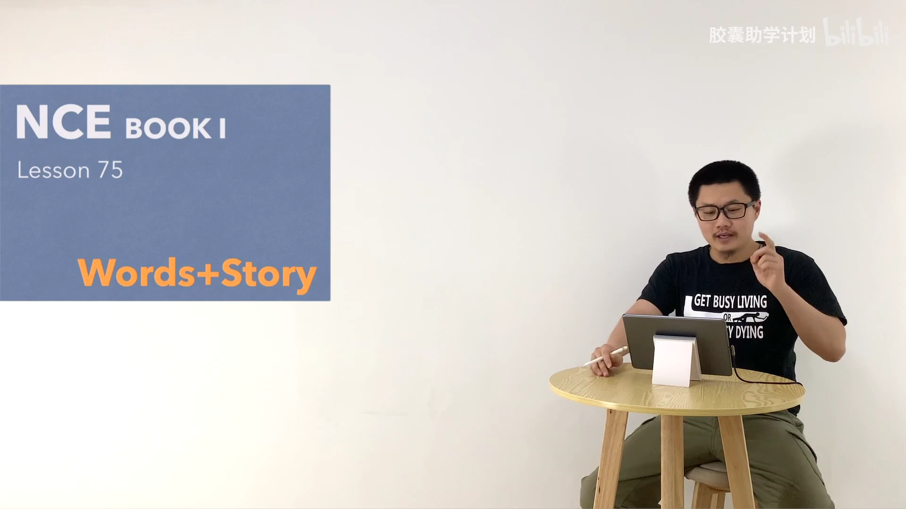

文字识别：胶囊助学计划 / NCE / BOOKI / Lesson 75 / Words+Story / GET BUSY LIVING / ORAL / YDYING

### 画面 00:00:10

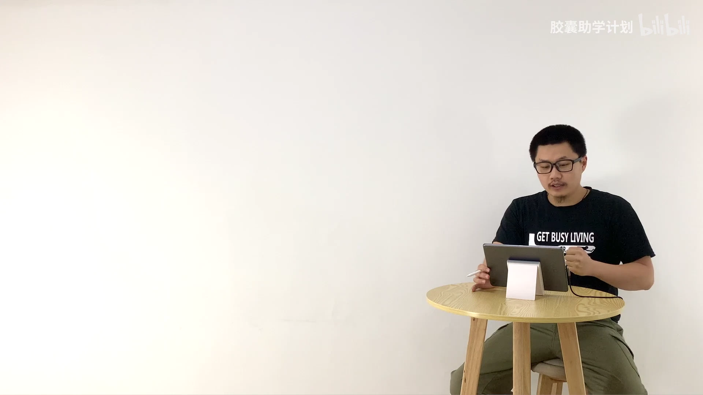

文字识别：胶囊助学计划 / GET BUSY LIVING

### 画面 00:00:12

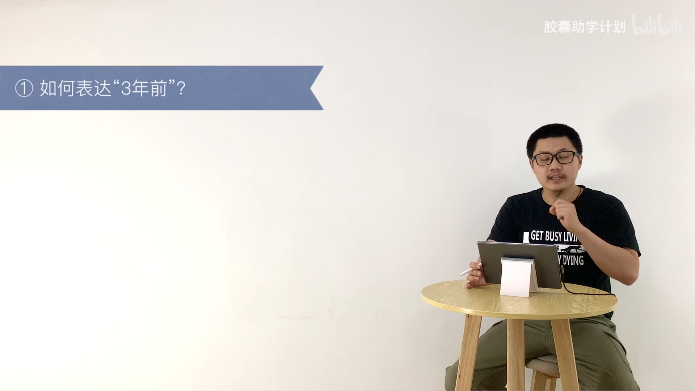

文字识别：胶囊助学计划 / ①如何表达“3年前”？ / GET BUSY LIVA / YDYING

### 画面 00:00:16

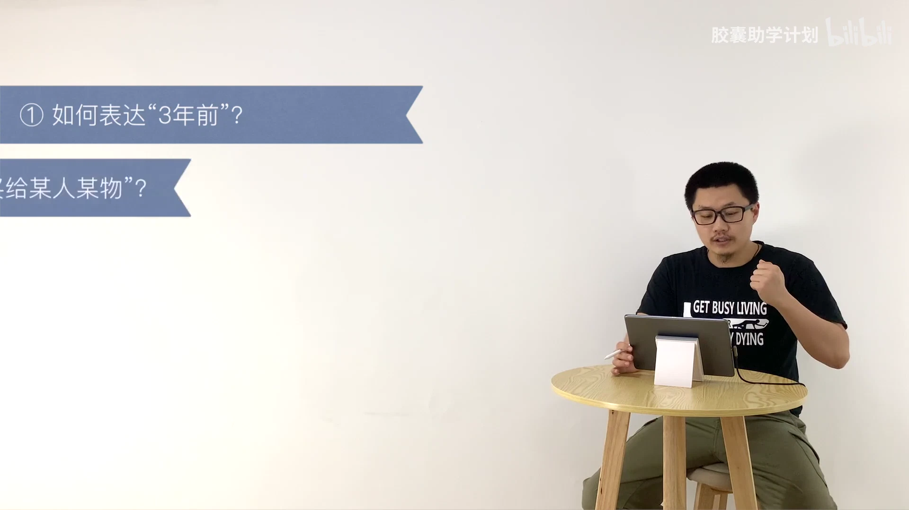

文字识别：胶囊助学计划 / ①如何表达“3年前”？ / 给某人某物 / GET BUSY LIVING / YDYING

### 画面 00:00:18

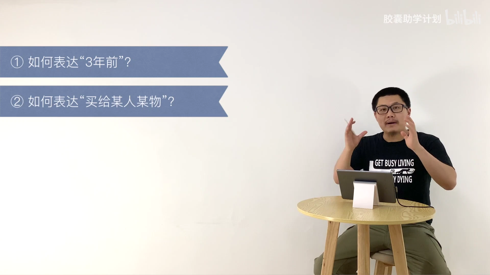

文字识别：胶囊助学计划 / ①如何表达“3年前”? / 如何表达“买给某人某物”? / GET BUSY LIVING / OR / YDYING

### 画面 00:00:21

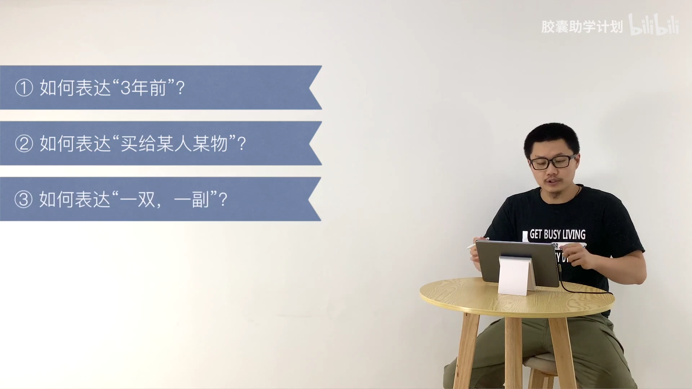

文字识别：胶囊助学计划 / ①如何表达“3年前”? / 如何表达“买给某人某物”? / 如何表达“一双，一副”？ / GET BUSY LIVING

### 画面 00:00:27

文字识别：胶囊助学计划bibil

## 00:00:30–00:01:00

那我们先看第一个小的单词，跟我一起读一下，叫做 ago， ago，叫做多久之前是吧？以前之前，那他们经常这个单词啊，经常和各种时间连用在一起，我都给大家打出来。比如说 n years ago，那 n 大于等于二啊。比如说两年前叫 two years ago，三年前叫 three years ago，对吧？啊，一千年前 one thousand years

### 画面 00:00:31

文字识别：胶囊助学计划

### 画面 00:00:33

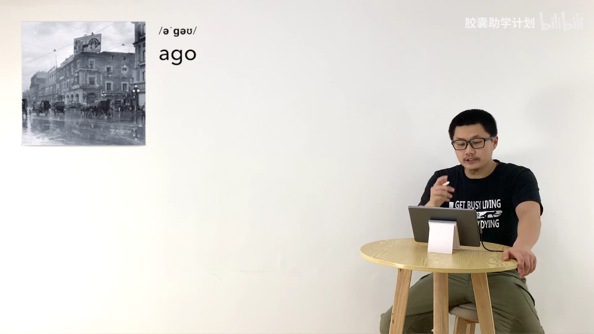

文字识别：胶囊助学计划 / /a'gau/ / ago / GET BUSY LVING / YDYING

### 画面 00:00:43

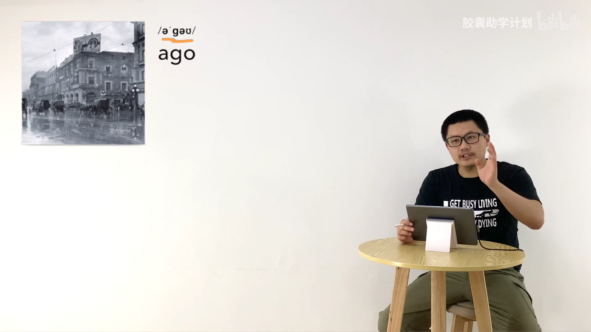

文字识别：胶囊助学计划 / /a'gau/ / ago / GET BUSY LIVING / DYING

### 画面 00:00:51

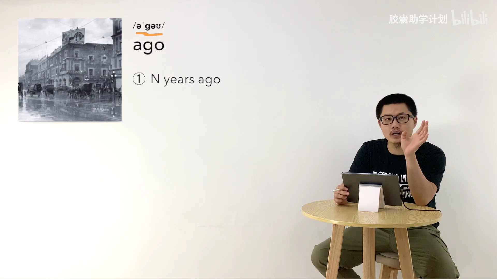

文字识别：胶囊助学计划 / /a'gau/ / ago / ① N years ago

## 00:01:00–00:01:30

ago, very ago,一个月前, one month ago,注意这儿就不加s了，是吧？好，你注意单复数的事儿啊。两个月前就要加s了，two month ago, OK。三天前, three days ago,五个小时前, five hours ago,三分钟前, three minutes ago。给大家补了一个小的单词叫做三十秒前，是吧？秒，second也是第二的意思，thirty seconds ago, very ago。那给大家几个小

### 画面 00:01:01

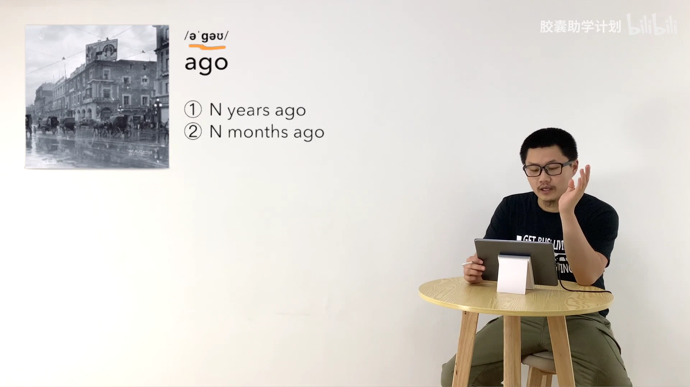

文字识别：胶囊助学计划 / /a'gau/ / ago / ① N years ago / ② N months ago / GET DIICI / LM

### 画面 00:01:18

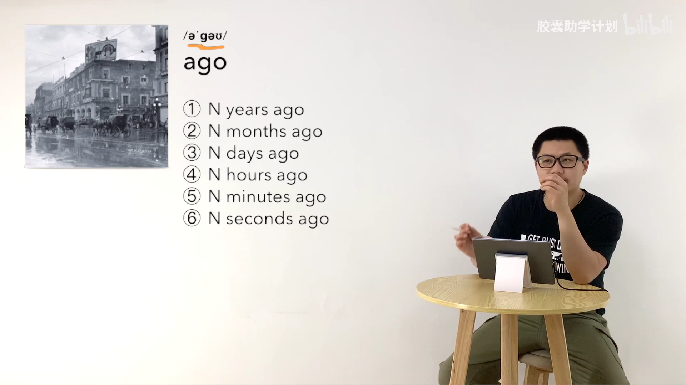

文字识别：胶囊助学计划 / /a'gau/ / ago / ① Nyears ago / 2 / Nmonths ago / Ndays ago / 3 / N hours ago / 4 / 5 / N minutes ago / 6 / N seconds ago

### 画面 00:01:23

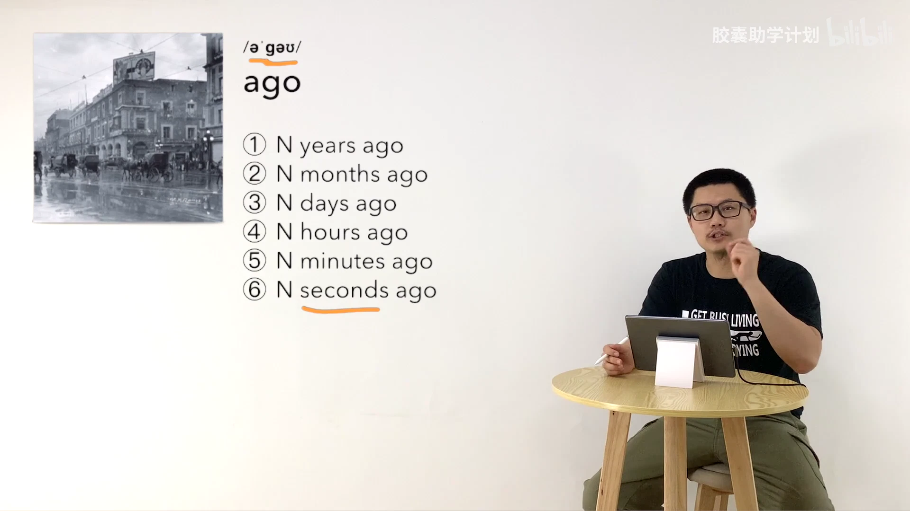

文字识别：胶囊助学计划 / /a'gau/ / ago / ① Nyears ago / 2 / N months ago / 3 / N / days ago / Nhours a / 4 / ago / 5 / Nminutes / ago / N seconds ago / 6 / GET RIISLIVING / SMING

## 00:01:30–00:02:00

的例句，比如说 I met your mom thirty years ago. 好啊，三十年前我遇见的你的母亲啊，这是一个当爹的给自己的孩子说，是吧？三十年前我遇见你的母亲。OK，好，那变一般疑问句，did提前，met换回原形变成meet，对吧？OK，那 I went to Beijing three days ago. 三天前我刚去的北京。一般疑问句，Did you go to Beijing three days ago? When did you go to Beijing?

### 画面 00:01:33

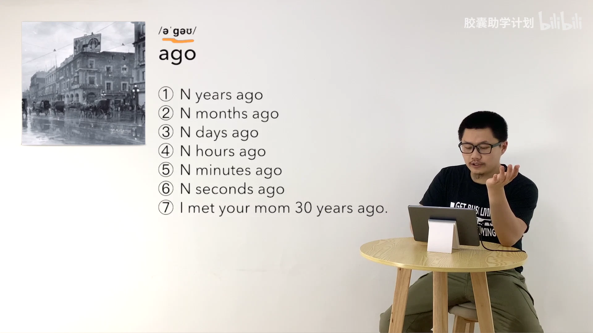

文字识别：胶囊助学计划 / /a'gau/ / ago / ① N years ago / 2 / Nmonths ago / N days ago / 3 / N hours ago / 4 / 5 / N minutes ago / 6 / N seconds ago / ⑦ I met your mom 30 years ago. / GET DISLMI / YING

### 画面 00:01:38

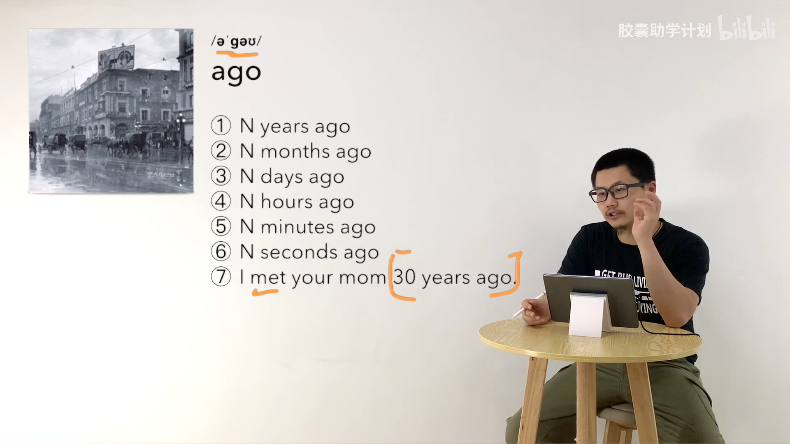

文字识别：胶囊助学计划 / bilbil / /a'gau/ / ago / ① N years ago / ② / N months ago / N days ago / 3 / N hours ago / 5 / N minutes ago / 6 /  N seconds ago / 30 years ago. / ⑦I met your mom / NING

### 画面 00:01:54

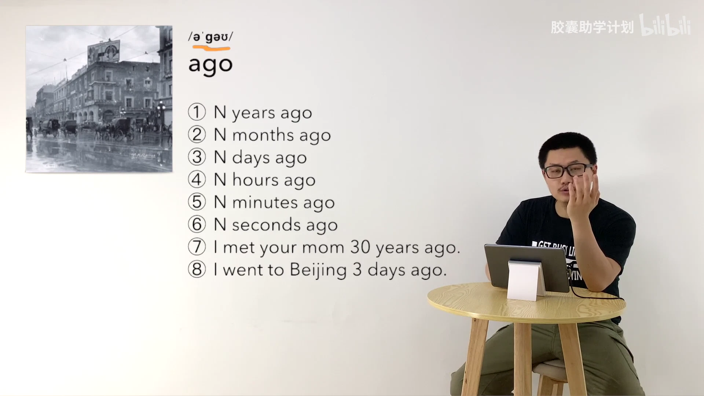

文字识别：bilbli / 胶囊助学计划 / /a'gau/ / ago / ① N years ago / ② / Nmonths ago / 3 / N days ago / N hours ago / 4 / 5 / N minutes ago / 6 / N seconds ago / ⑦ I met your mom 30 years ago. / ⑧ I went to Beijing 3 days ago.

## 00:02:00–00:02:30

Why did you go to Beijing? Three days ago,对吧？各位要练到像我这样，张嘴就来，对吧？看见肯定句，是吧？不打草稿，张嘴就给它弄出来，是吧？Continue，下一个单词跟我读一下，叫做buy。这是上一节课的家庭作业，对吧？如果您做了，您就应该知道了。过去式读一下，叫做bought。OK，给大家补充两个，注意这是两个，但是含义是一样的短语，买

### 画面 00:02:10

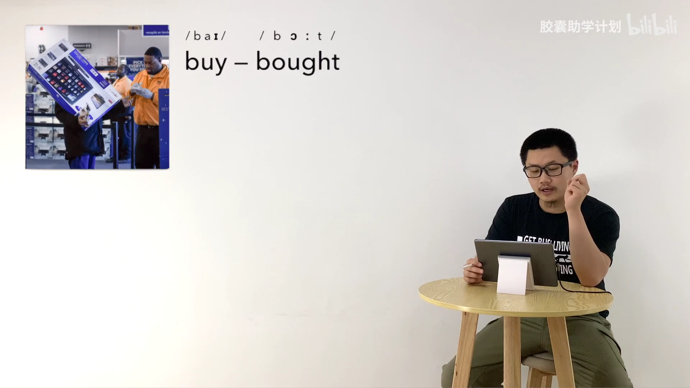

文字识别：胶囊助学计划bilbl / /bai/ / /bo:t / / buy - bought / BES / GET DICI

### 画面 00:02:19

文字识别：胶囊助学计划 / /bai/ / t/ / buy -bought / A- IISY VING / PYING

## 00:02:30–00:03:00

给某人某物，或者是买某物给某人。注意这儿用的介词是 for 而不是 to，对吧？我们造个句子，比如说 My dad bought this TV for us two months ago。我父亲好像不管他 buy something for somebody two months ago。我们刚学，完美的贴进去了，对吧？buy 换成 bought，一般疑问句 did 提前，buy 换回

### 画面 00:02:33

文字识别：胶囊助学计划 / /bai/ / buy-bought / ① buy sb. sth./ buy sth.for sb. / USYLING / K / DYING

### 画面 00:02:36

文字识别：胶囊助学计划 / /bai/ / t/ / buy -bought / ① buy sb. sth./ buy sth forsb. / SY VING / DYING

### 画面 00:02:40

文字识别：胶囊助学计划 / /bai/ / = t / / buy-bought / ① buy sb. sth./ buy sth.for sb. / My dad bought this TV for us 2 / months ago. / GET RISY UING / DYING

### 画面 00:02:44

文字识别：胶囊助学计划b出b出 / /bai/ / i t / / buy-bought / ① buy sb. sth./ buy sth.for sb. / ② My dad bought this TV for us 2 / months ago. / APT PUISY VING / DYING

### 画面 00:02:50

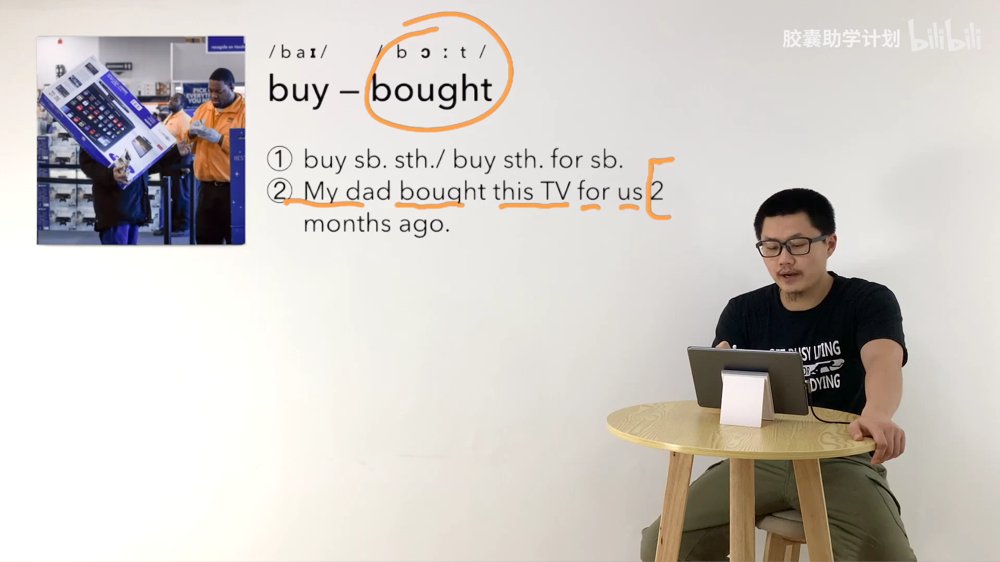

文字识别：bibil / 胶囊助学计划 / /bai/ / = t / / buy-bought / ① buy sb.sth./ buy sth.for sb. / ② My dad bouqht this TV for us / months ago. / SY LING / DYING

### 画面 00:02:53

文字识别：胶囊助学计划 / /bai/ / = t / / buy-bought / ① buy sb. sth./ buy sth.for sb. / ② My dad bouqht this TV for us / months ago.T / GET BUSY LZING / R / YDYING

## 00:03:00–00:03:30

原形， bought 换回原形， buy 对吧？ OK，以及这儿我们用的是 she bought her boyfriend a watch by somebody something 啊，买给某人某物，两个短语出来了。 OK，我都说了，接下来呢，我们看一个小的电影片段，给大家补充一个口语当中非常常用的一句话，叫 buy us more time。那你看这个直译叫

### 画面 00:03:01

文字识别：胶囊助学计划 / /bai/ / : t / / buy-bought / ① buy sb.sth./ buy sth.for sb. / ② My dad bouqht this TV for us / months ago.T / ETDUSY LING / DYING

### 画面 00:03:05

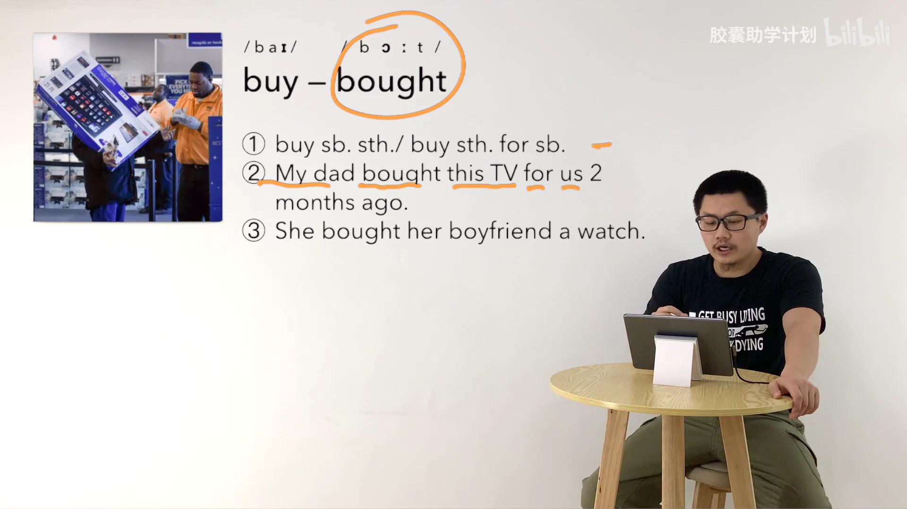

文字识别：胶囊助学计划 / /bai/ / = t / / buy-bought / ① buy sb.sth./ buy sth.for sb. / ② My dad bouqht this TV for us 2 / months ago. / She bought her boyfriend a watch. / GET BUISY LING / KDVING

### 画面 00:03:09

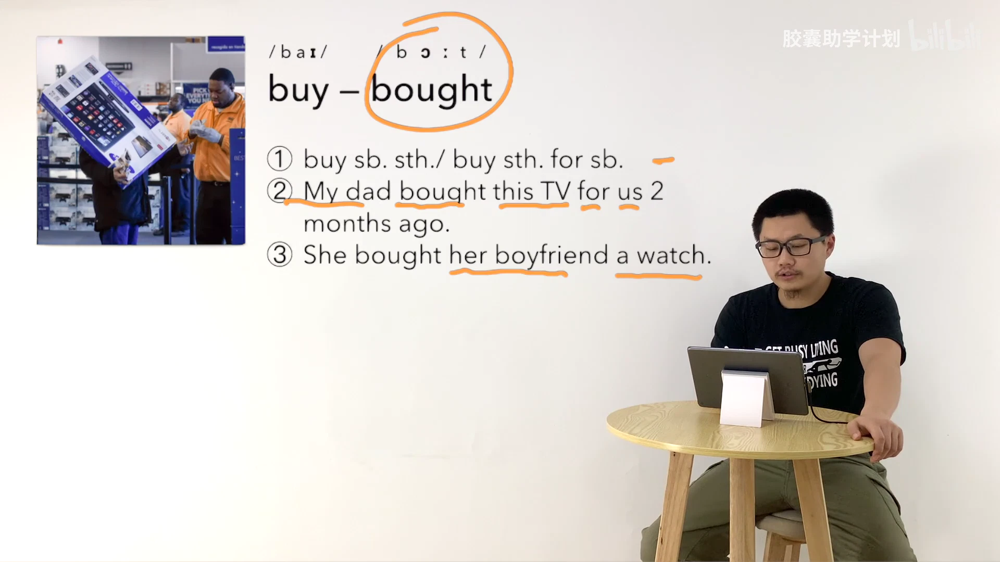

文字识别：胶囊助学计划 / /bai/ / = t / / buy-bought / ① buy sb.sth./ buy sth.for sb. / ② My dad bouqht this TV for us 2 / months ago. / She bought her boyfriend a watch. / A PUIY OING / PVING

### 画面 00:03:11

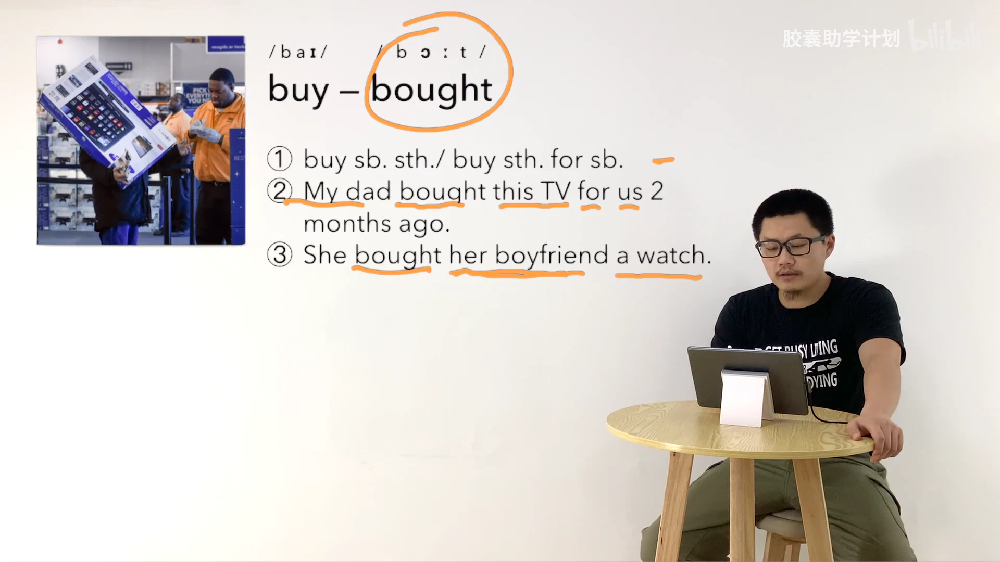

文字识别：胶囊助学计划 / /bai/ / b / = t / / buy-bought / ① buy sb. sth./ buy sth.for sb. / ② My dad bouqht this TV for us 2 / months ago. / She bought her boyfriend a watch. / ARF PISYLVING / PYING

### 画面 00:03:13

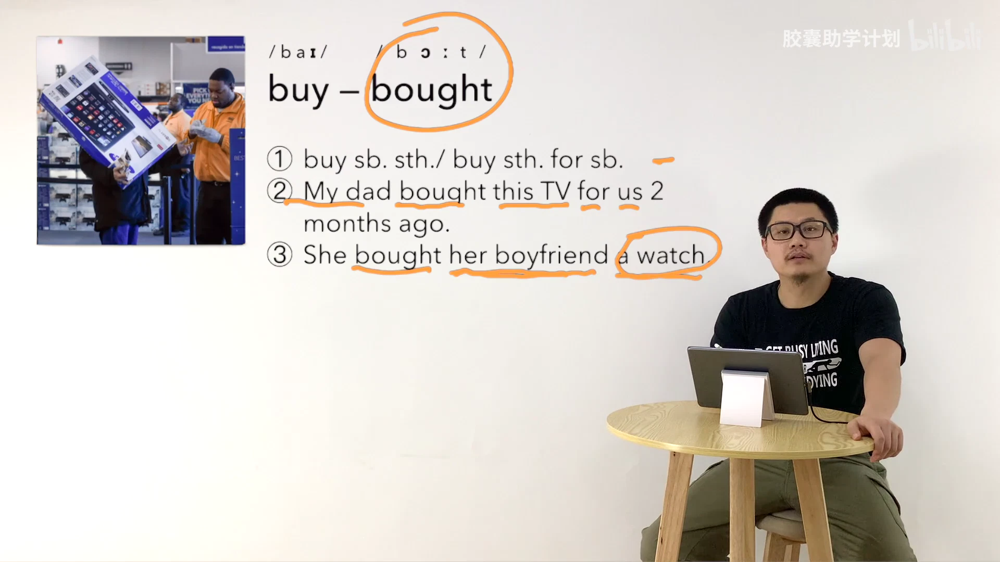

文字识别：胶囊助学计划 / /bai/ / i t / / buy-bought / ① buy sb.sth./ buy sth.for sb. / ② My dad bouqht this TV for us 2 / months ago. / She bought her boyfriend / watch / AR PISY LING / DYING

### 画面 00:03:17

文字识别：LE / N / A / RDO / D / 1 / C / A / P / R / WATANABE GORDON-LEVITT COTLLARD PAGE HARDY MURPHY / BERENGER / 胶囊助学计划 / YOUR MIND IS THE SCENEOF THE CRIME, / buy us more time / ART PISY LOING / DYING / INCEPTIO / 盗梦空间Inception(2010) / OM / THE DIRECTOR / OF THE DARK / EXPERIENCEIT IN THEATERS AND

### 画面 00:03:20

文字识别：LE / N / A / RDO / D / 1 / c / A / P / R / WATANABE GORDONHLEVITT COTLLARD PAGE HARDY MURPHY / BERENGER / 胶囊助学计划 / OUR MIND IS THE SCENE OF THE CRIME. / buy us more time / GET RIISY LING / PYING / INCEPTIO / 盗梦空间 Inception(2010) / ROM / THE / OIRECTOR OF THE DARK / K / EXPERIENCE ITIN THEATERS AND

### 画面 00:03:25

文字识别：LE / N / RDO / D / C / A / P / biibli / 胶囊助学计划 / WATANABE GORDON-LEVITT COTLLARD PAGE HARDY MURPHY / BERENGER / YOUR MIND IS THE SCENE OF THE CRIME. / buy us more time / DYING / INCEPTIO / 盗梦空间Inception(2010) / ROM / THE OIRECTOR / OFTHE DARK / EXPERIENCE ITIN THEATERS AND

## 00:03:30–00:04:00

做给我们买更多的时间，finish是不通的，对吧？这时间我怎么给你买？好，它的意思其实是给我们争取一下更多的时间，buy us more time.尤其在工作当中，你可以说 buy us more time. The deadline is Monday. It's impossible for me to do that to finish all my work before that. Okay, buy us more time, please.啊，给我们争取一些更多的时间吧。Okay,来了. Buy us more time. All

### 画面 00:03:30

文字识别：LE / N / A / R / DO / D / C / A / P / WATANABE GORDONHLEVITT COTLLARD PAGE HARDY MURPHY / BERENGER / 胶囊助学计划 / OUR MIND IS THE SCENE OF THE CRIME. / buy us more time / GET RISY LDING / PYING / INCEPTIO / 盗梦空间 Inception (2010) / ROM / THE OIRECTOR / OF THE DARK / K / EXPERIENCE ITIN THEATERS AND

### 画面 00:03:37

文字识别：LE / N / ARDO / D / 1 / c / A / R / WATANABE GORDON-LEVITT COTLLARD PAGE HARDY MURPHY / BERENGER / 胶囊助学计划 / YOUR MIND IS THE SCENE OF THE CRIME. / buy us more time / GET RLICY LNING / NYING / INCEPTIO / THE OIRECTOR / OF THE DARK / 盗梦空间Inception(2010) / EXPERIENCEITIN THEATERS AND

### 画面 00:03:43

文字识别：LE / N / RDO / D / 1 / c / A / P / WATANABE GORDON-LEVITT COTLLARD PAGE HARDY MURPHY BERENGER / 胶囊助学计划 / YOUR MIND IS THE SCENE OF THE CRIME. / buy us more time / GFT RIISY LIVINU / DYING / INCEPTIO / 盗梦空间Inception(2010) / OM / THE OIRECTOR / OF THE DARK / EXPERIENCE ITIN THEATERS AND

### 画面 00:03:53

文字识别：LE / 0 / N / A / RDO / D / 1 / c / A / R / WATANABE GORDON-LEVITT COTLLARD PAGE HARDY MURPHY BERENGER / 胶囊助学计划 / YOUR MIND IS THE SCENE OF THE CRIME. / buy us more time / GFT RIISY LVING / OYING / INCEPTIO / 盗梦空间Inception (2010) / OM / OIRECTOR / OF THE DARK / EXPERIENCE ITIN THEATERS AND

### 画面 00:03:55

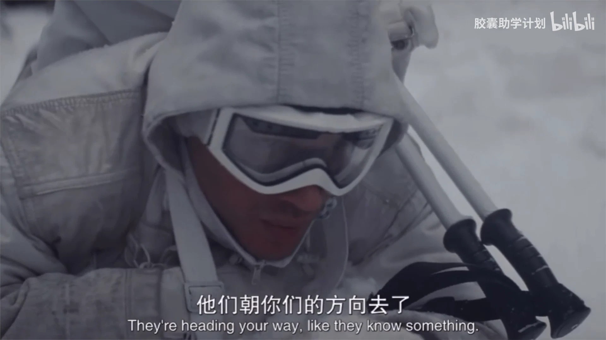

文字识别：bilbili / 胶囊助学计划 / 他们朝你们的方向去了 / They're heading your way, like they know something.

### 画面 00:03:57

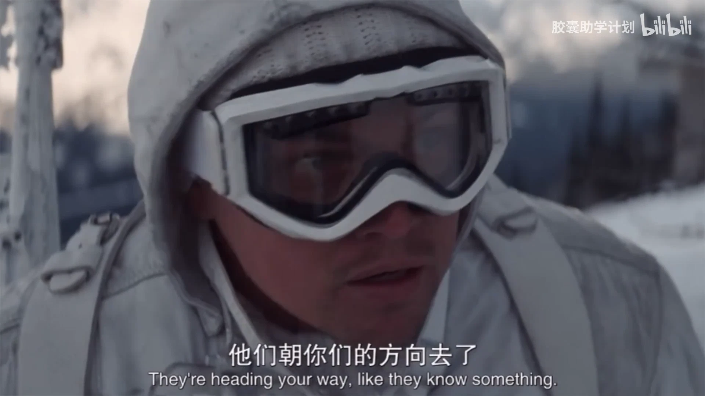

文字识别：bilbili / 胶囊助学计划 / 他们朝你们的方向去了 / They're heading your way, like they know something.

### 画面 00:03:59

文字识别：bilibili / 胶囊助学计划 / 尽量把他们拖住好吗 / Just buy us more time, all right?

## 00:04:00–00:04:30

more time, all right? Come on.好，那他这翻译的是帮我们拖住他啊，其实就是给我们争取更多的时间。OK，好，下一个单词跟我读一下，叫做 pair. pair. 好，它指的就是双的意思。但是呢，它往往是在这个短语当中去表达一双，比如说 a pair of shoes，一双鞋。那怎么表达一副呢？A pair of glasses，那就是一副眼镜，对吧？

### 画面 00:04:01

文字识别：bilibili / 胶囊助学计划 / 快走 / Come on!

### 画面 00:04:03

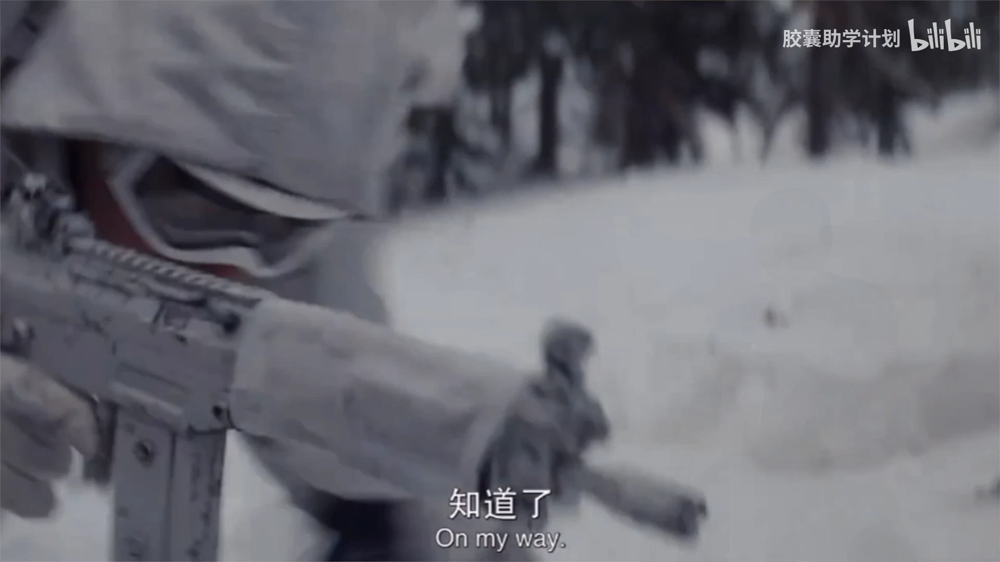

文字识别：Bilibili / 胶囊助学计划 / 知道了 / On my way.

### 画面 00:04:05

文字识别：LE / NARDO / D / A / R / WATANABE GORDON-LEVTT COTLLARD PAGE HARDY MURPHY / BERENGER / 胶囊助学计划 / YOUR MIND IS THE SCENE OF THE CRIME. / buy us more time / GET RLISY LING / AYING / INCEPTIO / 盗梦空间Inception(2010) / ROM / THE OIRECTOR / OFTHE DARK / EXPERIENCE IT IN THEATERS AND

### 画面 00:04:10

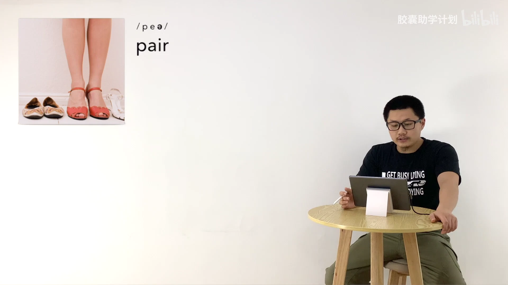

文字识别：胶囊助学计划 / /pea/ / pair / GET BUSY LZING / DYING

### 画面 00:04:19

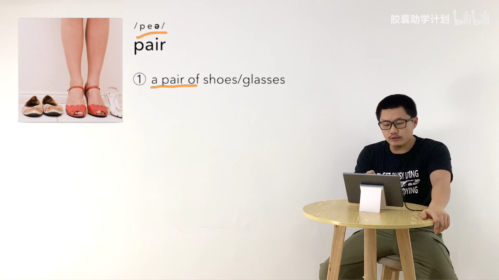

文字识别：胶囊助学计划 / /pea/ / pair / ① a pair of shoes/glasses / AR PISY VING / DYING

### 画面 00:04:28

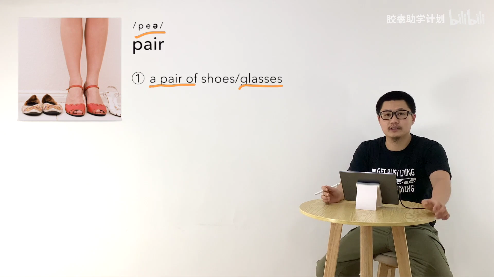

文字识别：胶囊助学计划 / /pea/ / pair / ①a pair of shoes/glasses / GET RIISY LDING / DYING

## 00:04:30–00:05:00

That is a pair of

### 画面 00:04:34

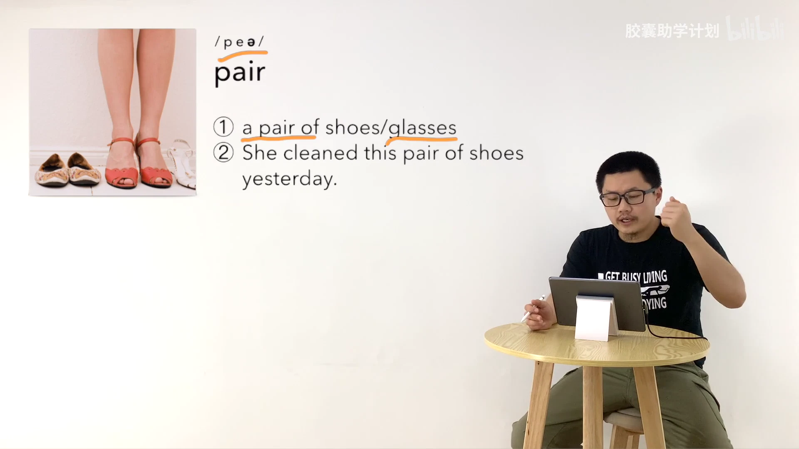

文字识别：胶囊助学计划 / /pea/ / pair / a pair of shoes/glasses / 1 / She cleaned this pair of shoes / yesterday. / GET RIISY LVING / AYING

### 画面 00:04:40

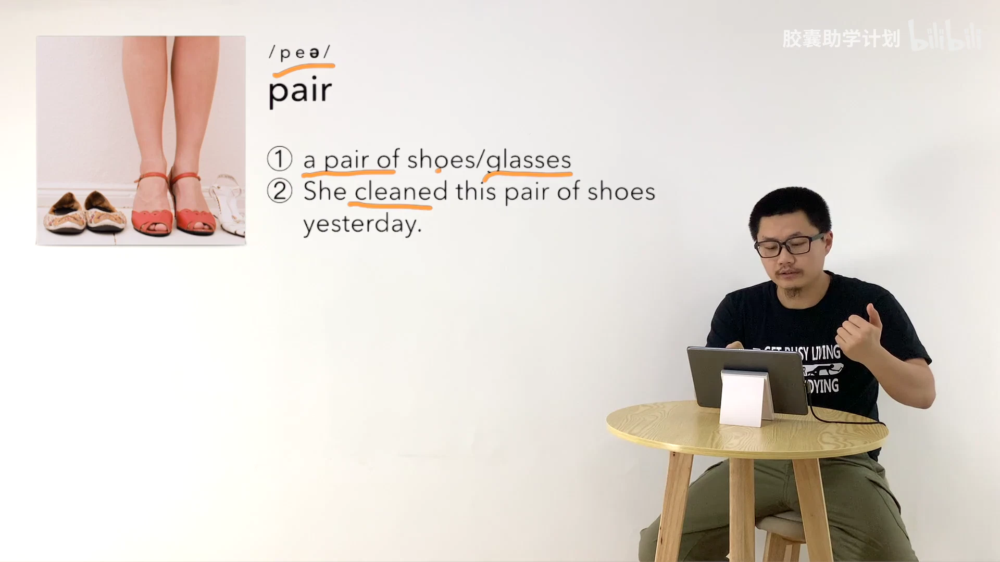

文字识别：胶囊助学计划 / /pea/ / pair / a pair of shoes/glasses / 1 / She cleaned this pair of shoes / yesterday. / DYING

### 画面 00:04:43

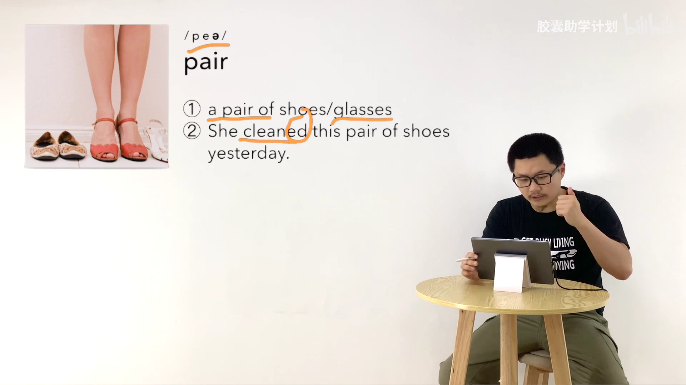

文字识别：胶囊助学计划 / /pea/ / pair / a pair of shces/glasses / 1 / She cleaned this pair of shoes / yesterday. / LIVING / DYING

### 画面 00:04:45

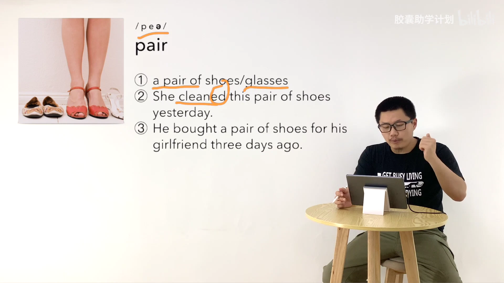

文字识别：胶囊助学计划 / /pea/ / pair / ① / a pair of shces/glasses / She cleaned this pair of shoes / yesterday. / He bought a pair of shoes for his / girlfriend three days ago. / GET BIICY LIVING / JYING

### 画面 00:04:48

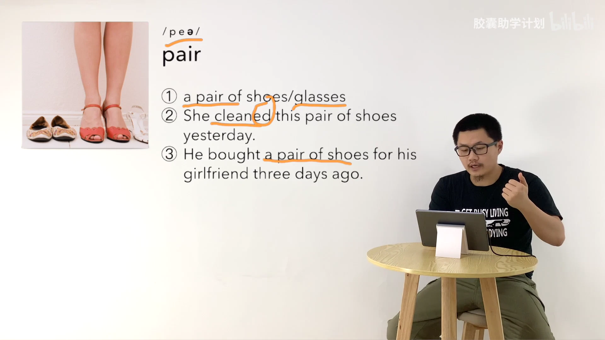

文字识别：胶囊助学计划 / /pea/ / pair / ① / a pair of shces/glasses / She cleaned this pair of shoes / yesterday. / He bought a pair of shoes for his / girlfriend t / I three days ago. / -CRT PSYLVING / DYING

### 画面 00:04:50

文字识别：胶囊助学计划 / /pea/ / pair / ① / a pair of shces/glasses / She cleaned this pair of shoes / yesterday. / He / bought / a pair of shoes / fon / his / girlfriend / three / days / ago. / RT RHISY LVING / 'DYING

## 00:05:00–00:05:30

shoes for his girlfriend three days ago? Okay,非常好啊，好。接下来下一个小的单词啊，fashion是吧？这个前几年还变成网络用，网络红词是吧？fashion是吧？不知道各位记不记得啊？别那么读是吧？来，fashion, fashion. Okay,叫做时尚啊。那我说这个东西很时尚，就是in fashion.比如说，this is in fashion啊，这个东西还挺时尚的。那out of fashion呢，就是不

### 画面 00:05:04

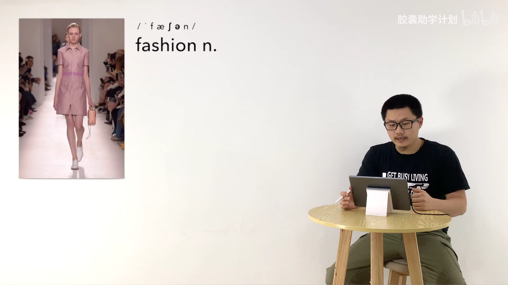

文字识别：胶囊助学计划 / / ' f æ ∫an / / fashion n. / GFT RIISY LIVING

### 画面 00:05:07

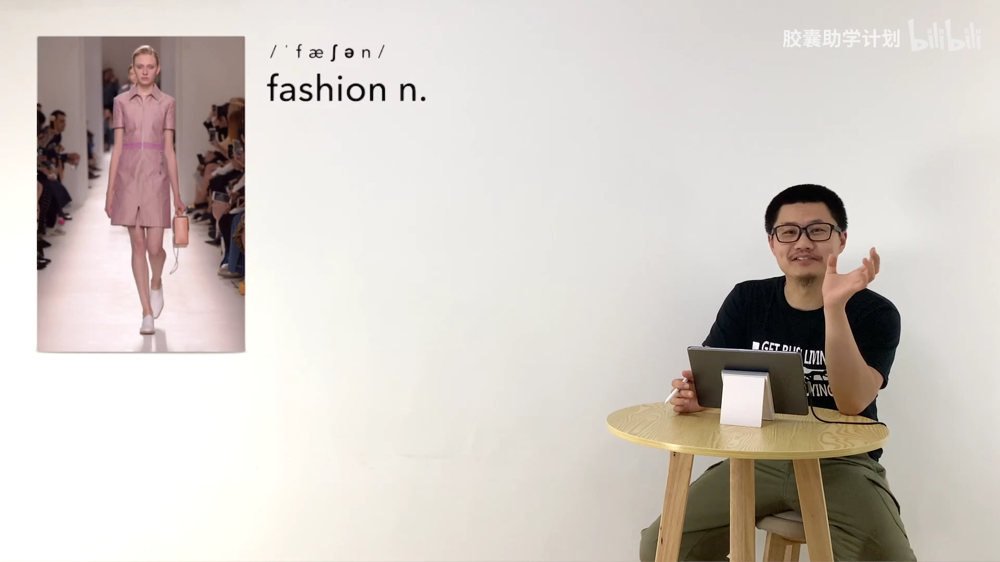

文字识别：胶囊助学计划 / / ' f æ ∫an / / fashion n. / LIVIN

## 00:05:30–00:06:00

流行了，不时尚了啊。那叫做 Is this out of fashion? 说这个东西不流行了，已经了，已经不再时尚了吗？ Okay, very good. Continue. 下一个单词，下一个单词啊，各位先把 U N 这两个字母给它扔掉，我们先不管它，只看后面叫做 Comfortable，连起来 Comfortable, Comfortable, Comfortable，连起来 Comfortable. Okay, Comfortable,

### 画面 00:05:32

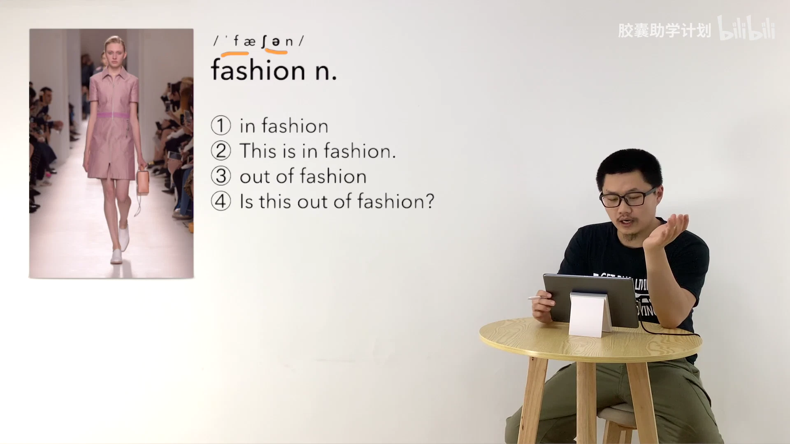

文字识别：胶囊助学计划bilbl / / ' fæ ∫an / / fashion n. / ① in fashion / This is in fashion. / out of fashion / ) Is this out of fashion?

### 画面 00:05:40

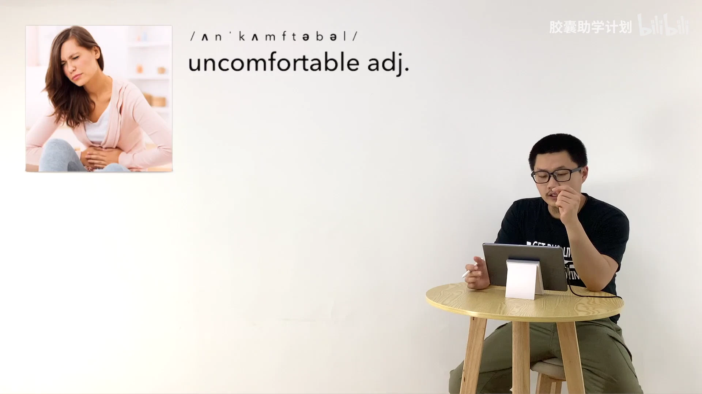

文字识别：胶囊助学计划 / /Λn'kamftabal/ / uncomfortable adj.

### 画面 00:05:49

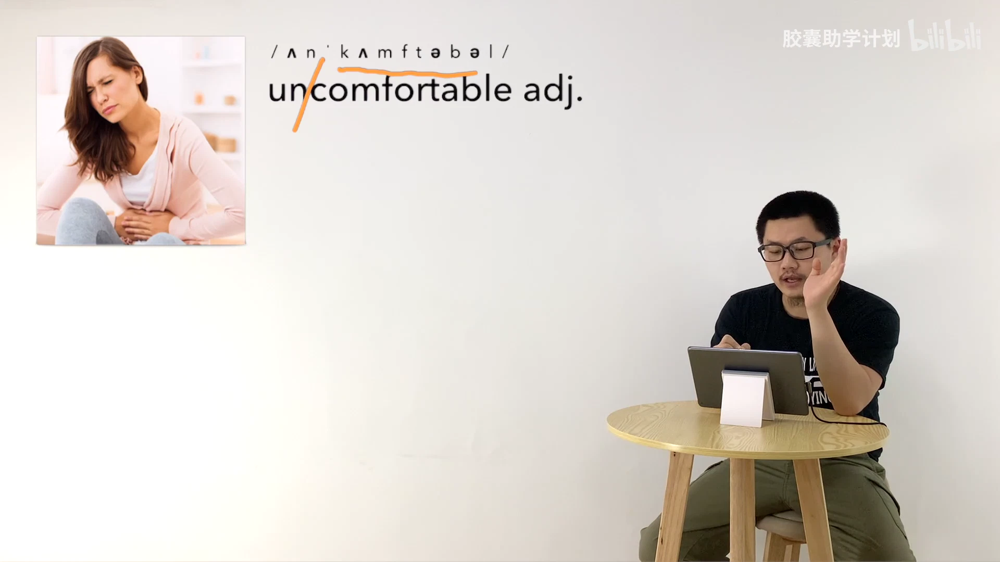

文字识别：胶囊助学计划 / /Λn,kamftabal/ / uncomtortable adj.

## 00:06:00–00:06:30

舒服得劲儿啊，comfortable，不舒服难受，uncomfortable。如果您还记得这个单词叫untidy，三十九课咱们学的，二十九课咱们学的，你应该就有印象，untidy的意思叫不整洁的。那tidy就是整洁的，所以un这个东西啊，啊，以后我们会慢慢提到，尤其到新二的时候，英文当中也有一些跟我们汉语

### 画面 00:06:17

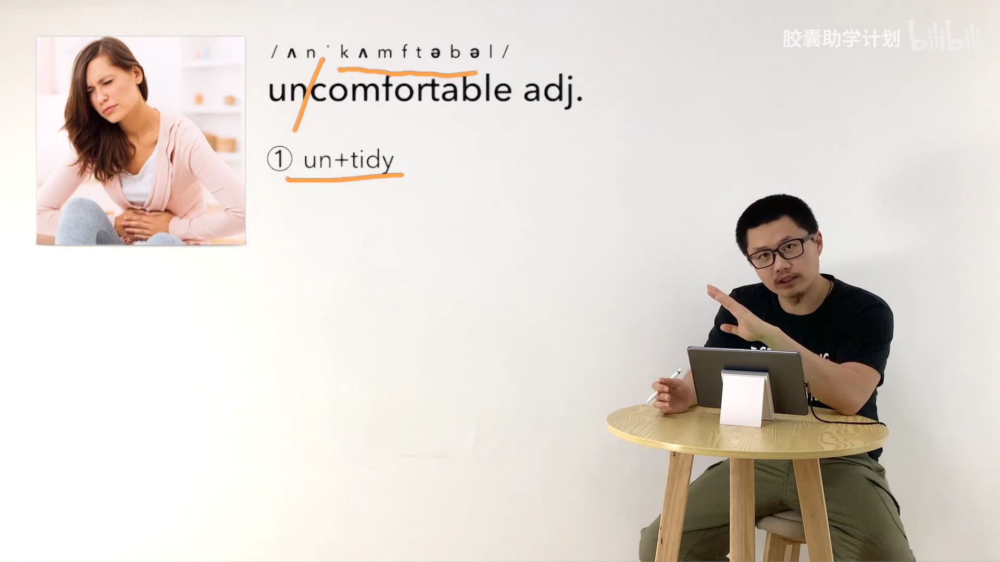

文字识别：胶囊助学计划 / /Λn.kamftabal/ / uncomtortable adj. / ① un+tidy

### 画面 00:06:23

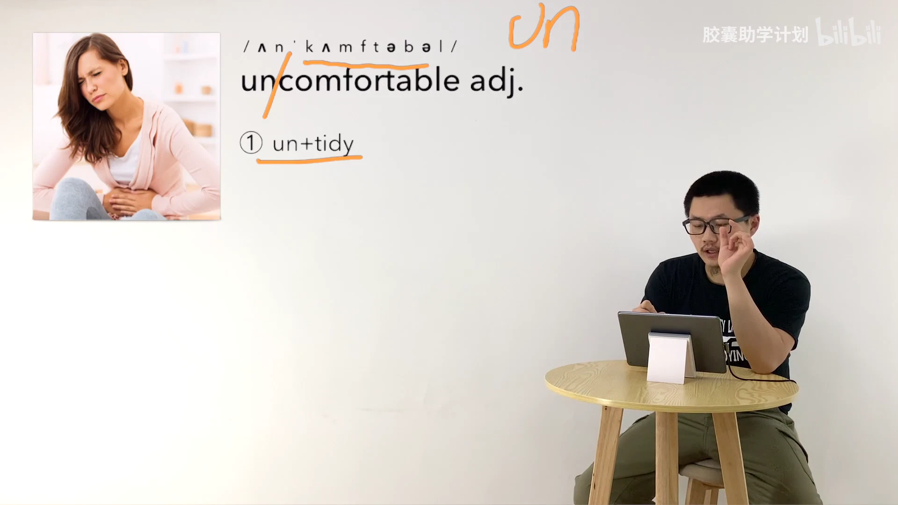

文字识别：on / 胶囊助学计划 / /Λn.kΛmftabal/ / uncomtortable adj. / ① un+tidy

### 画面 00:06:29

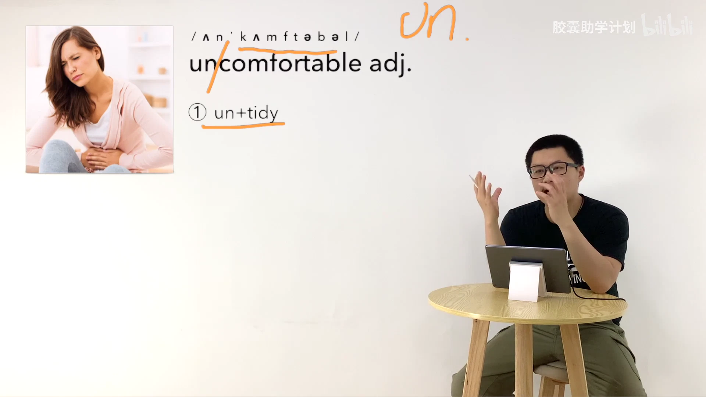

文字识别：un / 胶囊助学计划 / /Λn.kΛmftabal/ / uncomtortable adj. / ① un+tidy

## 00:06:30–00:07:00

类似的，类似于我们汉语偏旁部首的东西，你只是说类似啊，叫前缀后缀啊，包括这个able，对吧？它是有一些固定含义的，比如说un这两个字母放在形容词前面的时候，往往指的是不啊否定，比如说happy开心，unhappy不开心。OK，好，那我们造一些句子吧。uncomfortable叫不舒服，那我们就可以说，she feels

### 画面 00:06:55

文字识别：un / 胶囊助学计划 / /Λn,kamftabal/ / uncomtortable adj. / ① un+tidy / She feels uncomfortable. / GET DIEV VING / YING

## 00:07:00–00:07:30

uncomfortable. 她感觉不太舒服。这句话我们想变一般疑问句，把谁提前？Does提前，对吧？Does she feel uncomfortable? Okay, there you go. 哎，我还给大家写了，是吧？好，那 we must call the doctor. 我们必须要给医生打个电话。啊，梦回六十一六六十二课，对吧？Okay, 下一个单词跟我读一下，叫做 where, where. 注意它的意思有两个，叫穿

### 画面 00:07:02

文字识别：un / 胶囊助学计划 / /Λn,kΛmftabal/ / uncomtortable adj. / ① un+tidy / She feels uncomfortable. / Y VING / VING

### 画面 00:07:09

文字识别：en / 胶囊助学计划 / /Λn'kΛmftabal/ / uncomtortable adj. / Does / ① un+tidy / )She feels uncomfortable. / TY VING / YING

### 画面 00:07:13

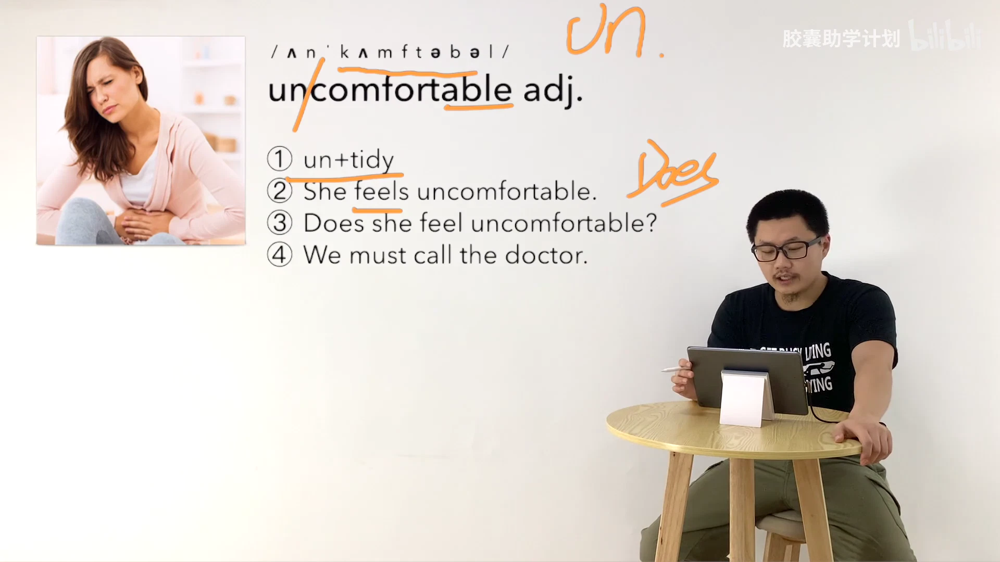

文字识别：un / 胶囊助学计划 / /Λn,kamftabal/ / uncomtortable adj. / Does / ① un+tidy / ② She feels uncomfortable. / Does she feel uncomfortable? / 3 / We must call the doctor. / VING / ING

### 画面 00:07:21

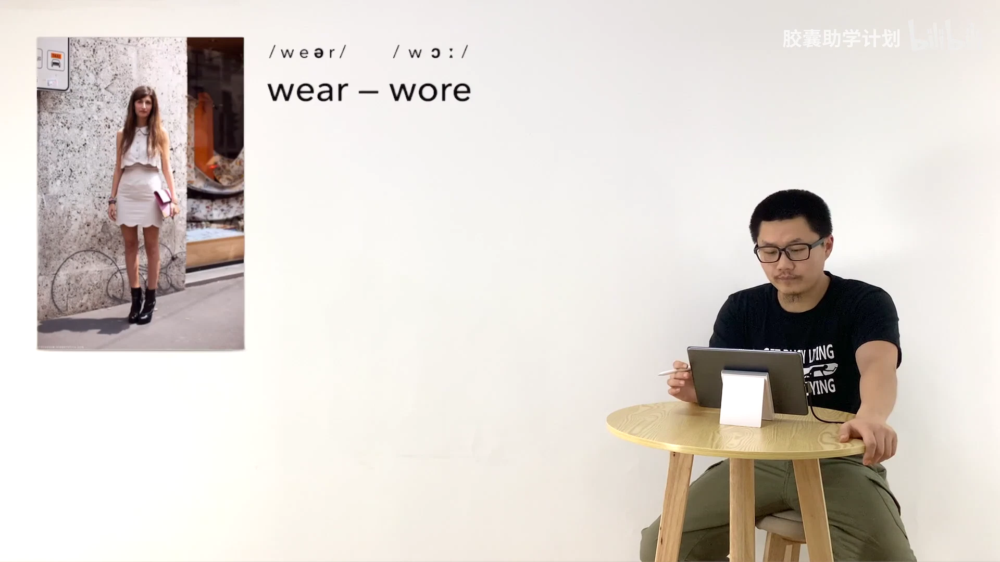

文字识别：胶囊助学计划 / /wear/ / / w 3 : 1 / wear - wore / YVING / NING

### 画面 00:07:23

文字识别：胶囊助学计划 / /wearl / / w 3 : 1 / wear- wore / O / SYIING / AYING

### 画面 00:07:28

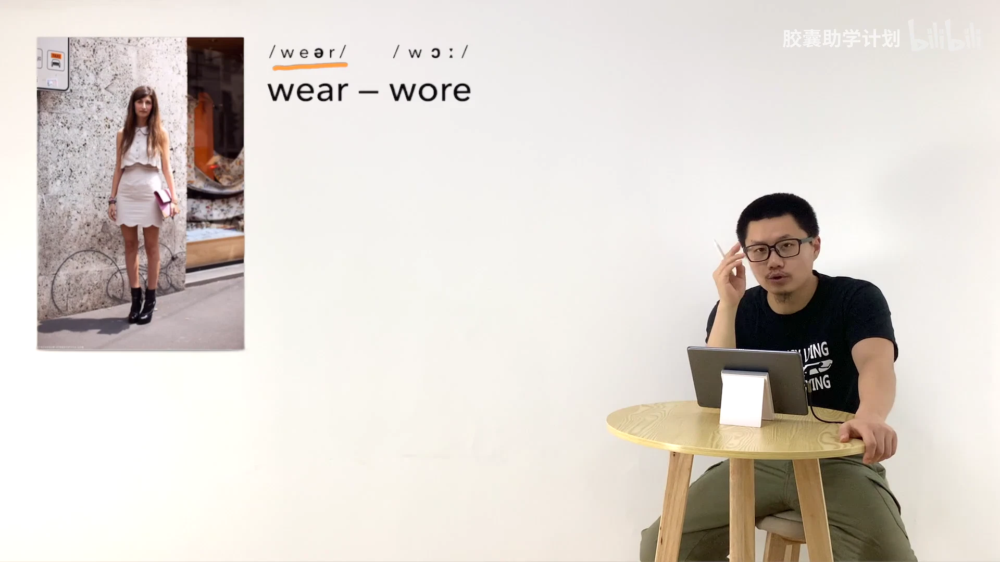

文字识别：胶囊助学计划 / /wear/ / / w J : 1 / wear - wore / VING / ING

## 00:07:30–00:08:00

或戴，是吧？你看袜子是穿还是戴，是吧？手套是穿还是戴？帽子是穿还是戴？不重要，英文当中一个单词 wear 就可以搞定了。OK，好，那过去式呢，读的叫做 wore 啊 wore。OK，好，呃，也是穿戴的意思，没有什么太大区别啊。OK，说 she wears a pair of black shoes，她客观事实，我现在看到说她穿了是一双黑

### 画面 00:07:43

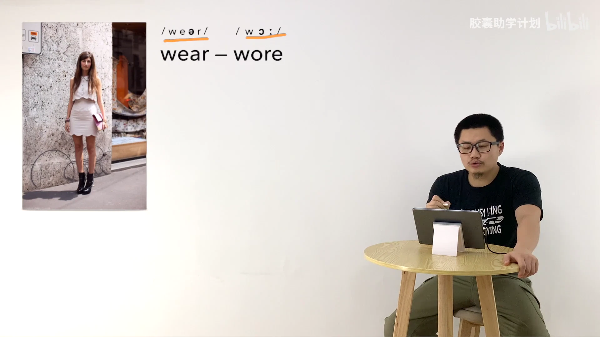

文字识别：胶囊助学计划 / Iwearl / /w 3:1 / wear - wore / HSYVING / DYING

### 画面 00:07:46

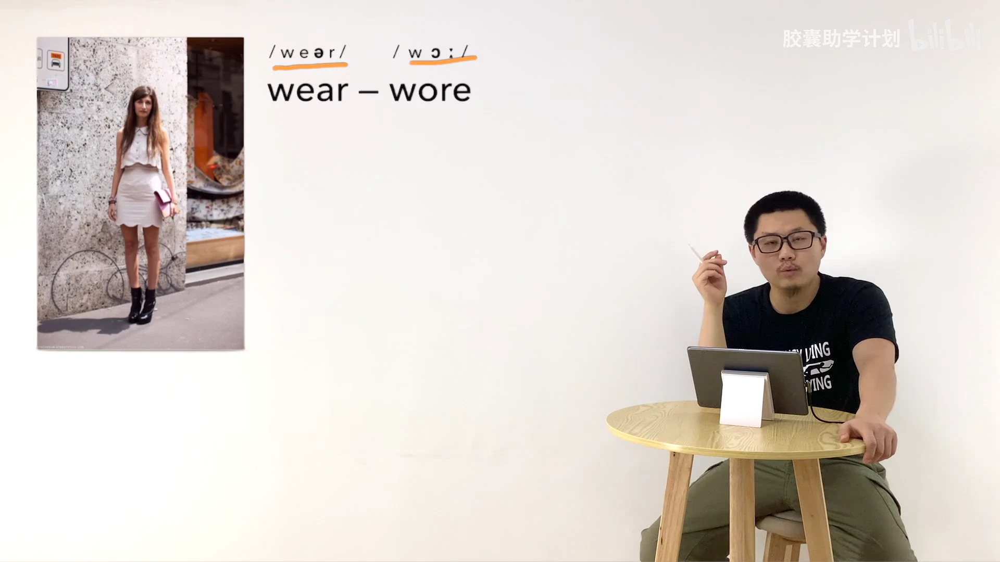

文字识别：胶囊助学计划 / /wear/ / / w 3 :1 / wear - wore / YVING / YING

### 画面 00:07:49

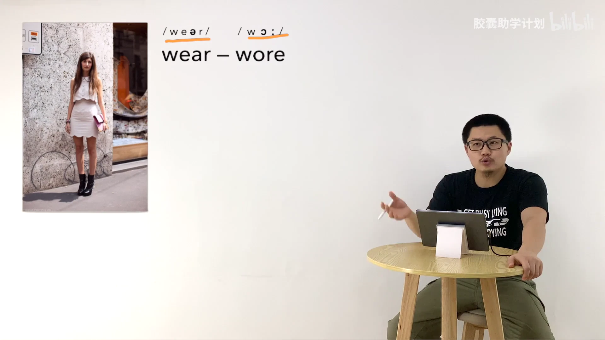

文字识别：胶囊助学计划 / /wearl / /w o:1 / wear - wore / CP USY ING / DYING

### 画面 00:07:58

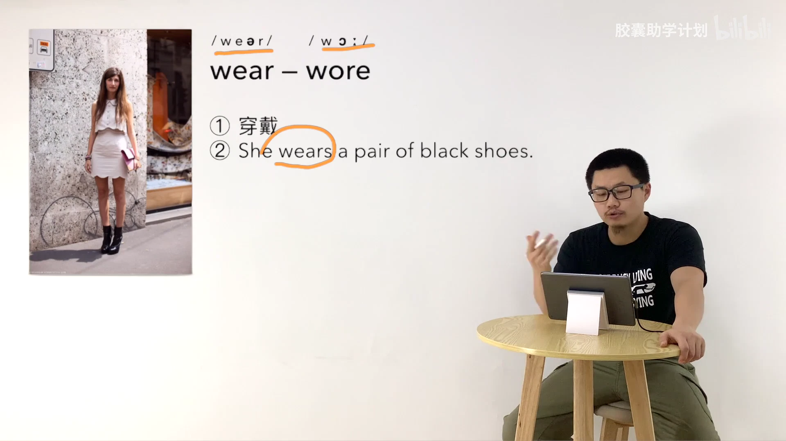

文字识别：胶囊助学计划 / /wearl / /w o:1 / wear - wore / ① 穿戴 / ② She wears / a pair of black shoes. / VING / ING

## 00:08:00–00:08:30

色的鞋，那昨天呢，他穿的是一个白色的裙子啊。说 she wore a white dress yesterday. Okay, 那如果说他戴着一个黑框的眼镜呢，您想一下这句话应该怎么去说啊？包括我提一个小的问题，就是我们在学语言的过程当中，大多数情况下，注意我们是学习语言，不是研究语言。区别是我们大多数情况下，如果学习语言，不问

### 画面 00:08:00

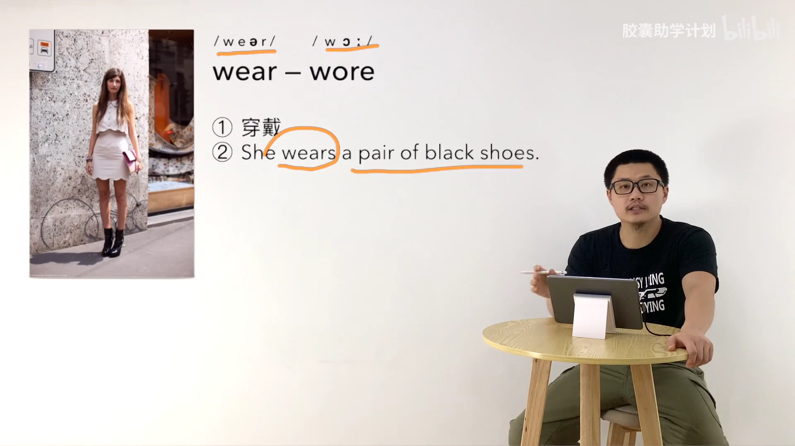

文字识别：胶囊助学计划 / /wearl / /w 3:/ / wear - wore / ① 穿戴 / ② She wears / a pair of black shoes. / SYLING / IYING

### 画面 00:08:04

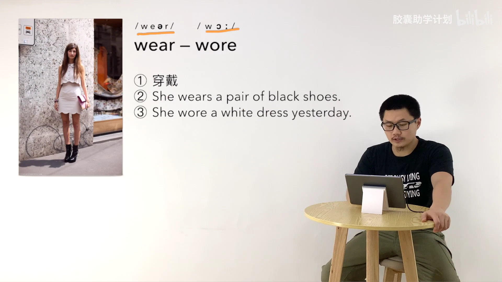

文字识别：胶囊助学计划 / /wear/ / /w 3:1 / wear - wore / 穿戴 / ② / She wears a pair of black shoes. / She wore a white dress yesterday. / SYVING / YING

### 画面 00:08:09

文字识别：胶囊助学计划 / /wear/ / / w o:1 / wear - wore / 穿戴 / 2 / She wears a pair of black shoes. / She wore a white dress yesterday / GET DUSY VING / RIYING

### 画面 00:08:12

文字识别：胶嚢助学计划 / /wear/ / /w 3:1 / wear - wore / 穿戴 / 1 / 2 / She wears a pair of black shoes. / She wore a white dress yesterday / GET DIIEV LVING / AVING

### 画面 00:08:15

文字识别：胶囊助学计划 / /wear/ / /w3:1 / wear - wore / 穿戴 / 1 / 2 / She wears a pair of black shoes. / She wore a white dress yesterday

### 画面 00:08:20

文字识别：胶囊助学计划 / /wear/ / /w3:1 / wear - wore / 穿戴 / 2 / She wears a pair of black shoes. / She wore a white dress yesterday

### 画面 00:08:27

文字识别：胶囊助学计划 / W / /wearl / /wo:L / wear - wore / 穿戴 / 1 / She wears a pair of black shoes. / 2 / She wore a white dress yesterday

### 画面 00:08:29

文字识别：Wh / 胶囊助学计划 / /wearl / /wo:/ / wear - wore / 穿戴 / 1 / 2 / She wears a pair of black shoes. / She wore a white dress yesterday

## 00:08:30–00:09:00

why，只接受就好了。就好比有一天有一个人告诉你说汉语叫穿袜子，但是不叫穿手套，一般叫戴手套，对吧？叫穿衣服，对吧？但是呢说的是戴项链，你不会去跟他纠结说为什么穿的是袜子不能用戴袜子。这个就在问的是 why 这个问题，这是研究语言的人要用要问的问题。各位只问 what 和 how 就可以了。它是

### 画面 00:08:31

文字识别：Wh / 胶囊助学计划 / /wear/ / /w0:1 / wear - wore / 穿戴 / She wears a pair of black shoes. / 2 / She wore a white dress yesterday

### 画面 00:08:52

文字识别：胶囊助学计划 / /wear/ / / w 3 :1 / wear - wore / 穿戴 / 1 / She wears a pair of black shoes. / 2 / She wore a white dress yesterday

### 画面 00:08:54

文字识别：胶囊助学计划 / /wearl / / W 3:1 / wear - wore / 穿戴 / She wears a pair of black shoes. / She wore a white dress yesterday

## 00:09:00–00:09:30

什么样，如何才能变成这样，我学模仿就可以了。OK，各位自己去想。好，那接下来我们直接看文章啊。说 Do you have any shoes like this? 你有任何像这双鞋一样的鞋吗？Do you have any shoes? 你有鞋吗？Like this, 像这双鞋一样的鞋。注意，你看这个地方是吧？看图就很重要了。Shop assistant, 导购说 What size? 多大的呢？尺码 Size five, 五号。What

### 画面 00:09:03

文字识别：胶囊助学计划 / /wear/ / / W 3 :1 / wear - wore / 穿戴 / She wears a pair of black shoes. / She wore a white dress yesterday

### 画面 00:09:06

文字识别：胶囊助学计划 / 回 / LADY: Do you have any shoes like these? / SHOP ASSISTANT: What size? / LADY: Size five / SHOP ASSISTANT: What colour? / LADY: Black. / SHOP ASSISTANT: I'm sorry. We don't have any. / GET BUSY LVING / LADY: But my sister bought this pair last month. / DYING / SHOP ASSISTANT: Did she buy them here?

## 00:09:30–00:10:00

color?

### 画面 00:09:35

文字识别：胶囊助学计划 / 回 / LADY: Do you have any shoes like these? / SHOP ASSISTANT: What size? / LADY: Size five / SHOP ASSISTANT: What colour? / LADY: Black. / SHOP ASSISTANT: I'm sorry. We don't have a / LADY: But my sister bought this pair last month. / DYING / SHOP ASSISTANT: Did she buy them here?

### 画面 00:09:38

文字识别：胶囊助学计划 / 回 / LADY: Do you have any shoes like these? / SHOP ASSISTANT: What size? / LADY: Size five / SHOP ASSISTANT: What colour? / LADY: Black. / SHOP ASSISTANT: I'm sorry. We don't have any. / LADY: But my sister bought this pair last month. / DYING / SHOP ASSISTANT: Did she buy them here?

## 00:10:00–00:10:30

上个月，Shop Assistant说，Did she buy them here？说她是在我们这儿买的吗？很神奇，女的说，No， she bought them in the U.S.啊，两个人脑回路都挺神奇的，说不是啊，bought them，她买的，他们在哪儿买的呢？在美国买的，是吧？那美国买的和这个，当然这个文章当中的内容是在英国发生的，对吧？那不代表英国就有。Shop Assistant说了一句话，说We had some shoes。

### 画面 00:10:07

文字识别：胶囊助学计划 / 回 / LADY: No, she bought them in the U.S. / SHOP ASSISTANT: We had some shoes like / those a month ago, but we don't have any now. / LADY: Can you get a pair for me, please? / SHOP ASSISTANT: I'm afraid that I can't. / They were in fashion last year and the year before last. / -CT DIISYLVING / But they're not in fashion this year. / PYING

### 画面 00:10:24

文字识别：胶囊助学计划 / 回 / LADY: No, she bought them in the U.S. / SHOP ASSISTANT: We had some shoes like / those a month ago, but we don't have any now. / LADY: Can you get a pair for me, please? / SHOP ASSISTANT: I'm afraid that I can't. / They were in fashion last year and the year before last. / GET BUSY LING / But they're not in fashion this year. / DYING

## 00:10:30–00:11:00

注意这儿的 had 非常重要，是 have 这个单词的过去式。你看 have 这个单词的三单是 has，对吧？现在分词是 having。当然，现在分词各位可能还没见过呢，是吧？好，我们曾经有过这样一一些鞋啊， like like those，像那样的一些鞋。A month ago，一个月前。But we don't have any

### 画面 00:10:32

文字识别：胶囊助学计划 / 回 / LADY: No, she bought them in the U.S. / SHOP ASSISTANT: We had some shoes like / those a month ago, but we don't have any now. / LADY: Can you get a pair for me, please? / SHOP ASSISTANT: I'm afraid that I can't. / They were in fashion last year and the year before last. / But they're not in fashion this year. / YING

### 画面 00:10:35

文字识别：ho / 胶囊助学计划 / 回 / LADY: No, she bought them in the U.S. / SHOP ASSISTANT: We hadsome shoes like / those a month ago, but we don't have any now. / LADY: Can you get a pair for me, please? / SHOP ASSISTANT: I'm afraid that I can't. / They were in fashion last year and the year before last. / LLSY VING / But they're not in fashion this year. / AVING

### 画面 00:10:40

文字识别：has / have / 胶囊助学计划 / LADY: No, she bought them in the U.S. / SHOP ASSISTANT: We hadsome shoes like / those a month ago, but we don't have any now. / LADY: Can you get a pair for me, please? / SHOP ASSISTANT: I'm afraid that I can't. / They were in fashion last year and the year before last. / SYVING / But they're not in fashion this year. / YING

### 画面 00:10:43

文字识别：has / have / 胶囊助学计划 / hav / 回 / LADY: No, she bought them in the U.S. / SHOP ASSISTANT: We hadsome shoes like / those a month ago, but we don't have any now. / LADY: Can you get a pair for me, please? / SHOP ASSISTANT: I'm afraid that I can't. / They were in fashion last year and the year before last. / SYVING / But they're not in fashion this year. / AVING

### 画面 00:10:46

文字识别：has / have / 胶囊助学计划 / having / LADY: No, she bought them in the U.S. / SHOP ASSISTANT: We hadsome shoes like / those a month ago, but we don't have any now. / LADY: Can you get a pair for me, please? / SHOP ASSISTANT: I'm afraid that I can't. / They were in fashion last year and the year before last. / But they're not in fashion this year. / PYING

### 画面 00:10:58

文字识别：has / have / 胶囊助学计划 / having / LADY: No, she bought them in the U.S. / SHOP ASSISTANT: We hadsome shoes like / those a month ago, but we don't have any now. / LADY: Can you get a pal for me, please? / SHOP ASSISTANT: I'm afraid that I can't. / They were in fashion last year and the year before last. / CY LING / But they're not in fashion this year. / YING

## 00:11:00–00:11:30

now.但是我们现在没有了。Can you get a pair for me, please?你能给我拿这样的一双鞋吗？或者你能帮我拿一双鞋吗？拜托了。I'm afraid that I can't.他都告诉他没有了，他还问说，他说，我恐怕。注意，I'm afraid。接下来各位会见过很多很多次啊，直到九十九课，我再跟各位讲这个that到底是个什么语法。各位现在先把它忽略就行

### 画面 00:11:16

文字识别：has / have / 胶囊助学计划 / having / 2 / LADY: No, she bought them in the U.S. / SHOP ASSISTANT: We hadsome shoes like / those a month ago, but we don't have any now. / LADY: Can you get a pair for me, please? / SHOP ASSISTANT: I'm afraid that I can't. / They were in fashion last year and the year before last. / But they're not in fashion this year. / NVING

## 00:11:30–00:12:00

了。我恐怕我不能。They were in fashion last year.他们去年还是很流行的。And the year before last,其实last后边省略了一个单词叫做year。去年前年很流行。But但是呢，they are not in fashion this year.但是他们今年啊不流行了。那not in fashion其实就是我们在讲单词的时候提到的叫做out of fashion，对吧？不流行了。

### 画面 00:11:30

文字识别：has / have / 胶囊助学计划 / having / LADY: No, she bought them in the U.S. / SHOP ASSISTANT: We hadsome shoes like / those a month ago, but we don't have any now. / LADY: Can you get a pair for me, please? / SHOP ASSISTANT: I'm afraid that I can't. / They were in fashion last year and the year before last. / Y LNING / But they're not in fashion this year. / DYING

### 画面 00:11:33

文字识别：has / have / 胶囊助学计划 / having / LADY: No, she bought them in the U.S. / SHOP ASSISTANT: We hadsome shoes like / those a month ago, but we don't have any now. / LADY: Can you get a pair for me, please? / SHOP ASSISTANT: I'm afraid that I can't. / They were in fashion last year and the year before last. / ISY VING / But they're not in fashion this year. / YING

### 画面 00:11:59

文字识别：胶囊助学计划 / 回 / LADY: No, she bought them in the U.S. / SHOP ASSISTANT: We had some shoes like / those a month ago, but we don't have any now. / LADY: Can you get a pair for me, please? / SHOP ASSISTANT: I'm afraid that I can't. / They were in fashion last year and the year before last. / But they're not in fashion this year. / YLING / DYING

## 00:12:00–00:12:30

Those these shoes are in fashion now. 她说这些鞋啊现在很流行。女士说了一句话，说 they look very uncomfortable，说他们看起来太不舒服了。然后 shop assistant 说了一句话，特别不啊，叫做 they are very uncomfortable。他们确实不舒服啊，没问题啊，你看的没走眼啊。为什么？他说怎么解释呢？但是 but women always

### 画面 00:12:01

文字识别：胶囊助学计划 / SHOP ASSISTANT: These shoes are in fashion now. / LADY: They look very uncomfortable. / SHOP ASSiSTANT: They are very uncomfortable. / But women always wear uncomfortable shoes! / GET RISY LZING / R / DYING

### 画面 00:12:19

文字识别：胶囊助学计划 / SHOP ASSISTANT: These shoes are in fashion now. / LADY: They look very uncomfortable. / SHOP ASSISTANT: They are very uncomfortable. / But women always wear uncomfortable shoes! / YVING / YING

## 00:12:30–00:13:00

wear uncomfortable shoes. 他说，但是女人呐，总是喜欢穿不舒服的鞋，是吧？就是舒不舒服不重要，好看才是重要的。OK啊，有一点我们说这个直男癌了，直男癌了，是吧？OK，好，但是也是确实好像跟这个有点关系，是不是啊？各位自己去想。接下来呢，我们进行 comprehension 口语听力练习。各位看着文章，听我问题，回答来了。弟弟，What

### 画面 00:12:43

文字识别：胶囊助学计划 / SHOP ASSISTANT: These shoes are in fashion now. / LADY: They look very uncomfortable. / SHOP ASSiSTANT: They are very uncomfortable. / But women always wear uncomfortable shoes! / GET RLISY LING / PYING

### 画面 00:12:50

文字识别：胶囊助学计划 / SHOP ASSISTANT: These shoes are in fashion now. / LADY: They look very uncomfortable. / SHOP ASSiSTANT: They are very uncomfortable. / But women always wear uncomfortable shoes! / UYLZING / YING

### 画面 00:12:52

文字识别：胶囊助学计划 / Comprehension / CRT DICY LING / YING

### 画面 00:12:56

文字识别：胶囊助学计划 / Comprehension / 1 T: What does the lady show to the shop assistant? / GET DIISY LNING / PYING

### 画面 00:12:59

文字识别：胶囊助学计划 / Comprehension / 1 T: What does the lady show to the shop assistant?

## 00:13:00–00:13:30

does the lady show to the shop assistant? A pair of shoes. Next one. Whose shoes are they? Her sister's shoes. Next one. Why does she show him those shoes? Because she wants a pair of shoes like those. Next one. What size does she want? Size five.

### 画面 00:13:06

文字识别：胶囊助学计划 / Comprehension / 2 T: Whose shoes are they?

### 画面 00:13:18

文字识别：胶囊助学计划 / Comprehension / 3 T: Why does she show him those shoes? / S: Because she wants a pair of shoes like those.

### 画面 00:13:24

文字识别：胶囊助学计划bl出 / Comprehension / 4 T: What size does she want? / IN

## 00:13:30–00:14:00

What color does she want? Black. Continue. Where did her sister buy those shoes? In the U.S. American. American. When did the shop have some shoes like this? A month ago. Can they get any shoes like those now? Ah, they can now. No, they can't.

### 画面 00:13:54

文字识别：胶囊助学计划bilb出 / Comprehension / 8 T: Can they get any shoes like those now? / 流

## 00:14:00–00:14:30

Why can't they get any?好，这个get我再提一句啊，万金油动词，在这儿就是获得的意思。OK，就拿到啊。Because they are not in fashion this year啊，不流行不卖了，对吧？好，asking questions，我问您答是吧？您变成一般疑问句，变成特殊疑问句来了。Ask me if I have any size five shoes. Do you have any size five shoes?

### 画面 00:14:09

文字识别：胶囊助学计划 / Comprehension / 9 T: Why can't they get any? / S: Because they're not in fashion this year.

### 画面 00:14:12

文字识别：胶囊助学计划 / Comprehension / 9 T: Why can't they get any? / S: Because they're not in fashion this year. / LING / YING

### 画面 00:14:14

文字识别：胶囊助学计划 / Asking questions / 1 T: Ask me if I have any size five shoes. / VING

### 画面 00:14:16

文字识别：胶囊助学计划 / Asking questions / 1 T: Ask me if I have any size five shoes. / IGET RIIY VING / DYING

## 00:14:30–00:15:00

What size? What size shoes do you have? Next one. Ask me if my sister bought a pair last month. Did your sister buy a pair last month? When? When did your sister buy a pair? Next one. Ask me if

### 画面 00:14:33

文字识别：胶囊助学计划 / Asking questions / 1 T: Ask me if I have any size five shoes. / S: Do you have any size five shoes? / T: What size...? / S: What size shoes do you have? / LY LING / AVING

### 画面 00:14:38

文字识别：胶囊助学计划 / Asking questions / 2 T: Ask me if my sister bought a pair last month. / YVING / LIYING

### 画面 00:14:52

文字识别：胶囊助学计划 / Asking questions / 2 T: Ask me if my sister bought a pair last month. / S: Did your sister buy a pair last month? / T: When...? / S: When did your sister buy a pair? / YLING / DYING

### 画面 00:14:56

文字识别：胶囊助学计划 / Asking questions / YLING / DVING

## 00:15:00–00:15:30

we had shoes like this a month ago. Answer: Did you have shoes like this a month ago? How long ago? Ah,多久之前? One month ago,对吧? How long ago did you have shoes like this? Continue. Ask me if they were in fashion last year. Were they in fashion last year? When?

### 画面 00:15:08

文字识别：胶囊助学计划 / Asking questions / 3 T: Ask me if we had shoes like this a month ago. / S: Did you have shoes like this a month ago? / T: How long ago.? / YLING / DYING

### 画面 00:15:18

文字识别：胶囊助学计划 / Asking questions / 3 T: Ask me if we had shoes like this a month ago. / S: Did you have shoes like this a month aqo? / T: How long ago..? / S: How long ago did you have shoes like this? / YVING / LIVING

### 画面 00:15:20

文字识别：胶囊助学计划 / Asking questions / YLING / LYING

## 00:15:30–00:16:00

when were they in fashion? Ask me if they look uncomfortable. Do they look uncomfortable? Why, why do they look uncomfortable? Okay,好recap.单词除了本课所有单词，对吧？您要格外注意一个点，就是un后边加一个形容词，可能表示的就是，又不是绝

### 画面 00:15:30

文字识别：胶囊助学计划 / Asking questions / 4 T: Ask me if they were in fashion last year. / S: Were they in fashion last year? / T:When...? / S: When were they in fashion? / YLING / DYING

### 画面 00:15:33

文字识别：胶囊助学计划 / Asking questions / 5 T: Ask me if they look uncomfortable. / YLVING / DYING

### 画面 00:15:42

文字识别：胶囊助学计划 / Asking questions / 5 T: Ask me if they look uncomfortable. / S: Do they look uncomfortable? / T: Why.? / S: Why do they look uncomfortable? / YLVING / VING

### 画面 00:15:47

文字识别：胶囊助学计划 / Recap / Patterns / Grammar / un+tidy / Words / un+comfortable / YLING / OYING / buy / us / more / time / buy / sb. / sth. / Expression / buy / sth.for sb. / a pair / of shoes/glasses

### 画面 00:15:51

文字识别：胶囊助学计划 / Recap / Patterns / Grammar / un+tidy / Words / un+comfortable / YLING / MING / buy / us / more / time / buy / sb. / sth. / Expression / buy / sth. for sb. / a pair / of shoes/glasses

### 画面 00:15:56

文字识别：胶囊助学计划 / Recap / Patterns / Grammar / tidy / Words / un / un / comfortable / YVING / DYING / buy / us / more / time / buy / sb. / sth. / Expression / buy / sth. for sb. / a pair / of shoes/glasses

## 00:16:00–00:16:30

对的啊。可能表示的就是它的否定。OK，所以在这儿您不仅要学到 uncomfortable，你还要学到 comfortable，还要学到安，对吧？接下来呢，expression 有这样一些小的习惯用法，各位在接下来单词造句的这个环节一定要用上。我们看一下家庭作业，绿皮书七十五课，各位可以写了。文章要跟读至熟读成诵，给自己讲解一遍今天的核心知识点。那如果大家喜欢

### 画面 00:16:13

文字识别：胶囊助学计划 / Recap / Patterns / Grammar / tidy / Words / un- / un / comfortable / SY LING / DYING / buy / us / more / time / buy / sth. / Expression / buy / sth. for sb. / pair / of shoes/glasses

### 画面 00:16:18

文字识别：胶囊助学计划 / YVING / DVING

### 画面 00:16:28

文字识别：胶囊助学计划 / YVING / IYING

## 00:16:30–00:17:00

我们的课程呢，欢迎大家关注、订阅、一键三连啊，并分享给那些需要的朋友来支持我们成长。OK。那最后呢，我们再来看一句名人名言：The most beautiful thing you can wear is confidence. Of course. See you next time.

### 画面 00:16:37

文字识别：胶囊助学计划 / CrT PEY LING / The most beautiful thing you can wear / is confidence. / PYING / Blake Lively

### 画面 00:16:40

文字识别：胶囊助学计划 / GET DIICY LING / The most beautiful thing you can wear / is confidence. / PVING / Blake Lively

### 画面 00:16:42

文字识别：胶囊助学计划 / GET DIIE VING / The most beautiful thing you can wear / is confidence. / AYING / Blake Lively

### 画面 00:16:45

文字识别：胶囊助学计划 / GFT RIISY VING / The most beautiful thing you can wear / AYING / is confidence. / Blake Lively

### 画面 00:16:48

文字识别：CAPSULEACADEMY / 胶囊助学计划 / 小红书 / 证 / 品

### 画面 00:16:50

文字识别：CAPSULEACADEMY / 胶囊助学计划 / 小红书 / Leo

### 画面 00:16:56

文字识别：CAPSULEACADEMY / 胶囊助学计划 / 小红书 / Creator / 回 / Leo & Berlin / OE

### 画面 00:16:58

文字识别：bilibili / 胶囊助学计划

### 画面 00:16:59

文字识别：bilibili / 胶囊助学计划

## 00:17:00–00:17:00

