# 077 单词 文章

快速机器解析：语音为单模型转写，未进行独立交叉校对或人工复核；画面每秒采样并按变化选帧，短时文字和标记可能遗漏。截图时间约有 1 秒误差。图片有损压缩；遇到疑点请按时间查看 Google Drive 原视频。

## 00:00:00–00:00:30

Hello everyone, welcome to Capsule Academy. This is Leo. Today we are going to learn new concept English book one lesson seventy seven words and story. 那老习惯进入正式课程之前，我们先看几个问题。第一，如何去表达预约？第二呢？那 walk in 它表示的是什么意思？带着这两个问题， hope you guys enjoyed. 好，我们先看第一个小的单词啊，看着

### 画面 00:00:00

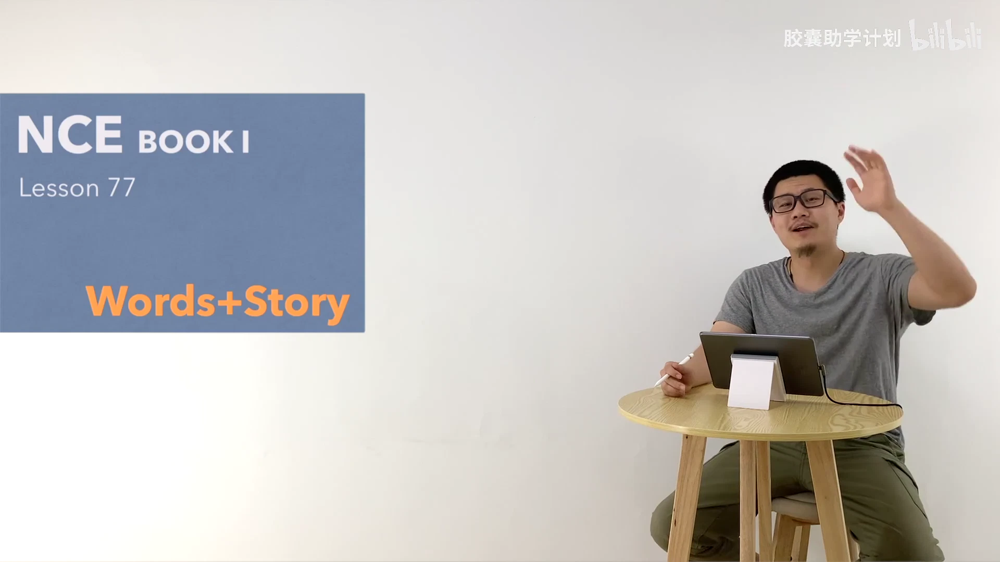

文字识别：BitL / 胶囊助学计划 / NCE / BOOKI / Lesson 77 / Words+Story

### 画面 00:00:02

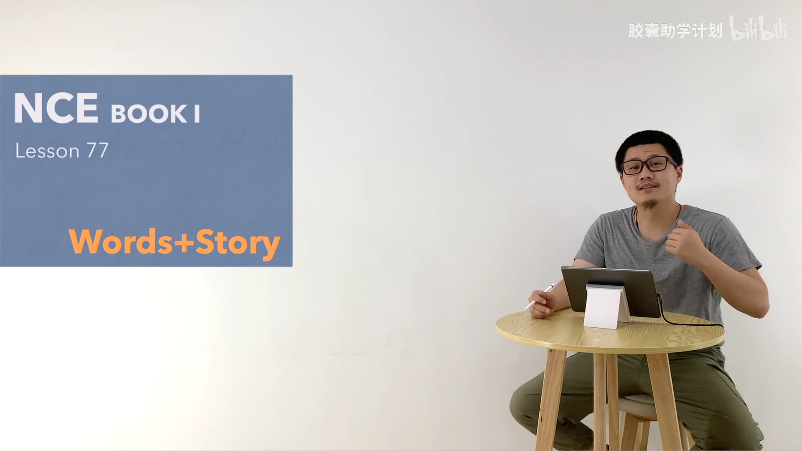

文字识别：Bitbii / 胶囊助学计划 / NCE / BOOKI / Lesson 77 / Words+Story

### 画面 00:00:05

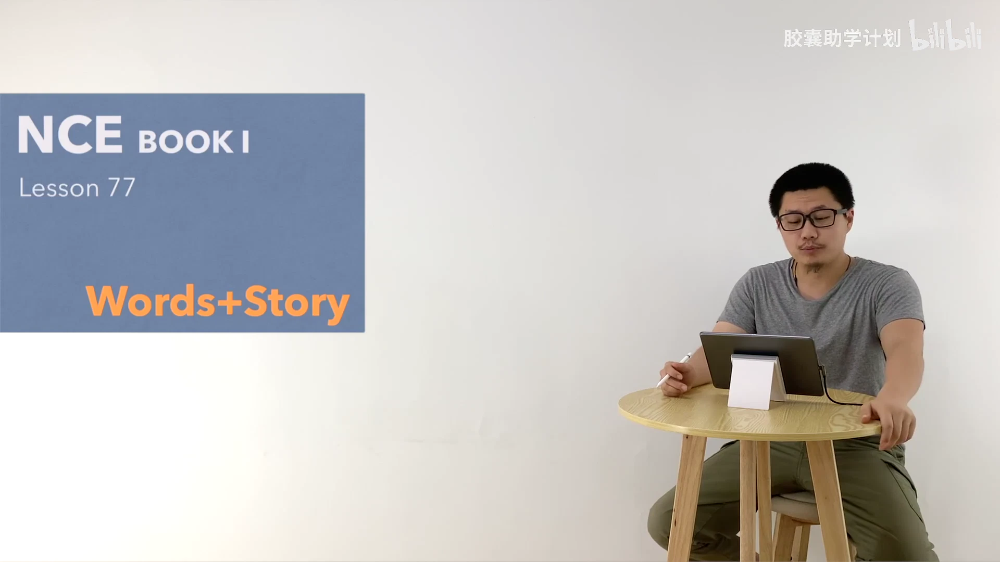

文字识别：bitbili / 胶囊助学计划 / NCE / BOOKI / Lesson 77 / Words+Story

### 画面 00:00:09

文字识别：Bibii / 胶囊助学计划 / NCE / BOOKI / Lesson 77 / Words+Story

### 画面 00:00:11

文字识别：胶囊助学计划bi出 / 勺”？

### 画面 00:00:13

文字识别：胶囊助学计划出 / ①如何表达“预约”?

### 画面 00:00:16

文字识别：胶囊助学计划 / ①如何表达“预约”？ / valk in”是什么意思? / 0

### 画面 00:00:18

文字识别：biltbil / 胶囊助学计划 / ①如何表达“预约”? / 'walk in”是什么意思?

### 画面 00:00:21

文字识别：biilili / 胶囊助学计划 / ①如何表达“预约”? / C6 / walk in”是什么意思?

### 画面 00:00:23

文字识别：胶囊助学计划li

### 画面 00:00:26

文字识别：虞助学计划 / 胶囊助学计划

### 画面 00:00:28

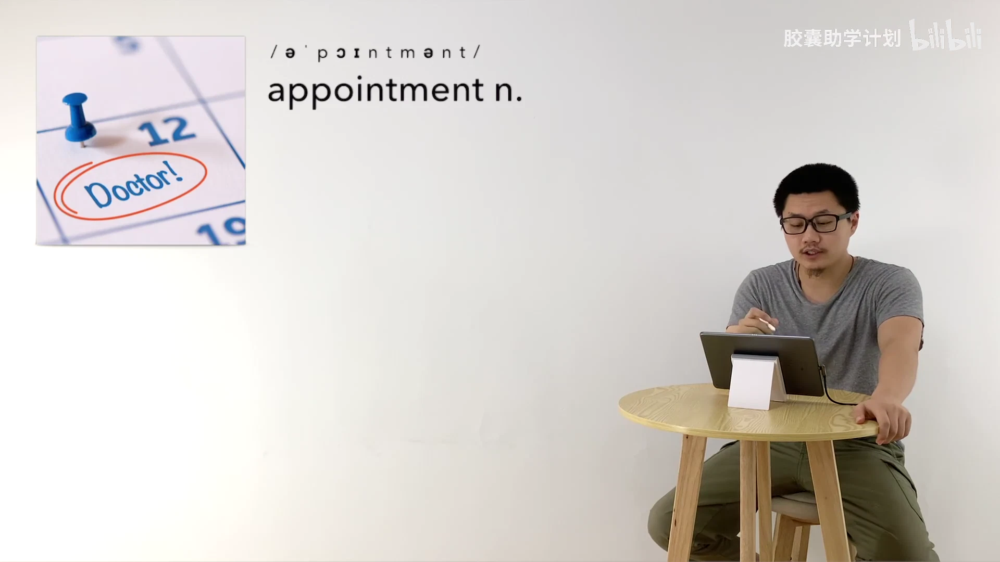

文字识别：bitbii / 胶囊助学计划 / /a'poIntmant/ / appointment n. / 12 / Doctor! / 19

## 00:00:30–00:01:00

音标，我们先一起读一下，叫做 appointment。 OK，注意重音在第二个音节上，于是连起来读叫做 appointment。 appointment。 OK，这个 t，也就是 t 字母啊，现在发的这个 t，呃，某种程度上可以把它失去爆破啊，就把它留一个位置就好了。然后呢，呃，我们基本上可能不会把它读成 appointment 啊，不不会这么夸张，就是

### 画面 00:00:37

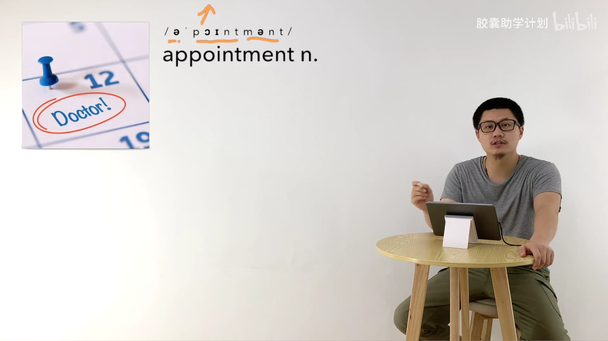

文字识别：Bitbii / 胶囊助学计划 / /a'pointmant/ / appointment n. / 12 / Doctor! / 19

### 画面 00:00:39

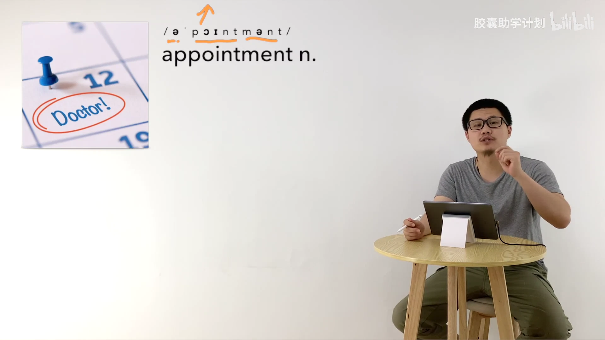

文字识别：bitb / 胶囊助学计划 / /a'pointmant/ / appointment n. / 12 / Doctor! / 19

### 画面 00:00:43

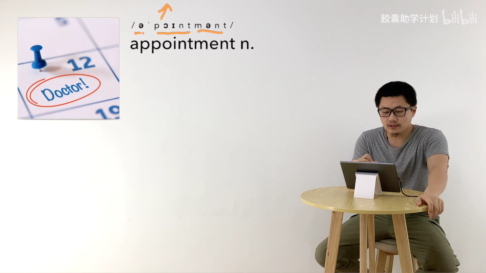

文字识别：biibii / 胶囊助学计划 / /a'pointmant/ / appointment n. / 12 / Doctor! / 19

### 画面 00:00:47

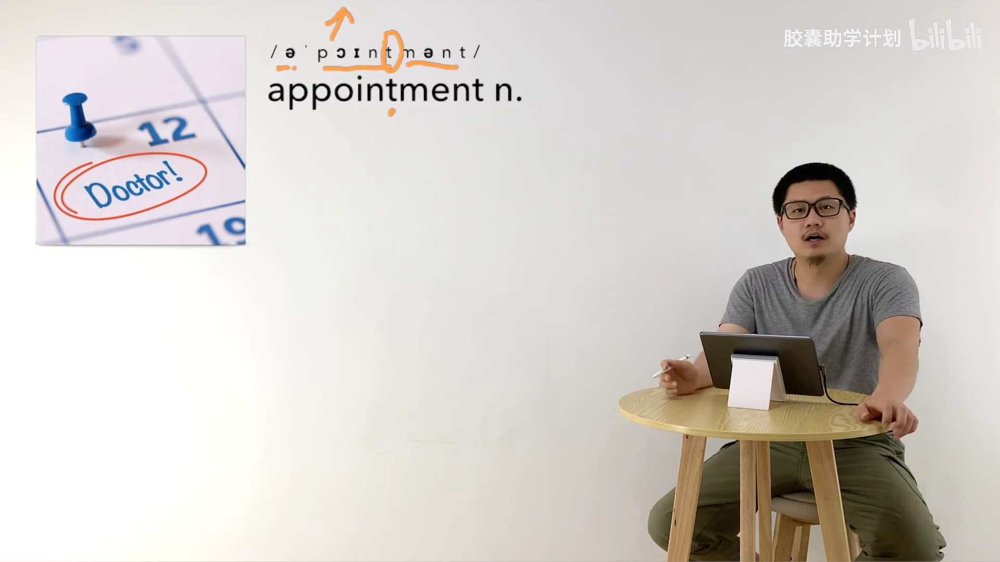

文字识别：bitbil / 胶囊助学计划 / nant/ / appointment / n. / 12 / Doctor! / 19

### 画面 00:00:56

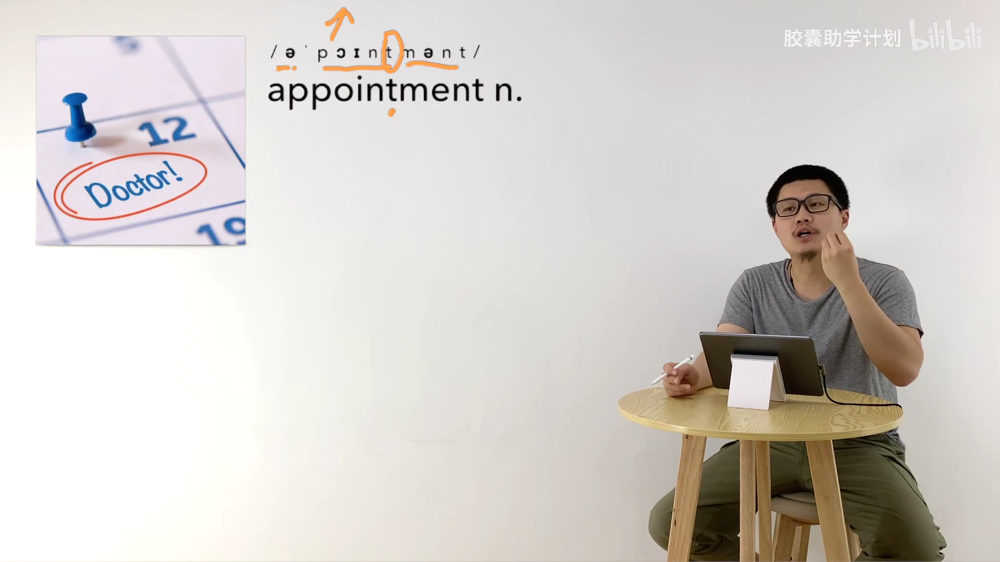

文字识别：bitbii / 胶囊助学计划 / nant/ / appointment / n. / 12 / Doctor! / 19

## 00:01:00–00:01:30

appointment. Okay,听见了哈。最后一个有一这么一点点音就可以了。那它表示就是预约，但是注意一下，它在这是一个名词，我们要把它动词化，或者说把它变成一个放在句子当中造句嘛，一定要有一个动词，对吧？怎么办呢？很简单，就是用从我们五十九课开始遇到的这个单词 have 这个单词就可以表示叫 have an appointment. 好，在这儿提几个小点。第一，你看啊，前面用

### 画面 00:01:06

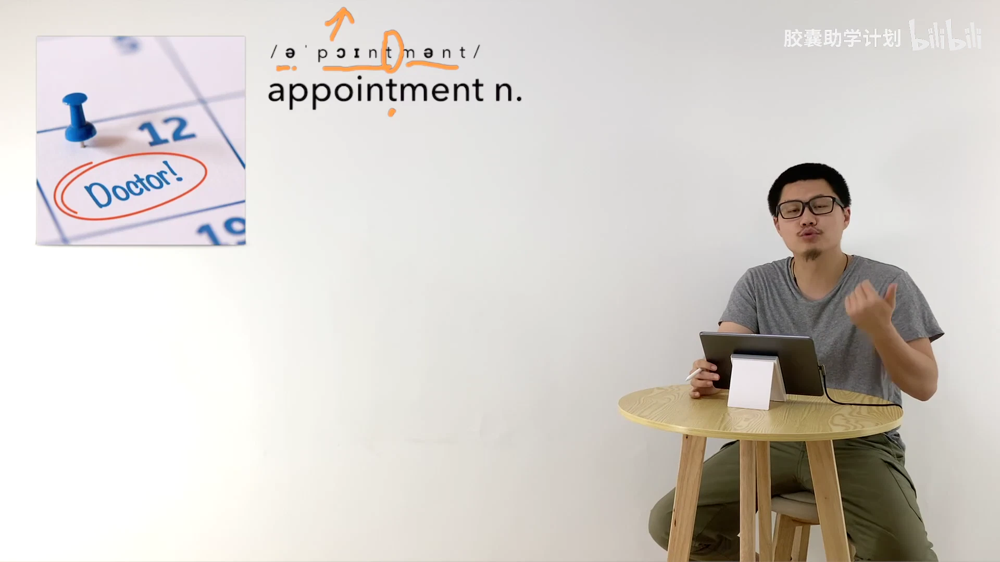

文字识别：Bitbii / 胶囊助学计划 / nant/ / appointment n. / 12 / Doctor! / 19

### 画面 00:01:12

文字识别：1 / bitbil / 胶囊助学计划 / /a' / nant/ / appointment / n. / 12 / Doctor! / 19

### 画面 00:01:16

文字识别：Bitbii / 胶囊助学计划 / n / mant / / appointment n. / 12 / Doctor! / 19

### 画面 00:01:21

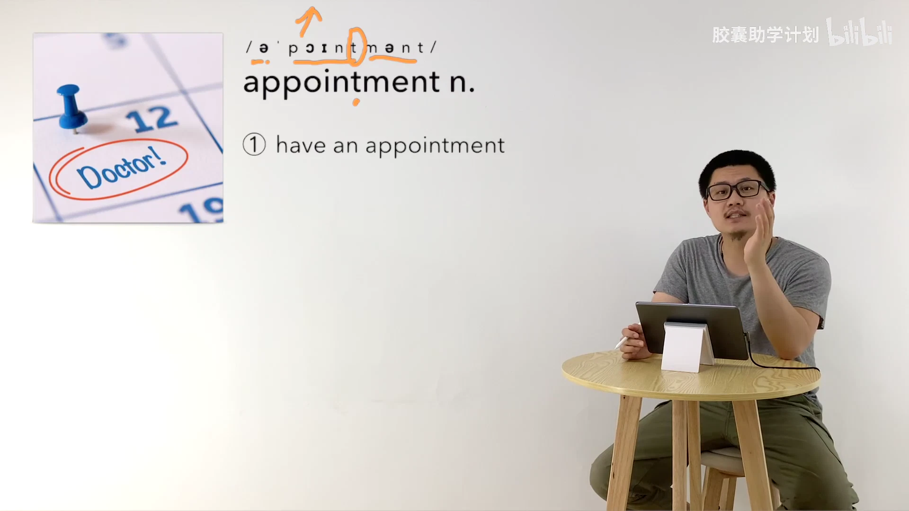

文字识别：4 / Bitbii / 胶囊助学计划 / nant/ / appointment n. / 12 / ① have an appointment / Doctor! / 19

### 画面 00:01:29

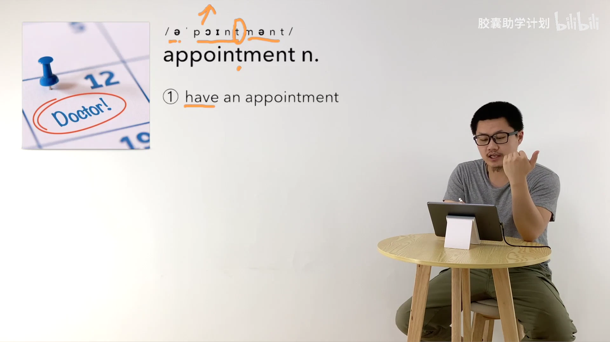

文字识别：Bitbii / 胶囊助学计划 / /a' / mant / / ク / appointment / n. / 12 / ① / have an appointment / Doctor! / 19

## 00:01:30–00:02:00

的是 have an appointment，在这儿这个 have 是一个动词，于是它实际上是可以进行一些时态转化的，比如说我之前有，那应该是把 have 变成什么？如果是三单，对吧？一般现在时下第三人称单数，那应该把 have 换成 has，对不对？这是第一个小点，想跟大家提一下。第二个就是这儿为什么用了 an？这是很久之前我们学到的一个知识点，那就注意一下这个单词

### 画面 00:01:39

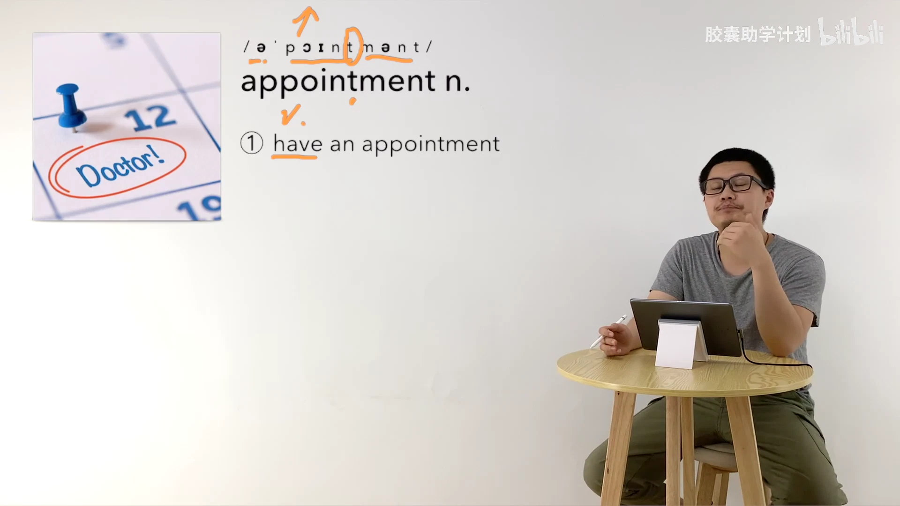

文字识别：biltbii / 胶囊助学计划 / /a' / nant/ / appointment / n. / 12 / have an appointment / 1 / Doctor! / 19

### 画面 00:01:50

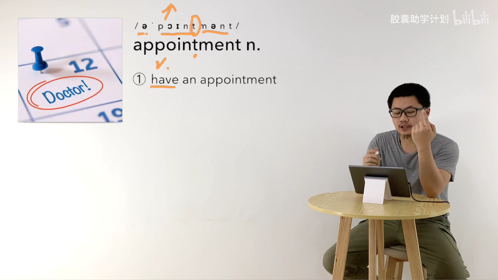

文字识别：biltbii / 胶囊助学计划 / /a' / nant / / appointment / n. / 12 / have an appointment / Doctor! / 19

### 画面 00:01:59

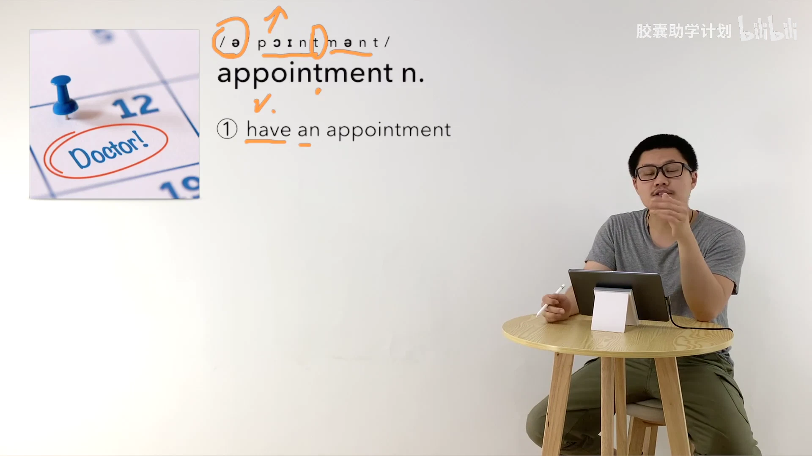

文字识别：BitLii / 胶囊助学计划 / a / n / nant / / appointment / :n. / 12 / have an appointment / 1 / Doctor! / 19

## 00:02:00–00:02:30

的第一个音标是元音音标，所以我们用的是 an，对吧？OK， so have an appointment，拿它去造一些这些句子啊，张嘴跟我读就OK了。来，Do you have an appointment？ Next one，说No， I don't have an appointment。OK，好，那指的是预约。这个预约呢，实际上有很多我们在文章当中和我自己在海外的这个切身经历一定可以用到的

### 画面 00:02:05

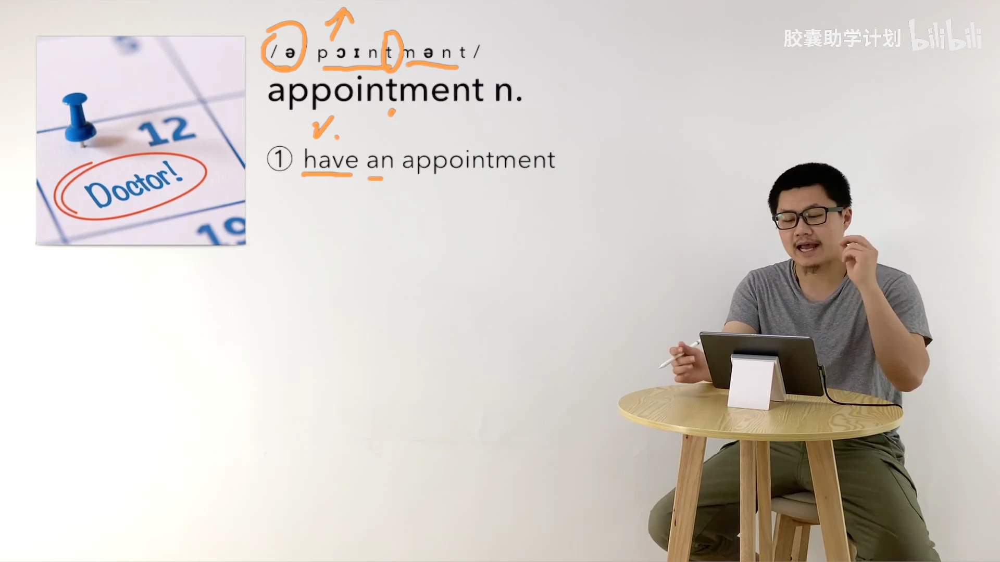

文字识别：bitbii / 胶囊助学计划 / nant / / appointment / n. / 12 / have an appointment / Doctor! / 19

### 画面 00:02:08

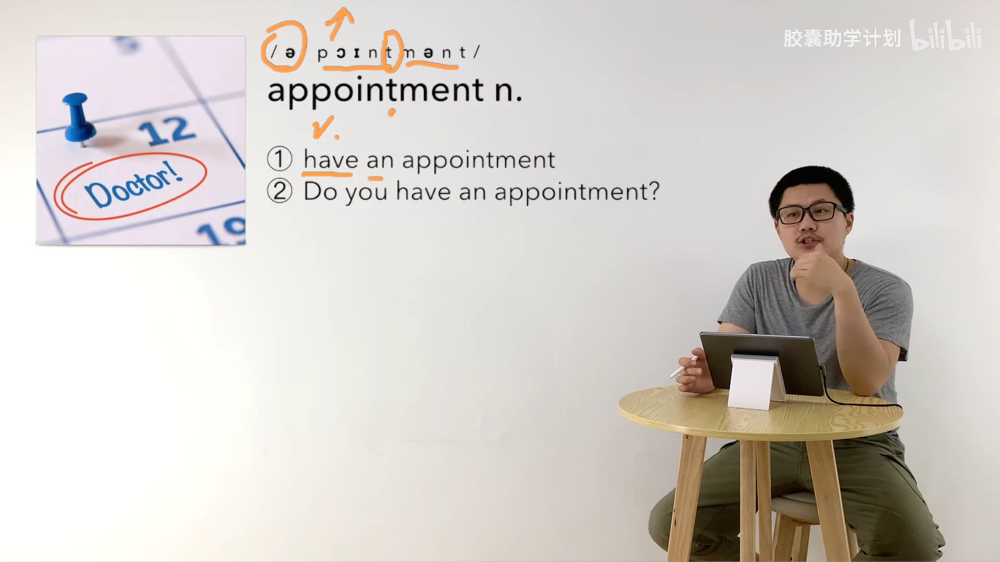

文字识别：Biltbili / 胶囊助学计划 / nant/ / appointment / n. / 12 / 1 / have / ean / appointment / Doctor!. / Do you / have an appointment? / 19

### 画面 00:02:11

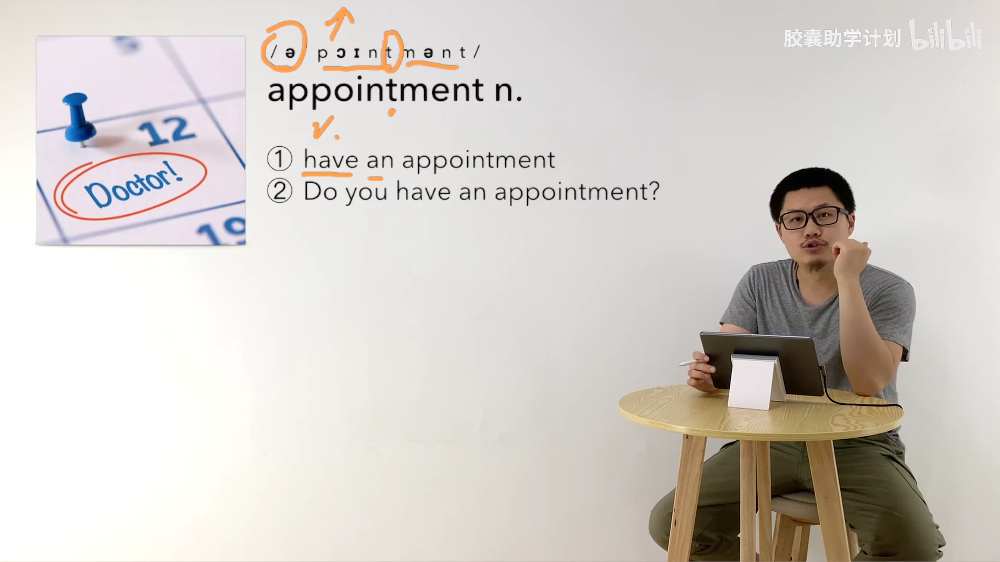

文字识别：bitbii / 胶囊助学计划 / n / nant/ / appointment / n. / 12 / 1 / have / an / appointment / Doctor! / Do you / have an appointment? / 19

### 画面 00:02:20

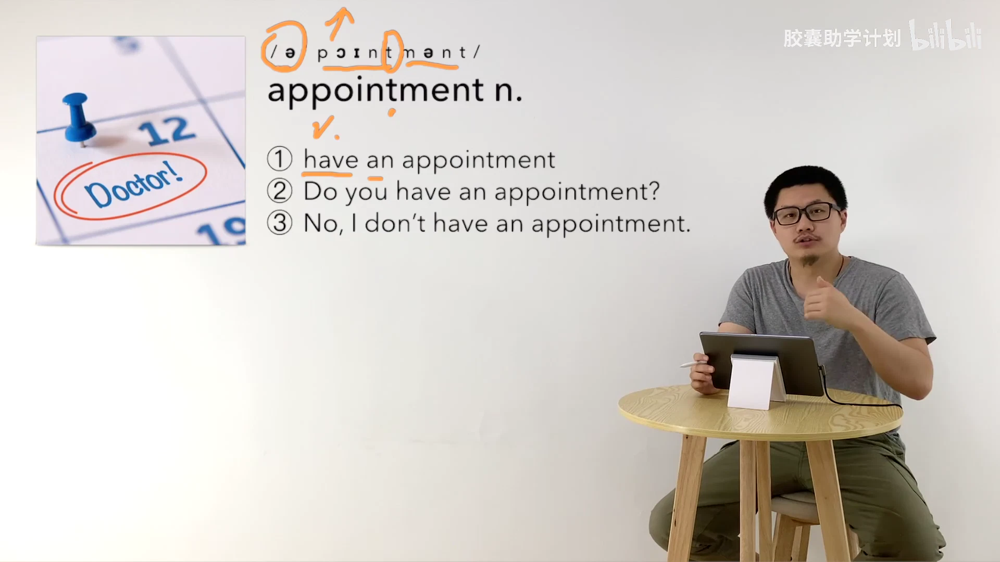

文字识别：Bitbii / 胶囊助学计划 / a / n / nant/ / appointment n. / 12 / 1 / have an a / appointment / Doctor! / 2 / Do you / have / an / appointment? / 19 / No,I don't have / an / appointment.

### 画面 00:02:23

文字识别：bitbii / 胶囊助学计划 / nant/ / appointment n. / 12 / have an appointment / 1 / Doctor! / Do you / have / an / appointment? / 19 / No, I don't have / an appointment.

## 00:02:30–00:03:00

其中一个点，就是我们去看医生的时候，对吧？啊，你去这个诊所或者医院，有一些尤其是小的，那你需要提前有一个 appointment， OK？好，那正好我们在这个电影片段当中就出现了这样一个非常棒的点，叫 I need an appointment at the hospital for my leg。啊，我需要一个预约。你看这儿的动词是 need，对吧？在医院，我需要一个预约

### 画面 00:02:32

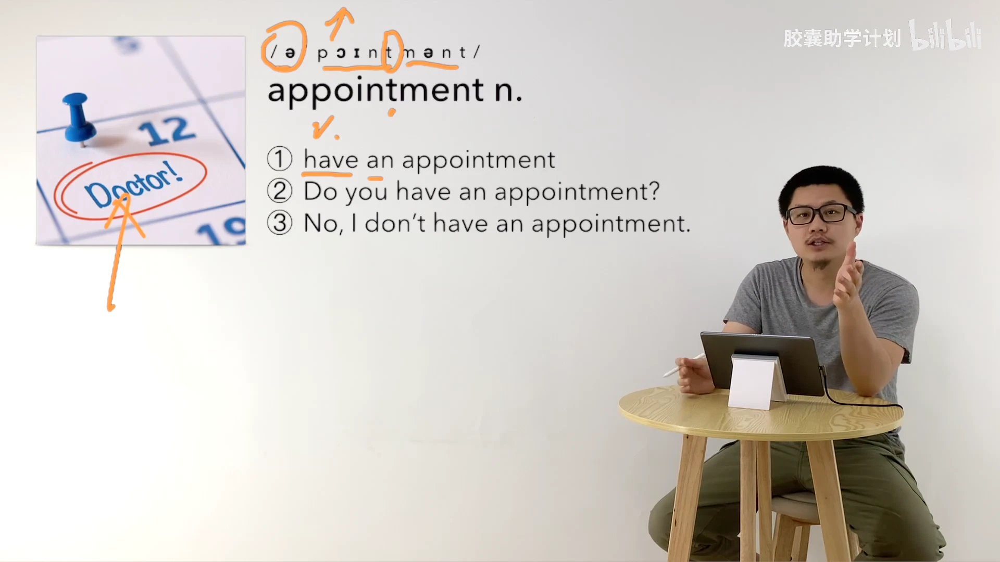

文字识别：biltbii / 胶囊助学计划 / a / n / nant/ / appointment n. / 12 / have an appointment / 1 / Dgctor! / Do you / have an a / appointment? / 19 / No, I don't have / an appointment.

### 画面 00:02:35

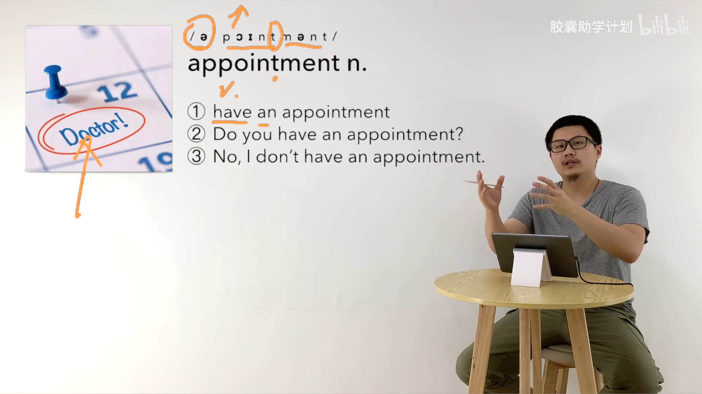

文字识别：Biibii / 胶囊助学计划 / nant/ / a / appointment n. / 12 / 1 / have an appointment / Dgctor! / Do you / u have an appointment? / 2 / No, I don't have an appointment. / 19

### 画面 00:02:37

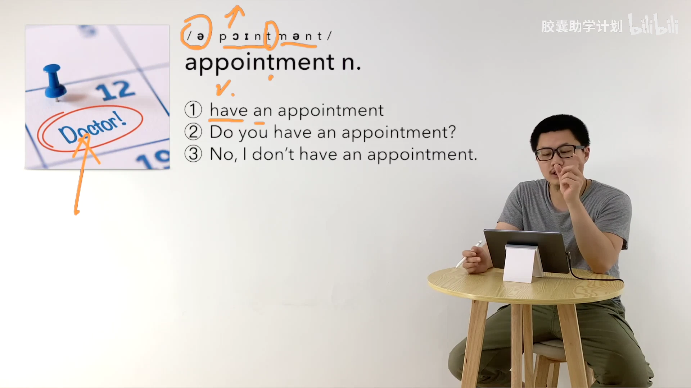

文字识别：Biltbii / 胶囊助学计划 / nant/ / appointment n. / 12 / have an appointment / 1 / Dgctor! / Do you / have an / appointment? / 19 / No, I don't have / an appointment.

### 画面 00:02:42

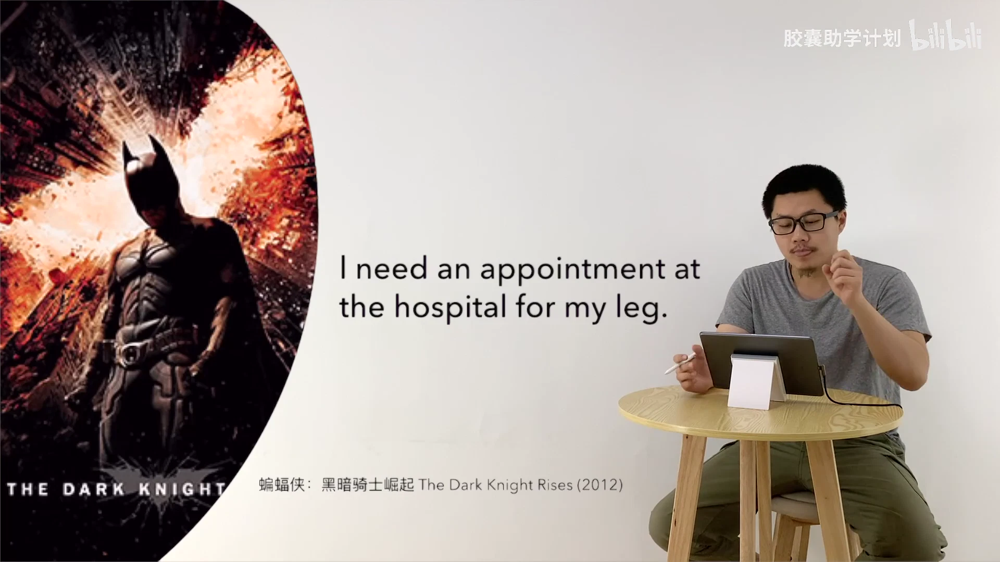

文字识别：胶囊助学计划bilb出 / I need an appointment at / the hospital for my leg. / THEDARK KNIGHT / 蝙蝠侠：黑暗骑士崛起 The Dark Knight Rises (2012)

### 画面 00:02:44

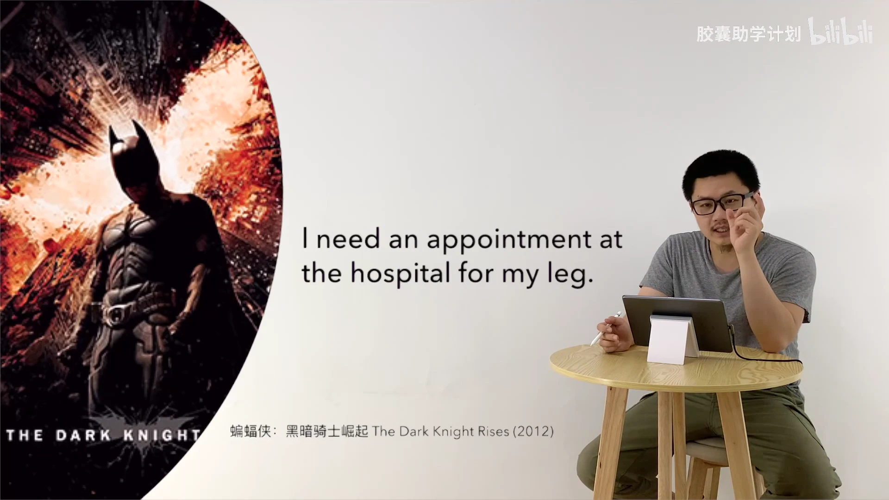

文字识别：胶囊助学计划bilibi出 / I need an appointment at / the hospital for my leg. / THE DARK KNIGHT / 蝙蝠侠：黑暗骑士崛起 The Dark Knight Rises (2012)

### 画面 00:02:47

文字识别：胶囊助学计划bil出 / I need an appointment at / the hospital for my leg. / THE DARK KNIGHT / 蝙蝠侠：黑暗骑士崛起 The Dark Knight Rises (2012)

### 画面 00:02:51

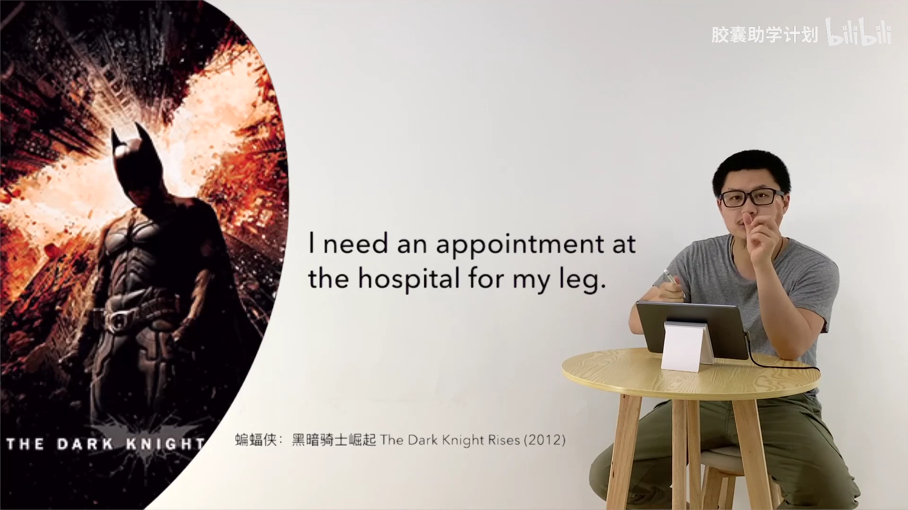

文字识别：胶囊助学计划bil出 / I need an appointment at / the hospital for my leg. / THE DARK KNIGHT / 蝙蝠侠：黑暗骑士崛起 The Dark Knight Rises (2012)

### 画面 00:02:56

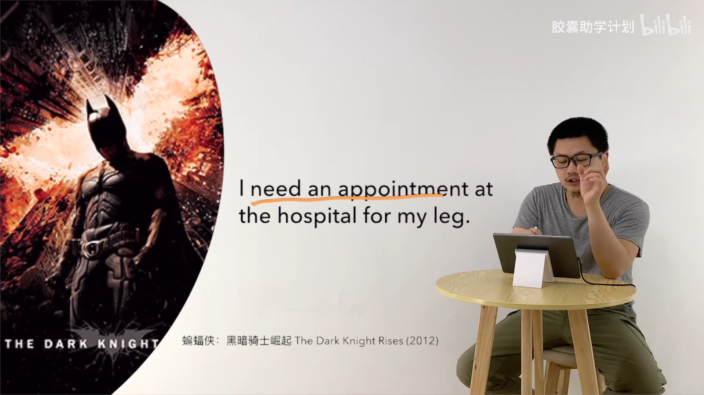

文字识别：胶囊助学计划bl出 / I need an appointment at / the hospital for my leg. / THE DARK KNIGHT / 蝙蝠侠：黑暗骑士崛起 The Dark Knight Rises (2012)

## 00:03:00–00:03:30

去看一下我的这个腿。OK，连起来读叫 I need an appointment at the hospital for my leg. 好，接下来我们注意力集中，看电影当中出现的这句话。 Do we still have any cars around the place? Yes, one or two. I need an appointment at the hospital for my leg. Which hospital? Which everyone, Jim Gordon is in. Okay, good. 啊，那叫做 I need an appointment. 那有的时候这个地方，如果你去，尤其是国外的

### 画面 00:03:01

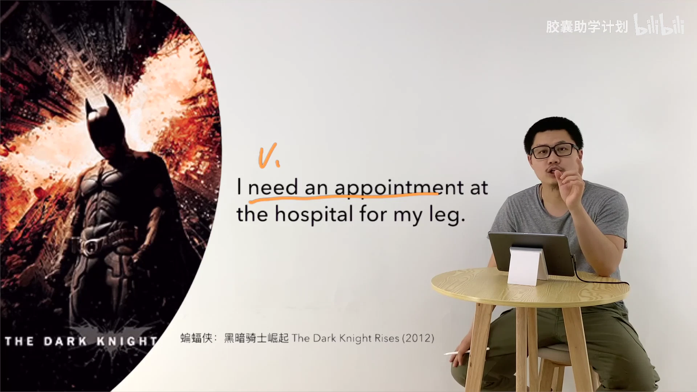

文字识别：胶囊助学计划bil出 / V / I need an appointment at / the hospital for my leg. / THE DARK KNIGHT / 蝙蝠侠：黑暗骑士崛起 The Dark Knight Rises (2012)

### 画面 00:03:03

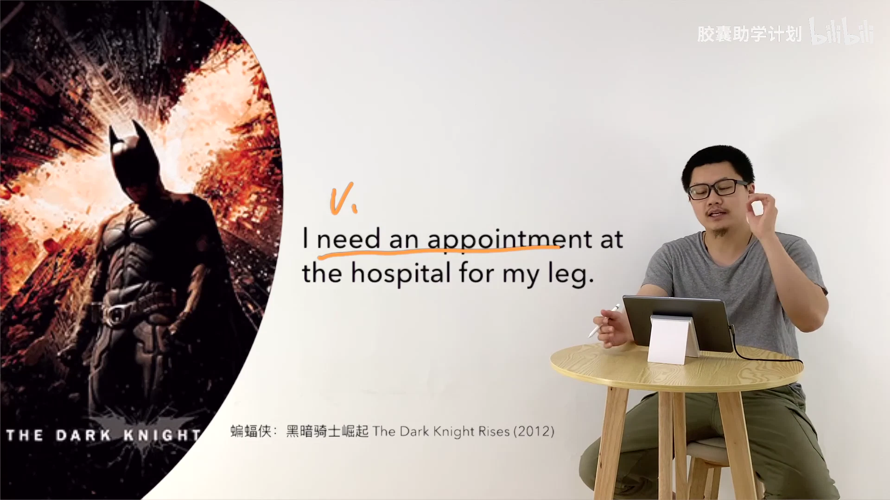

文字识别：胶囊助学计划册 / V / I need an appointment at / the hospital for my leg. / THE DARK KNIGHT / 蝙蝠侠：黑暗骑士崛起 The Dark Knight Rises (2012)

### 画面 00:03:05

文字识别：胶囊助学计划W / V / I need an appointment at / the hospital for my leg. / 蝙蝠侠：黑暗骑士崛起 The Dark Knight Rises (2012) / THE DARK KNIGHT

### 画面 00:03:08

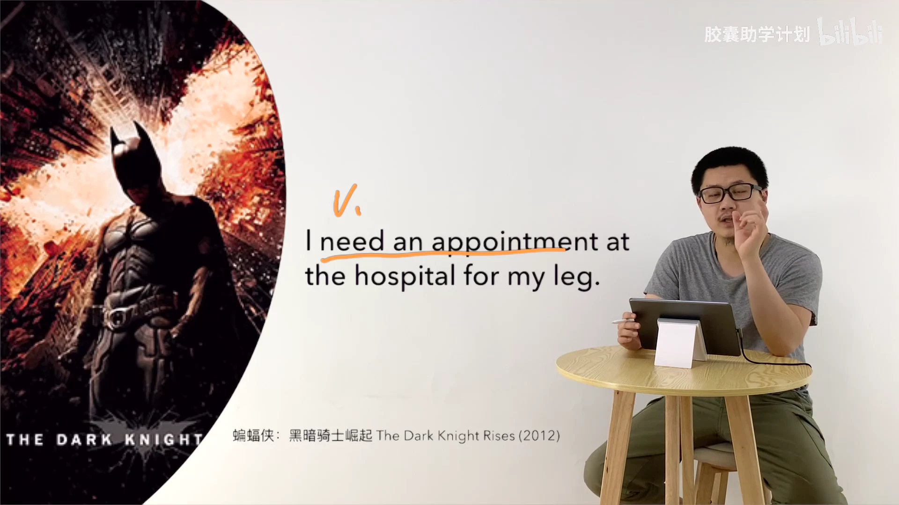

文字识别：胶囊助学计划L / V / I need an appointment at / the hospital for my leg. / THE DARK KNIGHT / 蝙蝠侠：黑暗骑士崛起The Dark Knight Rises (2012)

### 画面 00:03:11

文字识别：bilibili / 胶囊助学计划 / 不不不现在我们家里面还有车吗 / No, no, no. Do we still have any cars around the place?

### 画面 00:03:13

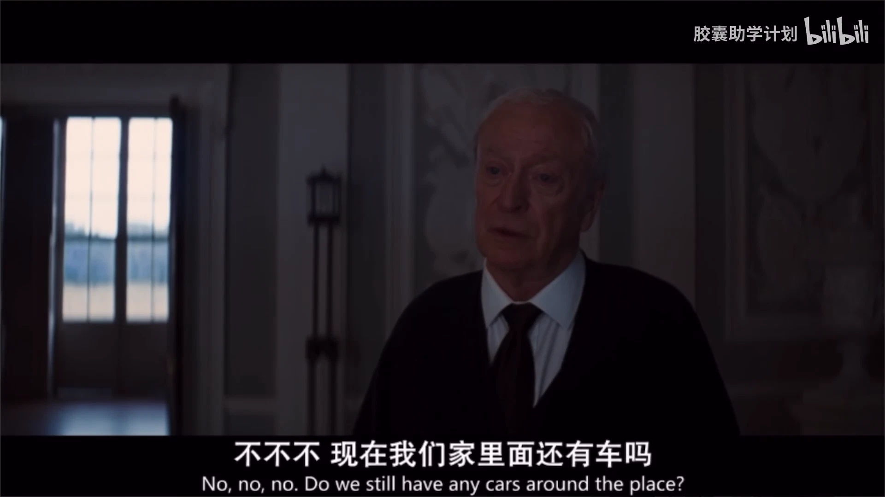

文字识别：bilibili / 胶囊助学计划 / 不不不 现在我们家里面还有车吗 / No, no, no. Do we still have any cars around the place?

### 画面 00:03:15

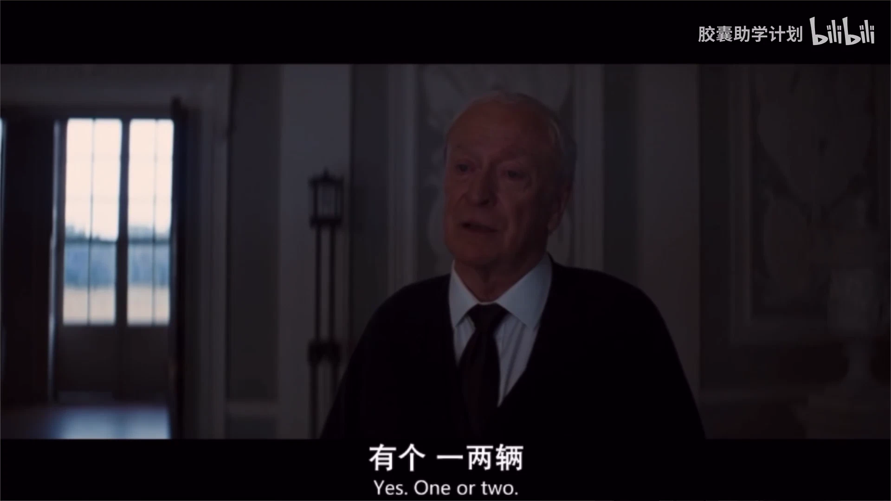

文字识别：bilibili / 胶囊助学计划 / 有个一两辆 / Yes. One or two.

### 画面 00:03:17

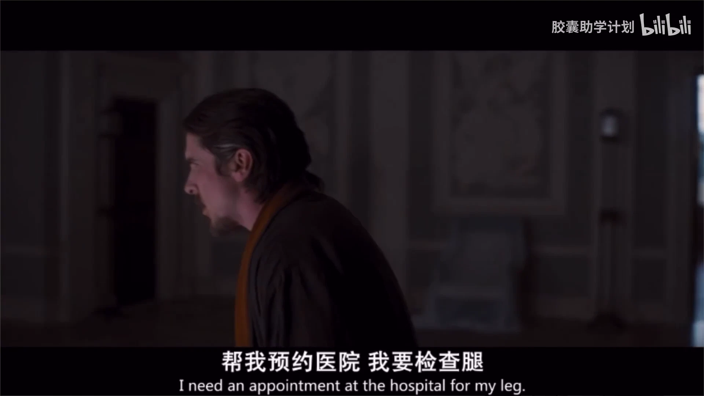

文字识别：bilibili / 胶囊助学计划 / 帮我预约医院 我要检查腿 / I need an appointment at the hospital for my leg.

### 画面 00:03:19

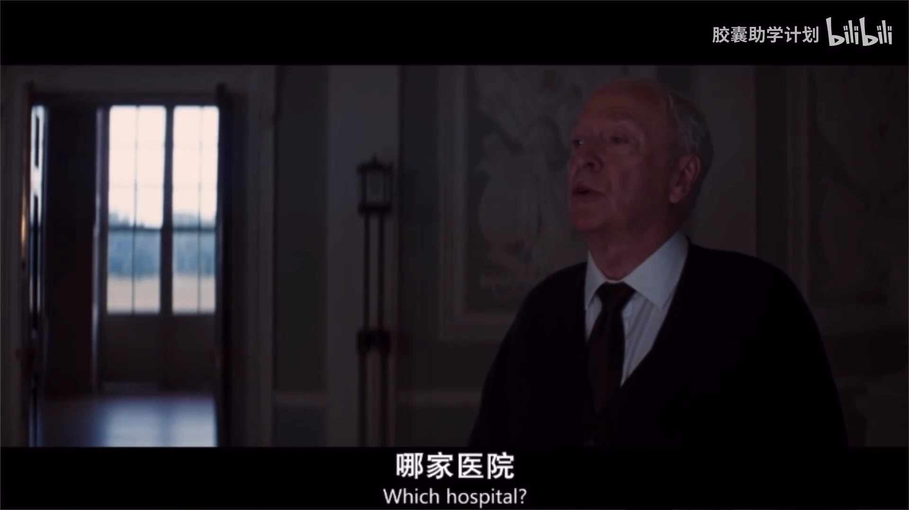

文字识别：bilibili / 胶囊助学计划 / 哪家医院 / Which hospital?

### 画面 00:03:21

文字识别：bilibili / 胶囊助学计划 / 吉姆·戈登住的那家 / Whichever one Jim Gordon's in.

### 画面 00:03:23

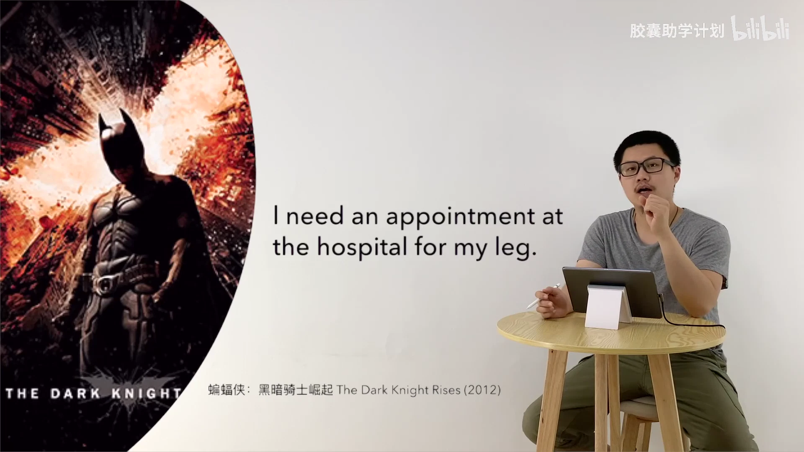

文字识别：胶囊助学计划bli出 / I need an appointment at / the hospital for my leg. / THEDARK KNIGHT / 蝙蝠侠：黑暗骑士崛起 The Dark Knight Rises (2012)

### 画面 00:03:25

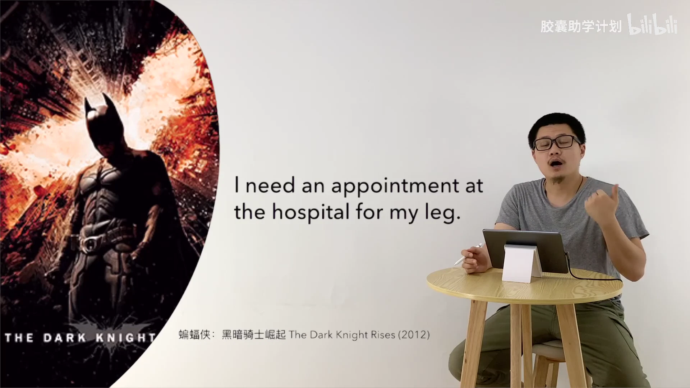

文字识别：胶囊助学计划bib出 / I need an appointment at / the hospital for my leg. / THE DARK KNIGHT / 蝙蝠侠：黑暗骑士崛起 The Dark Knight Rises (2012)

### 画面 00:03:28

文字识别：胶囊助学计划bi出 / I need an appointment at / the hospital for my leg. / THE DARK KNIGHT / 蝙蝠侠：黑暗骑士崛起 The Dark Knight Rises (2012)

## 00:03:30–00:04:00

一些医院，它有一些是要么是VIP制的，就是你必须要加入会员，人家才给你看病的，对吧？要不就是你必须要预约。那你需要一个预约怎么说呢？叫做 you need an appointment. Okay, one again.好，那接下来呢，我们下一个单词跟这个 appointment 又是能联系在一起的单词。我们先一起读一下，虽然含义上好像没什么太大联系。来一起读一下，叫做 urgent，叫做 urgent. Okay, 那 urgent

### 画面 00:03:30

文字识别：胶囊助学计划bib出 / I need an appointment at / the hospital for my leg. / THE DARK KNIGHT / 蝙蝠侠：黑暗骑士崛起 The Dark Knight Rises (2012)

### 画面 00:03:34

文字识别：胶囊助学计划bl出 / I need an appointment at / the hospital for my leg. / THE DARK KNIGHT / 蝙蝠侠：黑暗骑士崛起 The Dark Knight Rises (2012)

### 画面 00:03:36

文字识别：胶囊助学计划bil出 / I need an appointment at / the hospital for my leg. / 蝙蝠侠：黑暗骑士崛起 The Dark Knight Rises (2012) / THE DARK KNIGHT

### 画面 00:03:40

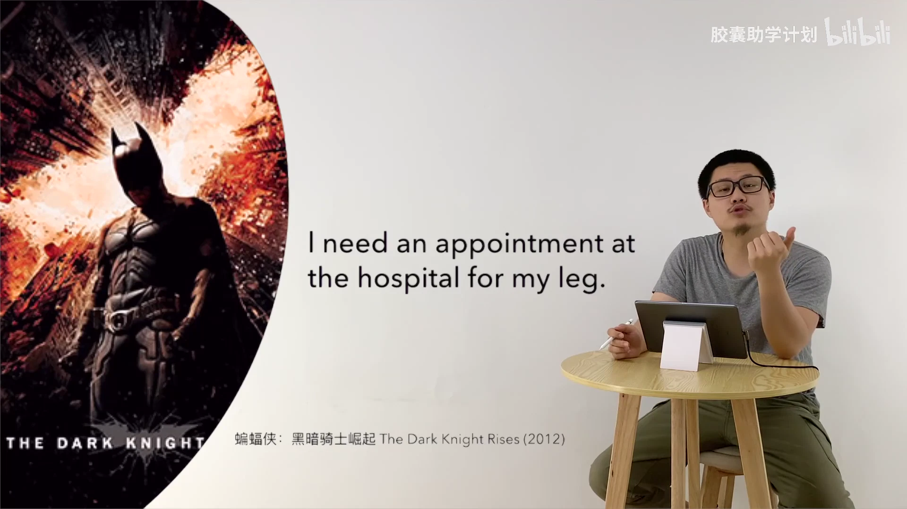

文字识别：胶囊助学计划bui出 / I need an appointment at / the hospital for my leg. / THEDARK KNIGHT / 蝙蝠侠：黑暗骑士崛起 The Dark Knight Rises (2012)

### 画面 00:03:42

文字识别：胶囊助学计划bilb出 / I need an appointment at / the hospital for my leg. / THEDARK KNIGHT / 蝙蝠侠：黑暗骑士崛起 The Dark Knight Rises (2012)

### 画面 00:03:44

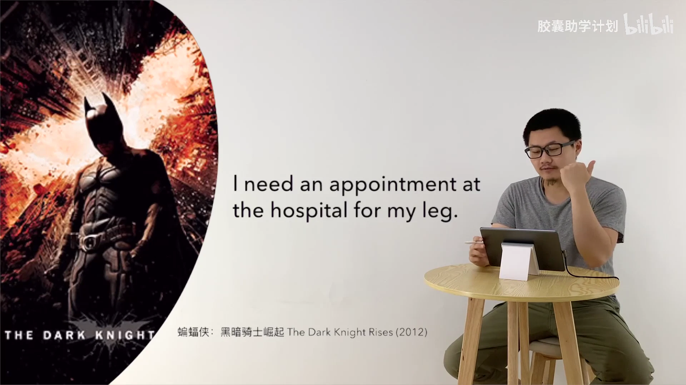

文字识别：胶囊助学计划bi出 / I need an appointment at / the hospital for my leg. / THE DARK KNIGHT / 蝙蝠侠：黑暗骑士崛起 The Dark Knight Rises (2012)

### 画面 00:03:46

文字识别：bitbii / 胶囊助学计划 / /'3:dzant/ / URGENT / CARE / urgent adj. / NO / ROENTEBANI

### 画面 00:03:49

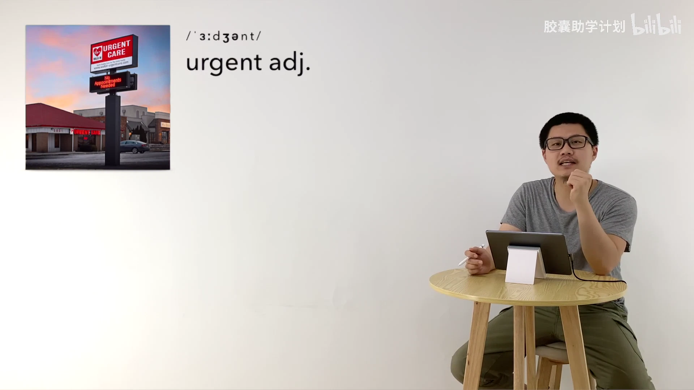

文字识别：bitbii / 胶囊助学计划 / /'3:d3ant/ / URGENT / CARE / urgent adj. / NO / NDENEBANE

### 画面 00:03:52

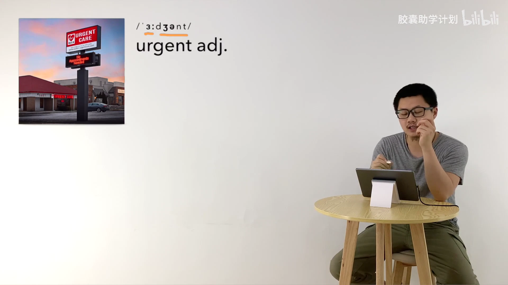

文字识别：biltbili / 胶囊助学计划 / /'3:d3ant/ / URGENT / CARE / urgent adj. / BOENT BAN

### 画面 00:03:55

文字识别：bibli / 胶囊助学计划 / /'3:d3ant/ / URGENT / CARE / urgent adj. / ApPOO / BGENTEBAR

### 画面 00:03:59

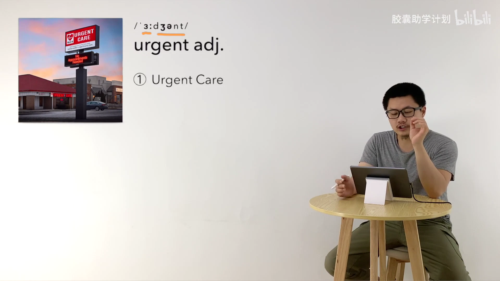

文字识别：bitbii / 胶囊助学计划 / /'3:d3ant/ / URGENT / CARE / urgent adj. / ents / ① Urgent Care / RGENTEBANI

## 00:04:00–00:04:30

care某种程度上就有点像咱们说的那个急诊的感觉，对吧？但是它更多不是急诊，它一般不是很大的事情，就是比如说紧急的一些包扎和处理。Okay，它叫做urgent care啊，urgent叫做紧急的，那care叫做这些护理照顾，对吧？它往往指的是这些小的诊所，而不是大医院啊。Okay，那我们在最开始问了一个问题，你会发现有

### 画面 00:04:05

文字识别：blbli / 胶囊助学计划 / /'3:d3ant/ / URGENT / CARE / urgent adj. / No / ① Urgent Care / BENECO

### 画面 00:04:07

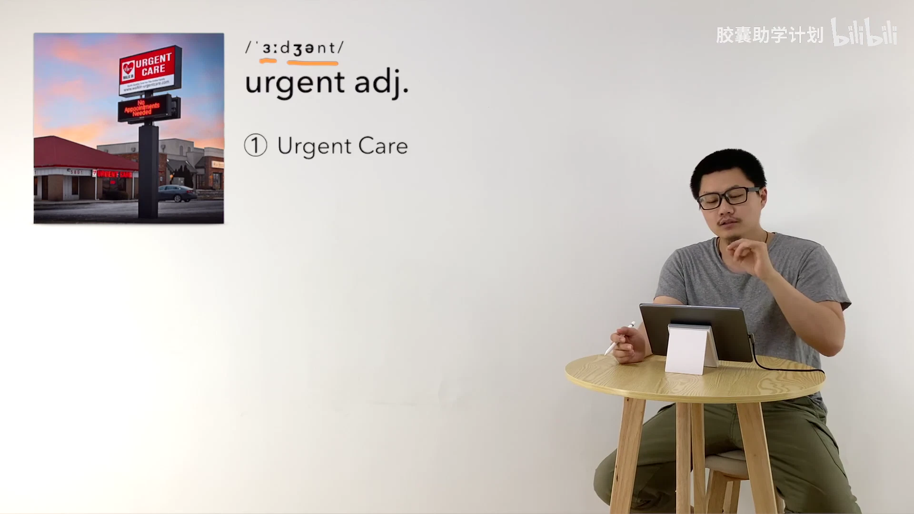

文字识别：bitbii / 胶囊助学计划 / /'3:d3ant/ / URGENT / CARE / urgent adj. / NO / ① Urgent Care / OENTOA

### 画面 00:04:11

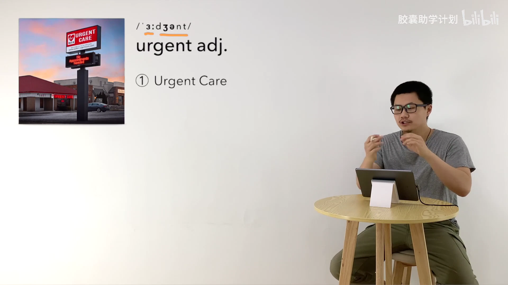

文字识别：bibii / 胶囊助学计划 / /'3:d3ant/ / JURGENT / CARE / urgent adj. / ① Urgent Care / ROENTCNN

### 画面 00:04:14

文字识别：bibii / 胶囊助学计划 / /'3:d3ant/ / URGENT / CARE / urgent adj. / ① Urgent Care / HOENTEBA

### 画面 00:04:16

文字识别：bitbii / 胶囊助学计划 / /'3:d3ant/ / URGENT / CARE / urgent adj. / ① Urgent Care / IBETCN

### 画面 00:04:19

文字识别：Bibii / 胶囊助学计划 / /'3:d3ant/ / URGENT / CARE / urgent adj. / ① Urgent Care / HBENECAN

### 画面 00:04:21

文字识别：blbili / 胶囊助学计划 / /'3:d3ant/ / URGENT / CARE / urgent adj. / ① Urgent Care / MBENE CAN

### 画面 00:04:24

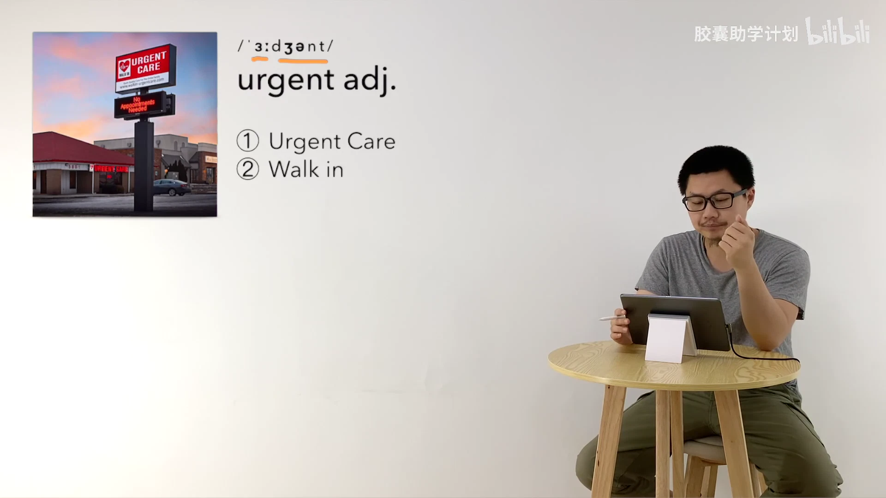

文字识别：biili / 胶囊助学计划 / /'3:d3ant/ / URGENT / CARE / urgent adj. / ments / ① / Urgent Care / Walk in / LRENTECAN

### 画面 00:04:27

文字识别：bilbil / 胶囊助学计划 / /'3:d3ant/ / URGENT / CARE / urgent adj. / 1 / Urgent Care / Walk in / NENTBA

## 00:04:30–00:05:00

很多像这些小的诊所，他会直接在外面写一个 walk in。那 walk in 是什么意思呢？就是 you don't have an appointment。它的反义词几乎可以就这样理解，就你没有预约，你就是直接进去就可以就医。他支持这件事情，就刚才我说了，对吧？有的有的小诊所是不支持的，你必须要预约。OK，你不能直接 walk in。啊，所以那这个他写着 walk in，就是你可以直接进来，你不

### 画面 00:04:30

文字识别：biibili / 胶囊助学计划 / /'3:d3ant/ / JURGENT / CARE / urgent adj. / Urgent Care / D / Walk in / EETON

### 画面 00:04:36

文字识别：bitbii / 胶囊助学计划 / /'3:d3ant/ / URGENT / CARE / urgent adj. / ants / ① / Urgent Care / Walk in / DENTC

### 画面 00:04:40

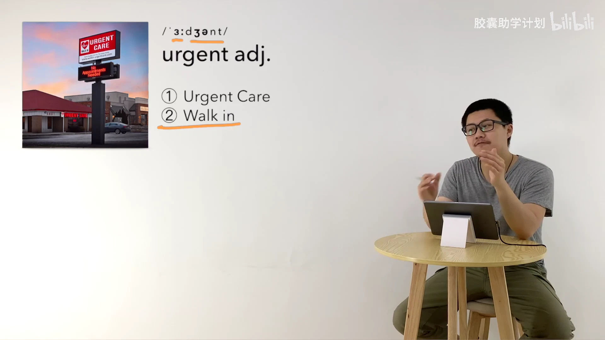

文字识别：bitbii / 胶囊助学计划 / /'3:d3ant/ / URGENT / CARE / urgent adj. / ① / Urgent Care / Walk in / BENTECN

### 画面 00:04:43

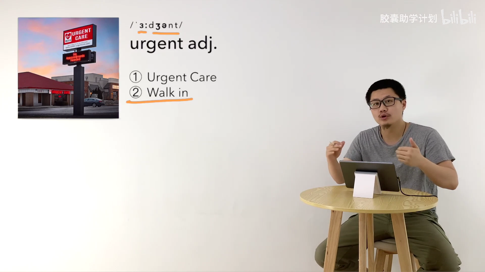

文字识别：bitBii / 胶囊助学计划 / /'3:dzant/ / URGENT / CARE / urgent adj. / NQ / ① / Urgent Care / Walk in / RENECN

### 画面 00:04:48

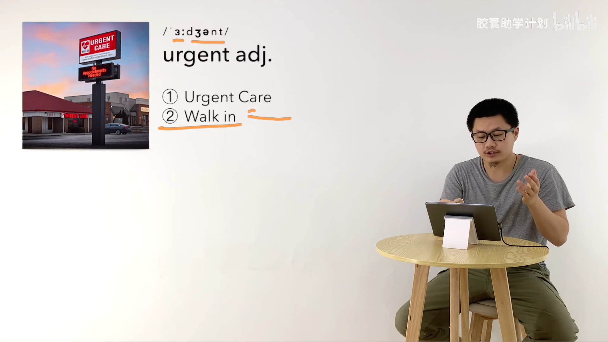

文字识别：LitL / 胶囊助学计划 / /'3:d3ant/ / URGENT / urgent adj. / CARE / 1 / Urgent Care / Walk in / IOENTECN

### 画面 00:04:50

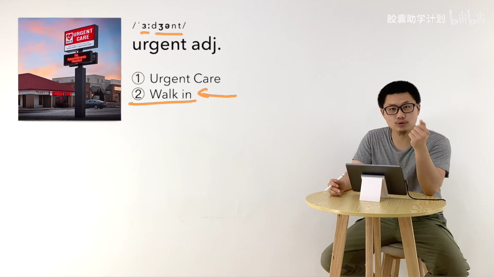

文字识别：胶囊助学计划 / biL / /'3:d3ant/ / URGENT / urgent adj. / CARE / 1 / Urgent Care / Walk in

### 画面 00:04:58

文字识别：胶囊助学计划 / /'3:d3ant/ / URGENT / urgent adj. / CARE / N / Urgent Care / Walk in / HGENTECN

## 00:05:00–00:05:30

需要提前预定。那这个 walk in 呢？各位注意，在海外的时候，你会发现它不光写在药店的这个啊啊，这个这个小诊所的这个外面，对吧？这个小医院的外面，有一些比如说娱乐场所、吃饭的地方或者酒吧啊，它都会直接写上 walk in。然后呢，还会加上这么一小段话，叫做 no appointment needed 啊， no appointment needed。其实各位看单词字面意思应该能翻译过来

### 画面 00:05:02

文字识别：胶囊助学计划 / /'3:d3ant/ / URGENT / urgent adj. / CARE / NO / Urgent Care / 1 / Walk in / NOENECN

### 画面 00:05:08

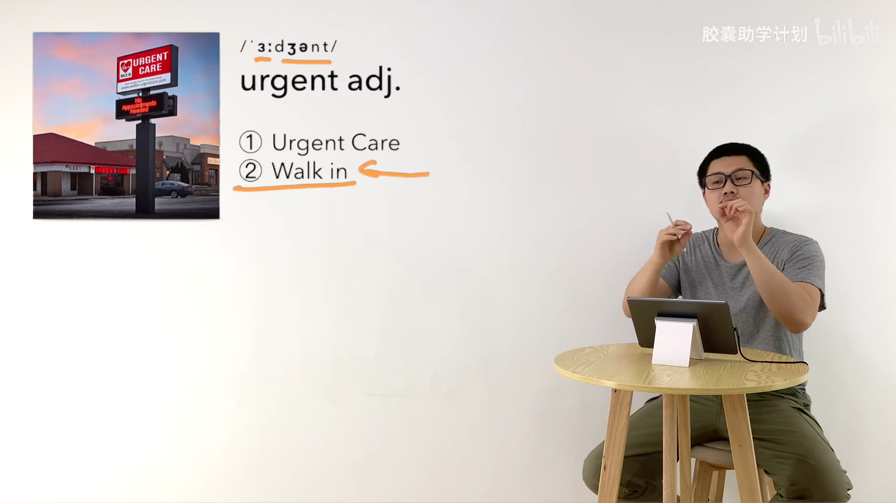

文字识别： Ltbi / 胶囊助学计划 / /'3:d3ant/ / URGENT / CARE / urgent adj. / NO / ① / Urgent Care / Walk in

### 画面 00:05:12

文字识别：胶囊助学计划 / /'3:d3ant/ / URGENT / urgent adj. / CARE / 1 / Urgent Care / Walk in / BENTECA

### 画面 00:05:17

文字识别：LiHL / 胶囊助学计划 / /'3:d3ant/ / URGENT / CARE / urgent adj. / 1 / Urgent Care / Walk in / BETEO

### 画面 00:05:20

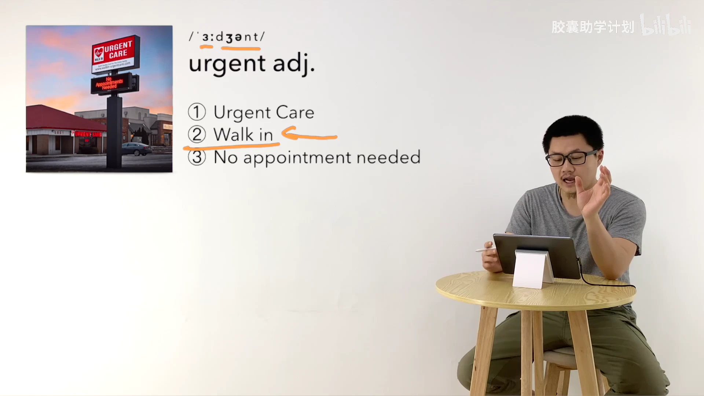

文字识别：bib / 胶囊助学计划 / /'3:d3ant/ / JURGENT / CARE / urgent adj. / 1 / Urgent Care / Walk in / DENTEO / 3） / No / appointment needed

## 00:05:30–00:06:00

了，叫做不需要预约，对吧？No appointment needed. Ah, urgent care walk-in. Ah,这几个小的短语，各位记住就好了。OK，接下来最后一个小的单词，本课单词并不是很多，也不是非常的难，就是这个单词叫做till. Till. OK，我们可以淡化它的词性啊，我们在这儿只需要记住它的意思。最常见的一个意思叫做直到啊，比如说直到三点钟啊，这个直到。OK，好，你比

### 画面 00:05:34

文字识别：胶囊助学计划 / /'3:d3ant/ / URGENT / urgent adj. / CARE / ① / Urgent Care / Walk in / ETO / 3) / No / appointment needed

### 画面 00:05:37

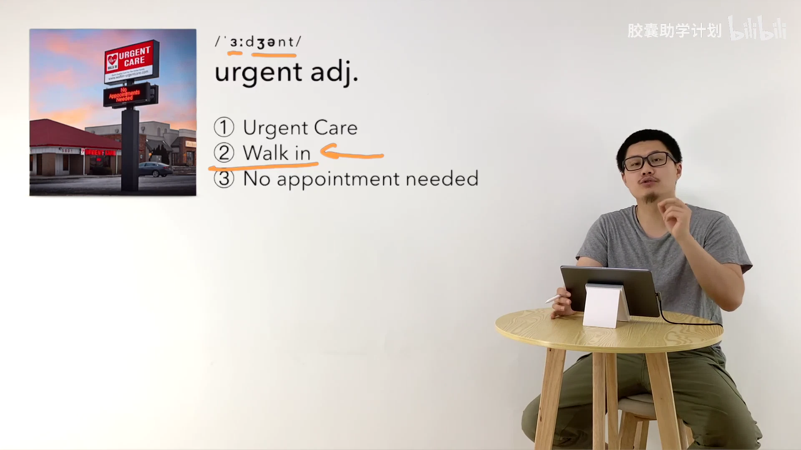

文字识别：bibi / 胶囊助学计划 / /'3:d3ant/ / URGENT / urgent adj. / CARE / 1 / Urgent Care / Walk in / 3） / No / appointment needed

### 画面 00:05:39

文字识别：胶囊助学计划bi出 / /tx1/ / till

### 画面 00:05:41

文字识别：胶囊助学计划bi / /tx1/ / till

### 画面 00:05:45

文字识别：胶囊助学计划blii / /txl/ / till

### 画面 00:05:49

文字识别：胶囊助学计划bl / /txl/ / till

### 画面 00:05:52

文字识别：胶囊助学计划bli / /txl/ / till

### 画面 00:05:55

文字识别：胶囊助学计划blii / /til/ / till

### 画面 00:05:57

文字识别：胶囊助学计划 / /txl/ / till

## 00:06:00–00:06:30

如说，我们就看一个小的短语啊，也可以理解为是句子，叫做 Wait here till I come back。好，你在这个地方等，直到我回来，等到什么时候呢？等到我回来为止。OK，就是这个小单词叫做 Till，跟我一起读一下 Till。OK，好，接下来我们直接进入文章。这篇文章没有新的语法，都是我们之前学过的一些内容。那咱们就注意力集中，迅速把它一起过一遍。好，

### 画面 00:06:00

文字识别：胶囊助学计划bi出 / /tIl/ / till / ① Wait here till I come back.

### 画面 00:06:03

文字识别：胶囊助学计划bl出 / /tl/ / till / ① Wait here till I come back.

### 画面 00:06:14

文字识别：胶囊助学计划bl出 / /trl/ / till / ① Wait here till I come back.

### 画面 00:06:16

文字识别：胶囊助学计划bi出 / /txl/ / till / ① Wait here till I come back.

### 画面 00:06:18

文字识别：胶囊助学计划bi出 / APRIL / 14 / NURSE: Good morning. Mr. Croft. / MR. CROFT: Good morning, nurse. / I want to see the dentist, please. / NURSE: Do you have an appointment? / MR. CROFT: No,Idon't. / NURSE: Is it urgent?

### 画面 00:06:23

文字识别：胶囊助学计划bili / APRIL / 14 / NURSE: Good morning. Mr. Croft. / MR. CROFT: Good morning, nurse. / I want to see the dentist, please. / NURSE: Do you have an appointment? / MR. CROFT: No,Idon't. / NURSE: Is it urgent?

### 画面 00:06:26

文字识别：胶囊助学计划bi出 / APRIL / 14 / NURSE: Good morning. Mr. Croft. / MR. CROFT: Good morning, nurse. / I want to see the dentist, please. / NURSE: Do you have an appointment? / MR. CROFT: No,I don't. / NURSE: Is it urgent?

## 00:06:30–00:07:00

首先注意说话的两个人，我们看图能看出来啊。This is a nurse, OK? This is a nurse, and this is Mr. Croft, OK?那nurse说了一句话，说Good morning, Mr. Croft，说明认识，对吧？啊，可能是这个小的社区医院，尤其是海外人又不多的话，那你经常可能直接不是直接去大医院，而是直接去这些社区医院，所以他可能是互相认识的。他说早上好，Mr. Croft。Mr.

### 画面 00:06:56

文字识别：胶囊助学计划bi出 / APRIL / 14 / NURSE: Good morning. Mr. Croft. / MR. CROFT: Good morning, nurse. / I want to see the dentist, please. / NURSE: Do you have an appointment? / MR. CROFT: No,I don't. / NURSE: Is it urgent?

## 00:07:00–00:07:30

Craft说，Good morning, nurse. 早上好，护士。I want to see the dentist. 好，那我们一看，这儿还可能不单纯是一个诊诊所，它可能更主要的是一个牙医啊，牙医诊所。说我想看一看这个牙医，please。好，这个单词各位跟我一起读一下，叫做 dentist。 Dentist叫做牙医。OK。 Nurse说，Do you have an appointment？说你有预约

### 画面 00:07:26

文字识别：胶囊助学计划bii / APRIL / 14 / NURSE: Good morning. Mr. Croft. / MR. CROFT: Good morning, nurse. / I want to see the dentist, please. / NURSE: Do you have an appointment? / MR. CROFT: No,I don't. / NURSE: Is it urgent?

## 00:07:30–00:08:00

吗？Mr. Craft说No, I don't.说不，我没有预约。Nurse又问说Is it urgent?你看啊，这个地方我们就可以把它的一般疑问句给它反推一下，变成肯定句，叫做这事儿很着急。你现在就应该会表达了。很简单，您把这个is这个单词给它放回到it后面去，对吧？叫做It's urgent.啊，那护士问他着急吗？Mr.

### 画面 00:07:39

文字识别：胶囊助学计划 / APRIL / 14 / NURSE: Good morning. Mr. Croft. / MR. CROFT: Good morning, nurse. / I want to see the dentist, please. / NURSE: Do you have an appointment? / MR. CROFT: No,Idon't. / NURSE: Is it urgent?

### 画面 00:07:53

文字识别：胶囊助学计划bll / APRIL / 14 / NURSE: Good morning. Mr. Croft. / MR. CROFT: Good morning, nurse. / I want to see the dentist, please. / NURSE: Do you have an appointment? / MR. CROFT: No,I don't. / NURSE: Is it urgent?

### 画面 00:07:58

文字识别：胶囊助学计划bii / APRIL / 14 / MR. CROFT: Yes, it is. / It's very urgent. I feel awful. / I have a terrible toothache. / NURSE: Can you come at 10 a.m. on Monday, / April 24th? / MR. CROFT: I must see the dentist now, nurse.

## 00:08:00–00:08:30

Kraft说，Yes, it is.是的，很着急。Is very urgent.你看，和我刚才说的is urgent多了一个very，对吧？没什么区别。I feel awful. Okay,我感觉到太糟糕了。分别是咱六十一课和七十一课学过的两个单词，对吧？我感觉到非常的糟糕。I have a terrible toothache.这也是我们六十二课、六十三课、六十四课那几课学到的。说我呀

### 画面 00:08:05

文字识别：胶囊助学计划bilii / APRIL / 14 / MR. CROFT: Yes, it is. / It's very urgent. I feel awful. / I have a terrible toothache. / NURSE: Can you come at 10 a.m. on Monday, / April 24th? / MR. CROFT: I must see the dentist now, nurse.

## 00:08:30–00:09:00

牙痛的很，牙特别的疼，叫做 I have a terrible toothache. Okay, 那 nurse 说 Can you come? 哎，你注意，他这儿就是需要预约的地方了，对吧？不是说直接可以支持 walk in 了啊，他可能只有一个牙医。比如说，那说你能什么时候来吗？At ten a.m. on Monday, April twenty fourth. 好，我们把这个小的时间都给他一起说一下。Ten

### 画面 00:08:35

文字识别：胶囊助学计划bi出 / APRIL / 14 / MR. CROFT: Yes, it is. / It's very urgent. I feel awful. / I have a terrible toothache. / NURSE: Can you come at 10 a.m. on Monday, / April 24th? / MR. CROFT: I must see the dentist now, nurse.

### 画面 00:08:57

文字识别：胶囊助学计划 bilil / APRIL / 14 / MR. CROFT: Yes, it is. / It's very urgent. I feel awful. / I have a terrible toothache. / NURSE: Can you come at 10 a.m. on Monday, / April 24th? / MR. CROFT: I must see the dentist now, nurse.

## 00:09:00–00:09:30

a.m. p.m. a.m.一般指的是上午这段时间啊，上午十点 on Monday在周一，注意一下具体的日期叫 April twenty fourth，四月二十四号。您注意一下啊，今天是 April fourteenth，今天是四月十四号。然后说如果你没有预约的话怎么办呢？那就请您四月二十四号再来吧，十天之后了，对吧？ Okay, Mr. Craft说 I must

### 画面 00:09:27

文字识别：胶囊助学计划bii / APRIL / 14 / MR. CROFT: Yes, it is. / It's very urgent. I feel awful. / I have a terrible toothache. / NURSE: Can you come at 10 a.m. on Monday, / April 24th? / MR. CROFT: I must see the dentist now, nurse.

## 00:09:30–00:10:00

see the dentist now, nurse. 我必须现在去看这个牙医啊，太疼了。 Nurse又接着说，The dentist is very busy at the moment. 好了，这个地方有一个小的短语叫做 at the moment，等于我们之前学过的经常出现的一个小的单词叫做 now 或者 right now，现在啊。 Continue，他说，Can you come at two p.m.？

### 画面 00:09:36

文字识别：胶囊助学计划 / 课堂笔记 / X / 公众号：胶囊助学计划 / 正版教材 / X / 雅思托福课 / ·学员来信 / ·试听课 / ·课程详情

### 画面 00:09:39

文字识别：胶囊助学计划 bll / APRIL / 14 / NURSE: The dentist is very busy at the moment. / Can you come at 2 p.m.? / MR. CROFT: That's very late. Can the dentist see me now? / NURSE: I'm afraid that he can't, Mr. Croft. / Can't you wait till this afternoon? / MR. CROFT: I can wait, but my toothache can't!

### 画面 00:09:46

文字识别：胶囊助学计划bi出 / APRIL / 14 / NURSE: The dentist is very busy at the moment. / Can you come at 2 p.m.? / MR. CROFT: That's very late. Can the dentist see me now? / NURSE: I'm afraid that he can't, Mr. Croft. / Can't you wait till this afternoon? / MR. CROFT: I can wait, but my toothache can't!

### 画面 00:09:50

文字识别：胶囊助学计划bi出 / APRIL / 14 / NURSE: The dentist is very busy at the moment. / Can you come at 2 p.m.? / MR. CROFT: That's very late. Can the dentist see me now? / NURSE: I'm afraid that he can't, Mr. Croft. / Can't you wait till this afternoon? / MR. CROFT: I can wait, but my toothache can't!

### 画面 00:09:53

文字识别：胶囊助学计划bil / APRIL / 14 / now / NURSE: The dentist is very busy at the moment. / Can you come at 2 p.m.? / MR. CROFT: That's very late. Can the dentist see me now? / NURSE: I'm afraid that he can't, Mr. Croft. / Can't you wait till this afternoon? / MR. CROFT: I can wait, but my toothache can't!

## 00:10:00–00:10:30

那你能哎，刚才我说了a.m.是上午，p.m.那就是下午，对吧？那你能今天下午两点来吗？给你插一个对，对吧？可不可以？Mr. Craft说That's very late.不行，太晚了。Can the dentist see me now?非常简单一个把can提前变一般疑问句的句子，对吧？这个我们早在四十二课啊四十三课我们就应该学过了。说这个牙医现在能看我吗？I'm afraid that he can't. Okay，

### 画面 00:10:01

文字识别：胶囊助学计划b出 / APRIL / 14 / now / NURSE: The dentist is very busy at the moment. / Can you come at 2 p.m.? / MR. CROFT: That's very late. Can the dentist see me now / NURSE: I'm afraid that he can't, Mr. Croft. / Can't you wait till this afternoon? / MR. CROFT: I can wait, but my toothache can't!

### 画面 00:10:03

文字识别：胶囊助学计划册 / APRIL / 14 / Now / NURSE: The dentist is very busy at the moment. / Can you come at 2 p.m.? / MR. CROFT: That's very late. Can the dentist see me now? / NURSE: I'm afraid that he can't, Mr. Croft. / Can't you wait till this afternoon? / MR. CROFT: I can wait, but my toothache can't!

### 画面 00:10:09

文字识别：胶囊助学计划b出 / APRIL / 14 / Now / NURSE: The dentist is very busy at the moment. / Can you come at 2 p.m.? / MR. CROFT: That's very late. Can the dentist see me now? / NURSE: I'm afraid that he can't, Mr. Croft. / Can't you wait till this afternoon? / MR. CROFT: I can wait, but my toothache can't!

## 00:10:30–00:11:00

提一个小点，这个that我们先给它画一个叉啊。你放心啊，我它放在句子当中也是不翻译的。我们先把它扔掉啊。等到九十九课、一百零一课，我们拿过来再去重新学习它。那我们先看这句子。I'm afraid这两个单词各位要记住，叫我恐怕。比如说，我恐怕我帮不了你了，对吧？我我恐怕他帮不了你了啊。我我恐怕他现在没有办法。I'm afraid he can't.我恐怕他不行，Mr. Croft.

### 画面 00:10:32

文字识别：胶囊助学计划bli / APRIL / 14 / now / NURSE: The dentist is very busy at the moment. / Can you come at 2 p.m.? / MR. CROFT: That's yery late. Can the dentist see me now? / NURSE: I'm afraidtthe can't, Mr. Croft. / Can't you wait tillthis afternoon? / MR. CROFT: I can wait, but my toothache can't!

### 画面 00:10:50

文字识别：胶囊助学计划bl出 / APRIL / 14 / now / NURSE: The dentist is very busy at the moment. / Can you come at 2 p.m.? / MR. CROFT: That's yery late. Can the dentist see me now? / NURSE: I'm afraidtthe can't, Mr. Croft. / Can't you wait till this afternoon? / MR. CROFT: I can wait, but my toothache can't!

### 画面 00:10:54

文字识别：胶囊助学计划 bil / APRIL / 14 / now / NURSE: The dentist is very busy at the moment. / Can you come at 2 p.m.? / MR. CROFT: That's yery late. Can the dentist see me now? / NURSE: I'm afraidtthe can't, Mr. Croft. / Can't you wait tillthis afternoon? / MR. CROFT: I can wait, but my toothache can't!

## 00:11:00–00:11:30

Can't you wait till this afternoon? 注意，你看，Can't you？这是我们六十七课学的，叫Can't you lucky？难道你不幸运吗？那Can't you wait？就是难道你不能等吗？Till叫做直到this afternoon，直到今天下午。等到什么时候呢？直到今天下午的时间啊？难道你就不能等吗？就是你应该等。OK，你没有预约，你只能等。然后呢，Mr. Craft说，I can wait。说我呀

### 画面 00:11:09

文字识别：胶囊助学计划册 / APRIL / 14 / Now / NURSE: The dentist is very busy at the moment. / Can you come at 2 p.m.? / MR. CROFT: That's yery late. Can the dentist see me now? / NURSE: I'm afraidtthe can't, Mr. Croft. / Can't you wait till this afternoon? / MR. CROFT: I can wait, but my toothache can't!

### 画面 00:11:12

文字识别：胶囊助学计划i山 / APRIL / 14 / Now / NURSE: The dentist is very busy at the moment. / Can you come at 2 p.m.? / MR. CROFT: That's yery late. Can the dentist see me now? / NURSE: I'm afraidtthe can't, Mr. Croft. / Can't you wait till this afternoon? / MR. CROFT: I can wait, but my toothache can't!

## 00:11:30–00:12:00

能等，有点英国人那种特别冷的小幽默。But my toothache can't, 就但是我这个牙疼等不了，是吧？我能等没问题啊，我牙疼等不了。OK，那文章没有出现太多，呃，没甚至可以这样说，没有出现新的语法，就是把我们之前学习的一些东西在这篇文章当中出现了，给大家一个缓和的一课，对吧？这一课学起来相对应该是轻松一点的。接下来呢，我们做一些口语听力练习。

### 画面 00:11:40

文字识别：胶囊助学计划b出 / APRIL / 14 / Now / NURSE: The dentist is very busy at the moment. / Can you come at 2 p.m.? / MR. CROFT: That's yery late. Can the dentist see me now? / NURSE: I'm afraidtthe can't, Mr. Croft. / Can't you wait tillthis afternoon? / MR. CROFT: I can wait, but my toothache can't!

### 画面 00:11:43

文字识别：胶囊助学计划bi出 / APRIL / 14 / now / NURSE: The dentist is very busy at the moment. / Can you come at 2 p.m.? / MR. CROFT: That's yery late. Can the dentist see me now? / NURSE: I'm afraidtthe can't, Mr. Croft. / Can't you wait till this afternoon? / MR. CROFT: I can wait, but my toothache can't!

### 画面 00:11:55

文字识别：胶囊助学计划bl出 / Comprehension

## 00:12:00–00:12:30

各位，您看着文章，我们刚刚学完，对吧？您看着文章，在文章当中找答案。我问问题，您把答案用英语口语啊表达给我就可以了。来了，第一题。Is Mr. Croft at the doctors or at the dentists？答案：at the dentists。Next one，Who is Mr. Croft talking

### 画面 00:12:13

文字识别：胶囊助学计划blibil / Comprehension / 1 T: Is Mr. Croft at the doctor's or at the dentist's?

## 00:12:30–00:13:00

He's talking to a nurse. Next one, what does Mr. Croft want to do? Ah, that want to do叫想做什么一百零五课咱们去学. He wants to see the dentist. Very good. Continue. Does he have an appointment? No, he doesn't. Next one, why does he want to see the dentist? Because he has a

### 画面 00:12:30

文字识别：胶囊助学计划bl出 / Comprehension / 2T: Who is Mr. Croft talking to? / S: He's talking to a nurse.

### 画面 00:12:58

文字识别：biibili / 胶囊助学计划 / Comprehension / 5 T: Why does he want to see the dentist? / S: Because he has a terrible toothache.

## 00:13:00–00:13:30

terrible toothache. Very good. Next one. How urgent is it? How就是多么对吧？程度啊。How urgent is it? Very urgent. Next one. Can the dentist see him now? No, he can't. Continue. Why can't the dentist see him now? Because he's very busy at the moment. Continue.

### 画面 00:13:02

文字识别：胶囊助学计划b出 / Comprehension / 6 T: How urgent is it?

### 画面 00:13:14

文字识别：胶囊助学计划bl出 / Comprehension / 7 T: Can the dentist see him now?

### 画面 00:13:16

文字识别：胶囊助学计划b#出 / Comprehension / 7 T: Can the dentist see him now?

### 画面 00:13:23

文字识别：bilbii / 胶囊助学计划 / Comprehension / 8 T: Why can't the dentist see him now? / S: Because he's very busy at the moment.

### 画面 00:13:29

文字识别：胶囊助学计划b讲出 / Comprehension / 9 T: What time can the dentist see him today?

## 00:13:30–00:14:00

what time can the dentist see him today? At two p.m. Continuing, can't Mr. Croft wait till this afternoon? Yes, he can, but his toothache can't. Very good. 好了，那第一个练习结束。第二个练习，老生常谈，我给您一般疑问句，您张嘴去把它变成啊，我给您肯定句，您张嘴变一般疑问句。我给特殊疑问词，您张嘴变

### 画面 00:13:42

文字识别：刘 bilbil / 胶囊助学计划 / Comprehension / 10 T: Can't Mr. Croft wait till this afternoon? / S: Yes, he can, but his toothache can't.

### 画面 00:13:45

文字识别：u bitbili / 胶囊助学计划 / Comprehension / 10 T: Can't Mr. Croft wait till this afternoon? / S: Yes, he can, but his toothache can't.

### 画面 00:13:47

文字识别：u biibili / 胶囊助学计划 / Comprehension / 10 T: Can't Mr. Croft wait till this afternoon? / S: Yes, he can, but his toothache can't.

### 画面 00:13:49

文字识别：胶囊助学计划bl出 / Asking questions

## 00:14:00–00:14:30

特殊疑问句，还是口语听力练习来了第一题。Ask me if Mr. Croft wants to see the dentist。哎，wants对吧？那Does Mr. Croft want to see the dentist？Who？Who does Mr. Croft want to see？Next one，Ask me if it's urgent。很简单，Is it

### 画面 00:14:03

文字识别：u biltbli / 胶囊助学计划 / Asking questions / 1 T: Ask me if Mr. Croft wants to see the dentist.

### 画面 00:14:14

文字识别：刘 bilili / 胶囊助学计划 / Asking questions / 1 T: Ask me if Mr. Croft wants to see the dentist. / S: Does Mr. Croft want to see the dentist?

### 画面 00:14:24

文字识别： bibi / 胶囊助学计划 / Asking questions / 2T: Ask me if it's urgent.

## 00:14:30–00:15:00

Why? Why? Why? Why?就你看，一般疑问句当中没有给答，直接带进去就行了。叫做Why is it urgent? Continue. Ask me if he can come on Monday, April twenty fourth. Can he come on Monday, April twenty fourth? Why can't?这个我们讲过，Why can't?对吧？直接把这个can去掉，加在它前

### 画面 00:14:36

文字识别： bilbii / 胶囊助学计划 / Asking questions / 2T: Ask me if it's urgent. / S: Is it urgent? / T: Why …?

### 画面 00:14:42

文字识别：bilibili / 胶囊助学计划 / Asking questions / 3 T: Ask me if he can come on Monday, April 24th.

### 画面 00:14:57

文字识别：biibii / 胶囊助学计划 / Asking questions / 3 T: Ask me if he can come on Monday, April 24th. / S / Can he come on Monday, April 24th? / T: Why can't ..?

## 00:15:00–00:15:30

面就可以了。一般疑问句的句首来叫 Why can't he come on Monday, April twenty fourth? 他为什么在四月二十四号周一没法来呢？啊， he can't wait，对吧？啊，他没法等了，等不了了。啊， continue， ask me if he must see the dentist now？啊， must 出现了，提前。 Must he see the dentist now? Why？直接加整句。 Why must he see the dentist

### 画面 00:15:13

文字识别：胶囊助学计划bi出 / Asking questions

### 画面 00:15:26

文字识别：胶囊助学计划bil出 / Asking questions / 4 T: Ask me if he must see the dentist now. / S: Must he see the dentist now? / T:Why.? / S: Why must he see the dentist now?

## 00:15:30–00:16:00

now. Ah, he why he must see now? Next one, ask me if he can wait till this afternoon.一般疑问句Can he wait till this afternoon?特殊疑问词Why can't?您试着把答案大声说出来，叫做Why can't he wait till this afternoon? Okay, very good.好Recap,本课没有新的语法。那本课单词这是老生常谈的，多

### 画面 00:15:32

文字识别： bibii / 胶囊助学计划 / Asking questions

### 画面 00:15:49

文字识别：胶囊助学计划bib出 / Asking questions / 5 T: Ask me if he can wait till this afternoon. / S: Can he wait till this afternoon? / T: Why can't...? / S: Why can't he wait till this afternoon?

### 画面 00:15:53

文字识别：bibili / 胶囊助学计划 / Recap / Patterns / Grammar / Words / Expression / have an appointment

### 画面 00:15:55

文字识别：Biltbil / 胶囊助学计划 / Recap / Patterns / Grammar / Words / Expression / have an appointment

### 画面 00:15:57

文字识别：Biltbi / 胶囊助学计划 / Recap / Patterns / Grammar / Words / Expression / have an appointment

## 00:16:00–00:16:30

了一个小的短语叫做 have an appointment。当然了，其实还应该有一个叫做 walk in 啊。这个大部分对于各位来说，就是您真的出国了之后，这个真的就非常重要了。你想去预定一些东西，是否能直接进去啊？这个是有一这个严格的要求的，每个不同的自己的这个企业啊、小饭店啊，或者说小诊所。OK，所以记住 walk in 这个小的短语。OK，好，家庭作业

### 画面 00:16:08

文字识别：bitbii / 胶囊助学计划 / Recap / Patterns / Grammar / Words / Expression / walE / have / appointment

### 画面 00:16:26

文字识别：bibii / 胶囊助学计划 / Recap / Patterns / & / Grammar / Words / Expression / wal / have / appointment

### 画面 00:16:28

文字识别：胶囊助学计划

## 00:16:30–00:17:00

呢，绿皮书七十七课各位可以写了。文章要跟读至熟读成诵，给自己讲解一遍今天的核心知识点。Okay，好，那如果大家喜欢我们的课程呢，欢迎大家关注、订阅、一键三连，分享给那些需要的朋友来支持我们。最后的最后，我们来看一句名人名言：Life's most persistent and urgent question is, What are you doing for others? See you next

### 画面 00:16:38

文字识别：胶囊助学计划i

### 画面 00:16:47

文字识别：u biibili / 胶囊助学计划 / Life's most persistent and urgent question is, / 'What are you doing for others?' / - Martin Luther King, Jr.

### 画面 00:16:59

文字识别：胶囊助学计划bl出 / Life's most persistent and urgent question is, / 'What are you doing for others?' / - Martin Luther King, Jr.

## 00:17:00–00:17:12

### 画面 00:17:01

文字识别：臺動字計划 / CAPSULEACADEMY / 胶囊助学计划 / 小红书 / Lecturer / OE

### 画面 00:17:03

文字识别：CAPSULEACADEMY / 胶囊助学计划 / 小红书 / □ / Photographer / OE

### 画面 00:17:06

文字识别：CAPSULEACADEMY / 胶囊助学计划 / 小红书 / Editor / Berlin / OE

### 画面 00:17:09

文字识别：CAPSULEACADEMY / 胶囊助学计划 / 小红书

### 画面 00:17:11

文字识别：bilibili / 胶囊助学计划

### 画面 00:17:12

文字识别：bilibili / 胶囊助学计划

