# 079 文章

快速机器解析：语音为单模型转写，未进行独立交叉校对或人工复核；画面每秒采样并按变化选帧，短时文字和标记可能遗漏。截图时间约有 1 秒误差。图片有损压缩；遇到疑点请按时间查看 Google Drive 原视频。

## 00:00:00–00:00:30

Hello everyone, welcome to Capsule Academy. This is Leo. Today we're going to learn New Concept English Book One Lesson Seventy Nine Story. Hope you guys enjoyed.那我们直接看文章啊，两个人聊天，Tom问了一句话，说 What are you doing, Carol? 你正在做什么呢？Carol 三十一课学的，I'm making a shopping list. Tom 现在正在进行，我正

### 画面 00:00:00

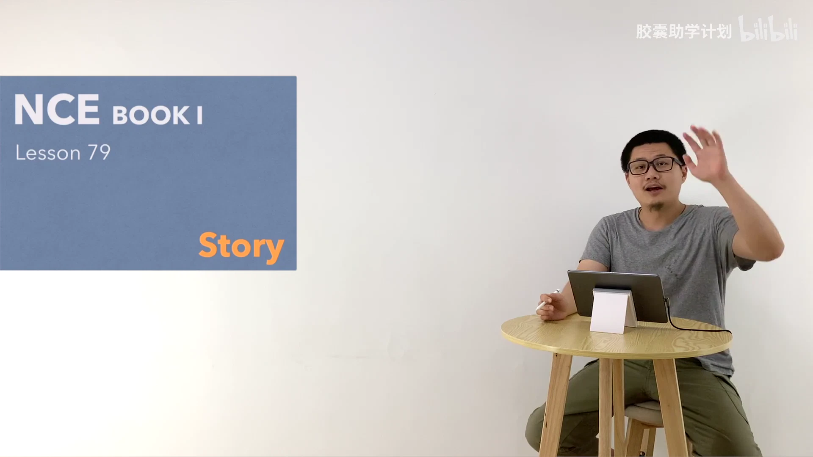

文字识别：Bilbili / 胶囊助学计划 / NCE / BOOKI / Lesson 79 / Story

### 画面 00:00:02

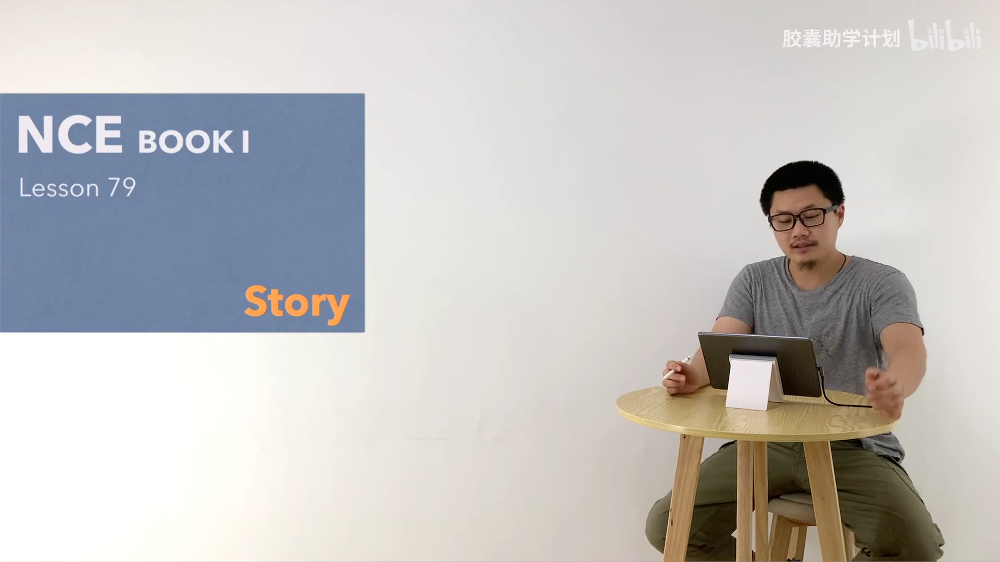

文字识别：Bilbili / 胶囊助学计划 / NCE / BOOKI / Lesson 79 / Story

### 画面 00:00:04

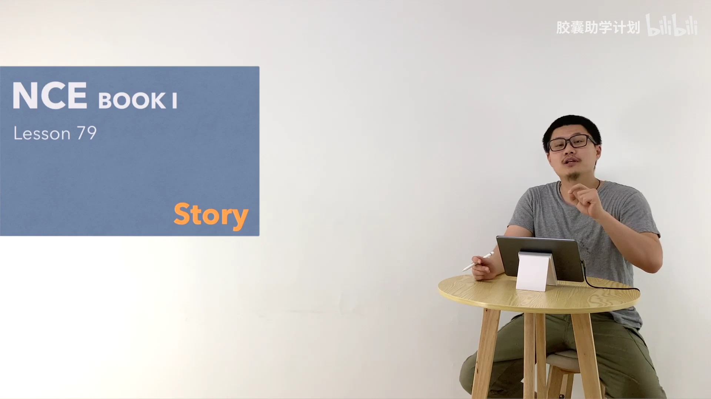

文字识别：bilbili / 胶囊助学计划 / NCE / BOOKI / Lesson 79 / Story

### 画面 00:00:08

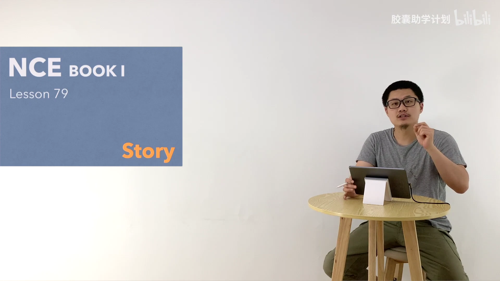

文字识别：Bilibili / 胶囊助学计划 / NCE / BOOKI / Lesson 79 / Story

### 画面 00:00:11

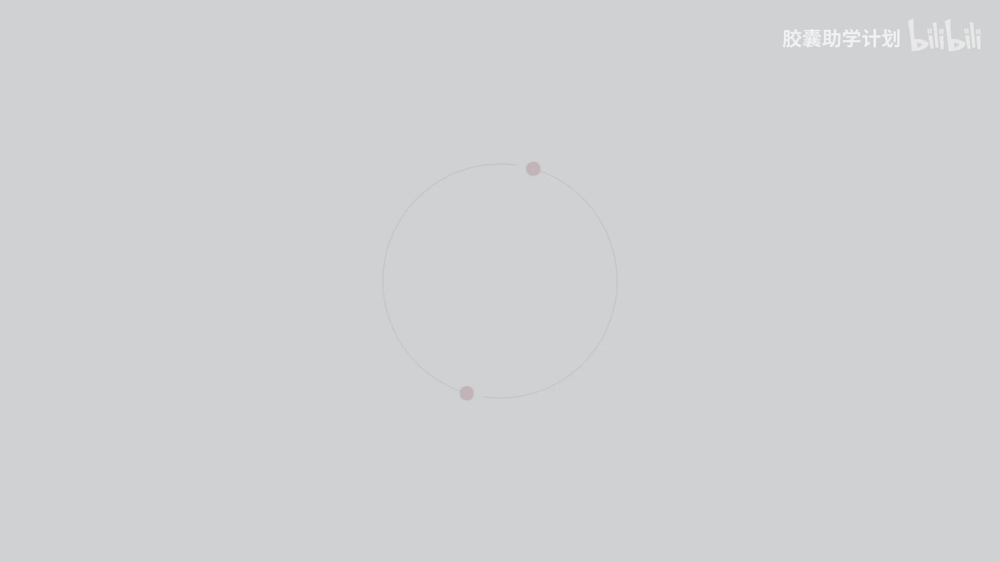

文字识别：胶囊助学计划bll / • / -

### 画面 00:00:14

文字识别：胶囊助学计划 / 胶囊助学计划

### 画面 00:00:16

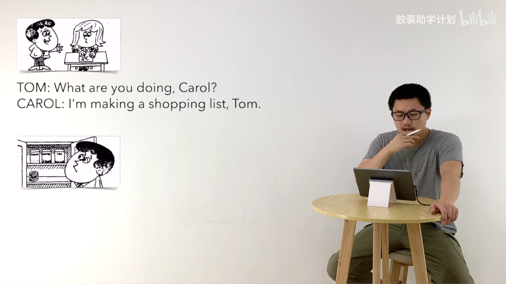

文字识别：bilibili / 胶囊助学计划 / TOM: What are you doing, Carol? / CAROL: I'm making a shopping list, Tom.

### 画面 00:00:28

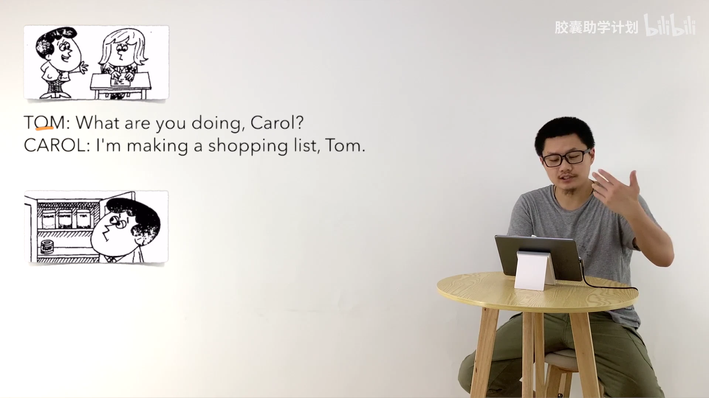

文字识别：BiiBili / 胶囊助学计划 / TOM: What are you doing, Carol? / CAROL: I'm making a shopping list, Tom.

## 00:00:30–00:01:00

在做一个什么呢？Shopping list啊，正在制作一个购物清单啊，正在写一个购物清单啊。What do we need?说我们需要什么东西呢？Tom问道。Carol说，We need a lot of things this week.说这周啊，我们需要很多很多的东西。OK，注意一个点叫做a lot of后边加了可数的一个单词，对吧？A lot of后边也可以加不可数，比如说a lot of money，叫

### 画面 00:00:36

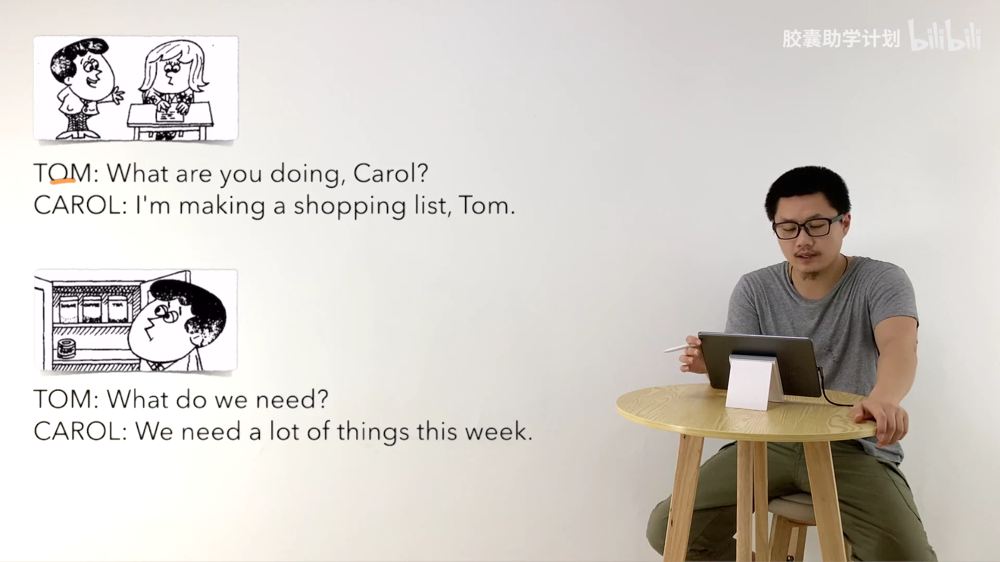

文字识别：bilbl / 胶囊助学计划 / TOM: What are you doing, Carol? / CAROL: I'm making a shopping list, Tom. / TOM: What do we need? / CAROL: We need a lot of things this week.

## 00:01:00–00:01:30

许多的意思. Continue. I must go to the grocers. I要去食品杂货店啊. I must go to the grocers. We haven't got.好了，这个就是我们在单词语法的那个视频当中有去学过的，叫做没有，对吧？Much tea or coffee.你看啊，它首先我们先注意几个小点，tea和coffee是不可数，所以前面它没有用

### 画面 00:01:01

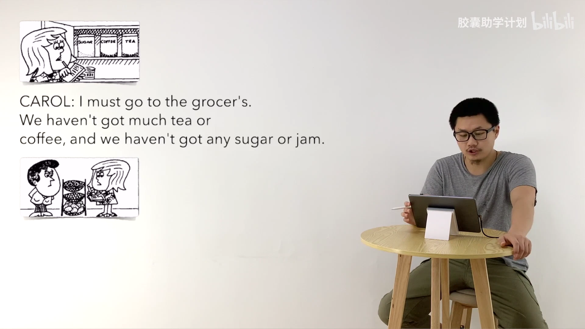

文字识别：胶囊助学计划lb出 / SUGARCOPTEETEA / CAROL: I must go to the grocer's. / We haven't got much tea or / coffee, and we haven't got any sugar or jam.

### 画面 00:01:16

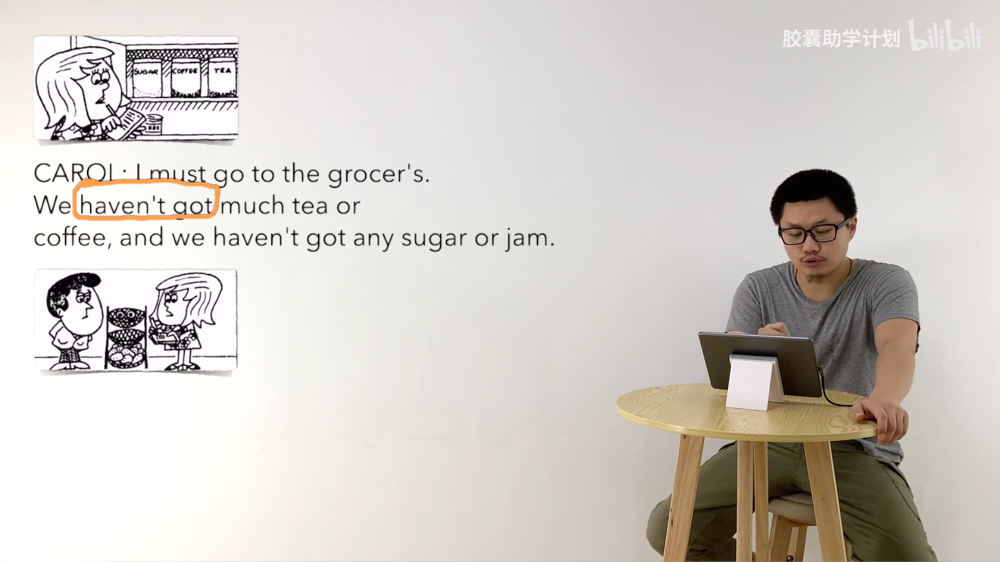

文字识别：胶囊助学计划 bilb出 / SUGARCOFTGETEA / CAROl· Lmust go to the grocer's. / Wehaven't aotmuch tea or / coffee, and we haven't got any sugar or jam.

### 画面 00:01:26

文字识别：Bilbili / 胶囊助学计划 / SUGARCOPPE / TEA / CAROl· Lmust go to the grocer's. / Wehaven't aotmuchtea or / coffeeand we haven't got any sugar or jam.

### 画面 00:01:28

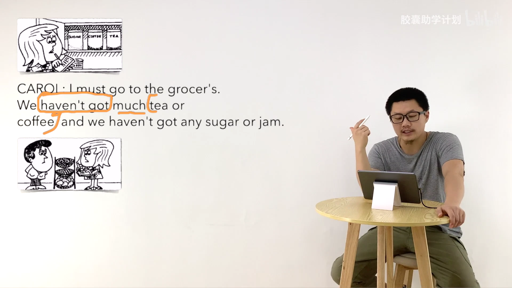

文字识别：胶囊助学计划 / SUGARKOPGE / TEA / CAROl· Lmust go to the grocer's. / Wehaven't aotmuchtea or / coffeeand we haven't got any sugar or jam.

## 00:01:30–00:02:00

many，用的是 much，对吧？其次呢， much 这个单词它表示许多。说我们没有许多的茶和咖啡了。那到底是有还是没有呢？答案叫做有但不多。所以您看这个图啊，其实画的还挺考究的，是吧？有但不多了，对吧？Okay， and we haven't got any sugar or jam。说然后呢，我们也没有 haven't got 没有任何

### 画面 00:01:37

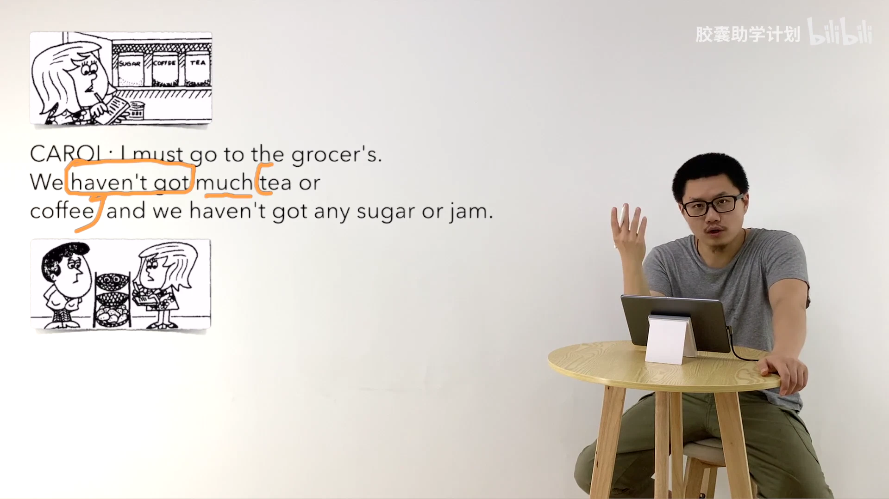

文字识别：bilbil / 胶囊助学计划 / SUGARKOPGE / TEA / CAROl· Lmust go to the grocer's. / Wehaven't aotmuchtea or / coffeeand we haven't got any sugar or jam.

### 画面 00:01:49

文字识别：bilbli / 胶囊助学计划 / COFTGE / CAROl · Lmust go to the grocer's. / Wehaven't aotmuchtea or / coffeeand we haven't got any sugar or jam.

### 画面 00:01:59

文字识别：Bilbli / 胶囊助学计划 / COFIGE / CAROl· Lmust go to the grocer's. / Wehaven't aotmuchtea or / coffeeand we haven't got a / ány / sugar or jam.

## 00:02:00–00:02:30

的糖或者果酱了啊！那这个图就画的不是太考究了，是吧？它还是给留了点儿，是吧？理论上来说就是一点都没了，对吧？或者很少很少，几乎可以忽略不计了。OK，好，接下来那 what about vegetables？那蔬菜呢？What about vegetables？蔬菜呢？啊，I must go to the green grocers. 我也必须得去这个蔬菜水果商那个地方啊！你看现在就是都去超市了，supermarket

### 画面 00:02:05

文字识别：bilibli / 胶囊助学计划 / OFYGE / CAROl· Lmust go to the grocer's. / We haven't aotmuchtea or / coffeeand we haven't got / any / sugar or jam.

### 画面 00:02:13

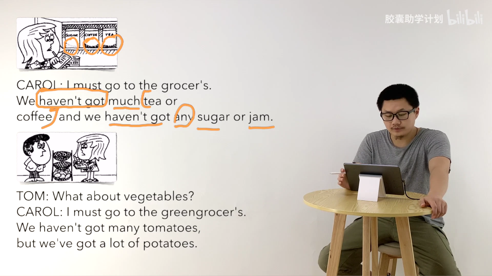

文字识别：胶囊助学计划bib出 / KCOFYGE / CAROl· Lmust go to the grocer's. / Wehaven't aotmuchtea or / coffee and we haven't got / sugar or jam. / any / TOM: What about vegetables? / CAROL: I must go to the greengrocer's. / We haven't got many tomatoes, / but we've got a lot of potatoes.

### 画面 00:02:18

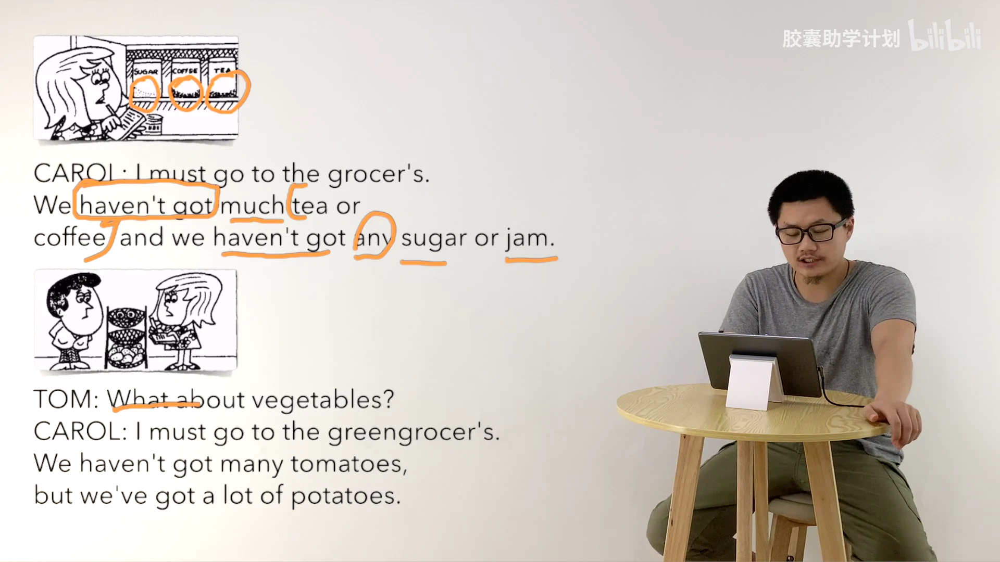

文字识别：Bilbili / 胶囊助学计划 / COFTGE / CAROl· Lmust go to the grocer's. / Wehaven't aotmuchtea or / coffeeand we haven't got / sugar or jam. / any / TOM: What about vegetables? / CAROL: I must go to the greengrocer's. / We haven't got many tomatoes, / but we've got a lot of potatoes.

### 画面 00:02:20

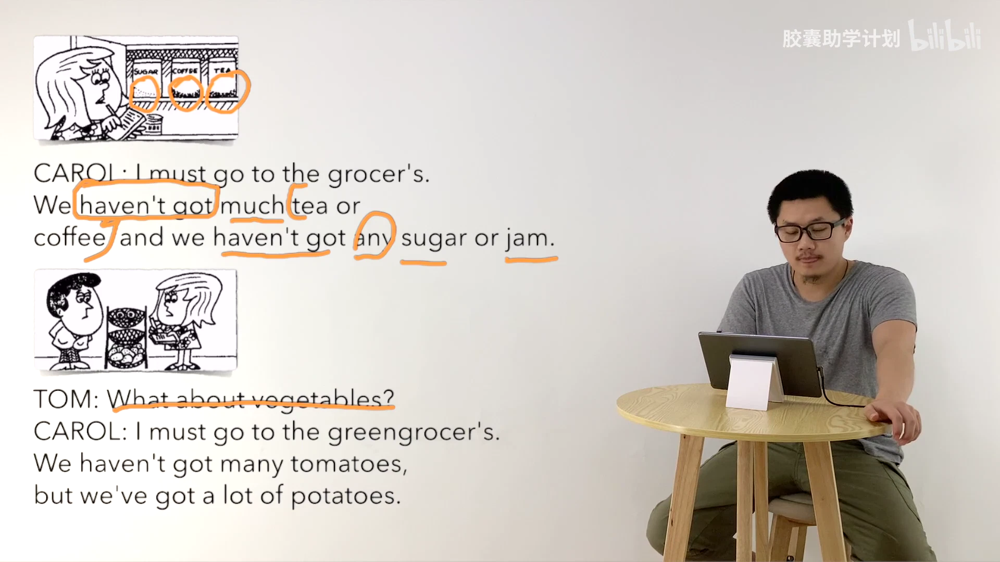

文字识别：刘bilbili / 胶囊助学计划 / KCOFTGE / CAROl· Lmust go to the grocer's. / Wehaven't aotmuchtea or / coffeeand we haven't got / sugar or jam. / any / TOM: What about vegetables? / CAROL: I must go to the greengrocer's. / We haven't got many tomatoes, / but we've got a lot of potatoes.

### 画面 00:02:25

文字识别：胶囊助学计划bl出 / COFTGE / CAROl· Lmust go to the grocer's. / Wehaven't aotmuchtea or / coffeeand we haven't got / any / sugar or jam. / TOM: What about vegetables? / CAROL: I must go to the greengrocer's. / We haven't got many tomatoes, / but we've got a lot of potatoes.

### 画面 00:02:29

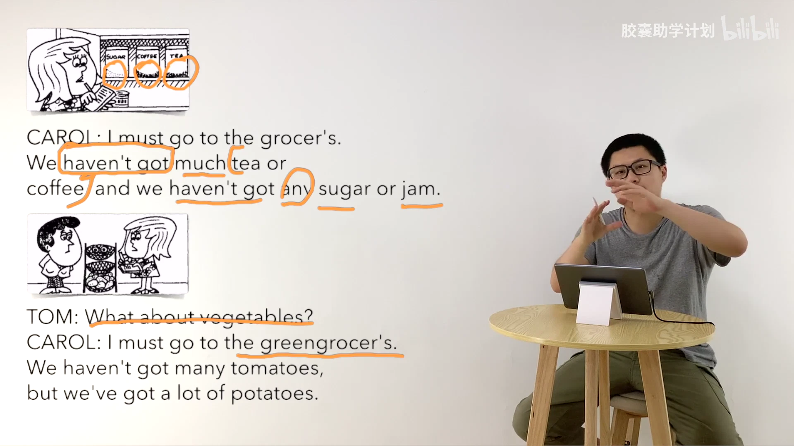

文字识别：Bilbili / 胶囊助学计划 / COFTGE / CAROl · Lmust go to the grocer's. / Wehaven't aotmuchtea or / coffeeand we haven't got / sugar or jam. / any / TOM: What about vegetables? / CAROL: I must go to the greengrocer's. / We haven't got many tomatoes, / but we've got a lot of potatoes.

## 00:02:30–00:03:00

全搞定了，对吧？We haven't got说我们没有many tomatoes，没有许多的tomatoes了，没有许多的西红柿了。哎，你看这儿呢，tomatoes，对吧？But we've got a lot of potatoes，但是我们有许多的什么呢？土豆。OK，好，注意几个小点。Many给它放在了否定句当中，对吧？后面加的是可数单词。A lot

### 画面 00:02:31

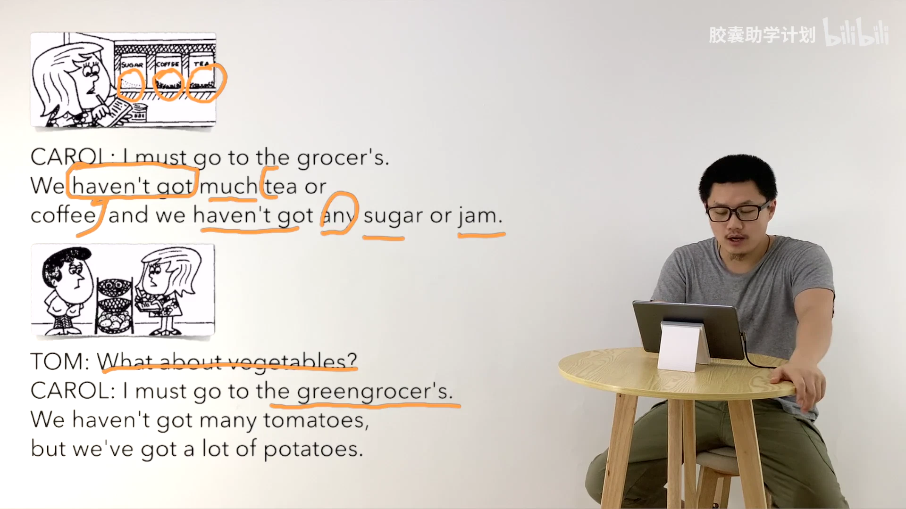

文字识别：胶囊助学计划b出b出 / COFTGE / CAROl· Lmust go to the grocer's. / Wehaven't aotmuchtea or / coffee and we haven't got / sugar or jam. / any / TOM: What about vegetables? / CAROL: I must go to the greengrocer's. / We haven't got many tomatoes, / but we've got a lot of potatoes.

### 画面 00:02:34

文字识别：biibili / 胶囊助学计划 / COFTGE / CAROl· Lmust go to the grocer's. / Wehaven't aotmuchtea or / coffeeand we haven't got / any / sugar or jam. / TOM: What about vegetables? / CAROL: I must go to the greengrocer's. / We haven't got many tomatoes, / but we've got a lot of potatoes.

### 画面 00:02:38

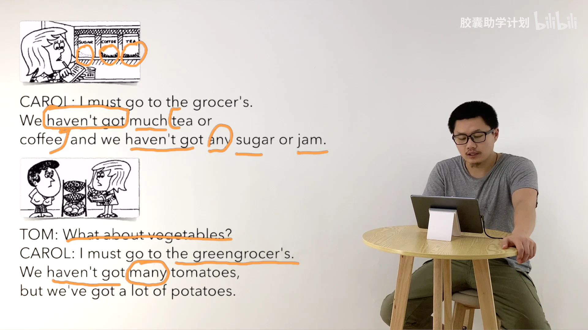

文字识别：bilbili / 胶囊助学计划 / COFTGE / CAROl· Lmust go to the grocer's. / Wehaven't aotmuchtea or / coffeeand we haven't got / any / sugar or jam. / TOM: What about vegetables? / CAROL: I must go to the greengrocer's. / We haven't gotmanytomatoes, / but we've got a lot of potatoes.

### 画面 00:02:41

文字识别：Biibili / 胶囊助学计划 / COFTGE / CAROl · Lmust go to the grocer's. / Wehaven't aotmuchtea or / coffeeand we haven't got / sugar or jam. / any / TOM: What about / t vegetables? / CAROL: I must go to the greengrocer's. / We haven't gotmanytomatoes / but we've got a lot of potatoes.

### 画面 00:02:44

文字识别：biltbli / 胶囊助学计划 / COFTGE / CAROl· Lmust go to the grocer's. / Wehaven't aotmuchtea or / coffeeand we haven't got / any / sugar or jam. / TOM: What about / t vegetables? / CAROL: I must go to the greengrocer's. / We haven't gotmanyt / tomatoes. / but we've got a lot of potatoes.

### 画面 00:02:46

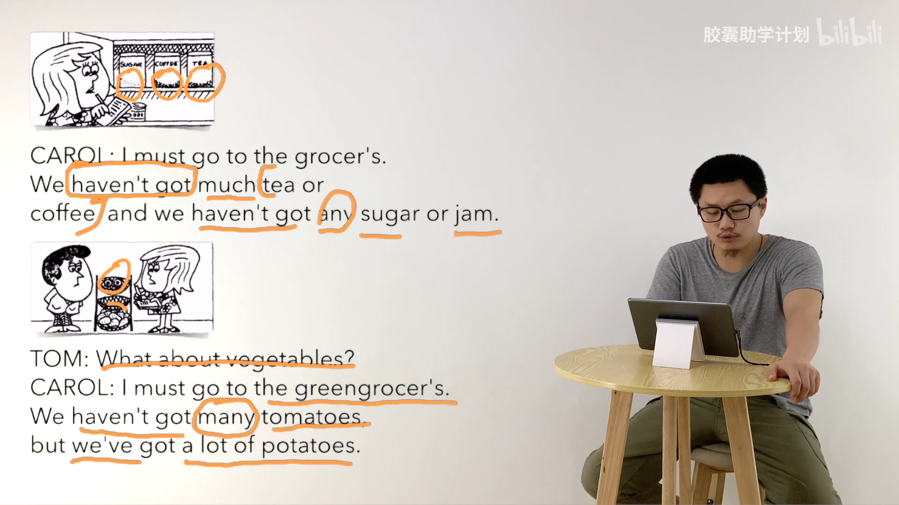

文字识别：biltbli / 胶囊助学计划 / COFTGE / CAROL· Lmust go to the grocer's. / Wehaven't aotmuchtea or / coffeeand we haven't got / any / sugar or jam. / 2 / TOM: What about / t vegetables? / CAROL: I must go to the greengrocer's. / We haven't gotmanytomatoes / but we've got a lot of potatoes.

### 画面 00:02:51

文字识别：bilbii / 胶囊助学计划 / COFTGE / CAROl· Lmust go to the grocer's. / Wehaven't aotmuchtea or / coffeeand we haven't got / any / sugar or jam. / TOM: What about / it vogetables? / CAROL: I must go to the greengrocer's. / We haven't gotmanytomatoes, / but we've got a lot of potatoes.

### 画面 00:02:53

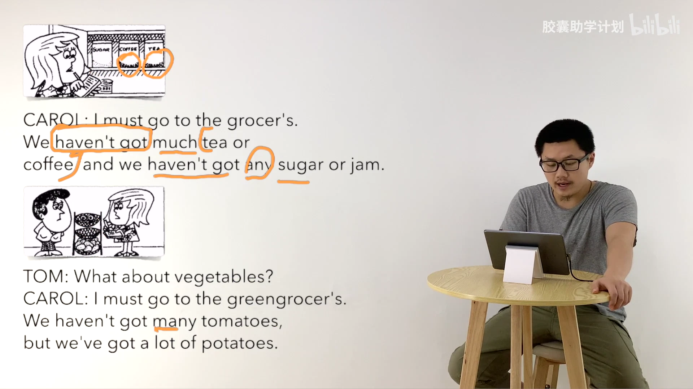

文字识别：Bilbili / 胶囊助学计划 / SUGAR / COFTGE / CAROl· Lmust go to the grocer's. / Wehaven't aotmuchtea or / coffeeand we haven't got / sugar or jam. / any / TOM: What about vegetables? / CAROL: I must go to the greengrocer's. / We haven't got many tomatoes, / but we've got a lot of potatoes.

### 画面 00:02:56

文字识别：胶囊助学计划bl出 / GAR / COFYGE / CAROl· Lmust go to the grocer's. / Wehaven't aotmuchtea or / coffeeand we haven't got / any / sugar or jam. / TOM: What about vegetables? / CAROL: I must go to the greengrocer's. / We haven't got many tomatoes, / but we've got a lot of potatoes.

## 00:03:00–00:03:30

of肯定句当中后边是可数单词。OK，好，continue. I must go to the butchers too.我也必须得去屠夫那个地方，也就是说所谓的叫肉店，对吧？We need some meat.我们需要一些肉。We haven't got any meat at all.啊，not at all.我们之前学过叫一点儿也不，对吧？我们一点儿肉都没有了啊。这个就是你看这个图画的就比较讲究了，就是在

### 画面 00:03:00

文字识别：bilbli / 胶囊助学计划 / COFTGE / CAROL· Lmust go to the grocer's. / Wehaven't aotmuchtea or / coffeeand we haven't got / sugar or jam. / any / TOM: What about vegetables? / CAROL: I must go to the greengrocer's. / We haven't got many tomatoes, / but we've got a lot of potatoes.

### 画面 00:03:05

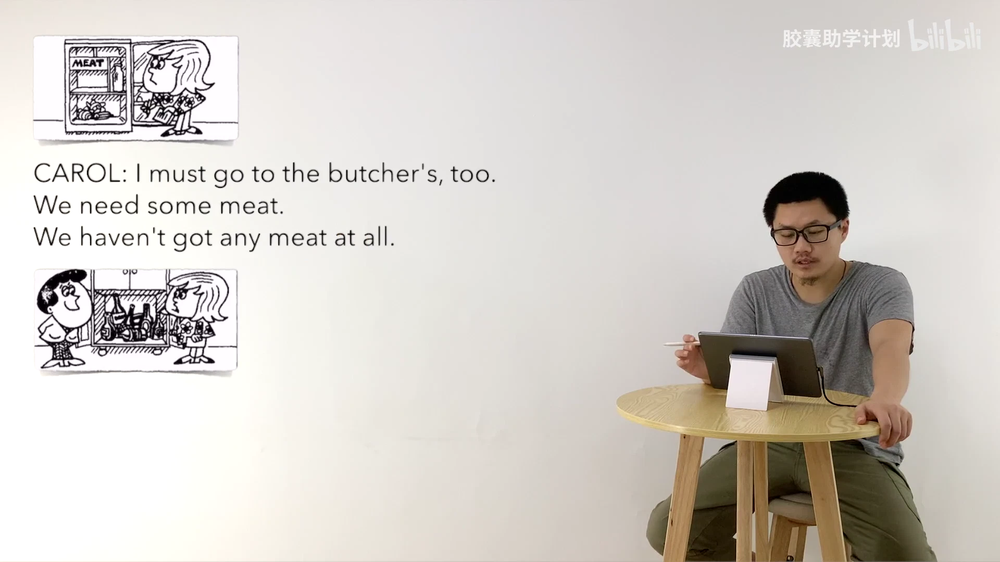

文字识别：胶囊助学计划 bilbl / MEAT / CAROL: I must go to the butcher's, too. / We need some meat. / We haven't got any meat at all. / 7

### 画面 00:03:10

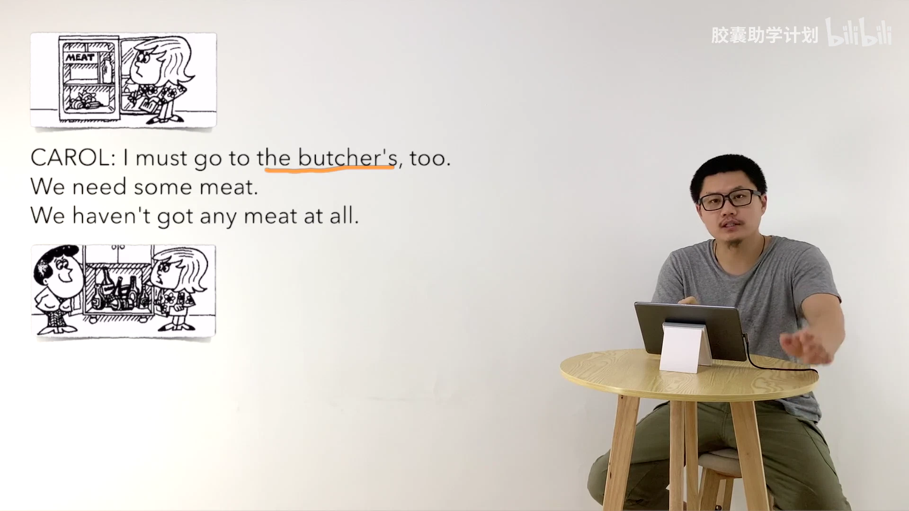

文字识别：胶囊助学计划bil出 / MEAT / CAROL: I must go to the butcher's, too. / We need some meat. / We haven't got any meat at all. / 7

### 画面 00:03:17

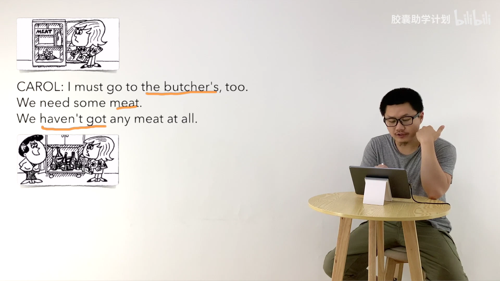

文字识别：胶囊助学计划 / MEAT / CAROL: I must go to the butcher's, too. / We need some meat. / We haven't got any meat at all.

### 画面 00:03:19

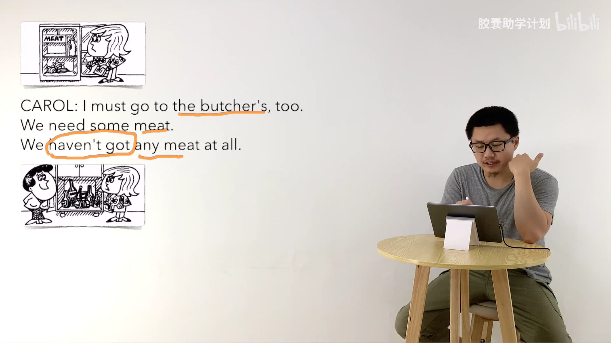

文字识别：胶囊助学计划 / MEAT / CAROL: I must go to the butcher's, too. / We need some meat. / Wenaven't got any meat at all. / 7

### 画面 00:03:21

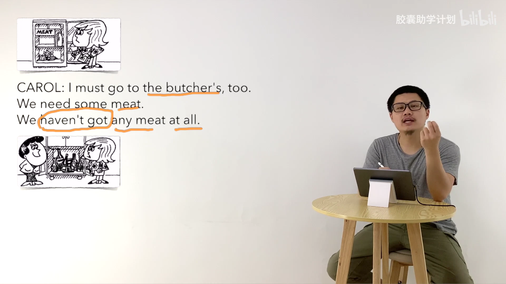

文字识别：胶囊助学计划blb出 / MEAT / CAROL: I must go to the butcher's, too. / We need some meat. / Wenaven't got any meat at all.

### 画面 00:03:28

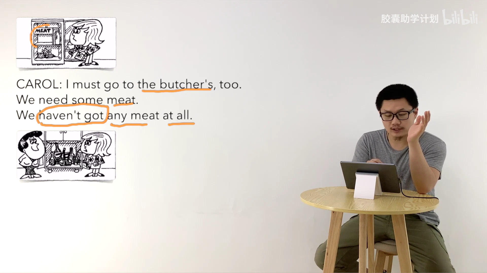

文字识别：bilb出 / 胶囊助学计划 / CAROL: I must go to the butcher's, too. / We need some meat. / Wenaven't got any meat at all.

## 00:03:30–00:04:00

meat 这个篮啊，这个底下是一点东西都没有的。 Okay, continue. Have we got? 哎，一般疑问句 have 提前，我们有没有 any beer and wine？有没有任何的酒或者红酒啊，啤酒或红酒了呢？ No, we haven't. 其实它这地方的给它补全了是什么呢？叫做 No, we haven't got any beer and wine. Okay, and I'm not going to get any.

### 画面 00:03:31

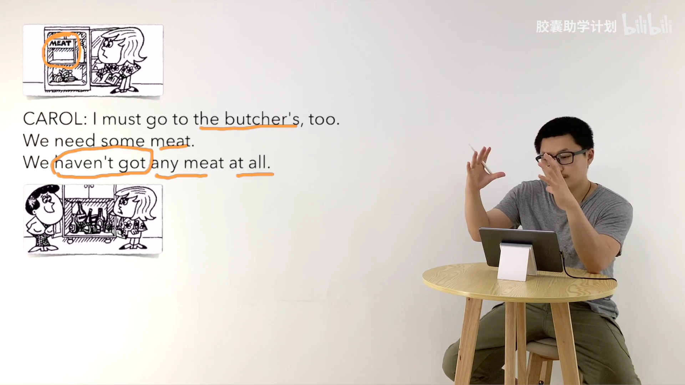

文字识别：胶囊助学计划 / MEAT / CAROL: I must go to the butcher's, too. / We need some meat. / Wenaven't got any meat at all.

### 画面 00:03:35

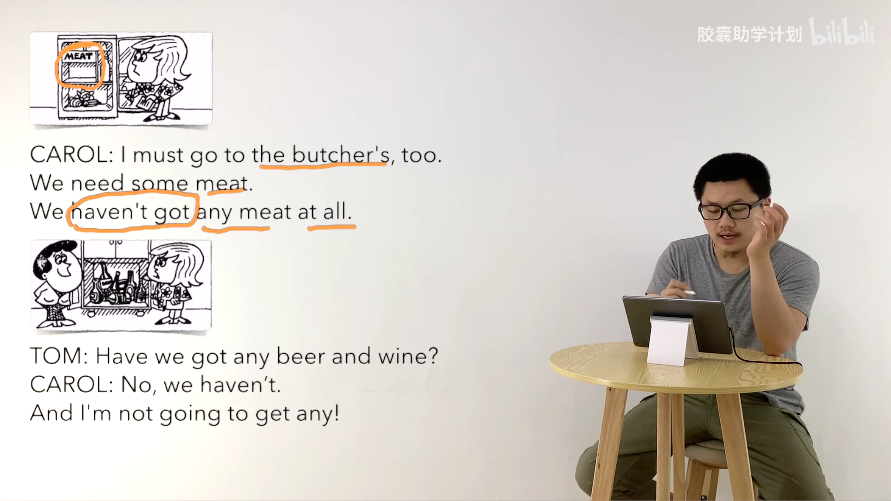

文字识别：胶囊助学计划bilbl / MEAT / CAROL: I must go to the butcher's, too. / We need some meat. / Wenaven't got any meat at all. / TOM: Have we got any beer and wine? / CAROL: No, we haven't. / And I'm not going to get any!

### 画面 00:03:40

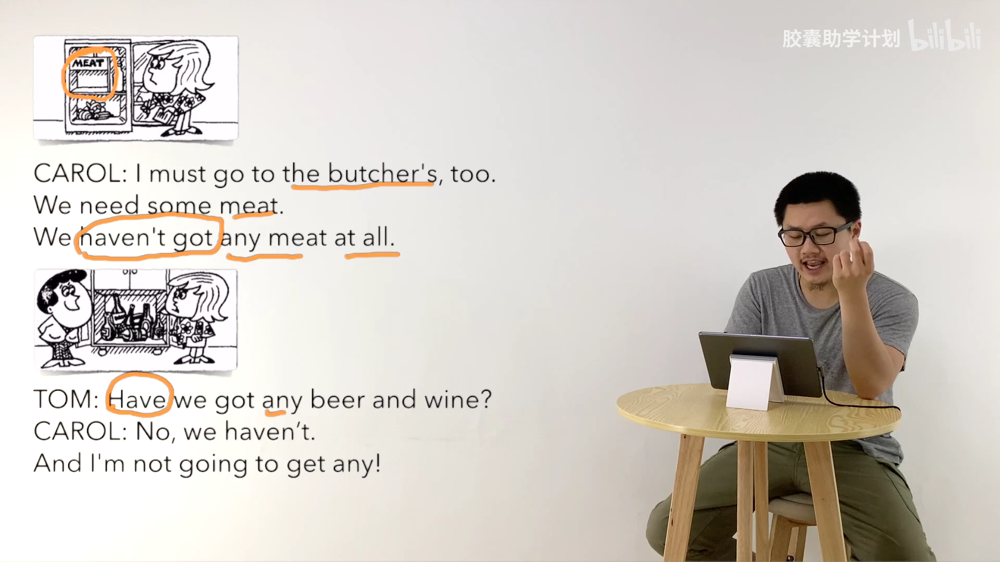

文字识别：Bibl / 胶囊助学计划 / MEAT / CAROL: I must go to the butcher's, too. / We need some meat. / Wenaven't got any meat at all. / TOM: Have we got any beer and wine? / CAROL: No, we haven't. / And I'm not going to get any!

### 画面 00:03:42

文字识别：胶囊助学计划blb出 / MEAT / CAROL: I must go to the butcher's, too. / We need some meat. / Wenaven't got any meat at all. / TOM: Have we got any beer and wine? / CAROL: No, we haven't. / And I'm not going to get any!

## 00:04:00–00:04:30

然后呢，我也不打算 be going to do，对吧？一般将来时，也不打算去 get any. Get 万能动词，我们之前已经见过了，买鞋那一课，对吧？好，get在这儿就可以理解为是 buy 啊，我也不打算买一些啊，我一打一点儿我也不打算买。两个人最后聊了一句说，I hope that.好，这儿第一个事儿啊，我们已经连着做过好几遍了，九十九课一百零一课，我们见分晓。就是 that 先来个叉，不管

### 画面 00:04:12

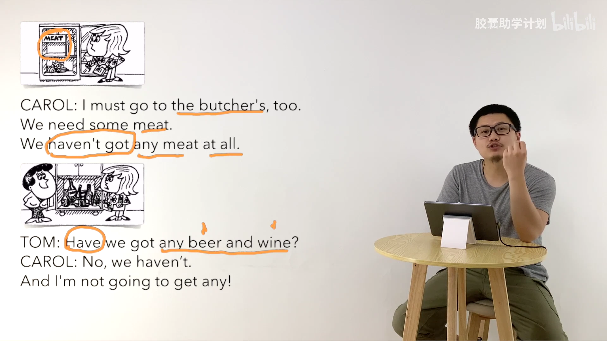

文字识别：胶囊助学计划 / Bilbil / MEAT / CAROL: I must go to the butcher's, too. / We need some meat. / Wenaven't got any meat at all. / TOM: Have we got any beer and wine? / CAROL: No, we haven't. / And I'm not going to get any!

### 画面 00:04:19

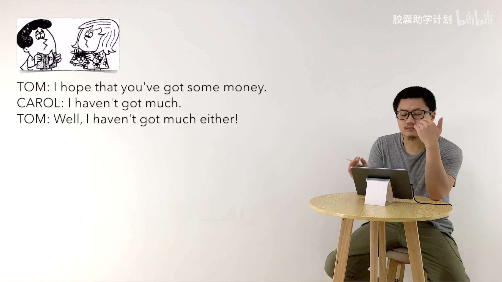

文字识别：胶囊助学计划 / TOM: I hope that you've got some money. / CAROL: I haven't got much. / TOM: Well I haven't got much either!

### 画面 00:04:28

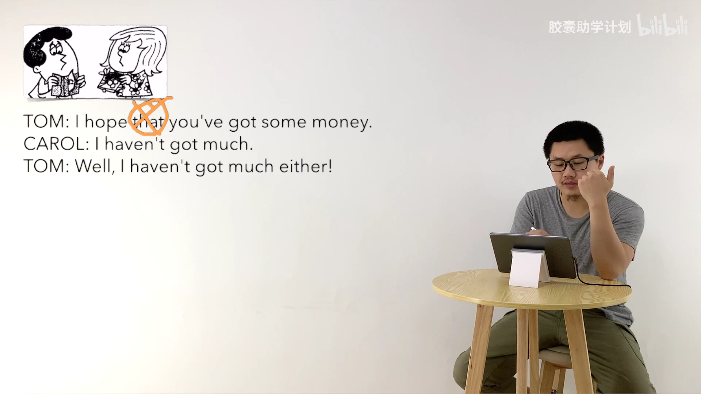

文字识别：bilbil / 胶囊助学计划 / TOM: Ihope / you've got some money. / CAROL: I haven't got much. / TOM: Well, I haven't got much either!

## 00:04:30–00:05:00

它。 I hope 我希望 you've got some money。 注意这个撇为 e 是 have 拥有啊。说你呀有一些钱。 I haven't got much。 我没有许多啊。你看 Carol 说的这句话，你看 Carol 钱包里还是有一点的，有但不多，对吧？ Much，并且后边其实加的就是 money。各位不妨就把 much 后边这个地方补一个单词叫做 money。 OK，没有许多的钱。 Well， well

### 画面 00:04:58

文字识别：Biltbili / 胶囊助学计划 / TOM: Ihope / you've got some money. / CAROL: I haven't got much. / TOM: Well, I haven't got much either!

## 00:05:00–00:05:30

就是一个口头禅，就是啊，好吧，啊，I haven't got much either.啊，或者是either，它有两个发音都是对的。我也没有许多了。Very good.那接下来呢，我们进入comprehension口语听力练习。我问您答，看着文章啊，来了。第一题，Is Tom making a shopping list? No, he isn't. Next one. Who is making a shopping

### 画面 00:05:00

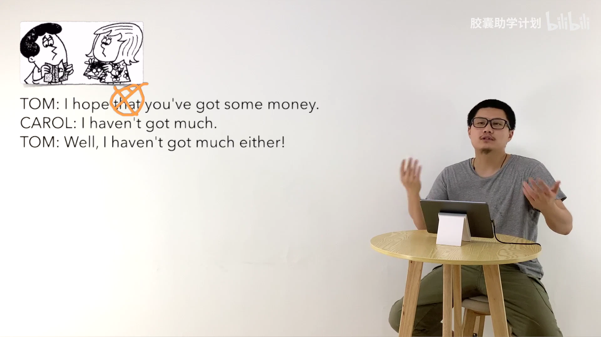

文字识别：胶囊助学计划 / TOM:Ihope / you've got some money. / CAROL: I haven't got much. / TOM: Well, I haven't got much either!

### 画面 00:05:11

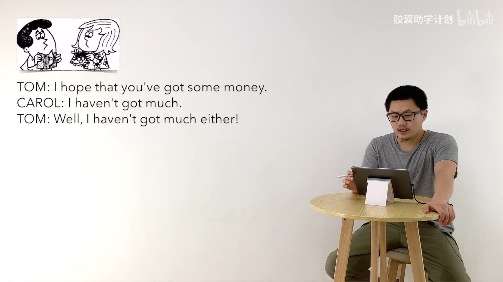

文字识别：胶囊助学计划 / TOM: I hope that you've got some money. / CAROL: Ihaven't got much. / TOM: Well, I haven't got much either!

### 画面 00:05:13

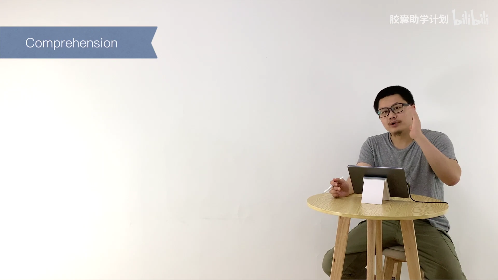

文字识别：bilbi / 胶囊助学计划 / Comprehension / の

### 画面 00:05:16

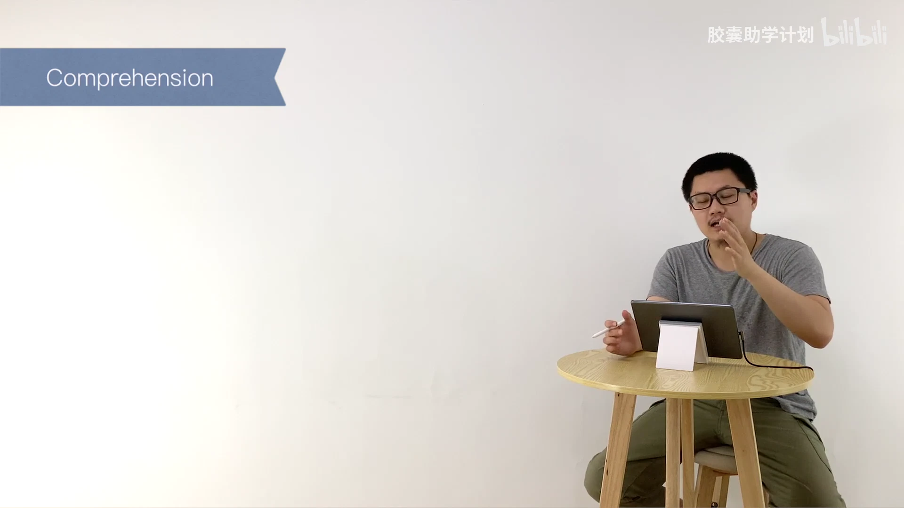

文字识别：Bilbil / 胶囊助学计划 / Comprehension

### 画面 00:05:18

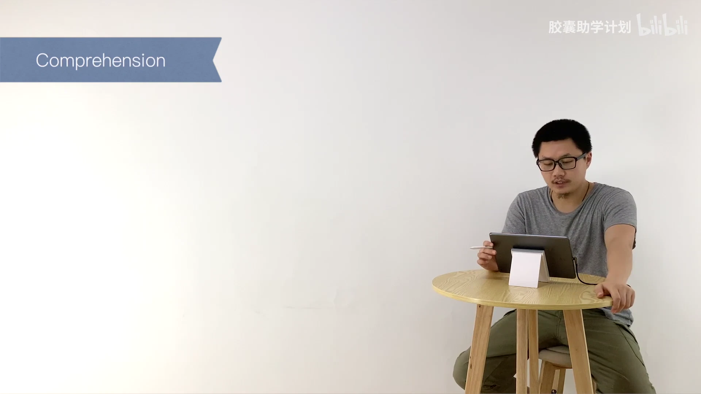

文字识别：Bilbili / 胶囊助学计划 / Comprehension

## 00:05:30–00:06:00

list? Carol is. Next one, what do they need this week? They need a lot of things. Next one, is she going to the grocers? Yes, she is. Next one, have they got any tea and sugar? No, they haven't got much tea and sugar. Next one,

### 画面 00:05:38

文字识别：bilbil / 胶囊助学计划 / Comprehension / 3 T: What do they need this week? / S: They need a lot of things.

### 画面 00:05:42

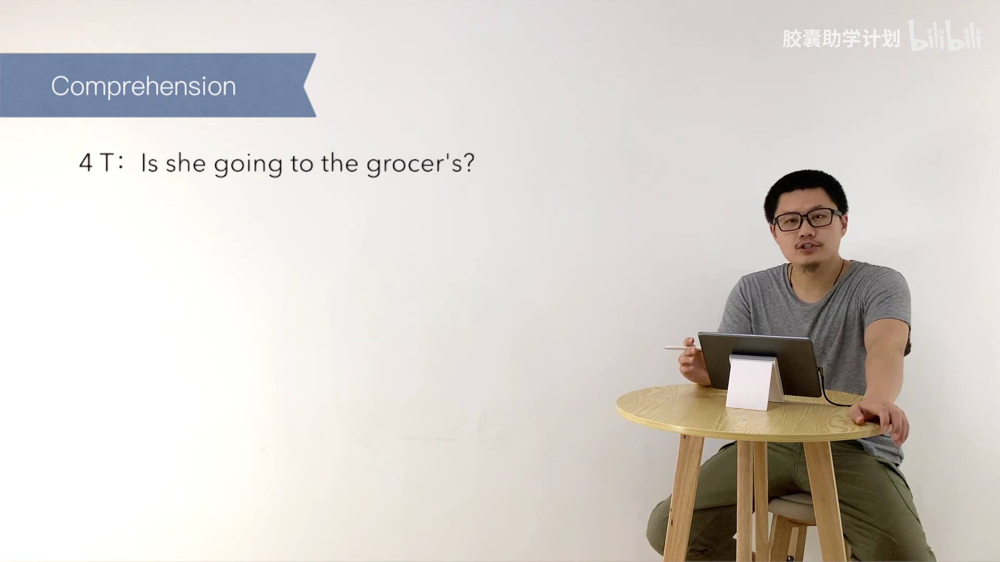

文字识别：Biibl / 胶囊助学计划 / Comprehension / 4 T: Is she going to the grocer's?

### 画面 00:05:53

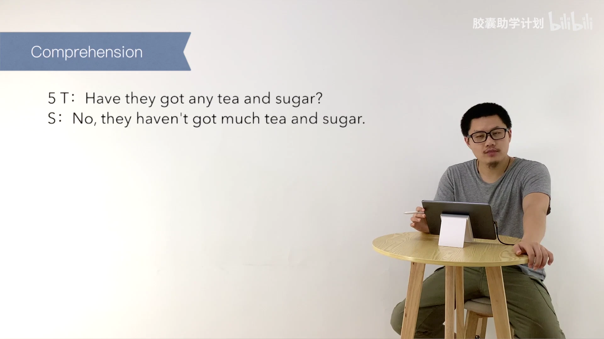

文字识别：bib业 / 胶囊助学计划 / Comprehension / 5 T: Have they got any tea and sugar? / S: No, they haven't got much tea and sugar.

### 画面 00:05:59

文字识别：Bilbili / 胶囊助学计划 / Comprehension / 6 T: Is she going to the greengrocer's?

## 00:06:00–00:06:30

is she going to the green grocers? Yes, she is. Next one, why must she go to the green grocers? Because they haven't got much tomatoes. What tomatoes? 两发音都OK. Have they got any meat? No, they haven't got any at all. Next one, is she going to get any beer

### 画面 00:06:08

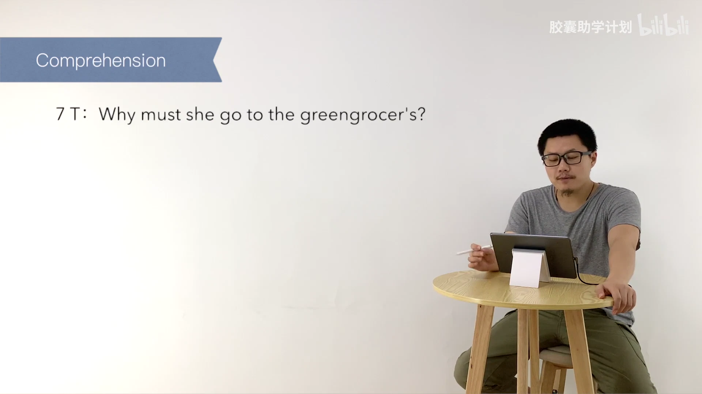

文字识别：Bilibili / 胶囊助学计划 / Comprehension / 7 T: Why must she go to the greengrocer's?

### 画面 00:06:22

文字识别：blbil / 胶囊助学计划 / Comprehension / 8 T: Have they got any meat? / S: No, they haven't got any at all.

### 画面 00:06:26

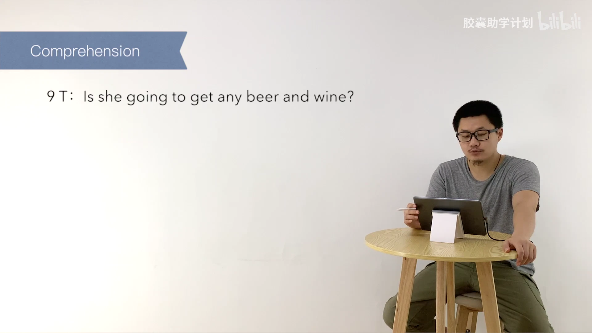

文字识别：Biibl / 胶囊助学计划 / Comprehension / 9 T: Is she going to get any beer and wine?

## 00:06:30–00:07:00

and wine? No, she isn't. One. Have they got much money? No, they haven't. One. Asking questions. 我给大家肯定句演变一般疑问句。我给特殊疑问词演变特殊疑问句来了. Ask me if Carol is making a shopping list. Is Carol making a shopping list? Why?

### 画面 00:06:41

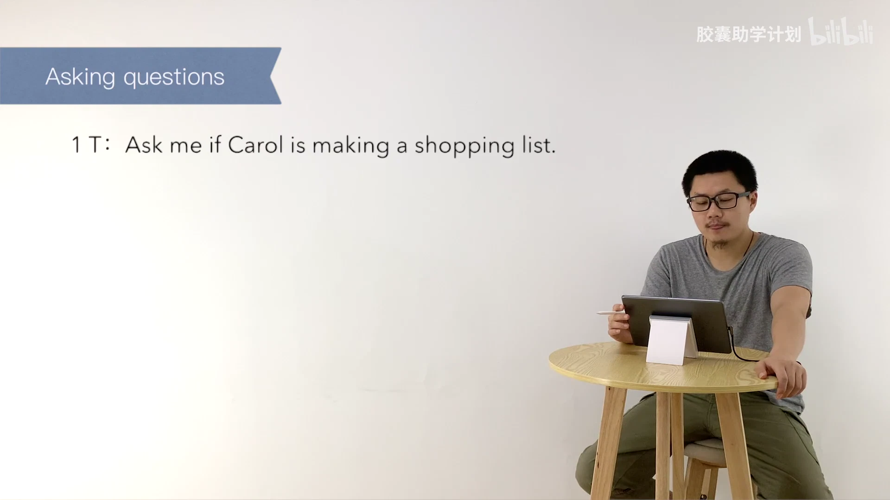

文字识别：胶囊助学计划 / Asking questions / 1 T: Ask me if Carol is making a shopping list.

## 00:07:00–00:07:30

why is Carol making a shopping list? Next one, ask me if they need a lot of things. Do they need a lot of things? What, what do they need? Next one, ask me if Carol must go to the grocers. Must Carol go to the grocers? Where, where

### 画面 00:07:00

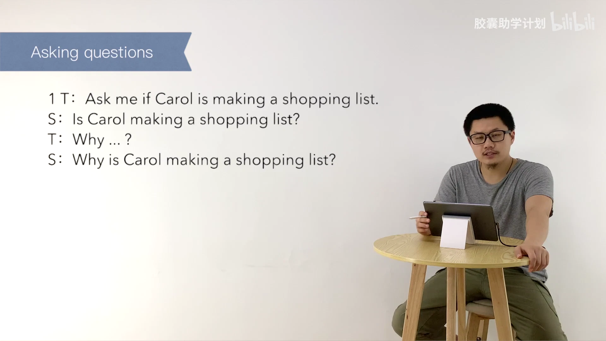

文字识别：胶囊助学计划 / Asking questions / 1 T: Ask me if Carol is making a shopping list. / S: Is Carol making a shopping list? / T：Why …? / S: Why is Carol making a shopping list?

### 画面 00:07:04

文字识别：bilbil / 胶囊助学计划 / Asking questions / 2 T: Ask me if they need a lot of things.

### 画面 00:07:27

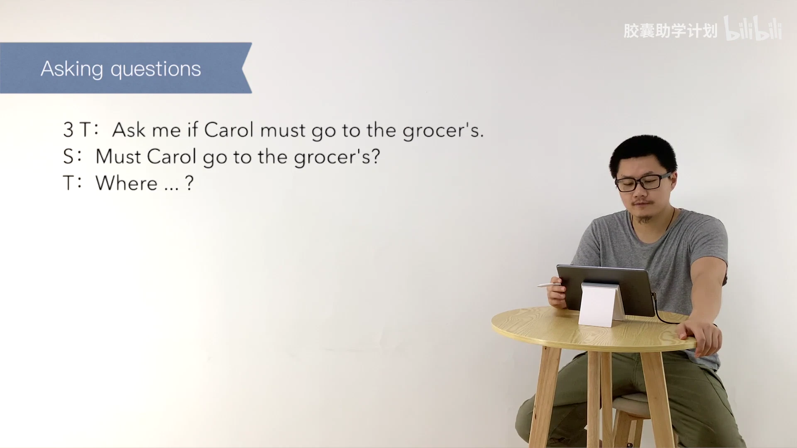

文字识别：Bilbili / 胶囊助学计划 / Asking questions / 3 T: Ask me if Carol must go to the grocer's. / S: Must Carol go to the grocer's? / T: Where ..?

## 00:07:30–00:08:00

must Carol go? Next one, ask me if she's going to get beer and wine. Answer is she going to get beer and wine? Next one, ask me if they have got much money.反疑问句 Have they got much money? Okay,好recap本课，在文章还是在复习. Have

### 画面 00:07:33

文字识别：bilbili / 胶囊助学计划 / Asking questions / 4 T: Ask me if she's going to get beer and wine

### 画面 00:07:48

文字识别：胶囊助学计划 / Asking questions / 5 T: Ask me if they have got much money. / S: Have they got much money?

### 画面 00:07:52

文字识别：Bilbili / 胶囊助学计划 / Recap / Patterns / have got / many / Grammar / much / Words / Expression

### 画面 00:07:54

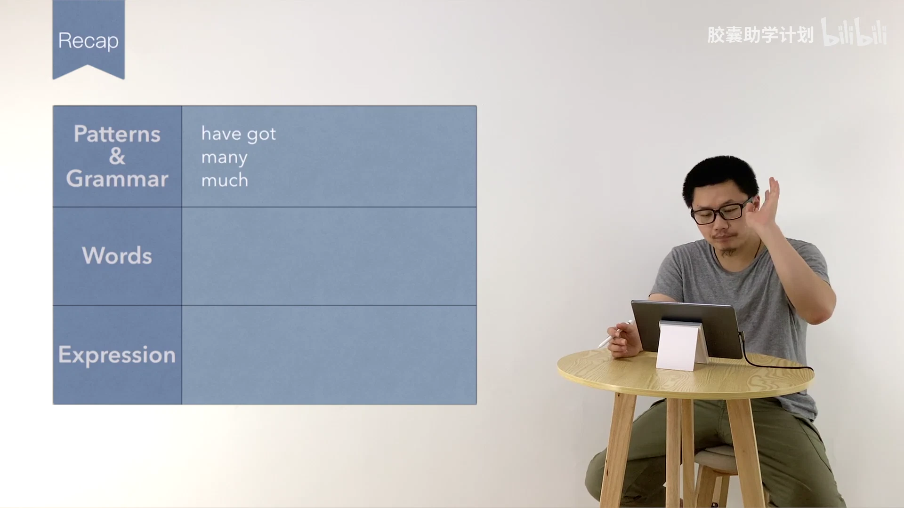

文字识别：bilbili / 胶囊助学计划 / Recap / Patterns / have got / many / Grammar / much / Words / Expression

### 画面 00:07:57

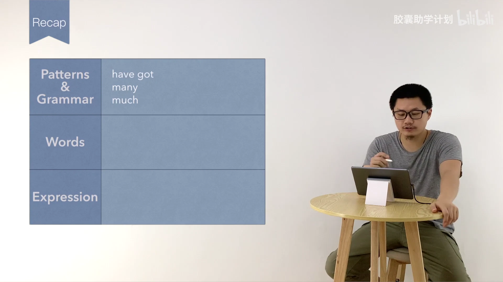

文字识别：胶囊助学计划 / Recap / Patterns / have got / many / Grammar / much / Words / Expression

## 00:08:00–00:08:30

got a lot of many much these words. Okay,嗯，那我们看一下本课的家作业啊，绿皮书七十九课写作练习，各位可以进行了。文章老习惯一定要熟读成诵，张开嘴多跟读，好吧。接下来呢，给自己讲解一遍今天的核心知识点。如果大家喜欢我们的课程，欢迎大家关注订阅啊，一键三连支持，并分享给那些需要的朋友。最后，我们再来看一句名人名言：

### 画面 00:08:05

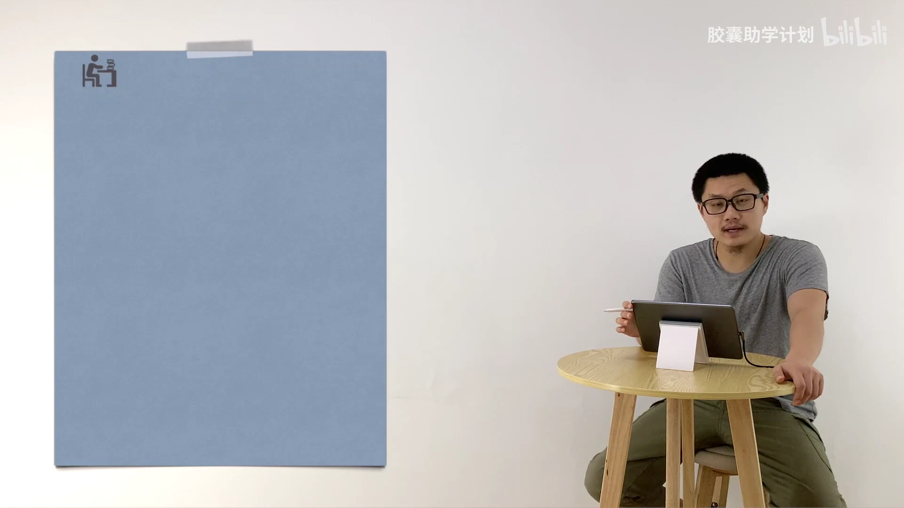

文字识别：胶囊助学计划bi出

### 画面 00:08:18

文字识别：胶囊助学计划bilb出

### 画面 00:08:27

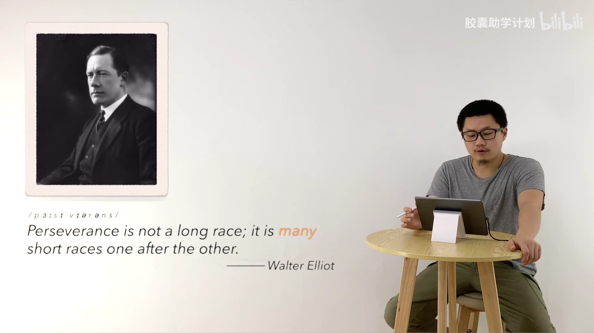

文字识别：胶囊助学计划b鼎b出 / /p3:sIvIarans/ / Perseverance is not a long race; it is many / short races one after the other. / Walter Elliot

## 00:08:30–00:08:53

Perseverance is not a long race; it is many short races, one after the other. See you next time.

### 画面 00:08:40

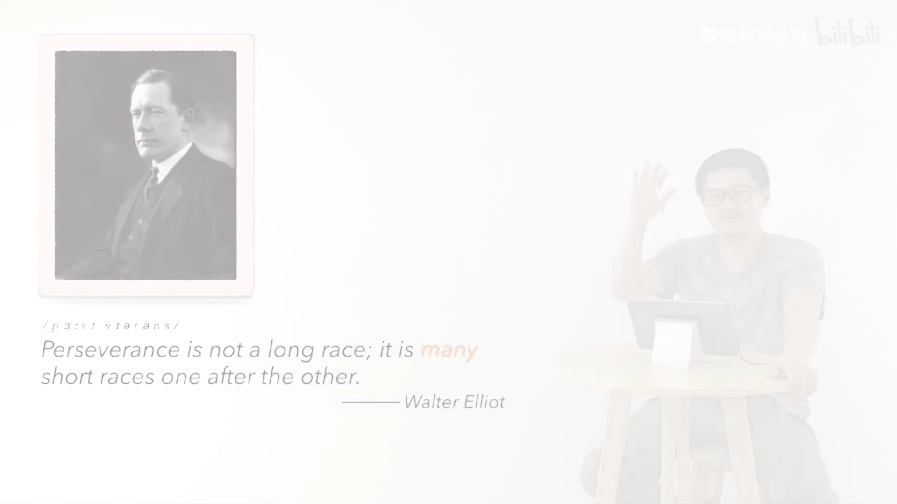

文字识别：/p3isIvIarans/ / Perseverance is not a long race; it is many / short races one after the other. / Walter Elliot

### 画面 00:08:42

文字识别：CAPSULEACADEMY / 胶囊助学计划 / 小红书 / Lecturer / □ / Leo / 8 / OE

### 画面 00:08:45

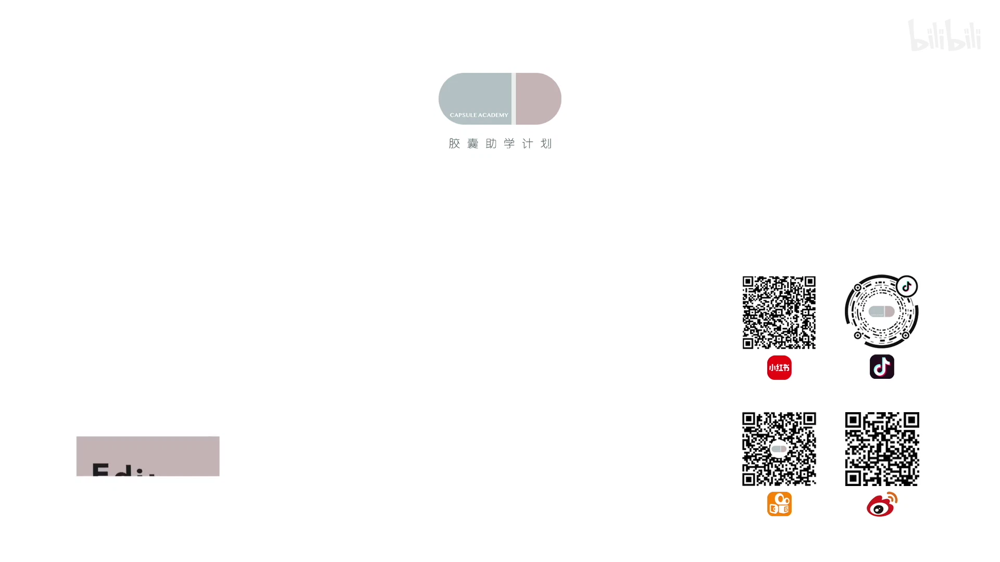

文字识别：CAPSULEACADEMY / 胶囊助学计划 / 小红书 / OE

### 画面 00:08:48

文字识别：CAPSULEACADEMY / 胶囊助学计划 / 『 / 小红书 / Creator / Leo & Berlin / OE

### 画面 00:08:50

文字识别：bilibili / 胶囊助学计划 / CAPSULEACADEMY / 胶囊助学计划 / 小红书 / OE / 0

### 画面 00:08:52

文字识别：bilibili / 胶囊助学计划

