# 081 单词 语法

快速机器解析：语音为单模型转写，未进行独立交叉校对或人工复核；画面每秒采样并按变化选帧，短时文字和标记可能遗漏。截图时间约有 1 秒误差。图片有损压缩；遇到疑点请按时间查看 Google Drive 原视频。

## 00:00:00–00:00:30

Hello everyone, welcome to Capsule Academy. This is Leo. Today we're going to learn New Concept English Book One, Lesson 81, Grammar and Words. 那老习惯进入正式课程之前呢，我们看一个问题啊。本课的一个关键语法就是 have 的万能用法。那带着这个问题，Hope you guys enjoyed. 好，我们先看第一个小的单词啊。看着音标，我们一起拼读一下，叫做 box。

### 画面 00:00:00

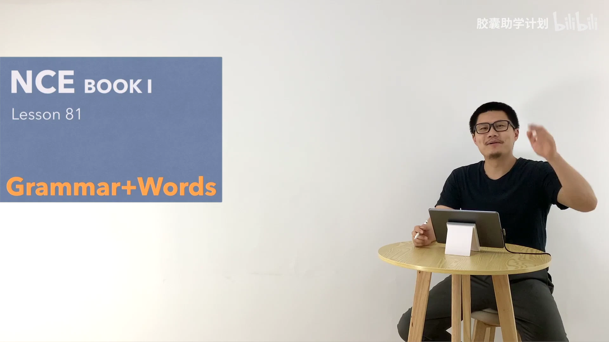

文字识别：胶囊助学计划 / NCE / BOOKI / Lesson 81 / Grammar+Words

### 画面 00:00:09

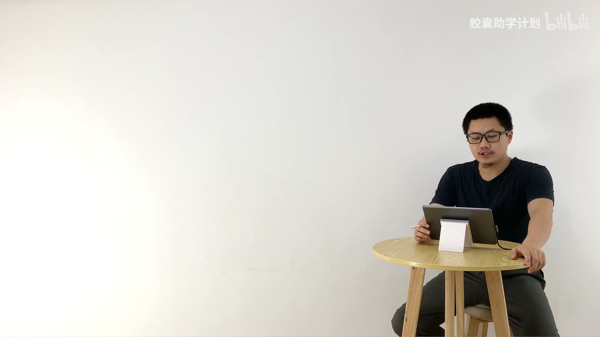

文字识别：胶囊助学计划bib出

### 画面 00:00:11

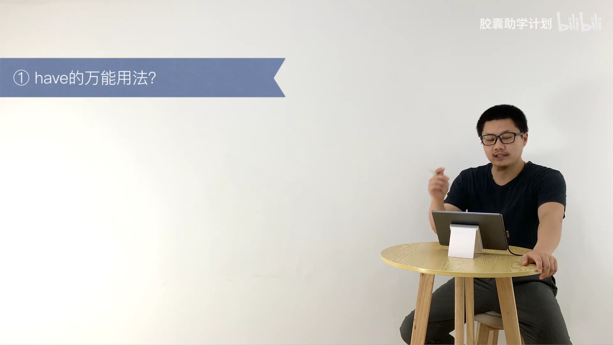

文字识别：bilbl / 胶囊助学计划 / ①have的万能用法?

### 画面 00:00:19

文字识别：胶囊助学计划 bilbl / • / •

### 画面 00:00:23

文字识别：胶囊助学计划

### 画面 00:00:25

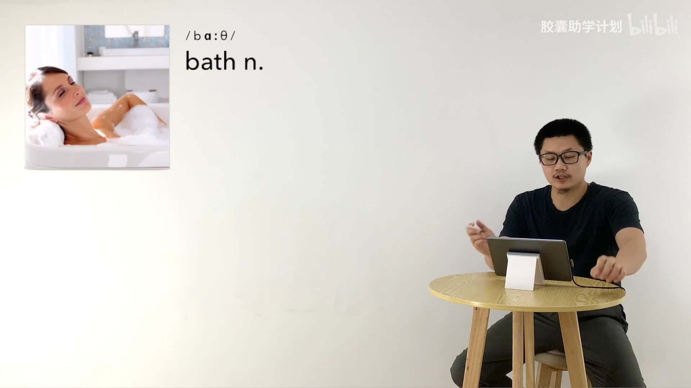

文字识别：胶囊助学计划blb出 / /ba:0/ / bath n.

## 00:00:30–00:01:00

啊，非常的简单，不要加耳化音，并且注意这个里面有一个自然拼读法则，对吧？ T H 字母组合放在单词当中去，经常是发咬舌的这个音。 OK，连起来 bath，它实际上指的是我们这个在浴缸里泡澡啊，这样一种感觉啊，这样一个动作。那你注意，在这儿它是一个名词。那我想说我刚才洗澡了，怎么说呢？就是用到我们说 have 这个万能动词，在这儿它就不表示有了。那 have

### 画面 00:00:34

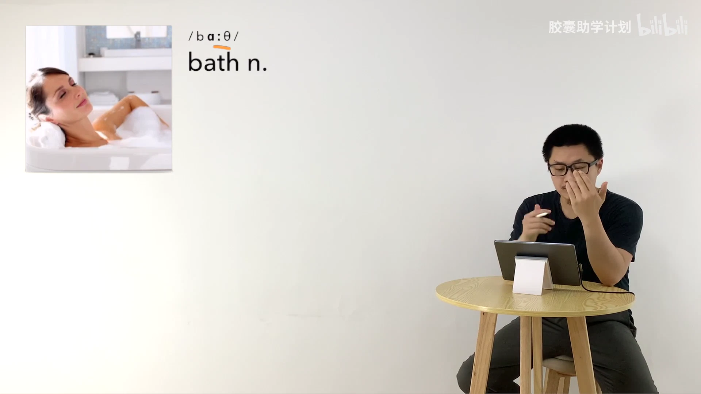

文字识别：胶囊助学计划b出出 / /ba:0/ / bath n.

### 画面 00:00:41

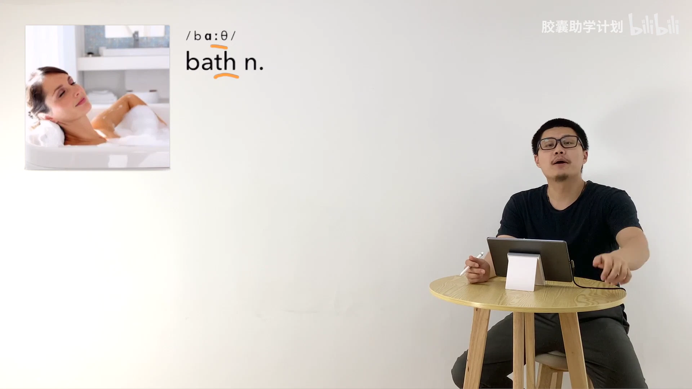

文字识别：胶囊助学计划blb出 / /ba:01 / bath n.

## 00:01:00–00:01:30

a buff，其实它就是 buff 的意思，只不过把它变得动词化了啊。也就是说，你看我们之前学到的各种时态上的变化，我们不是针对于名词去进行啊这个啊考究啊进行这个思考的，对吧？我们是进行动词啊，围绕着动词来去进行这个探讨。所以这个地方的 have，你要注意，它本身是一个动词。have a buff 翻译成的意思跟

### 画面 00:01:09

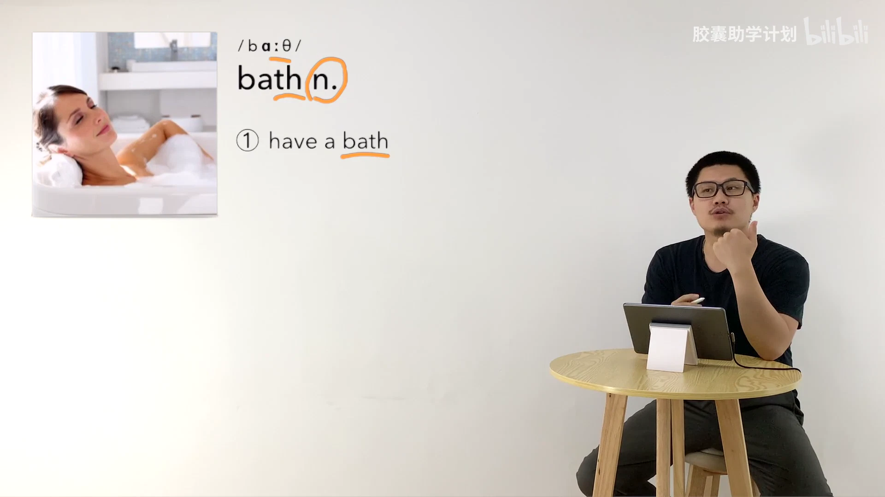

文字识别：胶囊助学计划blb出 / /ba:01 / bath / n. / ① have a bath

### 画面 00:01:24

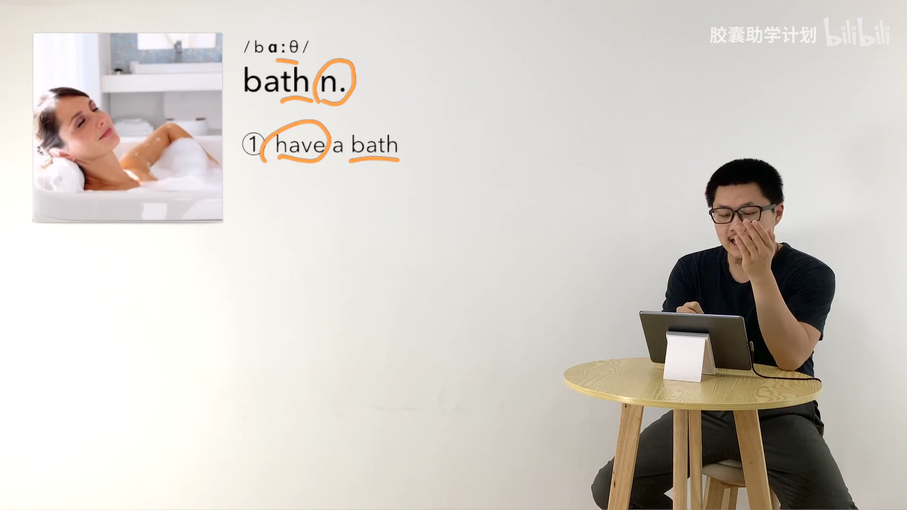

文字识别：胶囊助学计划bill / /ba:0/ / bath / n. / havea bath

### 画面 00:01:27

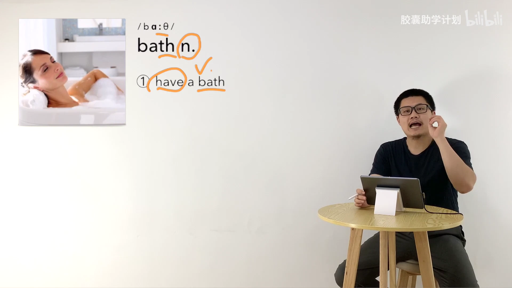

文字识别：胶囊助学计划bill / /ba:0/ / bath / n. / havea bath

## 00:01:30–00:02:00

bath本身没区别，但因为我们有了have这个动词，它就可以开始有了一些时态上的转化。比如说我们造一些句子，比如说Did you have a bath？还是说你刚才洗澡了吗？OK，注意，你看我用Did you问的是之前的事情，一般过去时，对吧？OK，那continue还是说I had a bath two hours ago？你注意这地方的have还是遵循时态转化。我如果把它变成一般过去时，

### 画面 00:01:46

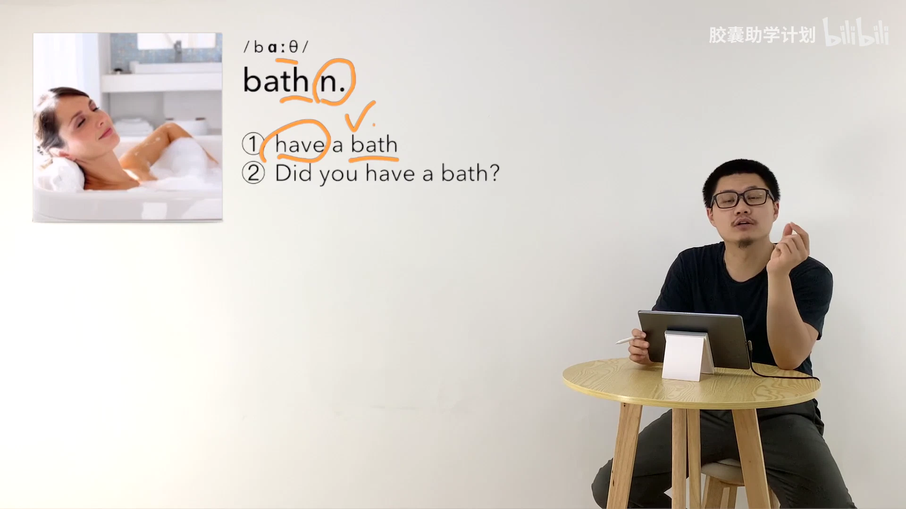

文字识别：Bilbili / 胶囊助学计划 / /ba:0/ / bath / n. / havea bath / 1 / Did you have a bath?

### 画面 00:01:51

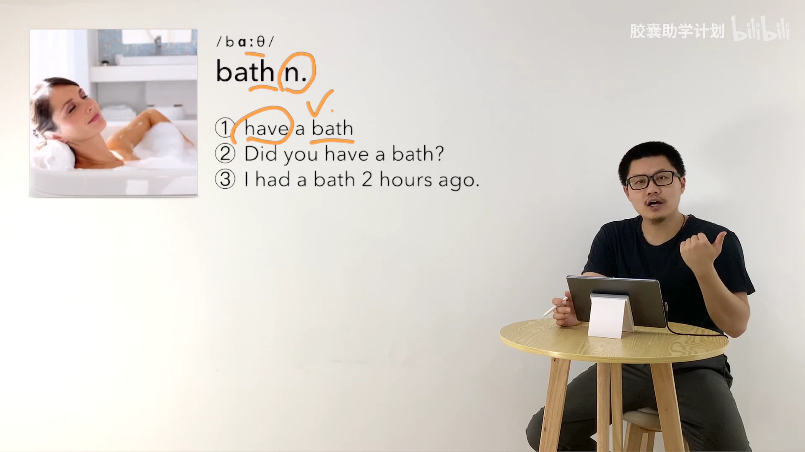

文字识别：刘biibili / 胶囊助学计划 / /ba:θ1 / bath / n / havea bath / Did you have a bath? / I had a bath 2 hours ago.

### 画面 00:01:55

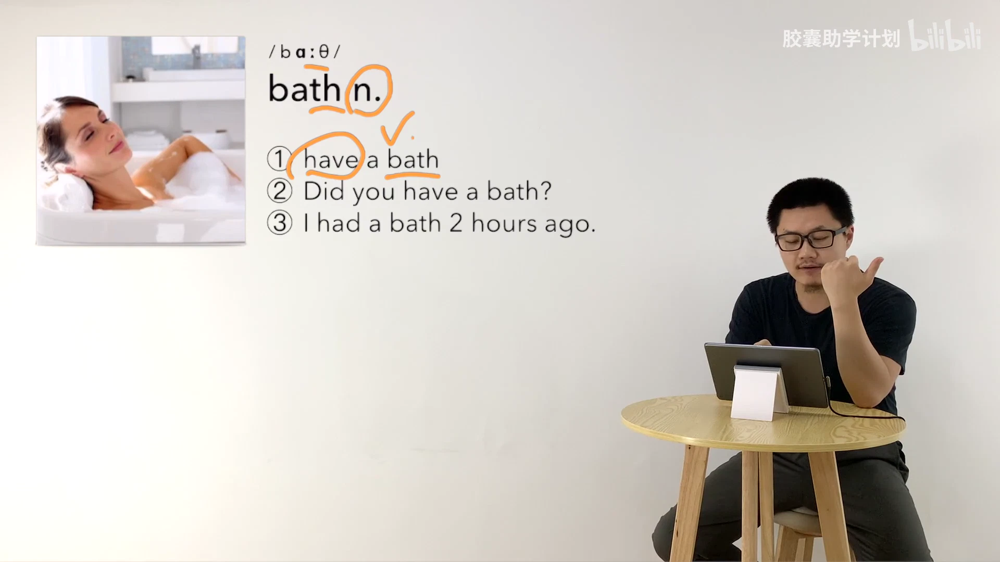

文字识别：Jbilibili / 胶囊助学计划 / /ba:0/ / bath / n / havea bath / Did you have a bath? / I had a bath 2 hours ago.

### 画面 00:01:59

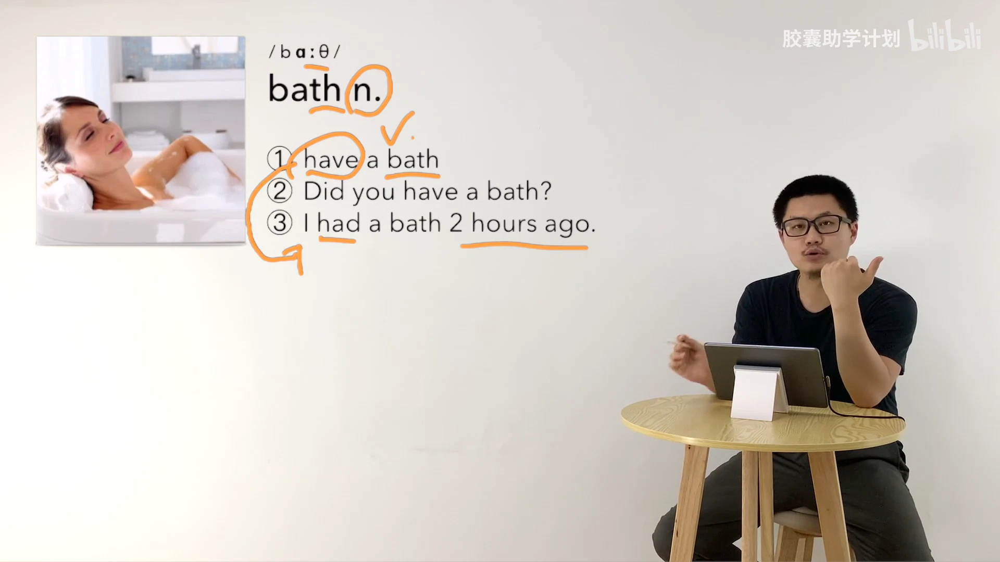

文字识别：bilbili / 胶囊助学计划 / /ba:0/ / bath / n / fhavea bath / Did you have a bath? / I had a bath 2 hours ago.

## 00:02:00–00:02:30

呢，have就要随随之把它变成had. Okay, very good.好，接下来我们说那她正在洗澡怎么说呢？She is having a bath.你注意，你看这个地方的is加having，三十一课咱们学过，现在进行时表示她正在做这件事情，对吧？那同理了，肯定去给各位我们张嘴随时变它一下，那随口去变它一下，叫做Is she having a bath?啊，以及

### 画面 00:02:14

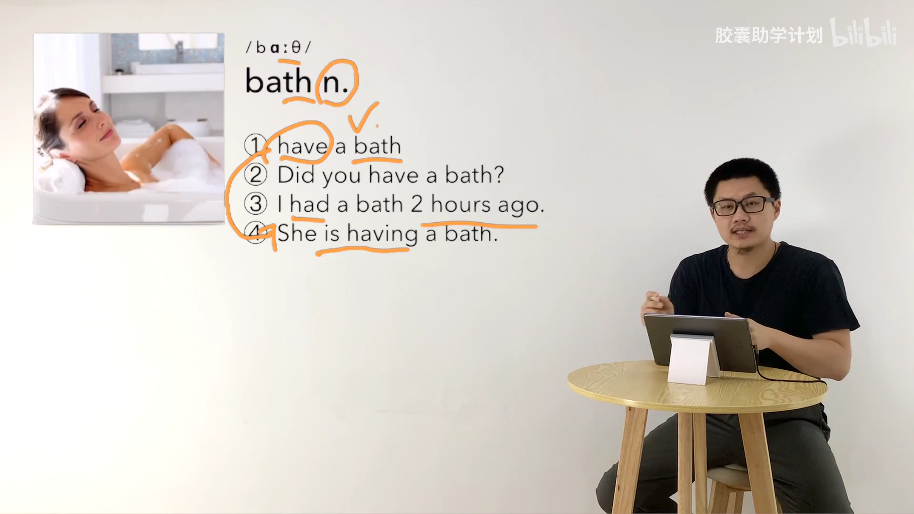

文字识别：Bilbili / 胶囊助学计划 / /ba:0/ / bath / n / havea bath / Did you have a bath? / I had a bath 2 hours ago. / She is  / having / a bath.

## 00:02:30–00:03:00

### 画面 00:02:30

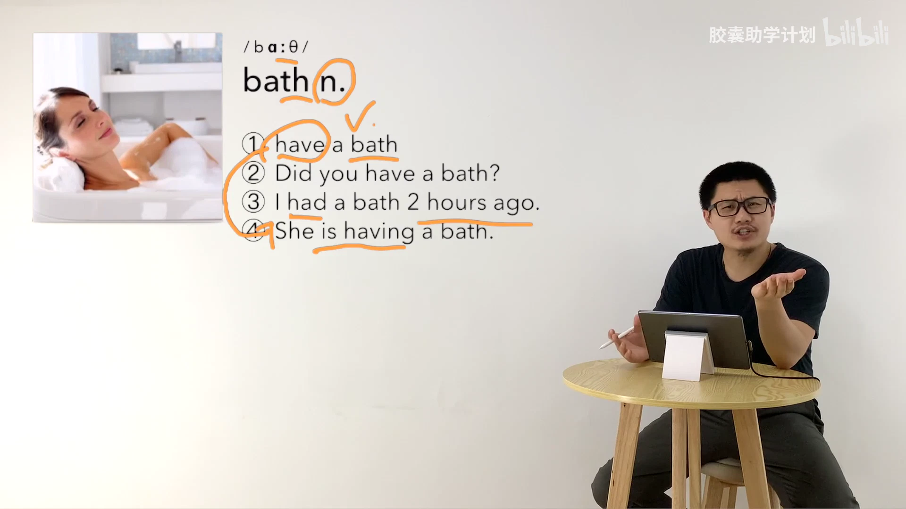

文字识别：biibili / 胶囊助学计划 / /ba:0/ / bath / n / havea bath / Did you have a bath? / I had a bath 2 hours ago. / 3 / She is having / a bath.

### 画面 00:02:37

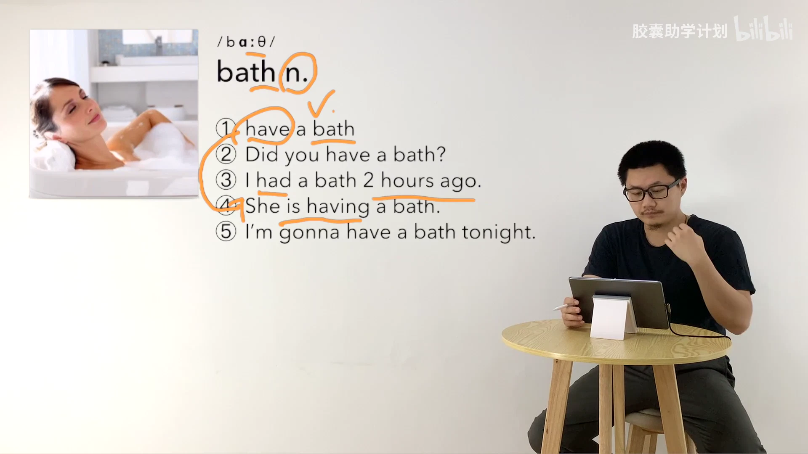

文字识别：biibili / 胶囊助学计划 / /ba:01 / bath / n / havea bath / Did you have a bath? / I had a bath 2 hours / 3 / ago. / She is / having / a bath. / 5 / I'm / gonna have a bath tonight.

### 画面 00:02:41

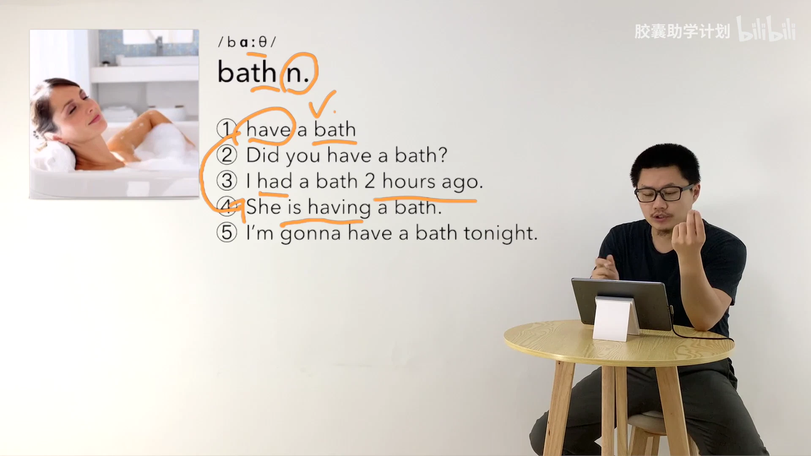

文字识别：bilibili / 胶囊助学计划 / /ba:θ/ / bath / n / havea bath / Did you have a bath? / I had a bath 2 hours ago. / 3 / She is / having / a bath. / 5 / l'm / gonna have a bath tonight.

### 画面 00:02:45

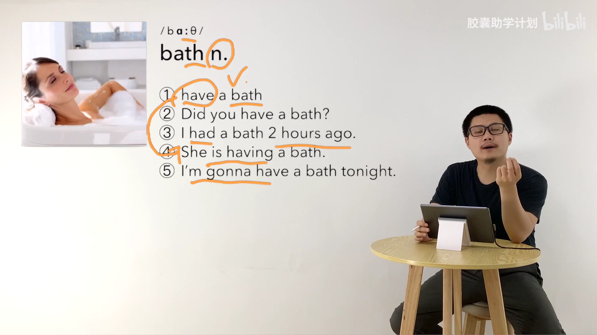

文字识别：Biibili / 胶囊助学计划 / /ba:θ/ / bath / n / havea bath / Did you have a bath? / I had a bath 2 hours ago. / 3 / She is having / a bath. / gonna have a bath tonight. / 5 / 1'm

### 画面 00:02:54

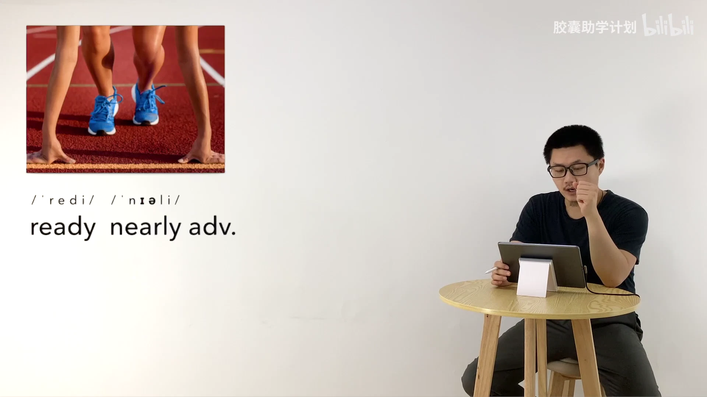

文字识别：胶囊助学计划b出出 / /redi//niali/ / ready nearly adv.

### 画面 00:02:56

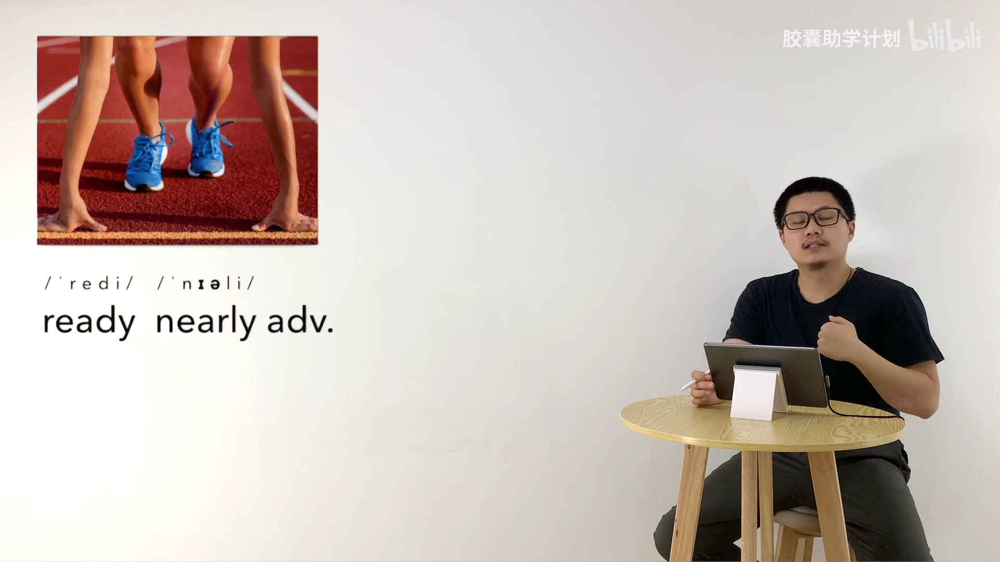

文字识别：胶囊助学计划bilb出 / /redi//niali/ / ready nearly adv.

## 00:03:00–00:03:30

中国汉语语境当中普及率还挺高的，叫做 ready 啊。那它最常用的叫做 Are you ready 啊？各位这句话一定要把它记下来，叫做你准备好了吗？如果你说我准备好了，其实非常的简单，就是把这一般疑问句换成肯定句，转化一下人称就行了，叫做 I'm ready，对吧？那 nearly 这个单词是什么意思呢？就是马上就要准备好了，几乎就要准备好了，但是还没有完全准备好，对吧？如果我们非要设

### 画面 00:03:00

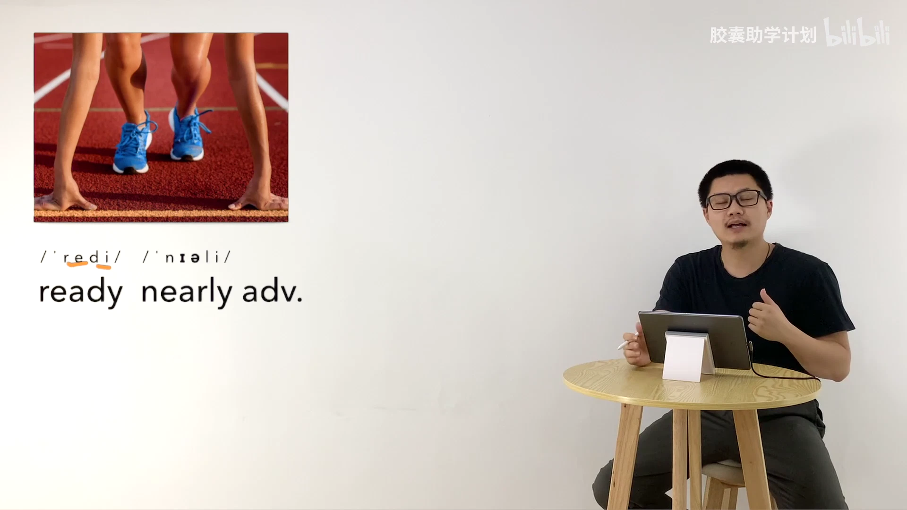

文字识别：胶囊助学计划bilb出 / /'redi//nrali/ / ready nearly adv.

### 画面 00:03:03

文字识别：胶囊助学计划bib出 / /'redi//nrali/ / ready nearly adv.

### 画面 00:03:06

文字识别：bibili / 胶囊助学计划 / /'redi//niali/ / ready nearly adv. / ① Are you ready?

### 画面 00:03:11

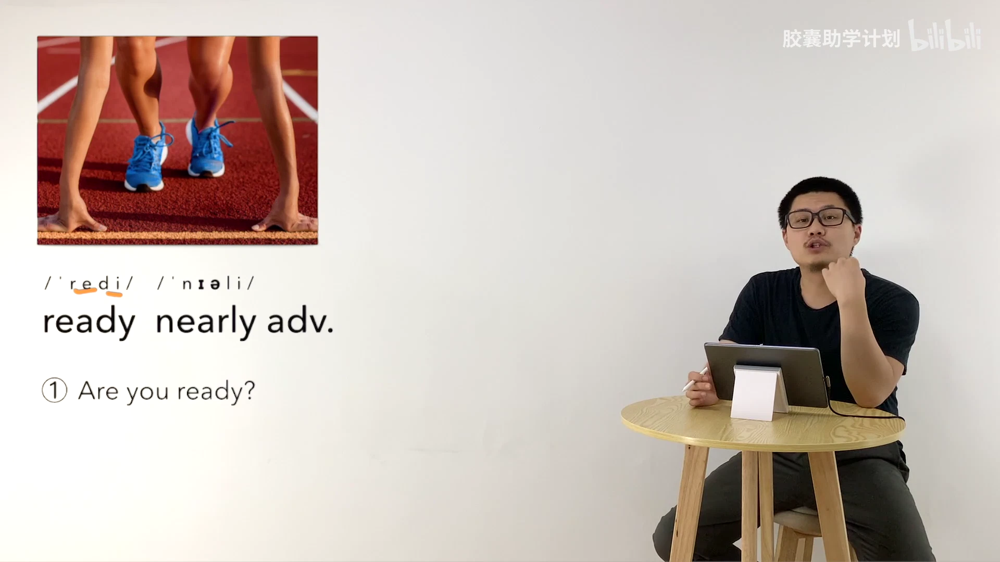

文字识别：胶囊助学计划 / /'redi//'nrali/ / ready nearly adv. / ① Are you ready?

### 画面 00:03:15

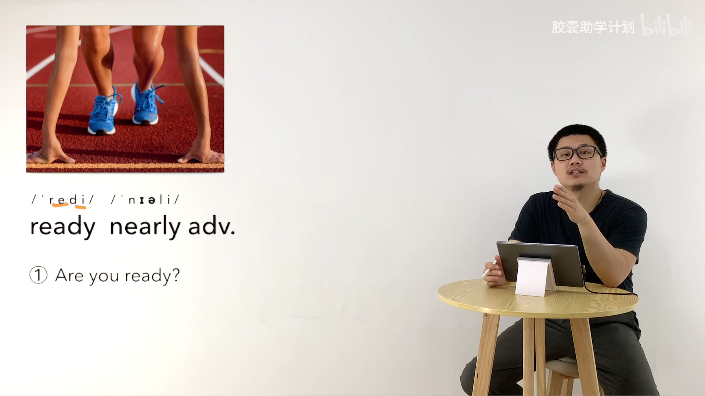

文字识别：胶囊助学计划 / /redi//nrali/ / ready nearly adv. / ① Are you ready?

### 画面 00:03:20

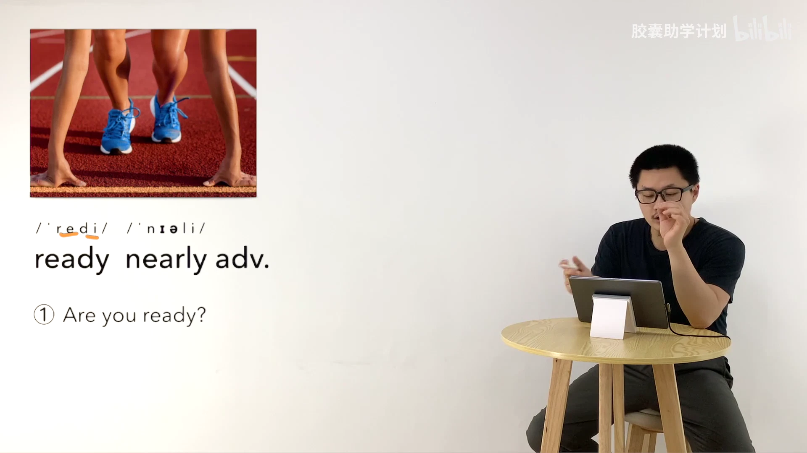

文字识别：胶囊助学计划 / /'redi//nrali/ / ready nearly adv. / ① Are you ready?

### 画面 00:03:22

文字识别：胶囊助学计划 / /'redi//nrali/ / ready nearly adv. / ① Are you ready?

### 画面 00:03:25

文字识别：胶囊助学计划 / /redi//niali/ / ready nearly adv. / ① Are you ready?

## 00:03:30–00:04:00

立设定一个，比如说进度表的话，那百分之九十或百分之九十五就是 nearly ready，那百分之百就是 ready。 OK，好，那比如说我的回答就可以是叫做 I'm nearly ready，我马上就要准备好了。 OK，接下来下一个单词，跟我一起读一下，叫做 dinner。 dinner 啊，我们一般指的是晚餐或正餐，对吧？那这个正餐往往也是指的晚餐。你看，同理，它依旧是一个名

### 画面 00:03:30

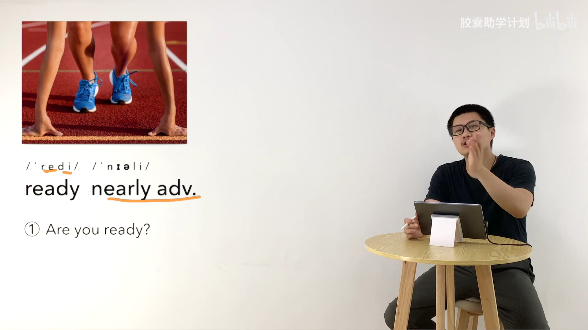

文字识别：胶囊助学计划 / /'redi//nrali/ / ready nearly adv. / ① Are you ready?

### 画面 00:03:41

文字识别：胶囊助学计划 / /redi//nrali/ / ready nearly adv. / ① Are you ready? / ② I'm nearly ready.

### 画面 00:03:44

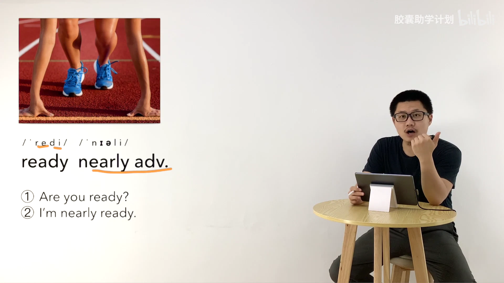

文字识别：胶囊助学计划 / /'redi//niali/ / ready nearly adv. / ① Are you ready? / ② I'm nearly ready.

### 画面 00:03:46

文字识别：胶囊助学计划 / /'dinal / dinner n.

## 00:04:00–00:04:30

词。我想把它变成吃晚餐，我们一般不用 eat dinner 啊，会有一点点怪。虽然你翻译成汉语好像是没有问题的，对吧？但是说毕竟是英文，英文的语言习惯叫做 have dinner，注意中间没有那个 a，对吧？哎，你一会儿发现啊，有的这样的一些短语呢有 a，比如说刚才的 have a bath，有的没有 a，叫 have dinner，就把它硬记住就可以了。OK，那 have dinner 就是吃晚饭。那刚才我们解

### 画面 00:04:00

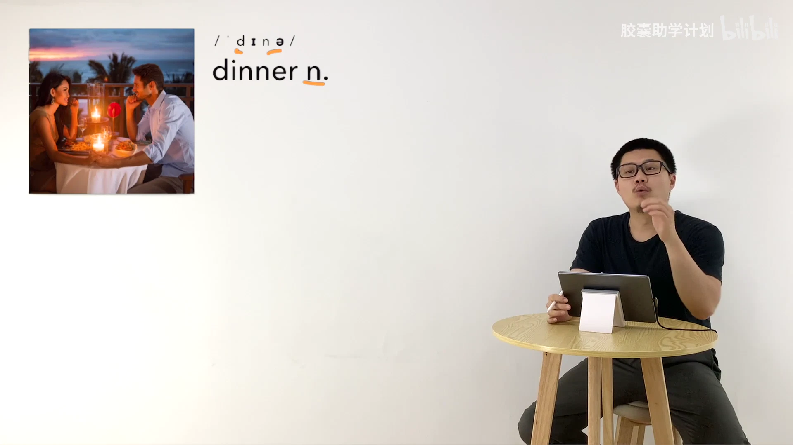

文字识别：胶囊助学计划 / /'dina/ / dinner n.

### 画面 00:04:18

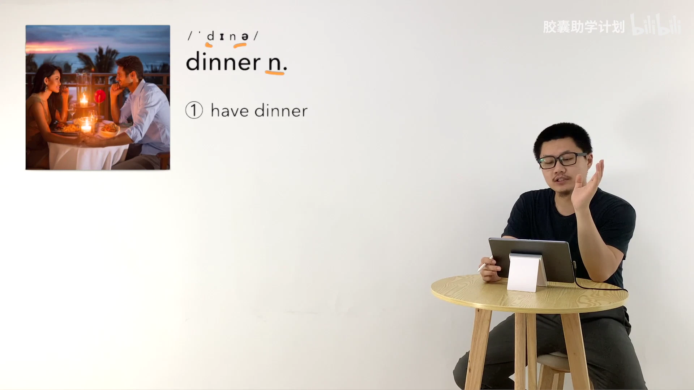

文字识别：胶囊助学计划 / /dinal / dinner n. / ① have dinner

## 00:04:30–00:05:00

释到了，说 have dinner 的 have 在这儿，它其实起到了一个动词的作用，并且它实际上怎么样呢？可以跟不同的时态，我们已经学过的和情态动词连起来。我们造了一些句子，您张嘴跟我读就好了。来，I'm going to have dinner with my husband tonight. Okay,那 she had dinner with me last night. 哎，昨晚一般过去时，对吧？表示一个。那以及 they are having dinner together.

### 画面 00:04:38

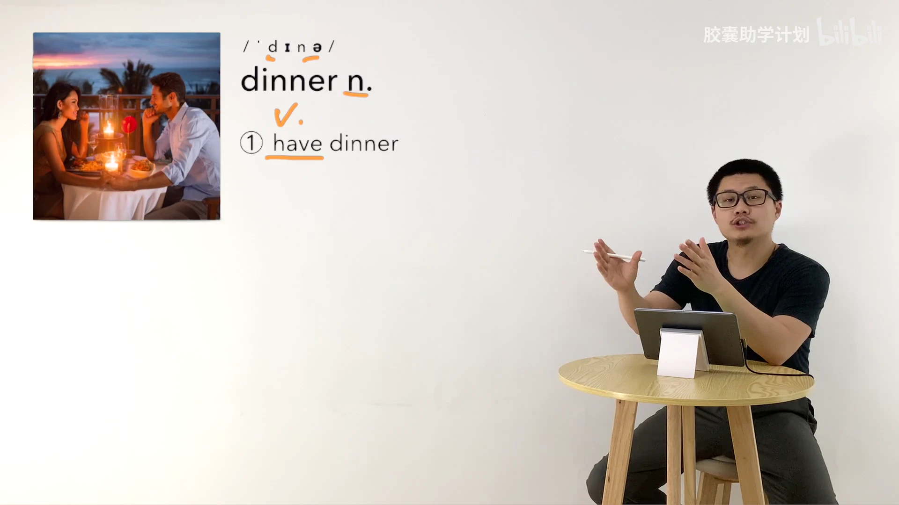

文字识别：胶囊助学计划 / /dinal / dinner n. / ✔. / ①have dinner

### 画面 00:04:41

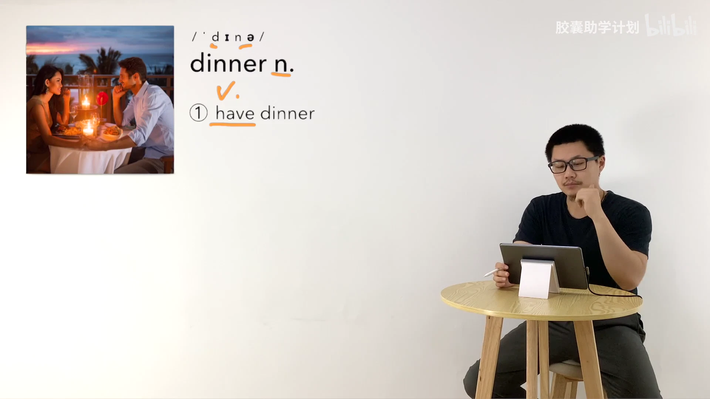

文字识别：胶囊助学计划 / /'dinal / dinner n. / V. / ① have dinner / 8

### 画面 00:04:45

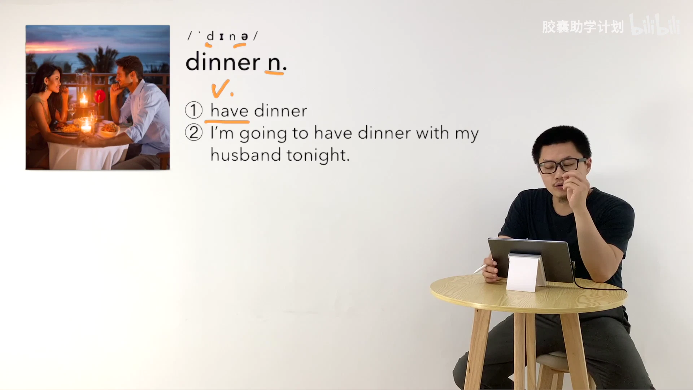

文字识别：胶囊助学计划 / /'dina/ / dinner n. / V. / ① / have dinner / 'm going to have dinner with my / husband tonight.

### 画面 00:04:56

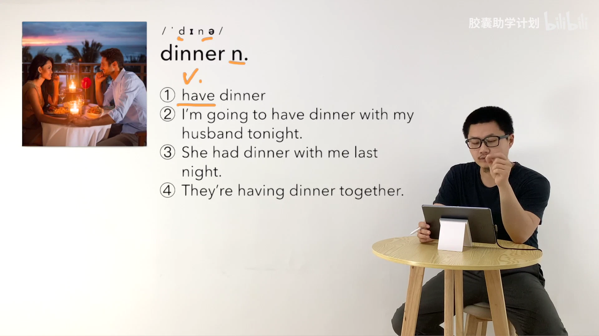

文字识别：胶囊助学计划 / /'dinal / dinner n. / V. / ① have dinner / 'm going to have dinner with my / husband tonight. / She had dinner with me last / night. / They're having dinner together.

## 00:05:00–00:05:30

okay. They are now having dinner together. Okay. They are now having dinner together. Okay. They are now having dinner together. Okay. They are now having dinner together. Okay. They are now having dinner together. Okay. They are now having dinner together. Okay. They are now having dinner together. Okay. They are now having dinner together. Okay. They are now having dinner together. Okay. They are now having dinner together. Okay. They are now having dinner together. Okay. They are now having dinner together. Okay. They are now having dinner together. Okay. They are now having dinner together. Okay. They are now having dinner together. Okay. They are now having dinner together. Okay. They are now having dinner together. Okay. They are now

### 画面 00:05:05

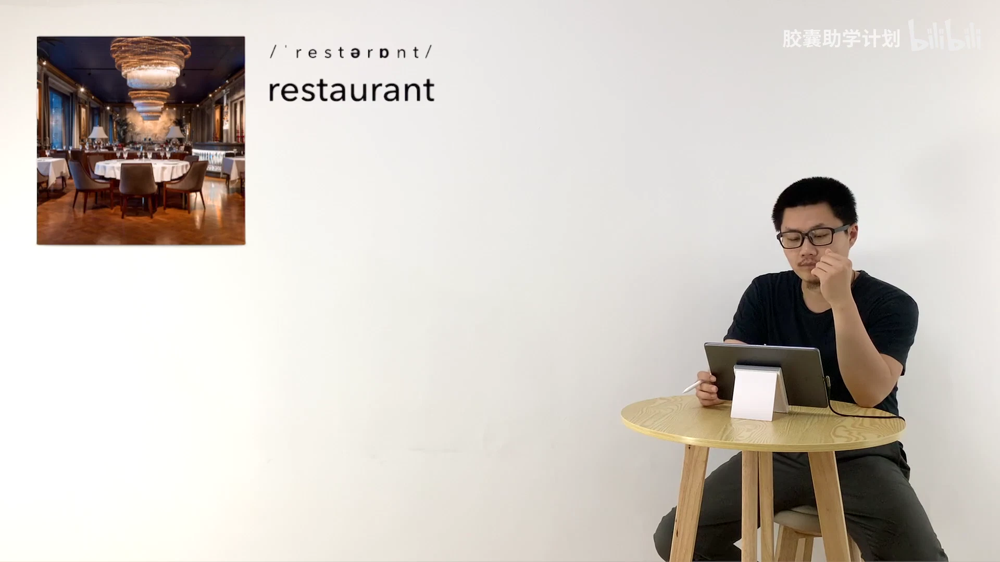

文字识别：胶囊助学计划 / /'restarpnt/ / restaurant

### 画面 00:05:09

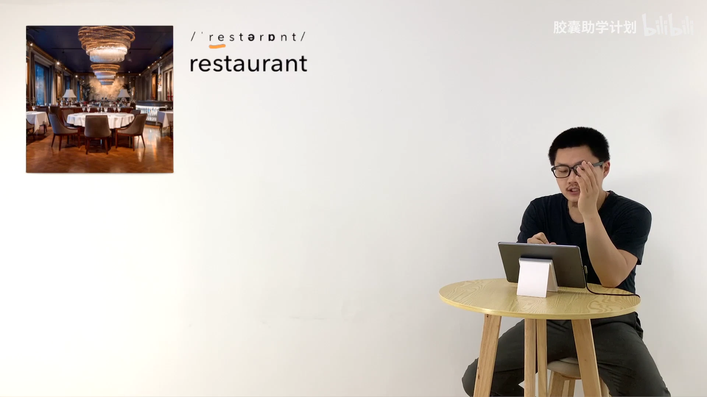

文字识别：胶囊助学计划 / / 'restarpnt / / restaurant

### 画面 00:05:12

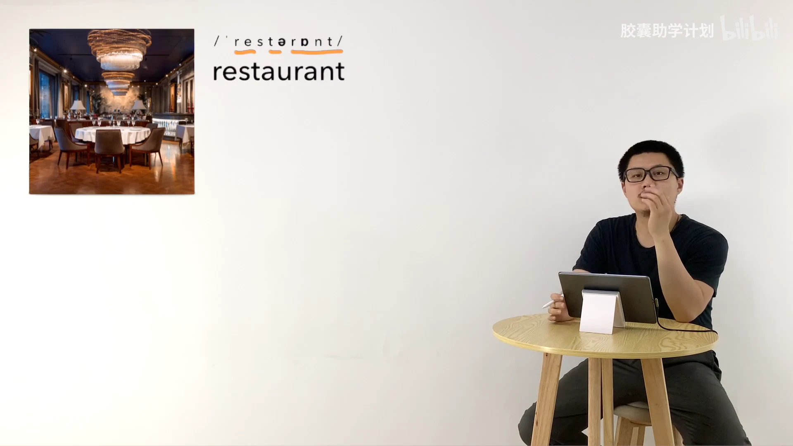

文字识别：胶囊助学计划 / /'restarpnt/ / restaurant

### 画面 00:05:16

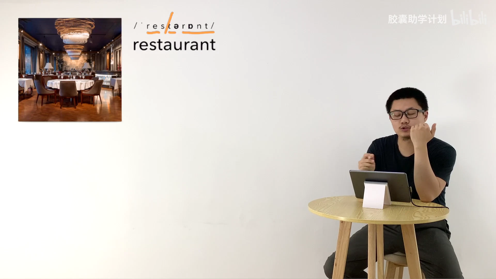

文字识别：胶囊助学计划 / /'restarpnt/ / restaurant

### 画面 00:05:20

文字识别：胶囊助学计划 / /'restarpnt/ / restaurant

### 画面 00:05:25

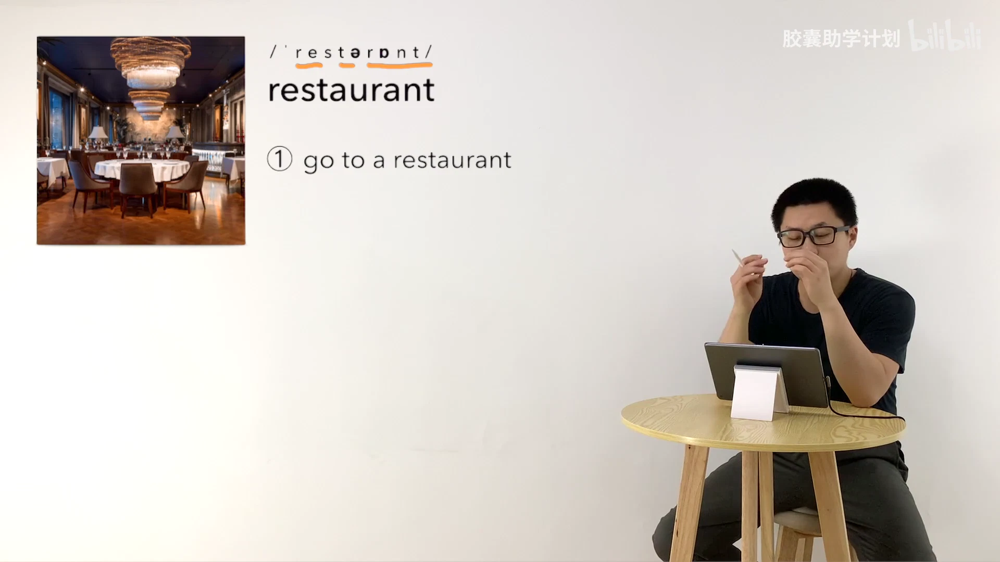

文字识别：胶囊助学计划 / /'restarpnt / / restaurant / ① go to a restaurant

## 00:05:30–00:06:00

还是要配合一些动词。最常用的动词就是 go to a restaurant。当然了，a 您可以换成 go to that restaurant 或 go to the restaurant。OK，由具体的场景去判断这个地方的 a 换成谁，但是 go to 可以是不变的。同理，我们把它进行一些时态上的转换。张嘴跟我读，Last night we went to a restaurant. Very good. Continue 说，变成一般疑问句，Did you go to a

### 画面 00:05:33

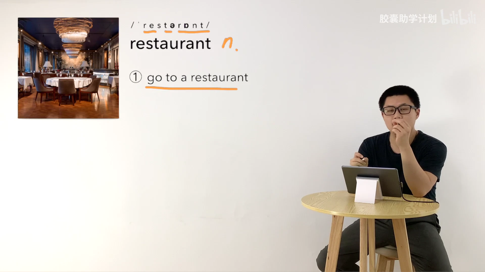

文字识别：胶囊助学计划 / /'restarpnt / / restaurant / go to a restaurant

### 画面 00:05:52

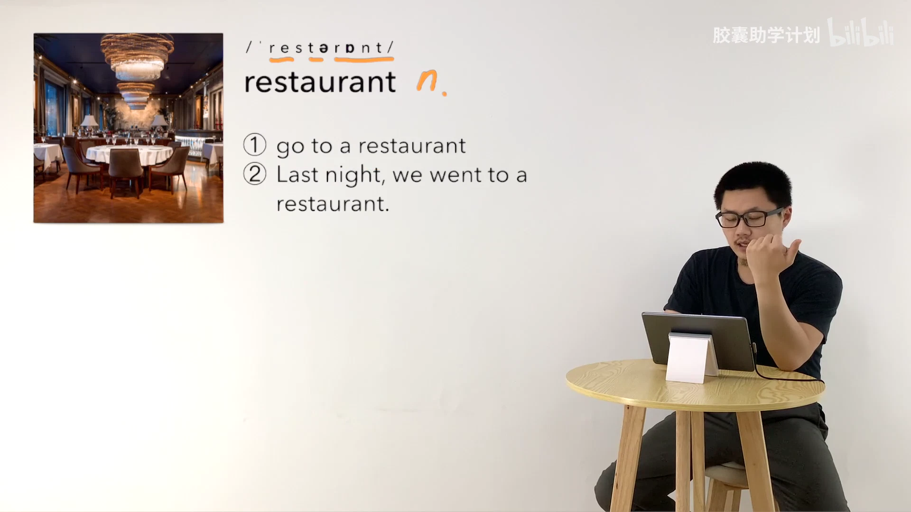

文字识别：胶囊助学计划 / /'restarpnt/ / restaurant / ① / go to a restaurant / Last night, we went to a / restaurant.

## 00:06:00–00:06:30

restaurant last night? 注意你看两个点一一见到 went go 的不规则过去式对吧？它的过去式是不规则的。然后我把 did 提前，并且把 went 换回了原形。这个点是各位初期啊，我根据教学的时候发现大家最容易遗忘的一个点。以及比如说这个里面各位一般疑问句放这儿了，我们是不是各种特殊疑问词就可以来了？好，比如说 when，比如说 who，比如说 where，比如说 when。那还有一些其他的可能性。那您在这个地

### 画面 00:06:03

文字识别：胶囊助学计划 / /'restarpnt / / restaurant / 1 / go to a restaurant / Last night, we went to a / restaurant. / Did you go to a restaurant last / night?

### 画面 00:06:10

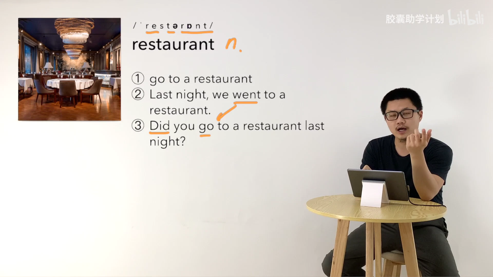

文字识别：胶囊助学计划 / /'restarpnt / / restaurant / go to a restaurant / Last night, we went to a / restaurant. / Did you go to a restaurant last / night?

### 画面 00:06:20

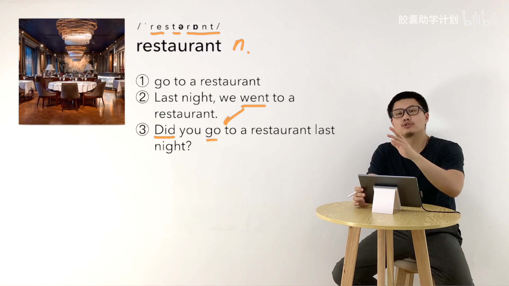

文字识别：胶囊助学计划 / /'restarpnt / / restaurant / ① / go to a restaurant / Last night, we went to a / restaurant. / Did you go to a restaurant last / night?

### 画面 00:06:29

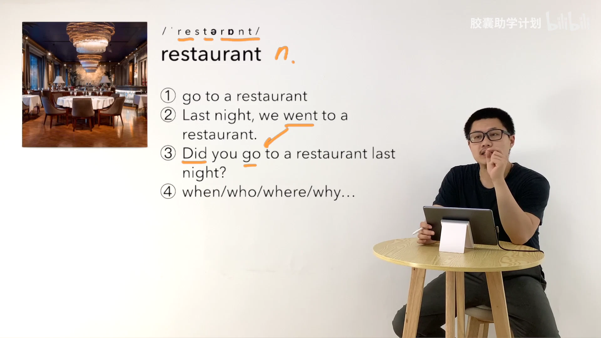

文字识别：胶囊助学计划 / /'restarpnt / / restaurant / go to a restaurant / Last night, we went to a / restaurant. / Did you go to a restaurant last / night? / when/who/where/why...

## 00:06:30–00:07:00

方张嘴给自己变一变就可以了，OK，做一个小的口语训练。Restaurant这个单词您也差不多就可以记住了啊。通过造句去记单词。下一个单词来跟我一起读，叫做Roast啊，Roast就是我们说这个烤箱啊、烤炉啊去烤的这个动作，我们管它叫做Roast啊。比如说北京烤鸭啊，Peking Roast Duck，对吧？啊，它叫做Roast。那我们本课Roast后边加了一个小的Beef，

### 画面 00:06:38

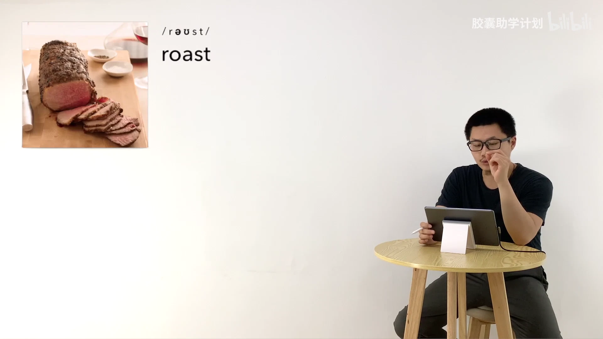

文字识别：胶囊助学计划 / /raust/ / roast / 6

### 画面 00:06:40

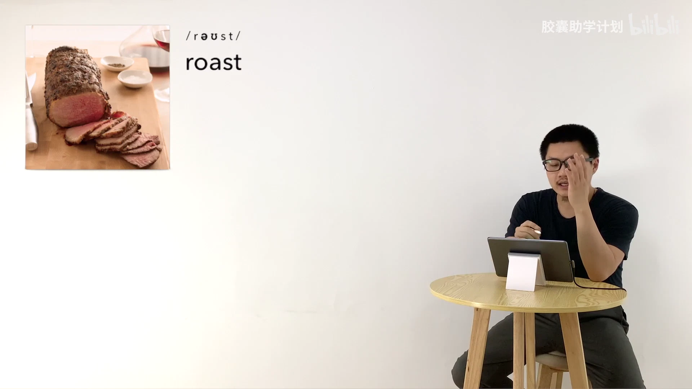

文字识别：胶囊助学计划 / /raust/ / roast

### 画面 00:06:45

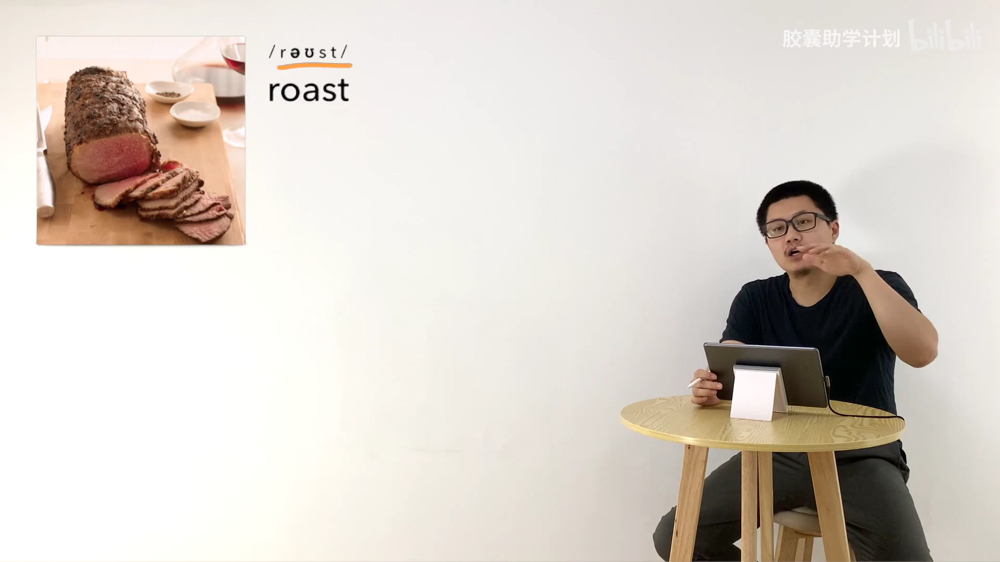

文字识别：胶囊助学计划 / /raust/ / roast

### 画面 00:06:59

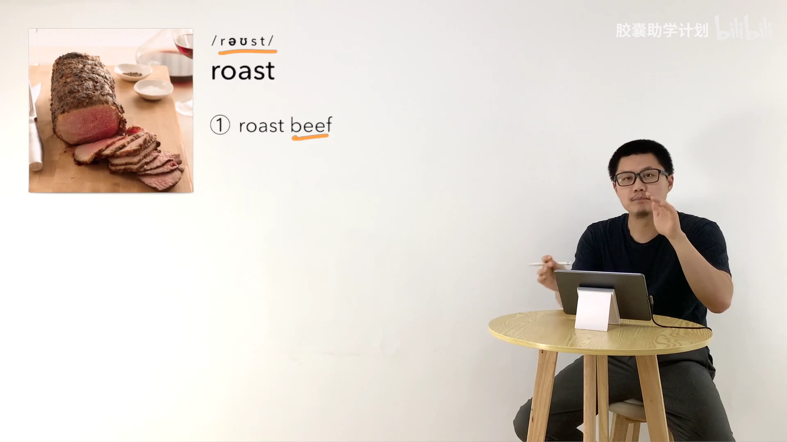

文字识别：胶囊助学计划 / /raust/ / roast / ① roast beef

## 00:07:00–00:07:30

这是我们之前学过的单词，叫烤牛肉，对吧？OK，那我们拿它造句，张嘴跟我读，叫 Do you like roast beef? Do you like roast beef? Very good. 说 Yes, I want some roast beef. Very good. 好，在这地方我提一个小的点，其实你像我在这儿是如何给大家准备这个课程的呢？就是我去想 roast beef 类似于一个名词，我要找动词跟它连起来。那我要找的这

### 画面 00:07:01

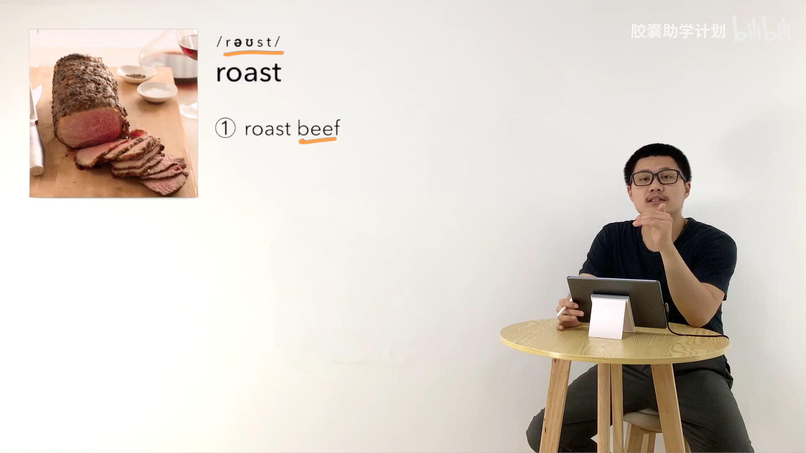

文字识别：胶囊助学计划 / /raust/ / roast / ① roast beef

### 画面 00:07:05

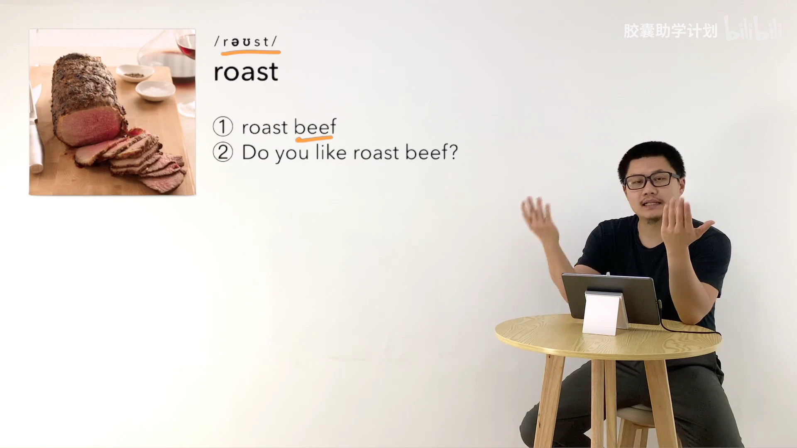

文字识别：胶囊助学计划 / /raust/ / roast / ① roast beef / ② Do you like roast beef?

### 画面 00:07:10

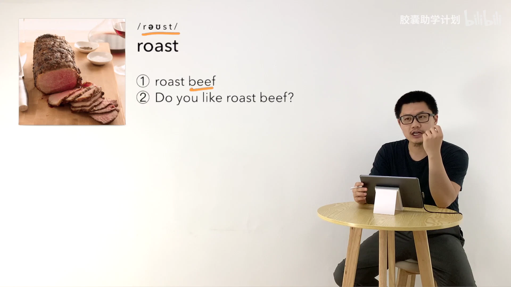

文字识别：胶囊助学计划 / /raust/ / roast / ① roast beef / ② Do you like roast beef?

### 画面 00:07:14

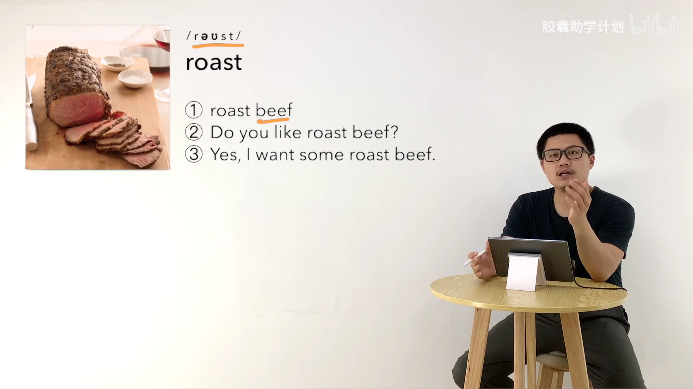

文字识别：胶囊助学计划 / /raust/ / roast / ① roast beef / ② Do you like roast beef? / ③ Yes, I want some roast beef.

### 画面 00:07:18

文字识别：胶囊助学计划 / /raust/ / roast / ①roast beef) / ② Do you like roast beef? / ③ Yes, I want some roast beef.

### 画面 00:07:20

文字识别：胶囊助学计划 / /raust/ / roast / ①roast beef / ② Do you like roast beef? / ③ Yes, I want some roast beef.

### 画面 00:07:25

文字识别：胶囊助学计划 / /raust/ / roast / ①roast beef / ② Do you like roast beef? / ③ Yes, I want some roast beef.

## 00:07:30–00:08:00

个动词呢，还不能是超纲的，也就是我们前八十一课学过的那些动词。想一下，哪些动词可以跟 roast beef 连起来？那最少最简单的 like, want，对吧？OK，那我们在文章的最开始以及刚才在讲单词的过程当中，实际上已经陆陆续续见到了 have 一些比较强大的用法，have a bath, have dinner，对吧？实际上 have 还是挺万能的，它吃喝

### 画面 00:07:30

文字识别：胶囊助学计划 / /raust/ / roast / ①roast beef / ② Do you like roast beef? / ③ Yes, I want some roast beef.

### 画面 00:07:35

文字识别：胶囊助学计划 / /raust/ / roast / ①roast beef /  Do you like roast beef? / 2 / ③ Yes, I want some roast beef.

### 画面 00:07:41

文字识别：胶囊助学计划 / /raust/ / roast / V / ①roast beef / Do you like roast beef? / 2） / Yes, I want some roast beef. / 3

### 画面 00:07:43

文字识别：胶囊助学计划 / have吃喝玩乐

## 00:08:00–00:08:30

玩乐啊，甚至比如说抽啊，比如说这个赌啊，都是可以用 have 这个单词去表达的。它真的就是一个比较万能的动词。比如说我们一个一个来啊，比如说吃早饭 have breakfast，你看对于您来说，您 breakfast 这个单词会，我只是告诉你吃早饭就是前面加了一个 have 就可以了，对吧？很简单。那吃中午饭 have lunch 啊，晚餐 have dinner，吃顿饭叫做 have a meal。

### 画面 00:08:13

文字识别：胶囊助学计划 / have吃喝玩乐 / ① have breakfast

## 00:08:30–00:09:00

那 a meal 是我们早在三十多课就学会的一个单词，对吧？这些呢，我们管它叫做吃。当然还有更多的，我们在这儿先学这些就够了。 OK，好，举一反三嘛，对吧？喝来，比如说 have some milk，哎，喝点奶没问题。 Milk，您学会？那 have tea，对吧？原来您学的叫 drink tea，没有问题。 Drink tea 是对的，但是口语当中比更容比 drink tea 更常出现的反而是 have

### 画面 00:08:32

文字识别：胶囊助学计划 / have吃喝玩乐 / ① have breakfast / ② have lunch / ③ have dinner / have a meal

### 画面 00:08:40

文字识别：胶囊助学计划 / have吃喝玩乐

### 画面 00:08:45

文字识别：胶囊助学计划 / have吃喝玩乐 / ① have some milk

## 00:09:00–00:09:30

对吧？这只是人们的一种语言习惯啊。 have tea，或者是 have coffee，啊，喝点儿这个咖啡，对吧？那还有最后一个是我们补充了一个，这个虽然是看上去是补充，对吧？但是单词您都认的，比如说 drink 这个单词，只不过您原来学它的时候是动词，在这儿变成了名词了。你看前面加了个 a 嘛，对吧？那 have a drink 是什么意思呢？注意这是英文当中特有的一种表达，就喝，就有点像咱们汉语的是

### 画面 00:09:04

文字识别：胶囊助学计划 / have吃喝玩乐 / ① have some milk / ②have tea / 3 / have coffee

### 画面 00:09:11

文字识别：胶囊助学计划 / have吃喝玩乐 / ① have some milk / ② / have tea / have coffee / 3 / have a drink

### 画面 00:09:19

文字识别：胶囊助学计划 / have吃喝玩乐 / ① have some milk / 2 / have tea / have coffee / have a drink / V

## 00:09:30–00:10:00

晚上咱喝一盅，这个喝一盅一定不是突然间拿出来了一个什么呃牛奶或者说这个果汁儿对吧？一定喝的是带酒精酒精的饮料对吧？啊，不管是硬饮还是软饮，它一定是带酒精的。所以 have a drink 在英文当中非常常用，往往指的就是咱们汉语当中就是喝两杯，这个两杯一定指的是带酒精的饮品。OK， have a drink 补充一个，接下来那我们

### 画面 00:09:34

文字识别：胶囊助学计划 / have吃喝玩乐 / ① /  have some milk / 2 / have tea / have coffee / 3 / have a drink / V

### 画面 00:09:47

文字识别：胶囊助学计划 / have吃喝玩乐 / have some milk / 2 / have tea / have coffee / have a drink / V

### 画面 00:09:58

文字识别：胶囊助学计划 / have吃喝玩乐

## 00:10:00–00:10:30

说玩乐吧，对吧？好，那补充这个小的单词短语啊，跟我读叫 have fun，叫玩的开心。那和 have a good time 其实是一个意思，都是玩的开心。他们的意思有点像 enjoy yourself 啊，我们曾经学过六十五课，对吧？Enjoy yourself 叫享受你自己，就是玩的开心的意思。好，比如说那 have a haircut， haircut 是我们马上要学会的一个单词，但因

### 画面 00:10:12

文字识别：胶囊助学计划 / have吃喝玩乐 / ①have fun / ② have a good time

## 00:10:30–00:11:00

为这个单词是两个已知单词组成的，我们看一下 hair hair 头发对吧？ cut 哎 cut 你应该还记得对吧？ Don't cut yourself 啊， shave too quickly and cut himself 对吧？我们管它叫做拉伤啊，刮伤或者切的意思对吧？好，那 haircut 就是剪头，have a haircut 还是剪头，只不过 haircut 是个名词，然后加了一个 have 把它动词化了。OK，

### 画面 00:10:35

文字识别：胶囊助学计划 / have吃喝玩乐 / ①have fun / ② have a good time / have a haircut / 3

### 画面 00:10:54

文字识别：胶囊助学计划 / have 吃喝玩乐 / ①have fun / ② have a good time / have a haircut / 3

## 00:11:00–00:11:30

那再然后，have a swim这个呢，在我个人的感受当中，出现的频率就不如swim更常用了。就是告诉各位，swim这个单词本身有动词的意思，也有名词的意思。那在这个地方，它是一个名词，have a swim完全就和swim本身没有区别。比如说，I'm swimming和I'm having a swim含义理论上来说是一致的，但是很少我会去听到说

### 画面 00:11:10

文字识别：胶囊助学计划 / have 吃喝玩乐 / ①have fun / 2 / have a good time / have a haircut / 3 / A / have a swim

## 00:11:30–00:12:00

having a swim 这个用法啊，大多数直接就用 swim 就可以了。但是见到的您要懂它的构词，对吧？它的这个构成就是 have 的万能动词，吃喝玩乐。 OK，好，再然后，比如说 have a bath。刚才我们讲到了啊，那 have a party 这个可能我们之前也学过，对吧？就是聚会。再然后呢，那 have a holiday，你在这就把它记一下。 Holiday 本身是一个名词，叫做假期。那 have a holiday 就是翻译成度假就可以了。比如

### 画面 00:11:40

文字识别：胶囊助学计划 / have吃喝玩乐

## 00:12:00–00:12:30

说我要去度假了，先想什么时态，be going to do，然后我们把它口语化叫做 I'm gonna have a holiday，啊， this summer，啊，今天夏天我要去度个假。I'm gonna have a holiday this summer， very good。 Continue，那 have a lesson 就是 you are doing， you are having a lesson right now。如果你现在正在看这个视频，那就叫做 you are having a lesson。你现在正在去上这个课啊，

### 画面 00:12:10

文字识别：胶囊助学计划 / have吃喝玩乐 / ①have a bath / ② have a party / ③ have a holiday

## 00:12:30–00:13:00

lesson本身叫课程的意思。玩一个好，那have a cigarette就是刚才我说，甚至连抽烟都可以用它，对吧？好，那cigarette是我们很早之前学过的一个单词，叫香烟。那have a cigarette就是抽根烟的意思。玩一个好，recap本课最重要、最核心的就是您要记住我给大家总结的have吃喝玩乐的这些小的短语。在这个地方呢，对

### 画面 00:12:32

文字识别：胶囊助学计划 / have吃喝玩乐 / ① have a bath / 2 / have a party / have a holiday / 3 / have a lesson / have a cigarette

### 画面 00:12:39

文字识别：胶囊助学计划 / have吃喝玩乐 / ① have a bath / 2 / have a party / have a holiday / 3 / have a lesson / have a cigarette

### 画面 00:12:47

文字识别：胶囊助学计划 / Recap / Patterns / Grammar / Words / have+吃喝玩乐 / Expression

### 画面 00:12:53

文字识别：胶囊助学计划 / Recap / Patterns / Grammar / Words / have+吃喝玩乐 / Expression

### 画面 00:12:56

文字识别：胶囊助学计划 / Recap / Patterns / Grammar / Words / have+ / 吃喝玩乐 / Expression

## 00:13:00–00:13:30

各位来说，初期可能就今天我讲完，您很快就可以理解，就是说 have 啊加吃喝玩乐名词就表示这个动作了，对吧？但是可能要花一点点时间去记，说哎什么前面加了 a，什么前面不加 a，对吧？比如说是 have a dinner 还是 have dinner 呢？这个没事儿，您拿它多去造句，慢慢您就记住了。OK，好，本课家庭作业单词造句啊，每个单词三句话，比如说那个 nearly ready 您不太好造呢，那没事儿，这个三个是我

### 画面 00:13:21

文字识别：胶囊助学计划

## 00:13:30–00:14:00

们说上限，对吧？您造三个就够了，实在不行就算了。那我建议各位多去配合 have 这个单词啊，您不，比如说我在这儿补充了是 have a buff，那您就拿 have a buff 这个短语去进行造句，别拿 buff 这个单词单独去造句，好吧？一举双一，这个一箭双雕，对吧？啊，一举两得，给自己讲解一遍今天的核心知识点。那如果大家喜欢我们的课程呢，欢迎大家关注、订阅、一键三连

### 画面 00:13:51

文字识别：胶囊助学计划 / 单词造句3 / 请给自己讲解一遍今天的 / 核心知识点

### 画面 00:13:54

文字识别：胶囊助学计划

## 00:14:00–00:14:30

支持我们，并分享给那些需要的朋友，来帮助我们快速成长。OK，那最后我们再来看一句名人名言：The world is changing quickly, and we must be ready to change with it, or risk being left behind. See you next time.

### 画面 00:14:05

文字识别：胶囊助学计划 / The world is changing / quickly / and / we / must be ready to change / with / it or risk / being left behind. / - Najib Razak

### 画面 00:14:20

### 画面 00:14:22

文字识别：CAPSULEACADEMY / 胶囊助学计划 / 『 / 小红书 / Lecturer / Leo / OE

### 画面 00:14:24

文字识别：CAPSULEACADEMY / 胶囊助学计划 / 小红书 / Photographer / Berlin / OE

### 画面 00:14:26

文字识别：CAPSULEACADEMY / 胶囊助学计划 / 小红书 / Editor / Berlin / OE

### 画面 00:14:29

文字识别：CAPSULEACADEMY / 胶囊助学计划 / 小红书 / OE

## 00:14:30–00:14:32

### 画面 00:14:31

文字识别：bilibili / 胶囊助学计划

