# 081 文章

快速机器解析：语音为单模型转写，未进行独立交叉校对或人工复核；画面每秒采样并按变化选帧，短时文字和标记可能遗漏。截图时间约有 1 秒误差。图片有损压缩；遇到疑点请按时间查看 Google Drive 原视频。

## 00:00:00–00:00:30

Hello everyone, welcome to Capsule Academy. This is Leo. Today we're going to learn New Concept English Book One Lesson Eighty One Story. Hope you guys enjoy it. We,们直接看文章来了。Sam说了一句话，说Hi Carol, where's Tom?他说Carol你好，Tom在哪儿呢？好，你能看到啊，首先这是一个门口，对吧？这个地方是衣架啊，这个是女主人，我们管她叫做Carol。

### 画面 00:00:00

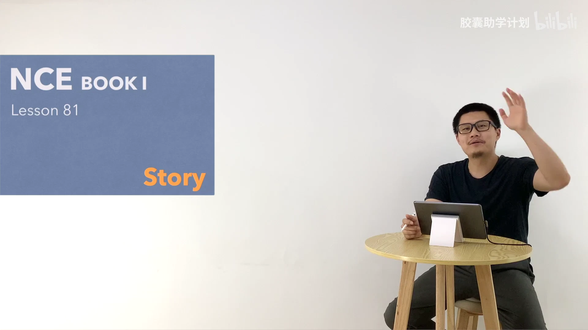

文字识别：胶囊助学计划 / NCE / BOOKI / Lesson 81 / Story

### 画面 00:00:05

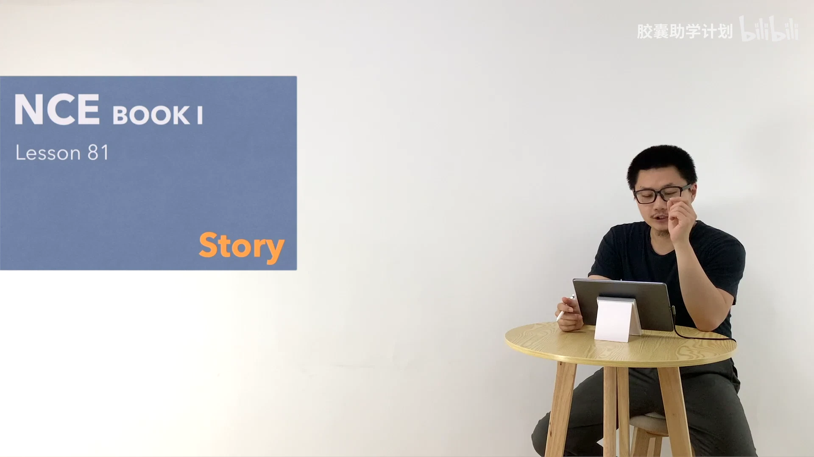

文字识别：胶囊助学计划 / NCE / BOOKI / Lesson 81 / Story

### 画面 00:00:10

文字识别：胶囊助学计划b出l / • / •

### 画面 00:00:14

### 画面 00:00:16

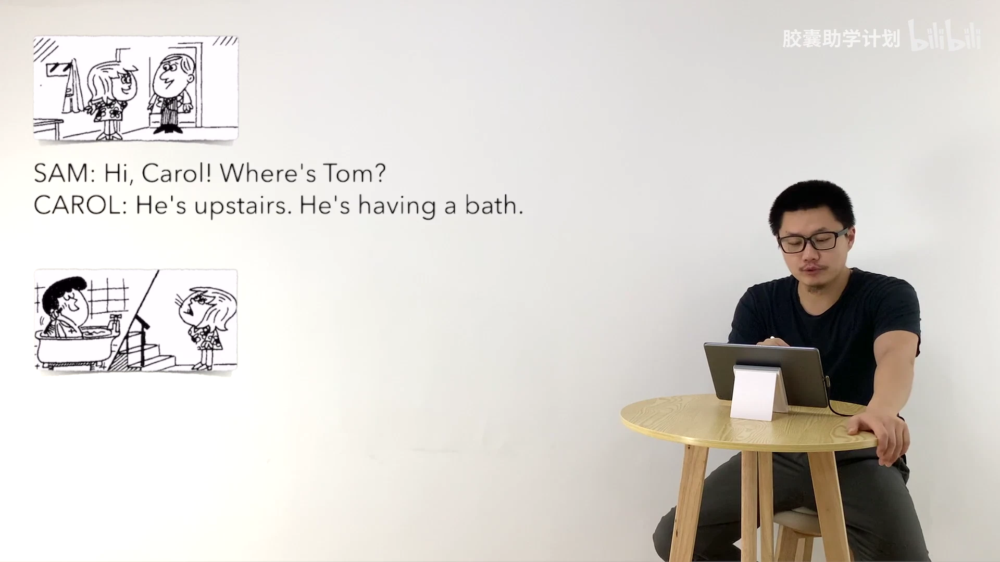

文字识别：胶囊助学计划 / SAM: Hi, Carol! Where's Tom? / CAROL: He's upstairs. He's having a bath.

## 00:00:30–00:01:00

那这个男客人呢叫 Sam。还有一个人没出现，叫做 Tom，对吧？好，Carol 说，女主人说，He's upstairs。说他呀现在在楼上啊。各位还记得那个短语吗？Come upstairs。啊，来楼上啊。Go upstairs。去楼上。He's having a bath。他正在洗澡。OK，注意 having is 加 having 现在进行时，对吧？Tom，哎，要冲楼

### 画面 00:00:46

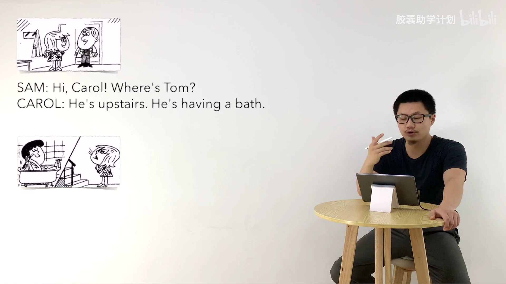

文字识别：胶囊助学计划 / SAM: Hi, Carol! Where's Tom? / CAROL: He's upstairs. He's having a bath.

### 画面 00:00:59

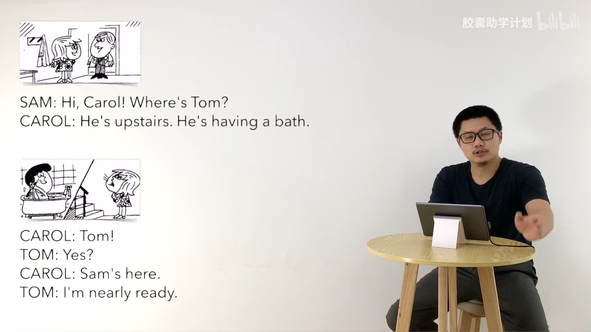

文字识别：胶囊助学计划 / SAM: Hi, Carol! Where's Tom? / CAROL: He's upstairs. He's having a bath. / CAROL: Tom! / TOM: Yes? / CAROL: Sam's here. / TOM: I'm nearly ready.

## 00:01:00–00:01:30

上喊了，说Tom, Tom回了一个Yes.这个我们第一节课就学过了，Excuse me, Yes,对吧？就类似于What啊，什么事儿啊？他不是Yes，不是是啊。Sam's here,哎，Sam到这里了，叫做Sam is here.那我想问说，Sam在这里吗？我没看见，Sam在这里吗？怎么问？Is Sam here? Okay, very good. Tom说I'm nearly ready.说我几乎

### 画面 00:01:29

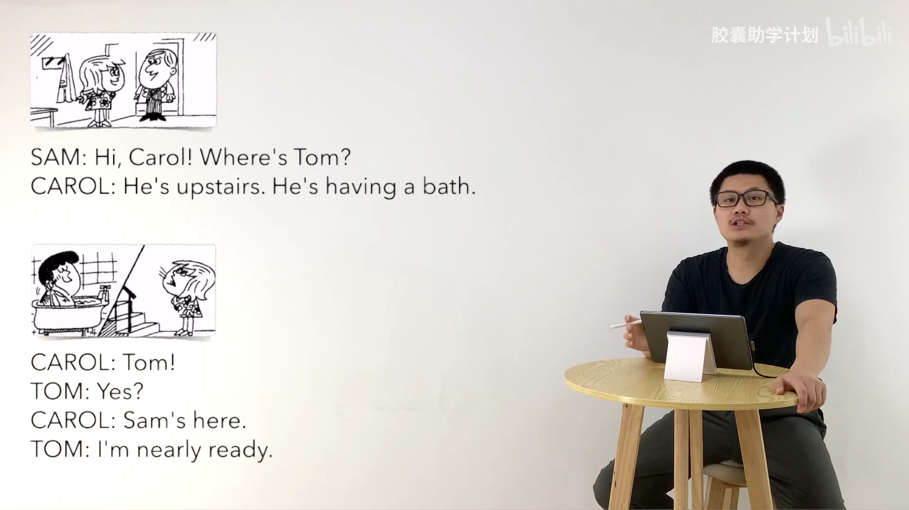

文字识别：胶囊助学计划 / SAM: Hi, Carol! Where's Tom? / CAROL: He's upstairs. He's having a bath. / CAROL: Tom! / TOM: Yes? / CAROL: Sam's here. / TOM: I'm nearly ready.

## 00:01:30–00:02:00

就要准备好了啊！啊，什么叫我几乎就要准备好？就我几乎就要洗完了啊！稍等一下，还没洗完，但快了，对吧？流程已经到了。Tom下来了。Tom说，Hello, Sam.啊，Sam你好。Have a cigarette,来抽根烟啊。Sam说，No, thanks, Tom.啊，不了，谢谢了，Tom啊。那Tom又说，那Have a glass of whiskey then.那我们先不管then，说Have a glass of whiskey.你想一下，这是不是就是

### 画面 00:01:38

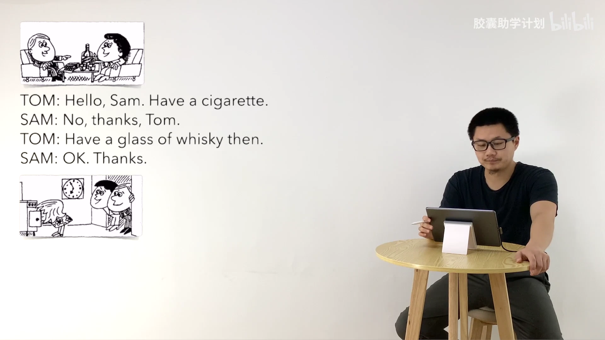

文字识别：胶囊助学计划 / 82 / 181118 / TOM: Hello, Sam. Have a cigarette. / SAM: No, thanks, Tom. / TOM: Have a glass of whisky then. / SAM: OK.Thanks.

## 00:02:00–00:02:30

喝？Have a drink,各位还记得吧？我在单词当中去讲过，叫喝一杯，对吧？那Have some milk啊，叫喝些牛奶。那Have tea, have coffee,对吧？这儿无非就变成了叫Have some whiskey.他把some换成了a glass of.那来杯whiskey吧。OK，他说OK, thanks啊，他说没问题啊，这个我可以喝，谢谢了。再来，Tom和这个他的好朋友啊Sam两个人跑到厨房去了，问说Is dinner

### 画面 00:02:01

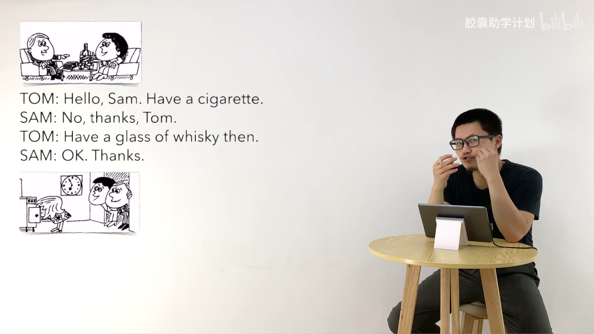

文字识别：胶囊助学计划 / 82 / 1811118 / TOM: Hello, Sam. Have a cigarette. / SAM: No, thanks, Tom. / TOM: Have a glass of whisky then. / SAM: OK.Thanks.

### 画面 00:02:20

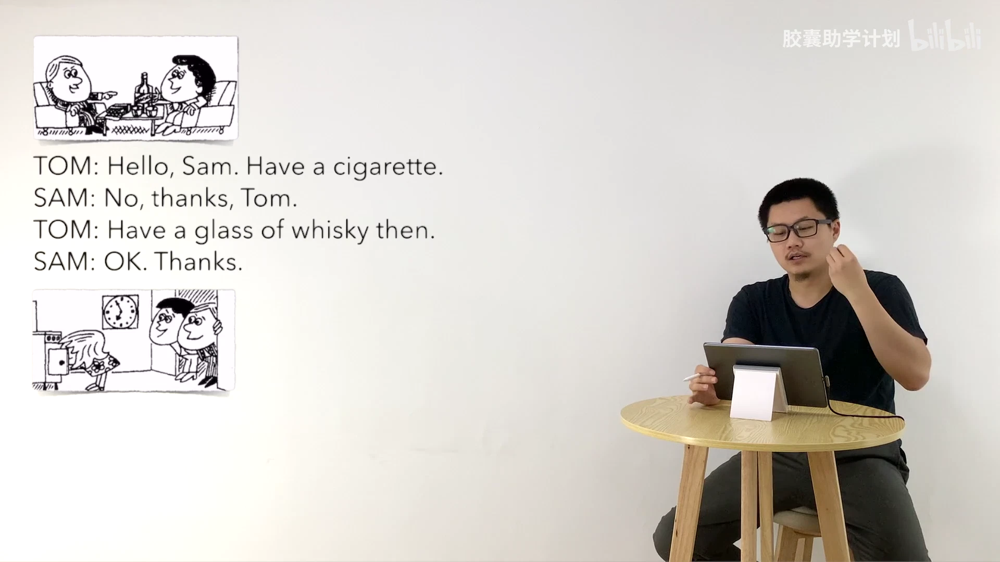

文字识别：胶囊助学计划 / 82 / 18111118 / TOM: Hello, Sam. Have a cigarette. / SAM: No, thanks, Tom. / TOM: Have a glass of whisky then. / SAM: OK. Thanks.

### 画面 00:02:22

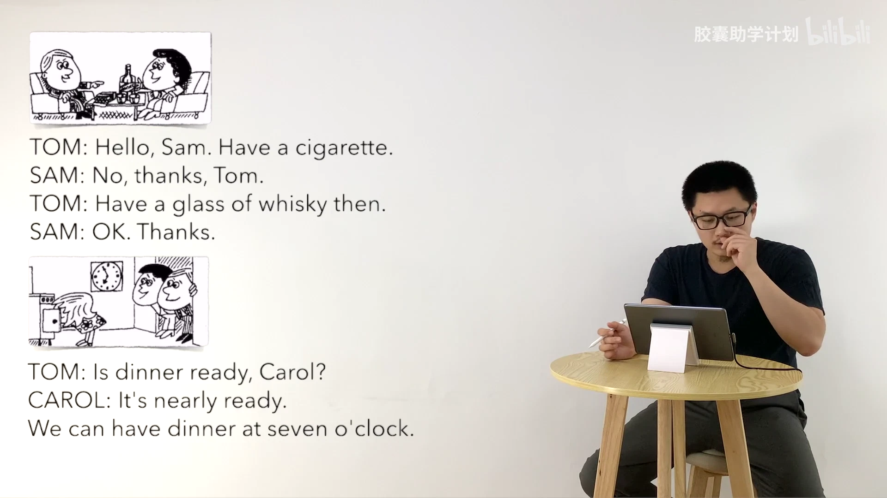

文字识别：胶囊助学计划 / 82 / 18118 / TOM: Hello, Sam. Have a cigarette. / SAM: No, thanks, Tom. / TOM: Have a glass of whisky then. / SAM: OK. Thanks. / TOM: Is dinner ready, Carol? / CAROL: It's nearly ready. / We can have dinner at seven o'clock.

## 00:02:30–00:03:00

Carol?好，各位，你看啊，给各位了个一般疑问句。您直接现在就新学会了一个新的表达，对吧？我们不要只背原文，还要从原文当中去想如何去把它变出来更多我们需要的句子。比如说，晚饭准备好了，叫做 dinner is ready，或者 dinner's ready。 Okay, is nearly ready，就快准备好了，还得等一会儿。然后他说，We can have dinner at

### 画面 00:02:36

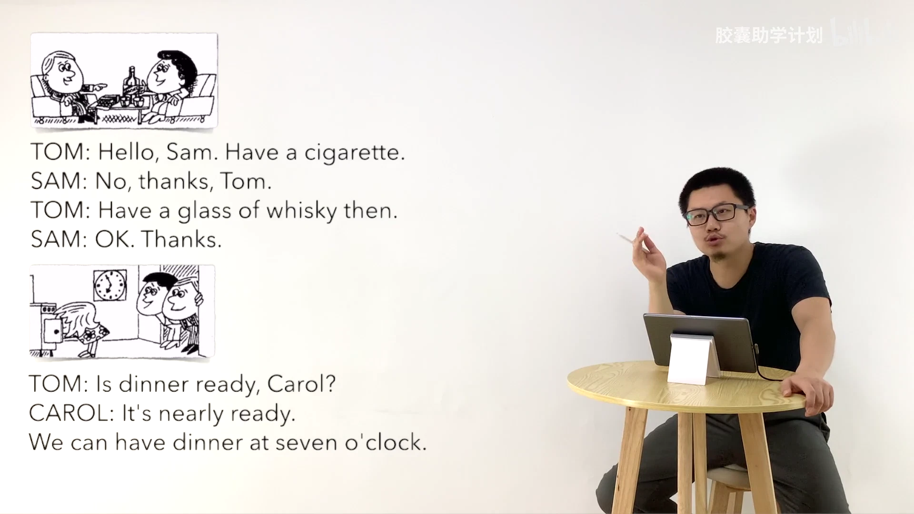

文字识别：胶囊助学计划 / 82 / 1818 / TOM: Hello, Sam. Have a cigarette. / SAM: No, thanks, Tom. / TOM: Have a glass of whisky then. / SAM: OK. Thanks. / TOM: Is dinner ready, Carol? / CAROL: It's nearly ready. / We can have dinner at seven o'clock.

### 画面 00:02:40

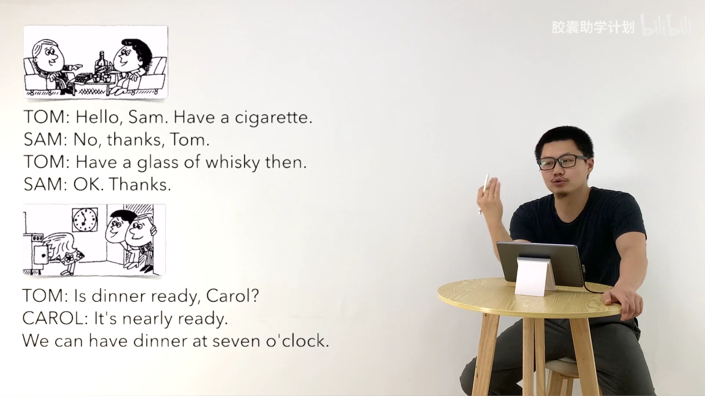

文字识别：胶囊助学计划 / 181118 / TOM: Hello, Sam. Have a cigarette. / SAM: No, thanks, Tom. / TOM: Have a glass of whisky then. / SAM: OK. Thanks. / TOM: Is dinner ready, Carol? / CAROL: It's nearly ready. / We can have dinner at seven o'clock.

## 00:03:00–00:03:30

seven o'clock.说我们啊可以怎么样呢？Have dinner在七点钟的时间。好，教各位一个小的自己去进行练习的一个方式。比如说，We can have dinner at seven o'clock.各位习惯上原来的方式是这一句话，然后给他读十遍、读二十遍，甚至读一百遍，对吧？我现在给各位的给各位的建议是什么呢？您把这一句话先给他读到非常熟，比如说读了二十遍啊。您本来想读一百遍，对吧？你读了二

### 画面 00:03:08

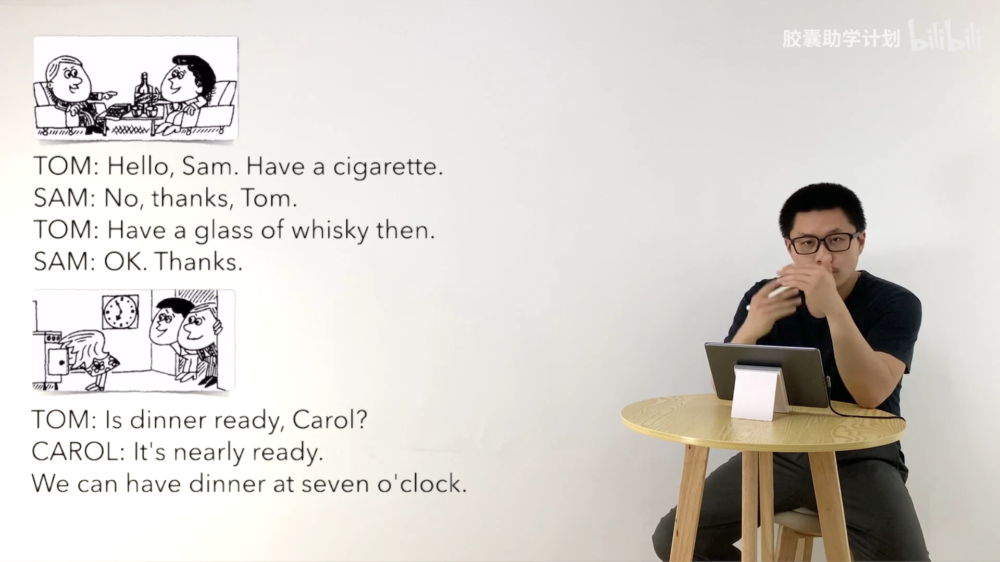

文字识别：胶囊助学计划 / 82 / 818 / TOM: Hello, Sam. Have a cigarette. / SAM: No, thanks, Tom. / TOM: Have a glass of whisky then. / SAM: OK.Thanks. / TOM: Is dinner ready, Carol? / CAROL: It's nearly ready. / We can have dinner at seven o'clock.

## 00:03:30–00:04:00

十遍，读到不磕巴了。然后您要做的事情是，既然给了你肯定句，你就要知道它背后还有否定句、一般疑问句和各种特殊疑问句。您就张嘴把它去变出来。比如说，We can't have dinner at seven o'clock. Can we have dinner at seven o'clock? When can we have dinner? Where can we have dinner? Who can have dinner at seven o'clock? Why can't we have dinner at seven o'clock? 对吧？这些

### 画面 00:03:38

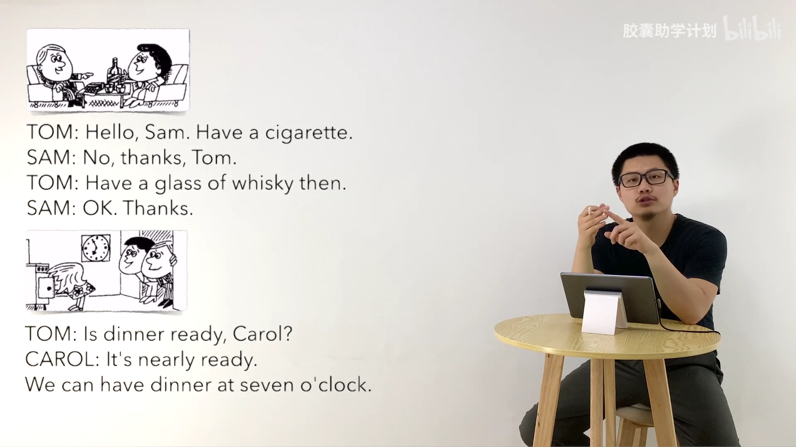

文字识别：胶囊助学计划 / 82 / 8118 / TOM: Hello, Sam. Have a cigarette. / SAM: No, thanks, Tom. / TOM: Have a glass of whisky then. / SAM: OK.Thanks. / TOM: Is dinner ready, Carol? / CAROL: It's nearly ready. / We can have dinner at seven o'clock.

## 00:04:00–00:04:30

句子您就都把它拿住了啊。Okay, continuing.他说Sam and I, Sam和我呀, had lunch together today.你看这个地方隐含的这个时态就很有意思。一般过去时。为什么呢？现在是晚餐时间，说我们今天一起吃的午餐，这一定是一般过去时了。您仔细想一想，对不对？中午发生的事情，所以它用的是had lunch. Okay, we went to a restaurant.哎，小的短语出来了，叫go

### 画面 00:04:03

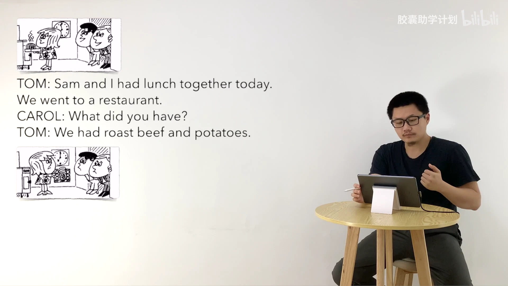

文字识别：胶囊助学计划 / TOM: Sam and I had lunch together today. / We went to a restaurant. / CAROL: What did you have? / TOM: We had roast beef and potatoes.

## 00:04:30–00:05:00

to a restaurant.那一般疑问句，您看到肯定句就要把它去变，叫做 Did you go to a restaurant?你看，您就多了一个表达，甚至你可以再多来一句，叫做 When did you go to the restaurant?或者 When did you go to a restaurant? Okay.啊，What did you have?那你们吃了什么呢？Tom说，We had roast beef and potatoes. Okay.啊，比较著名的一道菜啊，烤牛肉和土豆是吧？他说，Carol说，Oh，

### 画面 00:04:33

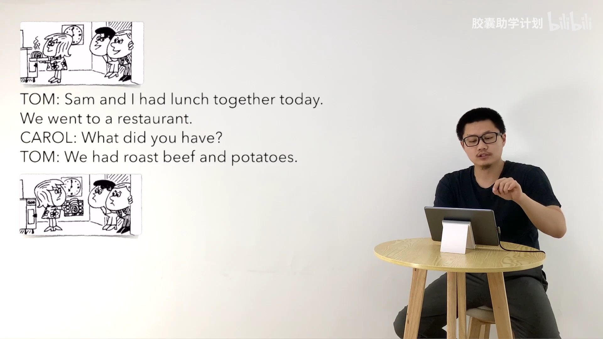

文字识别：胶囊助学计划 / TOM: Sam and I had lunch together today. / We went to a restaurant. / CAROL: What did you have? / TOM: We had roast beef and potatoes. / 的

### 画面 00:04:58

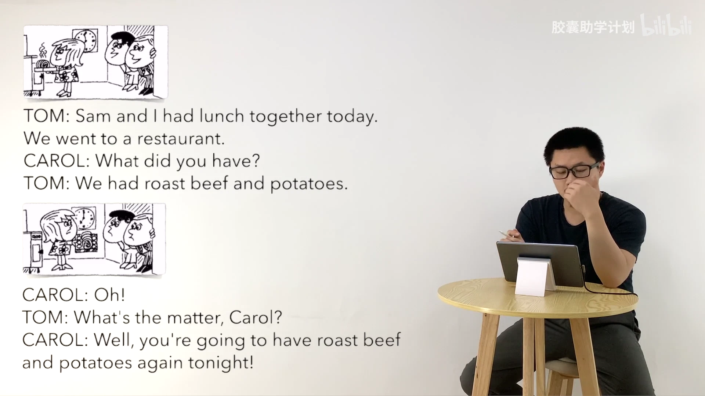

文字识别：胶囊助学计划 / 8 / TOM: Sam and I had lunch together today. / We went to a restaurant. / CAROL: What did you have? / TOM: We had roast beef and potatoes. / CAROL: Oh! / TOM: What's the matter, Carol? / CAROL: Well, you're going to have roast beef / and potatoes again tonight!

## 00:05:00–00:05:30

哇，怎么了？啊，Tom说，What's the matter，Carol？怎么了？Well，Well就是一个口头禅，我们之前也见过了。叫做好吧，啊，好吧。You are going to be going to do计划打算啊将表将来对吧？你们又要怎么样了？你们又要吃Have roast beef and potatoes again tonight？吃这儿的Have就是吃对吧？烤牛肉和土豆Again tonight又一次Tonight

### 画面 00:05:05

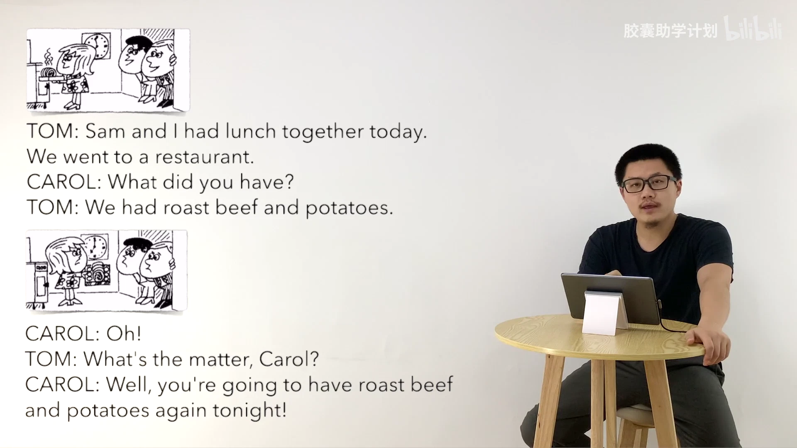

文字识别：胶囊助学计划 / TOM: Sam and I had lunch together today. / We went to a restaurant. / CAROL: What did you have? / TOM: We had roast beef and potatoes. / CAROL: Oh! / TOM: What's the matter, Carol? / CAROL: Well, you're going to have roast beef / and potatoes again tonight!

## 00:05:30–00:06:00

今晚啊非常舒服的一句话。来一个，接下来我们做一些口语听力练习。各位看着文章啊，我问问题，您回答我的问题，我们进行口语听力的训练。来了，一题。Is Tom downstairs? Answer: No, he isn't. Next one: Where is Tom? He is upstairs. Next one: What is he doing? He

### 画面 00:05:32

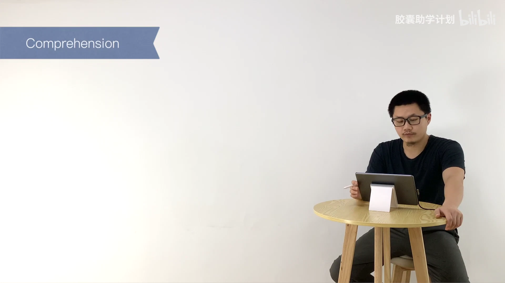

文字识别：胶囊助学计划 / Comprehension

### 画面 00:05:43

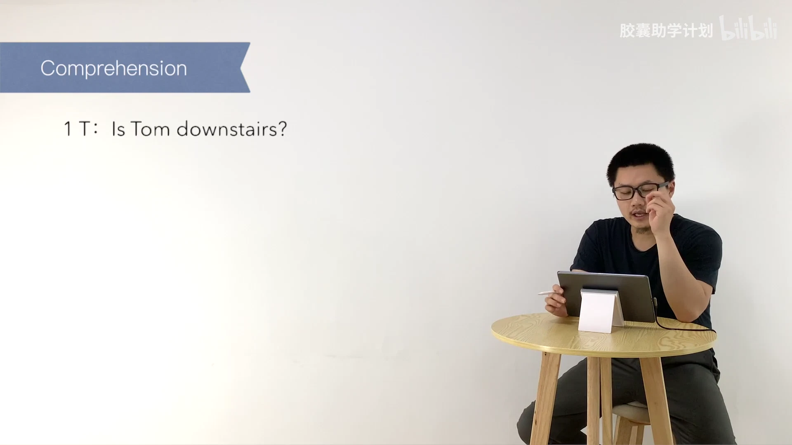

文字识别：胶囊助学计划 / Comprehension / 1 T: Is Tom downstairs?

## 00:06:00–00:06:30

He is having a bath. Next one, who is going to have dinner with Carol and Tom tonight? Sam is. Next one, is dinner ready? No, is nearly ready. Continue. When is dinner going to be ready? At seven o'clock.

### 画面 00:06:11

文字识别：胶囊助学计划 / Comprehension / 4 T: Who is going to have dinner with Carol / and Tom tonight? / S: Sam is.

### 画面 00:06:17

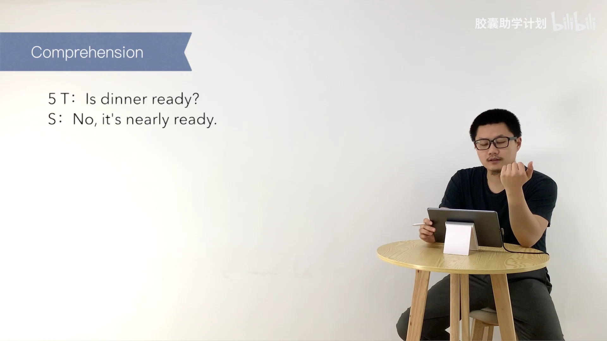

文字识别：胶囊助学计划 / Comprehension / 5 T: Is dinner ready? / S: No, it's nearly ready.

## 00:06:30–00:07:00

Next one, what did Sam and Tom do today? They had lunch together. 啊，两个好朋友中午一起吃的饭。 Next one, what did they have for dinner? For lunch, sorry, roast beef and potatoes. 好一个. Next one, is Carol disappointed? 好，可以抬头看一下这个 disappointed 是一个生词，叫做失望

### 画面 00:06:47

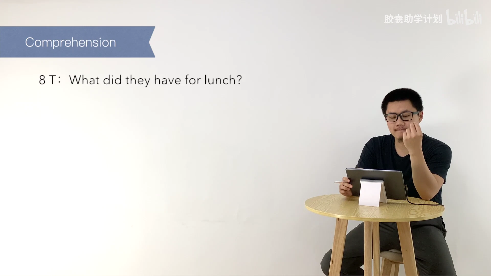

文字识别：胶囊助学计划 / Comprehension / 8 T: What did they have for lunch?

### 画面 00:06:58

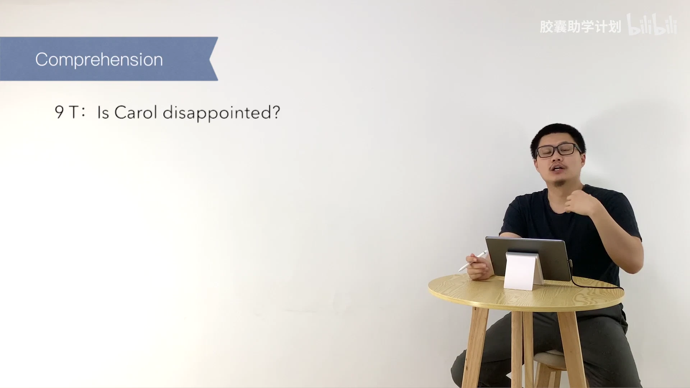

文字识别：胶囊助学计划 / Comprehension / 9 T: Is Carol disappointed?

## 00:07:00–00:07:30

嘛，对吧？她失望了吗？Yes, she is. Next one, what are they going to have for dinner? Roast beef and potatoes again,对吧？当然你也可以说像我这儿整句话打出来，都说出来没有问题啊。好，接下来 asking questions，我给肯定句，您变一般疑问句；我给特殊疑问词，您变特殊疑问句，对吧？这培养我们将来用英文发问的能力。下一个来了，

### 画面 00:07:01

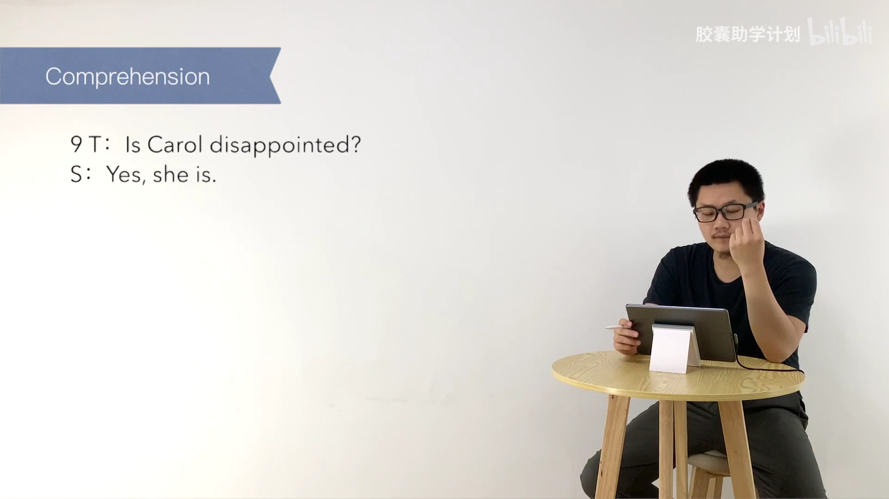

文字识别：胶囊助学计划 / Comprehension / 9 T: Is Carol disappointed? / S: Yes, she is.

### 画面 00:07:09

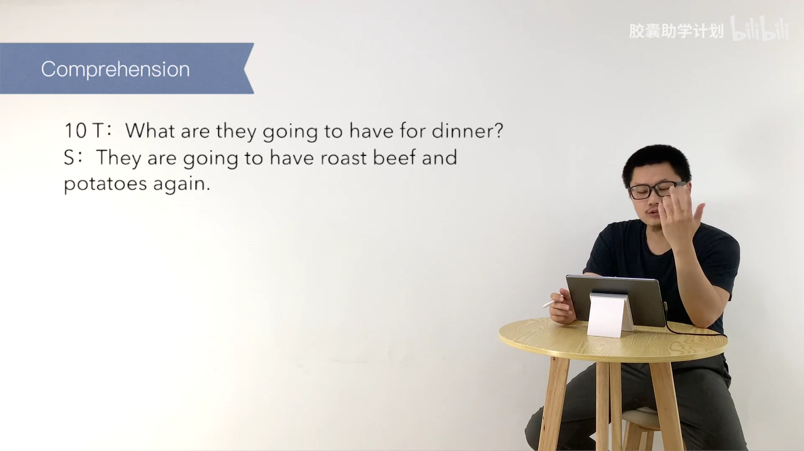

文字识别：胶囊助学计划 / Comprehension / 10T: What are they going to have for dinner? / S: They are going to have roast beef and / potatoes again.

### 画面 00:07:13

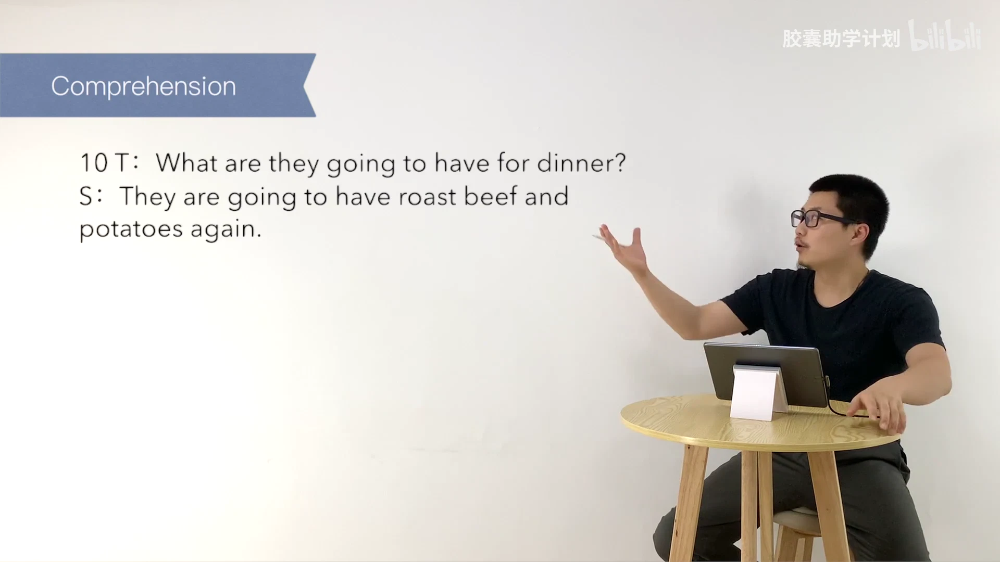

文字识别：胶囊助学计划 / Comprehension / 10 T: What are they going to have for dinner? / S: They are going to have roast beef and / potatoes again.

### 画面 00:07:17

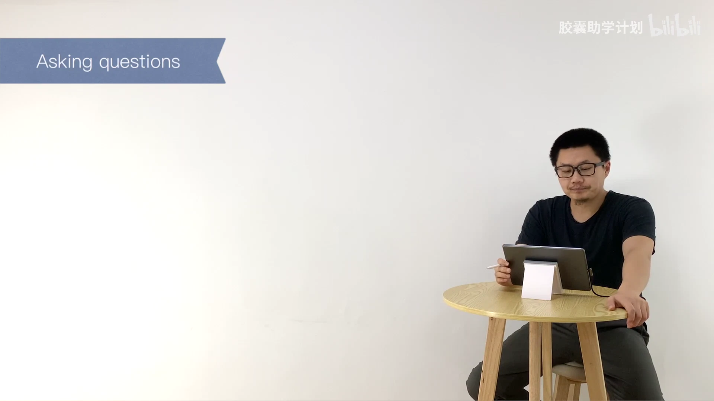

文字识别：胶囊助学计划 / Asking questions

## 00:07:30–00:08:00

came. Ask me if Tom is upstairs. Is Tom upstairs? Where? Where is Tom? Next one. Ask me if Sam wants a glass of whiskey. Wants, 啊，谁提前? Does Sam want a glass of whiskey? What? What does Sam want? Next

### 画面 00:07:37

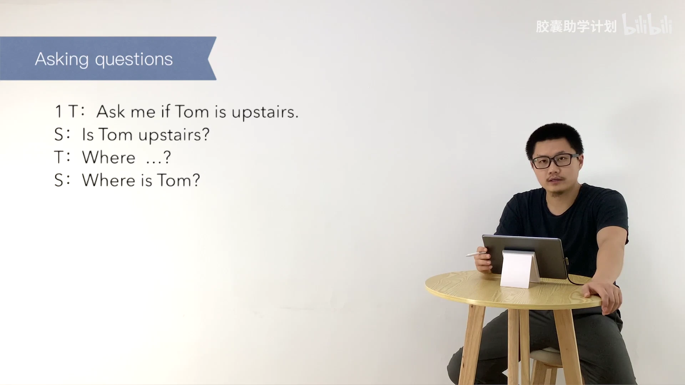

文字识别：胶囊助学计划 / Asking questions / 1 T: Ask me if Tom is upstairs. / S: Is Tom upstairs? / T: Where .? / S: Where is Tom?

### 画面 00:07:41

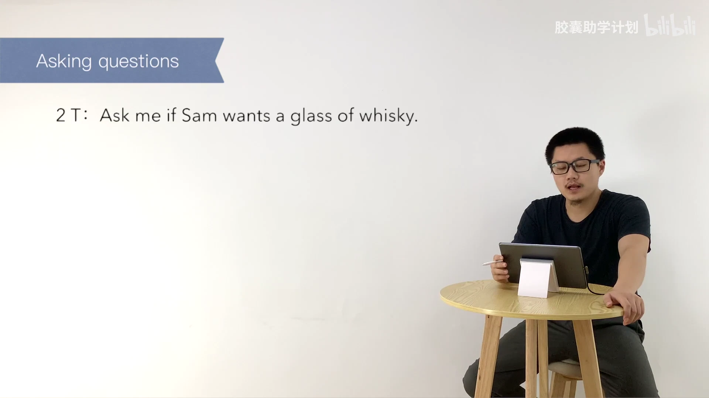

文字识别：胶囊助学计划 / Asking questions / 2 T: Ask me if Sam wants a glass of whisky.

### 画面 00:07:56

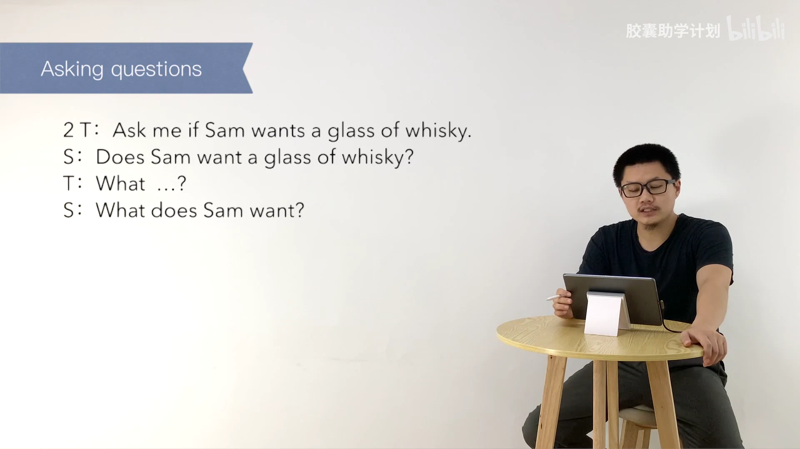

文字识别：胶囊助学计划 / Asking questions / 2 T: Ask me if Sam wants a glass of whisky. / S: Does Sam want a glass of whisky? / T: What ...? / S: What does Sam want?

### 画面 00:07:59

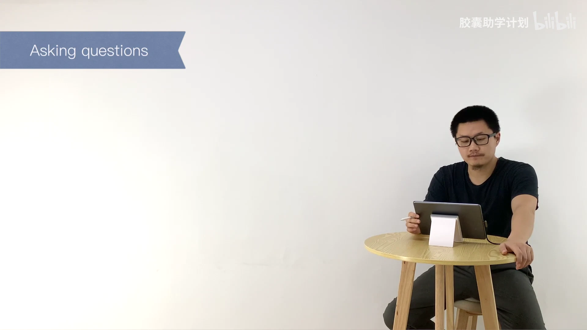

文字识别：胶囊助学计划 / Asking questions

## 00:08:00–00:08:30

one. Ask me if they can have dinner at seven. Can they have dinner at seven? What time? What time can they have dinner? Next one. Ask me if they went to a restaurant for lunch. Did they go to a restaurant for lunch? Where? Where did they go for lunch?

### 画面 00:08:11

文字识别：胶囊助学计划 / Asking questions / 3 T: Ask me if they can have dinner at seven. / S: Can they have dinner at seven? / T: What time ...? / S: What time can they have dinner?

### 画面 00:08:15

文字识别：胶囊助学计划 / Asking questions

### 画面 00:08:25

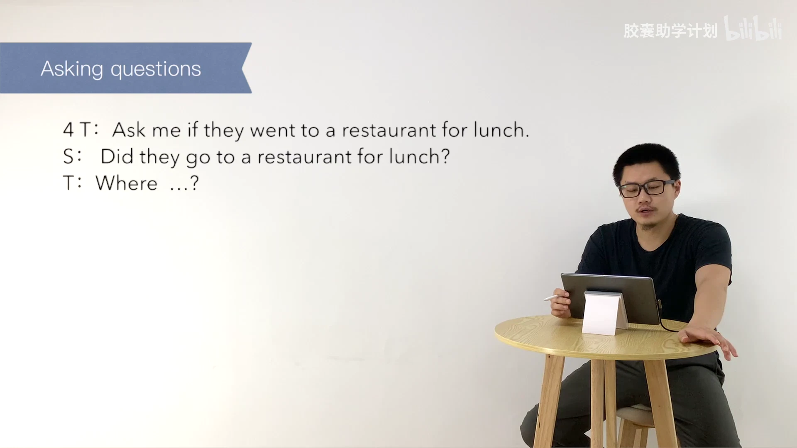

文字识别：胶囊助学计划 / Asking questions / 4 T: Ask me if they went to a restaurant for lunch. / S: Did they go to a restaurant for lunch? / T: Where ...?

## 00:08:30–00:09:00

Last one, ask me if they had roast beef for lunch. Had谁提线? Did they have roast beef for lunch? What What did they have for lunch? There you go. Good recap.本文关键的还是have加吃喝玩乐，对吧？整个八十一八十二就是have加吃喝玩乐。各位把这个掌握了，拿到手里就可以了。OK，好。

### 画面 00:08:30

文字识别：胶囊助学计划 / Asking questions / 5 T: Ask me if they had roast beef for lunch.

### 画面 00:08:42

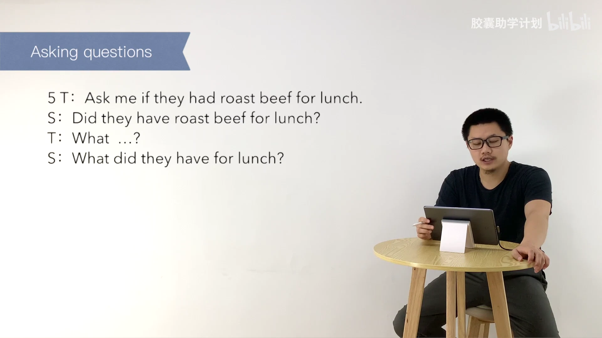

文字识别：胶囊助学计划 / Asking questions / 5 T: Ask me if they had roast beef for lunch. / S: Did they have roast beef for lunch? / T: What ...? / S: What did they have for lunch?

### 画面 00:08:46

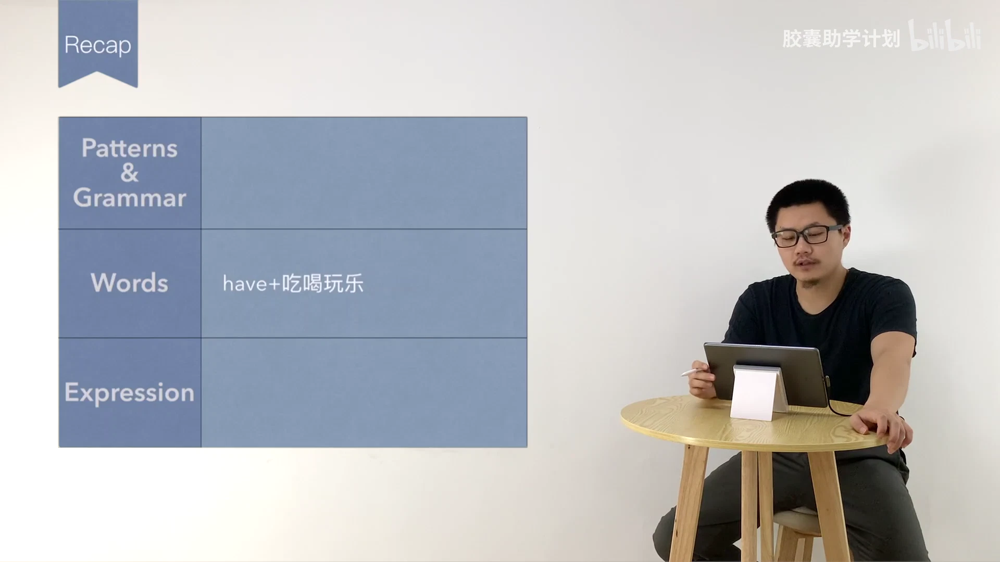

文字识别：胶囊助学计划 / Recap / Patterns / Grammar / Words / have+吃喝玩乐 / Expression

### 画面 00:08:59

文字识别：胶囊助学计划

## 00:09:00–00:09:30

家庭作业呢？绿皮书八十一课，各位的写作练习可以搞定了。文章要跟读至熟读成诵，这是我们贯穿各位英语学习初期很长一段时间的作业。然后呢，给自己讲解一遍今天的核心知识点。OK，好。那如果大家喜欢我们的课程呢，欢迎大家关注啊，订阅，一键三连支持我们，并分享给那些需要的朋友。最后，我们再来看一句名人名言：The secret of success is to be ready

### 画面 00:09:11

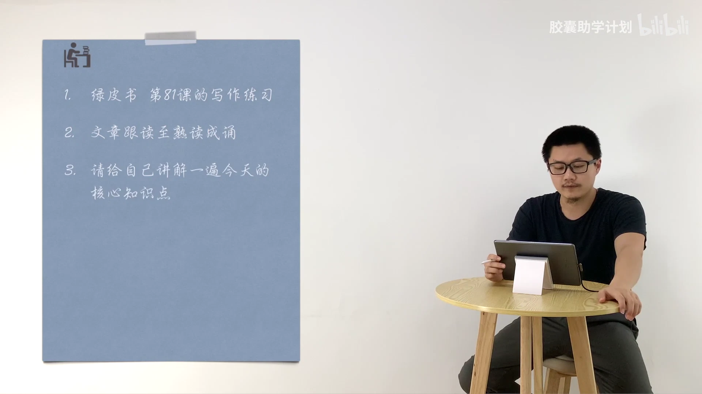

文字识别：胶囊助学计划 / 绿皮书第81课的写作练习 / 文章跟读至熟读成诵 / 3.请给自己讲解一遍今天的 / 核心知识点

### 画面 00:09:15

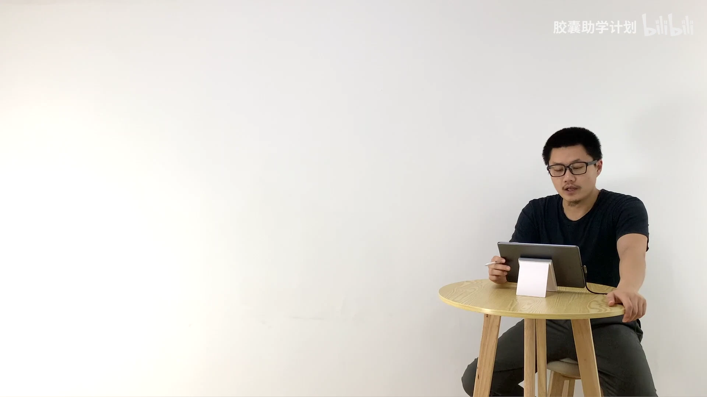

文字识别：胶囊助学计划

### 画面 00:09:23

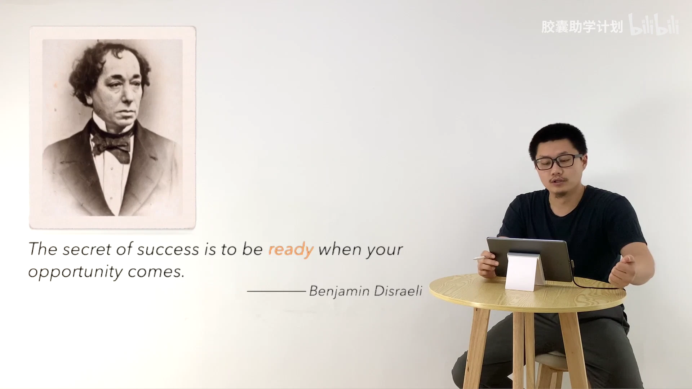

文字识别：胶囊助学计划 / The secret of success is to be ready when your / opportunity comes. / Benjamin Disraeli

## 00:09:30–00:09:46

when your opportunity comes. See you next time.

### 画面 00:09:34

### 画面 00:09:36

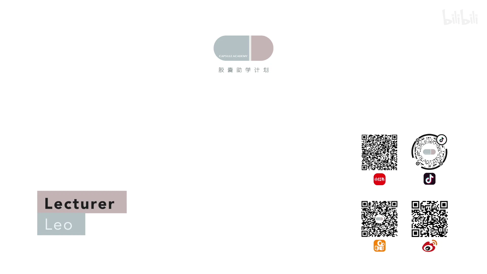

文字识别：CAPSULEACADEMY / 胶囊助学计划 / 小红书 / Lecturer / Leo / OE

### 画面 00:09:38

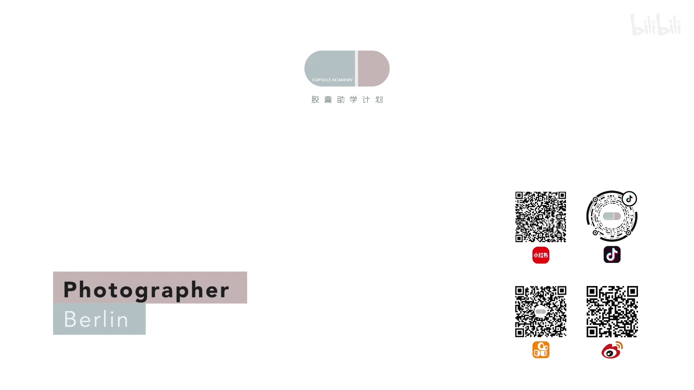

文字识别：CAPSULEACADEMY / 胶囊助学计划 / 『 / 小红书 / Photographer / Berlin / OE

### 画面 00:09:40

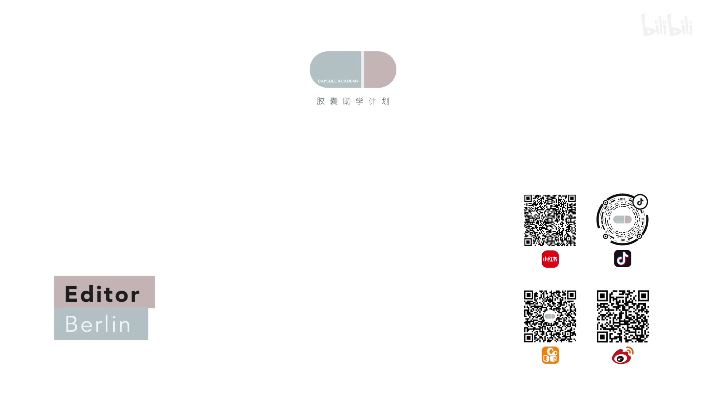

文字识别：CAPSULEACADEMY / 胶囊助学计划 / 『 / 小红书 / Editor / Berlin / OE

### 画面 00:09:43

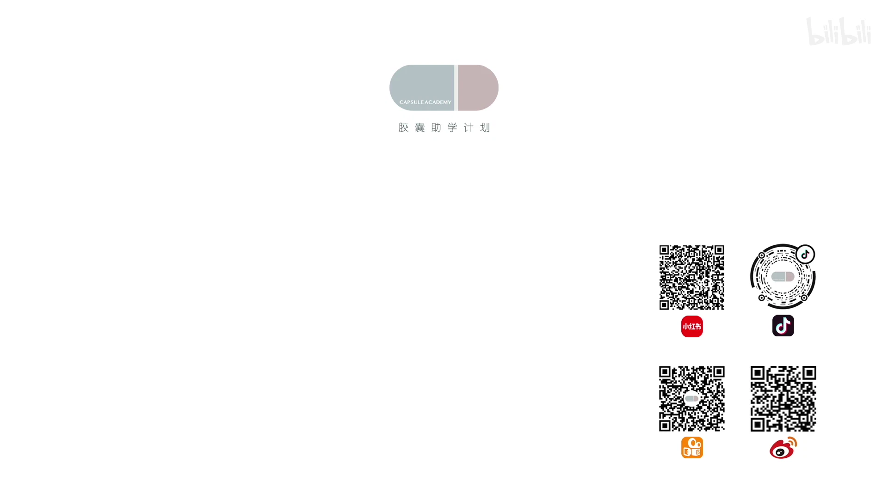

文字识别：CAPSULEACADEMY / 胶囊助学计划 / 小红书

### 画面 00:09:45

文字识别：bilibili / 胶囊助学计划

