# 083 文章

快速机器解析：语音为单模型转写，未进行独立交叉校对或人工复核；画面每秒采样并按变化选帧，短时文字和标记可能遗漏。截图时间约有 1 秒误差。图片有损压缩；遇到疑点请按时间查看 Google Drive 原视频。

## 00:00:00–00:00:30

Hello, everyone. Welcome to Capsule Academy. This is Leo. Today, we're going to learn New Concept English Book One, Lesson Eighty Three. Story. Hope you guys enjoyed.那我们上来直接看文章。Carol，楼下的这个人说，Hello, Sam. Come in.啊，又是他，是吧？Sam，来进来吧。八十一课我们刚见过这这这三个人，对吧？好，他说，Hello, Sam. Come in.进来吧。

### 画面 00:00:00

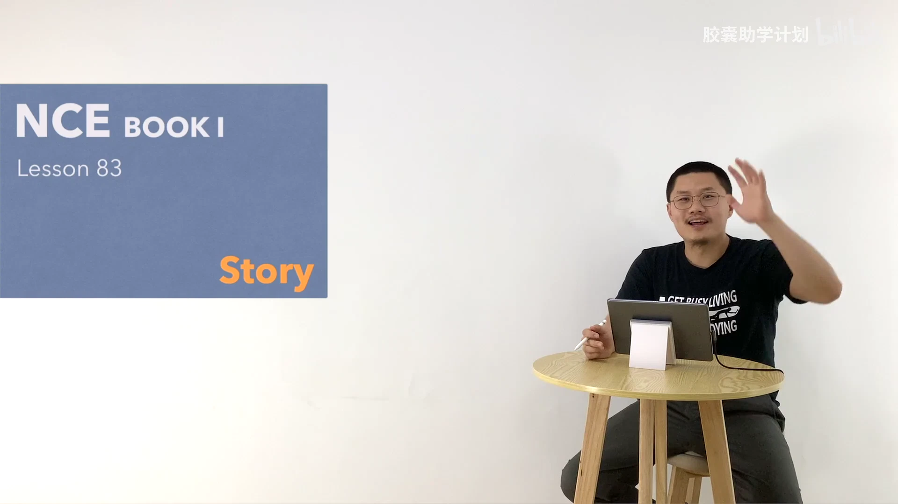

文字识别：胶囊助学计划 / NCE / BOOKI / Lesson 83 / Story / GET DICVLIVING / RYING

### 画面 00:00:02

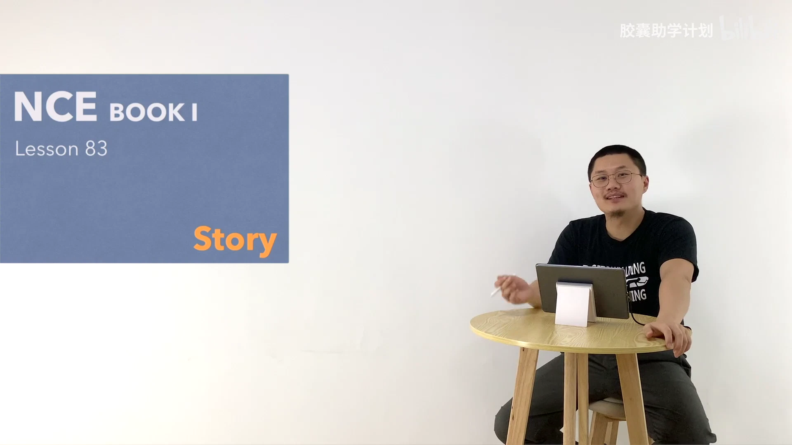

文字识别：胶囊助学计划 / NCE / BOOKI / Lesson 83 / Story / LANG / SING

### 画面 00:00:06

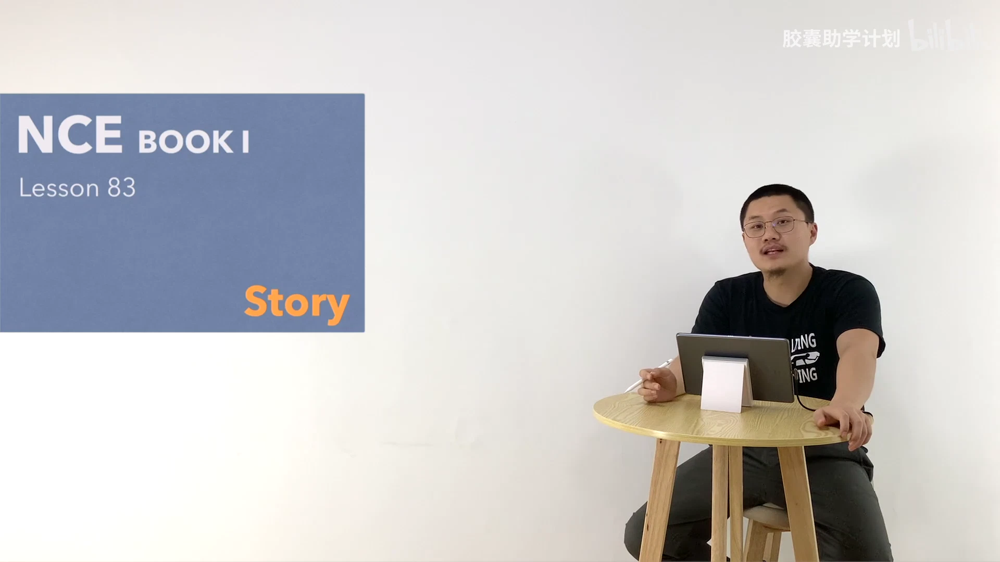

文字识别：胶囊助学计划 / NCE / BOOKI / Lesson 83 / Story / LING / JING

### 画面 00:00:10

文字识别：胶囊助学计划 bilbl / •

### 画面 00:00:14

文字识别：胶囊助学计划

### 画面 00:00:16

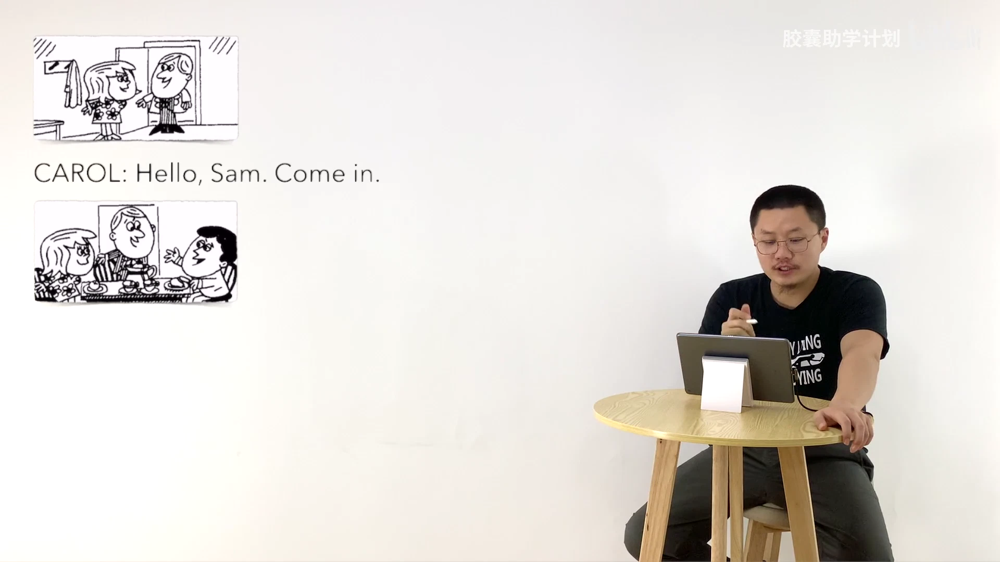

文字识别：CAROL: Hello, Sam. Come in. / YIING / ING

### 画面 00:00:28

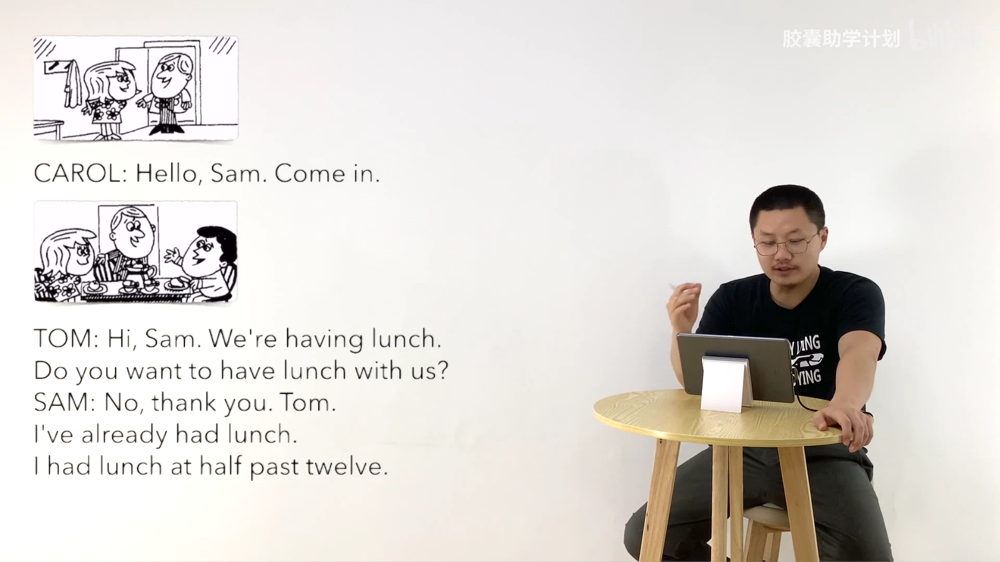

文字识别：胶囊助学计划 / CAROL: Hello, Sam. Come in. / TOM: Hi, Sam. We're having lunch. / YIANG / Do you want to have lunch with us? / PVING / SAM: No, thank you. Tom. / I've already had lunch. / I had lunch at half past twelve.

## 00:00:30–00:01:00

Tom，也就是这个Carol的老公了，说对吧？Hi, Sam.啊，说Hi, Sam，你好。We are having lunch.注意时态，are加having，现在进行时，表示一个动作现在正在进行。我们现在正在吃午饭。问Do you want to have lunch with us？关键词来了，说你想和我们一起吃午饭吗？Do you want to have lunch？问的是现在，对吧？Okay, Sam说No, thank you,

### 画面 00:00:58

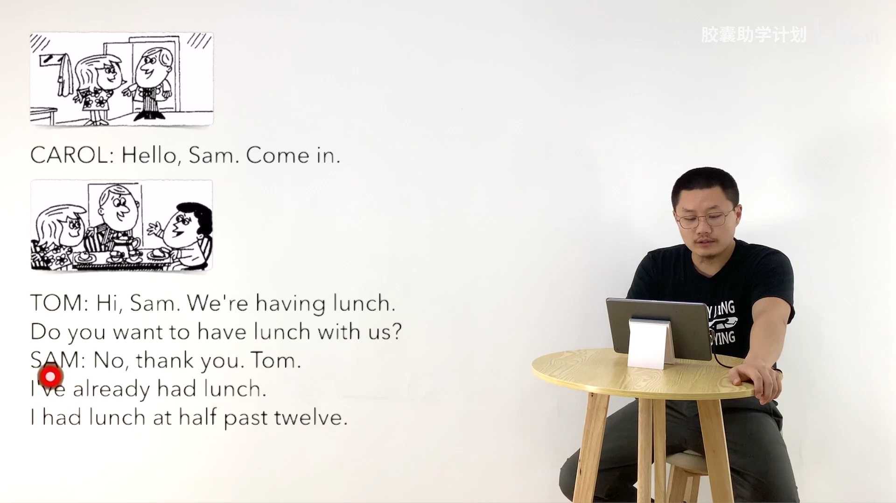

文字识别：CAROL: Hello, Sam. Come in. / TOM: Hi, Sam. We're having lunch. / YUNG / Do you want to have lunch with us? / BVING / SAM: No, thank you. Tom. /  Ve already had lunch. / I had lunch at half past twelve.

## 00:01:00–00:01:30

Tom. 不了，谢谢Tom. I've already had lunch. 对于各位来说，如果上一课学的不错，对吧？您给自己讲解了一遍核心语法点，看完视频之后又讲了一遍。那看到这儿的 have 加 had，你应该能瞬间想起来，它表示的是现在完成时这个时态。Already 表示已经，他想说的是叫我已经吃完午饭了。好，我们先不往下看

### 画面 00:01:11

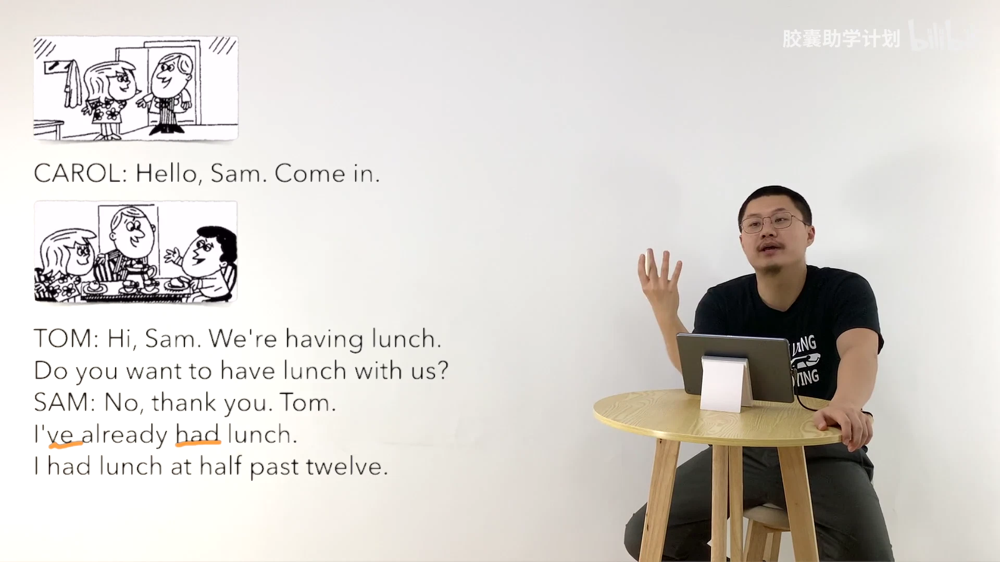

文字识别：胶囊助学计划 / CAROL: Hello, Sam. Come in. / TOM: Hi, Sam. We're having lunch. / LNG / Do you want to have lunch with us? / jING / SAM: No, thank you. Tom. / I've already had lunch. / I had lunch at half past twelve.

## 00:01:30–00:02:00

到这儿就可以了。Tom问的是你想和我们一起吃点午饭不？一起再吃一口，一起吃口午饭。Sam的回答是No, thank you。不，谢谢了，Tom。我已经吃完了。问吃这个动作发生在什么时候？一定是过去，对吧？吃午饭。那问对现在的影响是什么？就是No, thank you，对吧？就是你问我要不要一块吃，我的回答是不用一块吃了，对吧？因为我已经吃过了。言之过去，过去吃

### 画面 00:01:41

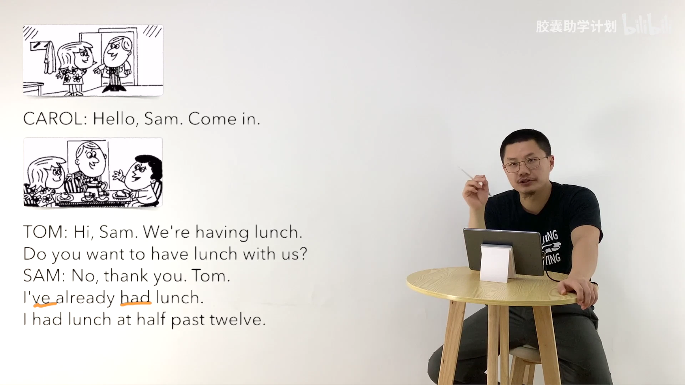

文字识别：胶囊助学计划 / CAROL: Hello, Sam. Come in. / TOM: Hi, Sam. We're having lunch. / MNG / Do you want to have lunch with us? / FING / SAM: No, thank you. Tom. / I've already had lunch. / I had lunch at half past twelve.

## 00:02:00–00:02:30

的意在当下，现在不吃了，对吧？叫我已经吃过了。好，接下来他说 I had lunch。好，再然后再加上 at half past twelve，十二点半，在十二点半的时间，这就是一个典型的一般过去时，就是告诉你这个动作发生在过去十二点半吃的，但是并没有想说跟现在有什么影响。OK，接下来 Carol 又说，那 Have a cup of coffee then，

### 画面 00:02:08

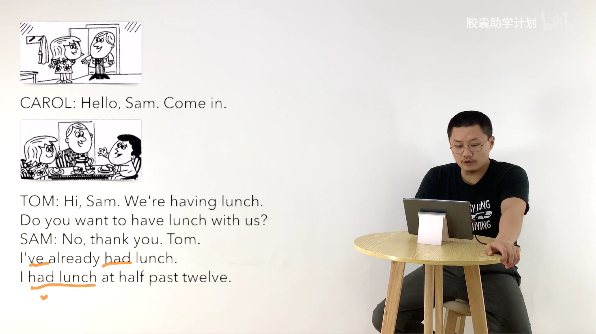

文字识别：胶囊助学计划 / CAROL: Hello, Sam. Come in. / TOM: Hi, Sam. We're having lunch. / YING / Do you want to have lunch with us? / VING / SAM: No, thank you. Tom. / I've already had lunch. / I had lunch at half past twelve.

### 画面 00:02:18

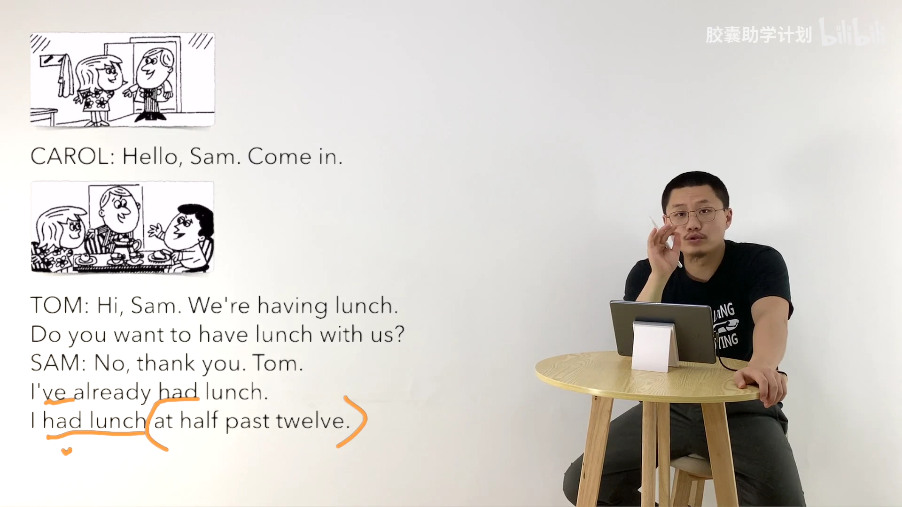

文字识别：胶囊助学计划 / CAROL: Hello, Sam. Come in. / TOM: Hi, Sam. We're having lunch. / MNG / Do you want to have lunch with us? / FYING / SAM: No, thank you. Tom. / I've already had lunch. / I had lunchat half past twelve.

### 画面 00:02:25

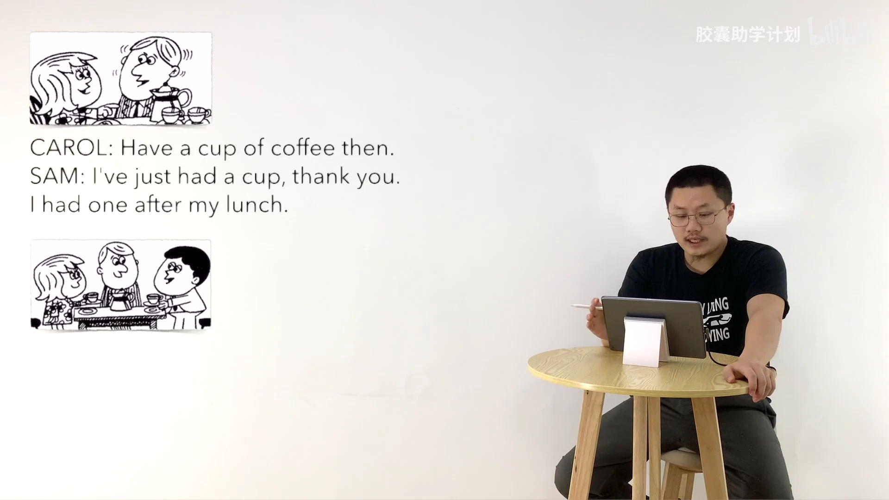

文字识别：胶囊助学计划 / CAROL: Have a cup of coffee then. / SAM: I've just had a cup, thank you. / I had one after my lunch. / YLING / VING

### 画面 00:02:29

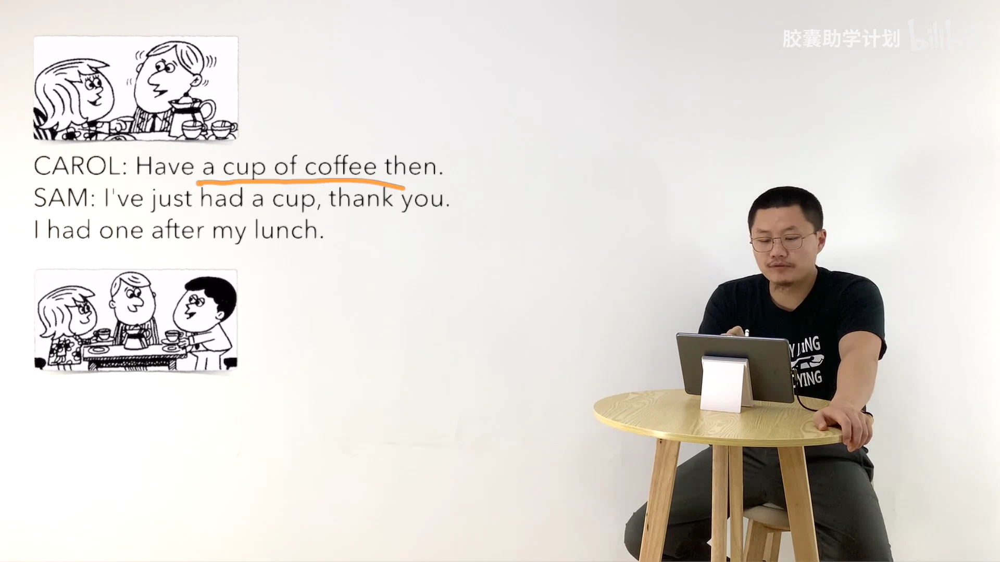

文字识别：胶囊助学计划 / CAROL: Have a cup of coffee then. / SAM: I've just had a cup, thank you. / I had one after my lunch. / YLANG / EYING

## 00:02:30–00:03:00

那喝杯咖啡吧。Sam说，I've just had a cup. Thank you. 你看这句话就非常好的把潜台词，他就没说出来。他说，他说喝杯咖啡。你看，Sam没有说no。Sam说的是have加蛋。我刚刚喝过一杯，谢谢。动作什么时候喝的？过去对现在的影响是什么？No。

### 画面 00:02:34

文字识别：胶囊助学计划 / CAROL: Have a cup of coffee then. / SAM: I've just had a cup, thank you. / I had one after my lunch. / YING / PYING

### 画面 00:02:38

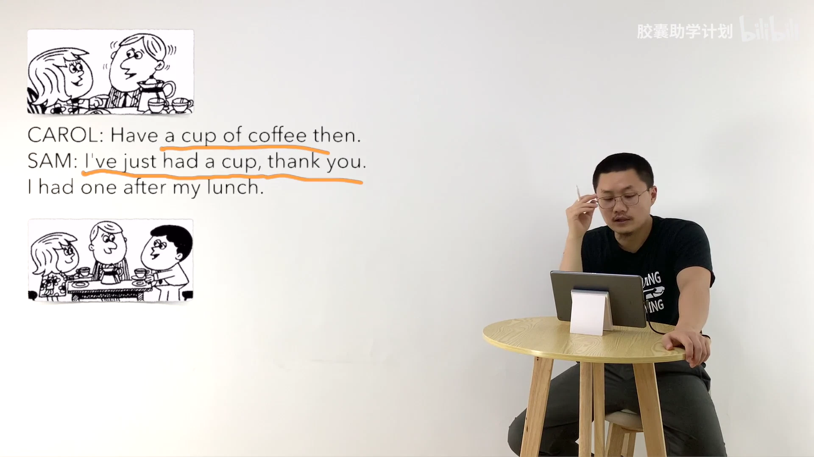

文字识别：胶囊助学计划 / CAROL: Have a cup of coffee then. / SAM: I've just had a cup, thank you. / I had one after my lunch. / VANG / NING

### 画面 00:02:41

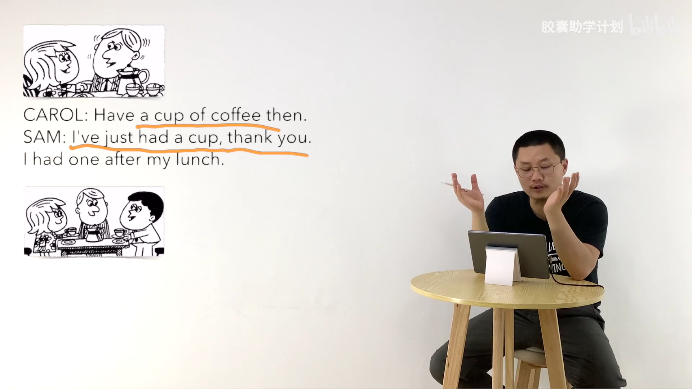

文字识别：胶囊助学计划 / CAROL: Have a cup of coffee then. / SAM: I've just had a cup, thank you. / I had one after my lunch.

### 画面 00:02:49

文字识别：胶囊助学计划 / CAROL: Have a cup of coffee then. / ejust hada cup, thank you. / SAM: / I had one after my lunch. / /IN

### 画面 00:02:52

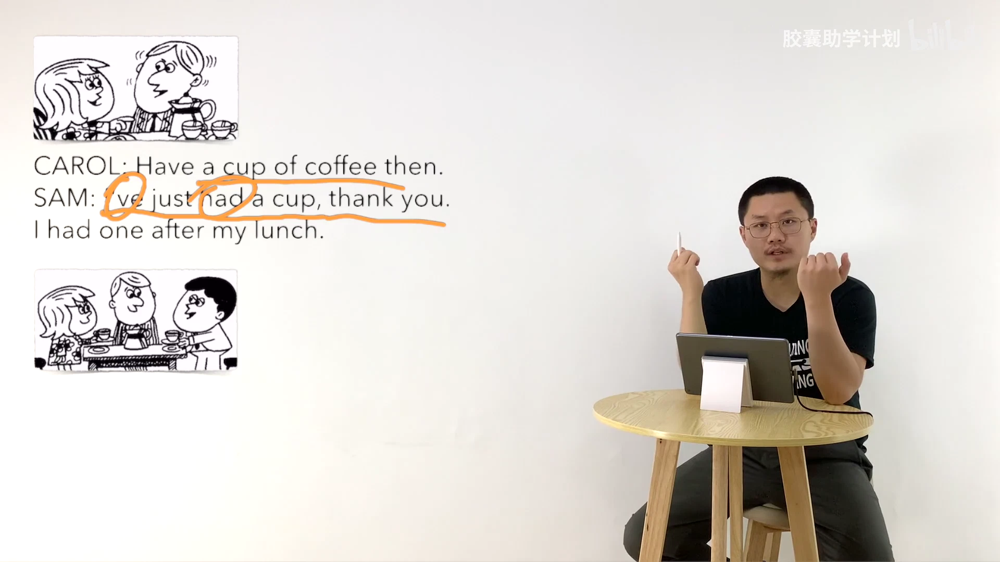

文字识别：胶囊助学计划 / CAROL: Have a cup of coffee then. / ve just fada cup, thank you. / SAM: / I had one after my lunch.

### 画面 00:02:58

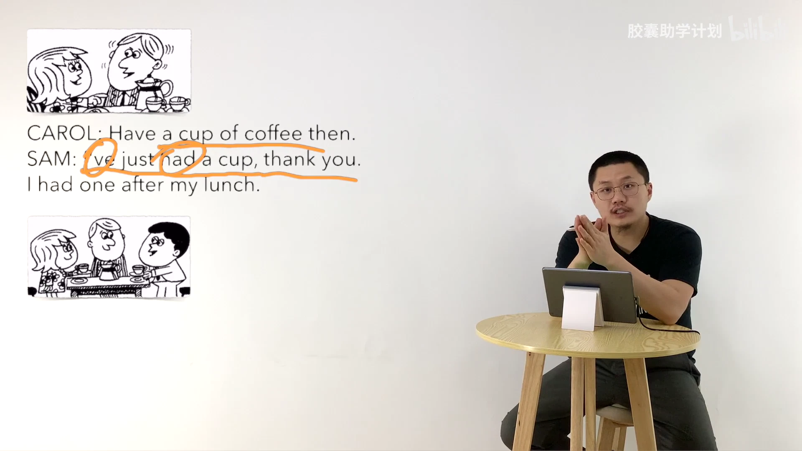

文字识别：胶囊助学计划 / CAROL: Have a cup of coffee then. / ve just ad a cup, thank you. / SAM: / I had one after my lunch.

## 00:03:00–00:03:30

我现在不想喝了，对吧？这就是现在完成时。而底下紧跟了一句一般过去时，叫 I had one after my lunch. 吃完午饭之后，我喝了一杯，对吧？这就是一般过去时了，它就不是现在完成时了，结构也不一样，对吧？含义也不完全相同。再然后，Tom说说 Let's go into the living room. 啊，吃完了，说那咱们去进入什么呢？Living room. 我们去客厅吧。Carol,

### 画面 00:03:04

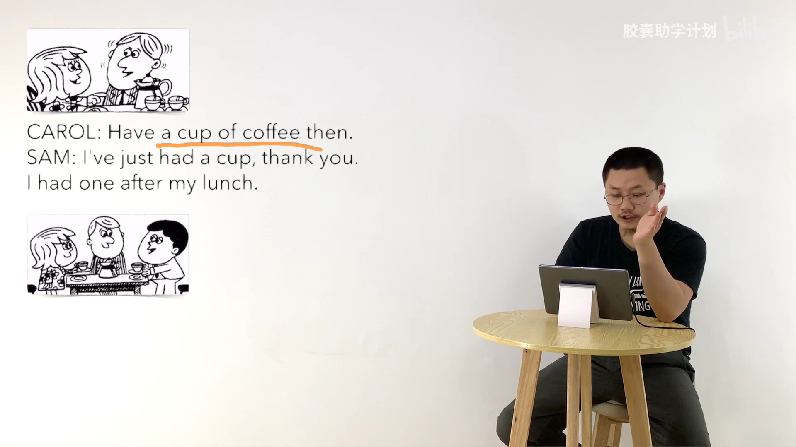

文字识别：胶囊助学计划 / CAROL: Have a cup of coffee then. / SAM: I've just had a cup, thank you. / I had one after my lunch.

### 画面 00:03:09

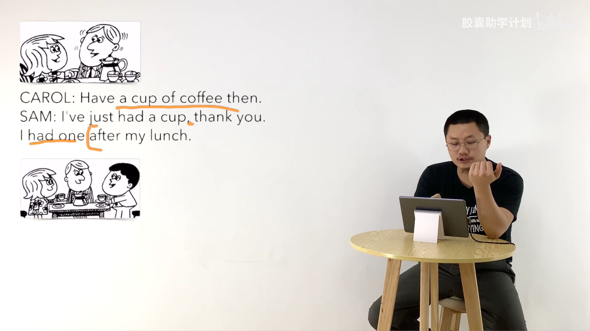

文字识别：胶囊助学计划 / CAROL: Have a cup of coffee then. / SAM: I've just had a cup_thank you. / I had onelafter my lunch. / ING

### 画面 00:03:12

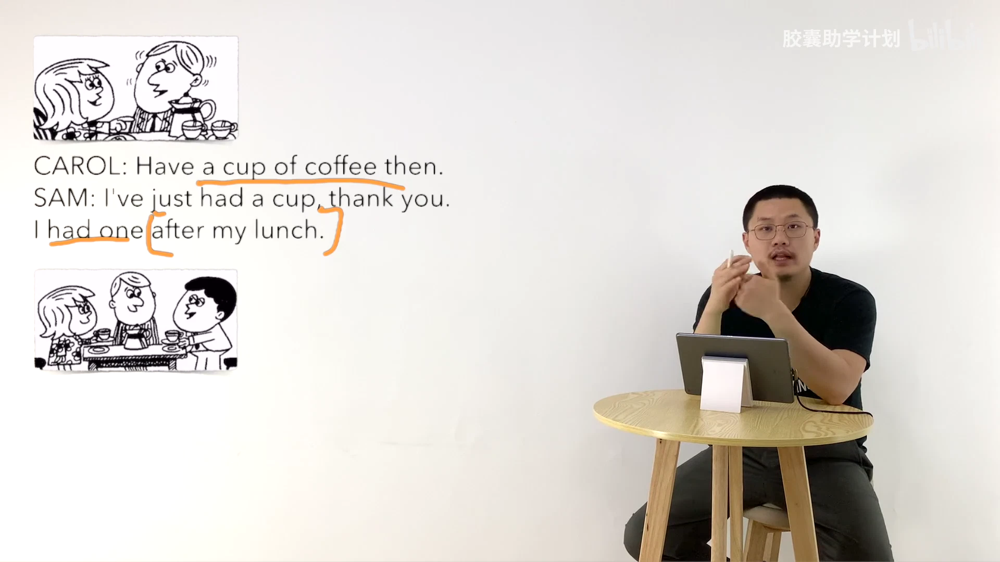

文字识别：胶囊助学计划 / CAROL: Have a cup of coffee then. / SAM: I've just had a cup thank you. / I had oneafter my lunch.

### 画面 00:03:16

文字识别：胶囊助学计划 / CAROL: Have a cup of coffee then. / SAM: I've just had a cup,thank you. / I had oneafter my lunch.

### 画面 00:03:21

文字识别：胶囊助学计划 / CAROL: Have a cup of coffee then. / SAM: I've just had a cup, thank you. / I had one after my lunch. / TOM: Let's go into the living room, Carol. / We can have our coffee there.

### 画面 00:03:25

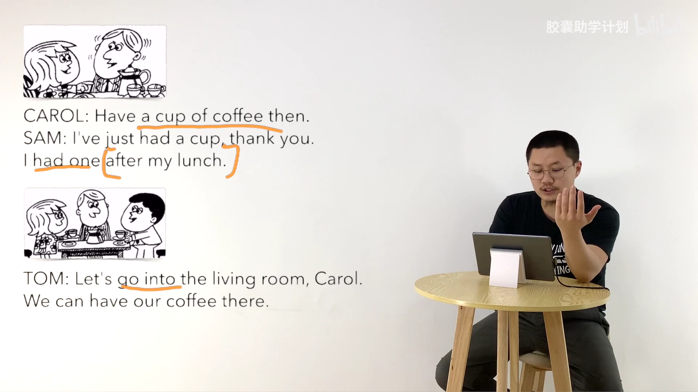

文字识别：胶囊助学计划 / CAROL: Have a cup of coffee then. / SAM: I've just had a cup,thank you. / I had oneafter my lunch. / TOM: Let's go into the living room, Carol. / We can have our coffee there.

### 画面 00:03:27

文字识别：胶囊助学计划 / CAROL: Have a cup of coffee then. / SAM: I've just had a cup,thank you. / I had oneafter my lunch. / TOM: Let's go into the living room / Carol. / We can have our coffee there.

## 00:03:30–00:04:00

We can have our coffee there.说我们可以在那里喝我们的咖啡。这个there放到最后就是一个小的单词，告诉你就表示的是那里。Here, there,对吧？好，Carol又说，Excuse the mess.好，Excuse是第一节课咱们学的，叫Excuse me啊，叫做原谅我，对吧？就是其实让你再说一遍，是吧？打扰一下别人，原谅一下我。提前说，那Excuse the mess就是哎，我这太乱了，实在不

### 画面 00:03:31

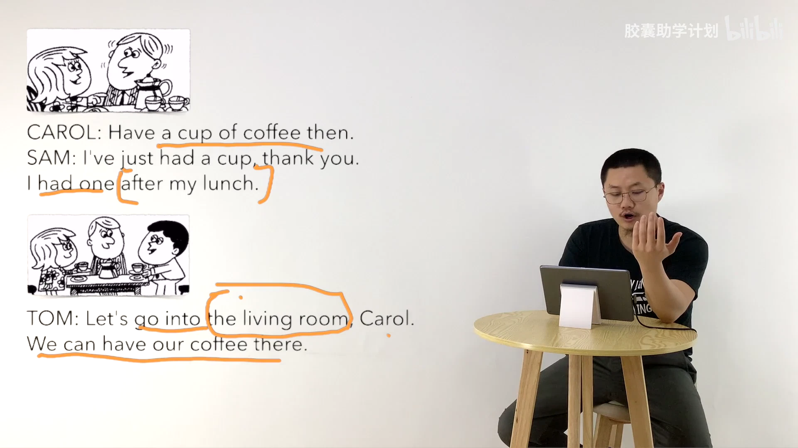

文字识别：胶囊助学计划 / CAROL: Have a cup of coffee then. / SAM: I've just had a cup,thank you. / I had oneafter my lunch. / TOM: Let's go into the living room / Carol. / We can have our cofftee there.

### 画面 00:03:35

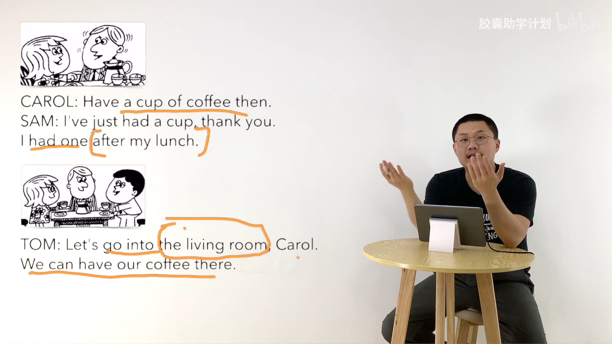

文字识别：胶囊助学计划 / CAROL: Have a cup of coffee then. / SAM: I've just had a cup, thank you. / I had oneafter my lunch. / TOM: Let's go into the living room / Carol. / We can have our cofftee there.

### 画面 00:03:42

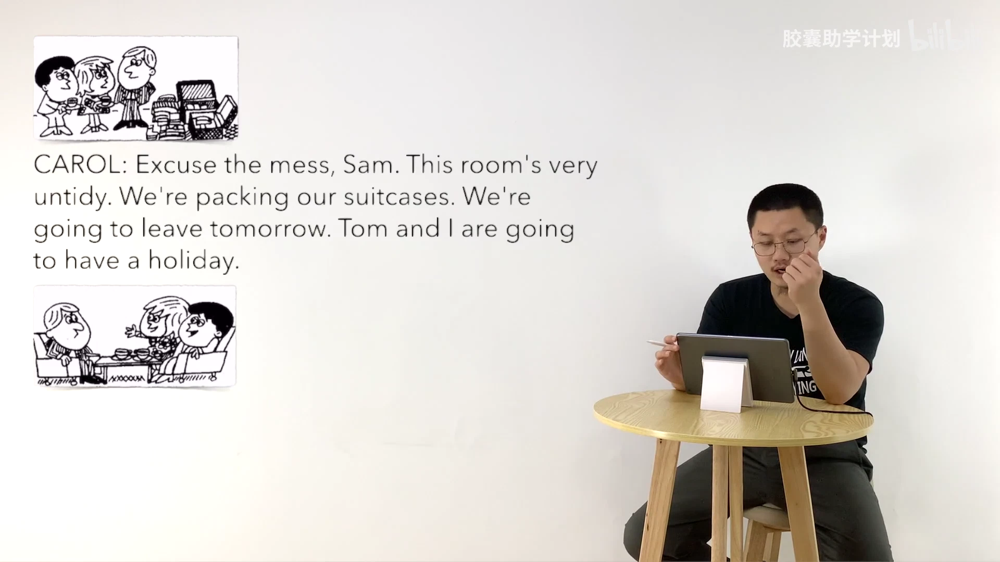

文字识别：胶囊助学计划 / 乐 / CAROL: Excuse the mess, Sam. This room's very / untidy. We're packing our suitcases. We're / going to leave tomorrow. Tom and I are going / to have a holiday.

### 画面 00:03:44

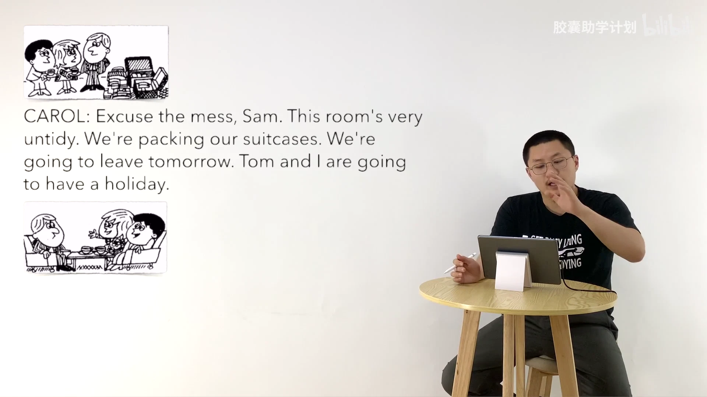

文字识别：胶囊助学计划 / CAROL: Excuse the mess, Sam. This room's very / untidy. We're packing our suitcases. We're / going to leave tomorrow. Tom and l are going / to have a holiday. / YLANG / x / DVING

### 画面 00:03:49

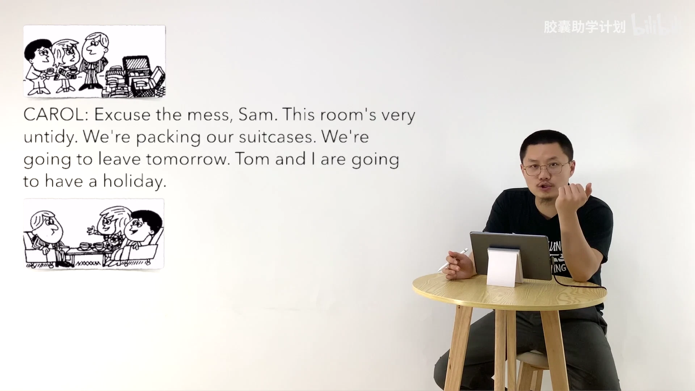

文字识别：胶囊助学计划 / CAROL: Excuse the mess, Sam. This room's very / untidy. We're packing our suitcases. We're / going to leave tomorrow. Tom and l are going / to have a holiday.

### 画面 00:03:54

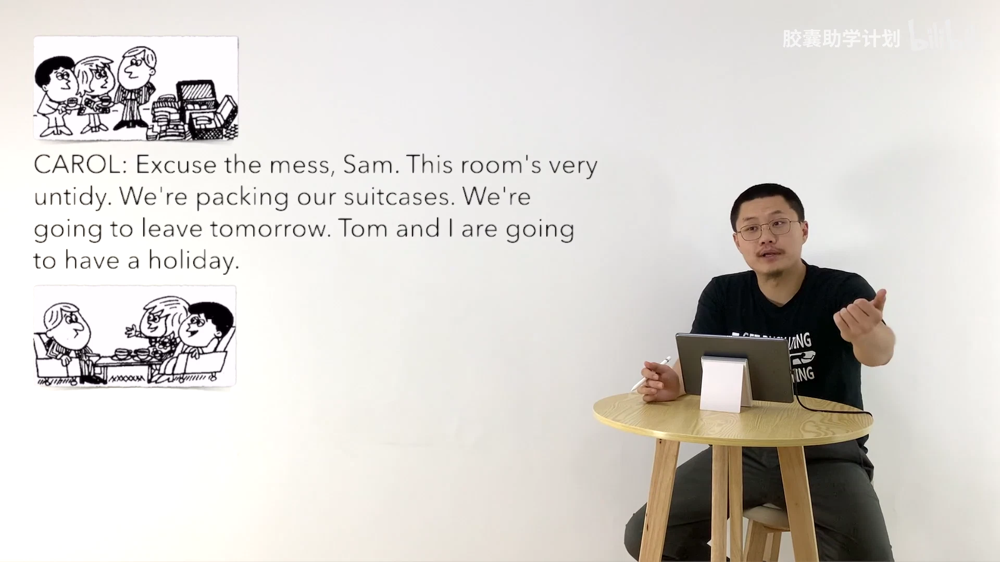

文字识别：胶囊助学计划 / CAROL: Excuse the mess, Sam. This room's very / untidy. We're packing our suitcases. We're / going to leave tomorrow. Tom and I are going / to have a holiday. / UANG / xx8 / HING

## 00:04:00–00:04:30

好意思啊。就大概是这么个意思，对吧？Sam，原谅我这儿的混乱啊。This room's very untidy.说这个房间非常的不整洁，非常的乱。这儿注意这儿的P.S.，你需想它是is还是has。如果是has，那理论上后边应该有个蛋，而后边没有蛋，对吧？过去分词，那这儿它就是is前二十课我们就学过的句型。We are packing our suitcases.

### 画面 00:04:03

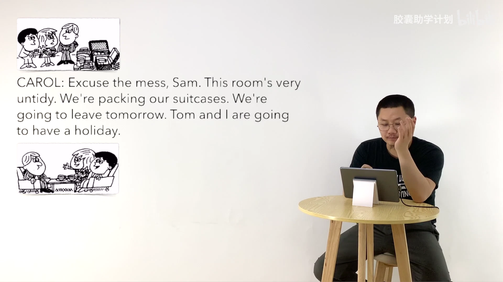

文字识别：胶囊助学计划 / 乐 / CAROL: Excuse the mess, Sam. This room's very / untidy. We're packing our suitcases. We're / going to leave tomorrow. Tom and l are going / to have a holiday.

### 画面 00:04:07

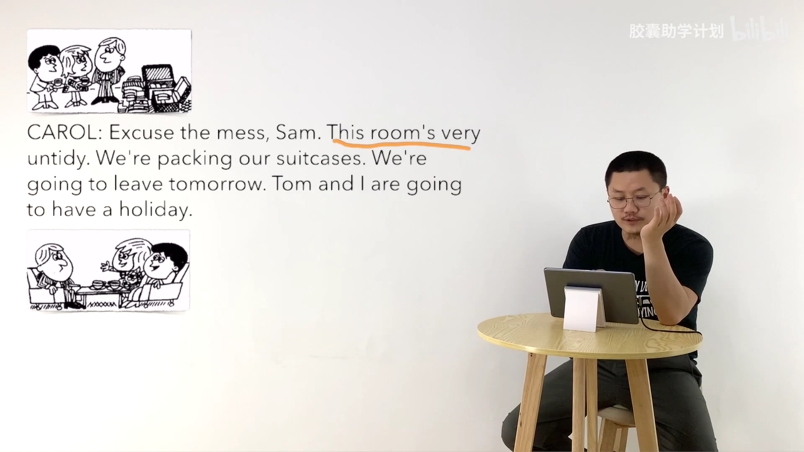

文字识别：胶囊助学计划 / 8 / CAROL: Excuse the mess, Sam. This room's very / untidy. We're packing our suitcases. We're / going to leave tomorrow. Tom and are going / to have a holiday.

### 画面 00:04:16

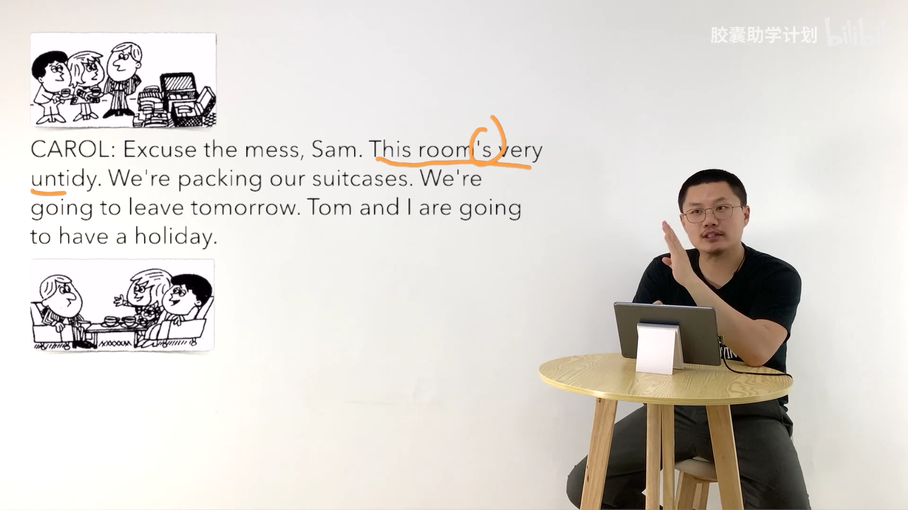

文字识别：胶囊助学计划 / untidy. We're packing our suitcases. We're / going to leave tomorrow. Tom and are going / to have a holiday.

### 画面 00:04:27

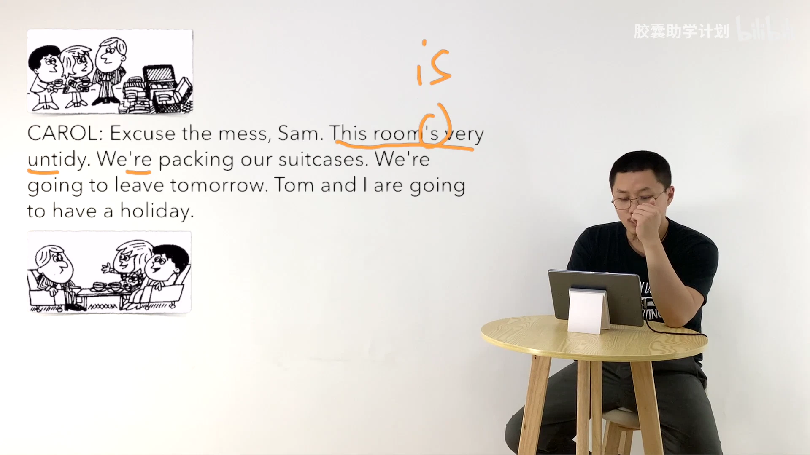

文字识别：胶囊助学计划 / C / CAROL: Excuse the mess, Sam. This rooms /ery / untidy. We're packing our suitcases. We're / going to leave tomorrow. Tom and I are going / to have a holiday. / x

## 00:04:30–00:05:00

说我们正在整理我们的这个行李，打包我们的这个行李，对吧？Okay, be加doing，现在正在做某件事情。说We are going to leave tomorrow.计划打算，我们打算明天离开。你看这篇文章还真不错，把我们目前为止学过的五个时态全出现了。您可以下了课，关闭视频之后，仔仔细细的给自己再标记一遍。Okay,

### 画面 00:04:32

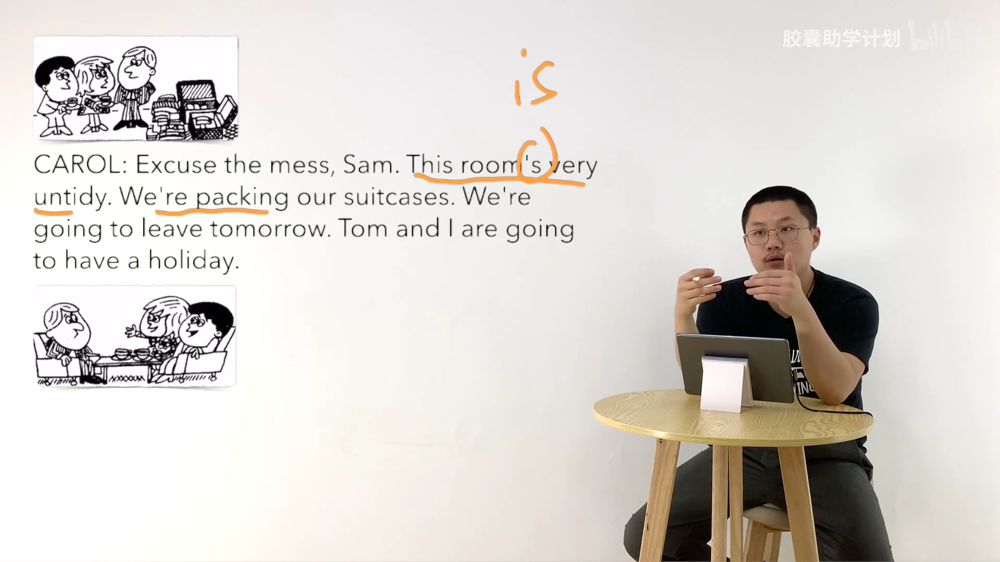

文字识别：胶囊助学计划 / 乐 / untidy. We're packing our suitcases. We're / going to leave tomorrow. Tom and I are going / to have a holiday. / x

### 画面 00:04:41

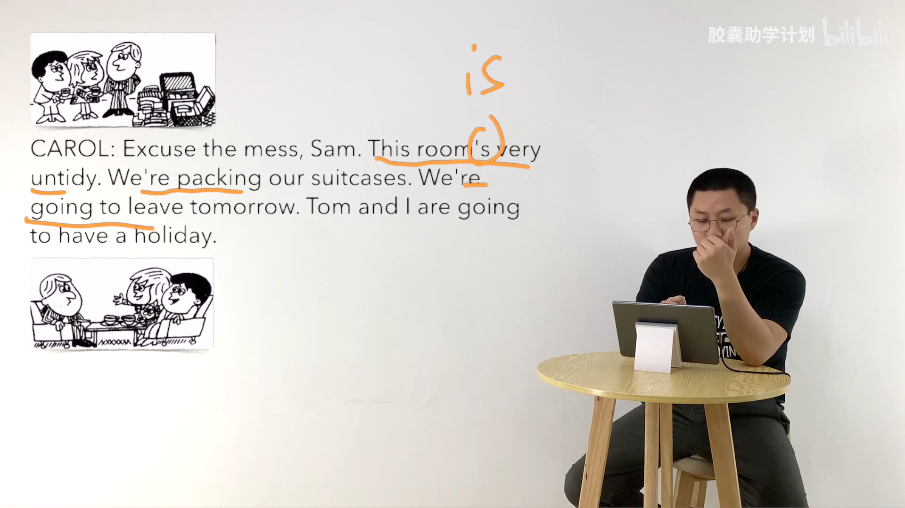

文字识别：胶囊助学计划 / e the mess, Sam. This roonsery / CAROL: Excuse / untidy. / We're packing our suitcases. We' / re / going t /  to leave tomorrow. Tom and I are / going / to have a holiday.

## 00:05:00–00:05:30

说 Tommy and I, Tom 和我呀，are going to 好 be going to do 这个表示计划打算，一般将来时。Have a holiday，我们八十二课刚刚学过的叫度假，我们打算去度个假。Sam 说，Aren't you lucky？六十七课学的否定疑问句叫做难道你们不幸运吗？就是你们太幸运了，表示语气的强调。When are you going to have a holiday, Sam？那你什么时候打算去度假呢，

### 画面 00:05:01

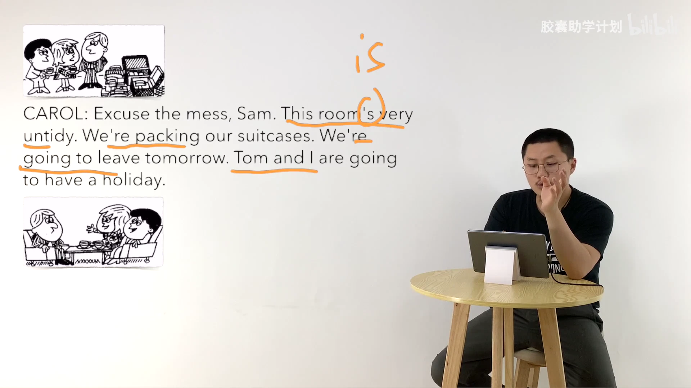

文字识别：胶囊助学计划 / e the mess, Sam. This roomsery / CAROL: Excuse / untidy. / We're packing / ourS / suitcases. We' / re / goingt /  to leave tomorrow. / Tom and I are / going / to have a holiday. / x18

### 画面 00:05:04

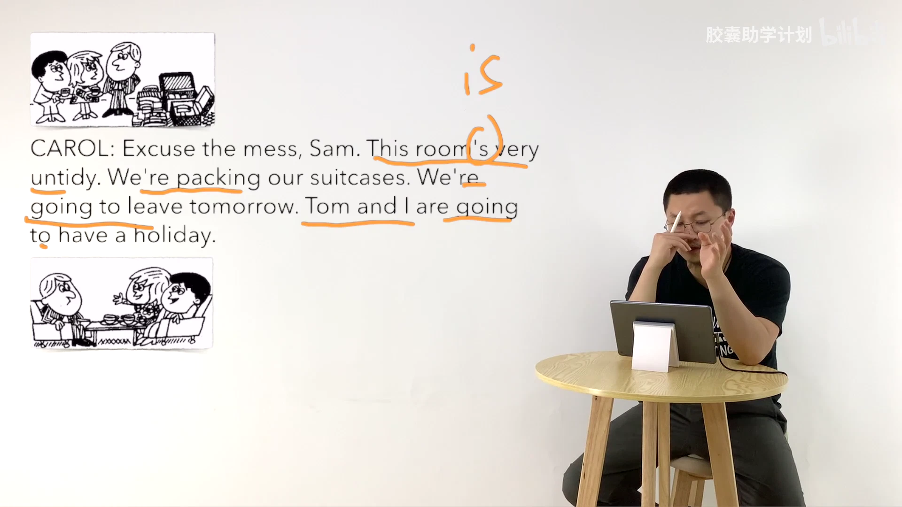

文字识别：胶囊助学计划 / CAROL: Excuse the mess, Sam. Thisroomsery / untidy. / We're packing our suitcases. We' / re / going to leave tomorrow. / Tom and I are going / to have a holiday. / x28

### 画面 00:05:08

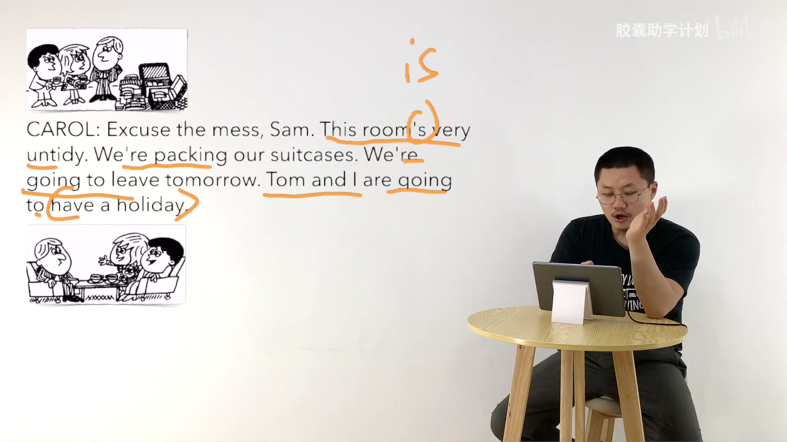

文字识别：胶囊助学计划 /  the mess, Sam. This rooms ery / CAROL: Excuse / untidy. / We're packing / ours / suitcases. We' / re / going t / to / leave tomorrow. / Tom and I are going / have a holiday. / to / x×x / 8

### 画面 00:05:13

文字识别：胶囊助学计划 / CAROL: Excuse the mess, Sam. This room s /ery / untidy. We're packing our suitcases. We're / going to leave tomorrow. Tom and I are going / to have a holiday. / xxxx / 8 / SAM: Aren't you lucky! / TOM: When are you going to have a holiday, Sam? / SAM: I don't know. I've already had my holiday this yea / CAROL: Where did you go? / SAM: I stayed at home!

### 画面 00:05:16

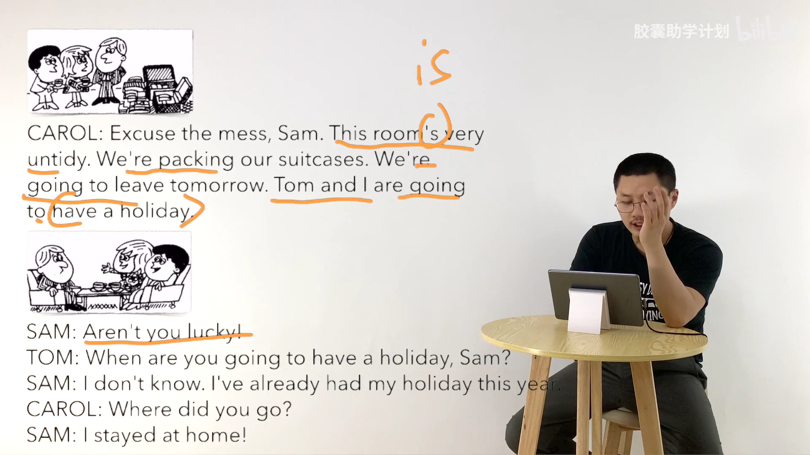

文字识别：胶囊助学计划 / 8 / CAROL: Excuse the mess, Sam. This roomery / untidy. We're packing our suitcases. We're / going to leave tomorrow. Tom and I are going / to have a holiday. / xxxx / SAM: Aren't you lucky! / TOM: When are you going to have a holiday, Sam? / SAM: I don't know. I've already had my holiday this yea / CAROL: Where did you go? / SAM: I stayed at home!

### 画面 00:05:18

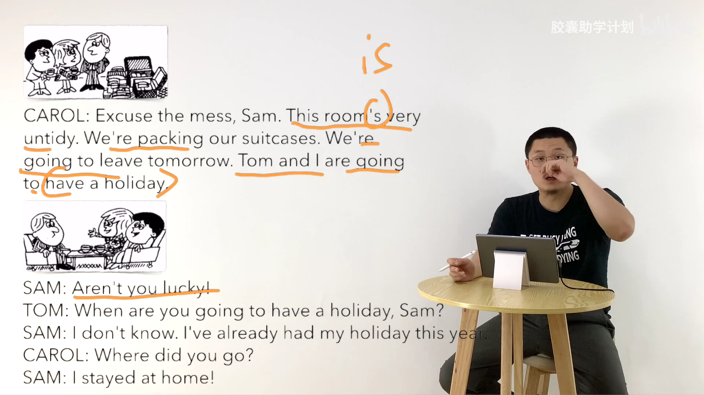

文字识别：胶囊助学计划 / 8 / 5 / CAROL: Excuse the mes, Sam. This roons ery / untidy. We're packing our suitcases. We're / going to leave tomorrow. Tom and I are going / to have a holiday. / ANG / PYING / xxx / 8 / SAM: Aren't you lucky! / TOM: When are you going to have a holiday, Sam? / SAM: I don't know. I've already had my holiday this yea / CAROL: Where did you go? / SAM: I stayed at home!

### 画面 00:05:24

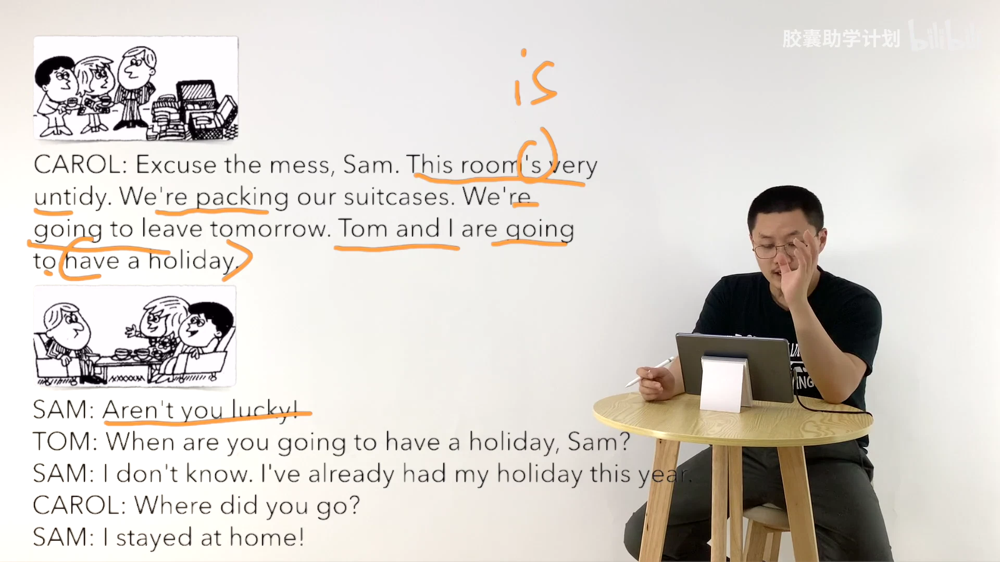

文字识别：胶囊助学计划 / CAROL: Excuse the mess, Sam. This roomery / untidy. We're packing our suitcases. We're / going to leave tomorrow. Tom and I are going / to have a holiday. / xxx / 8 / SAM: Aren't you luckyl / TOM: When are you going to have a holiday, Sam? / SAM: I don't know. I've already had my holiday this yea / CAROL: Where did you go? / SAM: I stayed at home!

### 画面 00:05:26

文字识别：胶囊助学计划 / CAROL: Excuse the mess, Sam. This room s ery / untidy. We're packing our suitcases. We're / going to leave tomorrow. Tom and I are going / to have a holiday. / xxx / 8 / ING / SAM: Aren't you luckyl / TOM: When are you going to have a holiday, Sam? / SAM: I don't know. I've already had my holiday this yea / CAROL: Where did you go? / SAM: I stayed at home!

### 画面 00:05:28

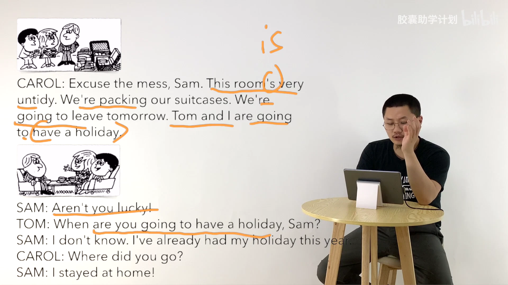

文字识别：胶囊助学计划 / CAROL: Excuse the mess, Sam. This room' s ery / untidy. We're packing our suitcases. We'r / 're / going to leave tomorrow. Tom and I are going / to have a holiday. / 8 / INC / SAM: Aren't you lucky! / TOM: When are you going to have a holiday, Sam? / SAM: I don't know. I've already had my holiday this yea / CAROL: Where did you go? / SAM: I stayed at home!

## 00:05:30–00:06:00

I don't know. 我也不知道. I've already had my holiday this year. 好, have加done. 各位看，这是have，这是done，又是现在完成时。我已经度过假了。今年，言之过去，一定是之前我就度过假了。对现在的影响是，你问我什么时候再去度假，我只能告诉你，我不知道了。为什么？因为我今年已经度过假了，对吧？OK, Carol说，

### 画面 00:05:31

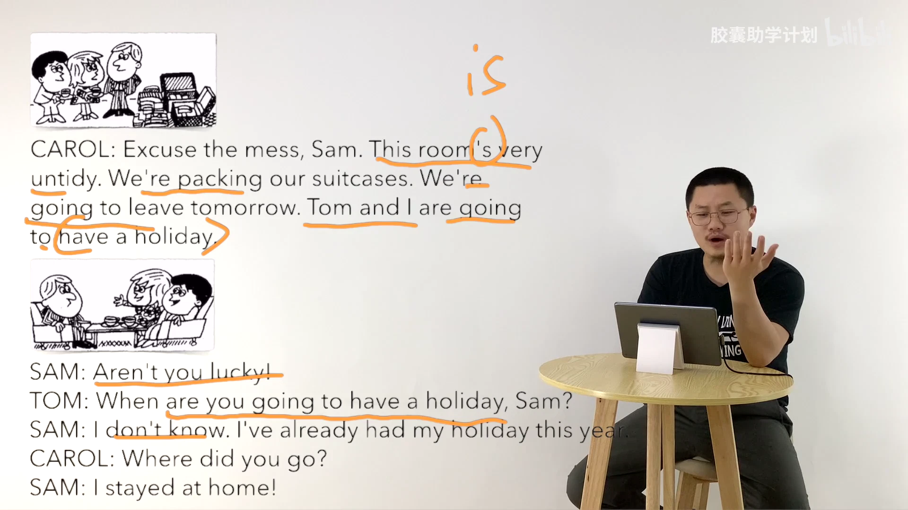

文字识别：胶囊助学计划 / CAROL: Excuse the mess, Sam. This rooms /ery / untidy. We're packing our suitcases. We'r / re / going to leave tomorrow. Tom and I are going / to have a holiday. / xx0 / 8 / SAM: Aren't you luckyl / TOM: When are you going to have a holiday, Sam? / SAM: I don't know. I've already had my holiday this yea / CAROL: Where did you go? / SAM: I stayed at home!

### 画面 00:05:40

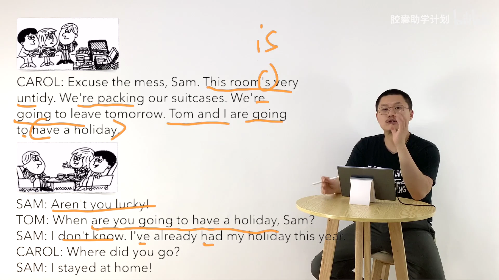

文字识别：胶囊助学计划 / untidy. We're packing our suitcases. We'r / re / going to leave tomorrow. Tom and I are going / to have a holiday. / xx0x / 8 / SAM: Aren't you luckyl / TOM: When are you going to have a holiday, Sam? / SAM: I don't know. I've already had my holiday this yea / CAROL: Where did you go? / SAM: I stayed at home!

### 画面 00:05:43

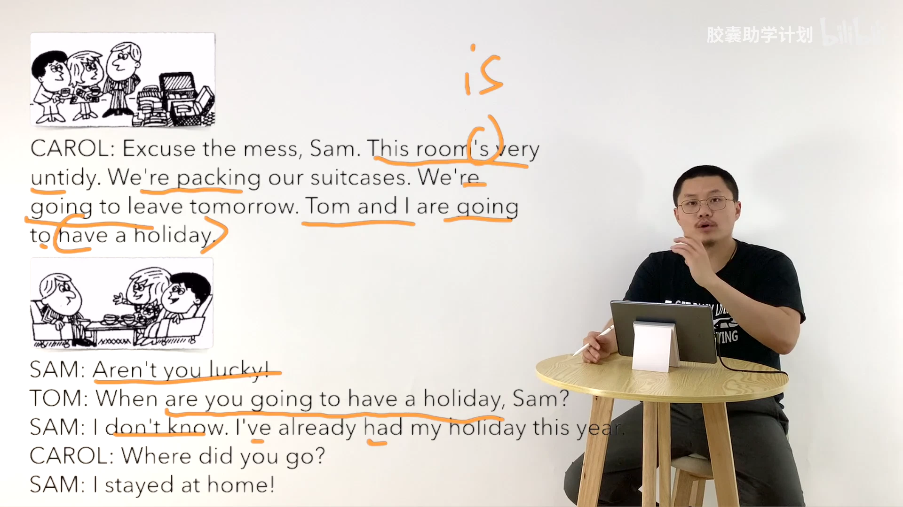

文字识别：胶囊助学计划 / CAROL: Excuse the mess, Sam. This roomery / untidy. We're packing our suitcases. We'r / re / going to leave tomorrow. Tom and I are going / to have a holiday. / ING / xx×xx / 8 / SAM: Aren't you luckyl / TOM: When are you going to have a holiday, Sam? / SAM: I don't know. I've already had my holiday this yea / CAROL: Where did you go? / SAM: I stayed at home!

### 画面 00:05:46

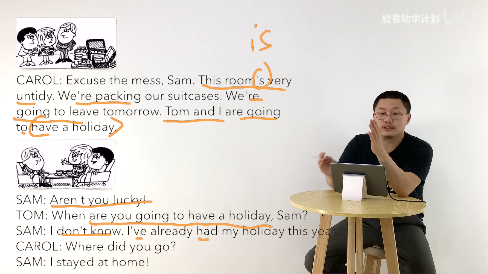

文字识别：胶囊助学计划 / untidy. We're packing our suitcases. We're / going to leave tomorrow. Tom and I are going / to have a holiday. / SAM: Aren't you luckyl / TOM: When are you going to have a holiday, Sam? / SAM: I don't know. I've already had my holiday this yea / CAROL: Where did you go? / SAM: I stayed at home!

### 画面 00:05:49

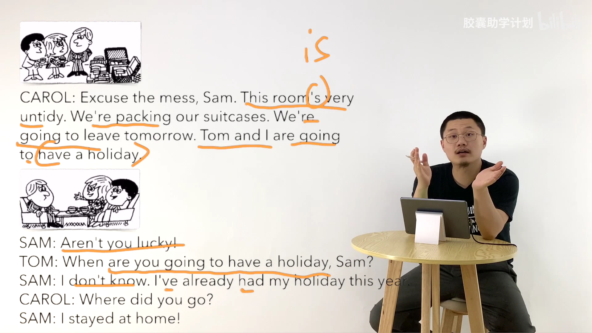

文字识别：胶囊助学计划 / CAROL: Excuse the mes, Sam. This room's ery / untidy. We're packing our suitcases. We'r / re / going to leave tomorrow. Tom and I are going / to have a holiday. / xxx×xx / 8 / SAM: Aren't you luckyl / TOM: When are you going to have a holiday, Sam? / SAM: I don't know. I've already had my holiday this yea / CAROL: Where did you go? / SAM: I stayed at home!

### 画面 00:05:51

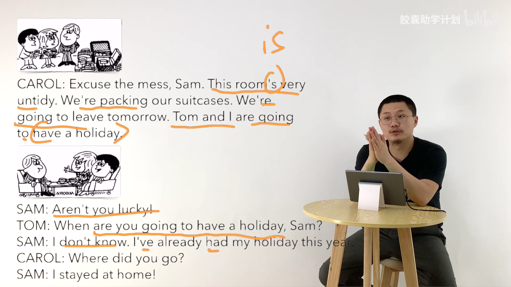

文字识别：胶囊助学计划 / untidy. We're packing our suitcases. We're / going to leave tomorrow. Tom and I are going / to have a holiday. / xx0x / SAM: Aren't you luckyl / TOM: When are you going to have a holiday, Sam? / SAM: I don't know. I've already had my holiday this yea / CAROL: Where did you go? / SAM: I stayed at home!

### 画面 00:05:55

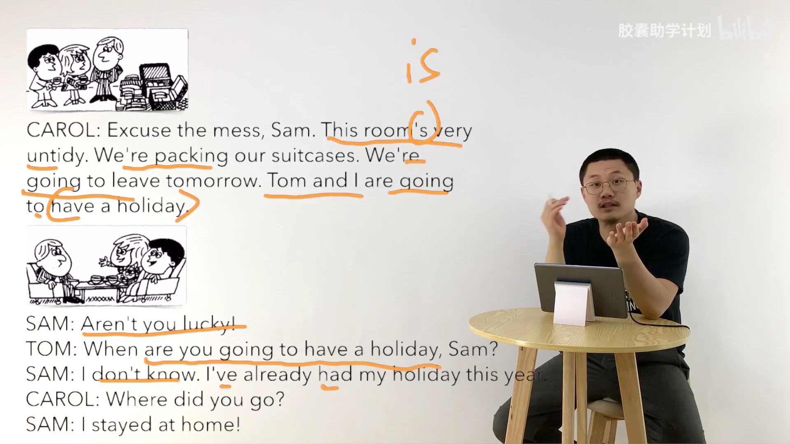

文字识别：胶囊助学计划 / CAROL: Excuse the mess, Sam. This rooms/ery / untidy. We're packing our suitcases. We'r / re / going to leave tomorrow. Tom and I are going / to have a holiday. / xx×xx / 8 / SAM: Aren't you luckyl / TOM: When are you going to have a holiday, Sam? / SAM: I don't know. I've already had my holiday this yea / CAROL: Where did you go? / SAM: I stayed at home!

## 00:06:00–00:06:30

Where did you go?那你当时去哪儿了？你看我没有想说跟现在有什么影响，我就问当时你去哪儿了？一般过去式，对吧？说I stayed at home，还是表示当时，对吧？我当时待在家里面了。所以你看，一般过去式。Okay，玩一个。那文章我们讲完了，接下来口语听力练习，我读啊，您听，然后在文章当中找到答案，口语回答给我来了。Didi。

### 画面 00:06:08

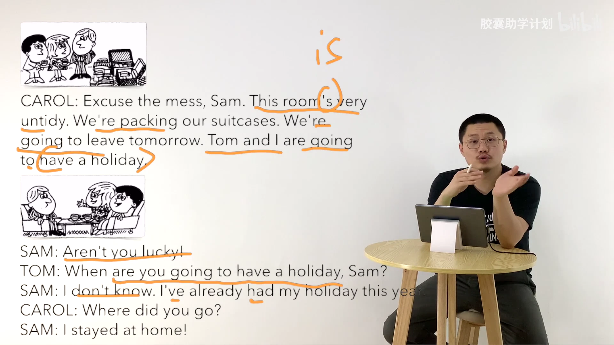

文字识别：胶囊助学计划 / untidy. We're packing our suitcases. We're / going to leave tomorrow. Tom and I are going / to have a holiday. / xxx / 8 / SAM: Aren't you luckyl / TOM: When are you going to have a holiday, Sam? / SAM: I don't know. I've already had my holiday this yea / CAROL: Where did you go? / SAM: I stayed at home!

### 画面 00:06:18

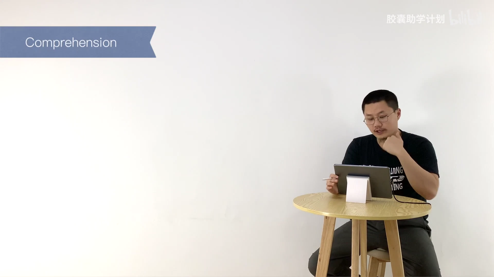

文字识别：胶囊助学计划 / Comprehension / LZING / ING

## 00:06:30–00:07:00

Aren't Tom and Carol having dinner? 那你看，本来是 Are they having dinner? 我现在是 Aren't they? 啊 Aren't Tom and Carol having dinner? No, they aren't. 没有。 Next one. Are they having lunch? Yes, they are. Next one. Who is that at the door? Is Sam. Next one.

### 画面 00:06:32

文字识别：胶囊助学计划 / Comprehension / 1 T: Aren't Tom and Carol having dinner?

### 画面 00:06:52

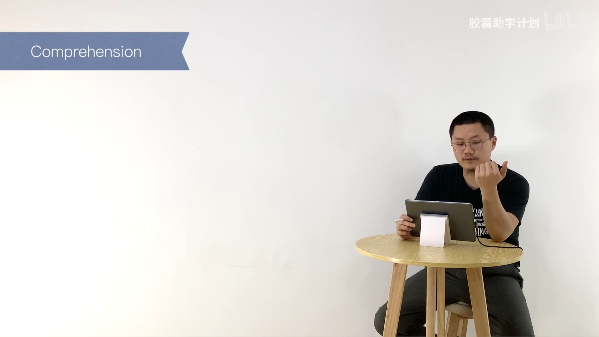

文字识别：胶囊助学计划 / Comprehension

## 00:07:00–00:07:30

why doesn't Sam want to have lunch with them? Because he's already had lunch. Very good. Come on. What time did Sam have lunch? At half past twelve. Next one, has Sam already had a cup of coffee? Yes, he has. Continue. What

### 画面 00:07:06

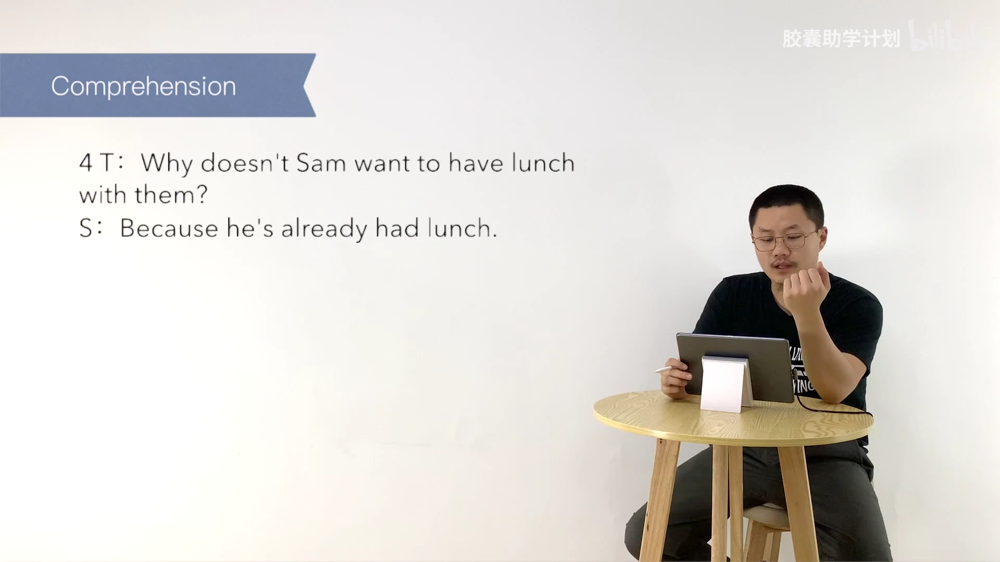

文字识别：胶囊助学计划 / Comprehension / 4 T: Why doesn't Sam want to have lunch / with them? / S: Because he's already had lunch.

### 画面 00:07:11

文字识别：胶囊助学计划 / Comprehension / 5 T: What time did Sam have lunch?

### 画面 00:07:23

文字识别：胶囊助学计划 / Comprehension / 6 T: Has Sam already had a cup of coffee? / YLING / ING

### 画面 00:07:28

文字识别：胶囊助学计划 / Comprehension / 7 T: What are Tom and Carol going to do? / LING / ING

## 00:07:30–00:08:00

are Tom and Carol going to do? They are going to have a holiday. That口语可以直接说这种. They're gonna have a holiday. They're gonna have a holiday. Next one. What are they doing today? They are packing their suitcases. Next one. Has Sam already had his holiday this year? Yes, he has. Continue. Where did he go

### 画面 00:07:44

文字识别：胶囊助学计划 / Comprehension / 8 T: What are they doing today? / S: They're packing their suitcases. / YUNG / ING

### 画面 00:07:49

文字识别：胶囊助学计划 / Comprehension / 9 T: Has Sam already had his holiday this year? / YLING / VYING

## 00:08:00–00:08:30

for his holiday? Answer: He stayed at home. Okay,好，接下来 asking questions. 我说肯定句，你们变一般疑问句；我给特殊疑问词，你们变特殊疑问句。那这训练的是我们将来能提问的能力，对吧？Okay,来了第一题. Ask me if Sam had lunch at half past twelve.那你要迅速判断是 had，一般过去时，所以 did 提前. Did

### 画面 00:08:01

文字识别：胶囊助学计划 / Comprehension / 10 T: Where did he go for his holiday? / S: He stayed at home. / YLNG / CYING

### 画面 00:08:05

文字识别：胶囊助学计划 / Asking questions / YLING / NING

### 画面 00:08:18

文字识别：胶囊助学计划 / Asking questions / 1 T: Ask me if Sam had lunch at half past twelve. / 9 / YLING / MING

### 画面 00:08:21

文字识别：胶囊助学计划 / Asking questions / 1 T: Ask me if Sam had lunch at half past twelve. / LANG / VING

## 00:08:30–00:09:00

Sam have lunch at half past twelve? Next one when 对 at half past twelve 提问对吧？来叫做 when did Sam have lunch? Next one ask me if Sam has just had a cup of coffee. 一般疑问句 has Sam just had a cup of coffee? Next one what 那肯定是问 a cup of coffee 对吧？来叫做

### 画面 00:08:37

文字识别：胶囊助学计划 / Asking questions / 1 T: Ask me if Sam had lunch at half past twelve. / S: Did Sam have lunch at half past twelve? / T: When .? / S: When did Sam have lunch? / LNG / ING

### 画面 00:08:42

文字识别：胶囊助学计划 / Asking questions / 2 T: Ask me if Sam has just had a cup of coffee. / LING / jING

### 画面 00:08:58

文字识别：胶囊助学计划 / Asking questions / 2 T: Ask me if Sam has just had a cup of coffe. / S: Has Sam just had a cup of coffee? / T: What …? / YING / VING

## 00:09:00–00:09:30

What has Sam just had? 他刚刚喝了点什么？ Next one, ask me if they can have coffee in the living room. 一般疑问句 Can they have coffee in the living room? Where? 答案 Where can they have coffee? Next one, ask me if the room is very untidy. Is the room very

### 画面 00:09:05

文字识别：胶囊助学计划 / Asking questions / YLING / UYING

### 画面 00:09:14

文字识别：胶囊助学计划 / Asking questions / 3 T: Ask me if they can have coffee in the / living room. / S: Can they have coffee in the living room? / LING / ING

### 画面 00:09:24

文字识别：胶囊助学计划 / Asking questions / 4 T: Ask me if the room is very untidy. / LING / GVING

## 00:09:30–00:10:00

untidy? Why? Direct sentence. Why is the room very untidy? Okay. Next one. Ask me if Tom and Carol are going to have a holiday. Are Tom and Carol going to have a holiday? When? When are Tom and Carol going to have a holiday? Okay. Recap. This article.

### 画面 00:09:32

文字识别：胶囊助学计划 / Asking questions / 4T: Ask me if the room is very untidy. / S: Is the room very untidy? / T: Why..? / S: Why is the room very untidy? / LNG / YING

### 画面 00:09:37

文字识别：胶囊助学计划 / Asking questions / 5 T: Ask me if Tom and Carol are going to have a holiday. / LING / DYING

### 画面 00:09:51

文字识别：胶囊助学计划 / Asking questions / 5 T: Ask me if Tom and Carol are going to have a holiday. / S: Are Tom and Carol going to have a holiday? / T: When ….? / S: When are Tom and Carol going to have a holiday? / LING / ING

### 画面 00:09:57

文字识别：Recap / 胶囊助学计划 / Patterns / have+done / 言之过去， / 意在当下 / Grammar / Words / ING / DYING / Expression

## 00:10:00–00:10:30

文章啊，对，当然了，各位最重要的是把汉代现在完成时，言之过去，意在当下。结构首先你要一眼能看出来，对吧？把在文章当中把它标出来。第二，要给自己讲解一下，这是怎么言之过去了，怎么意在当下了。OK，好，家庭作业，绿皮书八十三课，各位可以写了。文章熟读成诵啊，跟读至熟读成诵，一定要跟读啊，跟着音频去读，不要自己去

### 画面 00:10:02

文字识别：胶囊助学计划 / Recap / Patterns / havetdone / 言之过去， / 意在当下 / Grammar / Words / Expression

### 画面 00:10:18

文字识别：胶囊助学计划 / 绿皮书第83课的写作练习

### 画面 00:10:27

文字识别：胶囊助学计划 / 绿皮书第83课的写作练习 / 文章跟读至熟读成诵 / 3.请给自己讲解一遍今天的 / 核心知识点

## 00:10:30–00:11:00

读，对吧？好，然后呢，给自己讲解一遍今天的核心知识点。OK，那如果大家喜欢我们的课程，欢迎大家关注、订阅、一键三连，分享给那些需要的朋友啊，来帮助我们成长。最后呢，我们再看一句名人名言：When you leave a beautiful place, you carry it with you wherever you go. Where you go, see next time.

### 画面 00:10:34

文字识别：胶囊助学计划

### 画面 00:10:36

文字识别：胶囊助学计划 / -

### 画面 00:10:44

文字识别：胶囊助学计划 / When you leave a beautiful place, you carry it / with you wherever you go. / Alexandra Stoddard

### 画面 00:10:47

文字识别：胶囊助学计划 / When you leave a beautiful place, you carry it / with you wherever you go. / Alexandra Stoddard

### 画面 00:10:53

文字识别：胶囊助学计划 / When you leave a beautiful place, you carry it / AING / with you wherever you go. / -Alexandra Stoddard

### 画面 00:10:55

### 画面 00:10:57

文字识别：CAPSULEACADEMY / 胶囊助学计划 / 小红书 / Lecturer / Leo / OE

## 00:11:00–00:11:07

### 画面 00:11:00

文字识别：CAPSULEACADEMY / 胶囊助学计划 / 『 / 小红书 / Editor / OE

### 画面 00:11:03

文字识别：CAPSULEACADEMY / 胶囊助学计划 / 小红书 / Creator / □ / Leo & Berlin / OE

### 画面 00:11:05

文字识别：bilibili / 胶囊助学计划

### 画面 00:11:07

文字识别：bilibili / 胶囊助学计划

