# 084 练习

快速机器解析：语音为单模型转写，未进行独立交叉校对或人工复核；画面每秒采样并按变化选帧，短时文字和标记可能遗漏。截图时间约有 1 秒误差。图片有损压缩；遇到疑点请按时间查看 Google Drive 原视频。

## 00:00:00–00:00:30

Hello everyone, welcome to Capsule Academy. This is Liu. Today we're going to learn New Concept English Book One Lesson Eighty Four Practices. Hope you guys enjoyed. Okay,那偶数课我们最重要的事情，对吧？就是练习，练习，还是练习啊！那各位张开嘴跟我读就可以了。来了，Have you had any vegetables? 看一下，现在完成时一般疑问句。

### 画面 00:00:00

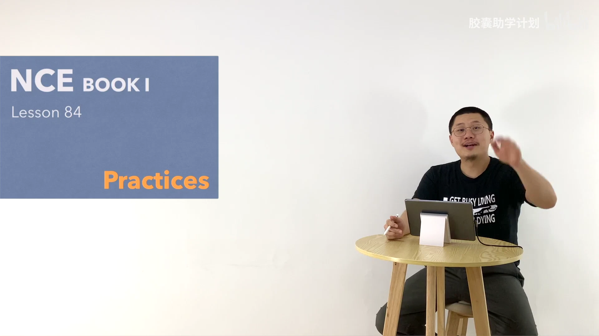

文字识别：胶囊助学计划 / NCE / BOOKI / Lesson 84 / Practices / GET DIY LOING / DVING

### 画面 00:00:05

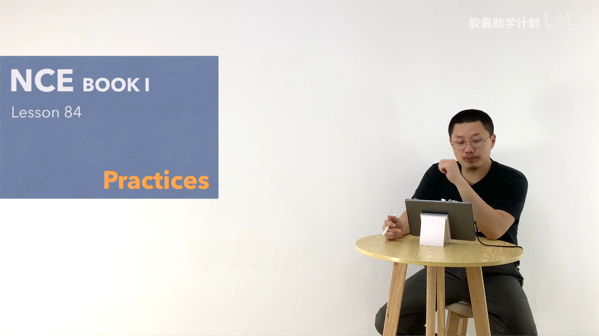

文字识别：胶囊助学计划 / NCE / BOOKI / Lesson 84 / Practices

### 画面 00:00:09

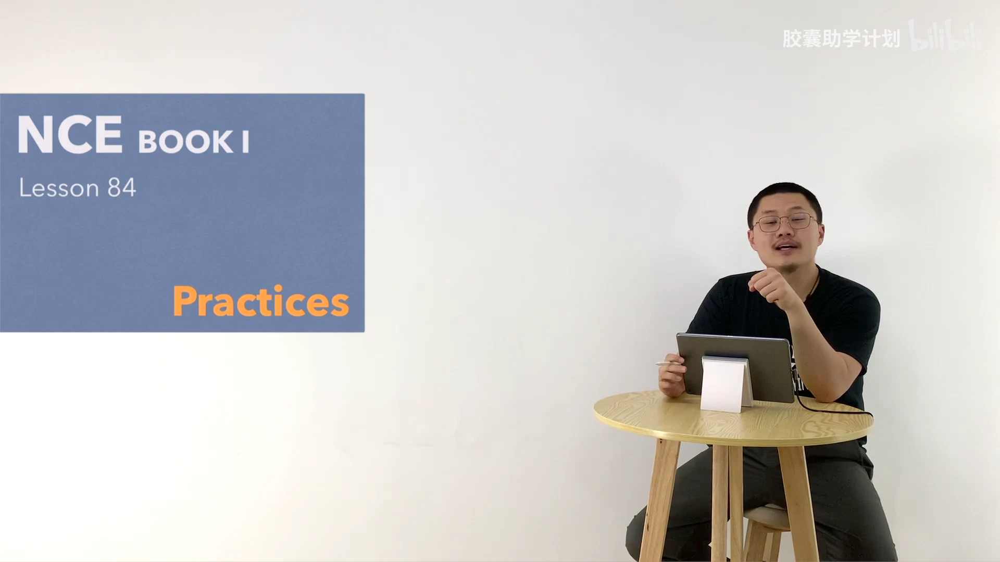

文字识别：胶囊助学计划 / NCE / BOOKI / Lesson 84 / Practices

### 画面 00:00:11

文字识别：胶囊助学计划bill

### 画面 00:00:14

文字识别：胶囊助学计划

### 画面 00:00:16

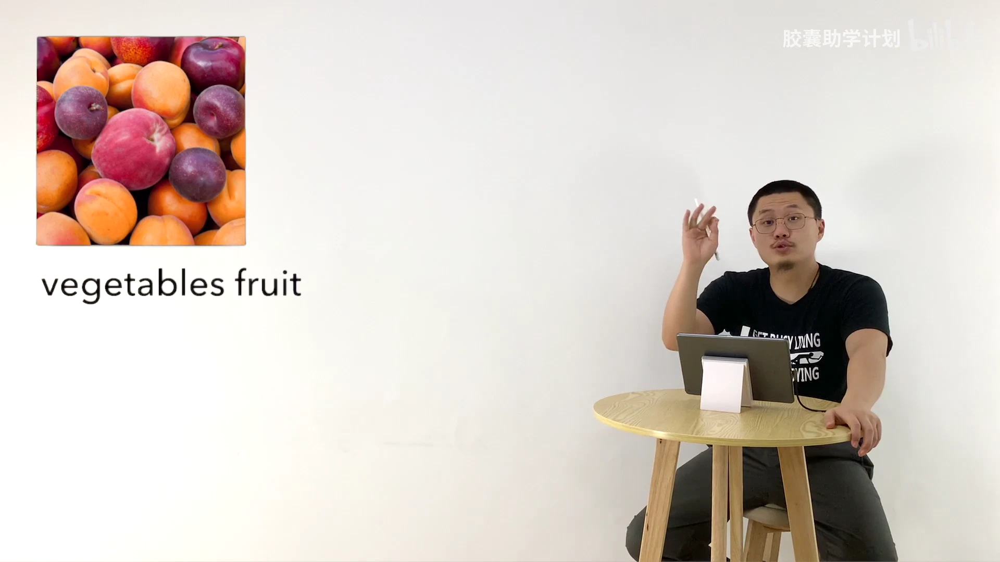

文字识别：胶囊助学计划 / vegetables fruit / WVING

## 00:00:30–00:01:00

I haven't had any vegetables. 现在完成时否定句。Do you want to have some fruit? I've just had some fruit. 我刚刚吃了一些水果。你要不吃点水果吗？我刚吃了一点水果。这句话告诉你过去吃的水果对现在的影响是，你问我要不要吃，我的潜台词就是不吃了，对吧？OK啊，接下来练的都一样，

### 画面 00:00:30

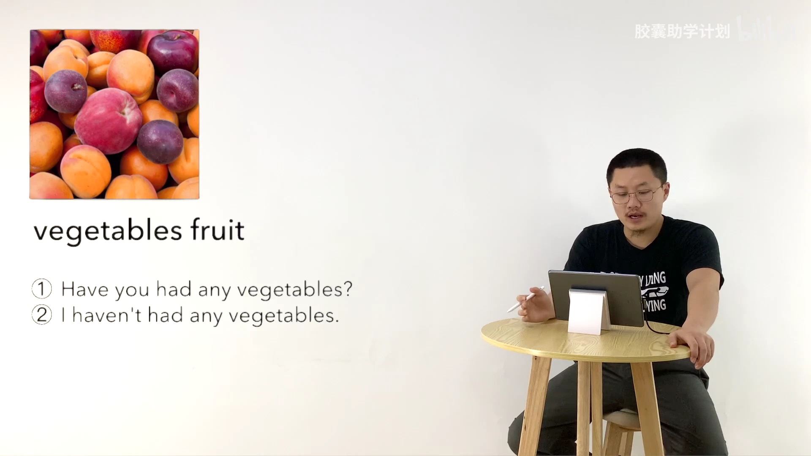

文字识别：胶囊助学计划 / vegetables fruit / YLING / Have you had any vegetables? / LNING / ② I haven't had any vegetables. / 2

### 画面 00:00:38

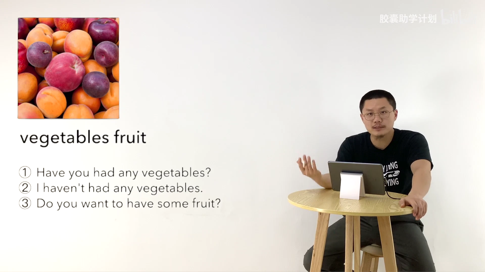

文字识别：胶囊助学计划 / 9 / vegetables fruit /  Have you had any vegetables? / YING / 1 / NING / ② I haven't had any vegetables. / 2 / ③ Do you want to have some fruit?

### 画面 00:00:42

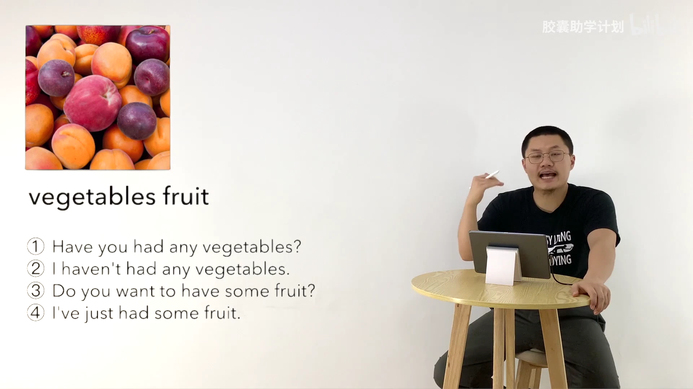

文字识别：胶囊助学计划 / vegetables fruit /  Have you had any vegetables? / YLRNG / 1 / YING / ② I haven't had any vegetables. / 2 /  Do you want to have some fruit? / 3 /  I've just had some fruit.

### 画面 00:00:49

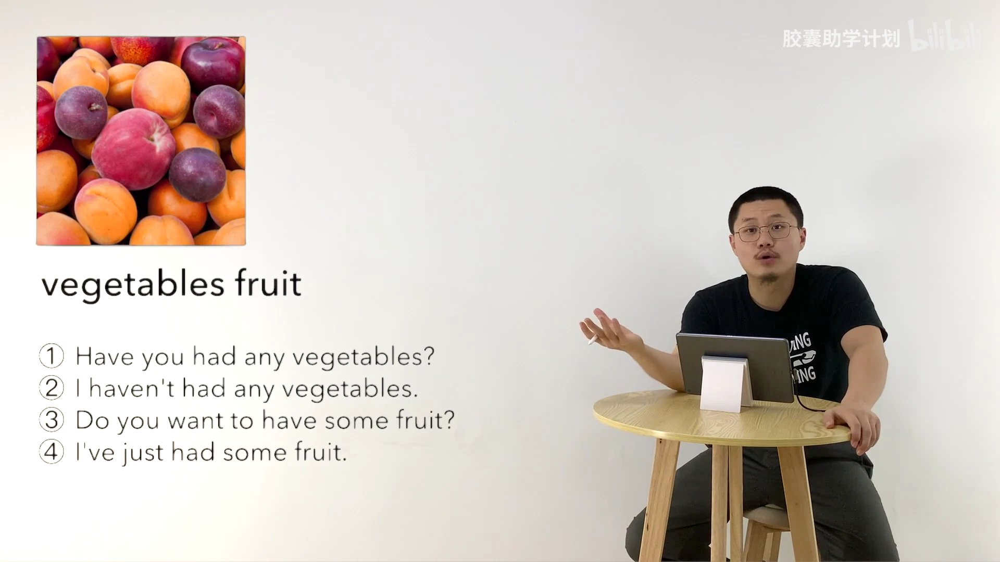

文字识别：胶囊助学计划 / vegetables fruit / ANG /  Have you had any vegetables? / 1 /  I haven't had any vegetables. / 2 / 3 Do you want to have some fruit? / 3 / D I've just had some fruit.

### 画面 00:00:57

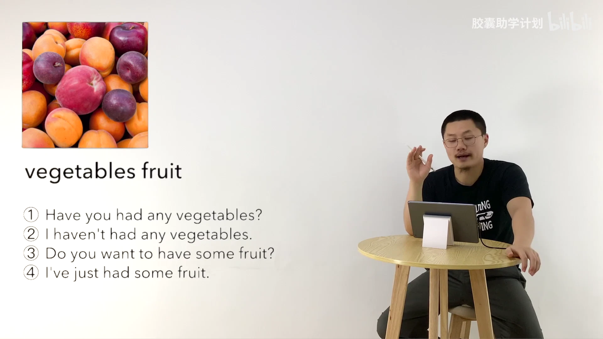

文字识别：胶囊助学计划 / vegetables fruit / LANG /  Have you had any vegetables? / 1 / ING /  I haven't had any vegetables. / 2 /  Do you want to have some fruit? / 3 /  I've just had some fruit.

## 00:01:00–00:01:30

就不一一讲解了。各位张开嘴跟我读就好了。OK，好了。Has he had any beans? He hasn't had any beans. Does he want to have some peas? He's just had some peas. Have they had any coffee? They haven't had any coffee. Do they want to have some tea?

### 画面 00:01:01

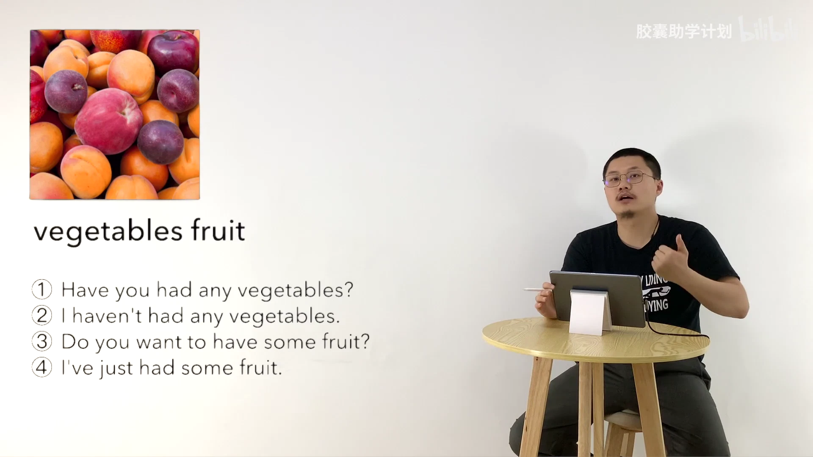

文字识别：胶囊助学计划 / vegetables fruit /  Have you had any vegetables? / LMN / 1 / YING /  I haven't had any vegetables. / 2 /  Do you want to have some fruit? / 3 / I've just had some fruit.

### 画面 00:01:04

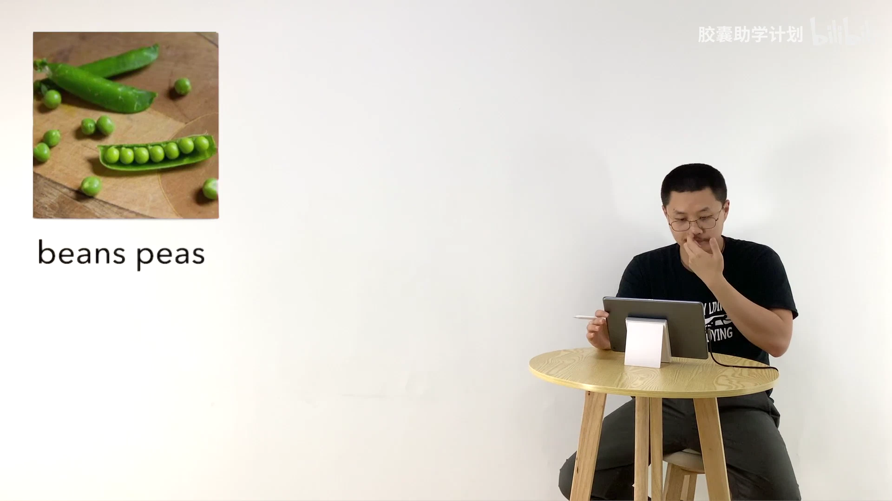

文字识别：胶囊助学计划 / beans peas / DYING

### 画面 00:01:15

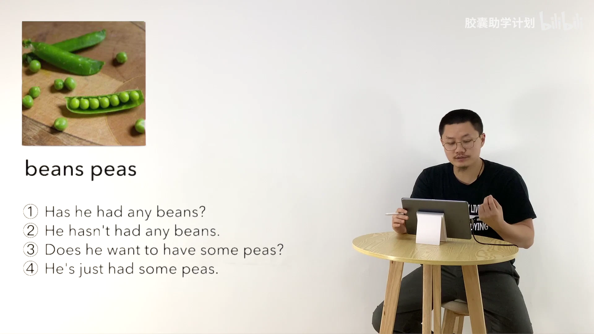

文字识别：胶囊助学计划 / beans peas / ① Has he had any beans? /  He hasn't had any beans. / YING / 2 /  Does he want to have some peas? / He's just had some peas.

### 画面 00:01:20

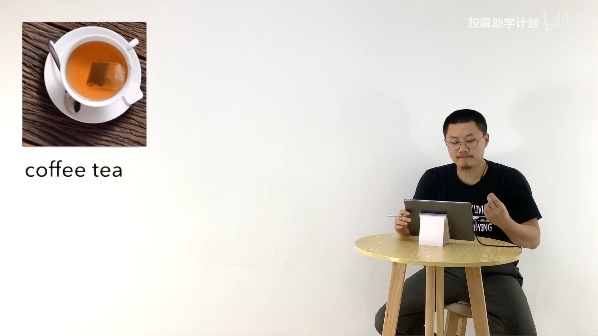

文字识别：胶囊助学计划 / coffee tea / LVING

### 画面 00:01:27

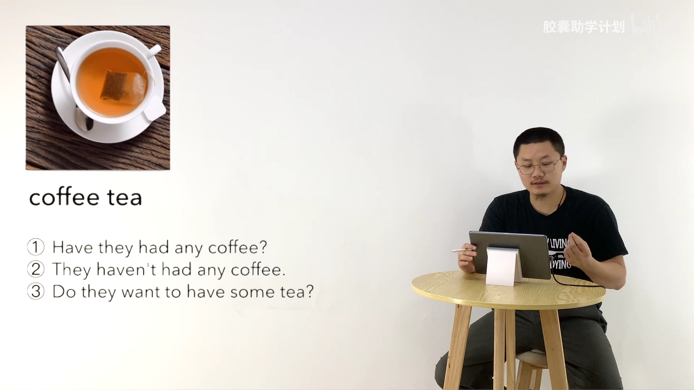

文字识别：胶囊助学计划 / coffee tea /  Have they had any coffee? / 1 / LIVIN / ② They haven't had any coffee. / 2 / 3 Do they want to have some tea? / 3

## 00:01:30–00:02:00

They've just had some tea. Have you had any apples? I haven't had any apples. Do you want to have some peaches? I've just had some peaches. Continue. Have you had any cabbages? Cabbage. I haven't had any cabbage.

### 画面 00:01:35

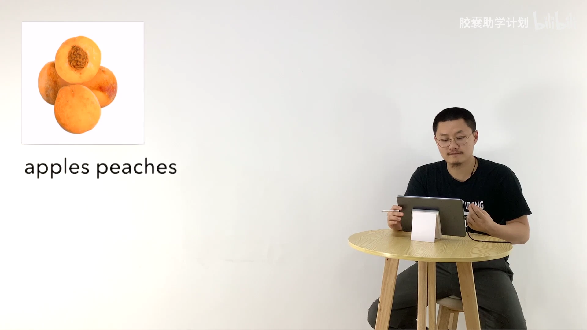

文字识别：胶囊助学计划 / apples peaches

### 画面 00:01:43

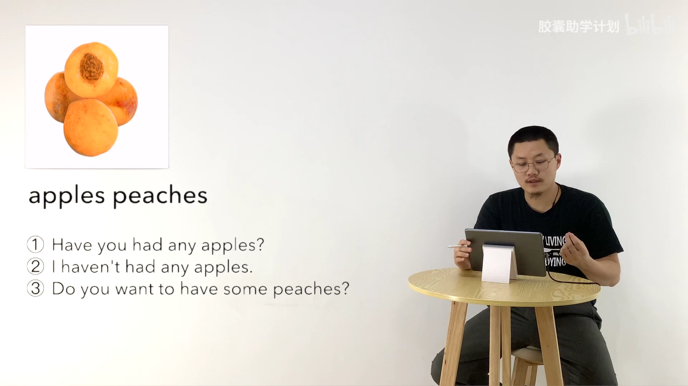

文字识别：胶囊助学计划 / apples peaches /  Have you had any apples? / LIVING / 1 / ② I haven't had any apples. / ③ Do you want to have some peaches?

### 画面 00:01:51

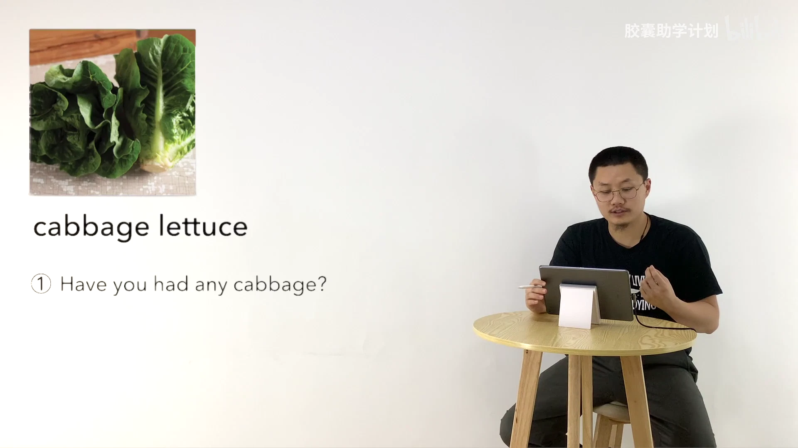

文字识别：胶囊助学计划 / cabbage lettuce / ① Have you had any cabbage?

## 00:02:00–00:02:30

Do you want to have some lettuce? I've just had some lettuce. Continue. Have you had any chicken?张开嘴跟我读。I haven't had any chicken. Do you want to have some steak? I've just had some steak. So no, thank you,对吧？Okay.那本课很简单，很简单，就是复习一

### 画面 00:02:02

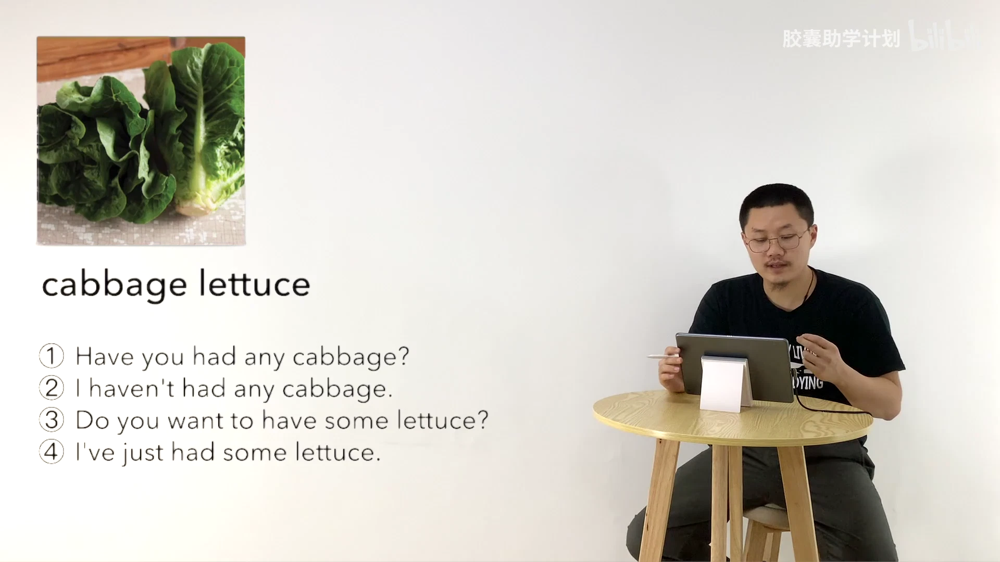

文字识别：胶囊助学计划 / cabbage lettuce /  Have you had any cabbage? / 1 / ② I haven't had any cabbage. / 2 / 3 Do you want to have some lettuce? / 3 /  I've just had some lettuce.

### 画面 00:02:07

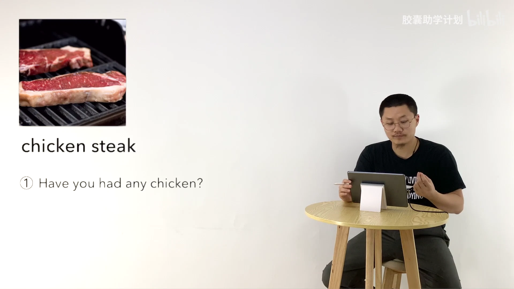

文字识别：胶囊助学计划 / chicken steak / ① Have you had any chicken?

### 画面 00:02:12

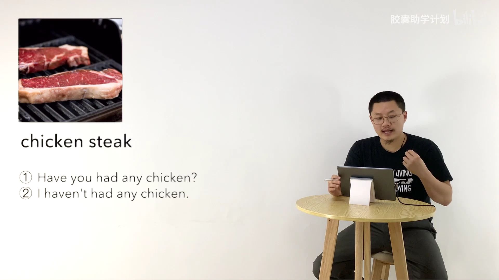

文字识别：胶囊助学计划 / chicken steak /  Have you had any chicken? / 1 / ② I haven't had any chicken. / DYING

### 画面 00:02:17

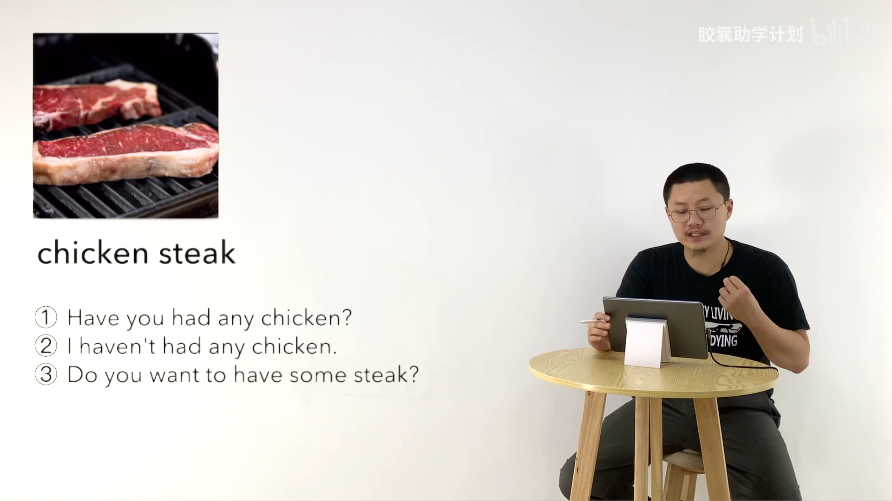

文字识别：胶囊助学计划 / chicken steak /  Have you had any chicken? / 1 / ② I haven't had any chicken. / DYING / ③ Do you want to have some steak?

### 画面 00:02:25

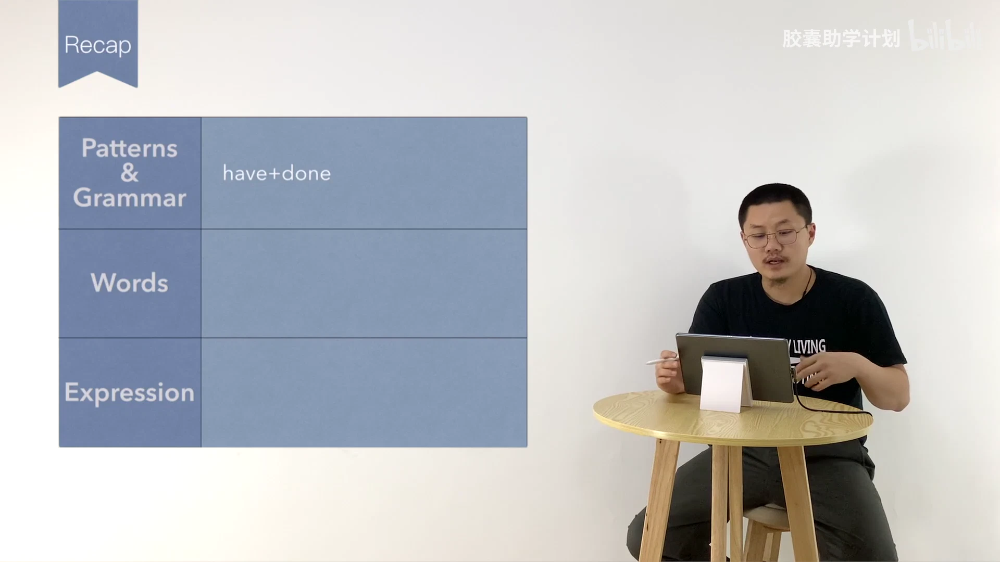

文字识别：胶囊助学计划 / Recap / Patterns / & / have+done / Grammar / Words / YLIVING / Expression

## 00:02:30–00:03:00

have 加 done，练习一下，同时复习一下，对吧？现在完成时的第一个用法，延迟过去，意在当下啊！你问我想不想要，我说我刚刚吃过，对吧？刚刚喝过，来一个。好，呃，家庭作业绿皮书八十四课，各位可以写了，然后给自己讲解一遍今天的核心知识点。大家如果喜欢我们的课程呢，欢迎大家关注、订阅、一键三连，支持我们，分享给那些需要的朋友。OK，那最后我们再来看一句名人名言：

### 画面 00:02:42

文字识别：胶囊助学计划 / IING

### 画面 00:02:49

文字识别：胶囊助学计划 / 9 / YLIVING

### 画面 00:02:57

文字识别：胶囊助学计划 / Do your best and leave the rest to God. / - Manisha Koirala

## 00:03:00–00:03:17

Do your best and leave the rest to God. See you next time.

### 画面 00:03:05

### 画面 00:03:07

文字识别：CAPSULEACADEMY / 胶囊助学计划 / 『 / 小红书 / Lecturer / □ / Leo / OE

### 画面 00:03:10

文字识别：CAPSULEACADEMY / 胶囊助学计划 / 小红书 / □ / Editor / OE

### 画面 00:03:13

文字识别：CAPSULEACADEMY / 胶囊助学计划 / 小红书 / Creator / □ / Leo & Berlin / OE

### 画面 00:03:15

文字识别：bilibili / 胶囊助学计划 / 胶囊助学计划 / 小红书 / OE

### 画面 00:03:17

文字识别：bilibili / 胶囊助学计划

