# 085 语法 文章

快速机器解析：语音为单模型转写，未进行独立交叉校对或人工复核；画面每秒采样并按变化选帧，短时文字和标记可能遗漏。截图时间约有 1 秒误差。图片有损压缩；遇到疑点请按时间查看 Google Drive 原视频。

## 00:00:00–00:00:30

Hello everyone, welcome to Capsule Academy. This is Will. Today we're going to learn New Concept English Book One, Lesson eighty-five, grammar and story. 那老习惯进入正式课程之前，我们先看一个问题：Have gone to 和 have been to 这两个长得非常像的结构，含义有何不同？那带着这个问题，Hope you guys enjoy it. 我们直接

### 画面 00:00:00

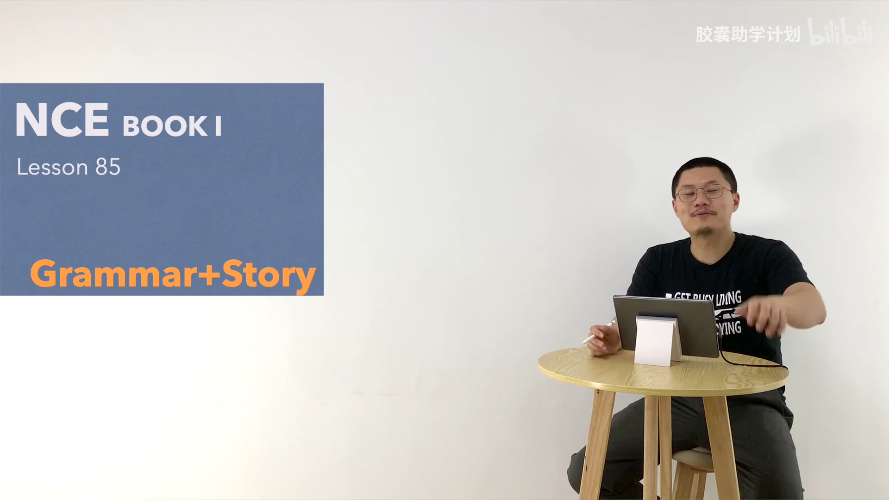

文字识别：胶囊助学计划 / NCE / BOOKI / Lesson 85 / Grammar+Story / YING

### 画面 00:00:10

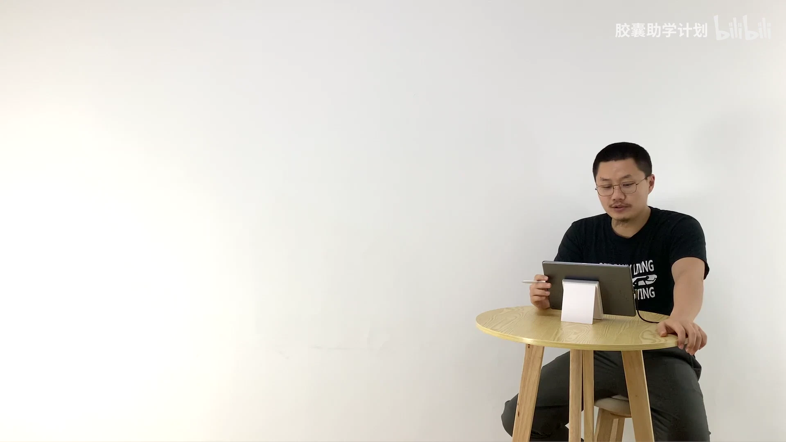

文字识别：胶囊助学计划 / LDANG / TING

### 画面 00:00:12

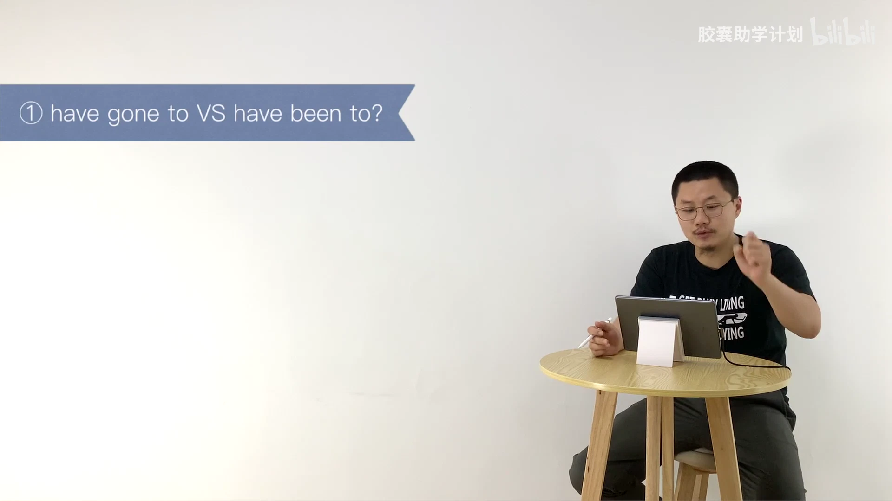

文字识别：胶囊助学计划 / ① have gone to VS have been to? / LING / VING

### 画面 00:00:24

文字识别：胶囊助学计划bl出 / •

### 画面 00:00:28

文字识别：胶囊助学计划

## 00:00:30–00:01:00

进入文章，看两个人对话，一个叫 George，一个叫 Ken，就是说 Hello Ken，Hi George，没什么可说的，两个人见面打个招呼，然后关键词就来了，叫 Have you just been to the cinema？好，这儿首先有一个小的单词叫做 been，been 这个单词各位可能是今天第一次见到，我讲几个和它近亲的单词啊，比如说 am，比如说 is，

### 画面 00:00:30

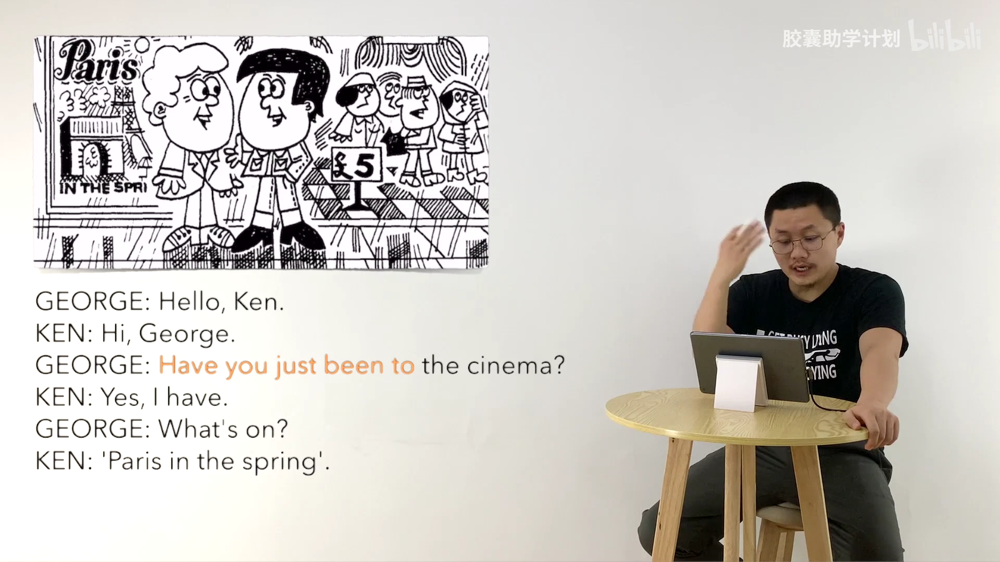

文字识别：胶囊助学计划 / Jams / 5 / INTHESPRI / 11 / GEORGE: Hello, Ken. / KEN: Hi, George. / YDING / GEORGE: Have you just been to the cinema? / YING / KEN: Yes, Ihave. / GEORGE: What's on? / KEN: 'Paris in the spring'.

### 画面 00:00:48

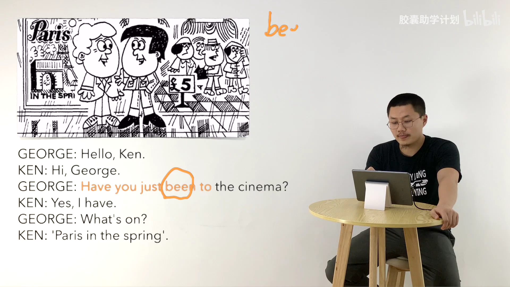

文字识别：beo / 胶囊助学计划 / Jans / 区5 / INTHESPRI / GEORGE: Hello, Ken. / KEN: Hi, George. / YLING / GEORGE: Have you justbeey to the cinema? / VING / KEN: Yes, Ihave. / GEORGE: What's on? / KEN: 'Paris in the spring'.

### 画面 00:00:52

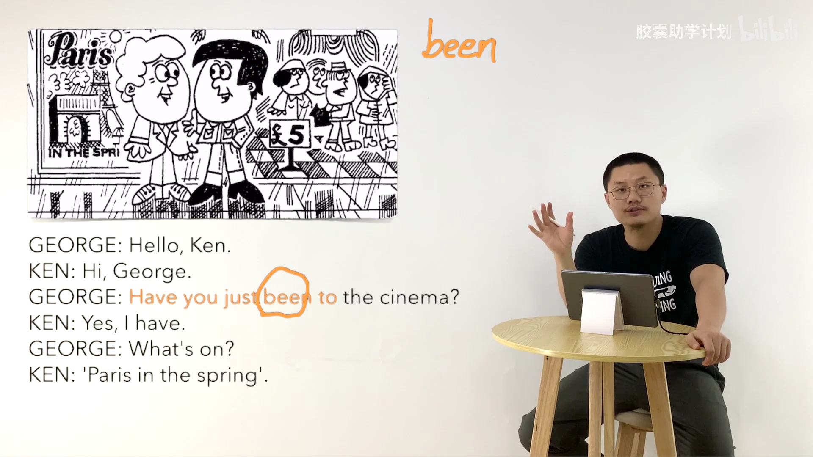

文字识别：been / 胶囊助学计划 / 0 / Jans / 三 / 区5 / INTHESPRI / GEORGE: Hello, Ken. / KEN: Hi, George. / VANG / GEORGE: Have you justbeey / to the cinema? / MING / KEN: Yes, Ihave. / GEORGE: What's on? / KEN: 'Paris in the spring'.

### 画面 00:00:58

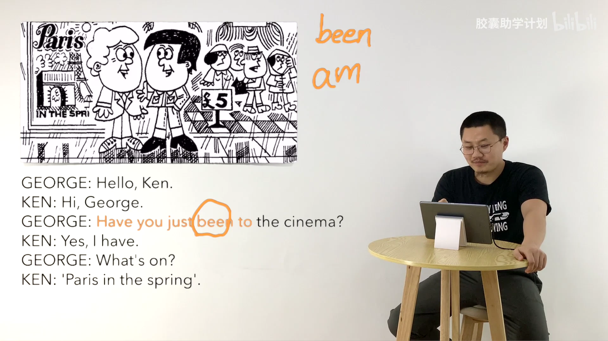

文字识别：been / 胶囊助学计划 / 0 / Jans / am / 民5 / INTHESPRI / 111! / GEORGE: Hello, Ken. / KEN: Hi, George. / YUING / GEORGE: Have you justbeey to the cinema? / VING / KEN: Yes, Ihave. / GEORGE: What's on? / KEN: 'Paris in the spring'.

## 00:01:00–00:01:30

比如说 are，比如说原型 be，OK，比如说 was，比如说 was，啊，这些单词底下您都见过了对吧？那 be 就是原型，一般现在时就是 am is are，一般过去时就是 was were，那现在完成时或者说 be 这个单词的过去分词就是跟我读一下

### 画面 00:01:00

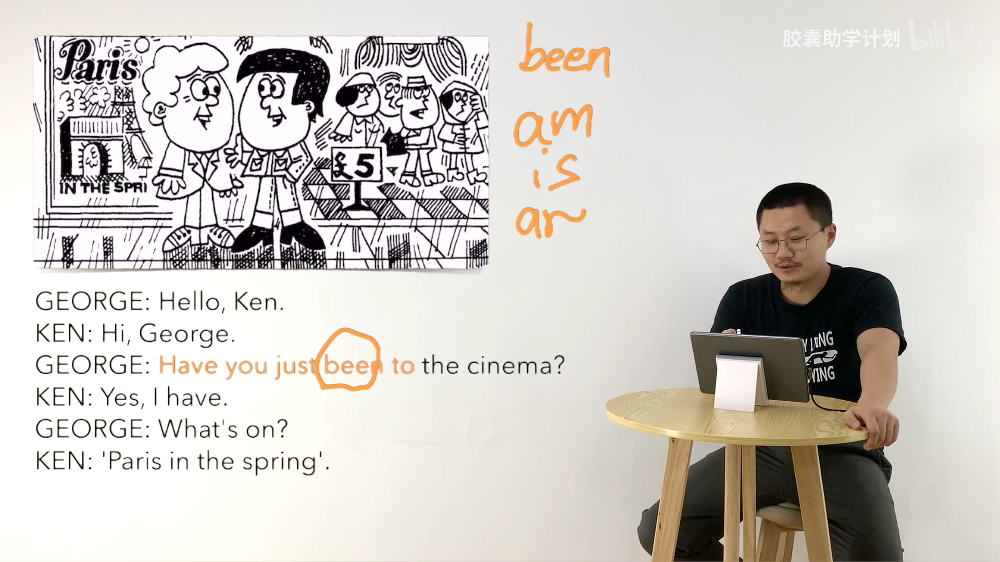

文字识别：been / 胶囊助学计划 / Jans / am / 区5 / INTHESPRI / a~ / GEORGE: Hello, Ken. / KEN: Hi, George. / YLING / GEORGE: Have you justbeey / to the cinema? / VING / KEN: Yes, Ihave. / GEORGE: What's on? / KEN: 'Paris in the / spring'.

### 画面 00:01:03

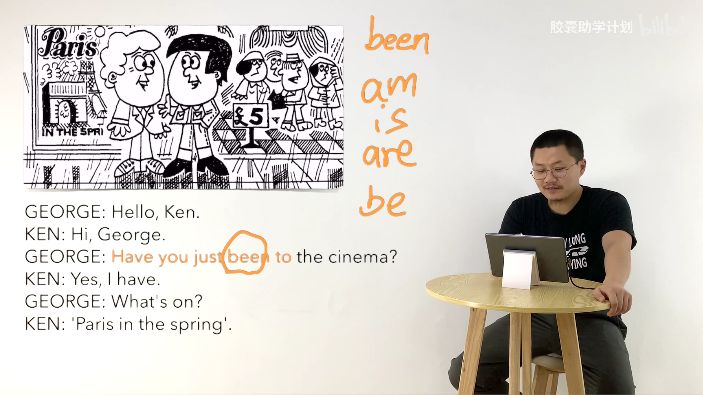

文字识别：been / 胶囊助学计划 / Jauns / am / 5 / iS / INTHESPRI / LlL! / are / be / GEORGE: Hello, Ken. / KEN: Hi, George. / YUING / GEORGE: Have you justbeey / to the cinema? / VING / KEN: Yes, I have. / GEORGE: What's on? / KEN: 'Paris in the / spring'.

### 画面 00:01:07

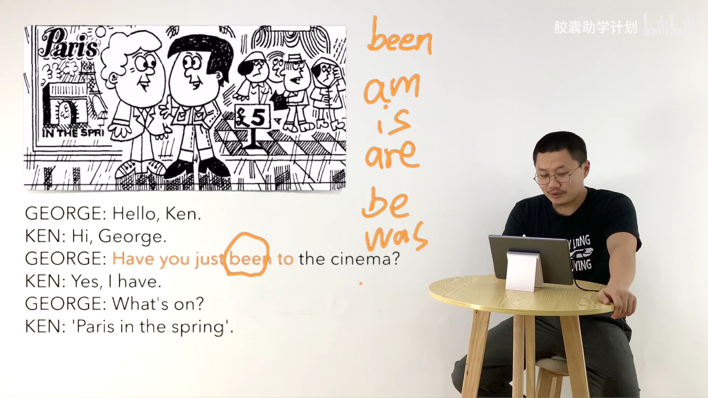

文字识别：been / 胶囊助学计划 / Jans / am / 区5 / iS / INTHESPRI / are / be / GEORGE: Hello, Ken. / Was / KEN: Hi, / George. / YUING / GEORGE: Have / you justbeey / to / the / cinema? / MING / KEN: Yes, / I have. / GEORGE: / What's / on? / KEN: 'Paris in the / spring'.

### 画面 00:01:09

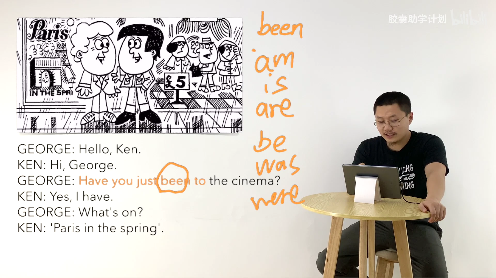

文字识别：been / 胶囊助学计划 / Jans / am / 区5 / INTHESPRI / are / be / GEORGE: / Hello, Ken. / Was / KEN: Hi, / George. / YLING / GEORGE: / Have / you justbeen / to / the / cinema? / VING / KEN: / Yes, / Ihave. / were / GEORGE: / What's / on? / KEN: 'Paris in t / the / spring'.

### 画面 00:01:13

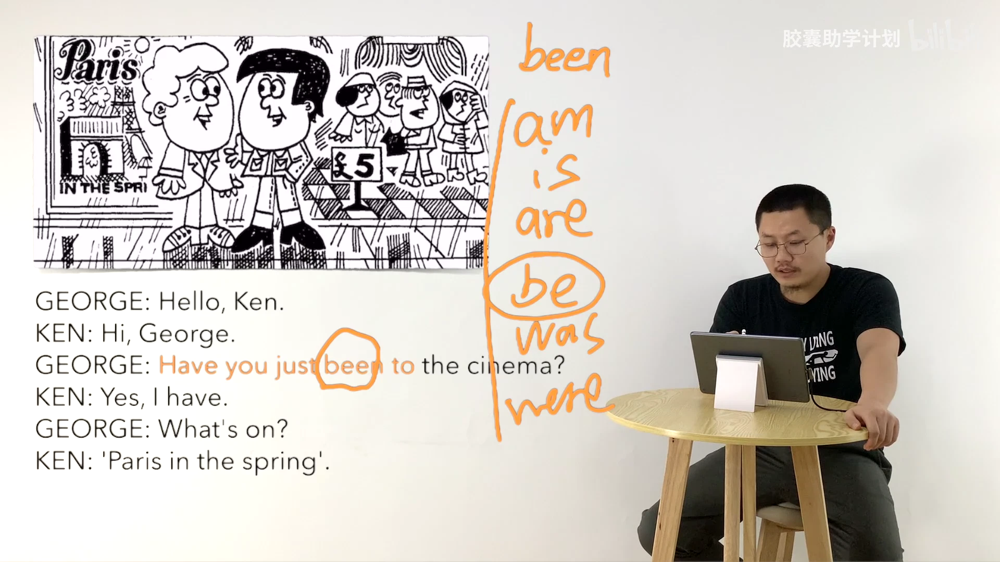

文字识别：been / 胶囊助学计划 / Jans / am / 区5 / iS / INTHESPRI / are / be / GEORGE: / Hello, Ken. / KEN: Hi, / George. / WaS / YUING / GEORGE: / Have / you justbeen / to / the / cilnema? / YING / KEN: / Yes, / I have. / Imere / GEORGE: / What's / on? / KEN:'Paris / in / the / spring'.

### 画面 00:01:17

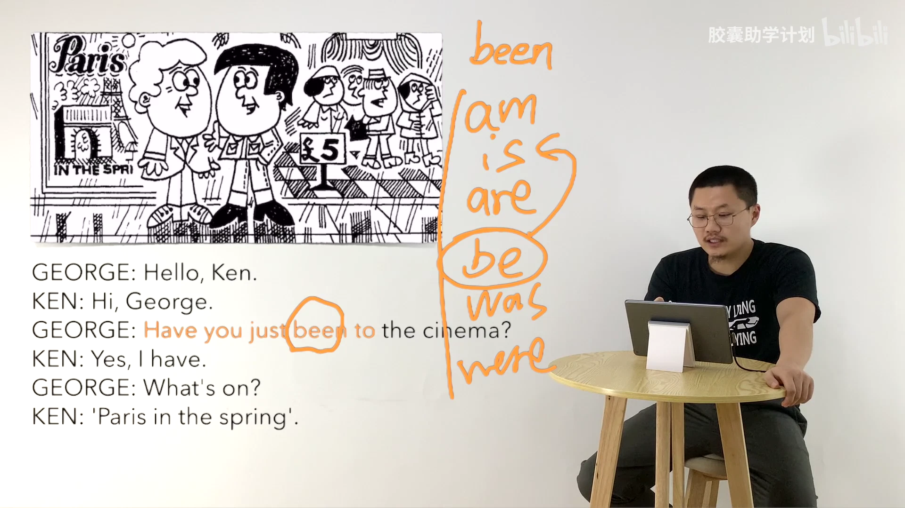

文字识别：been / 胶囊助学计划 / 0） / Jaus / am / 5 / INTHESPRI / are / be / GEORGE: / Hello, Ken. / KEN: Hi, / George. / WaS / YLING / GEORGE: / Have / you justbeen / to / the / cilema? / YING / KEN: / Yes, / I have. / Imere / GEORGE: / What's / on? / KEN:'Paris / sin / the / spring'.

### 画面 00:01:20

文字识别：been / 胶囊助学计划 / ans / 务 / am / 区5 / INTHESPRI / LIL! / are / be / GEORGE: / Hello, Ken. / KEN: Hi, / George. / WaS / YUING / GEORGE: / Have / you justbeen / to / the / cilnema? / VING / KEN: / Yes, / I have. / Imere / GEORGE: / What's / on? / KEN:'Paris / sin / the / spring'.

### 画面 00:01:26

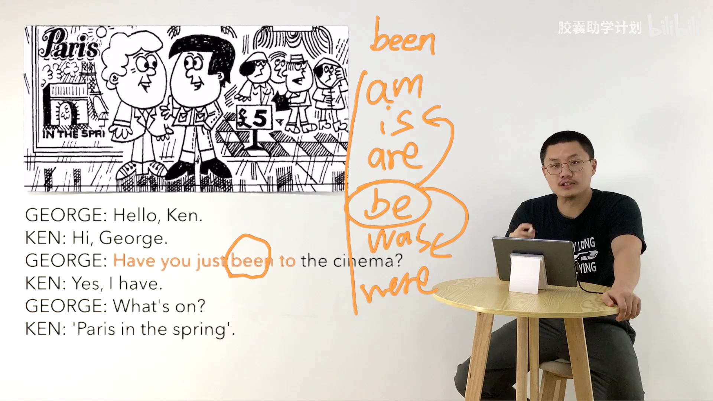

文字识别：been / 胶囊助学计划 / ans / am / 区5 / S / INTHESPRI / L1L! / are / be / GEORGE: / Hello, Ken. / Wa / KEN: Hi, / George. / V / YLING / GEORGE: / Have / you justbeen / to / the / cinema? / VING / KEN: / Yes, / I have. / Imere / GEORGE: / What's / on? / KEN:'Paris / in / the / spring'.

### 画面 00:01:29

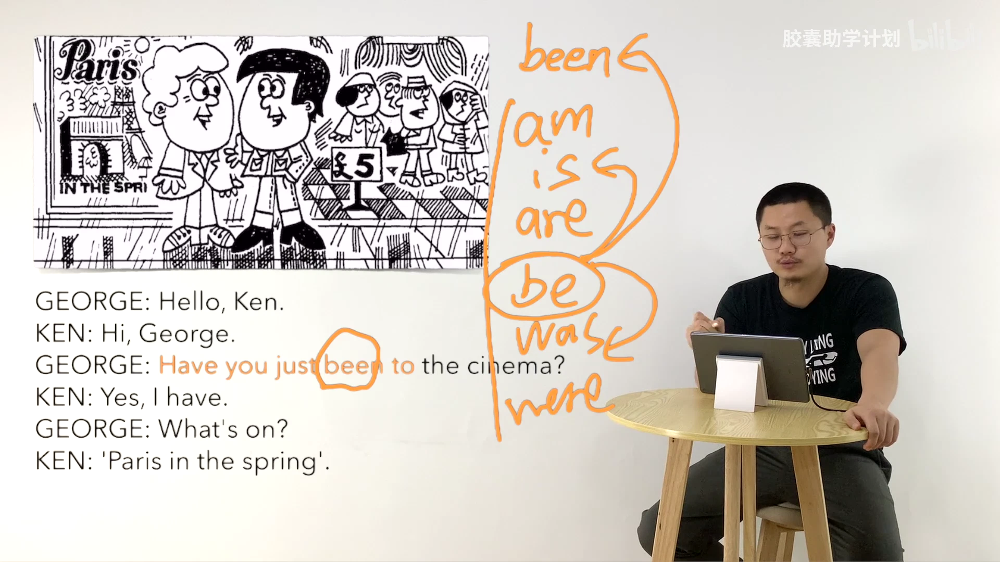

文字识别：been6 / 胶囊助学计划 / 0 / Jans / am / 区5 / iS / INTHESPRI / are / be / GEORGE: / Hello, Ken. / Wa / KEN: Hi, / George. / se / YLING / GEORGE: / Have / you justbeen / to / the / cilnema? / PVING / KEN: / Yes, / I have. / Imere / GEORGE: / What's / on? / KEN:'Paris / in / the / spring'.

## 00:01:30–00:02:00

been, been, OK, very good.那这句话说，Have you just been to the cinema?什么意思呢？我先直接告诉各位，叫做你去电影院了吗？注意两个人现在是面对面的，对吧？叫做你去电影院了吗？Very good.说Yes, I have.是我去过了。然后What's on?好了，这是一个小的短语，各位直接把它记下来，也是一个句子了，对吧？叫做什么在上？什么在上？

### 画面 00:01:31

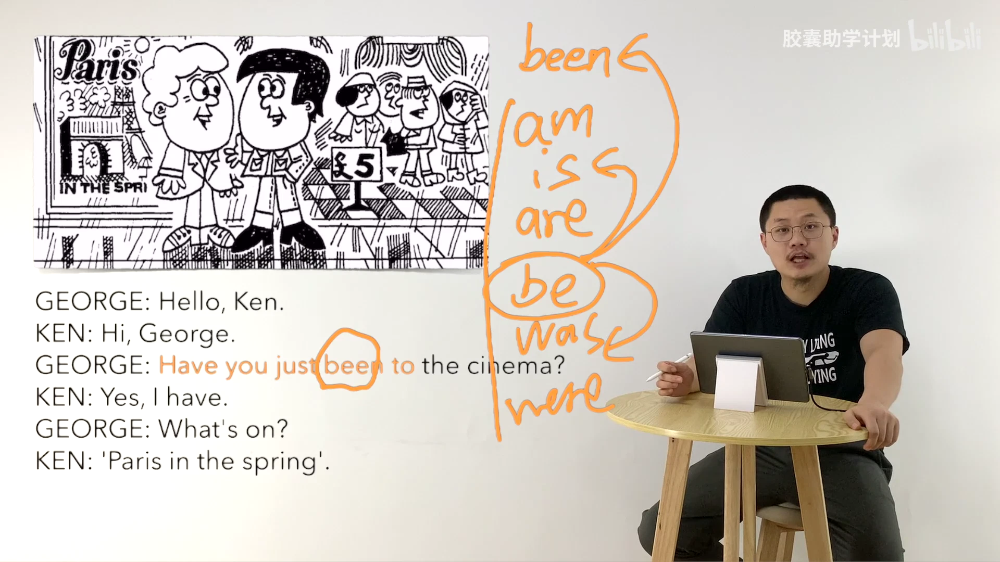

文字识别：been6 / 胶囊助学计划 / ans / am / 85 / INTHESPRI / L1L! / are / be / GEORGE: / Hello, Ken. / Wa / KEN: Hi, / George. / YLING / GEORGE: / Have / you justbeen / to / the / cinema? / NING / KEN: / Yes, / I have. / Imere / GEORGE: / What's / on? / KEN:'Paris / in / the / spring'.

### 画面 00:01:34

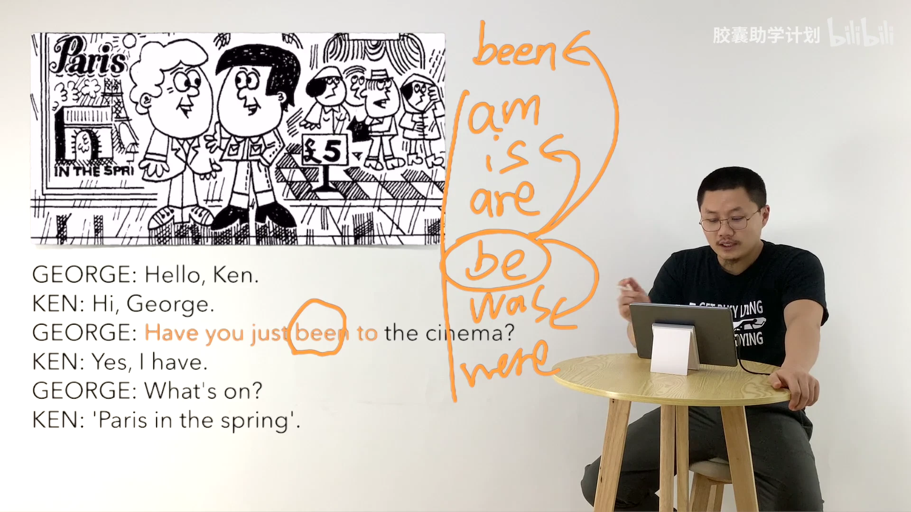

文字识别：been6 / 胶囊助学计划 / Jans / am / 区5 / iS / INTHESPRI / are / be / GEORGE: / Hello, Ken. / Wa / KEN: Hi, / George. / "YVNG / GEORGE: / Have / you justbeen / to / the / cinema? / DYING / KEN: / Yes, / I have. / Imere / GEORGE: / What's / on? / KEN:'Paris / in / the / spring'.

### 画面 00:01:40

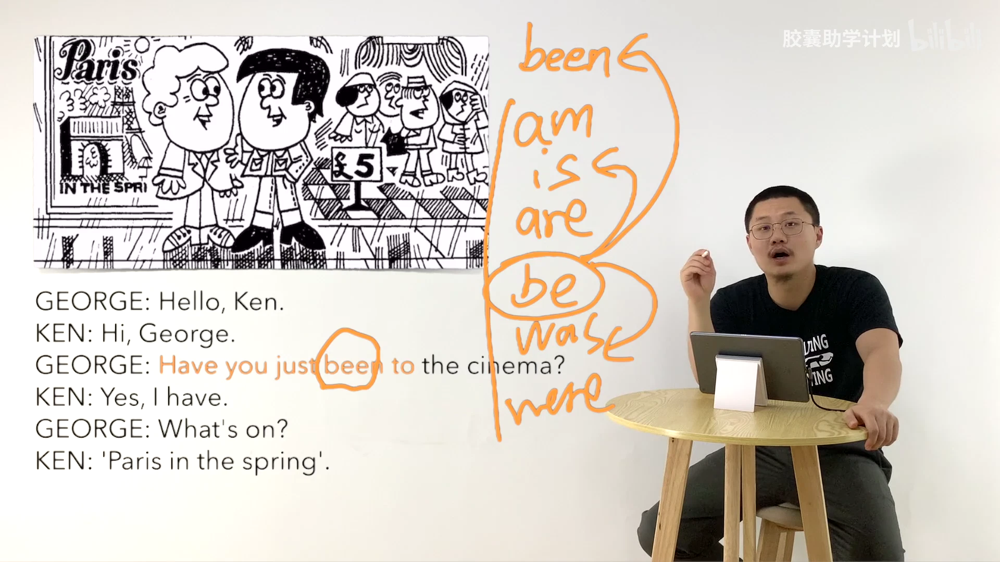

文字识别：been6 / 胶囊助学计划 / 0 / Jaus / am / 5 / S / INTHESPRI / L1L! / are / be / GEORGE: / Hello, Ken. / Wa / KEN: Hi, / George. / LANG / GEORGE: / Have / you justbeen / to / the / cilnema? / MING / KEN: / Yes, / I have. / Imere / GEORGE: / What's / on? / KEN:'Paris / in / the / spring'.

### 画面 00:01:49

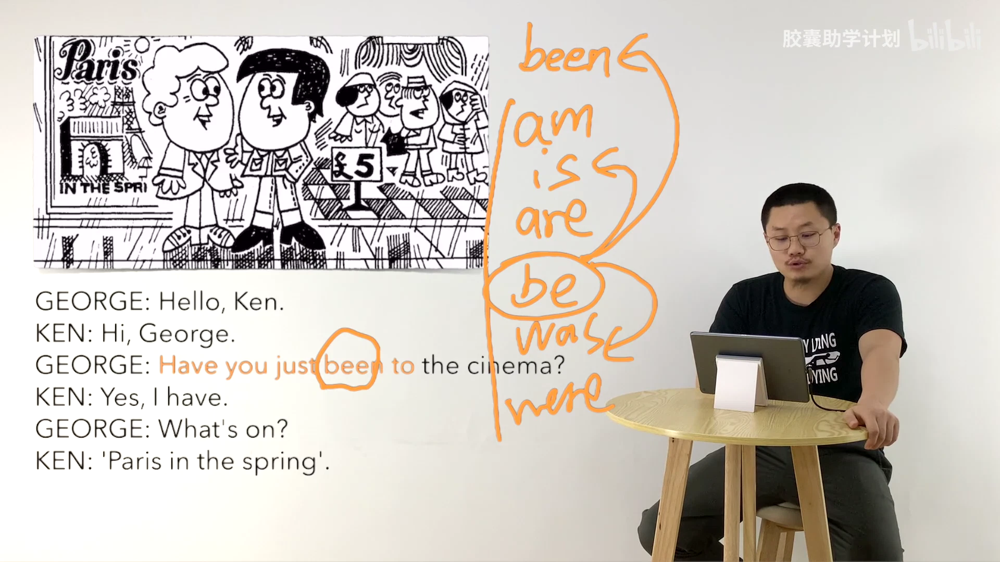

文字识别：been6 / 胶囊助学计划 / Jans / am / 区5 / S / INTHESPRI / are / be / GEORGE: / Hello, Ken. / Wa / KEN: Hi, / George. / YUING / GEORGE: / Have / you justbeen / to / the / cinema? / IVING / KEN: / Yes, / I have. / Imere / GEORGE: / What's / on? / KEN:'Paris / in / the / spring'.

### 画面 00:01:52

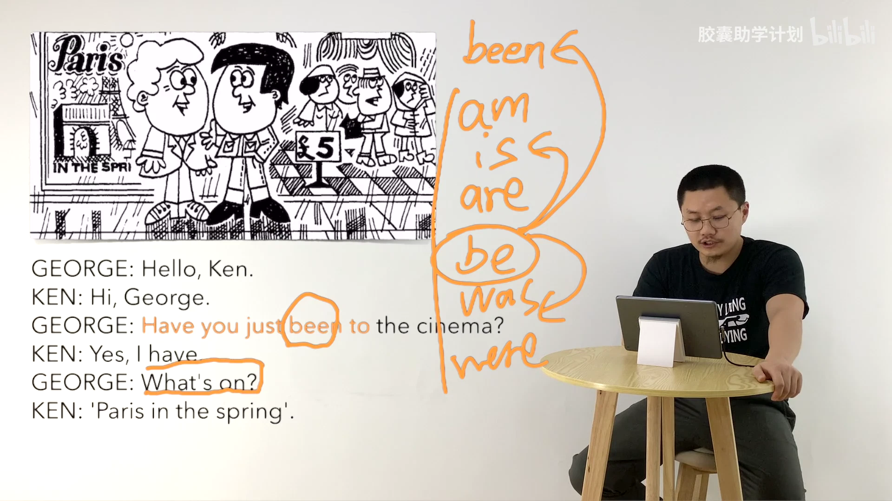

文字识别：been6 / 胶囊助学计划 / 0 / Jans / am / 区5 / INTHESPRI / are / be / GEORGE: / Hello, / , Ken. / KEN: Hi, / George. / Wa / YLING / GEORGE: / Have / you justbeen / to / the / cilema? / R / NING / KEN: / Yes, / I have / Imere / GEORGE: / What's on? / KEN:'Paris / in / the / spring'.

### 画面 00:01:56

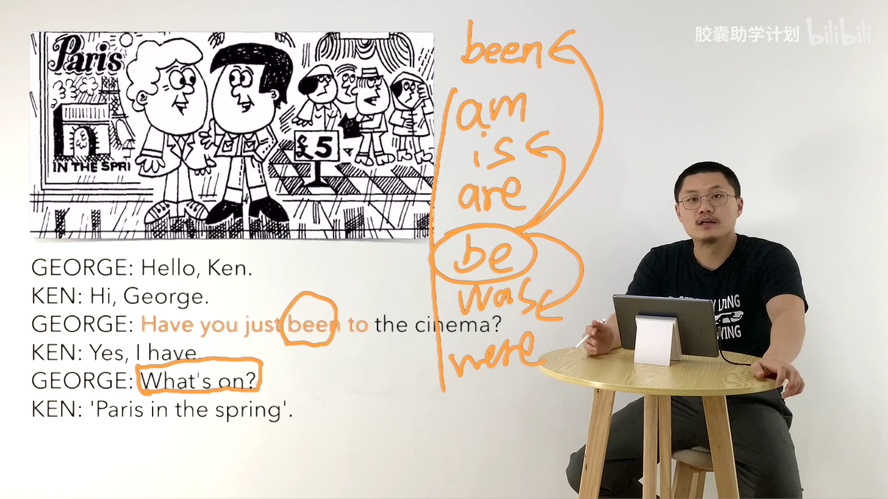

文字识别：been6 / 胶囊助学计划 / Jans / am / 区5 / S / INTHESPRI / are / be / GEORGE: / Hello, / Ken. / Wa / KEN: Hi, / George. / YUING / GEORGE: / Have / you justbeen / to / the / cihema? / WVING / KEN: / Yes, / Ihave / Imere / GEORGE: / What's on? / KEN:'Paris in / the / spring'.

## 00:02:00–00:02:30

问电影院什么在上？这个你结合自己的，我觉得汉语的语感应该能猜出来，对吧？它叫做什么在上映啊？这是经常用的一个小的短语，叫 What's on？但注意啊，一般指的是有上下文语境啊，跟电影院相关的时候，你才会用 What's on？答案叫做 Paris in the spring。这个字面翻译就行了，叫做 Paris 巴黎 in the spring，叫在春天，巴黎在春天啊。它翻译成了

### 画面 00:02:00

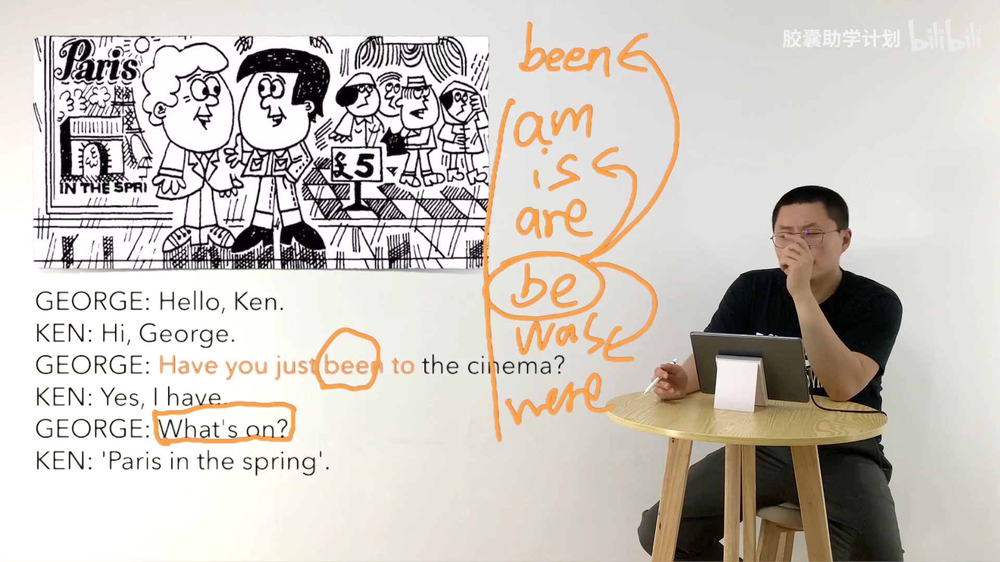

文字识别：been6 / 胶囊助学计划 / Jans / am / 区5 / S / INTHESPRI / are / be / GEORGE: / Hello, / , Ken. / WaS / KEN: Hi, / George. / GEORGE: / Have / you justbeeh / to / the / cilema? / KEN: / Yes, / I have / Imere / GEORGE: / What's on? / KEN: 'Paris in t / the / spring'.

### 画面 00:02:04

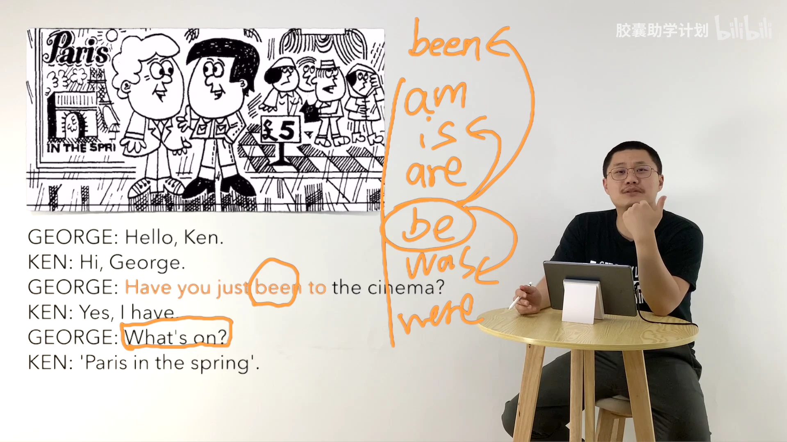

文字识别：been6 / 胶囊助学计划 / Jans / am / 区5 / iS / INTHESPRI / are / be / GEORGE: / Hello, Ken. / WaSe / KEN: Hi, / George. / GEORGE: / Have / you justbeen / to / the / cilema? / KEN: / Yes, / Ihave / Imere / GEORGE: / What's on? / KEN: 'Paris in t / the / spring'.

### 画面 00:02:15

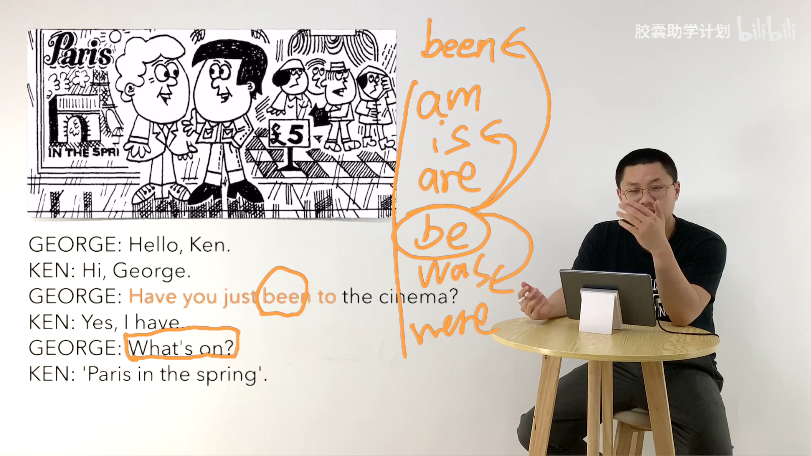

文字识别：been6 / 胶囊助学计划 / の / Jans / am / 区5 / iS / INTHESPRI / L1L! / are / be / GEORGE: / Hello, Ken. / KEN: Hi, / George. / Wa / GEORGE: / Have / you justbeen / to / the / cinema? / KEN: / Yes, / Ihave / Imere / GEORGE: / What's on? / KEN: 'Paris in  / the / spring'.

### 画面 00:02:21

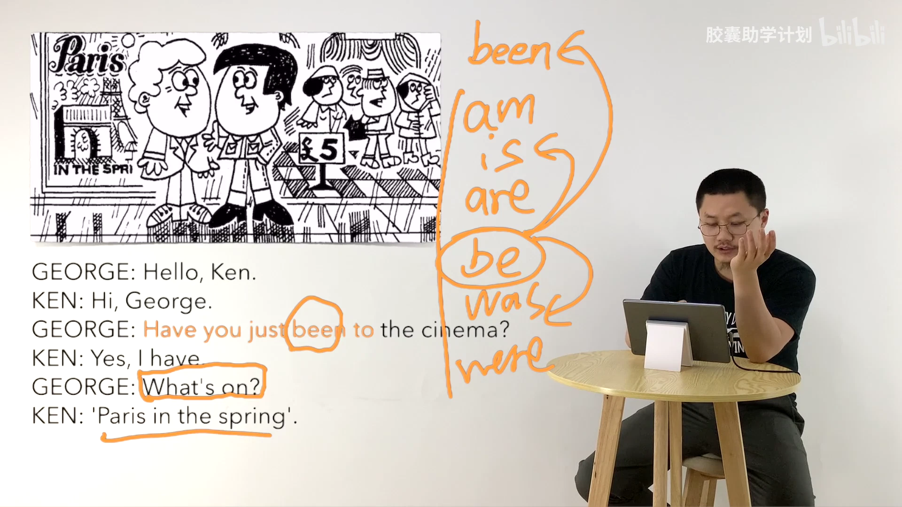

文字识别：been6 / 胶囊助学计划 / as / am / 区5 / iS / INTHESPRI / are / be / GEORGE: / Hello, Ken. / Wa / KEN: Hi, / George. / GEORGE: / Have / you justbeen / to / the / cilema? / KEN: / Yes, / Ihave / Imere / GEORGE: / What's on? / KEN: 'Paris in 1 / the / spring'.

### 画面 00:02:25

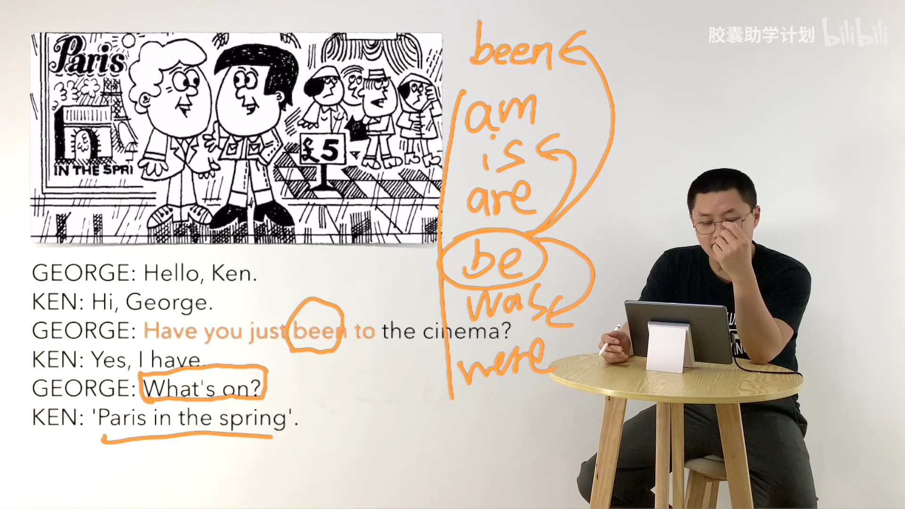

文字识别：been6 / 胶囊助学计划 / Jans / am / 区5 / iS / INTHESPRI / are / be / GEORGE: / Hello, Ken. / Wa / KEN: Hi, / George. / GEORGE: / Have / you justbeen / to / the / cihema? / KEN: / Yes, / Ihave / Imere / GEORGE: / What's on? / KEN:'Paris in t / the / spring'.

## 00:02:30–00:03:00

叫《巴黎之春》啊，这是电影的名字啊。OK，那接下来我们就要去讲一下 have been to 和 have gone to 的一个小的区别，这两者特别像，而且特别容易混。那我简单说一下 gone 这个单词是它的原型是谁？猜也不难猜出来，对吧？就是 go，就是走去的那个过去分词。我们接下来一个一个看，我们给大家

### 画面 00:02:32

文字识别：been6 / 胶囊助学计划 / Jans / am / 区5 / iS / INTHESPRI / are / be / GEORGE: / Hello, Ken. / Wa / KEN: Hi, / George. / GEORGE: / Have / you justbeen / to / the / cinema? / KEN: / Yes, / Ihave / Imere / GEORGE: / What's on? / KEN: 'Paris in the / spring'.

### 画面 00:02:34

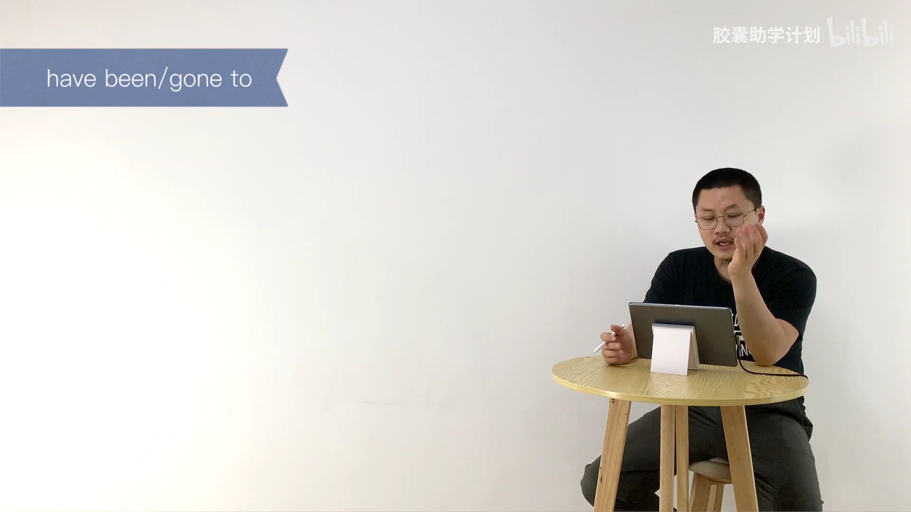

文字识别：胶囊助学计划L / have been/gone to

### 画面 00:02:36

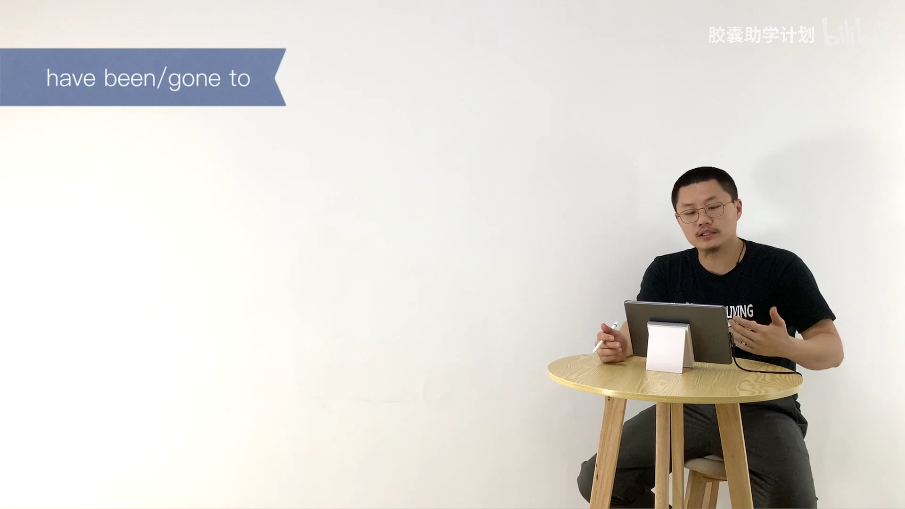

文字识别：胶囊助学计划 / have been/gone to / 9 / UING

### 画面 00:02:47

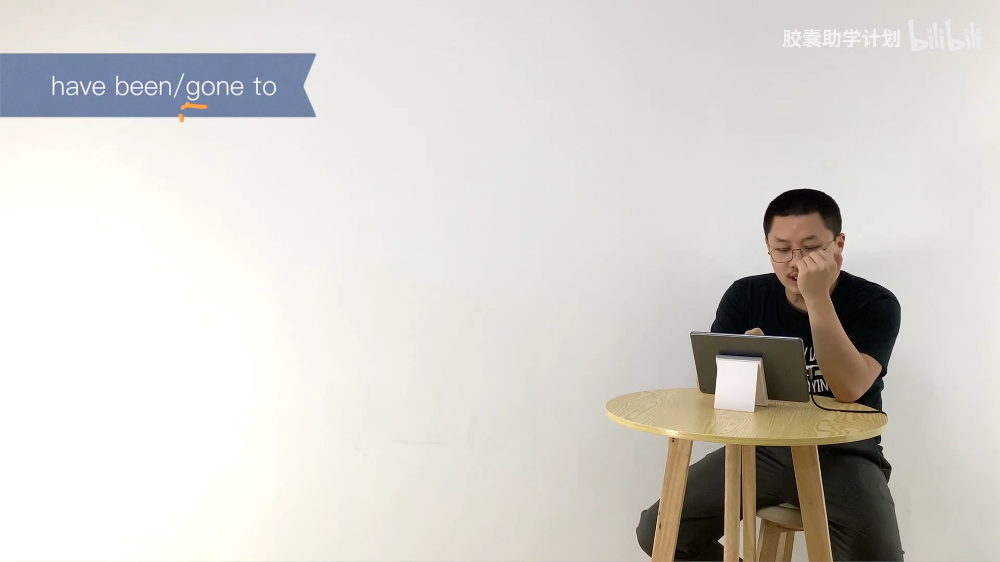

文字识别：胶囊助学计划 / have been/gone to

### 画面 00:02:49

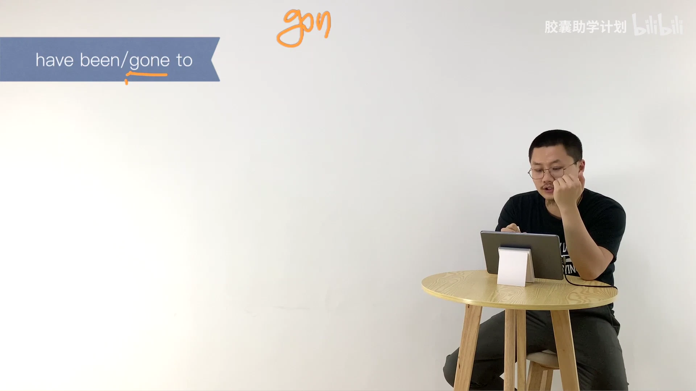

文字识别：gn / 胶囊助学计划 / have been/gone to

### 画面 00:02:53

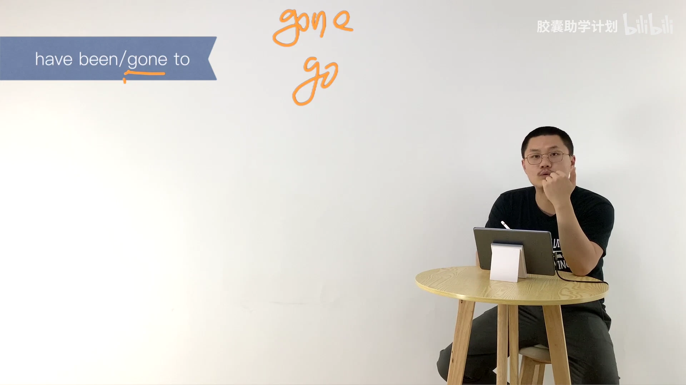

文字识别：gone / Bibilt / 胶囊助学计划 / have been/gone to / go

## 00:03:00–00:03:30

了一个小的场景，说 Sally went to Paris last week. 上周她去巴黎了。注意发生在过去。 She arrived in Beijing yesterday. 她昨天到北京了。之前上周去巴黎了，昨天回北京了。注意，接下来叫做 She has been to Paris. 你看啊，翻译成叫做去过，叫做去了，然后人

### 画面 00:03:02

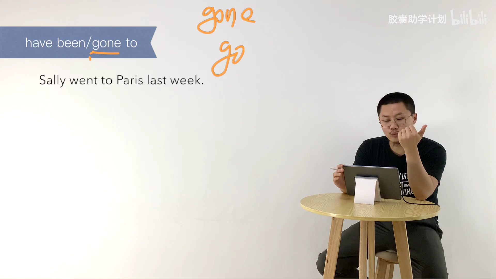

文字识别：gone / BiBi / 胶囊助学计划 / have been/gone to / go / Sally went to Paris last week.

### 画面 00:03:19

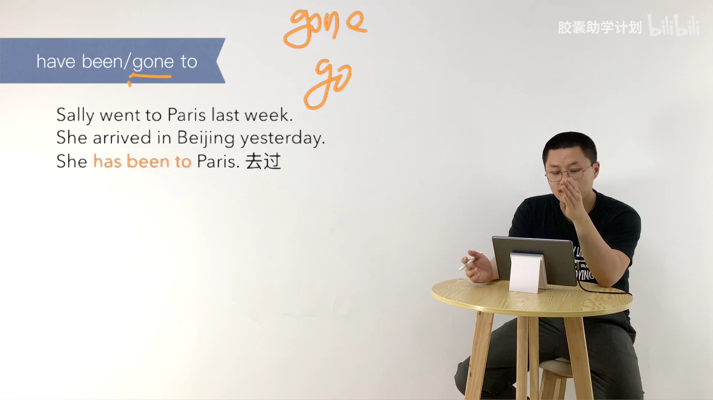

文字识别：gone / 胶囊助学计划 / have been/gone to / 9o / Sally went to Paris last week. / She /  arrived in Beijing yesterday. / She / has been to Paris.去过

### 画面 00:03:27

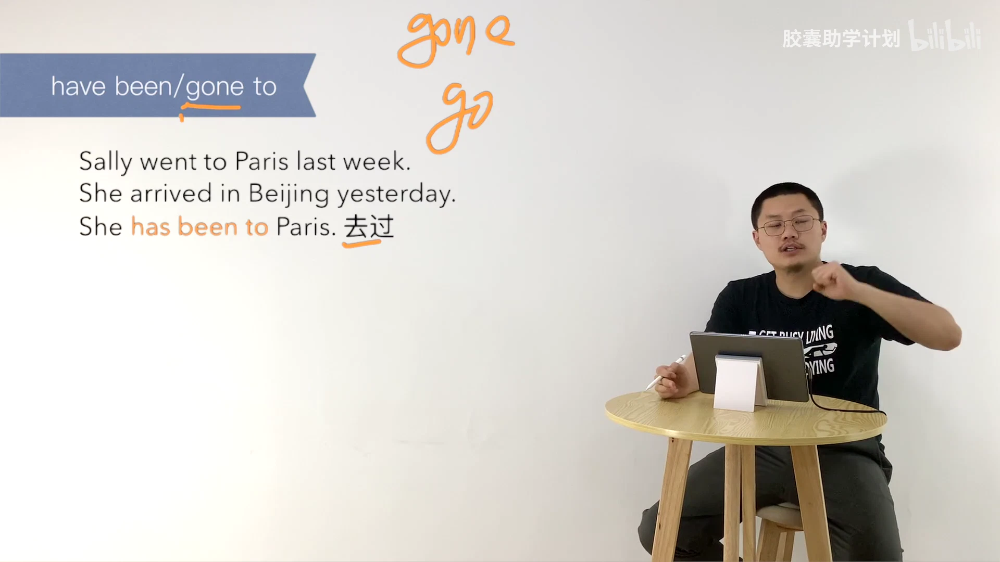

文字识别：gone / 胶囊助学计划 / have been/gone to / 90 / Sally went to Paris / last week. / She / arrived in Beijing yesterday. / She / has been to Paris.去过 / AYING

## 00:03:30–00:04:00

又回来了，叫做去过某地，用的是 have been to 这个点各位要记住。那与它相对应的就是这句话，叫做 Sally went to Paris last week. She is in Paris now. 去了，但人没回来，人还在那个地方。我们管它叫做 she has gone to Paris. 所以翻译成叫做去了，人去了还没有回

### 画面 00:03:31

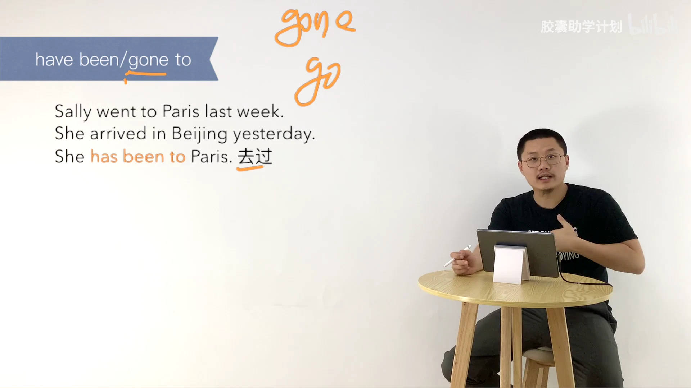

文字识别：gone / 胶囊助学计划 / have been/gone to / 90 / Sally went to Paris / s last week. / She / arrived in Beijing yesterday. / She / has been to Paris.去过

### 画面 00:03:36

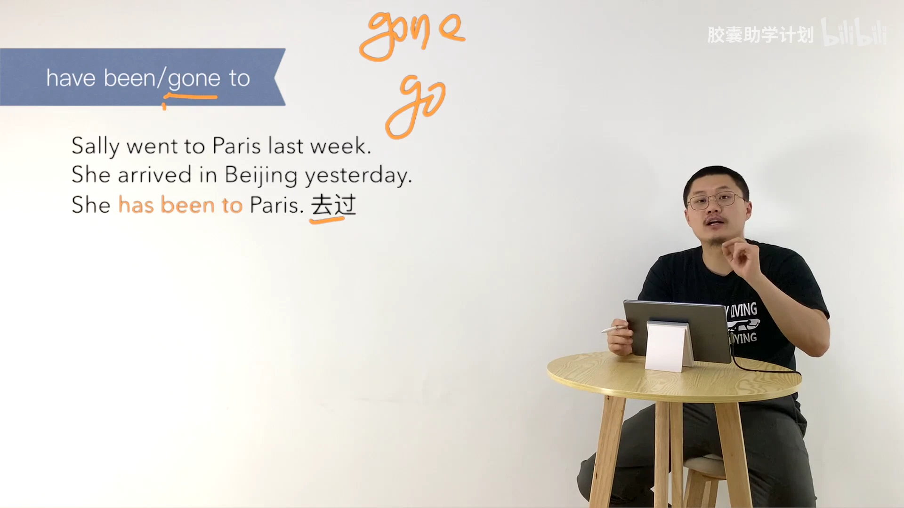

文字识别：gone / 胶囊助学计划 / have been/gone to / 90 / Sally went to Paris / last week. / She / arrived in Beijing yesterday. / She / has been to Paris.去过 / YIVING / IVING

### 画面 00:03:38

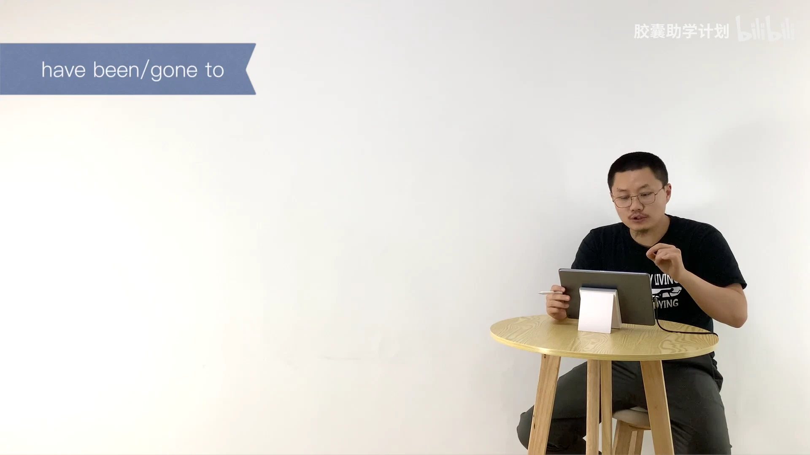

文字识别：胶囊助学计划 / have been/gone to / VING

### 画面 00:03:41

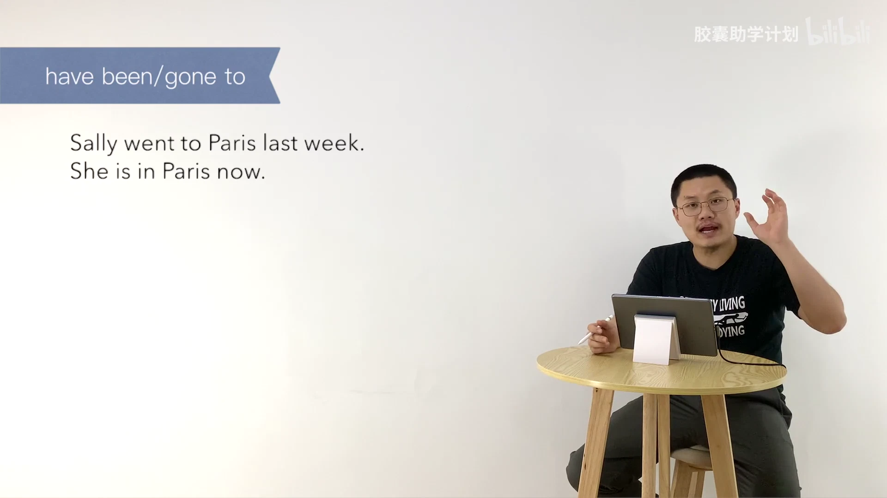

文字识别：胶囊助学计划 / have been/gone to / Sally went to Paris last week. / She is in Paris now. / YIVING / DYING

## 00:04:00–00:04:30

来，表示去了用的是 have gone to。当然由时态由人称去做一个变化，have 要换成 has。这么去讲，各位不是非常容易立刻就把它记下来。接下来我们做一些小的练习啊。当然这个地方提了一下，对吧？Go 过去式是 went，过去分词是 go。好，接下来我们做一些小的练习。比如说 Jim is on holiday。Jim 在度假，

### 画面 00:04:10

文字识别：胶囊助学计划 / have been/gone to / Sally went to Paris last week. / She is in Paris now. / She has gone to Paris.去了

### 画面 00:04:12

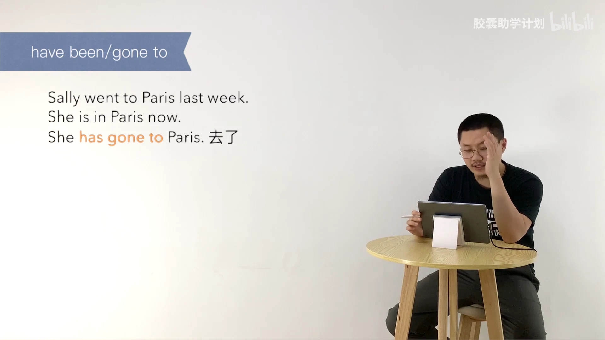

文字识别：胶囊助学计划 / have been/gone to / Sally went to Paris last week. / She is in Paris now. / She has gone to Paris.去了

### 画面 00:04:19

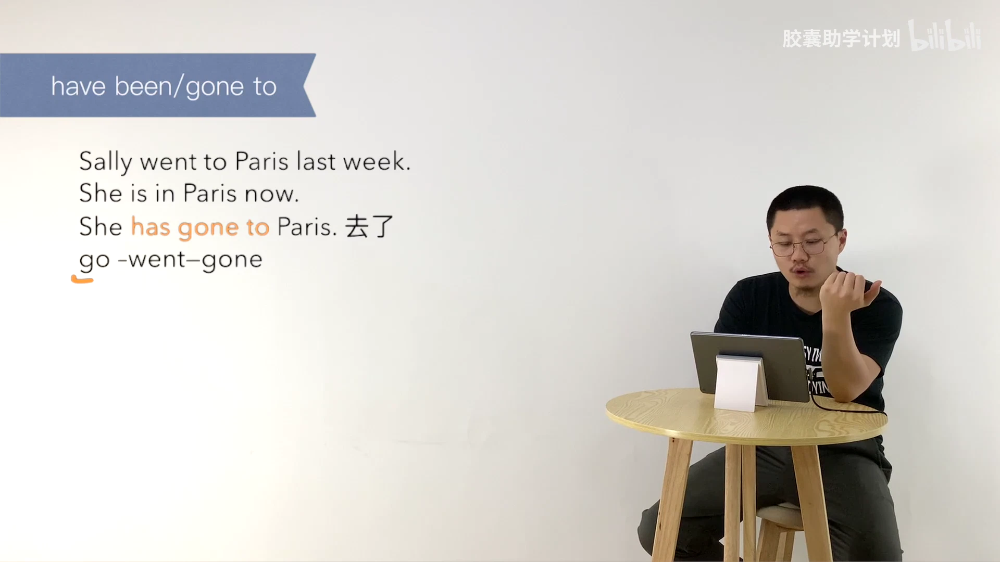

文字识别：胶囊助学计划 / have been/gone to / Sally went to Paris last week. / She is in Paris now. / She has gone to Paris.去了 / go-went-gone

### 画面 00:04:23

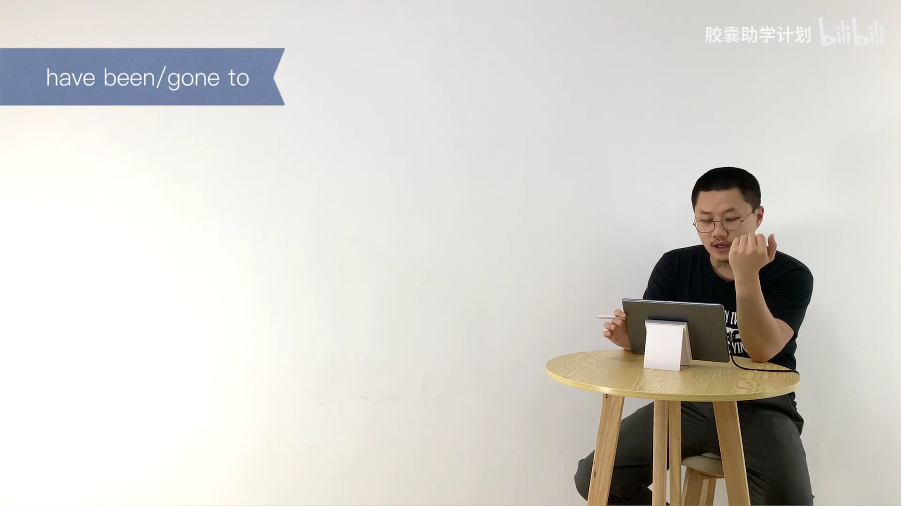

文字识别：Biibil / 胶囊助学计划 / have been/gone to

## 00:04:30–00:05:00

他注意，接下来的问题就是，人是去了回来了，还是去了没回来？是去过还是去了？说他人现在去意大利了。你注意，人现在人在哪？他现在在度假。人现在在意大利去了没回来？叫去了，对吧？叫做He's gone to Italy.他去了意大利度假去了，对吧？人没回来。OK，再来，比如说，Hello,

### 画面 00:04:32

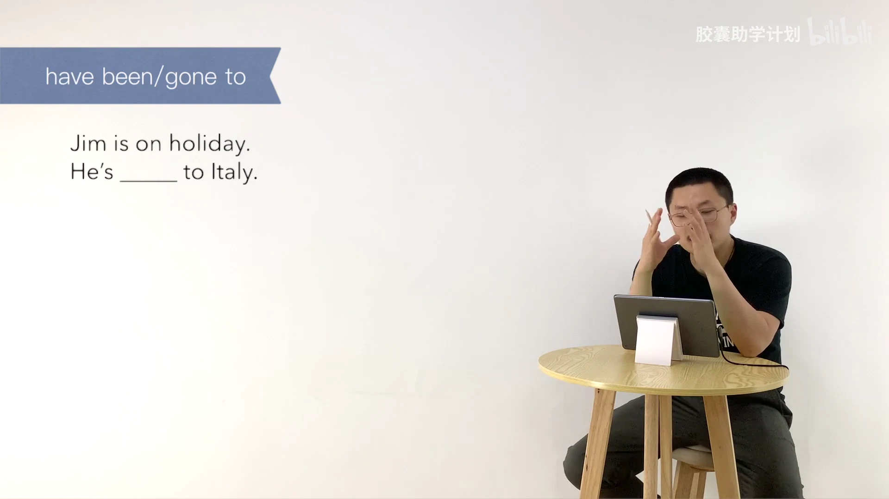

文字识别：胶囊助学计划 / have been/gone to / Jim is on holiday. / He's / to ltaly.

### 画面 00:04:54

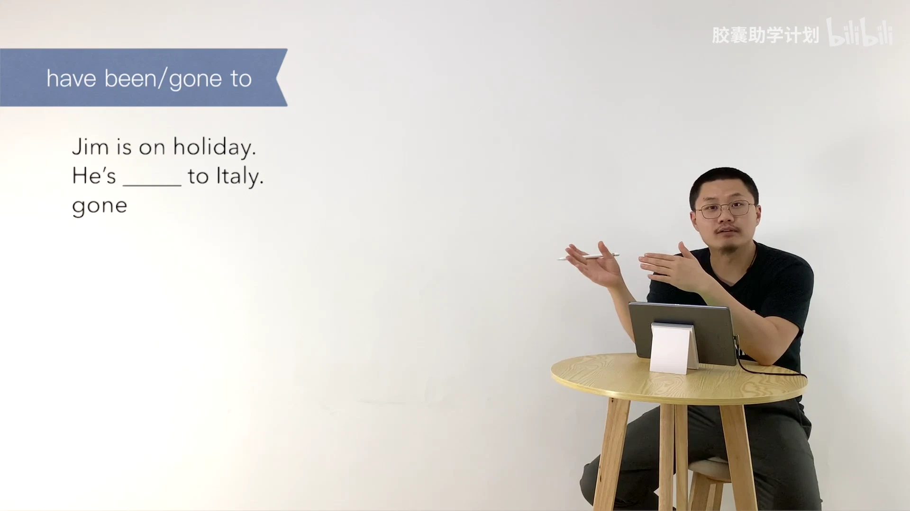

文字识别：胶囊助学计划 / have been/gone to / Jim is on holiday. / He's / to ltaly. / gone

### 画面 00:04:57

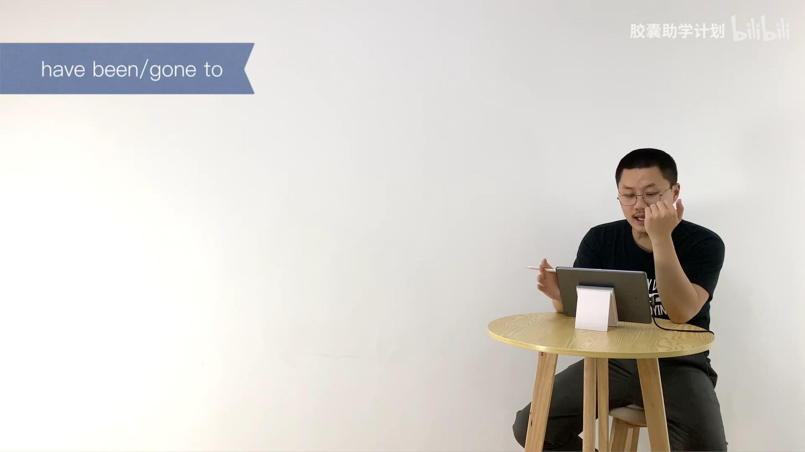

文字识别：胶囊助学计划 / BiD / have been/gone to

## 00:05:00–00:05:30

I've just什么to the shops. I've bought a lot of things.我买了许多东西。我刚刚买了很多东西。那我问你，这个是我去了还是去过？人去了商店，然后现在站在你面前和你聊天儿，是不是就不是去了，对吧？如果我去了，我不可能张当面跟你聊天嘛，对不对？所以叫做been to，去过啊。叫做哎，我刚刚去过商店，人现在回

### 画面 00:05:00

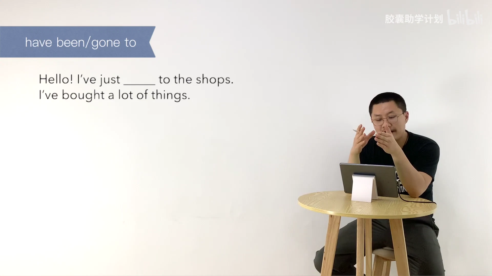

文字识别：胶囊助学计划 / have been/gone to / Hello! I've just / to the shops. / I've bought a lot of things.

### 画面 00:05:23

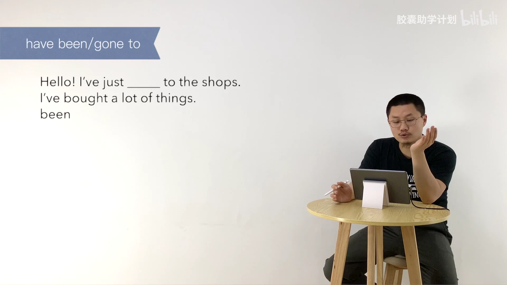

文字识别：胶囊助学计划 / have been/gone to / Hello! I've just / to the shops. / I've bought a lot of things. / been

### 画面 00:05:25

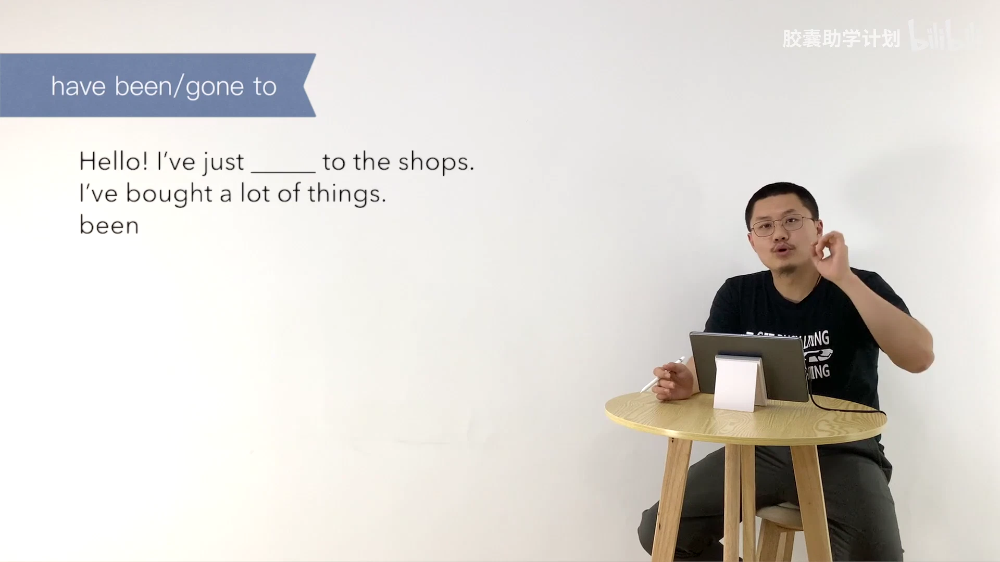

文字识别：胶囊助学计划 / have been/gone to / Hello! I've just / to the shops. / I've bought a lot of things. / been / LING / IING

## 00:05:30–00:06:00

来了。我买了很多的东西，你瞧。Very good. So use been to.再来说，Alice isn't here at the moment.这基本上这句话出来，你就应该能想到是用been to还是gone to了。他现在人不在这儿，那他肯定是去了某地，对吧？说She's gone to the shop to get a newspaper.他去商店了，干嘛去了呢？去买报纸去了。Okay, continue.再来

### 画面 00:05:35

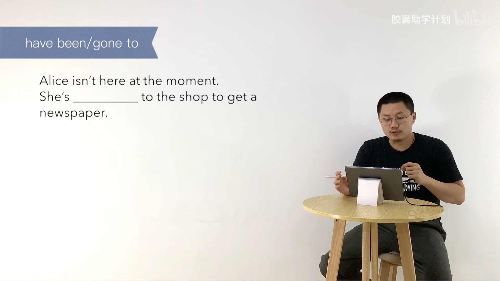

文字识别：胶囊助学计划 / have been/gone to / Alice isn't here at the moment. / She's / to the shop to get a / newspaper. / DYING

### 画面 00:05:37

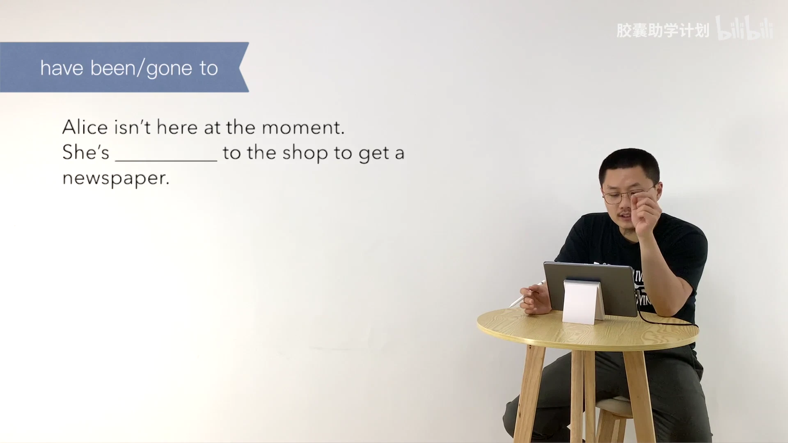

文字识别：胶囊助学计划 / have been/gone to / Alice isn't here at the moment. / She's / to the shop to get a / newspaper.

### 画面 00:05:41

文字识别：胶囊助学计划 / have been/gone to / Alice isn't here at the moment. / She's / to the shop to get a / newspaper.

### 画面 00:05:47

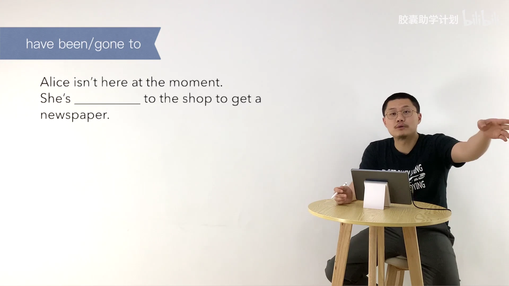

文字识别：胶囊助学计划 / have been/gone to / Alice isn't here at the moment. / She's / to the shop to get a / newspaper. / YANG / YING

### 画面 00:05:52

文字识别：胶囊助学计划 / have been/gone to / Alice isn't here at the moment. / She's / to the shop to get a / newspaper. / gone / SYLIMNG / DYING

### 画面 00:05:59

文字识别：胶囊助学计划 / have been/gone to / Tom has / out. / He'll be back in about an hour.

## 00:06:00–00:06:30

说Tom has什么out. He will be back in about an hour.他半一个小时之后回来，所以人是去某地了，对吧？不是去了回来了，去了人没回来，所以用的是gone。叫做She has, Tom has gone out.这为什么不用to呢？啊，因为后边是out这个单词，对吧？我们前面不需要再加to了。但是如果地点，你一般在后边给它加个to啊。好，

### 画面 00:06:22

文字识别：胶囊助学计划 / have been/gone to / Tom has / out / He'll be back in about an hour. / gone / SYUIVING / DVING

## 00:06:30–00:07:00

再来说，Are you going to the bank? 你要去银行吗？No，不，你注意，我们是当面在聊天。我去过，人又回来了，去了那个地方，人又回来了，叫做 No， I've already been to the bank。我已经去过银行了，现在当着面和你聊天呢，对吧？Have been to， OK。 One more，那接下来我们继续回到文章啊，这儿说，Oh， I've already

### 画面 00:06:30

文字识别：胶囊助学计划 / have been/gone to / 'Are you going to the bank'

### 画面 00:06:32

文字识别：胶囊助学计划 / have been/gone to / 'Are you going to the bank' / 际

### 画面 00:06:36

文字识别：胶囊助学计划 / have been/gone to / 'Are you going to the bank' / 'No, I've already / to the bank'

### 画面 00:06:39

文字识别：胶囊助学计划 / have been/gone to / 'Are you going to the bank' / 'No, I've already / to the bank' / ANG / NING

### 画面 00:06:46

文字识别：胶囊助学计划 / have been/gone to / 'Are you going to the bank' / 'No, I've already / to the bank'. / been / SYLIVING / DVING

### 画面 00:06:54

文字识别：胶囊助学计划 / 0 / Jans / 区5 / NTHESPRI / L1! / 11 / GEORGE: Oh, I've already seen it. / I saw it on television last year. / YUVING / It's an old film, but it's very good. / KEN: Paris is a beautiful city. / GEORGE: I've never been there. / Have you ever been there, Ken?

### 画面 00:06:58

文字识别：胶囊助学计划 / Jais / 85 / NTHESPRI / Li! / 11 / GEORGE: Oh, I've already seen it. / I saw it on television last year. / YING / It's an old film, but it's very good. / VING / KEN: Paris is a beautiful city. / GEORGE: I've never been there. / Have you ever been there, Ken?

## 00:07:00–00:07:30

seen it. 说我已经看过了。哎，现在完成时 have 加单。注意，那这儿的 seen 的原型是谁？我猜就不用我说了吧？您直接写旁边吧。 See, I saw it on television last year. 注意把这个 saw 旁边也是写个 see，对吧？这是过去式，这是过去分词啊，长得不一样啊。我在电视上看到 last year，去年。 It's an old film, 是个老电影。 But it's

### 画面 00:07:01

文字识别：胶囊助学计划 / Jans / 区5 / INTHESPRI / 11 / GEORGE: Oh, l've already seen it. / I saw it on television last year. / YUNG / It's an old film, but it's very good. / YING / KEN: Paris is a beautiful city. / GEORGE: I've never been there. / Have you ever been there, Ken?

### 画面 00:07:09

文字识别：胶囊助学计划 / 0 / ans / 区5 / INTHESPRI / 11 / GEORGE: Oh, I've already seen it. / I saw it on television last year. / LING / It's an old film, but it's very good. / ING / KEN: Paris is a beautiful city. / GEORGE: I've never been there. / Have you ever been there, Ken?

### 画面 00:07:12

文字识别：胶囊助学计划 / ans / 区5 / INTHESPRI / 11 / GEORGE: Oh, I've already seen it. / I saw it on television last year. / SYING / It's an old film, but it's very good. / DYING / KEN: Paris is a beautiful city. / GEORGE: I've never been there. / Have you ever been there, Ken?

## 00:07:30–00:08:00

very good. 但特别好。说 Paris is a beautiful city. 说巴黎是一座很美的城市。Ken说了一句话，说巴黎是一个很美的城市。说 I've never been there. 我从来都没去过那里。你看，你注意这个 there 后边也不，前面也不加 to，对吧？从来没去过那里。Have you ever been there, Ken? 说你以前去过吗？你看，他无非就是把我们刚才的 have

### 画面 00:07:42

文字识别：胶囊助学计划 / 0 / Jans / 5 / INTHESPRI / GEORGE: Oh, I've already seen it. / I saw it on television last year. / YUING / It's an old film, but it's very good. / TIVING / KEN: Paris is a beautiful city. / GEORGE: I've never been there. / Have you ever Deen there, Ken?

### 画面 00:07:48

文字识别：胶囊助学计划 / Jams / 5 / INTHESPRI / 11 / GEORGE: Oh, I've already seen it. / I saw it on television last year. / YUING / It's an old film, but it's very good. / IVING / KEN: Paris is a beautiful city. / GEORGE: I've never been there. / Have you ever been there, Ken?

### 画面 00:07:51

文字识别：胶囊助学计划 / 0 / Jas / 股5 / INTHESPRI / 11 / GEORGE: Oh, L've already seen it. / I saw it on television last year. / YLING / It's an old film, but it's very good. / YING / KEN: Paris is a beautiful city. / GEORGE: I've never been there. / Have you ever been there, Ken?

## 00:08:00–00:08:30

been to 变成一般疑问句 have 提前了，对不对？ Okay, very good. 再来说，Yes, I have. 是的，我去过。I was there in April. 啊，I remember I was in Paris in August. 我应该是八月份，七八月份去的巴黎，是吧？那他是《巴黎之春》，正好春天去的。他说 I was there in April. 我是这个四月份去的，是吧？他说 Paris in the spring. 啊，哎，双关，胖，对吧？就一语双关了。就是电

### 画面 00:08:04

文字识别：胶囊助学计划 / 0 / Jans / 5 / INTHESPRI / 11 / KEN: Yes, I have.I was there in April. / GEORGE: Pairs in the spring, eh? / SYLING / KEN: It was spring, but the weather was awful. / DVING / It rained all the time. / GEORGE: Just like London!

### 画面 00:08:14

文字识别：胶囊助学计划 / 0 / Jans / 区5 / INTHESPRI / 11 / KEN: Yes, I have.I was there in April. / GEORGE: Pairs in the spring, eh? / LANG / KEN: It was spring, but the weather was awful. / MING / It rained all the time. / GEORGE: Just like London!

### 画面 00:08:22

文字识别：胶囊助学计划 / Jans / 区5 / INTHESPRI / 11 / KEN: Yes, I have.I was there in April. / GEORGE: Pairs in the spring, eh? / SYLNG / KEN: It was spring, but the weather was awful. / UVING / It rained all the time. / GEORGE: Just like London!

## 00:08:30–00:09:00

影的名字叫《巴黎之春》。哎，他四月份去的，正好恰好也是巴黎之春，对吧？哎，巴黎的春天。It was spring，说当时确实是春天。你看是was，but the weather was awful，说但是这个天气啊太糟糕了。It rained all the time，说全程都在不停的下雨，有点像我们南方啊这个长江以南的这个梅雨季节，对吧？江浙

### 画面 00:08:31

文字识别：胶囊助学计划 / 0 / Jans / 5 / INTHESPRI / 11 / KEN: Yes, I have. I was there in April. / GEORGE: Pairs in the spring, eh? / CET DISY LDING / KEN: It was spring, but the weather was awful. / PYING / It rained all the time. / GEORGE: Just like London!

### 画面 00:08:36

文字识别：胶囊助学计划 / 0 / Jans / 5 / INTHESPRI / Lli! / 11 / KEN: Yes, I have.I was there in April. / GEORGE: Pairs in the spring, eh? / YUING / KEN: It was spring, but the weather was awful. / CYING / It rained all the time. / GEORGE: Just like London!

## 00:09:00–00:09:30

每年三四月份稀稀拉拉不停的在下雨，对吧？有点像那个感觉，叫做 It rained all the time。然后 George 说，Just like London，啊，自嘲了一下，自黑了一下，说就和我们伦敦一模一样，对吧？不停的在下雨啊。OK，那接下来呢，我们做一些小的口语听力练习，comprehension。我问问题，您回答，基于的就是这篇文章 Paris in the Spring 来了。第一题，

### 画面 00:09:06

文字识别：胶囊助学计划b出b业 / ans / 区5 / NTHESPRI / 11 / KEN: Yes, I have. I was there in April. / GEORGE: Pairs in the spring, eh? / YUNG / KEN: It was spring, but the weather was awful. / DVING / It rained all the time. / GEORGE: Just like London!

### 画面 00:09:12

文字识别：胶囊助学计划 / ans / 区5 / NTHESPRI / 11 / KEN: Yes, I have.I was there in April. / GEORGE: Pairs in the spring, eh? / LING / KEN: It was spring, but the weather was awful. / NING / It rained all the time. / GEORGE: Just like London!

### 画面 00:09:17

文字识别：胶囊助学计划 / Comprehension / CETDIISY / DYING

### 画面 00:09:19

文字识别：胶囊助学计划 / Comprehension

## 00:09:30–00:10:00

Has Ken been at home all day? No, he hasn't. Next one. Has he just been to the cinema? Yes, he has. Next one. Has George ever seen the film Paris in the Spring? Yes, he has. Continue. Uh, when did George see the film? He saw it last year.

### 画面 00:09:49

文字识别：胶囊助学计划 / Comprehension / 3 T: Has George ever seen the film 'Paris in / the Spring'? / V

### 画面 00:09:56

文字识别：胶囊助学计划 / Comprehension / 4 T: When did George see the film? / -CRT IUSY LVING

### 画面 00:09:59

文字识别：胶囊助学计划 / Comprehension / 4 T: When did George see the film? / S: He saw it last year.

## 00:10:00–00:10:30

Continue. Did he see it at the cinema? No, he didn't. He saw it on television. Next one. Has George ever been to Paris? No, he hasn't. Continue. Has Ken been to Paris? Yes, he has. Continue. What's Paris like? What's Romarson like? What's

### 画面 00:10:03

文字识别：胶囊助学计划 / Comprehension / 5 T: Did he see it at the cinema?

### 画面 00:10:28

文字识别：胶囊助学计划 / Comprehension / 8 T: What's Paris like? / GET DUISYUIVING / OYING

## 00:10:30–00:11:00

the weather like? 各位还记得吧？So it's a beautiful city. 确实很美. Continue. What time of year was Ken in Paris? He was there in April. What was the weather like in April? It was awful. It rained all the time. 一般过去时，当时一直都在下雨. Okay, very good. 接下来 asking questions. 我给肯定

### 画面 00:10:33

文字识别：胶囊助学计划 / Comprehension / 8 T: What's Paris like? / S: It's a beautiful city.

### 画面 00:10:45

文字识别：胶囊助学计划 / Comprehension / 10 T: What was the weather like in April?

### 画面 00:10:51

文字识别：胶囊助学计划 / Comprehension / 10 T: What was the weather like in April? / S: It was awful. It rained all the time. / YING

### 画面 00:10:56

文字识别：胶囊助学计划 / Asking questions / YLANG / DYING

## 00:11:00–00:11:30

has been to the cinema. Has Ken been to the cinema? Where? Where has Ken been? Next one, ask me if Ken saw Paris in the spring.

### 画面 00:11:06

文字识别：胶囊助学计划 / Asking questions / 1 T: Ask me if Ken has been to the cinema. / M

### 画面 00:11:17

文字识别：胶囊助学计划 / Asking questions / 1 T: Ask me if Ken has been to the cinema. / S: Has Ken been to the cinema? / T: Where …..? / S: Where has Ken been?

### 画面 00:11:20

文字识别：胶囊助学计划 / Asking questions / 2 T: Ask me if Ken saw'Paris in the Spring'.

## 00:11:30–00:12:00

Ken see Paris in the spring? What? What did Ken see? Very good. Next one. Ask me if George saw it on television. Did George see it on television? When? When did George see it on television? Continue. Ask me if Ken was in Paris in April.

### 画面 00:11:47

文字识别：胶囊助学计划 / Asking questions / 3 T: Ask me if George saw it on television. / S: Did George see it on television? / T: When …..?

### 画面 00:11:54

文字识别：胶囊助学计划 / Asking questions / 4 T: Ask me if Ken was in Paris in April. / V

## 00:12:00–00:12:30

was Ken in Paris in April. When? When was Ken in Paris? Continue. Ask me if the weather was awful. Was the weather awful? What? 点点来，天气怎么样？ What was the weather like? 注意，他用的是 was，所以指的是当时天气怎么样。玩一个。

### 画面 00:12:05

文字识别：胶囊助学计划 / Asking questions / 4 T: Ask me if Ken was in Paris in April. / S: Was Ken in Paris in April? / T: When ...? / S: When was Ken in Paris?

### 画面 00:12:10

文字识别：Jbilbil / 胶囊助学计划 / Asking questions / 5 T: Ask me if the weather was awful. / V

### 画面 00:12:20

文字识别：胶囊助学计划 / Asking questions / 5 T: Ask me if the weather was awful. / S: Was the weather awful? / T： What ...like? / CVINC / LDING

### 画面 00:12:29

文字识别：Bilibil / 胶囊助学计划 / Recap / Patterns / Grammar / Words / DYI / have / been to sw. / Expression / have / gone tos / sW.

## 00:12:30–00:13:00

那 recap 本课最重要的两个小的短语，我希望各位回去要拿红皮书把它查到，并且认认真真的做一下它对你的练习，叫 have been to somewhere 或者 have gone to somewhere。一个表示去过某地，人又回来了；一个表示去了某地，人没有回来。OK，好，家庭作业绿皮书八十五课，各位可以写了文章熟读成诵啊，一定要跟读至熟读成诵。最

### 画面 00:12:51

文字识别：胶囊助学计划 / CRT PUSYUIVING / R

## 00:13:00–00:13:30

后呢啊，再然后红皮书，各位要查一下 have been to 和 have gone to，然后给自己讲解一遍今天的核心知识点。如果大家喜欢我们的课程呢，欢迎大家关注、订阅、一键三连，分享给那些需要的朋友。最后我们再来看一句名人名言：Good, better, best. Never let it rest. Till you, your good is better, and your better is best. See you next time.

### 画面 00:13:05

文字识别：胶囊助学计划 / 绿皮书第85课的写作练习 / 文章跟读至熟读成诵 / 3.红皮书查have been/gone to / 请给自己讲解一遍今天的 / 核心知识点 / YLIVING / DYING

### 画面 00:13:08

文字识别：胶囊助学计划 / DA / VLIVING / DYING

### 画面 00:13:15

文字识别：胶囊助学计划 / 'SYLUIVING / Good, better, best. Never let it rest. 'Til / DYING / your good is better and your better is best. / -St. Jerome

### 画面 00:13:29

文字识别：Good, better, best. Never let it rest. 'Til / your good is better and your better is best. / St. Jerome

## 00:13:30–00:13:41

### 画面 00:13:31

文字识别：CAPSULEACADEMY / 胶囊助学计划 / 小红书 / Lecturer / Leo / OE

### 画面 00:13:34

文字识别：CAPSULEACADEMY / 胶囊助学计划 / 小红书 / Edit~. / OE

### 画面 00:13:37

文字识别：CAPSULEACADEMY / 胶囊助学计划 / 小红书 / Creator / 回 / Leo & Berlin / OE

### 画面 00:13:39

文字识别：bilibili / 胶囊助学计划 / 胶囊助学计划 / 小红书 / OE

### 画面 00:13:41

文字识别：bilibili / 胶囊助学计划

