# 087 单词

快速机器解析：语音为单模型转写，未进行独立交叉校对或人工复核；画面每秒采样并按变化选帧，短时文字和标记可能遗漏。截图时间约有 1 秒误差。图片有损压缩；遇到疑点请按时间查看 Google Drive 原视频。

## 00:00:00–00:00:30

Hello everyone, welcome to Capsule Academy. This is Leo. Today we're going to learn the Concept English Book One Lesson A Seven Words. 那老习惯进入正式课程之前，我们先看几个小的问题：一，如何表达前台；第二，如何表达带给某人某物；啊，最后一个问题，如何表达尝试做某件事情。带着这三个问题，后边呢， enjoy.

### 画面 00:00:00

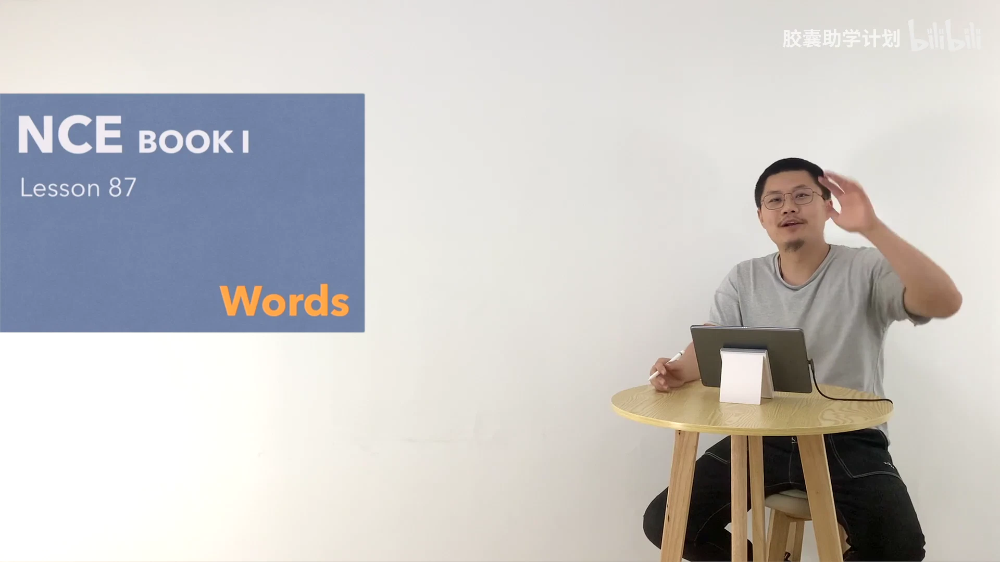

文字识别：胶囊助学计划 / NCE / BOOKI / Lesson 87 / Words

### 画面 00:00:08

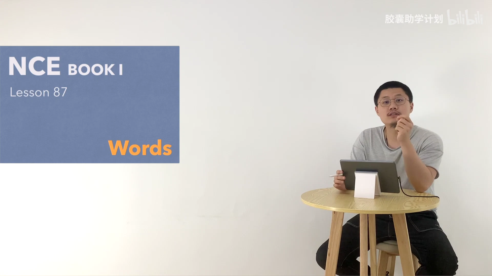

文字识别：胶囊助学计划 / NCE / BOOKI / Lesson 87 / Words

### 画面 00:00:10

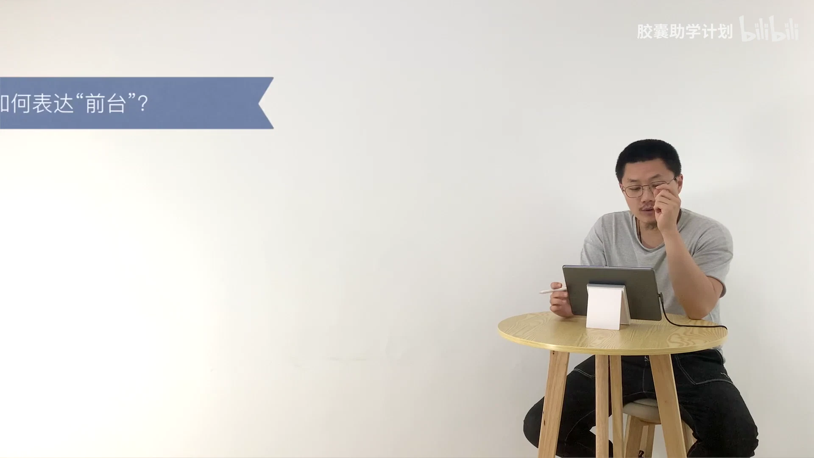

文字识别：胶囊助学计划 / 何表达“前台”？

### 画面 00:00:12

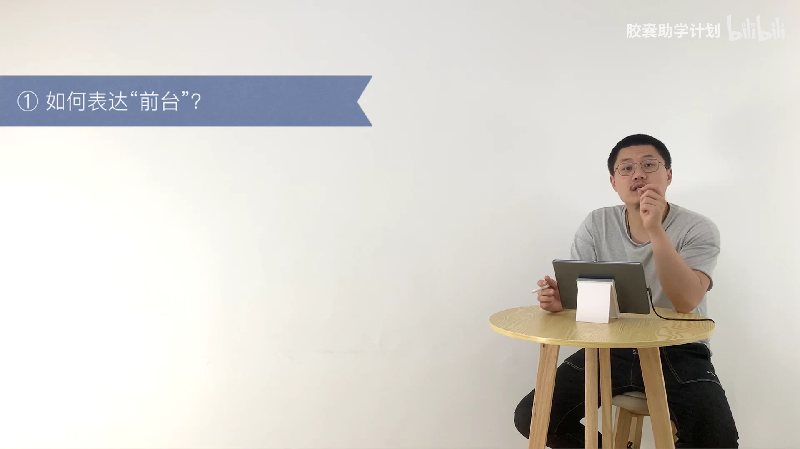

文字识别：胶囊助学计划 / ①如何表达“前台”？

### 画面 00:00:15

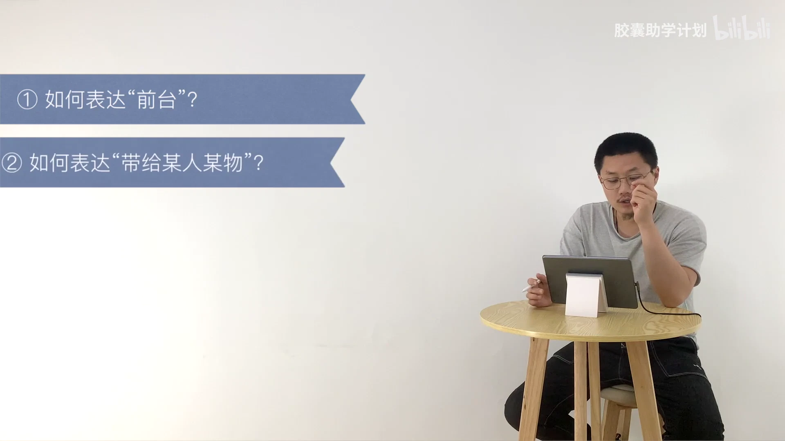

文字识别：胶囊助学计划 / ①如何表达“前台”? / 如何表达“带给某人某物”?

### 画面 00:00:18

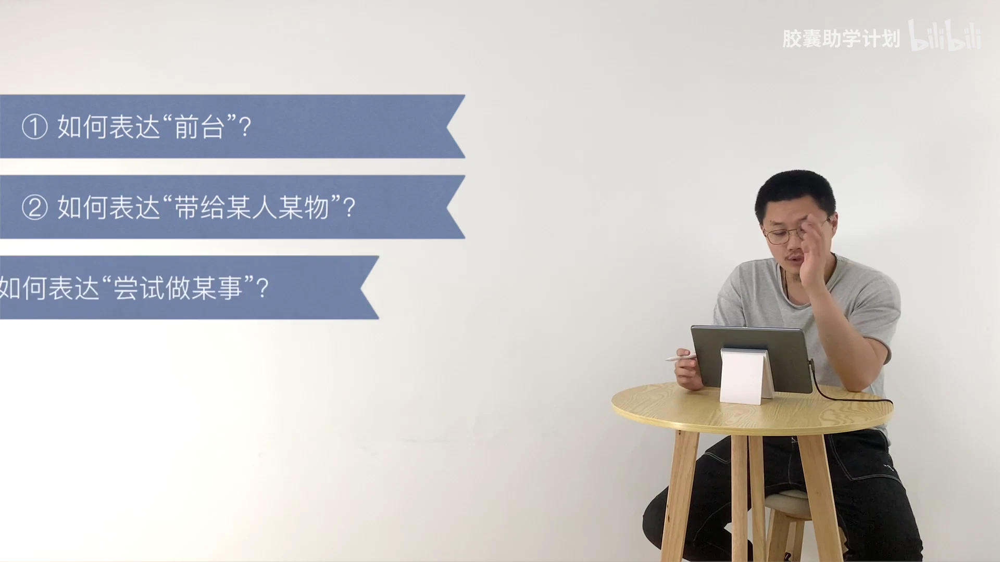

文字识别：胶囊助学计划 / ①如何表达“前台”? / 如何表达“带给某人某物”? / 如何表达“尝试做某事”

### 画面 00:00:22

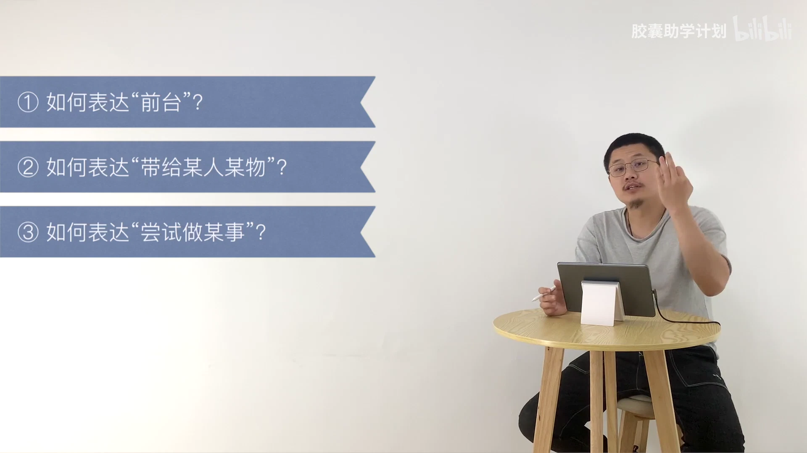

文字识别：胶囊助学计划 / ①如何表达“前台”? / 如何表达“带给某人某物”? / 如何表达“尝试做某事”?

### 画面 00:00:25

文字识别：胶囊助学计划b出l / •

### 画面 00:00:29

## 00:00:30–00:01:00

好，那我们先看文章当中给我们的第一个单词啊，我们先一起读一下，叫做呃，attendant，对吧？OK，连起来，attendant，attendant。那他在这个地方想说，attendant指的是前台的意思，对吧？但实际上我自己在国外的生活呢，让我意识到另一个单词出现的频率要比attendant其实要多很多，而且很多的时候，attendant它往往可能指的是flight attendant，我们之前学过，

### 画面 00:00:31

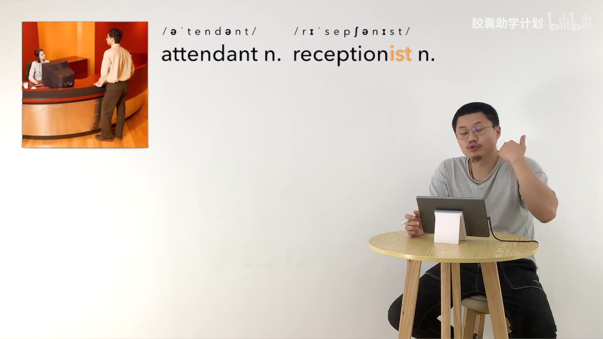

文字识别：胶囊助学计划 / /a'tendant/ / /ri'sep∫anist / / attendant n. receptionist n.

### 画面 00:00:40

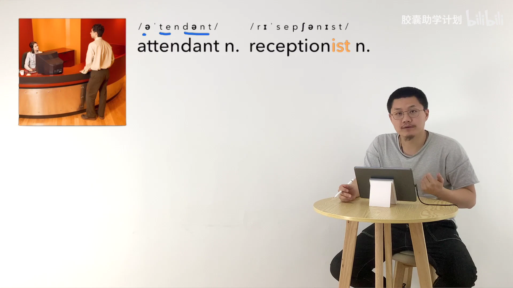

文字识别：胶囊助学计划 / /a'tendant/ / /ri'sep∫anist / / attendant n. receptionist n.

## 00:01:00–00:01:30

right? Air hostess, ah, flight attendant. That we look at the next word. Ah, we first read together called receptionist, receptionist, connect receptionist. Okay, that receptionist is the staff at the front desk. If you remove the ist这三个 letters, then it is read as reception, which means the receptionist position. The location we call reception. Okay, the staff at the front desk.

### 画面 00:01:06

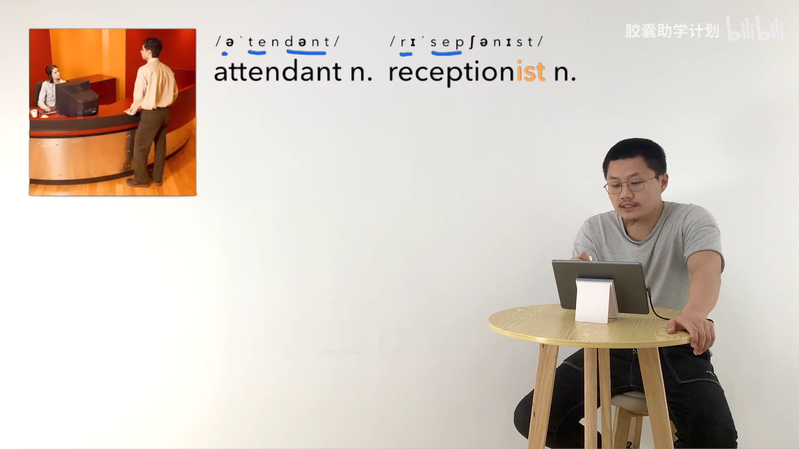

文字识别：胶囊助学计划 / /a'tendant/ / /ri'seplanist/ / attendant n. receptionist n.

### 画面 00:01:10

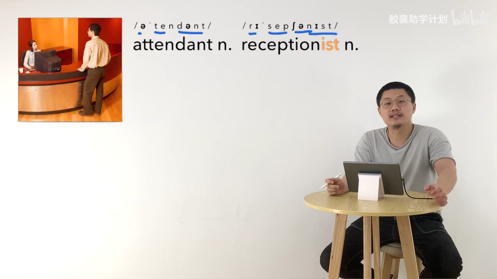

文字识别：胶囊助学计划 / /a'tendant/ / /ri'sep∫anist / / attendant n. receptionist n.

## 00:01:30–00:02:00

前台的这个工作人员，那就招待员，对吧？我们就管它叫做 receptionist.好，那我们在这儿补一个这个小的单词，更常用一些啊。好，那我们造一些句子，说 I can't find the receptionist. It's like you're in the reception or you're at the reception, but you can't find the receptionist.说你现在在前台，但是你找不到前台的这个工作人员或招待员，对吧？Okay,那我们还可以问说 Where is

### 画面 00:01:40

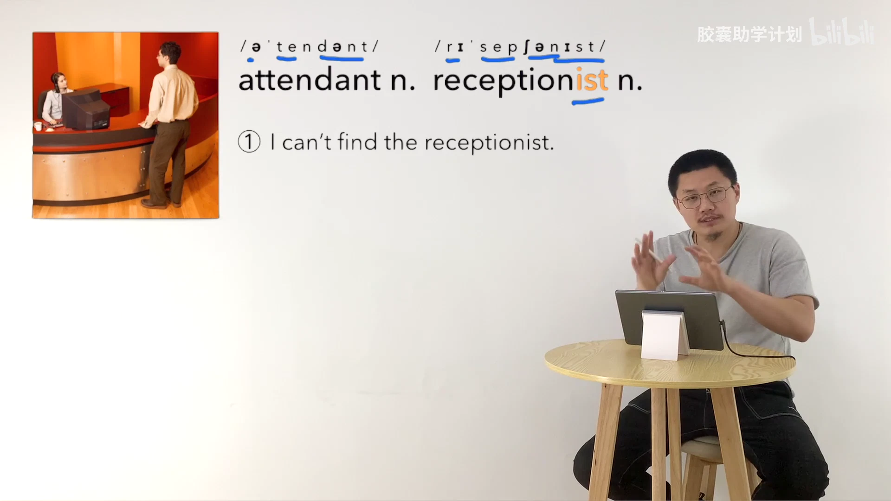

文字识别：胶囊助学计划 / la'tendant/ / /ri'sep∫anist / / attendant n. receptionist n. / ① I can't find the receptionist.

## 00:02:00–00:02:30

the reception? 那说这个前台在什么地方呢？我怎么没找到呢？它好像没在门口。 Okay, 所以叫 Where is the reception? 你看我们这都是很简单的句子，对吧？也是我们之前学过的。再然后，比如说 Do you know that receptionist? 一个非常简单的一般现在时，问你认识那个招待员吗？ Okay, 这儿一个。接下来下面这个单词，下面这个单词我们先一起读一下，叫做 Brain, Brain. Okay, 好。然后呢，它的过去

### 画面 00:02:10

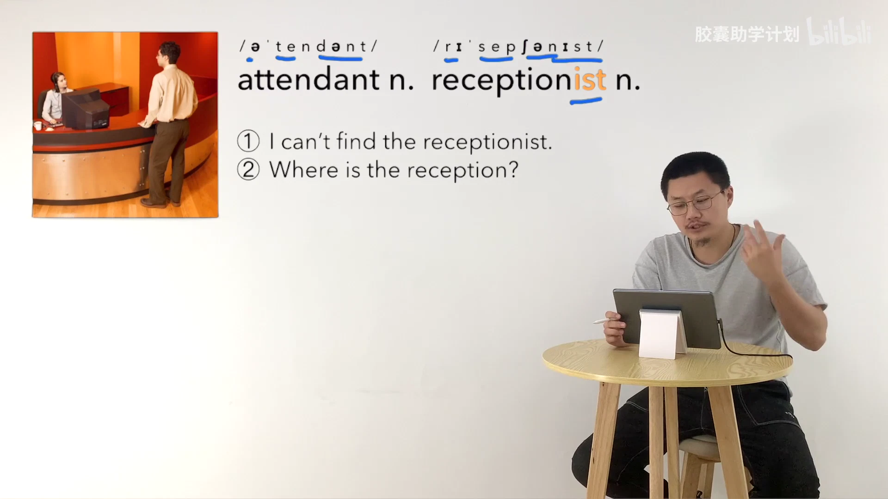

文字识别：胶囊助学计划 / /a'tendant/ / /ri'seplanist / / attendant n. receptionist n. / ① I can't find the receptionist. / Where is the reception?

### 画面 00:02:20

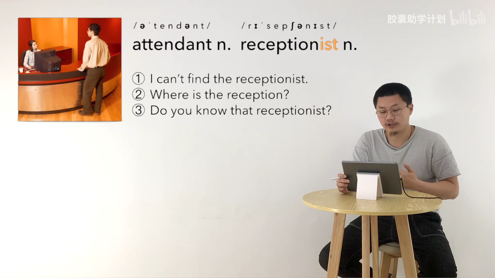

文字识别：胶囊助学计划 / /a'tendant/ / /ri'sｅp∫anist / / attendant n. receptionist n. / ① I can't find the receptionist. / Where is the reception? /  Do you know that receptionist?

### 画面 00:02:22

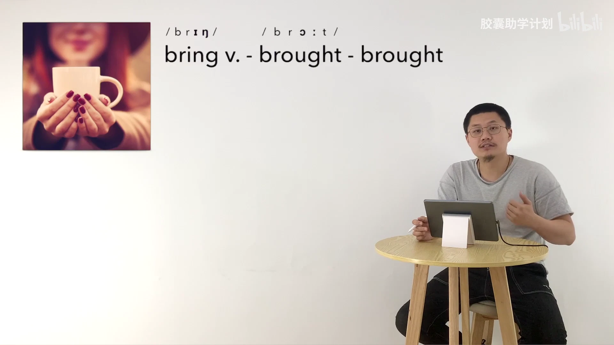

文字识别：胶囊助学计划 / /brin/ / / b r o it / / bring v. - brought - brought

### 画面 00:02:25

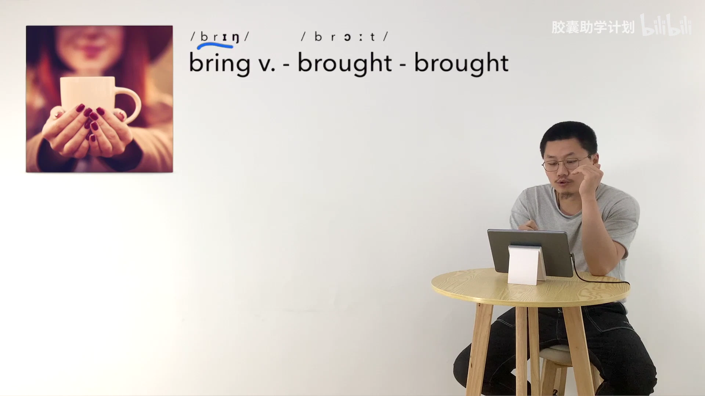

文字识别：胶囊助学计划 / /brin/ / / b r o it / / bring v.- brought - brought

## 00:02:30–00:03:00

式和过去分词都是不规则的，但是长得是一个样子的。我们一起读一下，叫做 brought，brought。OK，在这个地方注意一小下，bring 这个单词特别像 take。我们之前学过一个单词叫 take，叫拿过来，对吧？哦，特别像它的某种程度上的方向上的反义词。好，take，你可以说把它拿走。那 bring，往往指的是把它带来。比如说，我说一句话，说叫

### 画面 00:02:30

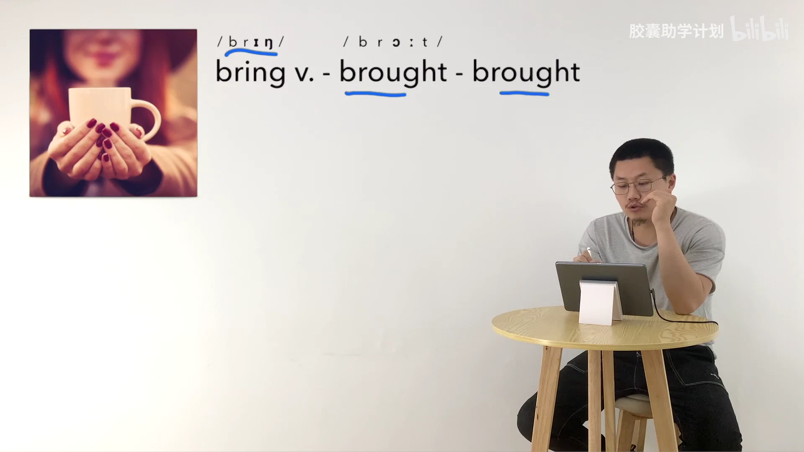

文字识别：胶囊助学计划 / /brin/ / / b r o it / / bring v. - brought - brought

### 画面 00:02:39

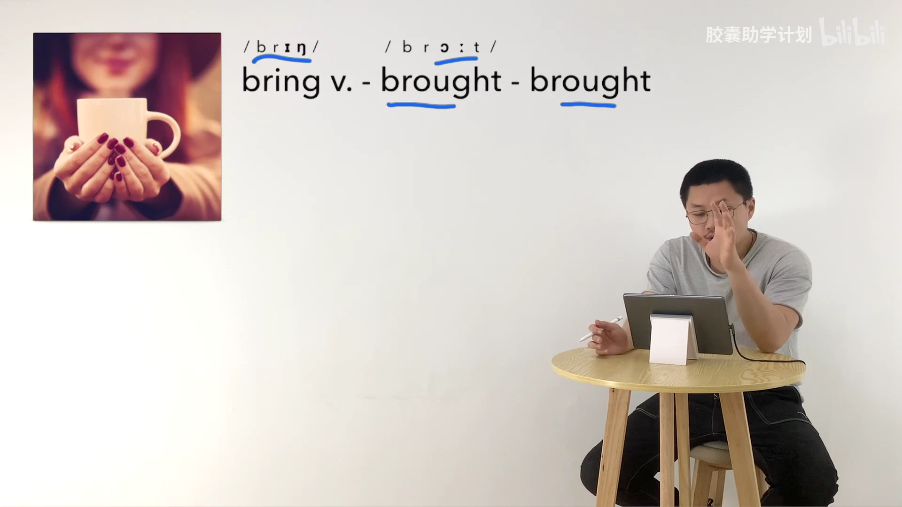

文字识别：胶囊助学计划 / /brin/ / / broit / / bring / v. - brought - brought

### 画面 00:02:43

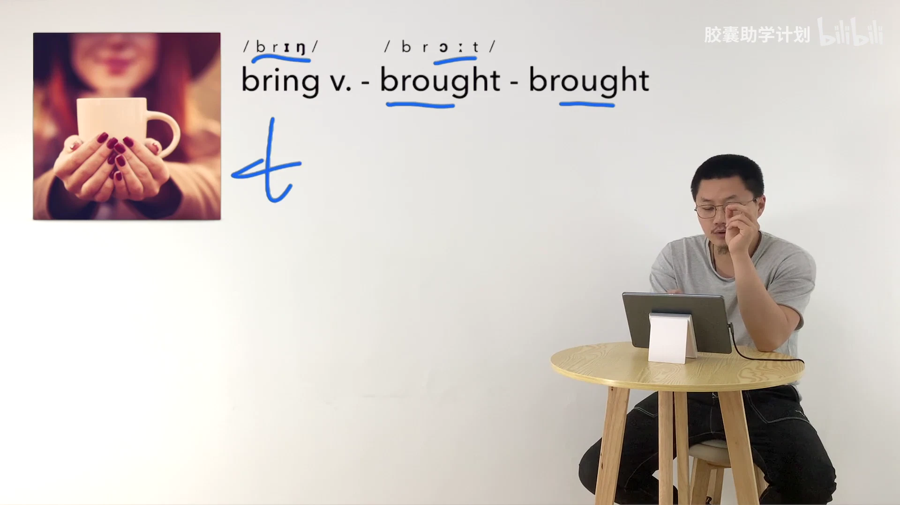

文字识别：胶囊助学计划 / /brin/ / / br oit / / bring / v. - brought - brought

### 画面 00:02:45

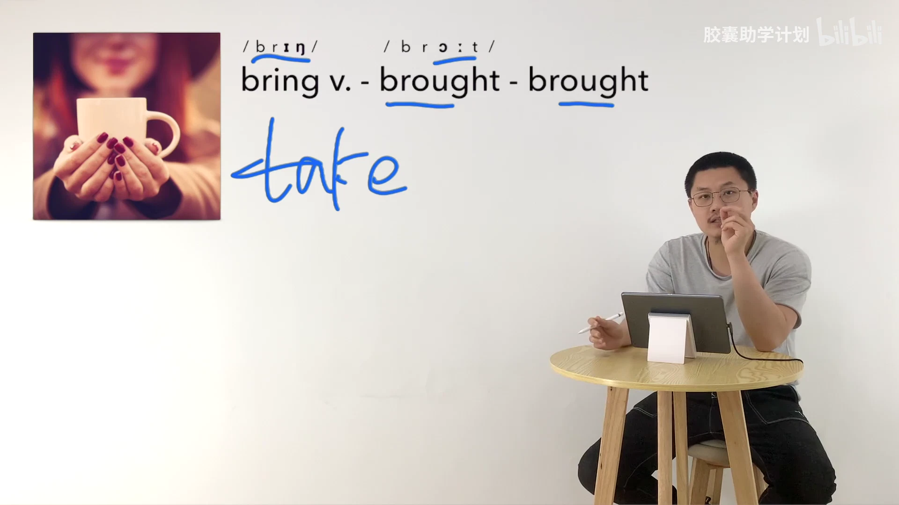

文字识别：胶囊助学计划 / /brin/ / / b / roit/ / bring / v. - brought - brought / fe

### 画面 00:02:48

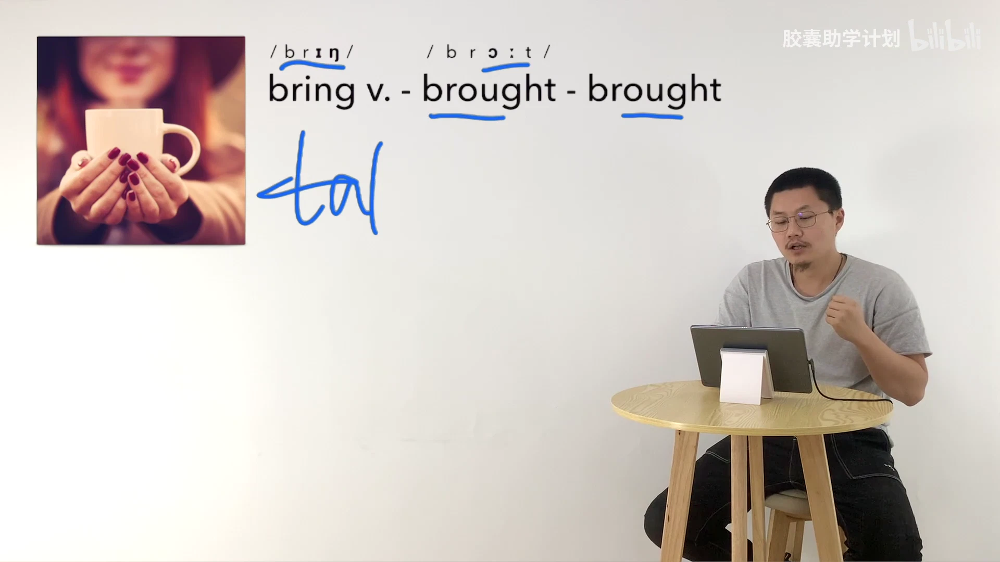

文字识别：胶囊助学计划 / /brin/ / / br o i t / / bring / v. - brought - brought

### 画面 00:02:50

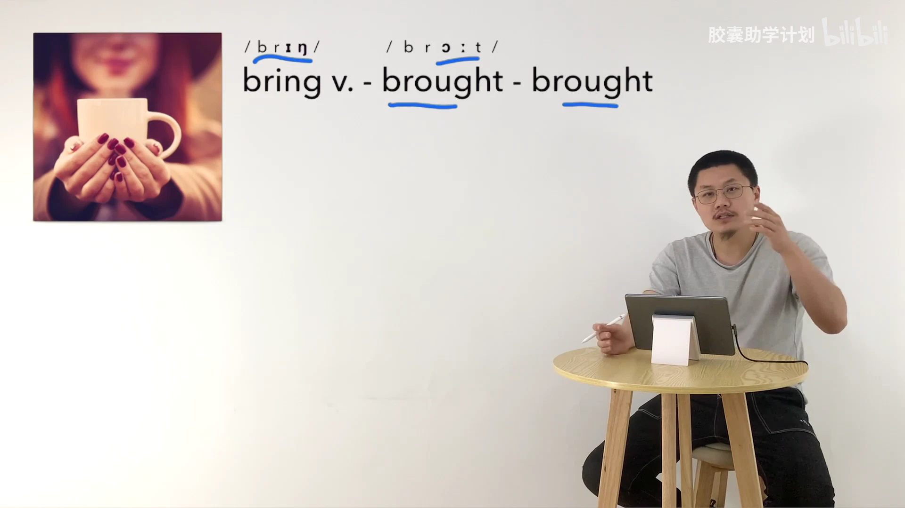

文字识别：胶囊助学计划 / /brin/ / / broit / / bring / g v. - brought - brought

## 00:03:00–00:03:30

bring me some coffee，给我拿点咖啡来，带给我一些咖啡，带给，对吧？各位能看到 bring me some coffee 这句话，你看我们实际上跟二十一课学过的叫 give somebody something 非常的像，对吧？ Give me some coffee，给我一些咖啡喝。 Bring me some coffee，比如说你的同事现在要去买咖啡，问你要不要？你说 Yeah， bring me some coffee please，啊，帮我带一些咖啡来吧。 OK，那它同理

### 画面 00:03:11

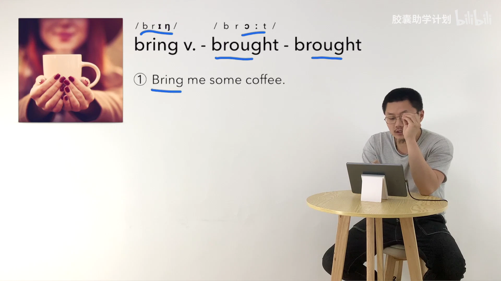

文字识别：胶囊助学计划 / /brin/ / / b r o it / / bring / v. - brought - brought / Bring me some coffe.

### 画面 00:03:13

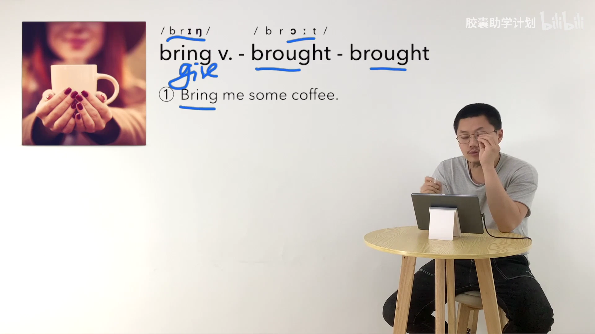

文字识别：胶囊助学计划 / /brin/ / /broit / / bring / v. - brought - brought / gie / ①Bring me some coffee.

### 画面 00:03:18

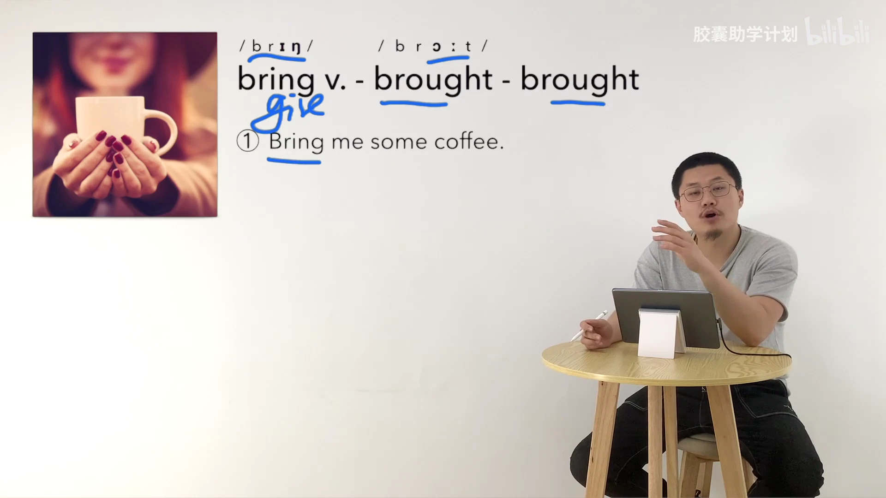

文字识别：胶囊助学计划 / /brin/ / / br oit / / bring / v. - brought - brought / gie / ①Bring me some coffee.

### 画面 00:03:23

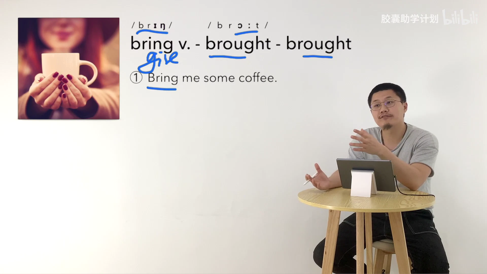

文字识别：胶囊助学计划 / /brin/ / /broit / / bring / gv. - brought - brought / gie / ① Bring me some coffee.

## 00:03:30–00:04:00

也可以变成叫 bring it to me，啊，把它带给我。那他问你 Do you want some coffee? Yeah， bring to me，啊，给我带点儿吧。OK， one more。那这两个句式都跟 give somebody something 或 give something to somebody 是一样的。你们把 give 换成 bring 就可以了。OK， continue。说 I brought my car here five days ago。我把我的车注意，它不是 bought，啊，还是多了个字母呢。仔细看一下，叫 I brought。OK，

### 画面 00:03:37

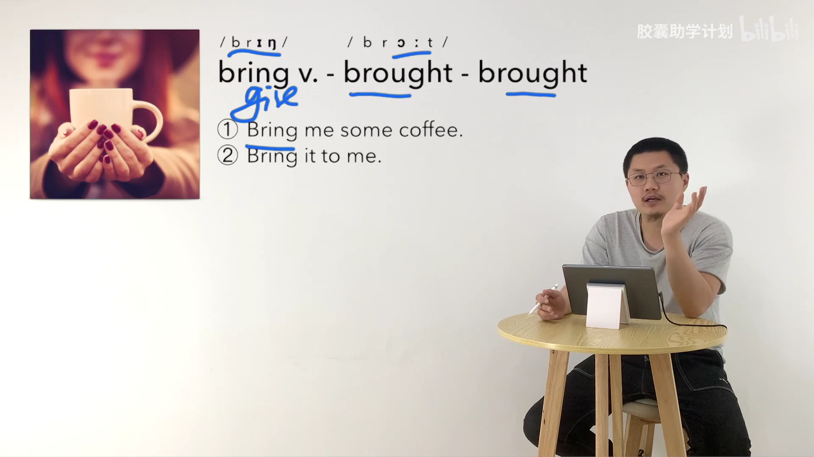

文字识别：胶囊助学计划 / /brin/ / / b r o : t / / bring / v. - brought - brought / gie / Bring / me some( / coffee. / Bring / it to / me.

### 画面 00:03:41

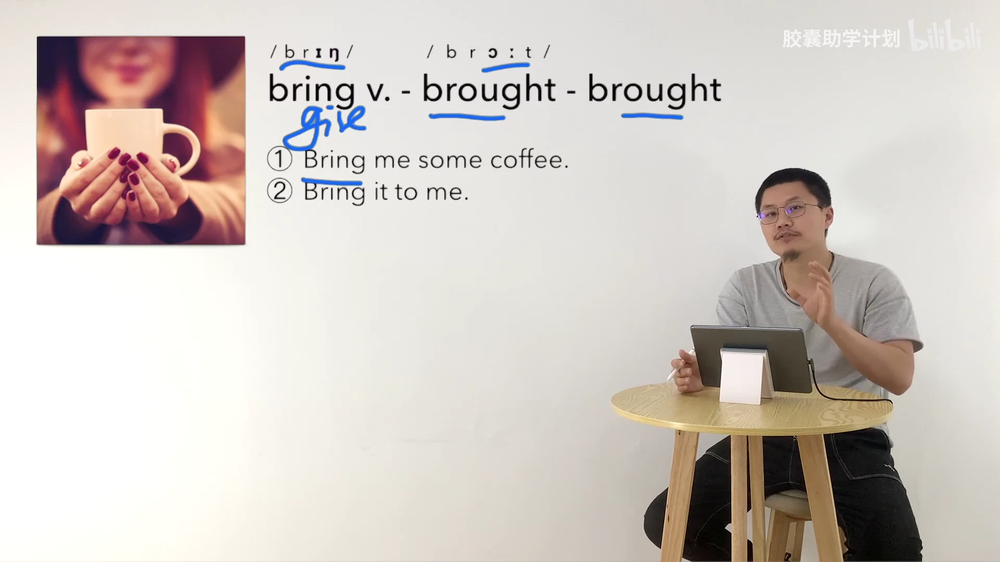

文字识别：胶囊助学计划 / /brin/ / / b r o : t / / bring / v. - brought - brought / gie / Bring / me some coffee. / Bring / it to / me.

### 画面 00:03:51

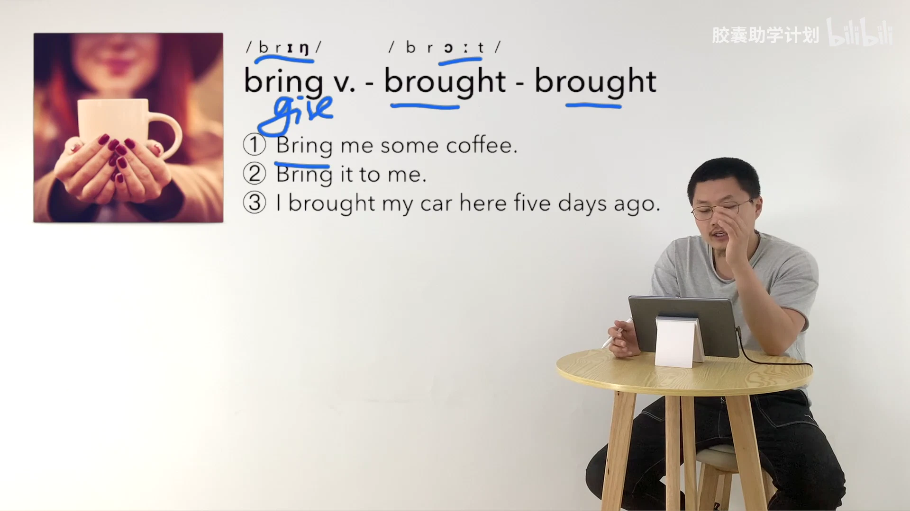

文字识别：胶囊助学计划 / /brin/ / / b r o i t / / bring / g v. - brought - brought / gie / Bring / me some coffee. / Bring / it to / me. / I brought my car here five days ago.

### 画面 00:03:56

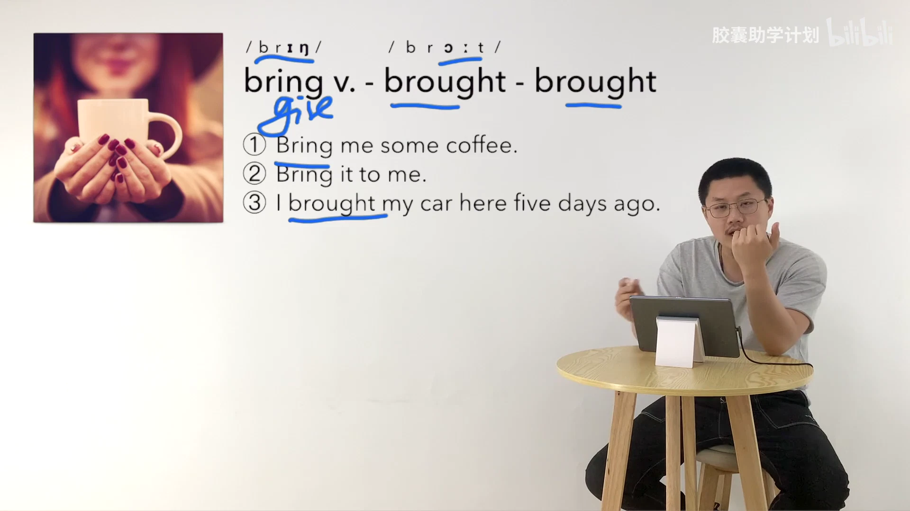

文字识别：胶囊助学计划 / /brin/ / / b r o : t / / bring / v. - brought - brought / gie / Bring / me some coffee. / Bring / it to / me. / I brought my  / ' car here / five / e days ago.

## 00:04:00–00:04:30

Okay, 我把我的车带到了这里啊，我人现在在这儿。我说我五天前把我的车放到了这里，对吧？带到了这里，叫 I brought my car here five days ago. Okay， 那变一般疑问句，did 提前，动词换原形，张嘴跟我读一下，叫做 Did you bring your car here five days ago？以及我现在如果想对 five days ago 提问，就变成了张嘴读 When did you bring your car here？ Okay， 好，那我们在这个地方简

### 画面 00:04:12

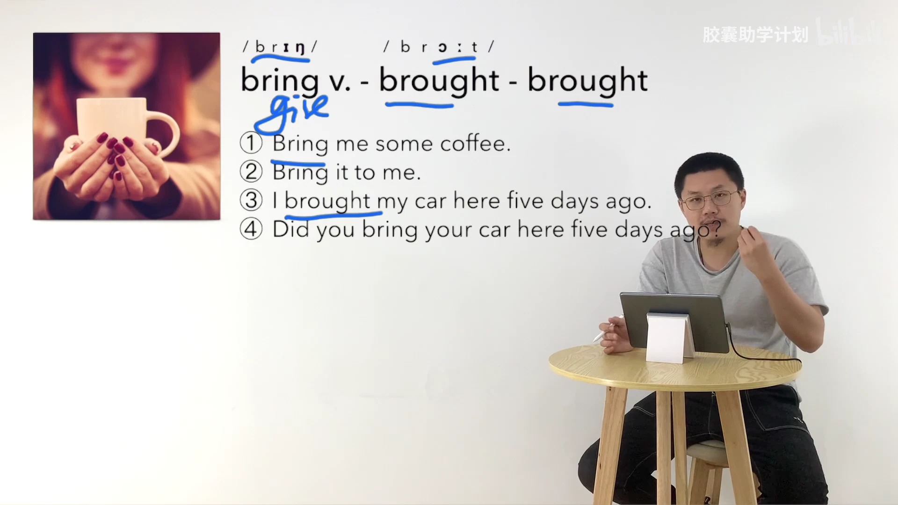

文字识别：胶囊助学计划 / /brin/ / / b r o : t / / bring / v. - brought - brought / gie / Bring / me some coffee. / Bring / it to / me. / I brought my / car I / here / five / days / ago. / Did you / bring / your car here / five / days / sago?

### 画面 00:04:28

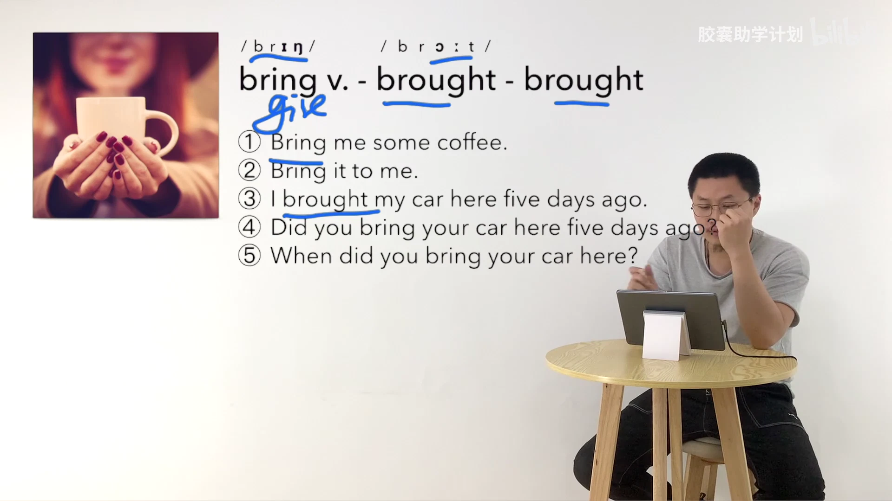

文字识别：胶囊助学计划 / /brin/ / / b r o i t / / bring v. - brought - brought / gie / Bring r / me some coffee. / Bring / it to me. / I brought my car here / five / days ago. / Did you / bring / your / car / here / five / days / ago? / 5 / When did / you / bring / your car here?

## 00:04:30–00:05:00

单的回顾一个非常小的知识点，就是我们单词非常重要的几个部分当中，对于大家来说最容易遗忘的就是单词造句的这个部分，对吧？造句实际上不仅仅帮您记住这个单词，也能帮您复习之前的各种语法。比如说在这儿我们就复习了一般过去时的肯定句、一般疑问句和特殊疑问句。OK， continue，下一个单词车库啊，或者说修理车的这个车厂都可以

### 画面 00:04:30

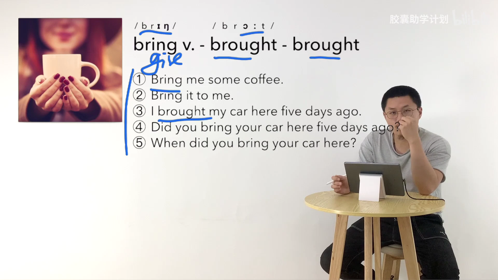

文字识别：胶囊助学计划 / /brin/ / / b r o i t / / bring v. - brought - brought / gie / ①Bring r / me some coffee. / 2 / Bring / it to me. / 3 / I brought my car here / five / days ago. / Did you / bring / your car H / here / five / days / ago? / ? / 5 / When did you / bring / your car here?

### 画面 00:04:54

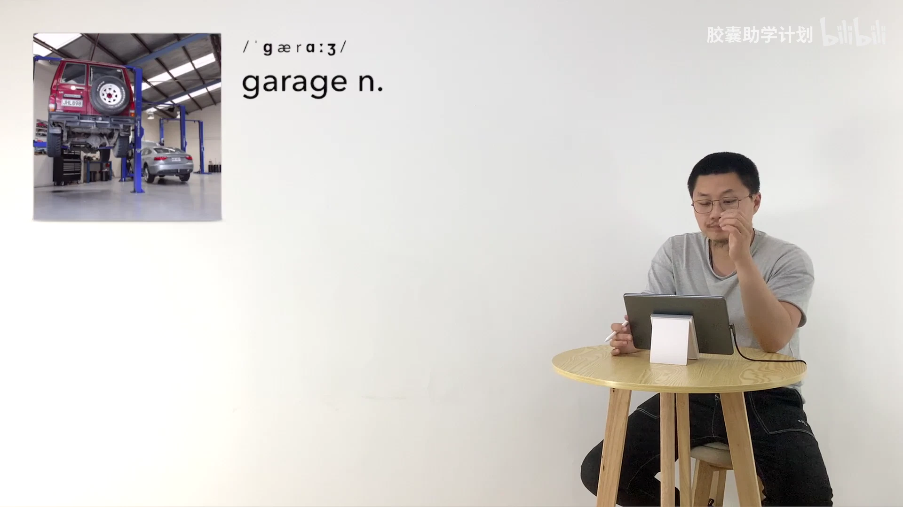

文字识别：胶囊助学计划 / /'gæra:3/ / garage n. / JHL898

## 00:05:00–00:05:30

教这个单词连起来读，叫做 garage garage。 OK，好，那它是一个名词，我们它往往啊，在我们没学被动的时候，对吧？我们往往可以把它当作一个地点啊，加上 in the，对吧？那叫做 in the garage，叫在车库里。比如说 There is a cat in the garage，非常简单，二十五课学的 there be 句型，我们造一句话，再来说 They are having dinner in the garage。 OK，你看我们造句

### 画面 00:05:12

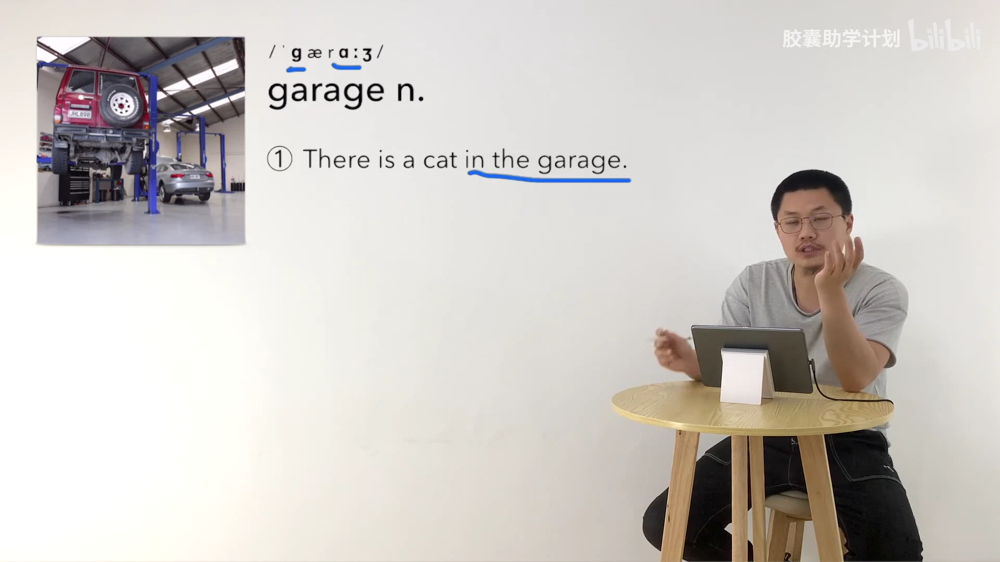

文字识别：胶囊助学计划 / /gæra:3/ / garage n. / JHL898 / ① There is a cat in the garage.

## 00:05:30–00:06:00

construction now. This sentence I just took out, but I want to tell you the thought process. I first want to make a sentence. I must first choose a tense or a mood verb. So I choose be doing, right? Then you need a verb. Have dinner is, everyone, you think back to the 81 lesson we just learned, right? It's called having dinner. In the garage, it's called in the garage, right? They just finished work there and had dinner. Okay, continue. He bought. Pay attention, this is not brought, but bought.

### 画面 00:05:30

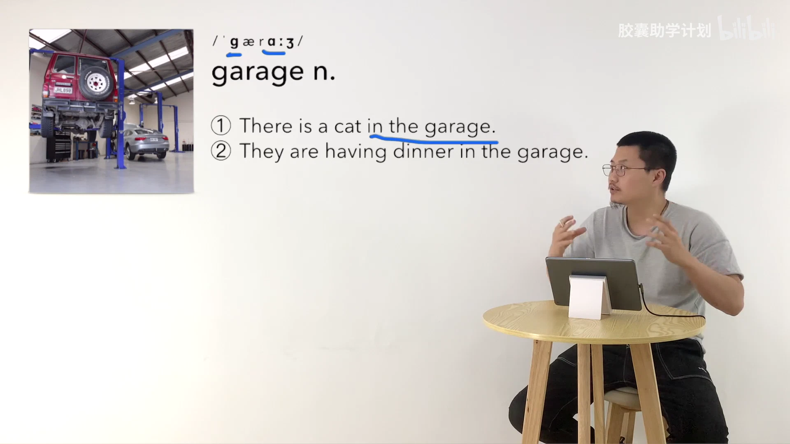

文字识别：胶囊助学计划 / / gæra:3/ / garage n. / JHL898 / There is a cat in the garage. / 1 / They are having / dinner in the garage.

### 画面 00:05:39

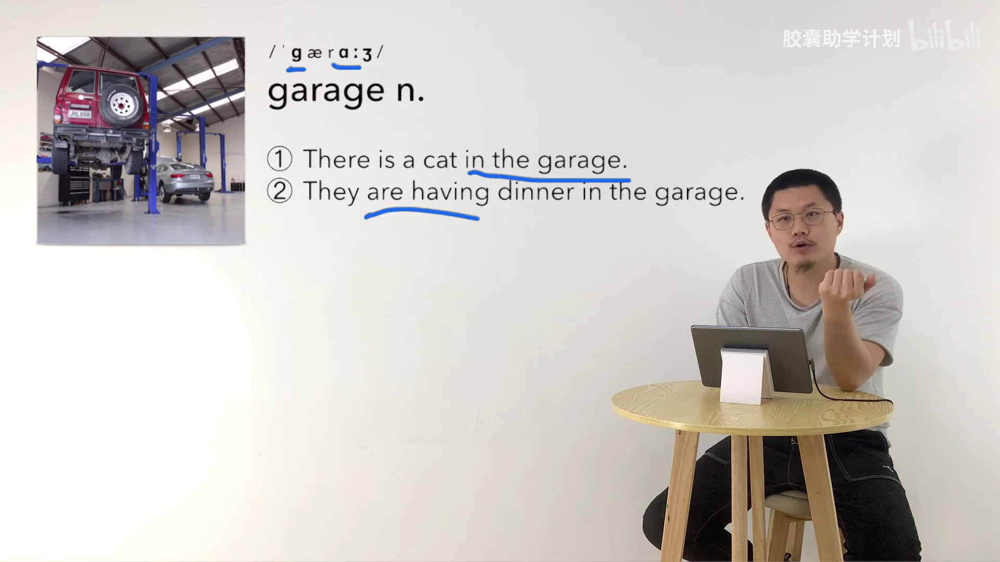

文字识别：胶囊助学计划 / / 'gæra:3/ / garage n. / JHL89E / There is a cat in the garage. / 1 / They are having / dinner in the garage.

### 画面 00:05:45

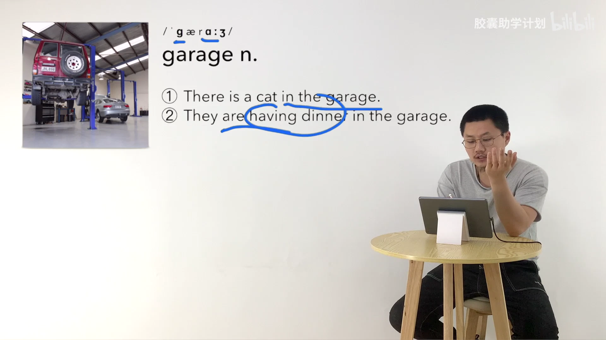

文字识别：胶囊助学计划 / /gæra:3/ / garage n. / JHL898 / There is a cat in the garage. / 1 / They / arehaving / dinne in the / garage.

### 画面 00:05:50

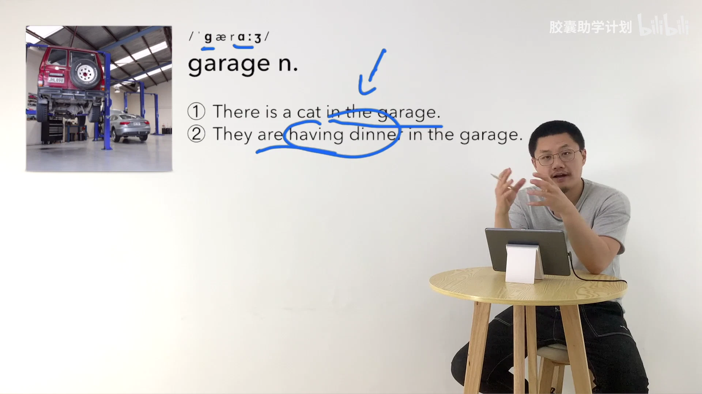

文字识别：胶囊助学计划 / / 'gæra:3/ / garage n. / JHL898 / There is a cat / in the garage. / 1 / They / arehaving / dinne in the / garage.

### 画面 00:05:59

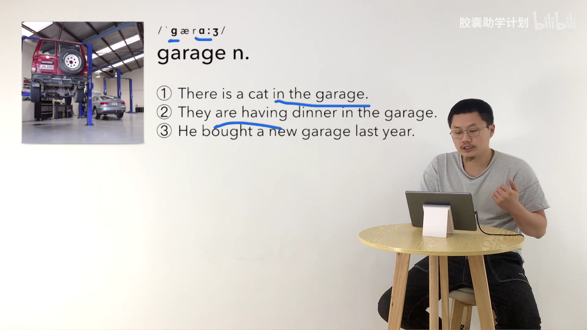

文字识别：胶囊助学计划 / /gæra:3/ / garage n. / JHL89e / 1 / There is a cat in / the / garage. / They / are / having / dinner in / the / garage. / He / bought a new / garage / last year.

## 00:06:00–00:06:30

这不是 brought 了，是 bought 这两个单词很像，就差个字母 r。我如果没记错的话，但是意思完全不同。bought 是 buy 的过去式。He bought a new garage last year. 好，去年他买了一个新的汽车修理厂啊，一个一个车库。OK。二一个，那我们可以把它变一般疑问句，叫做 Did he buy a new garage last year？前面再加一个 why，就是为什么，对吧？啊， because he can 啊，因为他能啊，有

### 画面 00:06:02

文字识别：胶囊助学计划 / / gæra:3/ / garage n. / JHL898 / There is a cat in the garage. / They are having / dinner in the / garage. / He / boughta new / garagel / : last year.

### 画面 00:06:22

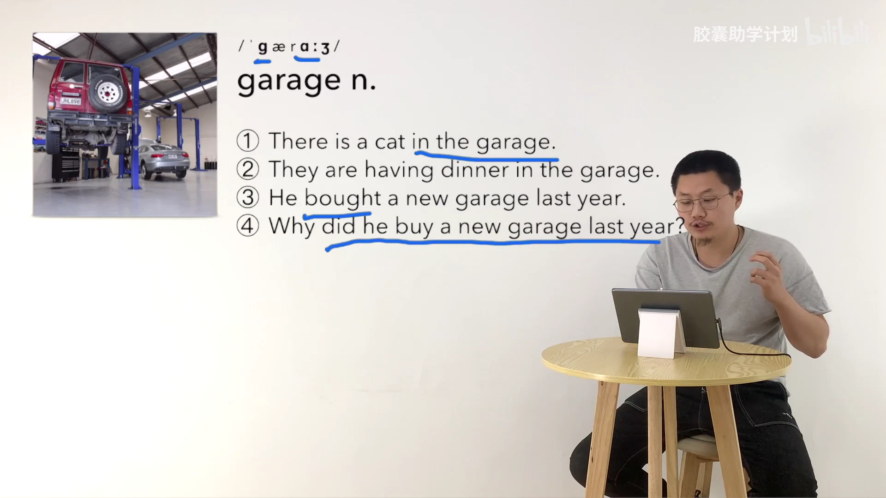

文字识别：胶囊助学计划 / /gæra:3/ / garage n. / JHL898 / There is a cat in the garage. / 1 / They are having / dinner in the / garage. / He / bought a / anew / garage / lasty / t year. / Why did he / buy a / anew / garage / last year?

### 画面 00:06:25

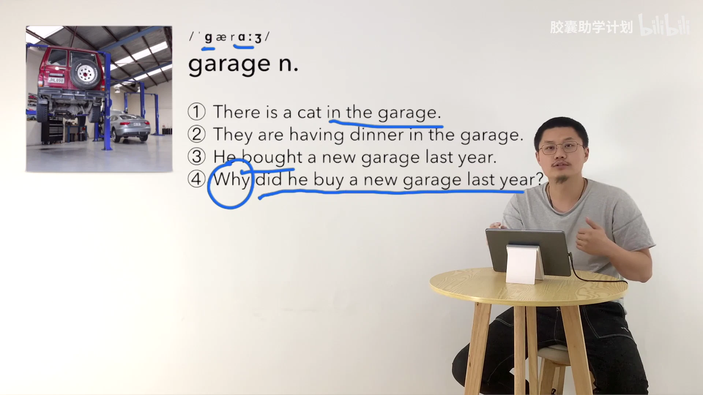

文字识别：胶囊助学计划 / /gæra:3/ / garage n. / JHL898 / There is a cat in the garage. / They are / having / dinner in / the / garage. / 3 / Hebought a / anew / garage / last / year. / Why / did he / buy / anew / garage / last year?

## 00:06:30–00:07:00

钱。Okay,下一个单词我们一起读一下，叫做crash, crash. Okay, crash这个单词就像图中展示的一样，就是撞，猛烈的撞击。Okay,那他如果想把你看，注意它的词性，它是名词，这是我们学英文的时候初期格，哎，甚至到后期要格外注意的一件事情啊。我们汉语当中，啊，它也有名词、动词的变化，但是永远是这个字儿，对吧？啊，我很喜欢睡觉。你看这里的睡觉是个

### 画面 00:06:30

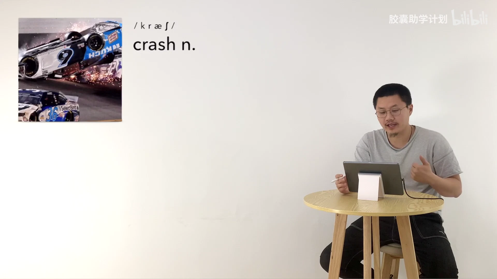

文字识别：胶囊助学计划 / / kr æ∫ 1 / crash n. / SelecBne

### 画面 00:06:38

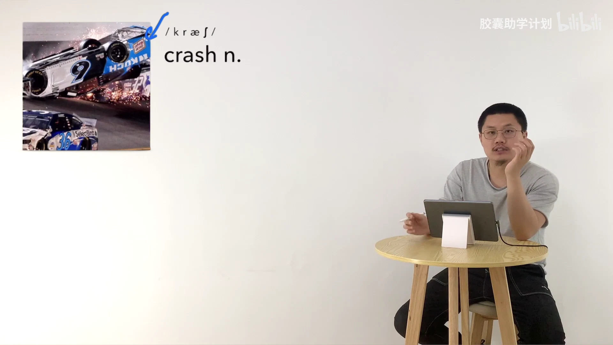

文字识别：胶囊助学计划 / / kræ∫1 / crash n. / SeletBnc

## 00:07:00–00:07:30

名词还是动词呢？对吧？我想睡觉了，这里边的是个名词还是动词呢？对吧？这两者是没区别的，虽然一个是名词，一个是动词。在英文当中呢，crash如果它是名词，就不能做时态的改变，但是我们要把它加一个小的短语叫have a crash，have a crash，哎，就变成动词了，就是撞车了，对吧？那如果有了have这个动词，各种时态就可以来了啊。当然你你表示我正在撞车，好像就有点怪了。但如果你

### 画面 00:07:08

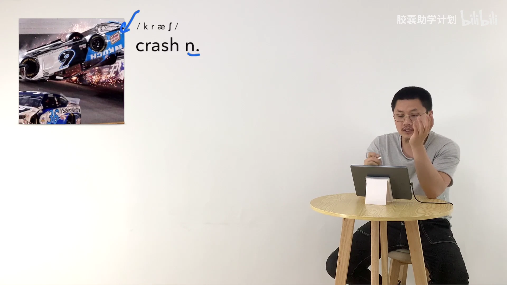

文字识别：胶囊助学计划 / / kræ∫1 / crash n. / ISeletine

### 画面 00:07:18

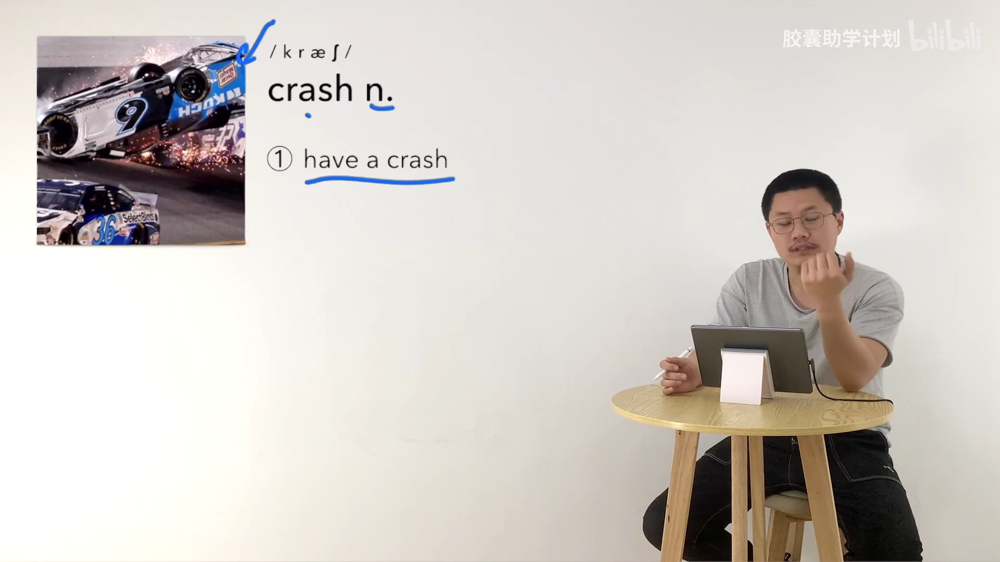

文字识别：胶囊助学计划 / / kræ∫/ / crash n. / ① have a crash / SeletBna

## 00:07:30–00:08:00

说一般过去时撞车了，这好像就很舒服了。比如说，我们造一句话叫 I had a car crash last night。好，我们多加了一个小的单词 car，是吧？昨晚撞车了。OK，那一般疑问句 Did you have a car crash last night？以及 Who had a car crash last night？这是注意一个小点啊，我们也好久没提了。在新一当中，对主语提问的时候，这是我们三十一课学的。如果您忘了，不妨翻看一下

### 画面 00:07:36

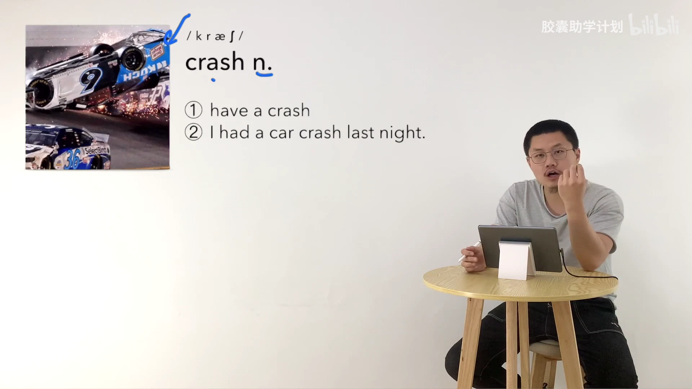

文字识别：胶囊助学计划 / / kræ∫ 1 / crash n. / ① have a crash / ② I had a car crash last night. / ISeletBna

### 画面 00:07:47

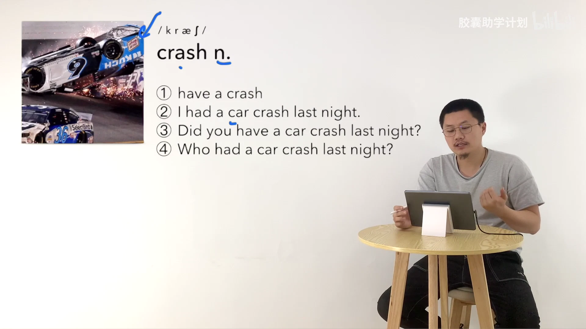

文字识别：胶囊助学计划 / / kræ∫/ / crash n. / • / ① have a crash / I had a car crash last night. / 2 / Did youhave a car crash last night? / SeletBna / Who had a car crash last night?

### 画面 00:07:53

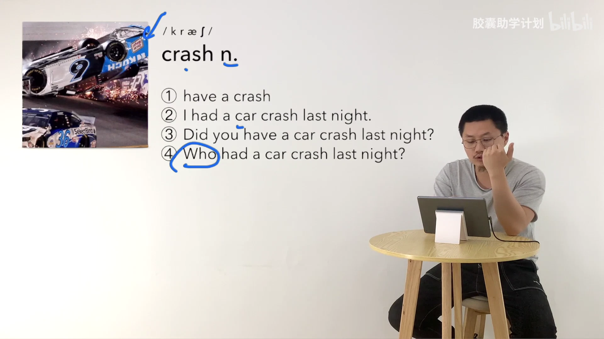

文字识别：胶囊助学计划 / / kræ∫ / / crash n. / ① have a crash / I had a car crash last night. / 2 / Did you have a car crash last night? / SelectBina / 3 / Whohad a car crash last night?

## 00:08:00–00:08:30

那一课的视频。如果对主语提问，直接就替代主语，不用变一般疑问句。所以你看后边的动词是 had 而不是 have，对吧？哪一个？接下来下一个单词，哎，我们先分开读，叫做 lamp。后面是 post，你看它有两个 p。如果您不做任何处理，对吧？那把它读出来叫做 lamp post。你有两个 p，实际上在这个地方呢，我们就可以理解

### 画面 00:08:01

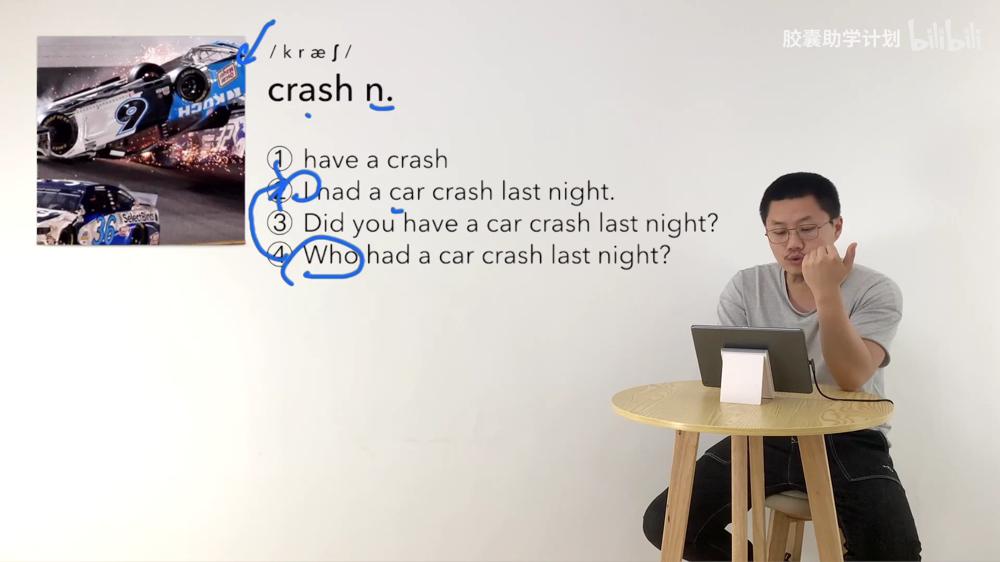

文字识别：胶囊助学计划 / / kræ∫1 / crash n. / D have a crash / Dhad a car crash last night. / Did you have a car crash last night? / ISeletBna / Whohad a car crash last night?

### 画面 00:08:09

文字识别：胶囊助学计划 / / kræ∫/ / crash n. / ① have a crash / ② I had a car crash last night. / SeletBna / 3 / Did you have a car crash last night? / Who had a car crash last night?

### 画面 00:08:11

文字识别：胶囊助学计划 / /'læemp paust/ / lamp-post n.

## 00:08:30–00:09:00

为它就不发音了啊，叫 lam post，连起来就可以了，lam post，very good。好，它是什么呢？就是这个东西，对吧？路灯啊，路灯的这个柱啊，OK，合起来我们可以管它叫做 lam post啊，或者是电线杆儿，也可以叫 lam post。OK，好，那它更多指的是这个，因为这个 lam 啊，自己本身是有这个灯的意思的，对吧？所以它往往指的是我图中给大家标的这种状态啊，lam post。

### 画面 00:08:31

文字识别：胶囊助学计划 / /'læemr / paust/ / lamp-post n.

### 画面 00:08:39

文字识别：胶囊助学计划 / /'laæemf / paust/ / lamp-post n.

### 画面 00:08:41

文字识别：胶囊助学计划 / /'laæemr / paust/ / lamp-post n.

## 00:09:00–00:09:30

说 I drove into a lamppost. 首首先第一个点， drove 它其实就是 drive 的一般过去式啊，就过去式，对吧？说，我开车开进这个电线杆里边了啊，撞进去了，是吧？一般疑问句， Did you drive? 再来一个特殊疑问句，叫 How did you drive into a lamppost? 就难以置信，说 Unbelievable! 啊， OK， 这一个。接下来结合了一个一般将来时， be gonna do， 叫做 We're

### 画面 00:09:00

文字识别：胶囊助学计划 / /'læemk / paust/ / lamp-post n. / ①I drove into a lamp-post.

### 画面 00:09:24

文字识别：胶囊助学计划 / /'læem / paust/ / lamp-post n. / ① I drove into a lamp-post. / How did you drive into a lamp-post? / We're gonna clean all the lamp-posts / on this street.

### 画面 00:09:28

文字识别：胶囊助学计划 / /'læms / paust/ / lamp-post n. / ① I drove into a lamp-post. / How did you drive into a lamp-post? / We're gonna clean all the lamp-posts / on this street.

## 00:09:30–00:10:00

gonna clean all the lamppost on this street. 我们打算把这条街上的所有 lamppost 都给打扫一下。玩一个 continue. 下一个单词我们放到两个单词放到一起去讲。这两个单词都很常用啊。后一个单词更常用。我们先看第一个，叫做 repair. repair 意思很简单，就如图所示啊，是这个修理的意思，对吧？修理东西。那 try 这个单词呢，表示的是尝

### 画面 00:09:39

文字识别：胶囊助学计划 / /ri'pea/ / /tral/ / repair v. try v.

### 画面 00:09:52

文字识别：胶囊助学计划 / /ri'pea/ / /tral/ / repair v. try v.

## 00:10:00–00:10:30

试啊，或者说努力做什么什么事情。比如说，我们先讲 try，叫 try to do something。注意这个地方的 do 指的是动词的原形，叫做尝试努力去做某件事情。好，我们连起来造一句话，叫做 I'm trying，我正在尝试着做一件事情，干嘛呢？Try to do something 啊，然后后面还加了一个叫做 talk to somebody 啊，叫做 I'm trying to talk to the receptionist.

### 画面 00:10:13

文字识别：胶囊助学计划 / /ri'pea/ / /tral/ / repair v. try v. / V. / ① try to do sth. / ② I am trying to talk to the receptionist.

### 画面 00:10:23

文字识别：胶囊助学计划 / /ri'peal / /tral/ / repair v. try v. / V. / ① try to do sth. / ② | am trying totalk to the receptionist.

### 画面 00:10:25

文字识别：胶囊助学计划 / /ri'pea/ / /tral/ / repair v. / tryV. / V. / ① try to do sth. / ②I am trying totalk to the receptionist)

## 00:10:30–00:11:00

Today,咱们这个视频学到的第一个单词叫做前台，对吧？前台的工作人员. Continue. Say, Are you trying to repair my computer? Say, You are trying to repair my computer. Say, Are you trying to repair my computer? Say, Are you trying to repair my computer? Say, Are you trying to repair my computer? Say, Are you trying to repair my computer? Say, Are you trying to repair my computer? Say, Are you trying to repair my computer? Say, Are you trying to repair my computer? Say, Are you trying to repair my computer? Say, Are you trying to repair my computer? Say, Are you trying to repair my computer? Say, Are you trying to repair my computer? Say, Are you trying to repair my computer? Say, Are you

### 画面 00:10:38

文字识别：胶囊助学计划 / /ri'pea/ / /trai/ / repair v. / tryv. / V. / ① try to do sth. / I am trying to talk to the receptionist. / 2 / Are you trying to repair my computer? / 3

### 画面 00:10:44

文字识别：胶囊助学计划 / /ri'peal / /trai/ / repair v. try v. / V. / ① try to do sth. /  I am trying to talk to the receptionist. / 2) / Are you trying to repair my computer? / 3

### 画面 00:10:47

文字识别：胶囊助学计划 / /ri'peal / /trar/ / repair v. try v. / V. / ① try to do sth. / ② I am trying to talk to the receptionist. / ③ Are you trying to repair my computer?

### 画面 00:10:54

文字识别：胶囊助学计划 / /ri'pea/ / /trar/ / repair v. try v. / V. / ① try to do sth. / ② I am trying to talk to the receptionist. / Are you trying to repair my computer? / 3 / He tries to repair it every week.

### 画面 00:10:57

文字识别：胶囊助学计划 / /ri'peal / /trar/ / repair v. try v. / V. / ① try to do sth. / 2 / ) I am trying to talk to the receptionist. / Are you trying to repair my computer? / 3 / He tries to repair it every week.

## 00:11:00–00:11:30

乎是每周都会尝试，对吧？OK，所以是一种生活习惯了，你可以理解为。玩一个好，Recap，本课除了自己的单词以外，我们多补了一个，其实是两个，对吧？一个叫 reception，一个叫 receptionist，前台和前台的工作人员啊，这两个单词各位记住，在国外啊，你去 check in check out 是吧？或者住 backpackers 啊，青旅或背包客中心的时候，这个单词出现的频率非常的高。

### 画面 00:11:06

文字识别：胶囊助学计划 / Recap / Patterns / 8 / Grammar / Words / receptionist / bring / sth.to sb. / Expression / have a crash / try to do sth

### 画面 00:11:15

文字识别：胶囊助学计划 / Recap / Patterns / & / Grammar / Words / receptionist / bring / sth. to sb. / Expression / have a crash / try to do sth

## 00:11:30–00:12:00

OK，那接下来呢，补了讲单词的时候，我们讲了这几个小的习惯用法，在今天单词造句的讲作业当中，各位就可以用上了，OK，那我们看一下讲作业，第一个单词造句老习惯，每个单词尽可能造满三个句子，continue，然后呢，给自己讲解一遍今天的核心知识点。如果大家喜欢我们的课程呢，那欢迎大家关注、订阅、一键三连，分享给那些需要的朋友。最

### 画面 00:11:34

文字识别：胶囊助学计划 / Recap / Patterns / Grammar / Words / receptionist / bring / sth. to sb. / Expression / havea / a crash / try to do sth

### 画面 00:11:39

文字识别：胶囊助学计划

### 画面 00:11:51

文字识别：胶囊助学计划

## 00:12:00–00:12:26

后，我们再来看一句名人名言。Don't make things too complicated. Try to relax. Enjoy every moment. Get used to everything. See you next time.

### 画面 00:12:02

文字识别：胶囊助学计划 / Don't make things too complicated. Try to / relax, enjoy every moment, get used to / everything. / -Angelique Kerber

### 画面 00:12:14

文字识别：Don't make things too complicated. Try to / relax, enjoy every moment, get used to / everything. / Angelique Kerber

### 画面 00:12:16

文字识别：CAPSULEACADEMY / 胶囊助学计划 / 『 / 小红书 / Lecturer / Leo / OE

### 画面 00:12:19

文字识别：CAPSULEACADEMY / 胶囊助学计划 / 『 / 小红书 / Edit~ / OE

### 画面 00:12:22

文字识别：CAPSULEACADEMY / 胶囊助学计划 / 小红书 / Creator / Leo & Berlin / OE

### 画面 00:12:24

文字识别：bilibili / 胶囊助学计划 / CAPSULEACADEMY / 胶囊助学计划 / 小红书 / OE

### 画面 00:12:26

文字识别：bilibili / 胶囊助学计划

