# 088 练习

快速机器解析：语音为单模型转写，未进行独立交叉校对或人工复核；画面每秒采样并按变化选帧，短时文字和标记可能遗漏。截图时间约有 1 秒误差。图片有损压缩；遇到疑点请按时间查看 Google Drive 原视频。

## 00:00:00–00:00:30

Hello everyone, welcome to Capsule Academy. This is Leo. Today we're going to learn the concept in English book one lesson eighty eight practices. Hope you can enjoy it.好，我们上来先看一个表格。这个表格各位不用着急抄，在各位的教材八十八课左下角是有这个表格的啊。我们也不要求今天各位全背下来，我只是简单说一下它的思路，就是关于

### 画面 00:00:00

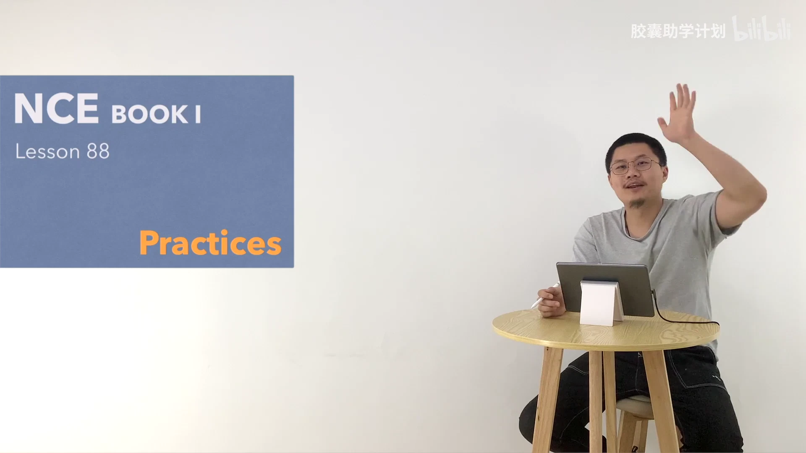

文字识别：胶囊助学计划 / NCE / BOOKI / Lesson 88 / Practices

### 画面 00:00:02

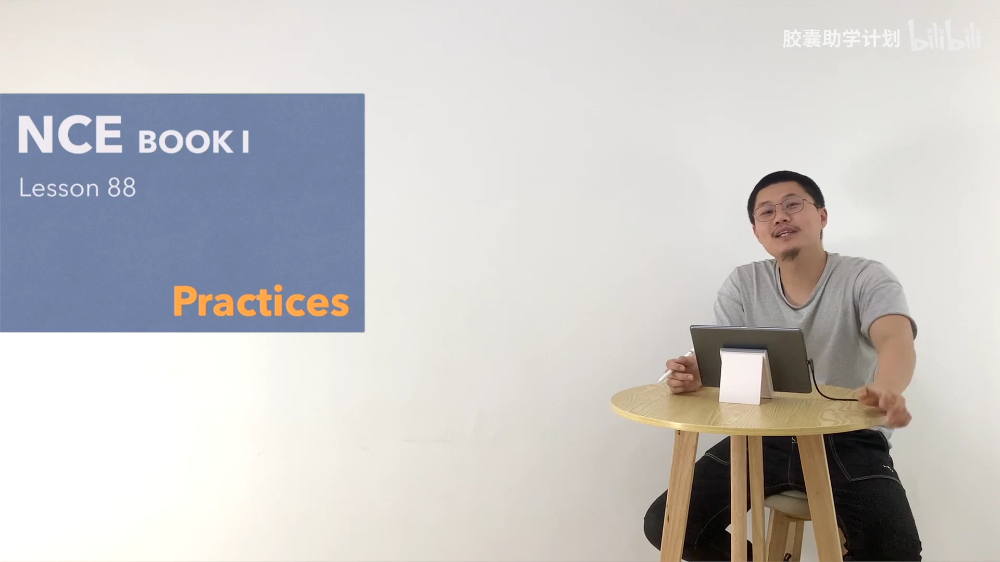

文字识别：胶囊助学计划 / NCE / BOOKI / Lesson 88 / Practices

### 画面 00:00:10

文字识别：胶囊助学计划 Lll / • / •

### 画面 00:00:14

文字识别：胶囊助学计划

### 画面 00:00:16

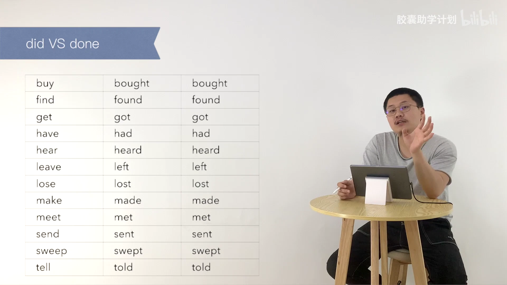

文字识别：胶囊助学计划 / did VS done / buy / bought / bought / find / found / found / get / got / got / have / had / had / hear / heard / heard / leave / left / left / lose / lost / lost / make / made / made / meet / met / met / send / sent / sent / sweep / swept / swept / tell / told / told

## 00:00:30–00:01:00

一般过去时和过去完成时这两种不同的动词变化规则。我们首先回顾一下这两者啊，did和done动词变化规则都有两种不同的变化。第一种叫规则的变化，就是各种加ed；，另外一种都是不规则的变化，对吧？然后我们下看一下这个表，buy买，bought bought，前面是过去式，后边是过去分词。您能

### 画面 00:00:30

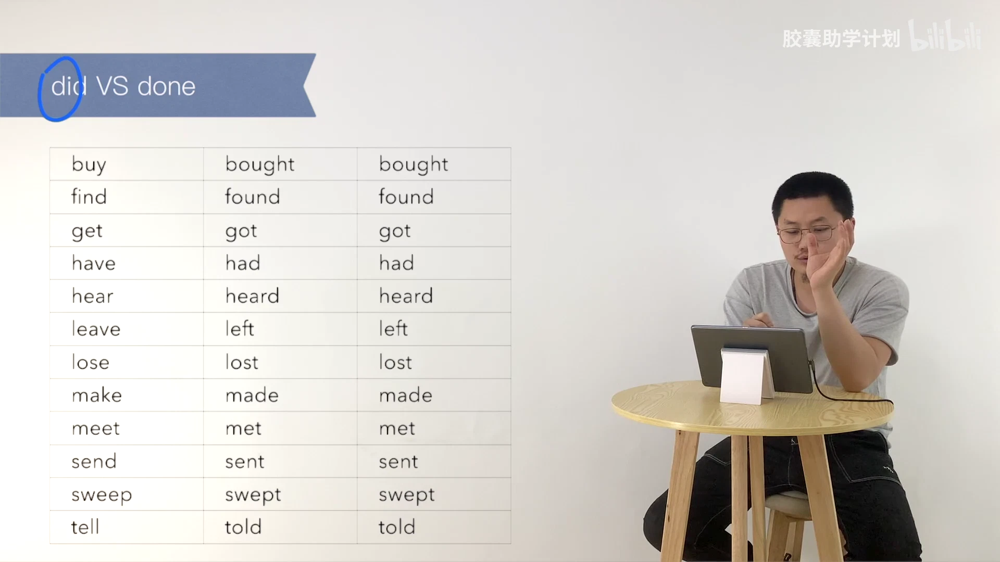

文字识别：胶囊助学计划 / did VS done / buy / bought / bought / find / found / found / get / got / got / have / had / had / hear / heard / heard / leave / left / left / lose / lost / lost / make / made / made / meet / met / met / send / sent / sent / sweep / swept / swept / tell / told / told

### 画面 00:00:32

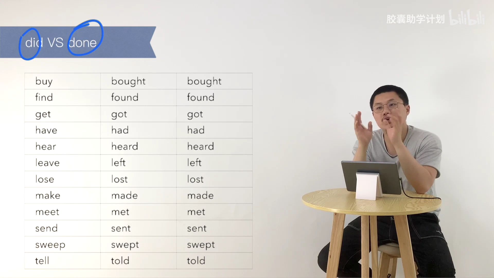

文字识别：胶囊助学计划 / didVS / done / buy / bought / bought / find / found / found / get / got / got / have / had / had / hear / heard / heard / leave / left / left / lose / lost / lost / make / made / made / meet / met / met / send / sent / sent / sweep / swept / swept / tell / told / told

### 画面 00:00:56

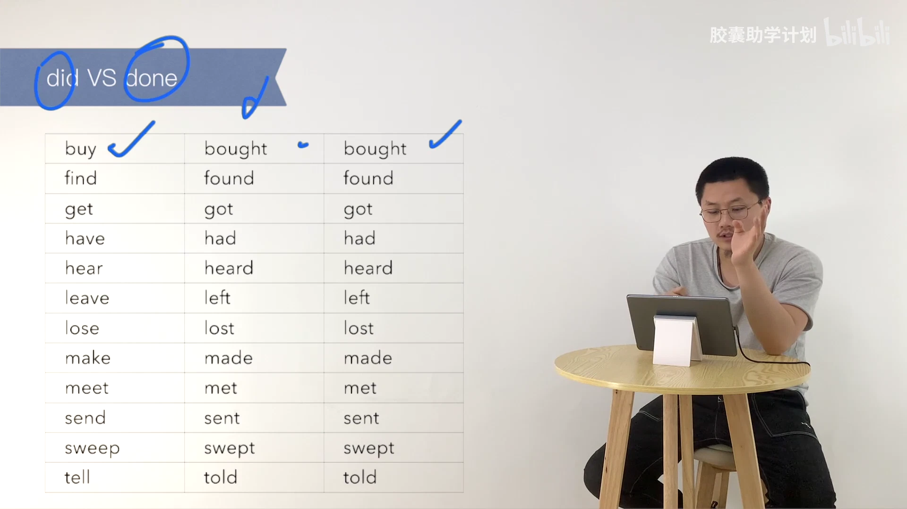

文字识别：胶囊助学计划 / didVS / done / buy / bought / bought / find / found / found / get / got / got / have / had / had / hear / heard / heard / leave / left / left / lose / lost / lost / make / made / made / meet / met / met / send / sent / sent / sweep / swept / swept / tell / told / told

### 画面 00:00:58

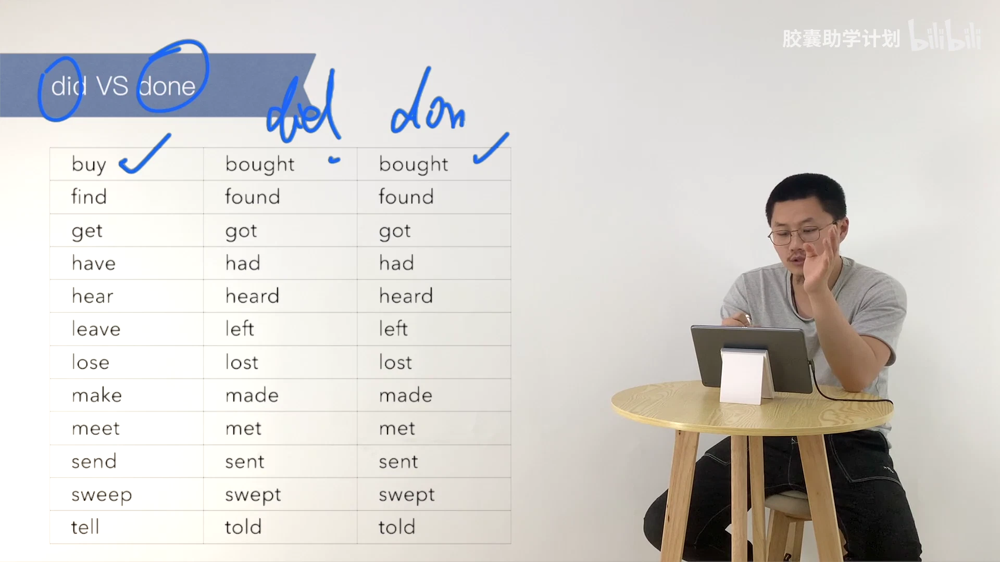

文字识别：胶囊助学计划 / didIVS / done / don / buy / bought / bought / find / found / found / get / got / got / have / had / had / hear / heard / heard / leave / left / left / lose / lost / lost / make / made / made / meet / met / met / send / sent / sent / sweep / swept / swept / tell / told / told

## 00:01:00–00:01:30

看到二者长得一模一样。这对于各位来说记一个就够了。然后呢，这一页其实都是过去式跟过去分词长得是一样的。您看一下这一列过去式和后边这一列的过去分词长得都是一模一样的。所以对于各位来说最重要的事情是把后边这两列和第一列的单词能对起来。比如说您看到 heard，您能反应过来它

### 画面 00:01:13

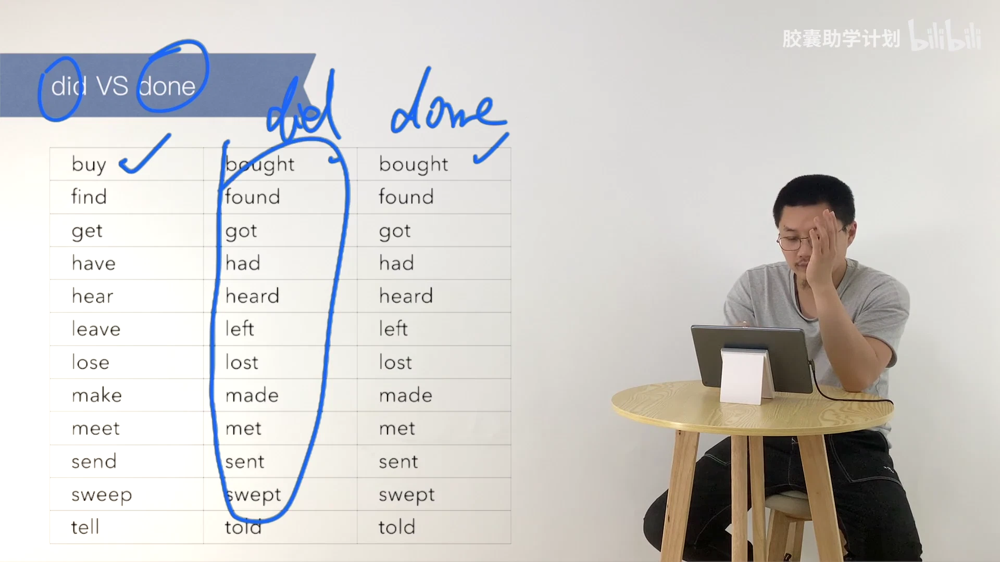

文字识别：胶囊助学计划 / digVS / done / done / buy / bought / bought / find / found / found / get / got / got / have / had / had / hear / heard / heard / leave / left / left / lose / lost / lost / make / made / made / meet / met / met / send / sent / sent / sweep / swept / swept / tell / told / told

### 画面 00:01:15

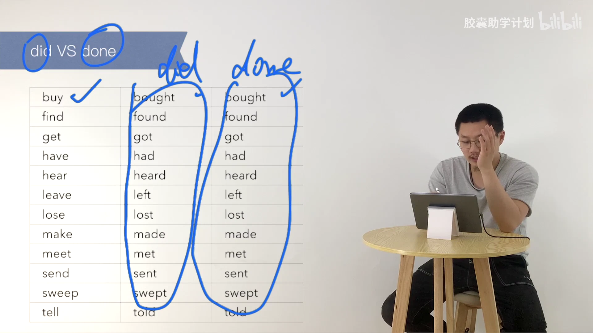

文字识别：Bibi / 胶囊助学计划 / did VS / done / done / buy / ppught / bought / find / found / found / get / got / got / have / had / had / hear / heard / heard / leave / left / left / lose / lost / lost / make / made / made / meet / met / met / send / sent / sent / sweep / swept / swept / tell / told

### 画面 00:01:17

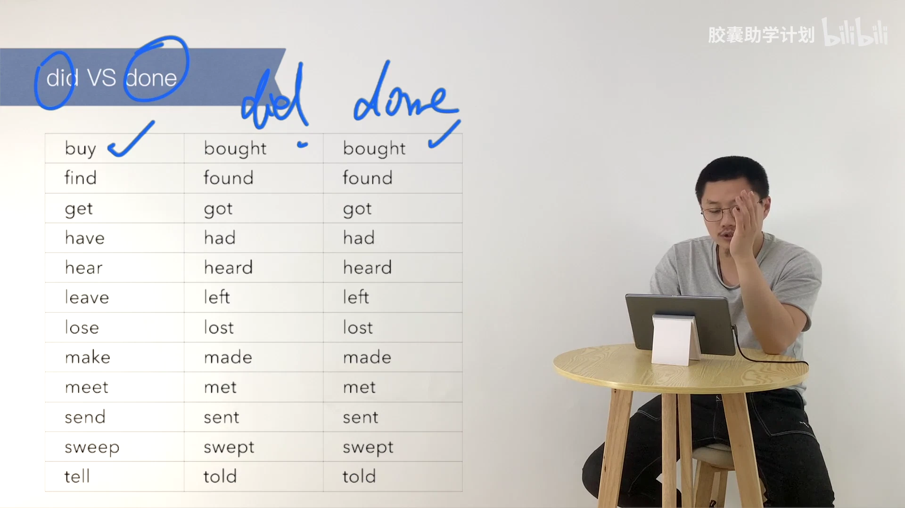

文字识别：bitbil / 胶囊助学计划 / didIVS / done / done / buy / bought / bought / find / found / found / get / got / got / have / had / had / hear / heard / heard / leave / left / left / lose / lost / lost / make / made / made / meet / met / met / send / sent / sent / sweep / swept / swept / tell / told / told

### 画面 00:01:22

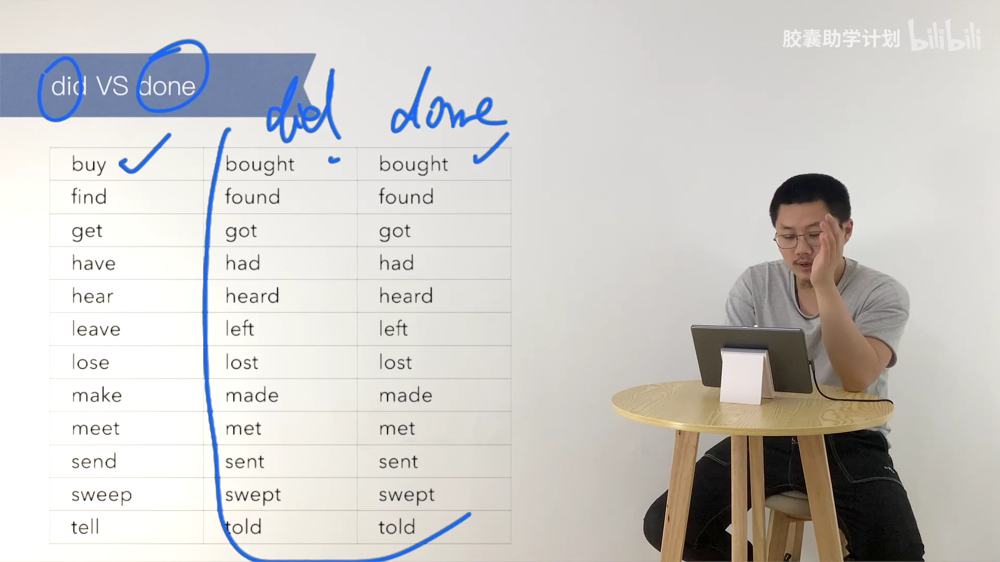

文字识别：Bilbl / 胶囊助学计划 / didVS / done / done / buy / bought / bought / find / found / found / get / got / got / have / had / had / hear / heard / heard / leave / left / left / lose / lost / lost / make / made / made / meet / met / met / send / sent / sent / sweep / swept / swept / tell / told / told

### 画面 00:01:24

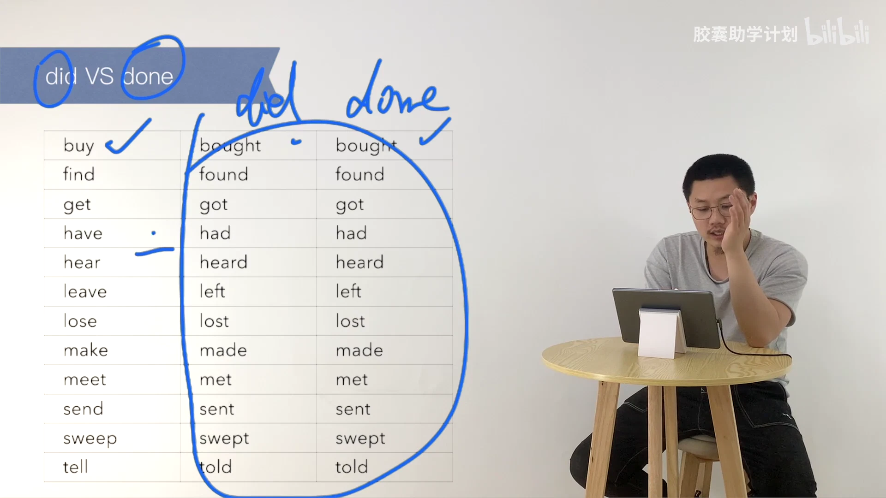

文字识别：Biltbli / 胶囊助学计划 / did VS / done / done / buy / bought / bougn / find / found / found / get / got / got / have / had / had / hear / heard / heard / leave / left / left / lose / lost / lost / make / made / made / meet / met / met / send / sent / sent / sweep / swept / swept / tell / told / told

## 00:01:30–00:02:00

的原型是 hear，也就是听的意思就可以了。这个呢，我给各位几个小的建议，您可以尝试去试一试啊。对于您来说好不好使？第一个小的建议呢，就是您把它首先哎放写到一张纸上，或者说写到你的笔记本里。每天呢，早中晚各一例，对吧？各一遍，看一遍就行，不要求这一遍记下来。您相信我，大概有个一周到两周的时间，您每天看

### 画面 00:01:30

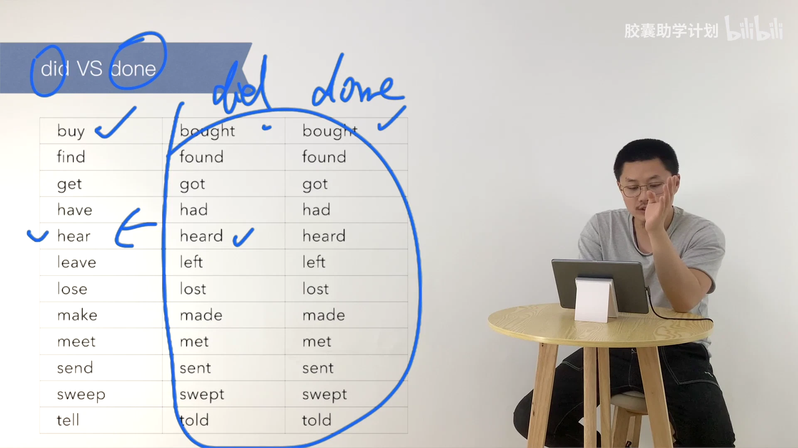

文字识别：Biibli / 胶囊助学计划 / did VS / done / done / buy / bought / bougnt / find / found / found / get / got / got / have / had / had / hear / heard / heard / leave / left / left / lose / lost / lost / make / made / made / meet / met / met / send / sent / sent / sweep / swept / swept / tell / told / told

### 画面 00:01:36

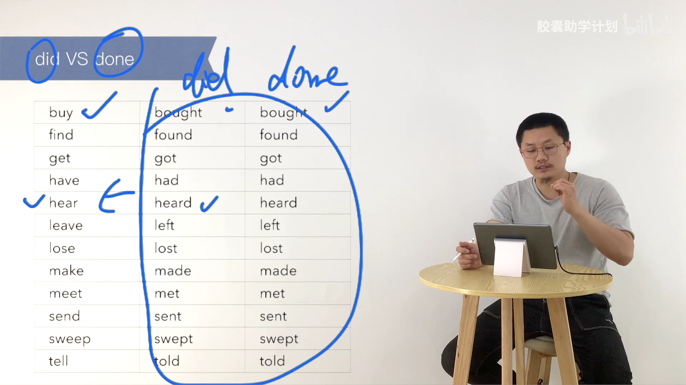

文字识别：胶囊助学计划 / did VS / done / dome / buy / bought / bougnt / find / found / found / get / got / got / have / had / had / hear / heard / heard / leave / left / left / lose / lost / lost / make / made / made / meet / met / met / send / sent / sent / sweep / swept / swept / tell / told / told

## 00:02:00–00:02:30

一遍，甚至都不用多看啊，朗读一遍，慢慢慢慢你就记下来了。OK，我就给这样一个小的建议。其次呢，另外一种更偷懒的方式就是，我们往后学，你只要坚持学，它会不停的出现，它不停的出现，您自然而然就把它记住了，对吧？这次不会查一下，下次不会再查一下，最终你一定会把它记下来。本课呢，各位要做的事情就是张开嘴跟我大声朗读就可以了，跟读来了。Did you buy a new car

### 画面 00:02:06

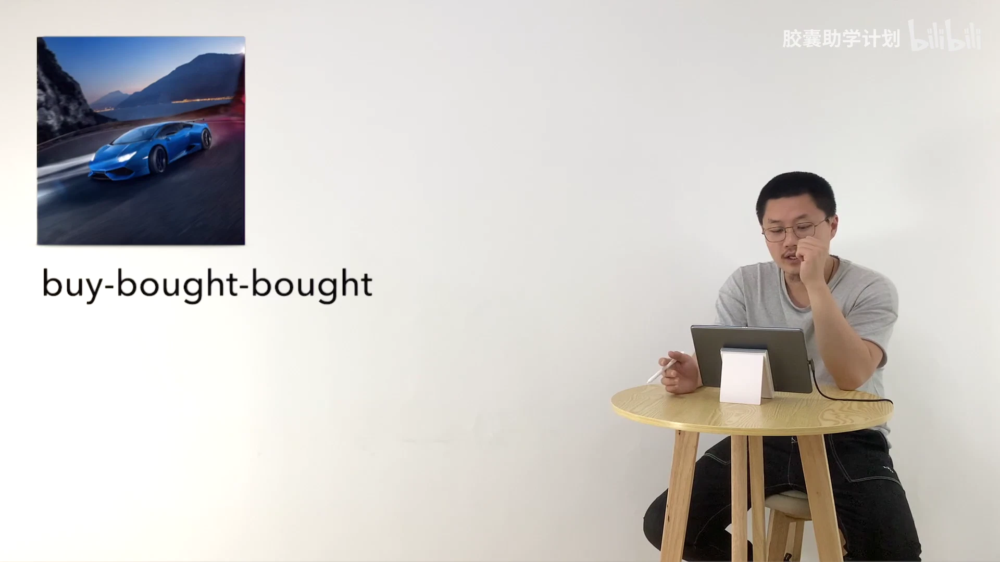

文字识别：胶囊助学计划 / buy-bought-bought

## 00:02:30–00:03:00

last year? Yes, I bought a new car last year. What about Sam? Sam呢？他买了吗？He hasn't bought a new car yet.他还没有买新车。注意前两句，你看一下是一般过去时，最后一句是现在完成时。于是他也用到了动词的不同形式，对吧？一般过去时的一般疑问句当中用原形，肯定句当中用过

### 画面 00:02:31

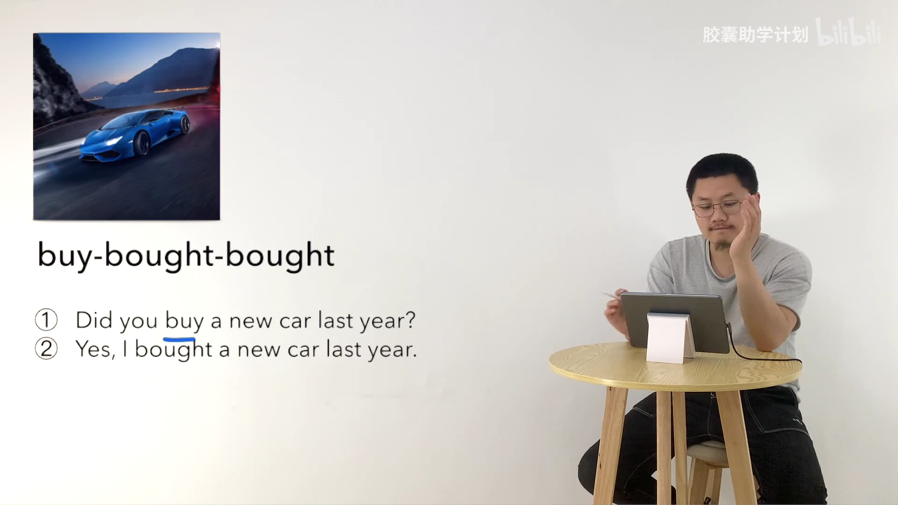

文字识别：胶囊助学计划 / buy-bought-bought / Did you buy a new car last year? / Yes, I bought a new car last year.

### 画面 00:02:41

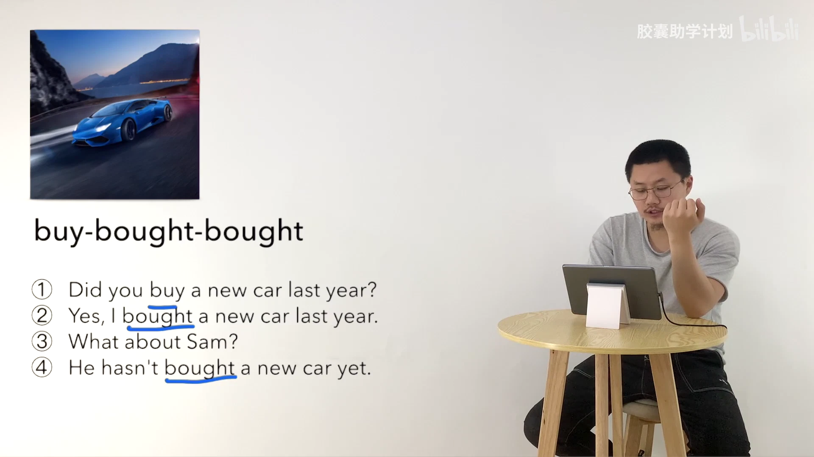

文字识别：胶囊助学计划 / buy-bought-bought / Did you buy a new car last year? / Yes,l bought a / a new car last year. / What / about Sam? / He hasn't bought a new car yet.

### 画面 00:02:48

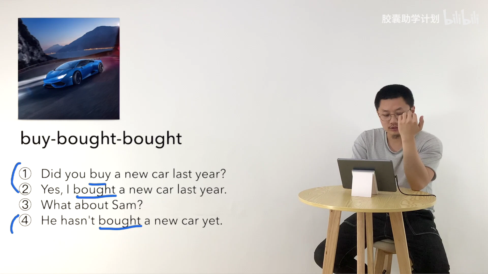

文字识别：胶囊助学计划 / buy-bought-bought / Did you buy a new car last year? / Yes, I bought a new car last year. / What about Sam? / He hasn't bought a new car yet.

### 画面 00:02:57

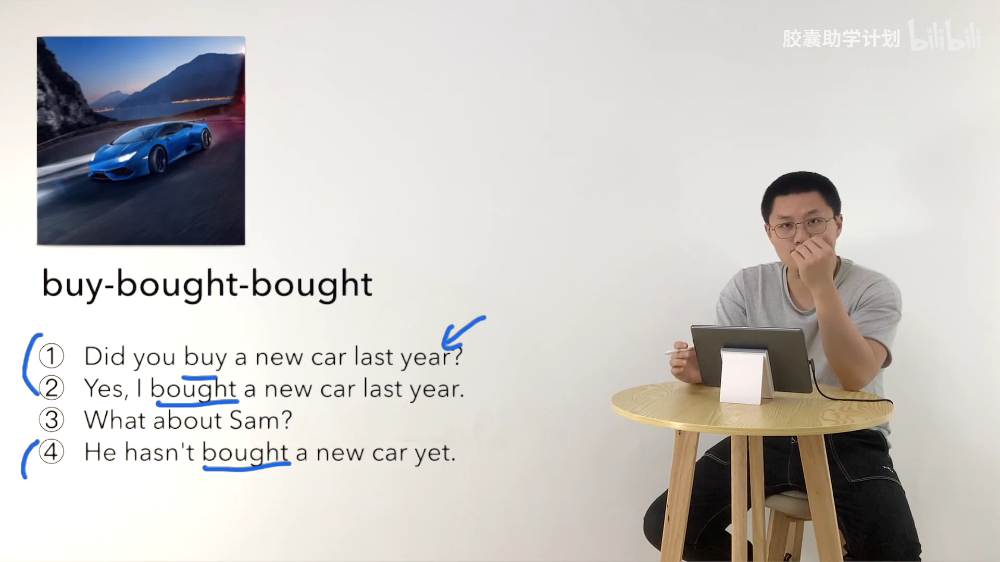

文字识别：胶囊助学计划 / buy-bought-bought / Did you buy a new car last year? / Yes,I bought / a new car last year. / What a / about Sam? / He hasn't bought a new car yet.

## 00:03:00–00:03:30

去式。玩一个，continuing. Did you find your pen yesterday? Yes, I found my pen yesterday. 等我读. What about Penny? She hasn't found her pen yet. Continuing. Did you have breakfast at eight o'clock? Yes, I had breakfast at eight o'clock. What

### 画面 00:03:01

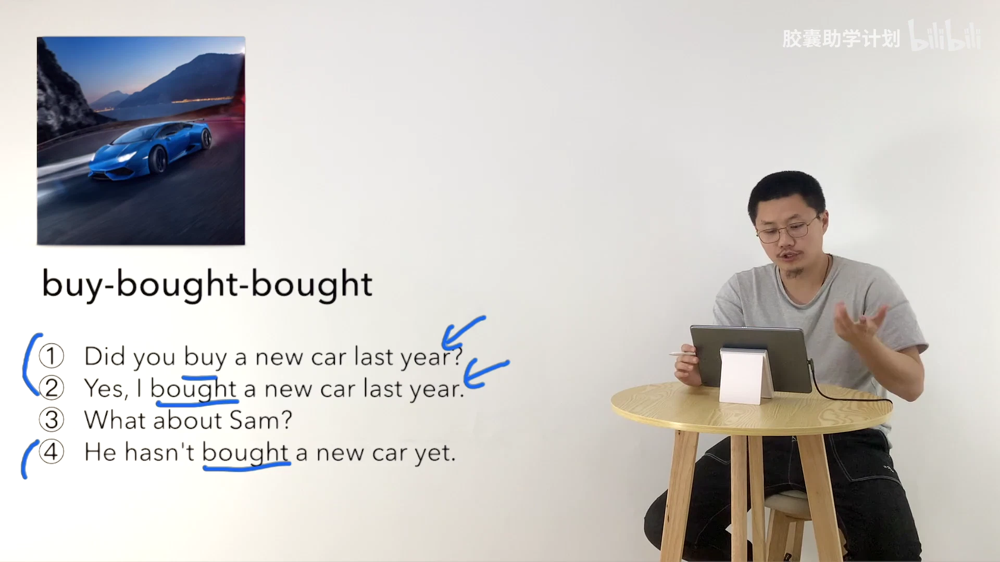

文字识别：胶囊助学计划 / buy-bought-bought / Did you buy a new car last year? / Yes,I bought / a new car last year. / What / about Sam? / He hasn't boughta / a new car yet.

### 画面 00:03:03

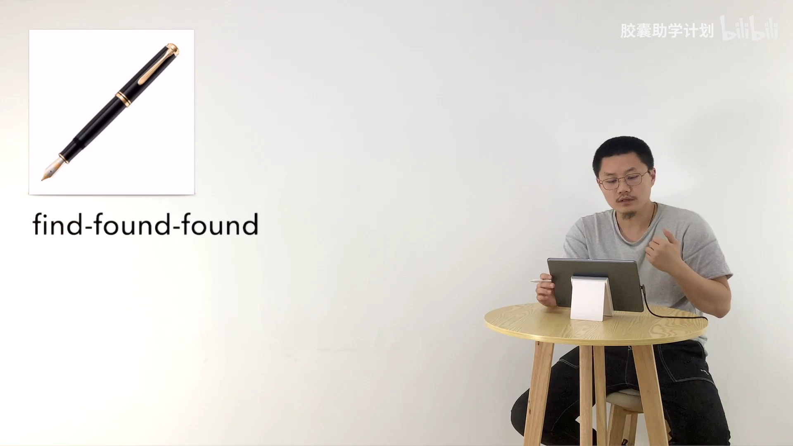

文字识别：胶囊助学计划 / find-found-found

### 画面 00:03:07

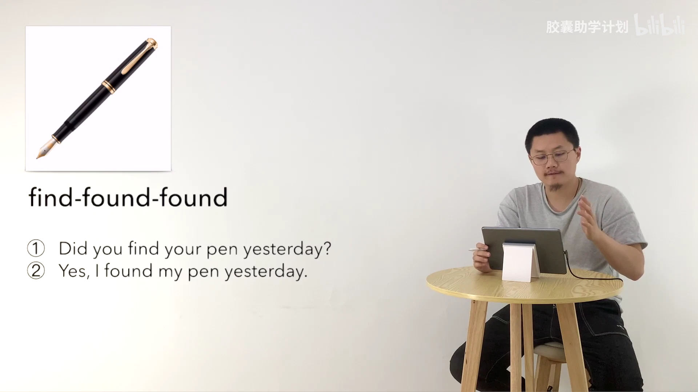

文字识别：胶囊助学计划 / find-found-found / Did you find your pen yesterday? / Yes, I found my pen yesterday.

### 画面 00:03:19

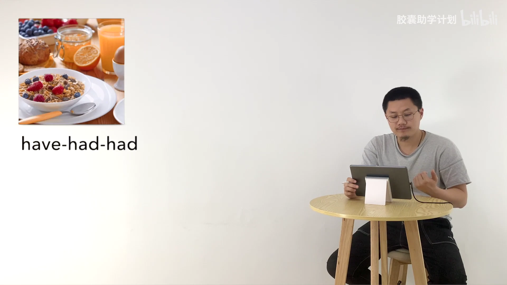

文字识别：胶囊助学计划 / have-had-had

### 画面 00:03:29

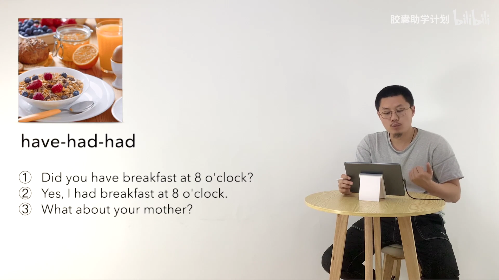

文字识别：胶囊助学计划 / have-had-had / Did you have breakfast at 8 o'clock? / Yes, I had breakfast at 8 o'clock. / What about your mother?

## 00:03:30–00:04:00

about your mother? She hasn't had breakfast yet. Continue, leave,离开啊. Did you leave the office early this morning? That this afternoon? Yes, I left the office early this afternoon. What about the boss? He hasn't left the office yet. Continue. Did you

### 画面 00:03:37

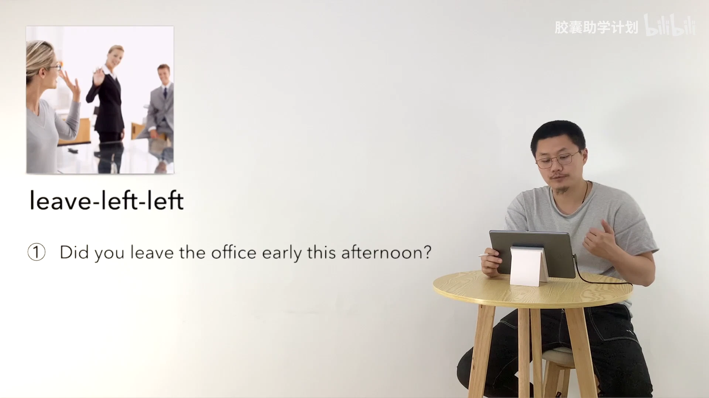

文字识别：胶囊助学计划 / leave-left-left / Did you leave the office early this afternoon?

### 画面 00:03:49

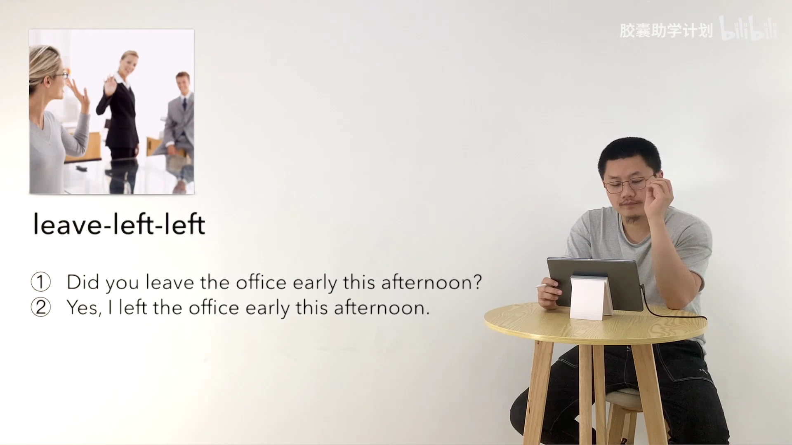

文字识别：胶囊助学计划 / leave-left-left / Did you leave the office early this afternoon? / Yes, I left the office early this afternoon.

### 画面 00:03:57

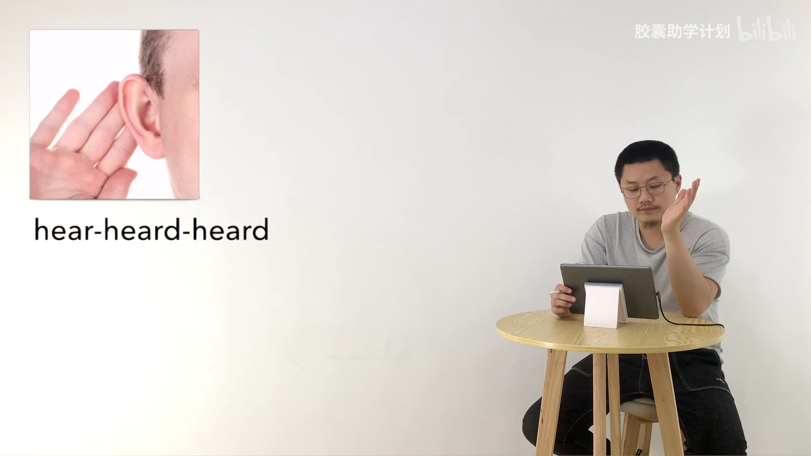

文字识别：胶囊助学计划 / hear-heard-heard

## 00:04:00–00:04:30

the news last night? Yes, I heard the news last night. What about Frank? He hasn't heard the news yet. Continue. Did you make your bed this morning? Yes, I made my bed this morning. What about Susan and Jan? They haven't made their beds yet.

### 画面 00:04:09

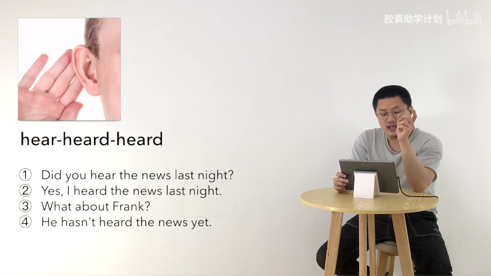

文字识别：胶囊助学计划 / hear-heard-heard / Did you hear the news last night? / Yes, I heard the news last night. / What about Frank? / He hasn't heard the news yet.

### 画面 00:04:14

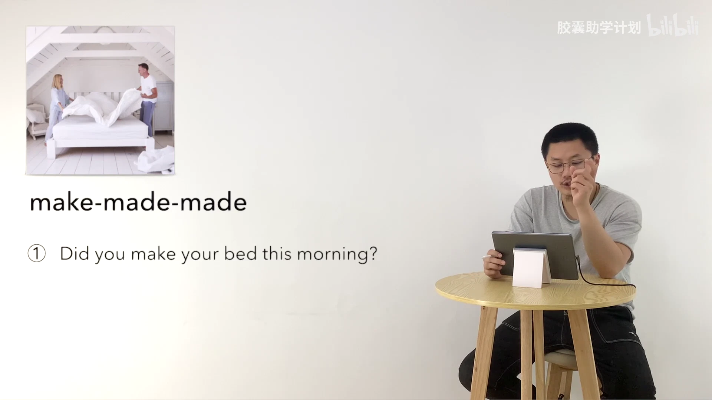

文字识别：胶囊助学计划 / make-made-made / Did you make your bed this morning?

### 画面 00:04:26

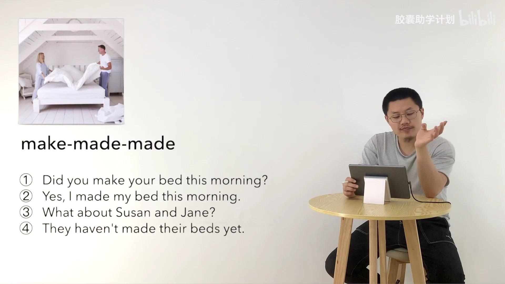

文字识别：胶囊助学计划 / make-made-made / Did you make your bed this morning? / Yes, I made my bed this morning. / What about Susan and Jane? / They haven't made their beds yet.

## 00:04:30–00:05:00

Did you meet Harry yesterday? Yes, I met Harry yesterday. What about your wife? She hasn't met Harry yet. Okay, recap.本课最关键就是 did have that两个时态，然后重点是两个时态当中要用到的动词的不同的形式，过去式，过

### 画面 00:04:30

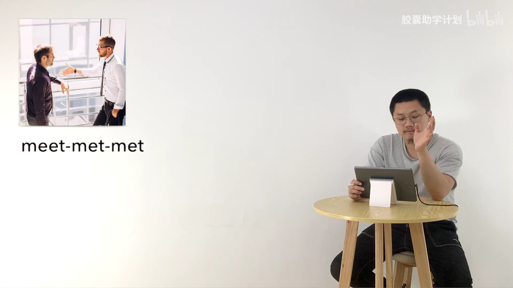

文字识别：胶囊助学计划 / meet-met-met

### 画面 00:04:39

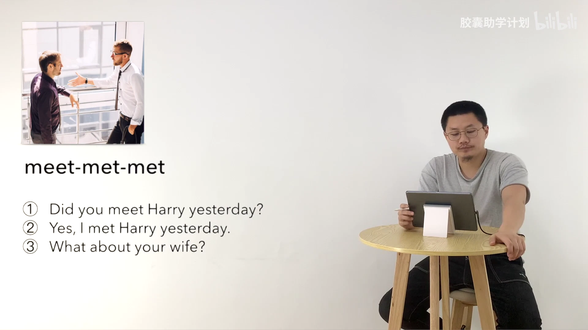

文字识别：胶囊助学计划 / meet-met-met / Did you meet Harry yesterday? / Yes, I met Harry yesterday. / What about your wife?

### 画面 00:04:46

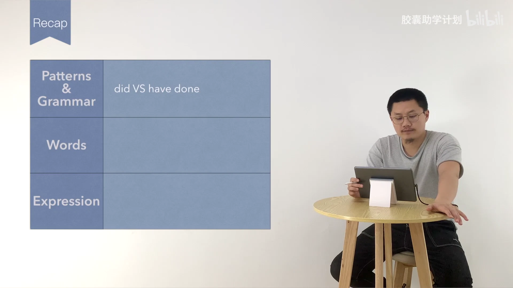

文字识别：胶囊助学计划 / Recap / Patterns / did Vs have done / Grammar / Words / Expression

### 画面 00:04:52

文字识别：胶囊助学计划 / Recap / Patterns / did Vs have done / Grammar / Words / Expression

## 00:05:00–00:05:30

去分词，对吧？OK，呃，家庭作业，绿皮书八十八课，各位可以写了，给自己讲解一遍今天的核心知识点。OK，如果大家喜欢我们的课程呢，欢迎大家关注、订阅、一键三连，分享给更多的朋友来帮助我们成长。最后，我们再来看一句名人名言：The most important thing is to try and inspire people so that they can be great in whatever they want to do. See you

### 画面 00:05:01

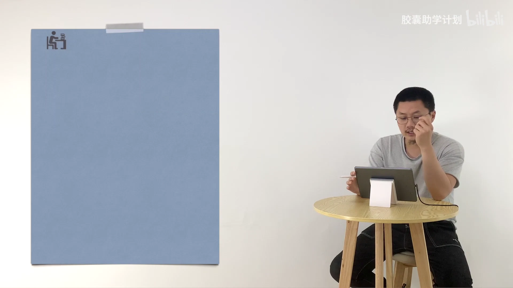

文字识别：胶囊助学计划

### 画面 00:05:08

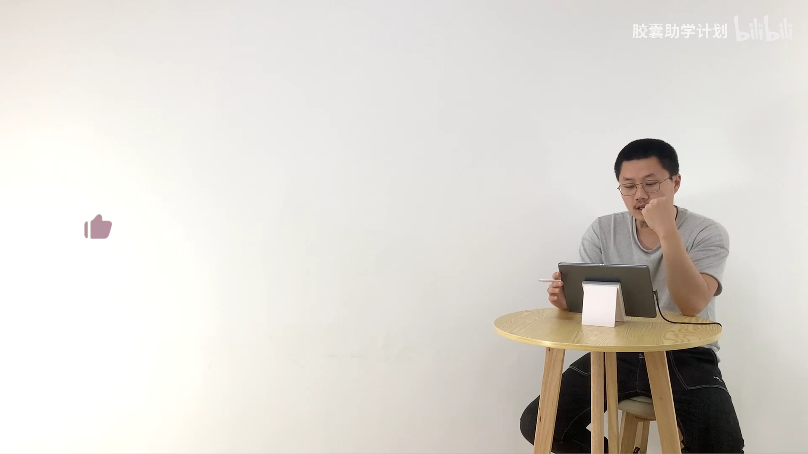

文字识别：胶囊助学计划

### 画面 00:05:16

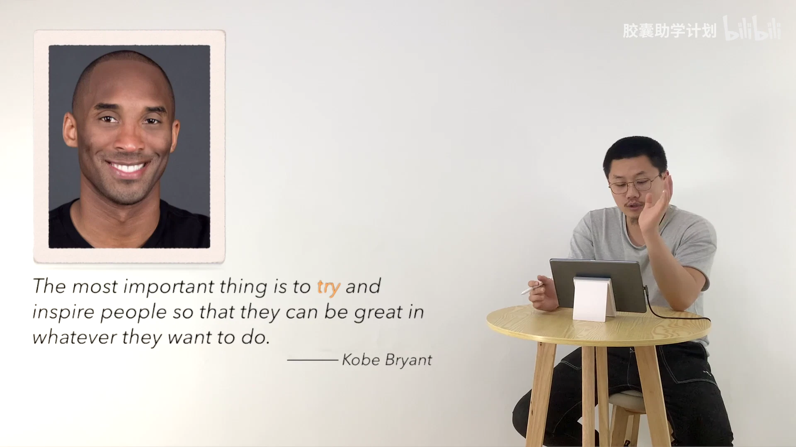

文字识别：胶囊助学计划 / The most important thing is to try and / inspire people so that they can be great in / whatever they want to do. / -Kobe Bryant

## 00:05:30–00:05:43

next time.

### 画面 00:05:30

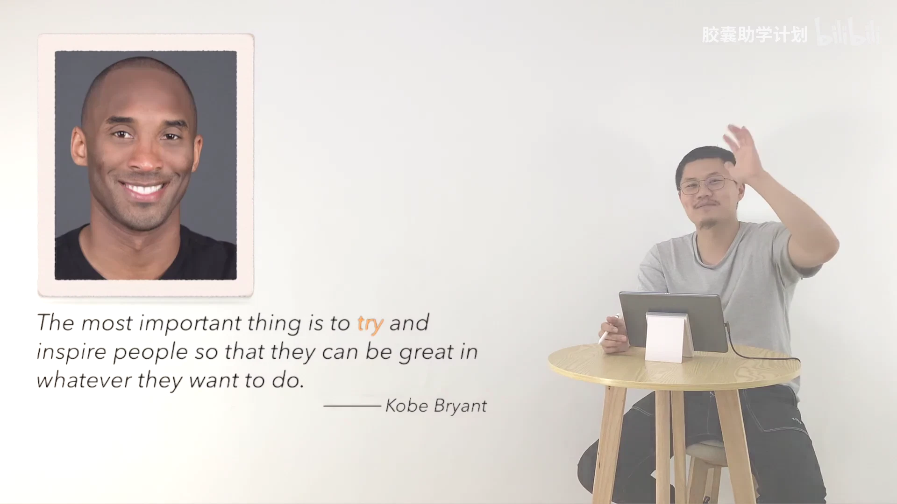

文字识别：胶囊助学计划 / The most important thing is to try and / inspire people so that they can be great in / whatever they want to do. / - Kobe Bryant

### 画面 00:05:32

文字识别：CAPSULEACADEMY / 胶囊助学计划 / 小红书 / Lecturer / □ / 口 / Leo / OE

### 画面 00:05:35

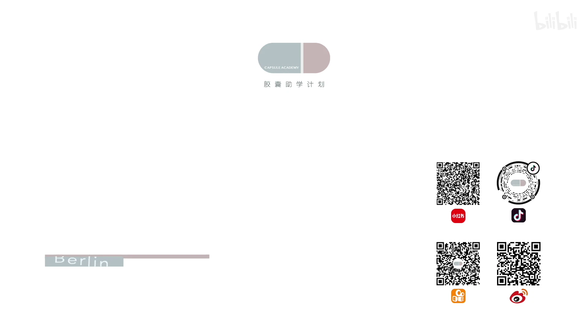

文字识别：CAPSULEACADEMY / 胶囊助学计划 / 『 / 小红书 / Berlin / OE

### 画面 00:05:38

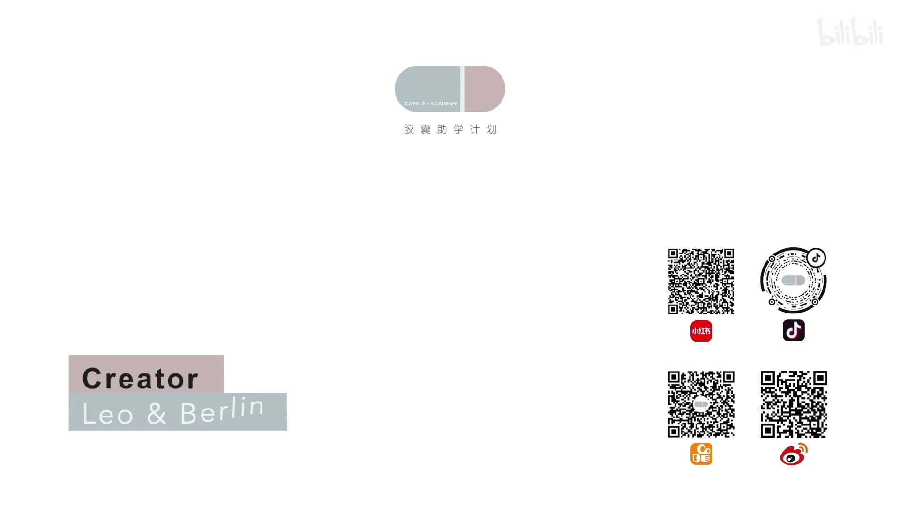

文字识别：CAPSULEACADEMY / 胶囊助学计划 / 『 / 小红书 / Creator / □ / Leo & Berlin / OE

### 画面 00:05:40

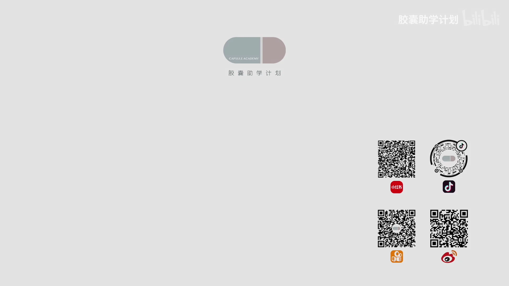

文字识别：胶囊助学计划 / CAPSULEACADEMY / 胶囊助学计划 / 『 / 小红书 / OE

### 画面 00:05:42

文字识别：bilibili / 胶囊助学计划

