# 089 单词 语法

快速机器解析：语音为单模型转写，未进行独立交叉校对或人工复核；画面每秒采样并按变化选帧，短时文字和标记可能遗漏。截图时间约有 1 秒误差。图片有损压缩；遇到疑点请按时间查看 Google Drive 原视频。

## 00:00:00–00:00:30

Hello everyone, welcome to Capsule Academy. This is Leo. Today we're going to learn New Concept English Book One, Lesson Eighty Nine, Grammar and Words. 老习惯，进入正式课程之前，我们先看几个问题。第一，Have done的用法二啊，我们在八十三课讲过它的用法一，现在完成时。今天我们来看一下它的第二个用法。第二，如何表达物有所值。带着这两个问题，Hope you guys enjoy it.

### 画面 00:00:00

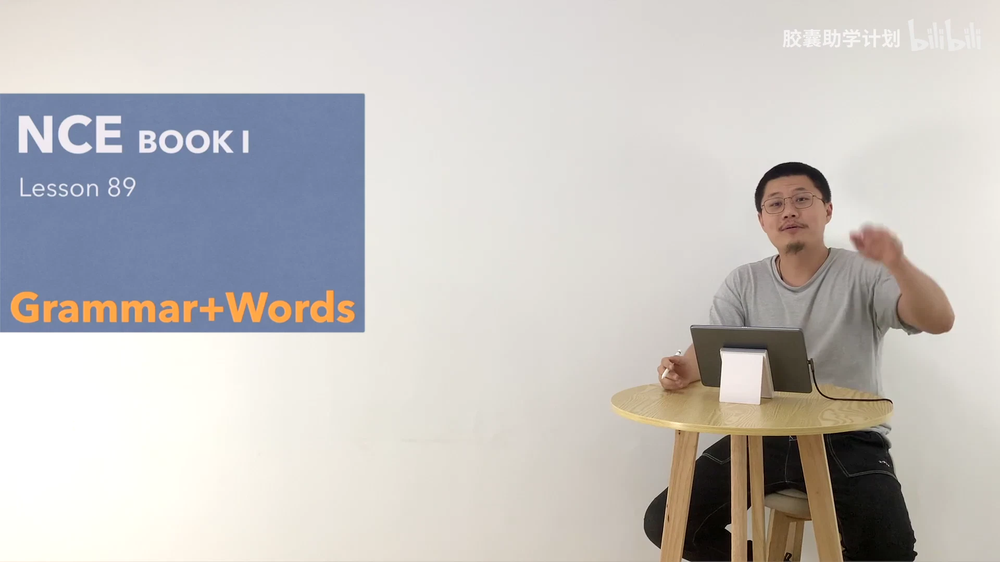

文字识别：胶囊助学计划 / NCE / BOOKI / Lesson 89 / Grammar+Words

### 画面 00:00:09

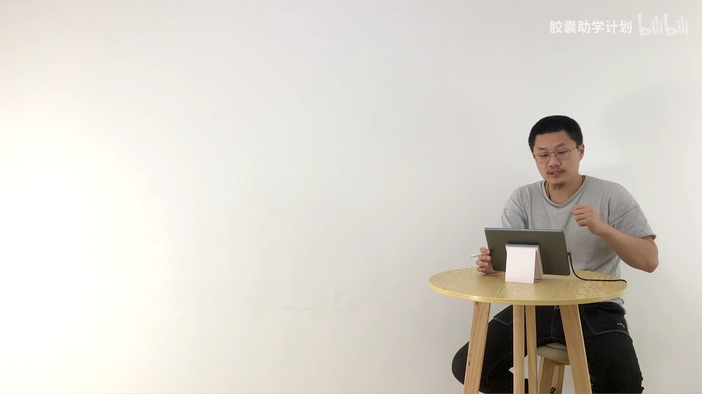

文字识别：胶囊助学计划 / D

### 画面 00:00:12

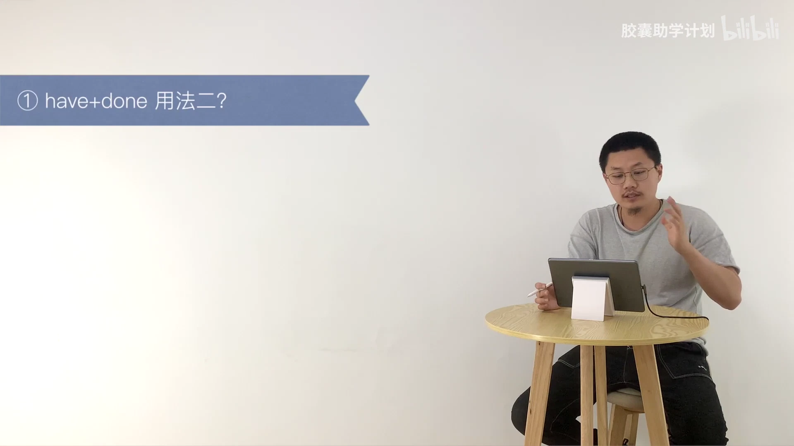

文字识别：胶囊助学计划b鼎b出 / ①have+done 用法二?

### 画面 00:00:20

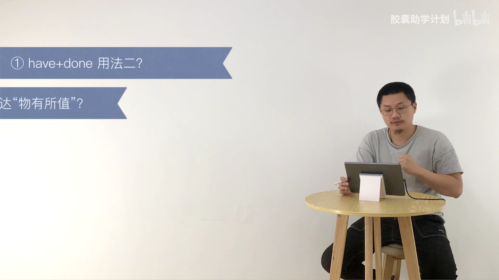

文字识别：胶囊助学计划 / ①have+done 用法二? / 达“物有所值”？

### 画面 00:00:22

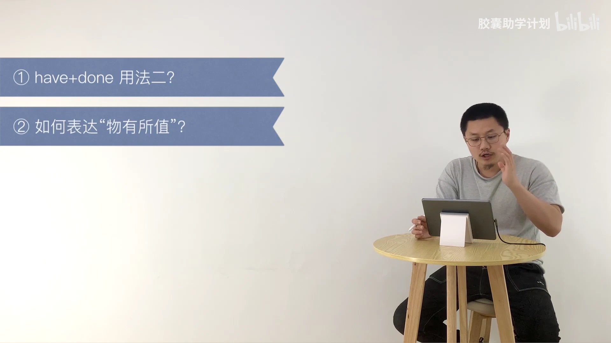

文字识别：胶囊助学计划 / ①have+done 用法二? / 如何表达“物有所值”?

### 画面 00:00:27

文字识别：胶囊助学计划bll / •

## 00:00:30–00:01:00

好，那我们接下来看一下 have done 的第二个用法。 have done 的结构我们之前讲过了，对吧？啊，我经常说这句话叫做时态，可这一个时态的结构可以有不同的含义，但是结构不会变。不管你是三个含义，甚至六个含义，无所谓，我永远是这一个结构。所以 have done 我们今天虽然讲它了第二个用法，但它的基本结构跟八十三课我们讲它

### 画面 00:00:31

### 画面 00:00:33

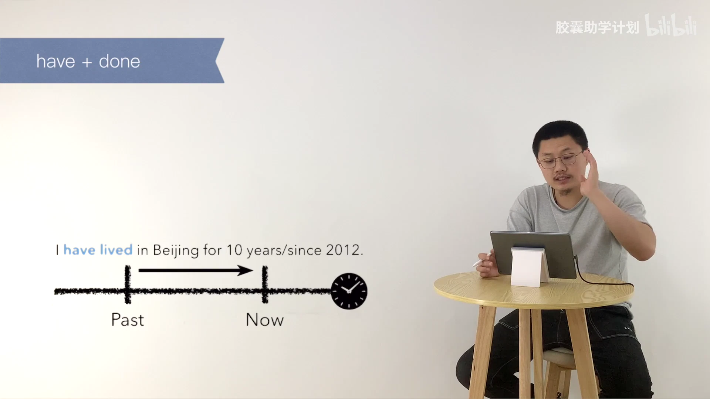

文字识别：胶囊助学计划 / have + done / I have lived in Beijing for 10 years/since 2012. / Past / Now

## 00:01:00–00:01:30

它的第一个用法的时候没有任何改变，那我们直接看它的含义就可以了，叫做一个动作或者状态，动作就是但状态就是并，一会儿我们再讲一下并这个单词到底是什么，好吧？我们现在先不管它，就知道是一个动作或一个状态。注意关键点来了，叫从过去持续到了现在。回想一下它的第一个用法，叫做过去的一个动作发生了，然后结束，

### 画面 00:01:03

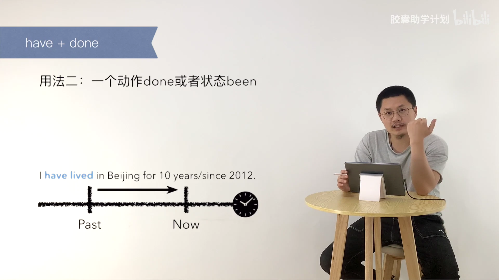

文字识别：胶囊助学计划 / have + done / 用法二：一个动作done或者状态been / I have lived in Beijing for 10 years/since 2012. / Past / Now

### 画面 00:01:20

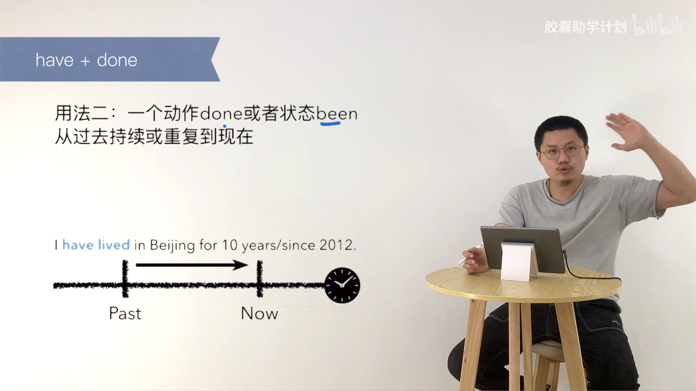

文字识别：胶囊助学计划 / have + done / 用法二：一个动作done或者状态been / 从过去持续或重复到现在 / I have lived in Beijing for 10 years/since 2012. / Past / Now

## 00:01:30–00:02:00

对现在产生了影响。你 Do you want to have lunch with us? 你想和我们吃晚饭不？ Ah, I've already had lunch. 我已经吃完了啊，吃午饭 lunch 啊，午饭我已经吃完了。 Okay, 过去吃了，对现在影响是 No, thank you. 其实就是等同于这句话，对吧？好，那我们看一下这句话叫做 I have lived in Beijing. 我们先不管别处，先把 have 加 lived 给它确定下来，现在完成时没跑

### 画面 00:01:38

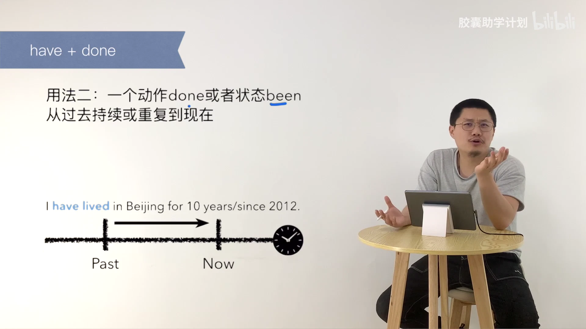

文字识别：胶囊助学计划 / have + done / 用法二：一个动作done或者状态been / 从过去持续或重复到现在 / I have lived in Beijing for 10 years/since 2012. / Past / Now

### 画面 00:01:52

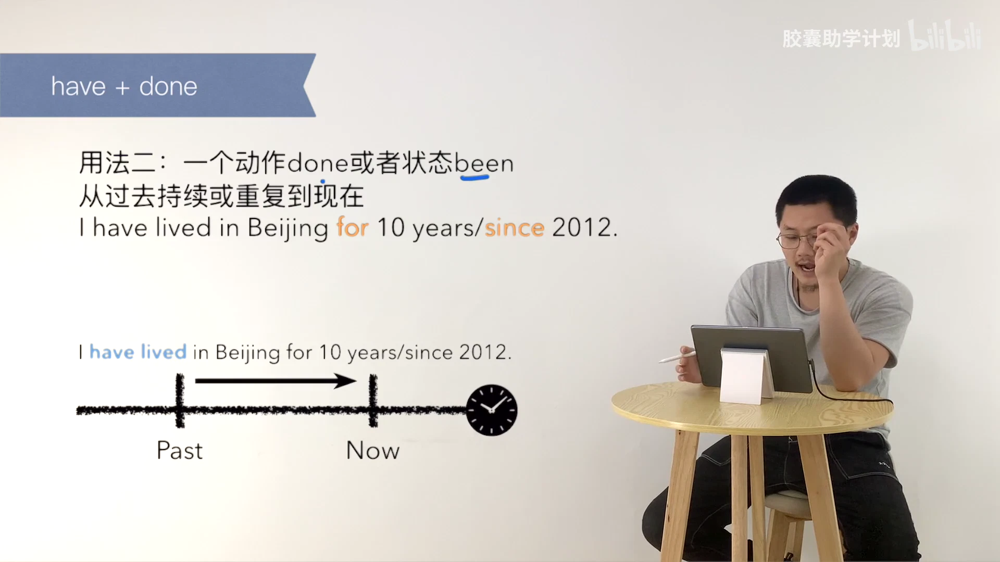

文字识别：胶囊助学计划 / have + done / 用法二：一个动作done或者状态been / 从过去持续或重复到现在 / I have lived in Beijing / for 10 years/since 2012. / I have lived in Beijing for 10 years/since 2012. / Past / Now

### 画面 00:01:56

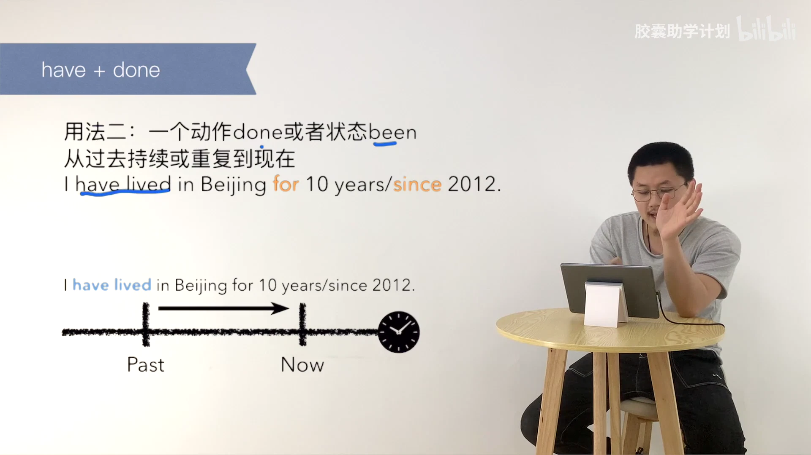

文字识别：胶囊助学计划 / have + done / 用法二：一个动作done或者状态been / 从过去持续或重复到现在 / I have lived in Beijing / for 10 years/since 2012. / I have lived in Beijing for 10 years/since 2012. / Past / Now

## 00:02:00–00:02:30

了，对吧？结构先确定，接下来要处理的事情就是我们要看通过句子去确定它到底是第一个用法还是第二个用法，对吧？我们先往下看。In Beijing啊，我住在北京 for ten years。这个我们马上讲啊，和 since two thousand twelve。好，中间加了个斜杠，二选其一就可以了。说已经十年了，for ten years，十年了。那 since two

### 画面 00:02:13

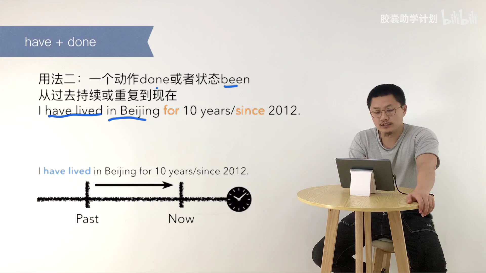

文字识别：胶囊助学计划 / have + done / 用法二：一个动作done或者状态been / 从过去持续或重复到现在 / I have lived in Beijing / for 10 years/since 2012. / I have lived in Beijing for 10 years/since 2012. / Past / Now

### 画面 00:02:16

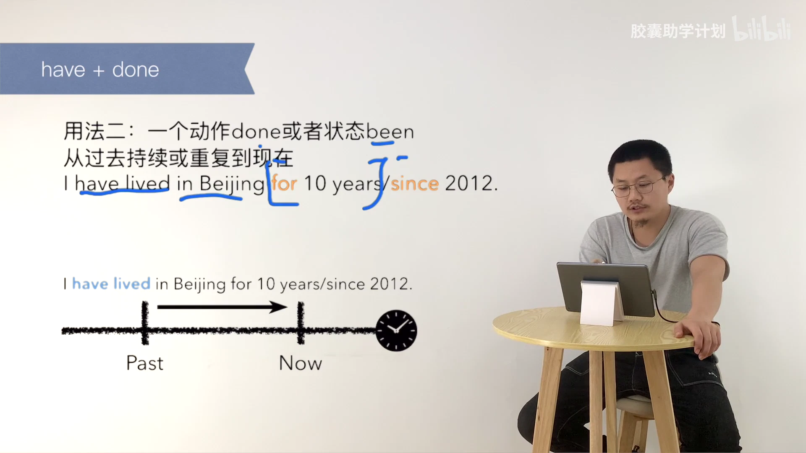

文字识别：胶囊助学计划 / have + done / 用法二：一个动作done或者状态been / 从过去持续或重复到现在 / I have lived in Beijing / gfor 10 years / /since 2012. / I have lived in Beijing for 10 years/since 2012. / Past / Now

### 画面 00:02:21

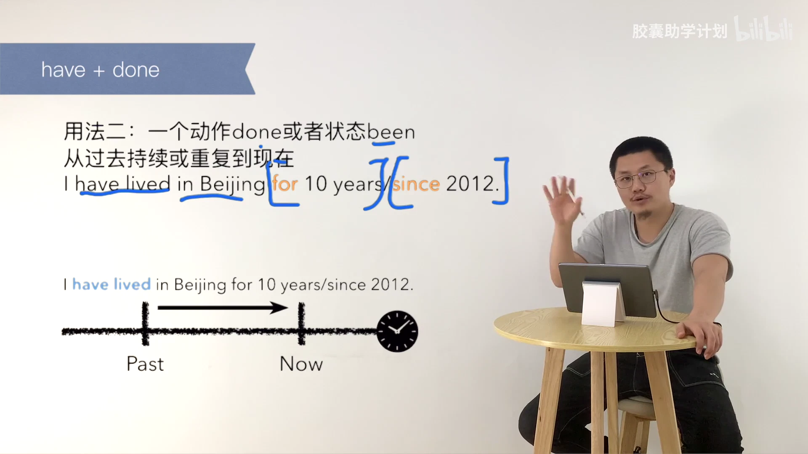

文字识别：胶囊助学计划 / have + done / 用法二：一个动作done或者状态been / 从过去持续或重复到现在 / r 1 yar/ince 20122] / I have lived in Beijing / I have lived in Beijing for 10 years/since 2012. / Past / Now

## 00:02:30–00:03:00

2012叫做自从二零一二年开始。你看啊，我在北京已经住了十年了，或者说，我从二零一二年就住在北京。如果您用的是have和that，并且后边往往会用for或since，它指的就是图中这个意思。过去开始住在北京，持续到了现在，也就意味着，如果我问你说Where is啊Where am I now？我现在

### 画面 00:02:35

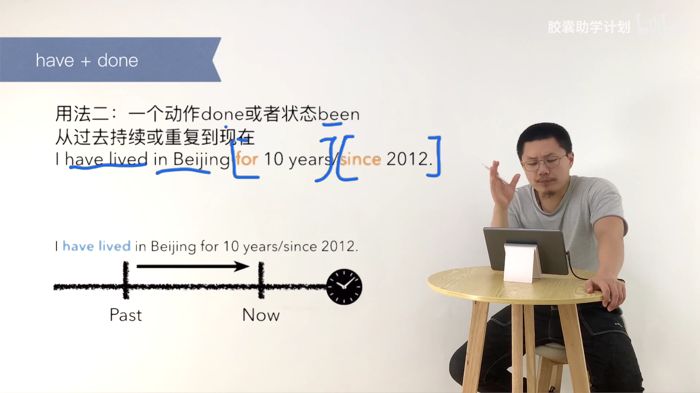

文字识别：胶囊助学计划 / have + done / 用法二：一个动作done或者状态been / 从过去持续或重复到现在 / r 1 yearince 201] / I have lived in Beijing / I have lived in Beijing for 10 years/since 2012. / Past / Now

### 画面 00:02:43

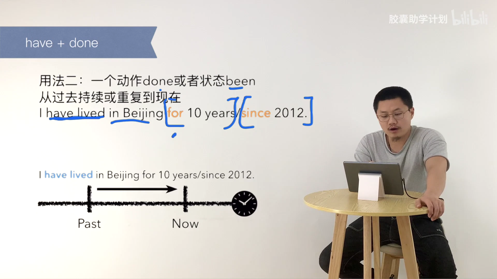

文字识别：胶囊助学计划 / have + done / 用法二：一个动作done或者状态been / 从过去持续或重复到现在 / r 1 yearice 20122] / I have lived in Beijing / I have lived in Beijing for 10 years/since 2012. / Past / Now

### 画面 00:02:51

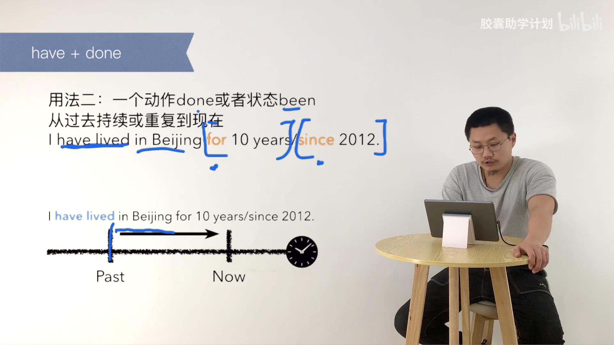

文字识别：胶囊助学计划 / have + done / 用法二：一个动作done或者状态been / 从过去持续或重复到现在 / I have lived in Beijing / I have lived in Beijing for 10 years/since 2012. / Past / Now

### 画面 00:02:53

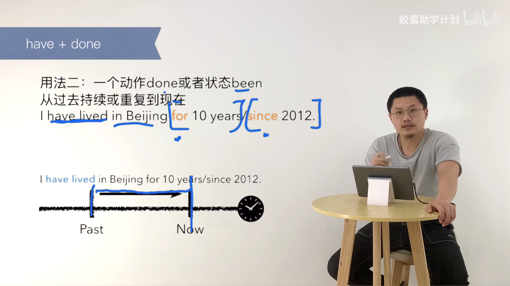

文字识别：胶囊助学计划 / have + done / 用法二：一个动作done或者状态been / 从过去持续或重复到现在 / I have lived in Beijing / I have lived in Beijing for 10 ye rs/since 2012. / Past / Now

## 00:03:00–00:03:30

在哪儿呢？I am in Beijing now, 对吧？我现在人在北京，因为它指的是从过去开始持续到了现在，对吧？OK，所以你看这句话，这个时间段可能是十，对吧？也可能是比如说是二零一二。Pass，过去持续到现在，用 have 加 done 去表示。OK，那我们处理完了它的肯定句之后，刚才我又讲到了说，你不管它是什么用法，只要是这个时

### 画面 00:03:11

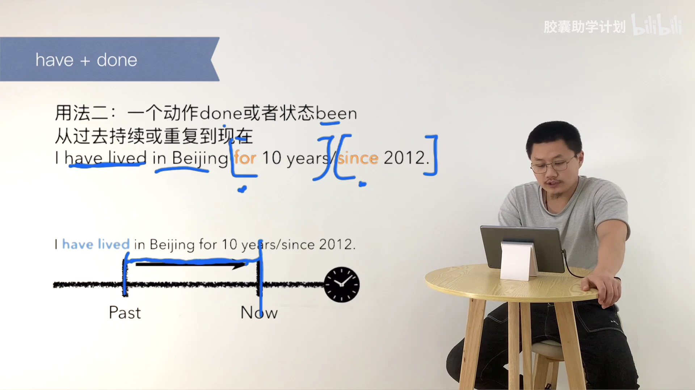

文字识别：胶囊助学计划 / have + done / 用法二：一个动作done或者状态been / 从过去持续或重复到现在 / I have lived in Beijing / I have lived in Beijing for 10 ye rs/since 2012. / Past / Now

### 画面 00:03:15

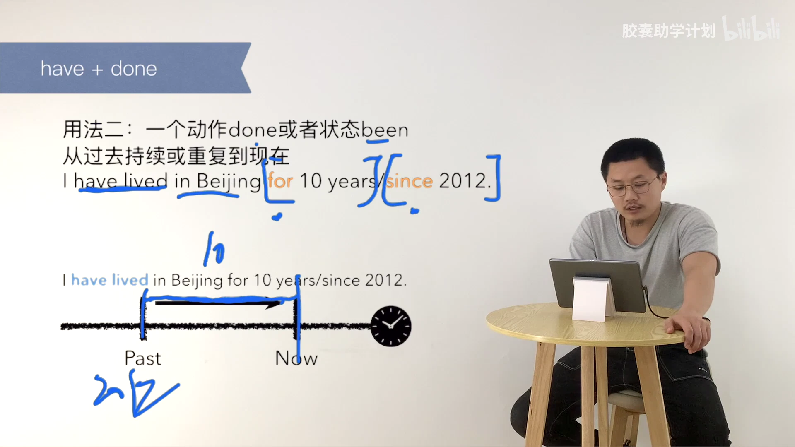

文字识别：胶囊助学计划 / have + / done / 用法二：一个动作done或者状态been / 从过去持续或重复到现在 / r 10 yearince 02] / I have lived in Beijing / I have l / lived in Beijing for 10 ye rs/since 2 / 2012. / Past / Now / 22

### 画面 00:03:23

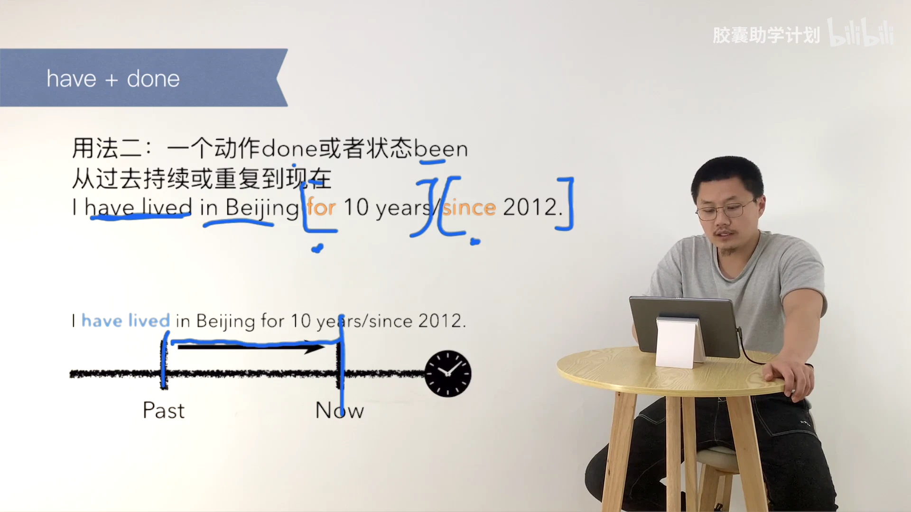

文字识别：胶囊助学计划 / have + done / 用法二：一个动作done或者状态been / 从过去持续或重复到现在 / I have lived in Beijing / I have lived in Beijing for 10 ye rs/since 2012. / Past / Now

### 画面 00:03:25

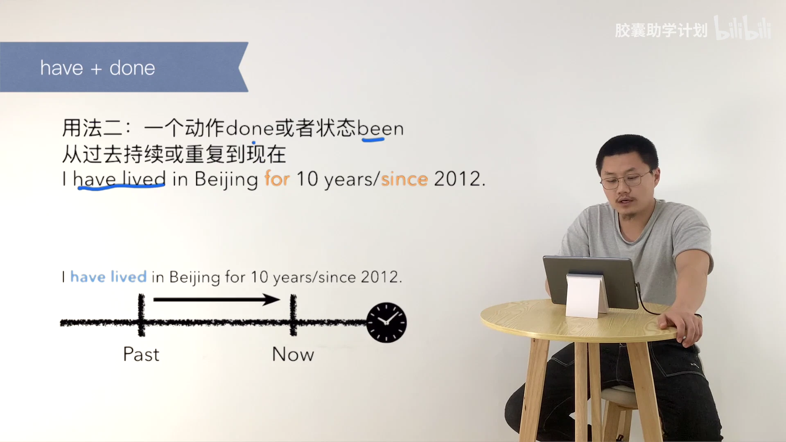

文字识别：胶囊助学计划 / have + done / 用法二：一个动作done或者状态been / 从过去持续或重复到现在 / I have lived in Beijing / for 10 years/since 2012. / I have lived in Beijing for 10 years/since 2012. / Past / Now

### 画面 00:03:29

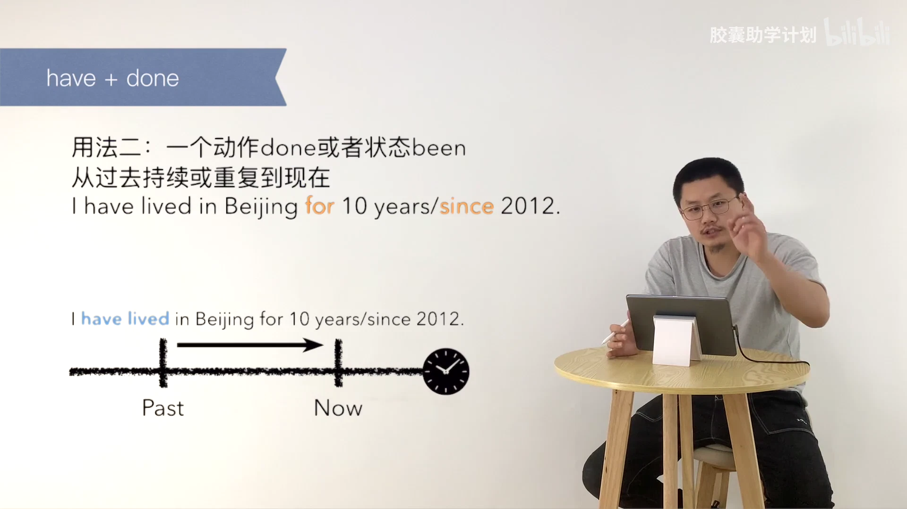

文字识别：胶囊助学计划 / have + done / 用法二：一个动作done或者状态been / 从过去持续或重复到现在 / I have lived in Beijing for 10 years/since 2012. / I have lived in Beijing for 10 years/since 2012. / Past / Now

## 00:03:30–00:04:00

态，它的结构是不变的。所以如果是一般疑问句，说你在北京住十年了吗？很简单，把 have 提前就可以了，跟八十三课学的没区别。如果我现在想对 for ten years 提问，这个多了一个新的特殊疑问词，叫做 how long 啊，叫做多长时间。那 how long have you lived in Beijing 的意思就是你在北京住多长时间了？你看我们汉语有没有这个时态？呃，你在这个公司工作多长

### 画面 00:03:44

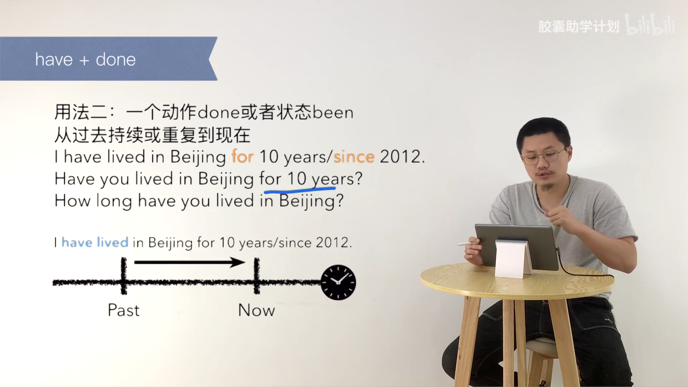

文字识别：胶囊助学计划 / have + done / 用法二：一个动作done或者状态been / 从过去持续或重复到现在 / I have lived in Beijing / for 10 years/since 2012. / Have you /  lived in Beijing for 10 years? / How long have you lived in Beijing? / I have lived in Beijing for 10 years/since 2012. / Past / Now

### 画面 00:03:48

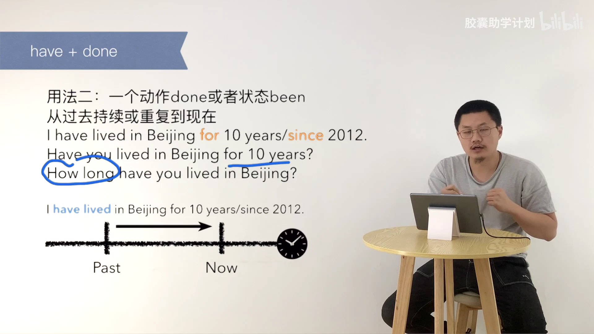

文字识别：胶囊助学计划 / have + done / 用法二：一个动作done或者状态been / 从过去持续或重复到现在 / I have lived in Beijing / for 10 years/since 2012. / Have you lived in Beijing / for 10 years? / How lonohave youl / u lived in Beijing? / I have lived in Beijing for 10 years/since 2012. / Past / Now

## 00:04:00–00:04:30

时间了？假设你现在人还在这个公司，对吧？好，别人问你说你在这儿工作了多久了？哎，你住在这里多久了？你们俩结婚多长时间了？OK啊，你谈恋爱谈多久了？OK，你学日语学多长时间了？全是现在完成时，它只不过是汉语的OK。好，我们接下来看两个小的知识点。第一个，各位可以自己去记一下，叫做for，这个地方往往是加一段时间，不是说它只能加一段时间啊。说我们说在现在

### 画面 00:04:12

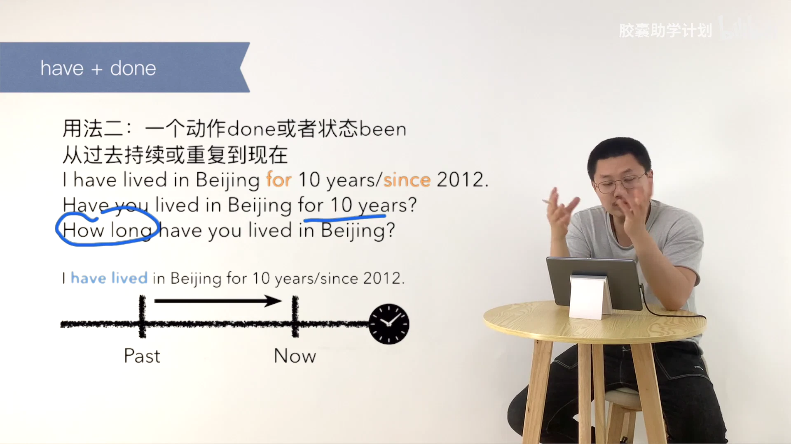

文字识别：胶囊助学计划 / have + done / 用法二：一个动作done或者状态been / 从过去持续或重复到现在 / I have lived in Beijing / for 10 years/since 2012. / Have you lived in E / Beijing / for 10 years? / How lonohave you / lived / in Beijing? / I have lived in Beijing for 10 years/since 2012. / Past / Now

### 画面 00:04:18

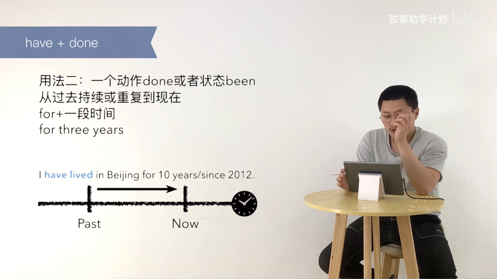

文字识别：胶囊助学计划 / have + done / 用法二：一个动作done或者状态been / 从过去持续或重复到现在 / for+一段时间 / for three years / I have lived in Beijing for 10 years/since 2012. / Past / Now

### 画面 00:04:23

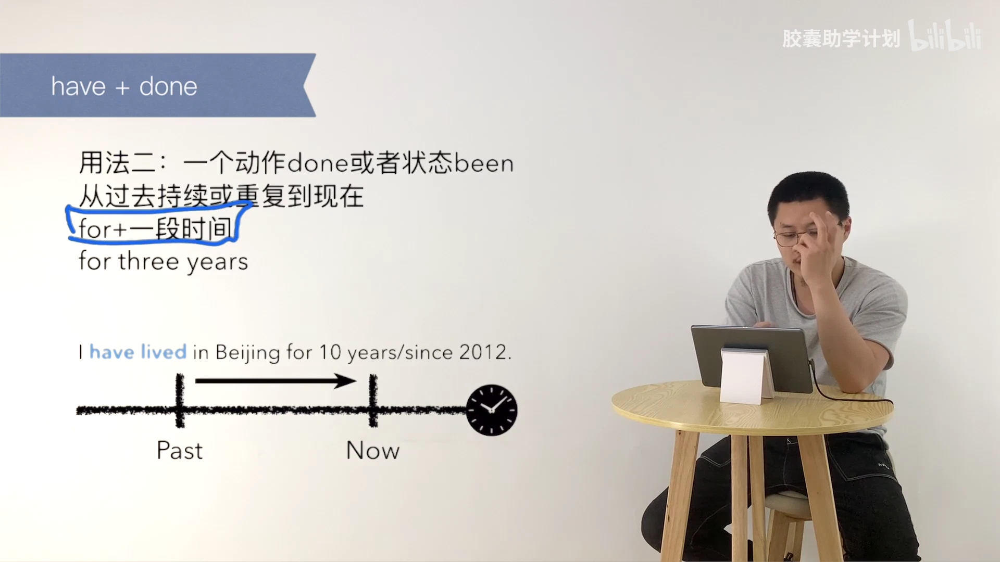

文字识别：胶囊助学计划 / have + done / 用法二：一个动作done或者状态been / 从过去持续或重复到现在 / for+—段时间 / for three years / I have lived in Beijing for 10 years/since 2012. / Past / Now

### 画面 00:04:26

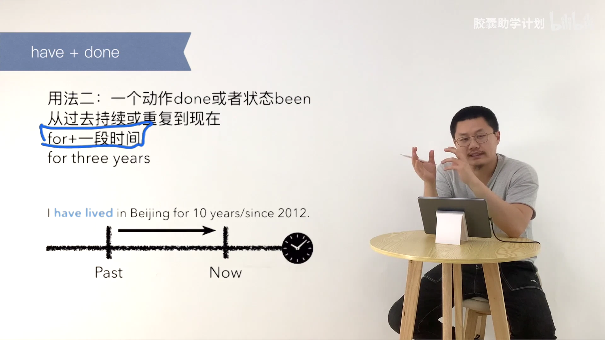

文字识别：胶囊助学计划 / have + done / 用法二：一个动作done或者状态been / 从过去持续或重复到现在 / for+一段时间 / for three years / I have lived in Beijing for 10 years/since 2012. / Past / Now

## 00:04:30–00:05:00

完成时当中，它可以加一段时间，比如说三年叫 for three years。那 since 呢，就是加一个时间点，它翻译成汉语往往是叫自从什么什么时候开始，比如说 since nineteen eighty four，自从一九八四年等等等等。如果各位仔细去想，或者您仔细去观察，你会发现很多的品牌它都会写上叫做 since 哪年哪年，翻译成汉语就有点像我们那个

### 画面 00:04:33

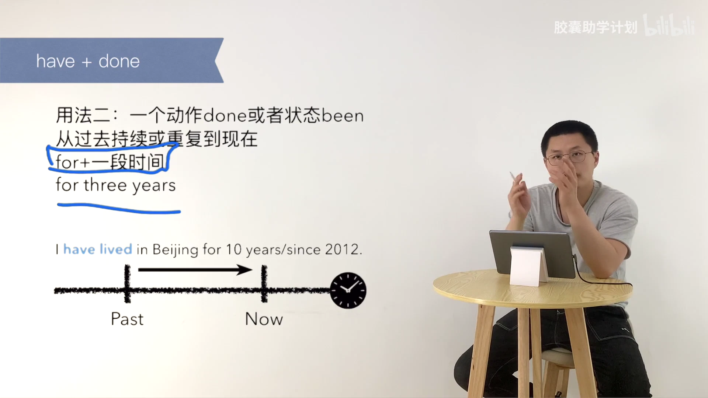

文字识别：胶囊助学计划 / have + done / 用法二：一个动作done或者状态been / 从过去持续或重复到现在 / for+一段时间 / for three years / I have lived in Beijing for 10 years/since 2012. / Past / Now

### 画面 00:04:35

文字识别：胶囊助学计划 / have + done / 用法二：一个动作done或者状态been / 从过去持续或重复到现在 / since+时间点 / since 1984 / I have lived in Beijing for 10 years/since 2012. / Past / Now

## 00:05:00–00:05:30

广告词当中的什么“源自一五七几年”，对吧？大概就是这样一种感觉啊。源自啊，叫做“since”自从，very good。接下来我们就要处理一个关键的单词了，叫“I have been here for two hours”。很多同学对这个单词，因为这个单词它没法翻译啊，它甚至不翻译，所以很多同学对这个单词不太了解。我现在给你换一个思路啊，我们看一下“be”这个单词到底和哪些单

### 画面 00:05:05

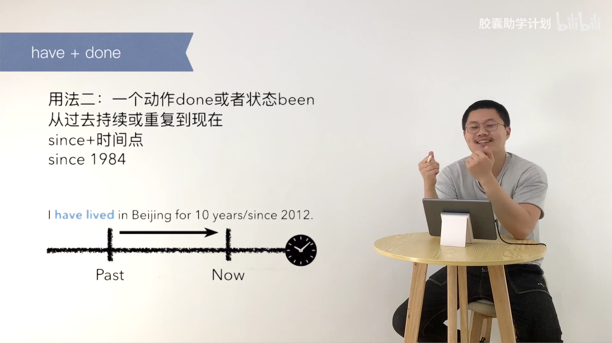

文字识别：胶囊助学计划 / have + done / 用法二：一个动作done或者状态been / 从过去持续或重复到现在 / since+时间点 / since 1984 / I have lived in Beijing for 10 years/since 2012. / Past / Now

### 画面 00:05:10

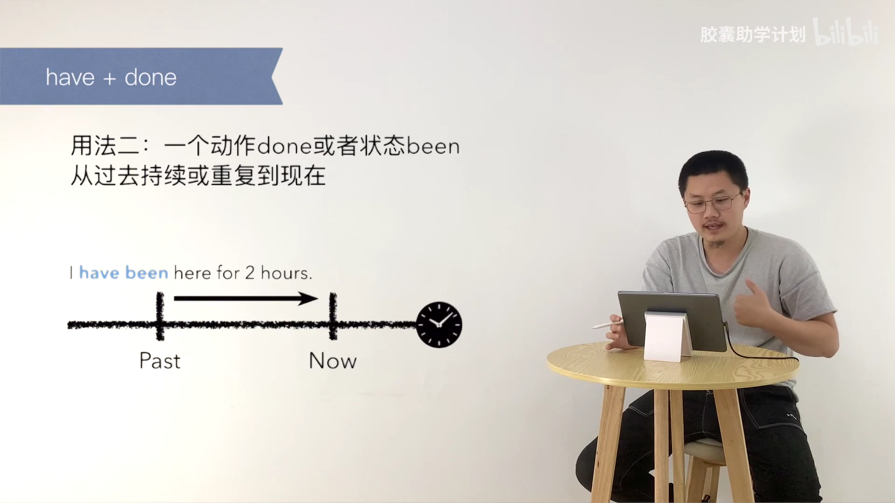

文字识别：胶囊助学计划 / have + done / 用法二：一个动作done或者状态been / 从过去持续或重复到现在 / I have been here for 2 hours. / Past / Now

### 画面 00:05:24

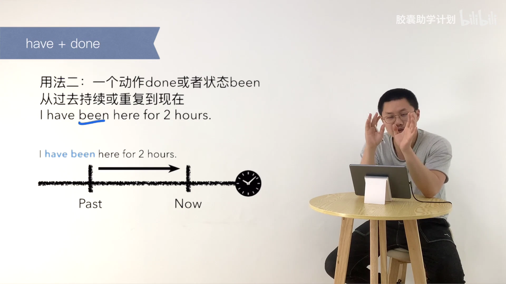

文字识别：胶囊助学计划 / have + done / 用法二：一个动作done或者状态been / 从过去持续或重复到现在 / I have been here for 2 hours. / I have been here for 2 hours. / Past / Now

## 00:05:30–00:06:00

词是近亲？首先，am is are这三个单词，你啊，我们太熟悉了，对吧？接下来was were啊，我们应该也挺熟悉的。六十七课开始学的，表过去，对吧？如果我现在想说我人现在在北京，那我直接就说I am in Beijing now，对吧？I am in Beijing。如果说我曾经在北京，那叫做I was in Beijing。你看这两个时态，它其实是一般现在时，

### 画面 00:05:32

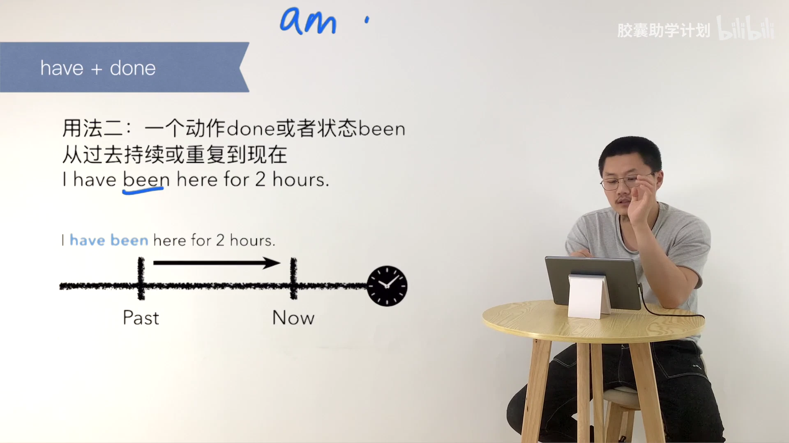

文字识别：am / 胶囊助学计划 / have + done / 用法二：一个动作done或者状态been / 从过去持续或重复到现在 / I have been here for 2 hours. / I have been here for 2 hours. / Past / Now

### 画面 00:05:34

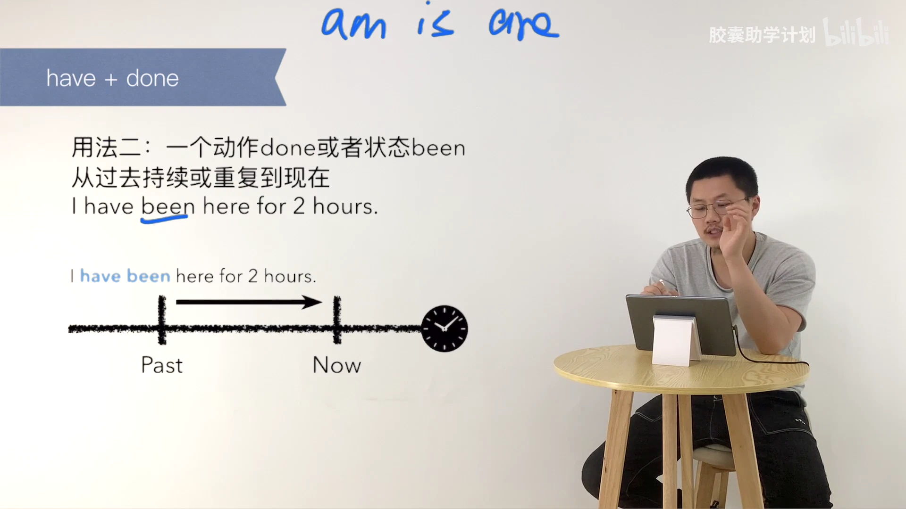

文字识别：am is / are / 胶囊助学计划 / have + done / 用法二：一个动作done或者状态been / 从过去持续或重复到现在 / I have been here for 2 hours. / I have been here for 2 hours. / Past / Now

### 画面 00:05:39

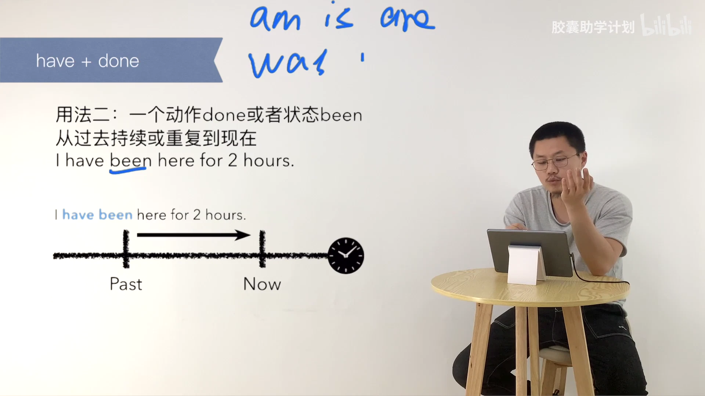

文字识别：am is / 胶囊助学计划 / Wai / have + done / 用法二：一个动作done或者状态been / 从过去持续或重复到现在 / I have been here for 2 hours. / I have been here for 2 hours. / Past / Now

### 画面 00:05:41

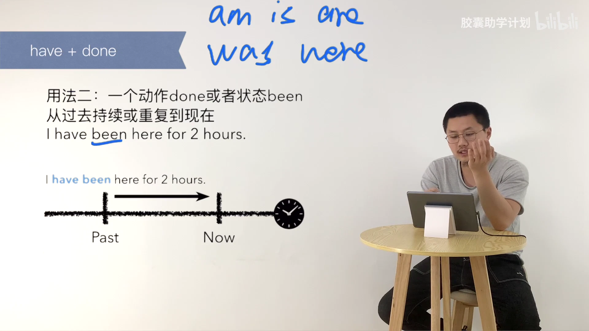

文字识别：am is / 胶囊助学计划 / Was / were / have + done / 用法二：一个动作done或者状态been / 从过去持续或重复到现在 / I have been here for 2 hours. / I have been here for 2 hours. / Past / Now

### 画面 00:05:58

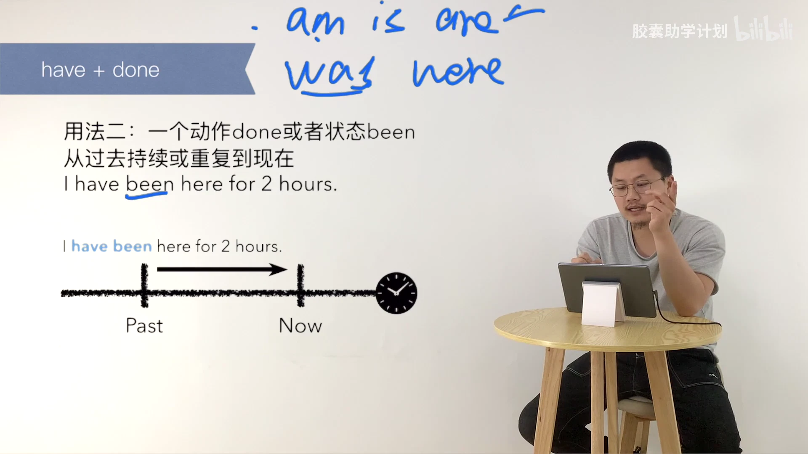

文字识别：am / ere / 胶囊助学计划 / Was / were / have + done / 用法二：一个动作done或者状态been / 从过去持续或重复到现在 / I have been here for 2 hours. / I have been here for 2 hours. / Past / Now

## 00:06:00–00:06:30

后边这 was were 呢是一般过去时。 been 其实是他们的近亲，你可以这样理解为，如果你表示我在北京已经待了两啊，我在北京已经待了十年了，叫做 I have been here in this city for ten years。啊，我在这里啊，这个城市已经待了十年了。它就是啊，那他们所有这些单词的原型是谁呢？一个单词我们

### 画面 00:06:01

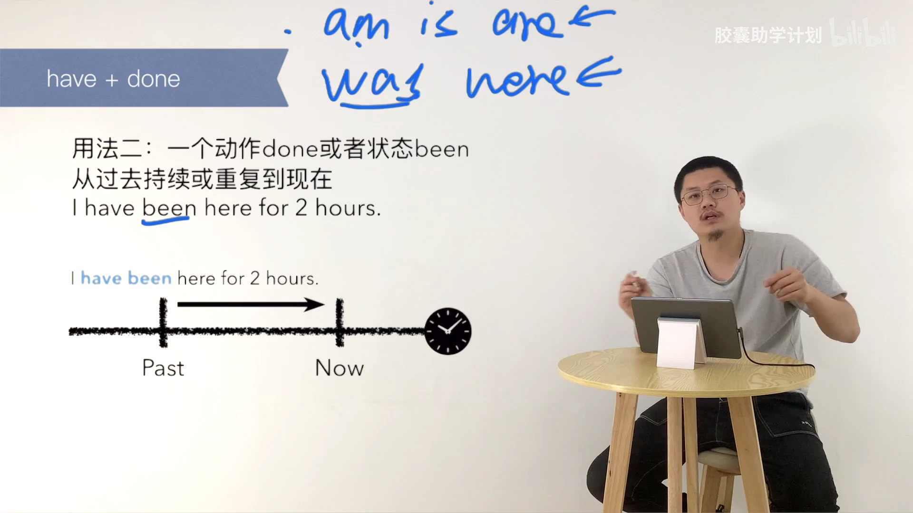

文字识别：am / 胶囊助学计划 / was / Were← / have + done / 用法二：一个动作done或者状态been / 从过去持续或重复到现在 / I have been here for 2 hours. / I have been here for 2 hours. / Past / Now

### 画面 00:06:06

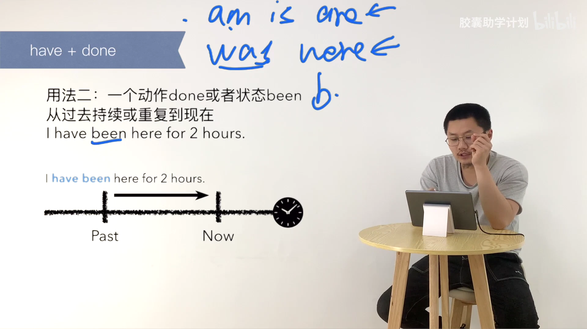

文字识别：am / 胶囊助学计划 / Was / Were← / have + done / 用法二：一个动作done或者状态been / 从过去持续或重复到现在 / I have been here for 2 hours. / I have been here for 2 hours. / Past / Now

### 画面 00:06:08

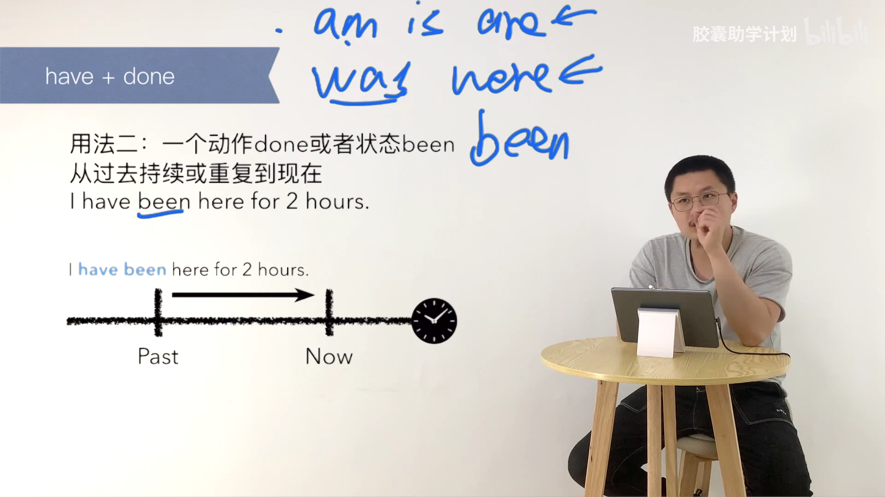

文字识别：am / 胶囊助学计划 / Was / Were← / have + done / been / 用法二：一个动作done或者状态been / 从过去持续或重复到现在 / I have been here for 2 hours. / I have been here for 2 hours. / Past / Now

### 画面 00:06:26

文字识别：am / 胶囊助学计划 / Was / Were← / have + done / been / 用法二：一个动作done或者状态been / 从过去持续或重复到现在 / I have been here for 2 hours. / I have been here for 2 hours. / Past / Now

### 画面 00:06:28

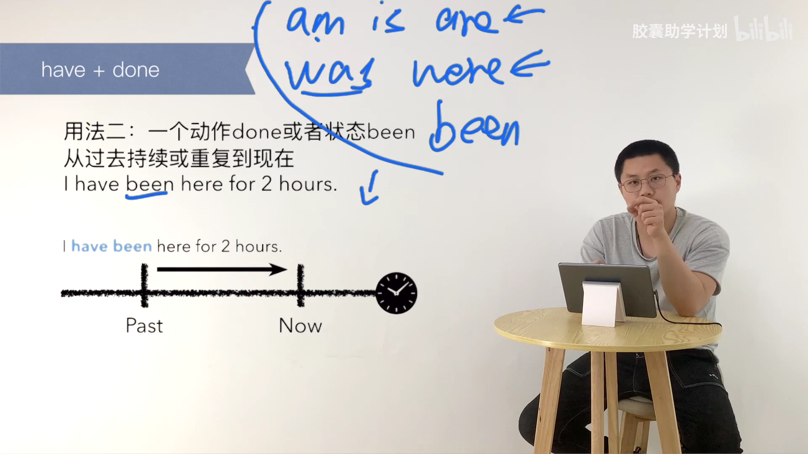

文字识别：am / 胶囊助学计划 / was / Were← / have + done / been / 用法二：一个动作done或者状态been / 从过去持续或重复到现在 / I have been here for 2 hours. / I have been here for 2 hours. / Past / Now

## 00:06:30–00:07:00

管它叫做 be，啊，又叫 be 动词。如果您听过的话，就是两个字母 b 加 e 组成的。如果表陈述客观事实，现在 be 就要变成它的 am is are。如果是过去，它就要变成 was were。如果表示从过去持续到现在，它就要用 been。您如果仔细想，八十五课您见过，但是我没提，我只是把它放在 have been to 和 have gone to 对比当中，直

### 画面 00:06:30

文字识别：am / 胶囊助学计划 / have + done / Was / Were← / been / 用法二：一个动作done或者状态been / 从过去持续或重复到现在 / I have been here for 2 hours. / I have been here for 2 hours. / Past / Now

### 画面 00:06:36

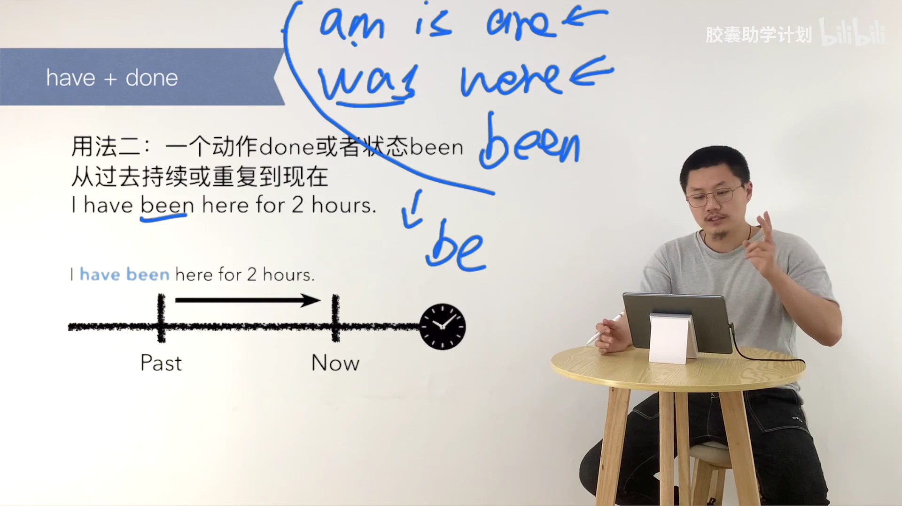

文字识别：am / 胶囊助学计划 / have + done / was / were← / been / 用法二：一个动作done或者状态been / 从过去持续或重复到现在 / I have been here for 2 hours. / be / I have been here for 2 hours. / Past / Now

## 00:07:00–00:07:30

接当做一个硬的短语给大家了，对吧？在这儿我们简单一下，been是怎么来的？所以 I have been here for two hours. Been其实就不用专门去翻译，它只是要告诉你 have加been表示从过去持续到了现在。两个小时前我到达了这里，开始在这儿待着，一直待到了两个小时后，我人还在这里，从过去持续或重复到了现在。OK, very good.那同理

### 画面 00:07:06

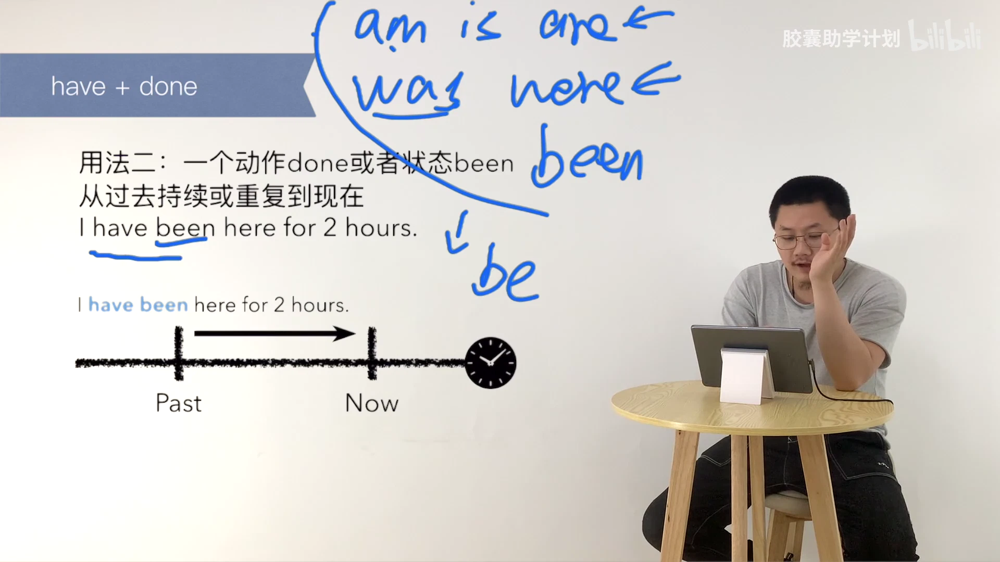

文字识别：am / 胶囊助学计划 / was / Were← / have + done / been / 用法二：一个动作done或者状态been / 从过去持续或重复到现在 / I have been here for 2 hours. / be / I have been here for 2 hours. / Past / Now

### 画面 00:07:08

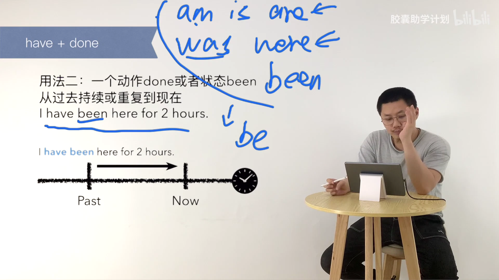

文字识别：am / 胶囊助学计划 / have + done / was / were∈ / been / 用法二：一个动作done或者状态been / 从过去持续或重复到现在 / I havek / been here for 2 hours. / be / I have been here for 2 hours. / Past / Now

### 画面 00:07:25

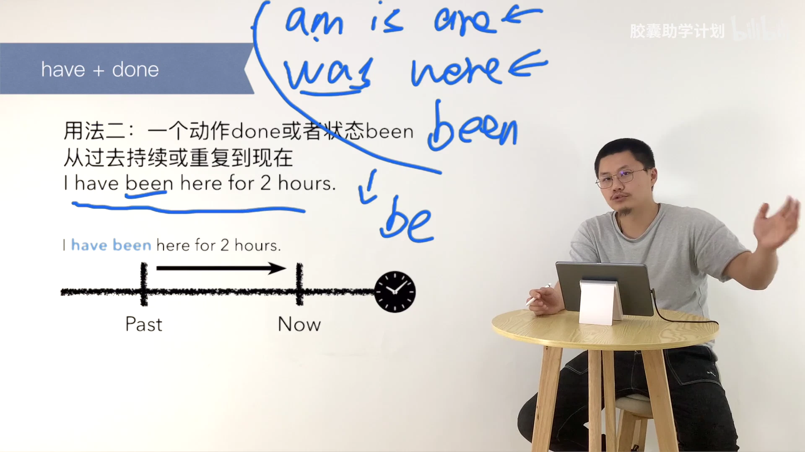

文字识别：am / 胶囊助学计划 / have + done / was / were← / been / 用法二：一个动作done或者状态been / 从过去持续或重复到现在 / I have / been here for 2 hours. / be / I have been here for 2 hours. / Past / Now

## 00:07:30–00:08:00

啊，比如说我现在想说你在这儿已经待两个小时了吗？怎么问呢？很简单吧，一般疑问句把have提前就可以了，叫Have you been here for two hours? Very good.好，那接下来呢，我们看一个小电影片段，印证一下我刚才讲的这个。我们先看一下他台词，叫I've been in this room for eight years now。说我在这个房间当中已经待了八年了啊。你设想一下这么极端的一个情况啊，蹲

### 画面 00:07:31

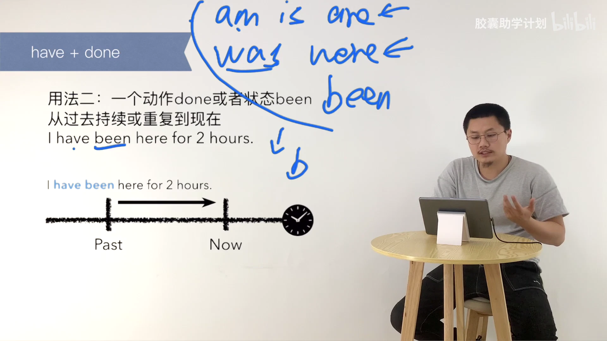

文字识别：am / 胶囊助学计划 / Was / Were← / have + done / been / 用法二：一个动作done或者状态been / 从过去持续或重复到现在 / I have been here for 2 hours. / I have been here for 2 hours. / Past / Now

### 画面 00:07:33

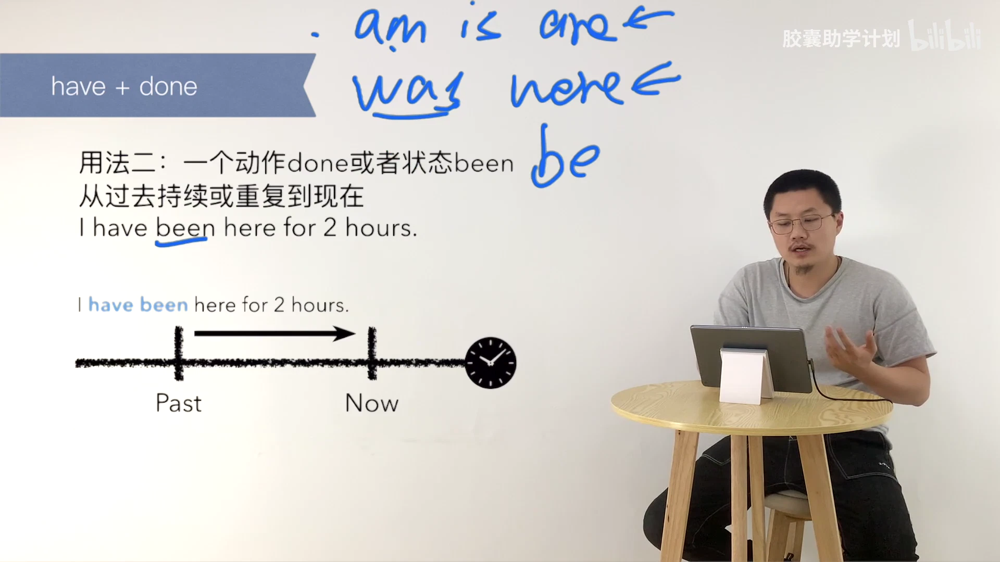

文字识别：am / 胶囊助学计划 / have + done / Was / were← / be / 用法二：一个动作done或者状态been / 从过去持续或重复到现在 / I have been here for 2 hours. / I have been here for 2 hours. / Past / Now

### 画面 00:07:37

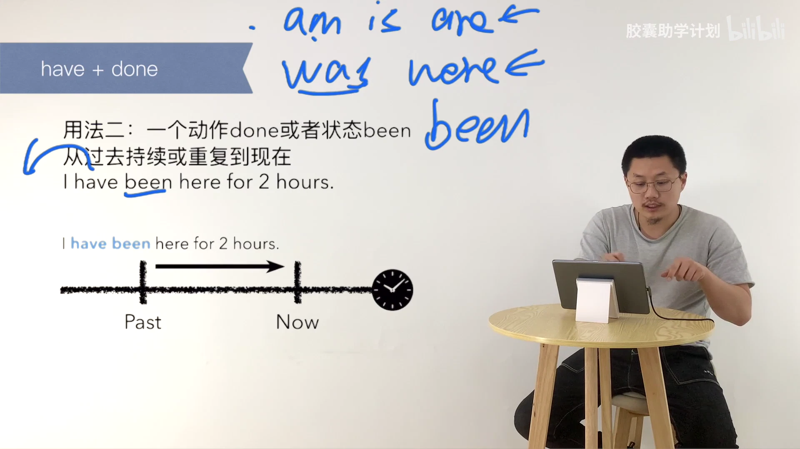

文字识别：am / 胶囊助学计划 / was / Were← / have + done / beem / 用法二：一个动作done或者状态been / 从过去持续或重复到现在 / I have been here for 2 hours. / I have been here for 2 hours. / Past / Now

### 画面 00:07:42

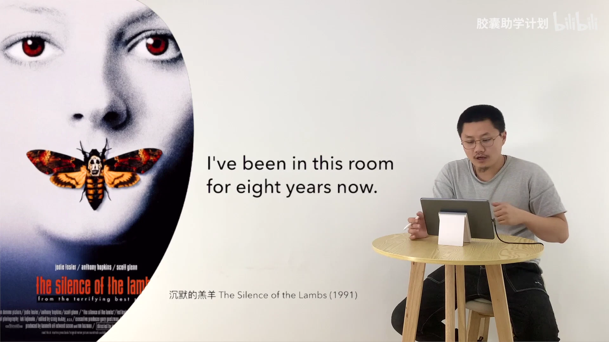

文字识别：胶囊助学计划 / I've been in this room / for eight years now. / jodie fositer/athony hopkins/scof glem / the silence of the lam / 沉默的羔羊 The Silence of the Lambs(1991) / from the terrifying best / mr/il / WC/

### 画面 00:07:49

文字识别：胶囊助学计划 / I've been in this room / for eight years now. / jodie fs/ainle / the silence of the lam / 沉默的羔羊 The Silence of the Lambs(1991) / Irom the terrifying best

### 画面 00:07:51

文字识别：胶囊助学计划 / I've been in this room / for eight years now. / jodie foster/anthoy hopkins/scof glenm / the silence of the lam / 沉默的羔羊 The Silence of the Lambs (1991) / Irom the terrifying best

## 00:08:00–00:08:30

蹲监牢了，对吧？蹲蹲监狱了。OK，叫我在这个房间已经待了八年了。好，接下来我们看一下。I've been in this room for eight years now, Terry. I know they will never ever let me out while I'm alive. What I want is a view. I want a window where I can see a tree or even water. OK，这是一个。I have been in this room for eight years now，对吧？说我现在在这个房间，叫 I am in this room。

### 画面 00:08:07

文字识别：bilibili / 胶囊助学计划

### 画面 00:08:09

文字识别：bilbili / 胶囊助学计划 / 克丽丝手 / 我在这里八年了 / I've been in this room for eight vears now, Clarice.

### 画面 00:08:11

文字识别：bilbli / 胶囊助学计划 / 克丽丝手 / 我在这里八年了 / I've been in this room for eight vears now, Clarice.

### 画面 00:08:13

文字识别：bilibili / 胶囊助学计划 / 我知道在我有生之年 / 他们都不会释放我 / I know they will never ever let me out while I'm alive.

### 画面 00:08:15

文字识别：bilbli / 胶囊助学计划 / 我知道在我有生之年 / 他们都不会释放我 / I know they will never ever let me out while I'm alive.

### 画面 00:08:17

文字识别：bilibili / 胶囊助学计划 / 我想要的是一个景观 / What I want is a view.

### 画面 00:08:19

文字识别：bilbili / 胶囊助学计划 / 我想要一个看到树和水的窗户 / want a window where I can see a tree or even water.

### 画面 00:08:21

文字识别：bilbili / 胶囊助学计划 / 我想要一个看到树和水的窗户 / want a window where I can see a tree or even water.

### 画面 00:08:23

文字识别：bibi / 胶囊助学计划 / I've been in this room / for eight years now. / jodie fositer/anthony hopkins/ scof glem / the silence of the lam / 沉默的羔羊 The Silence of the Lambs (1991) / Irom the terrifying best / mir/itl

### 画面 00:08:25

文字识别：胶囊助学计划 / I've been in this room / for eight years now. / jodie foster/anfhoyhopkins/so glenm / the slence of the lam / 沉默的羔羊 The Silence of the Lambs (1991) / Irom the terrifying best

## 00:08:30–00:09:00

我之前在那个房间叫做 I was in this room, 对吧？我现在人不在了，哪一个？那我在这个房间从八年前一直持续到了现在，那就是 have been in this room. 啊，希望各位有点感觉了。玩一个，接下来我们做一些小的对比，因为这个时态对于各位来说非常容易跟一般过去时混。一般过去时动作发生在过去，对吧？现在完成时是动作也发生在过去，非常容易混。我们做一些小的辨析。我学过英语和

### 画面 00:08:44

文字识别：胶囊助学计划 / have + done

## 00:09:00–00:09:30

我学英语十年了。你看，汉语说这句话，说我学过英语，往往指的是这个人现在学还是不学，这是潜台词啊。我们说大部分情况，我们不去讲那些太细节的事儿，是吧？哦，大部分的情况，说我学过英语的意思，就我原来学，现在怎么样，一般指的是不学了，对吧？但我学英语十年了，往往指的是十年前开始学，我现在其实还在学着呢，对吧？比如说，我说我冥想十年了，你看你听到这句话的时候，往

### 画面 00:09:01

文字识别：胶囊助学计划 / have + done / 我学过英语。 / 我学英语十年了。

## 00:09:30–00:10:00

往感觉到我现在还在做这件事情，对吧？Very good。那他们对应的英文翻译呢？是这两句。我们看第一句，I studied English before。我以前学过英语，非常典型的一般过去时，没有想跟你说现在的事儿，只不过大部分情况下，如果我这么说，别人潜台词会认为你现在不学了，对吧？就发生在过去。但如果你说 I have studied English for ten years，

### 画面 00:09:31

文字识别：胶囊助学计划 / have + done / 我学过英语。 / 我学英语十年了。

### 画面 00:09:49

文字识别：胶囊助学计划 / have + done / 我学过英语。 / 我学英语十年了。 / I studied English before. / I have studied English for ten years.

### 画面 00:09:58

文字识别：胶囊助学计划 / have + done / 我学过英语。 / 我学英语十年了。 / I studied English before. / I have studied English for ten years.

## 00:10:00–00:10:30

现在完成时从过去持续到现在。那我现在还学了呢。 Okay, very good. Then continue. 再来。我曾住在这里和我从一九八九年就住在这里。你看它的区别是什么？我曾住在这里就告诉你过去住这儿，对吧？往往指的是现在不住这儿了，没跟现在有什么太多关系。而我从一九八九年就住在这里了，它往往只从过去持续到现在。玩一个，我们接下来走啊。比如说 I lived here. 我住在这

### 画面 00:10:07

文字识别：胶囊助学计划 / have + done / 我曾住在这里

## 00:10:30–00:11:00

里，以及 I have lived here since 1989. 现在完成时，从一九八九年一直住到了现在，从过去持续到了现在，对吧？现在完成时。再来，昨儿下雨了，和这场雨下四个小时啊，这都下了四个小时了。你看说这句话的时候，往往是外边还在下雨，对吧？我们把它变成英文叫做 It rained yesterday，或者说之前下雨了，Before

### 画面 00:10:30

文字识别：胶囊助学计划 / have + done / 我曾住在这里 / 我从1989年就住在这里。 / I lived here. / I have lived here since 1989.

### 画面 00:10:38

文字识别：胶囊助学计划 / have + done / 我曾住在这里 / 我从1989年就住在这里。 / I lived here. / I have lived here since 1989.

### 画面 00:10:44

文字识别：胶囊助学计划 / have + done

### 画面 00:10:47

文字识别：胶囊助学计划 / have + done / 昨天下雨了。 / 这场雨下了4个小时。

## 00:11:00–00:11:30

it rained before，对吧？往往是 the rain stopped，雨停了。那说 it has rained for four hours， has 加 rained， have 加 that，现在完成时。后边还有一个 for 加一个时间段，典型的用法二，从过去重复或持续到了现在。来一个，所以现在还在下啊。再来一个，二十年前我当过老师，和我当老师五年了，区别是 I was a teacher twenty years ago。

### 画面 00:11:12

文字识别：胶囊助学计划 / have + done / 昨天下雨了。 / 这场雨下了4个小时。 / It rained yesterday. / It has rained for four hours.

### 画面 00:11:14

文字识别：胶囊助学计划 / have + done / 昨天下雨了。 / 这场雨下了4个小时。 / It rained yesterday. / It has rainedfor four hours.

### 画面 00:11:21

文字识别：胶囊助学计划 / have + done

### 画面 00:11:25

文字识别：胶囊助学计划 / have + done / 20年前，我当过老师 / 我当老师5年了。 / I was a teacher twenty years ago.

## 00:11:30–00:12:00

如果我说我现在是个老师，叫做 I am a teacher. 如果我说我当老师五年了，叫 I have been a teacher. 您看到了吗？其实，它基本上就是把 be 在不同的结构，想表达不同的含义的时候，选用不同的形态，表示现在 I am 是二，表示过去 I was，表示从过去持续到现在 have 加 been，对吧？哪一个？呃，简单的复习一下，我们放到一个表格当中啊。这个是我们在语法单项的时候

### 画面 00:11:38

文字识别：胶囊助学计划 / have + done / 20年前，我当过老师 / 我当老师5年了。 / I was a teacher twenty years ago. / I have been a teacher for five years.

### 画面 00:11:53

文字识别：胶囊助学计划 / have + done / 现在完成时 / 一个动作done或者状态been / 用法2 / 从过去持续或重复到现在NCE2L4

## 00:12:00–00:12:30

提过的，我们迅速的回顾一下就好了。首先，现在完成时一个动作用法二是一个动作状态，从过去重复持续到现在。结构就是 have 加 done，规则变化就是动词加 e d done 的规则变化，不规则变化那就是不规则啊。done 呢表示的是过去分词。肯定句给了两个，这个刚才我们都提过，不再多说了。否定句 have has 后边加 not，一般疑问句 have has 提到句首，跟八十三课讲到用法一

### 画面 00:12:11

文字识别：胶囊助学计划 / have + done / 现在完成时 / 一个动作done或者状态been / 用法2 / 从过去持续或重复到现在NCE2L4 / 结构 / have+done / v.ed / done / 过去分词

### 画面 00:12:19

文字识别：胶囊助学计划 / have + done / 现在完成时 / 一个动作done或者状态been / 用法2 / 从过去持续或重复到现在NCE2L4 / I have lived in Beijing / for 10 years/since 2012. / 肯定 / I have been here for 6 years. / 结构 / have+done / v.ed / done / 过去分词

## 00:12:30–00:13:00

的时候没任何区别，特殊疑问句它往往会多了一个地方，我们特殊强调一下，叫做 How long have you lived in Beijing？叫 How long？对吧？OK，它有一些小的难点，难点是我们看第一个叫 have lived 和 lived 之间的区别。我们在这儿假设说 I lived in Beijing 和 I have lived in Beijing for ten years 这两者的区别，你看对于外行

### 画面 00:12:31

文字识别：胶囊助学计划 / have + done / 现在完成时 / 一个动作done或者状态been / 用法2 / 从过去持续或重复到现在NCE2L4 / I have lived in Beijing / 肯定 / for 10 years/since 2012. / I have been here for 6 years. / 结构 / have+done / 否定 / have/has + not / v.ed / 一般疑问 / have/has 提句首 / done / 特殊疑问 / How long have you lived in Beijing? / 过去分词

### 画面 00:12:43

文字识别：胶囊助学计划 / have + done / 现在完成时 / 一个动作done或者状态been / 用法2 / 从过去持续或重复到现在NCE2L4 / I have lived in Beijing / 肯定 / for 10 years/since 2012. / 结构 / I have been here for 6 years. / have+done / 否定 / have/has + not / v.ed / 一般疑问 / have/has 提句首 / done / 特殊疑问 / How long have you lived in Beijing? / 过去分词 / have lived VS lived? / 难点 / v.可持续 / v.ed (done 过去分词)

### 画面 00:12:51

文字识别：胶囊助学计划 / have + done / 现在完成时 / 一个动作done或者状态been / 用法2 / 从过去持续或重复到现在NCE2L4 / I have lived in Beijing / 肯定 / for 10 years/since 2012. / 结构 / I have been here for 6 years. / have+done / 否定 / have/has + not / v.ed / 一般疑问 / have/has 提句首 / done / 特殊疑问 / How long have you lived in Beijing? / 过去分词 / have lived VS lived? / 难点 / v.可持续 / v.ed (done 过去分词)

## 00:13:00–00:13:30

人来说，这两句话的区别好像就是第二句话多了个 have 这个单词，多了个什么 for ten years，别的没什么区别，单词一样，对吧？OK，那对于各位来说，你明白说 I lived in Beijing，它是一般过去时，指我曾经住在北京，对吧？但是如果说 I have lived in Beijing for ten years，就是我从十年前一直到现在都住在北京，我人现在还在北京，这是他们的一个区别，对吧？其次

### 画面 00:13:02

文字识别：胶囊助学计划 / have + done / 现在完成时 / 一个动作done或者状态been / 用法2 / 从过去持续或重复到现在NCE2L4 / I have lived in Beijing / 肯定 / for 10 years/since 2012. / I have been here for 6 years. / 结构 / have+done / 否定 / have/has + not / v.ed / 一般疑问 / have/has 提句首 / done / 特殊疑问 / How long have you lived in Beijing? / 过去分词 / have lived VS lived? / 难点 / v.可持续 / v.ed (done 过去分词)

## 00:13:30–00:14:00

呢，动词要注意一个可持续。这个呢，今天我们不会专门去讲，但是在未来出现的时候，我会不停的提。今天您知道这么一个事儿就行了。为什么动词需要可持续呢？很简单，人家说的就叫做从过去持续或重复到现在。你这个动词是一下结束的，你想一下，它是不是好像没办法表示重复和持续，对吧？所以这个逻辑上就是这个样子。最后一个动词的过去分词，这有很多跟

### 画面 00:13:32

文字识别：胶囊助学计划 / have + done / 现在完成时 / 一个动作done或者状态been / 用法2 / 从过去持续或重复到现在NCE2L4 / I have lived in Beijing / 肯定 / for 10 years/since 2012. / 结构 / I have been here for 6 years. / have+done / 否定 / have/has + not / v.ed / 一般疑问 / have/has 提句首 / done / 特殊疑问 / How long have you lived in Beijing? / 过去分词 / have lived VS lived? / 难点 / v.可持续 / v.ed (done 过去分词)

### 画面 00:13:43

文字识别：胶囊助学计划 / have + done / 现在完成时 / 一个动作done或者状态been / 用法2 / 从过去持续或重复到现在NCE2L4 / I have lived in Beijing / 肯定 / for 10 years/since 2012. / 结构 / I have been here for 6 years. / have+done / 否定 / have/has + not / v.ed / 一般疑问 / have/has 提句首 / done / 特殊疑问 / How long have you lived in Beijing? / 过去分词 / have lived VS lived? / 难点 / v.可持续 / v.ed (done 过去分词)

### 画面 00:13:48

文字识别：胶囊助学计划 / have + done / 现在完成时 / 一个动作done或者状态been / 用法2 / 从过去持续或重复到现在NCE2L4 / I have lived in Beijing / for 10 years/since 2012. / 肯定 / 结构 / I have been here for 6 years. / have+done / 否定 / have/has + not / v.ed / 一般疑问 / have/has 提句首 / done / 特殊疑问 / How long have you lived in Beijing? / 过去分词 / have lived VS lived? / 难点 / v.可持续 / v.ed (done 过去分词)

### 画面 00:13:57

文字识别：胶囊助学计划 / have + done / 现在完成时 / 一个动作done或者状态been / 用法2 / 从过去持续或重复到现在NCE2L4 / I have lived in Beijing / 肯定 / for 10 years/since 2012. / 结构 / I have been here for 6 years. / have+done / 否定 / have/has + not / v.ed / 一般疑问 / have/has 提句首 / done / 特殊疑问 / How long have you lived in Beijing? / 过去分词 / have lived VS lived? / 难点 / v.可持续🍛 / v.ed (done 过去分词)

## 00:14:00–00:14:30

八十三课一模一样，我们不多说了。接下来看一个小的电影片段，出现了叫做 You have been there. 好，你在那里已经待了多长多长时间了？玩一个来了。 So where are you? You're in some motel room. You just you just wake up and you're in in a motel room. There's the key. It feels like maybe it's just the first time you've been there, but perhaps you've been there for a week, three months. It's it's kind of hard to say. I

### 画面 00:14:01

文字识别：胶囊助学计划 / You have been / MEMENTO / there... / SOME MEMORIES ARE BEST FORGOTTEY / Cooncal seect / ce ron fotiunl) / GUY PEARCE CARRIE-ANNE MOSS JOE / 记忆碎片Memento(2000) / MEMEN

### 画面 00:14:04

文字识别：胶囊助学计划 / You have been / MEMENTO / there... / SOME MEMORIES ARE BEST FORGOTTEY / Cooncial seecl / ce rin fegtinl) / GUY PEARCE CARRIE-ANNE MOSS JOE / 记忆碎片Memento(2000) / MEMEN / 901

### 画面 00:14:06

文字识别：胶囊助学计划 / You have been / MEMENTO / there... / SOME MEMORIES ARE BEST FORGOTTEY / Concial seet / ce rin Feofiual / GUY PEARCE CARRIE-ANNE MOSS JOE / 记忆碎片Memento(2000) / MEMEN

### 画面 00:14:11

文字识别：Bilb / 胶囊助学计划 / You have been / MEMENTO / there... / SOME MEMORIES ARE BEST FORGOTTEY / Concial seect / ce roin Fesival) / GUY PEARCE CARRIE-ANNE MOSS JOE / 记忆碎片Memento(2000) / MEMEN

### 画面 00:14:13

文字识别：bilibli / 胶囊助学计划 / 我在哪里?某间旅馆房内 / So where are you? You're in some motel room.

### 画面 00:14:15

文字识别：bilibli / 胶囊助学计划 / 一觉醒来发觉自己在旅馆房内 / You just wake up, and you're in a motel room.

### 画面 00:14:17

文字识别：bilibli / 胶囊助学计划 / 一觉醒来发觉自己在旅馆房内 / You just wake up, and you're in a motel room.

### 画面 00:14:19

文字识别：bilibili / 胶囊助学计划 / 钥匙在这里代 / 似乎刚刚住进来 / There's the key. It feels like maybe it'sjust the first time you've been there...

### 画面 00:14:21

文字识别：bilbili / 胶囊助学计划 / 钥匙在这里似乎刚刚住进来 / There's the key. It feels like maybe it'sjust the first time you've been there...

### 画面 00:14:23

文字识别：bilibli / 胶囊助学计划 / 但…又似乎住了一个星期 / but.. perhaps you've been there for a week.

### 画面 00:14:25

文字识别：bilibli / 胶囊助学计划 / 但…又似乎住了一个星期 / but.. perhaps you've been there for a week.

### 画面 00:14:27

文字识别：bilibili / 胶囊助学计划 / nikh / 甚至三个月 / three months.

### 画面 00:14:29

文字识别：bilibli / 胶囊助学计划 / 很难说我不知道 / It's kind of hard to say. I don't know.

## 00:14:30–00:15:00

don't I don't know. Okay,啊他原文说Perhaps you've been there for a week or three months,是吧？你可能在那里已经待了一周甚至三个月了。There you go.好了，接下来我们看本课的单词。本课的单词有不少都是高频词汇啊，出现频率非常高的。我们认真听一下啊。第一个单词叫做believe, believe叫做我相信啊，相信啊，信任。比如说Do you believe me?

### 画面 00:14:31

文字识别：胶囊助学计划 / You have been / MEMENTO / there... / SOME MEMORIES ARE BEST FORGOTTEY / Coonial select / ice ron Fegfivnil) / GUY PEARCE CARRIE-ANNE MOSS JOE / 记忆碎片Memento(2000) / MEMEN

### 画面 00:14:33

文字识别：胶囊助学计划 / You have been / MEMEHTO / there... / SOME MEMORIES ARE BEST FORGOTTEY / Concial seect / c ron Fesiunl) / GUY PEARCE CARRIE-ANNE MOSS JOE / 记忆碎片Memento(2000) / MEMEN

### 画面 00:14:36

文字识别：胶囊助学计划 / You have been / MEMEHTO / there... / SOME MEMORIES ARE BEST FORGOTTEY / Concial seect / ce ron Festiunl) / GUY PEARCE CARRIE-ANNE MOSS JOE / 记忆碎片Memento(2000) / MEMEN

### 画面 00:14:41

文字识别：胶囊助学计划 / /br'li:v/ / believe / Believe

### 画面 00:14:56

文字识别：胶囊助学计划 / / b1'li:v/ / believe / Believe

## 00:15:00–00:15:30

你相信我吗？Okay,以及我不相信这件事情。I don't believe it. Okay,好，注意看，这有一个小的连读哈。我们看believe的最后一个音是v，是一个辅音。连读有这么一个规则，就是下一个单词，你看它的第一个音是元音e，所以它往往不读成believe it。它不是说I don't believe it。你这么读没有错，但是外国人他往往是

### 画面 00:15:08

文字识别：胶囊助学计划 / / b=' l i : v / / believe / ① Do you believe me? / Believe / ② I don't believe it.

## 00:15:30–00:16:00

I don't believe it, it 听见了哈，连起来了 I don't believe it, very good, continue 下一个单词叫做 may，它类似于我们之前学过的 can，今天我们先作为一个单词的方式去讲它，以后我们再具体去讲它啊，给它来一个专栏。今天各位知道它的意思叫允许、许可就可以了。比如说它经常出现的一个小的用法叫做 may I 怎么怎么样，叫

### 画面 00:15:35

文字识别：胶囊助学计划 / /meil / may / 2

## 00:16:00–00:16:30

我云我可以怎么怎么样？有点像Can I对吧？比如说I'm thirsty, May I have some water？说我渴了，我能喝点水吗？啊，当然了，这个可能是在一些特殊的场景之下会问这样语。我说我很渴，我可以喝一点水吗？哎，你不能，你接下来做这事儿不允许喝水，先渴会是吧？或者说May I is too cold here？哦，真是太冷了。May I close the door？你看他的感觉是不是跟Can I

### 画面 00:16:05

文字识别：胶囊助学计划 / /mei/ / may / ① May I . / I'm thirsty. / 2 / ③ May I have some water? / 3

### 画面 00:16:21

文字识别：胶囊助学计划 / /mei/ / may / ① May | ….

## 00:16:30–00:17:00

close the door? 很像，对吧？OK，它往往指的是我能怎么怎么样嘛。玩一个好，May。接下来两个单词经常一起出现。第一个单词就不多说了，我们见过很多遍了，叫做 Why？为什么？一个特殊疑问词。而下面这个单词就是它的答案，叫做因为，对吧？叫做 Because，Because。玩一个。那注意一个小点，Because 这个单词我们在新二当中其实会见到它的频率会更高。它其实是一个我们学术

### 画面 00:16:35

文字识别：胶囊助学计划 / /wai/ /bιkaz / / why because

## 00:17:00–00:17:30

术语叫原因状语从句的引导词，是吧？你但是你在这儿目前知道它后边加一个小的句子就行了。比如说，我问，Why are you having a meal at midnight？你为什么这大半夜的吃饭呢？回答，Because I'm so hungry。说因为啊我太饿了。你看，because后边是不是加了一句话？玩一个。接下来下一个小的动词非常常

### 画面 00:17:00

文字识别：胶囊助学计划 / /wai/ /bikaz/ / why because / ① because +句子

### 画面 00:17:08

文字识别：胶囊助学计划 / /wai/ / /bι'kａz/ / why / because / ① because +句子 / Why are you having a meal at midnig!

### 画面 00:17:25

文字识别：胶囊助学计划 / /sel/ / /sauld/ / FQ / sell v. - sold - sold / E / SOLD / 福

## 00:17:30–00:18:00

用，叫做 sell， sell 叫做卖啊买 buy 卖 sell，过去式过去分词长得是一样的。带着各位先读一下，叫做 sold， sold very good。我们看这个小牌子啊，这个我在奥克兰的时候还真注意到过，他们都是 house 对吧？门口就会如果这个房子要卖，就会插这么一个东西，插上了之后，那个上面插上这么一个木板子吧，类似于好板子上面

### 画面 00:17:47

文字识别：胶囊助学计划 / /sel/ / /sauld/ / FQ / sell v. - sqld - sold / • / SOLD

## 00:18:00–00:18:30

有各种各样的信息，然后会写两个英文叫 for sale 啊，翻译成汉语就是两个字儿叫代售。这个 sale 其实是 sale，你可以理解为是它的名词状态，对吧？ for sale 叫代售。如果这个房子卖出去了呢，它往往就会来一个单词叫做 sold 啊，叫做已经被卖出去了。你看到它也是 sell 的单词，对吧？它这个单词的变体。 OK，比如说我

### 画面 00:18:02

文字识别：胶囊助学计划 / /sel/ / /sauld/ / FQ / sell v. - sqld - sold / • / ① for sale / SOLD

### 画面 00:18:19

文字识别：胶囊助学计划 / /sel/ / /sauld/ / FQ / sell v. - sqld - sold / • / ① for sale / SOLD

## 00:18:30–00:19:00

们拿它造句子. They sold their house yesterday.他们昨天把他们的房子给卖了。肯定句，一般疑问句，Did提前，Did they sell their house yesterday?那儿一个对yesterday提问，When did they sell their house?他们什么时候把他们的房子给卖了呢？那儿一个好，下一个单词retire. Retire，注意到它是一个动词，它

### 画面 00:18:30

文字识别：胶囊助学计划 / /sel/ / /sauld/ / FQ / sell v. - sqld - sold / • / ① for sale / SOLD / They sold their house yesterday.

### 画面 00:18:45

文字识别：胶囊助学计划 / /sel/ / /sauld/ / Fo / sell v. - sqld - sold / ① for sale / SOLD / They sold their house yesterday. / Did they sell their house yesterday? / When did they sell their house?

### 画面 00:18:54

文字识别：胶囊助学计划 / /ri'taia/ / retire v.

## 00:19:00–00:19:30

表示的是退休。OK，我们造句子说，My father can stay with my mom。我我父亲能和我妈妈待在一起。Because记得吧？我说Because要加一句话，对吧？He has just retired。因为他刚刚退休。退休这件，当我说他刚刚退休的时候，他一定不是我说话这一刻退休的，一定是之前退休的，对吧？那之前退休对现在的影响是什么呢？

### 画面 00:19:02

文字识别：胶囊助学计划 / /ri'taia/ / retire y. / ① My father can stay with my mom, / because he has just retired.

### 画面 00:19:15

文字识别：胶囊助学计划 / /ri'taia/ / retire ?. / ① My father can stay with my mom, / because he has just retired.

## 00:19:30–00:20:00

前面那句话，He can stay with my mom. 啊，他能和我母亲每天粘在一起，对吧？那儿一个 continue 说，They retired last month. 他们上个月退休的。一般过去时，They retired last month. 他们上个月退休的。一般疑问句，Did they retire last month? 啊，以及 When did they retire? 他们什么时候退休的呀？对，这事儿已经过去了，对吧？已经退完

### 画面 00:19:31

文字识别：胶囊助学计划 / /ri'taia/ / retire y. / ① My father can stay with my mom, / because he has just retired.

### 画面 00:19:35

文字识别：胶囊助学计划 / /ri'taia/ / retire !. / ① My father can stay with my mom, / because he has just retired.

### 画面 00:19:39

文字识别：胶囊助学计划 / /ri'taia/ / retire Y. / ① My father can stay with my mom, / because he has just retired. / They retired last month.

### 画面 00:19:49

文字识别：胶囊助学计划 / /ri'taia/ / retire Y. / ① My father can stay with my mom, / because he has just retired. / They retired last month. / ③ Did they retire last month?

## 00:20:00–00:20:30

了。这儿一个，接下来下一个小的单词叫 cost，注意它是一个动词，叫做花费。比如说，it costs sixty eight thousand and five hundred，说它呀花了六万八千五百块钱。好，注意这个它指的不是人花了六万五千块钱，注意它的主语往往是这个东西花费了我多

### 画面 00:20:01

文字识别：胶囊助学计划 / /kpst/ / cost / $

### 画面 00:20:26

文字识别：胶囊助学计划 / /kpst/ / cost / V. / $ / ① It costs 68,500.

## 00:20:30–00:21:00

少多少钱，对吧？所以某种程度上，你可以理解为这儿啊省略了一个 me 啊，it costs me，说这个东西花了我六万八千五百块钱。it 指的是你买的那个东西，对吧？那一般疑问句你要注意一下它的时态，costs，陈述客观事实，一般现在时，does 提前，叫做 does it cost sixty eight thousand five hundred？完一个，以及对前提问，how much？我们之前讲过 much

### 画面 00:20:33

文字识别：胶囊助学计划 / /kpst/ / V / cost / $ / ① It costs 68,500.

### 画面 00:20:55

文字识别：胶囊助学计划bil出 / /kpst/ / cost / V / me / $ / ① It costs 68,500. / ② Does it cost 68,500? / How much does it cost?

### 画面 00:20:59

文字识别：胶囊助学计划 / /kpst/ / V / cost / me / $ / ① It costs 68,500. / Does it cost 68.500? / 2 / ) / How much does it cost?

## 00:21:00–00:21:30

and many before, right? Much加不可数，many加可数。所以问钱的时候，我们往往问的是how much, right? So how much does it cost?叫做这个玩意儿要多少钱啊？就是就是问这个东西多少钱啊？或者一个花了多少钱，就是问多少钱。最后几个小的单词，各位只要知道它基本的含义就可以了，不用拿它去造句了。第一个单词叫pound, pound.其实我们之前学过

### 画面 00:21:18

文字识别：胶囊助学计划 / BANIRENGILANID / £70 / /paund/ /ｐeni/ / / ｐens / / TEN / pound penny - pence / Tw / 17090 / FTVE

## 00:21:30–00:22:00

四十一课，磅的意思，那时候它是个重量单位，对吧？今天呢，各位能知道它又多了一个新的意思，指的是英镑啊。下一个单词叫做 penny，叫做便士，便士就是分了，对吧？咱们你可以理解为一磅就是一块钱，一便士就是一分钱，你这么理解就行了，对吧？那十便士，那就一毛钱呗，对吧？OK，那然后一百便士呢，就是一磅。OK，pence

### 画面 00:21:48

文字识别：胶囊助学计划 / BANRENGLAND / /paund/ /peni/ / /ｐens / / TEN / pound / penny - pence / Tw / 0090 / FIVE

## 00:22:00–00:22:30

OK，pence就是penny的复数，这个我们在后面的文章当中会见到，所以我提前拿出来说一下，OK，好，呃，接下来呢，我们最后还有一个小的单词，我们直接拿电影片段去给各位说了，叫做worth，worth，worth指的是值啊，就就比如说你买个东西，这玩意儿物有所值，性价比很高，就是这个值这个字，那worth every penny啊，值每一分钱，其实就是你

### 画面 00:22:00

文字识别：胶囊助学计划 / BANIRENGLAND / £70. / /paund/ /'peni/ / /ｐens / / TEN / pound / penny - pence / Tw / LU90 / FIVE

### 画面 00:22:07

文字识别：胶囊助学计划 / MISCHIEF. MAYHEM. SOAP. / /w3:θ1 / worth every penny / RAD PITT EDWARD NO / HELENA 30NN / 搏击俱乐部 Fight Club(1999) / FROM THE DIRECTOR OF

### 画面 00:22:12

文字识别：CUL / 胶囊助学计划 / MISCHIEF. MAYHEM. SOAP. / /w3:θ1 / worth every penny / RAD PITT EDWAND NO / HELENA 30NH / EE / 搏击俱乐部 Fight Club(1999) / FROM THE DIRECTOR OF

### 画面 00:22:25

文字识别：CUL / 胶囊助学计划 / MISCHIEF.MAYHEM. SOAP. / /w3:θ1 / worth every penny / RAD PITT EDWARD NO / E / HELENA 30NH / 搏击俱乐部 Fight Club(1999) / FROM THE DIRECTOR OF

### 画面 00:22:29

文字识别：ClUD / 胶囊助学计划 / MISCHIEF. MAYHEM. SOAP. / /w3:θ1 / worth every penny / RAD PIFT EDWARD NO / E / HELENA 30NN / 搏击俱乐部 Fight Club(1999) / hafn t   / Ld / FROM THE DIRECTOR OF

## 00:22:30–00:23:00

花的每一分钱都特别值这个东西，对吧？花十块钱买了一个东西，这个东西太值了啊！或者花一万块钱买了个东西，OK。所以这个东西物有所值，worth every penny。接下来我们看电影片段。I got this dress at a thrift store for one dollar. It was worth every penny. It's a bridesmaid's dress. Is worth every penny.啊，物有所值，每一分钱都值。玩一个。Recap，我们在这一课当中知识点还真不少。首

### 画面 00:22:42

文字识别：Bilibili / 胶囊助学计划

### 画面 00:22:44

文字识别：biibili / 胶囊助学计划 / 我花一块钱买下了这件礼服 / I got this dress at a thrift store for $1.

### 画面 00:22:46

文字识别：bilibili / 胶囊助学计划 / 一分钱一分货 / It was worth every penny.

### 画面 00:22:48

文字识别：bilbli / 胶囊助学计划 / 这件是结婚礼服 / It's a bridesmaid's dress.

### 画面 00:22:50

文字识别：胶囊助学计划 / MISCHIEF. MAYHEM. SOAP. / /w3:θ1 / worth every penny / RAD PITT EDWARD NO / HELENA 30NH / 搏击俱乐部 Fight Club(1999) / FROM THE DIRECTOR OF

### 画面 00:22:54

文字识别：Recap / 胶囊助学计划 / Patterns / have +done 用法二 / Grammar / why / Words / how long / because / Expression / May Iv..?

### 画面 00:22:57

文字识别：胶囊助学计划 / Recap / Patterns / have+done用法二 / Grammar / why / Words / how long / because / Expression / May Iv..?

## 00:23:00–00:23:30

先 have 加单用法二，各位仔细回顾一下，动作或状态从过去重复或持续到现在。接下来呢，关键单词出现了几个 why， how long，跟 because，这些都是功能性单词啊，频率出现的非常非常的高。最后呢，我们还有一个小的习惯用法叫“美 I 怎么怎么样”，类似于“Can I 怎么怎么样”，对吧？非常的像，叫我能怎么怎么样吗？Where you go？好，家庭作业单词

### 画面 00:23:18

文字识别：胶囊助学计划 / Recap / Patterns / have + done / 用法二 / Grammar / why / Words / howlong / because / Expression / May I v...?

### 画面 00:23:27

文字识别：胶囊助学计划

## 00:23:30–00:24:00

造句，各位要做红皮书初级啊。Have加但，各位去找一下用法二。你会应该在两个不同的单元找到用法一和用法二。接下来呢，给自己讲解一遍今天的核心知识点，尤其是现在完成时的第二个用法。如果大家喜欢我们的课程，欢迎大家关注、订阅、一键三连，分享给那些需要的朋友。最后，我们看一句名人名言：In order to succeed, we must first believe that

### 画面 00:23:40

文字识别：胶囊助学计划 / 单词造句3 / 2.红皮书have+done用法二 / 3.请给自己讲解一遍今天的 / 核心知识点

### 画面 00:23:46

文字识别：胶囊助学计划

### 画面 00:23:52

文字识别：胶囊助学计划 / In order to succeed, we must first believe / that we can. / - Nikos Kazantzakis

## 00:24:00–00:24:14

we can. See you next time.

### 画面 00:24:02

文字识别：In order to succeed, we must first / that we can. / Nikos Kazantzakis

### 画面 00:24:04

文字识别：CAPSULEACADEMY / 胶囊助学计划 / 『 / 小红书 / Lecturer / Leo / OE

### 画面 00:24:07

文字识别：CAPSULEACADEMY / 胶囊助学计划 / 『 / 小红书 / Editor / OE

### 画面 00:24:10

文字识别：CAPSULEACADEMY / 胶囊助学计划 / 小红书 / Creator / Leo & Berlin / OE

### 画面 00:24:12

文字识别：bilibili / 胶囊助学计划 / 胶囊助学计划 / 小红书 / OE

### 画面 00:24:14

文字识别：bilibili / 胶囊助学计划

