# 089 文章

快速机器解析：语音为单模型转写，未进行独立交叉校对或人工复核；画面每秒采样并按变化选帧，短时文字和标记可能遗漏。截图时间约有 1 秒误差。图片有损压缩；遇到疑点请按时间查看 Google Drive 原视频。

## 00:00:00–00:00:30

Hello everyone, welcome to Capsule Academy. This is Leo. Today we're going to learn New Concept English Book One Lesson Eighty Nine Story. Hope you guys enjoyed. We directly look at the article. Two people, one called Nigel, one called In. Good. Nigel says good afternoon. Afternoon. I believe. Say I believe.

### 画面 00:00:00

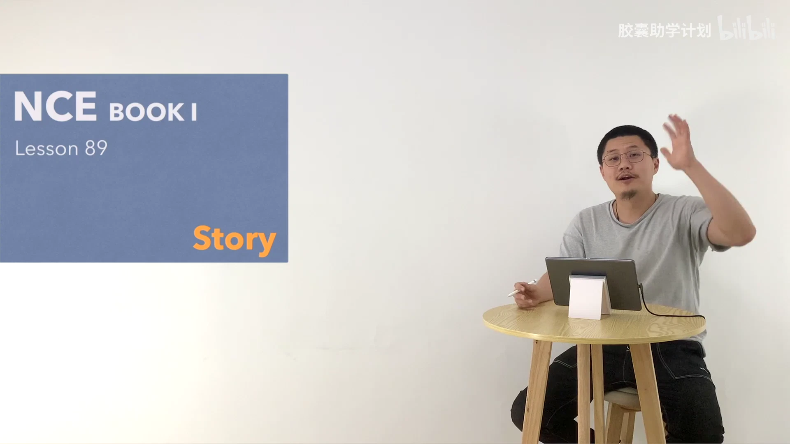

文字识别：胶囊助学计划 / NCE / BOOKI / Lesson 89 / Story

### 画面 00:00:02

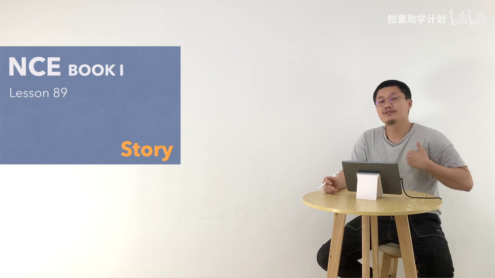

文字识别：胶囊助学计划 / NCE / BOOKI / Lesson 89 / Story

### 画面 00:00:08

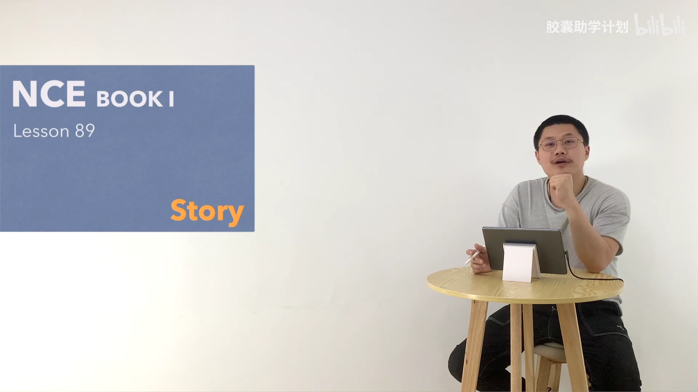

文字识别：胶囊助学计划 / NCE / BOOKI / Lesson 89 / Story

### 画面 00:00:10

文字识别：胶囊助学计划 bilbl

### 画面 00:00:13

文字识别：胶囊助学计划

### 画面 00:00:15

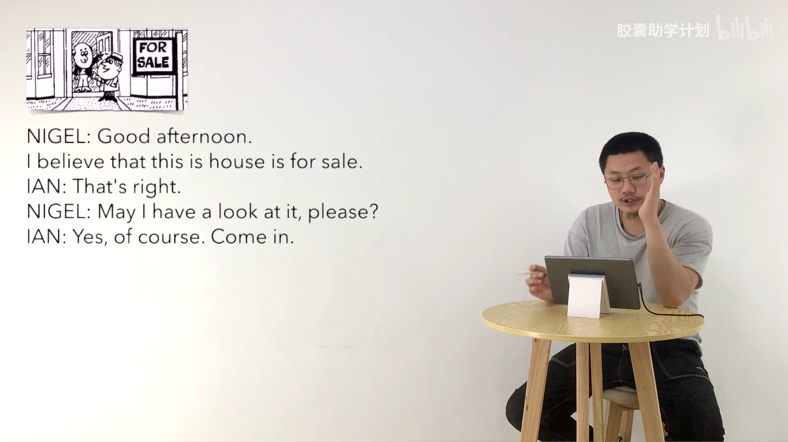

文字识别：胶囊助学计划 / FOR / :83 / SALE / NIGEL: Good afternoon. / I believe that this is house is for sale. / IAN: That's right. / NIGEL: May Ihave a look at it, please? / IAN: Yes, of course. Come in.

### 画面 00:00:24

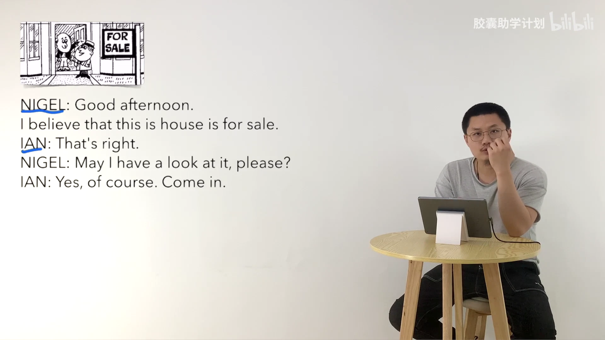

文字识别：胶囊助学计划bil / pal / FOR / SALE / NIGEL: Good afternoon. / I believe that this is house is for sale. / IAN: That's right. / NIGEL: May Ihave a look at it, please? / IAN: Yes, of course. Come in.

## 00:00:30–00:01:00

先不管它。九十九课、一百零一课，我们再去处理它啊。它本来也不翻译。我认为 this house is for sale。说这个房子是 for sale，一个小的短语，各位记住就行了。两个字，代售。That's right。In说没问题啊，是对的。Nigel问了一句话，说May I怎么怎么怎么样？好，回顾一下，May I have some water? May I close the door?这个是英文当中很常见的一

### 画面 00:00:43

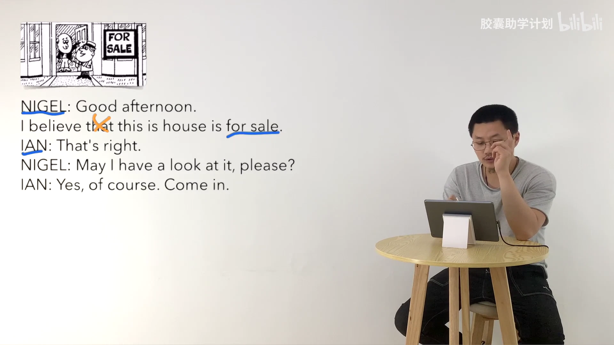

文字识别：胶囊助学计划b出出 / al / FOR / :83 / SALE / NIGEL: Good afternoon. / I believe tat this is house is for sale. / IAN: That's right. / NIGEL: May Ihave a look at it, please? / IAN: Yes, of course. Come in.

### 画面 00:00:54

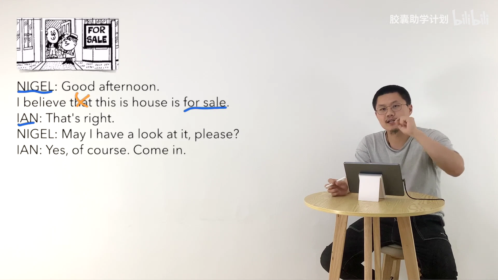

文字识别：胶囊助学计划 / pal / FOR / SALE / i / NIGEL: Good afternoon. / I believe tat this is house is for sale. / IAN: That's right. / NIGEL: May Ihave a look at it, please? / IAN: Yes, of course. Come in.

## 00:01:00–00:01:30

个句式啊，各位把它整理一下，造一些句子啊。我们在单词部分其实已经提到了。那 have a look at it，这个我们在八十七课也讲过，就是看一眼啊。我能看一眼吗？Please， Yes， of course，当然了。Come in，进来吧。那就说 How long have you lived here？好，看到这句话，have加lived往这一放，现在完成时。我们先不看它，我们先看下一句话，叫做 I've lived。好，这儿缺

### 画面 00:01:06

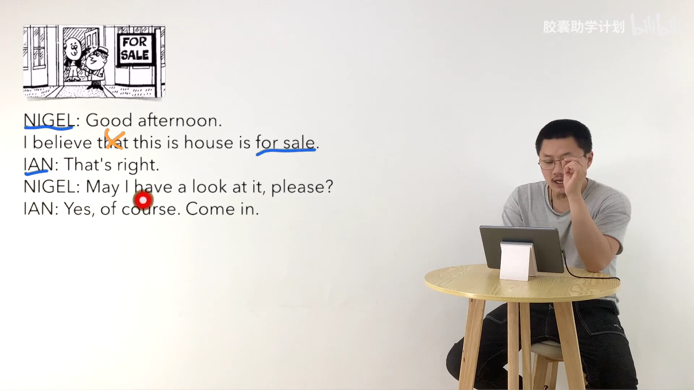

文字识别：胶囊助学计划 / al / FOR / :83 / SALE / 111 / NIGEL: Good afternoon. / I believe tat this is house is for sale. / IAN: That's right. / NIGEL: May I have a look at it, please? / IAN: Yes, of course. Come in.

### 画面 00:01:16

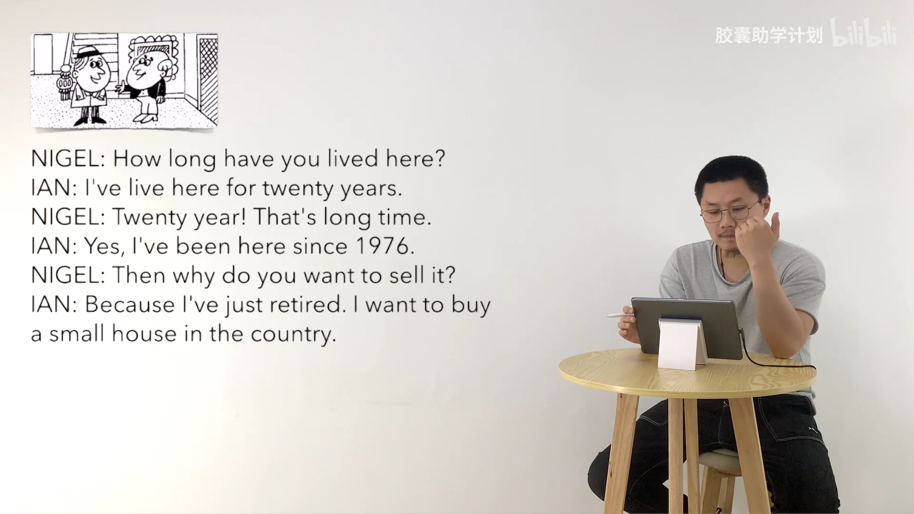

文字识别：胶囊助学计划 / NIGEL: How long have you lived here? / IAN: I've live here for twenty years. / NIGEL: Twenty year! That's long time. / IAN: Yes, I've been here since 1976. / NIGEL: Then why do you want to sell it? / IAN: Because I've just retired.I want to buy / a small house in the country.

## 00:01:30–00:02:00

了一个小的字母d啊。I've lived here for twenty years.我在这里已经住了二十年了。首先，have加蛋没问题，现在完成时。其次，持续了二十年，人现在还住在这里呢。过去持续到了现在，对吧？然后你把它变一般疑问句，再对for twenty years提问，就出来了。How long have you lived here?对吧？这两句话基本上

### 画面 00:01:46

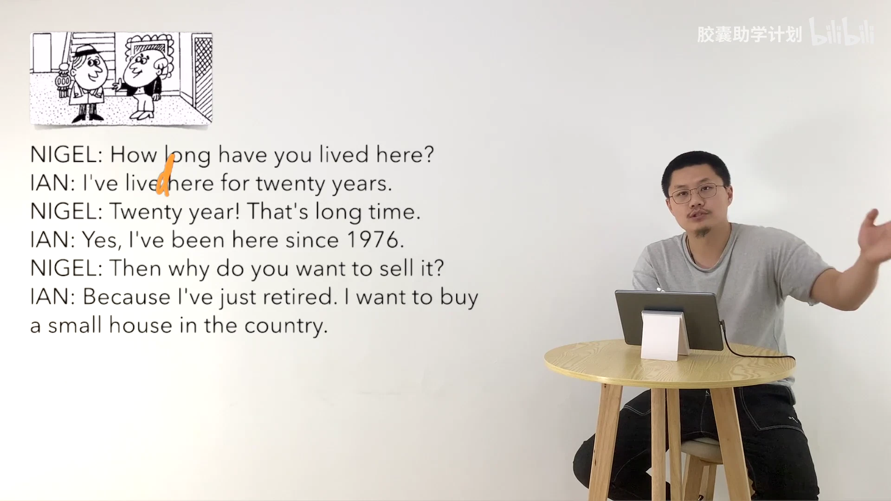

文字识别：胶囊助学计划 / NIGEL: How png have you lived here? / IAN: I've livehere for twenty years. / NIGEL: Twenty year! That's long time. / IAN: Yes, I've been here since 1976. / NIGEL: Then why do you want to sell it? / IAN: Because I've just retired.I want to buy / a small house in the country.

## 00:02:00–00:02:30

是一码事儿啊。Twenty years, that's a long time.说二十年了，这可够长了。Yes,是的。I've been here since.你看，I've been here. Have加been，现在完成时，对吧？我在这里，自从一九七六年。一九七六年怎么读呢？十九七十六，对吧？十九，nineteen七十六，seventy six。Very good. Then

### 画面 00:02:16

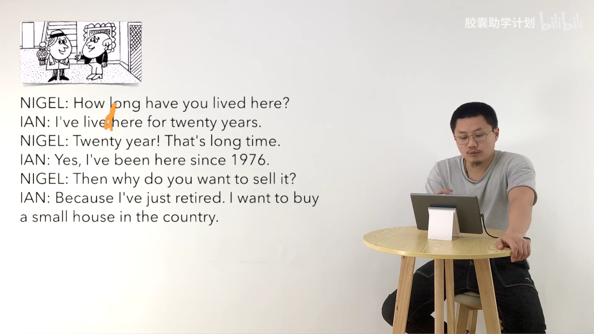

文字识别：胶囊助学计划 / NIGEL: How png have you lived here? / IAN: I've liveahere for twenty years. / NIGEL: Twenty year! That's long time. / IAN: Yes, I've been here since 1976. / NIGEL: Then why do you want to sell it? / IAN: Because I've just retired.I want to buy / a small house in the country.

## 00:02:30–00:03:00

说那么然后Why do you want to sell it?好注意不连读就是这样读啊。说为什么那你想去卖掉它呢？这儿有一个小的连读，最后的那个音和it的e是连起来的。于是它读起来听上去是sell it。听见了哈？不是sell it，sell it. Then why do you want to sell it? Very good. Because

### 画面 00:02:46

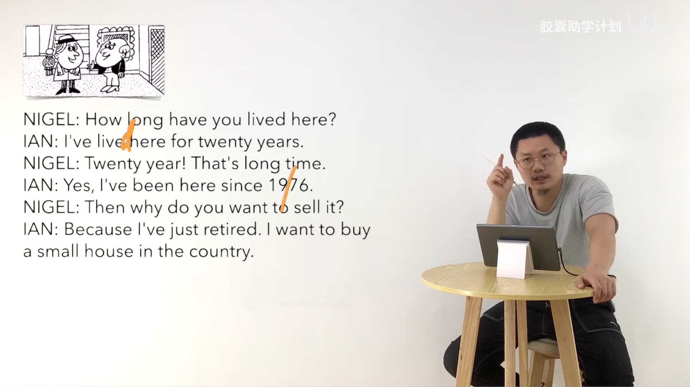

文字识别：胶囊助学计划 / NIGEL: How png have you lived here? / IAN: I've liveahere for twenty years. / NIGEL: Twenty year! That's long time. / IAN: Yes, I've been here since 1976. / NIGEL: Then why do you want tb sellit? / IAN: Because I've just retired.I want to buy / a small house in the country.

## 00:03:00–00:03:30

因为I've just retired.因为我刚刚退休。这一课很有意思。这一课你跟下一课连起来听，你能听到很多有趣的啊这个背后的故事是吧？你在这儿先记住啊。这个男主人说他想卖房子的原因是说我刚刚退休啊。然后呢，I want to buy a small house in the country.说我想去买一个小房子in the country叫在乡下是吧？我退休了，我想去

### 画面 00:03:00

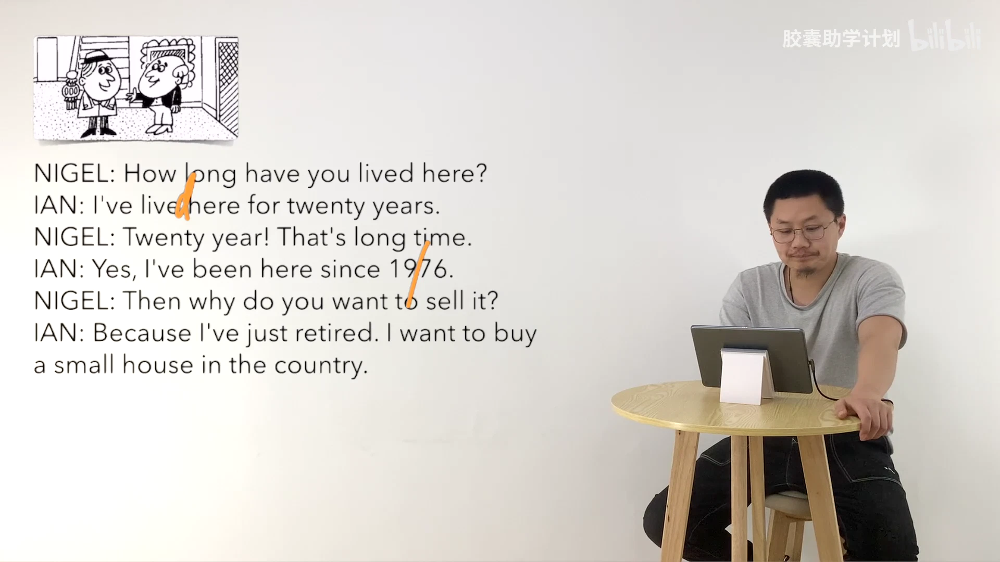

文字识别：胶囊助学计划 / NIGEL: How png have you lived here? / IAN: I've liveChere for twenty years. / NIGEL: Twenty year! That's long time. / IAN: Yes, I've been here since 1976. / NIGEL: Then why do you want tb sell it? / IAN: Because I've just retired.I want to buy / a small house in the country.

## 00:03:30–00:04:00

乡下度过晚年了。注意，这是他给为什么要卖房子的原因啊。好，continue。那就说，How much does this house cost？这个房子值多少钱呢？Sixty-eight thousand five hundred。注意这个小点儿是 thousand 千啊，所以六十八个千再加五百，六十八个千六万八，对吧？六万八千啊，六十八个千。所以你看这句话，

### 画面 00:03:30

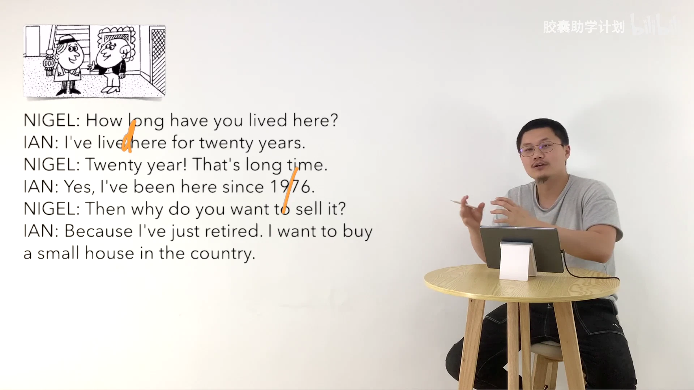

文字识别：胶囊助学计划 / NIGEL: How png have you lived here? / IAN: I've liveahere for twenty years. / NIGEL: Twenty year! That's long time. / IAN: Yes, I've been here since 1976. / NIGEL: Then why do you want tb sell it? / IAN: Because I've just retired.I want to buy / a small house in the country.

### 画面 00:03:35

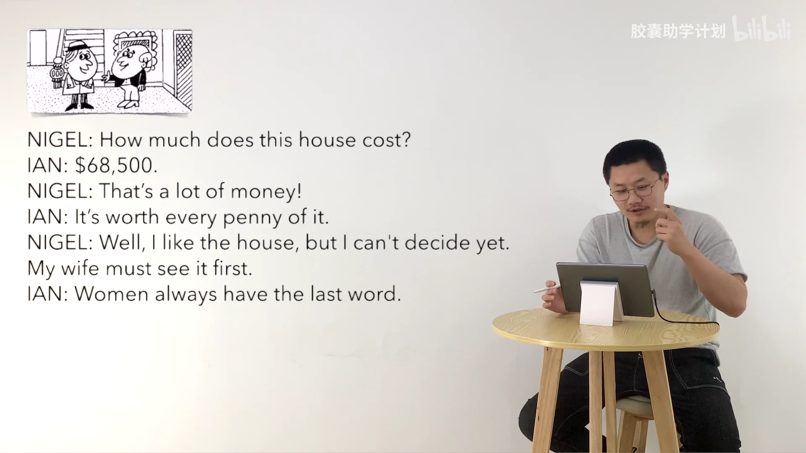

文字识别：胶囊助学计划 / NIGEL: How much does this house cost? / IAN: $68,500. / NIGEL: That's a lot of money! / IAN: It's worth every penny of it. / NIGEL: Well, I like the house, but I can't decide yet. / My wife must see it first. / IAN: Women always have the last word.

## 00:04:00–00:04:30

各位回想一下我们在单词部分讲过的，叫做 it 啊，或者 it 就变成了 this house嘛，对吧？这句话就变成 this house costs sixty eight thousand five hundred，然后再变一般疑问句，然后再对前提问，就变成了 how much does this house cost？玩一个，继续，Andrew 说 that's a lot of money，说这个不少钱呢。Andrew 说 yeah，is worth every penny of it，是值

### 画面 00:04:05

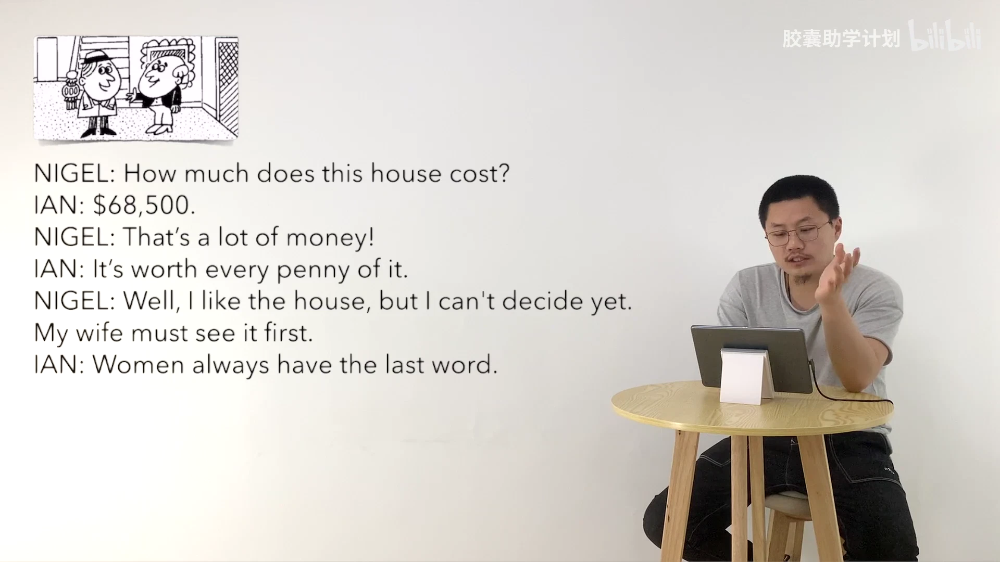

文字识别：胶囊助学计划 / NIGEL: How much does this house cost? / IAN: $68,500. / NIGEL: That's a lot of money! / IAN: It's worth every penny of it. / NIGEL: Well, I like the house, but I can't decide yet. / My wife must see it first. / IAN: Women always have the last word.

## 00:04:30–00:05:00

每一分钱。Worth every penny, 对吧？值每一分钱。Well, I like the house. Nigel就是买房子这个人说，嗯，我还挺喜欢这个房子。But I can't decide yet.我还没有办法决定。你看他为什么呢？他说，My wife must see it first.说，我呀决定不了，我老婆必须要先看一下啊。Must必须see it，看它first。首先，对吧？我我老婆必须要先看它一下。

### 画面 00:04:35

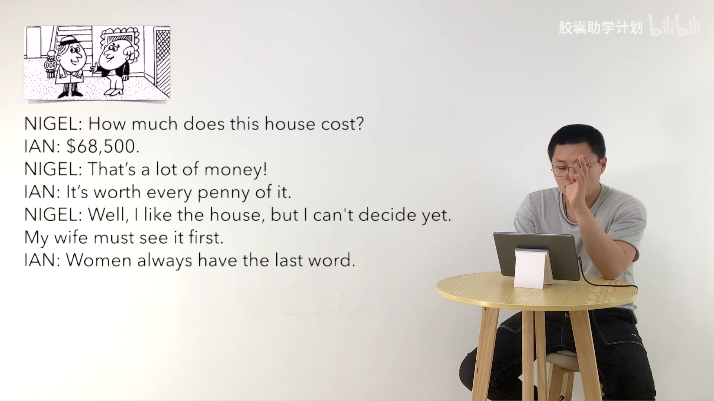

文字识别：胶囊助学计划 / NIGEL: How much does this house cost? / IAN: $68,500. / NIGEL: That's a lot of money! / IAN: It's worth every penny of it. / NIGEL: Well, I like the house, but I can't decide yet. / My wife must see it first. / IAN: Women always have the last word.

### 画面 00:04:50

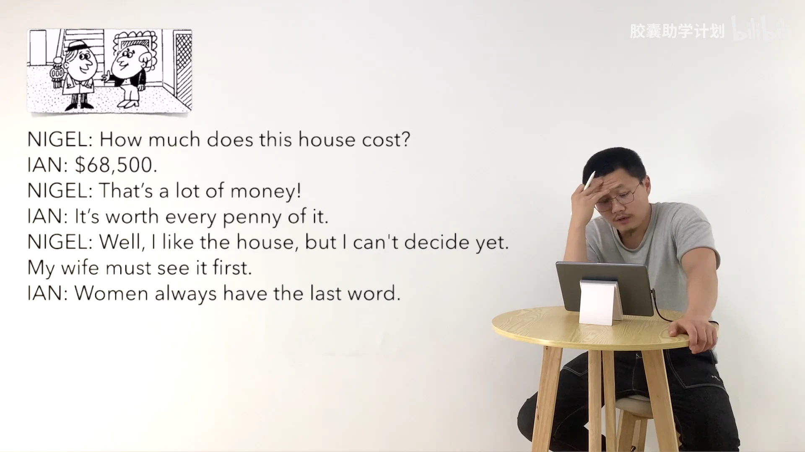

文字识别：胶囊助学计划 / NIGEL: How much does this house cost? / IAN: $68,500. / NIGEL: That's a lot of money! / IAN: It's worth every penny of it. / NIGEL: Well, I like the house, but I can't decide yet. / My wife must see it first. / IAN: Women always have the last word.

## 00:05:00–00:05:30

in给了一句意味深长的话啊，说women always have the last word。说女人们总是have the last word。好，我们先从字面意思去翻译，叫做have叫做拥有，last叫最后，word叫单词。女人总是拥有最后一个单词。嗯，这就完全不通了，对吧？所以你能理解为它可能是个习惯用法，它的意思叫做最终

### 画面 00:05:20

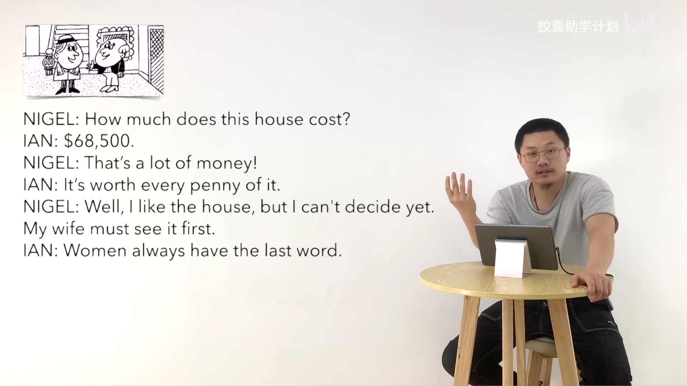

文字识别：胶囊助学计划 / NIGEL: How much does this house cost? / IAN: $68,500. / NIGEL: That's a lot of money! / IAN: It's worth every penny of it. / NIGEL: Well, I like the house, but I can't decide yet. / My wife must see it first. / IAN: Women always have the last word.

### 画面 00:05:26

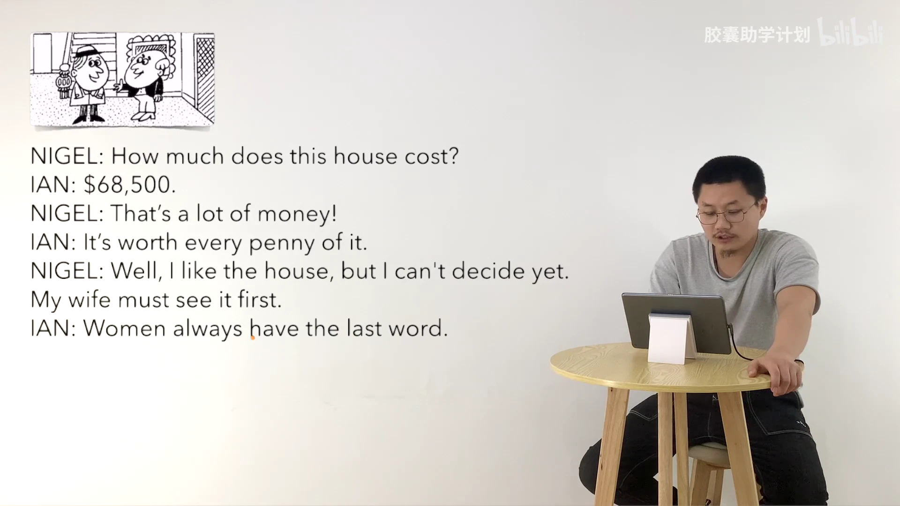

文字识别：胶囊助学计划 / NIGEL: How much does this house cost? / IAN: $68,500. / NIGEL: That's a lot of money! / IAN: It's worth every penny of it. / NIGEL: Well, I like the house, but I can't decide yet. / My wife must see it first. / IAN: Women always have the last word.

### 画面 00:05:28

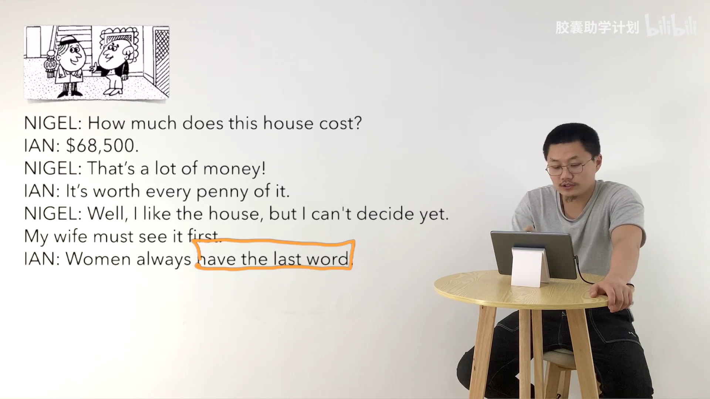

文字识别：胶囊助学计划 / NIGEL: How much does this house cost? / IAN: $68,500. / NIGEL: That's a lot of money! / IAN: It's worth every penny of it. / NIGEL: Well, I like the house, but I can't decide yet. / My wife must see it first. / IAN: Women always have the last word

## 00:05:30–00:06:00

决定权。您再结合印之前给的那个原因，对吧？这个买房子的人问他说：“你为什么要把房子卖了呀？”他说：“因为我呀刚退休，是吧？我想去这个呃这个乡下买套房子啊，都是我自己想的。”然后最后呢，他这个买房子的人挺诚实的，说我决定不了，我得问我老婆啊。然后印说：“哎，是啊，女人总是拥有最终决定权的。”然后您再配合下一篇文章放到一

### 画面 00:05:31

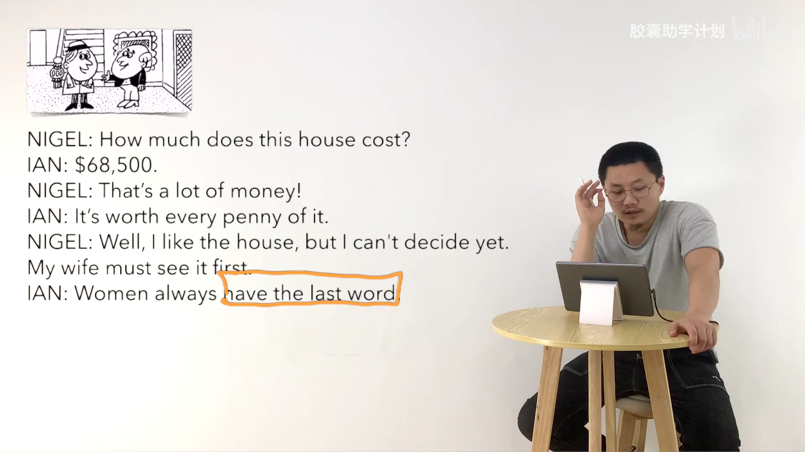

文字识别：胶囊助学计划 / NIGEL: How much does this house cost? / IAN: $68,500. / NIGEL: That's a lot of money! / IAN: It's worth every penny of it. / NIGEL: Well, I like the house, but I can't decide yet. / My wife must see it first. / IAN: Women always have the last word

### 画面 00:05:56

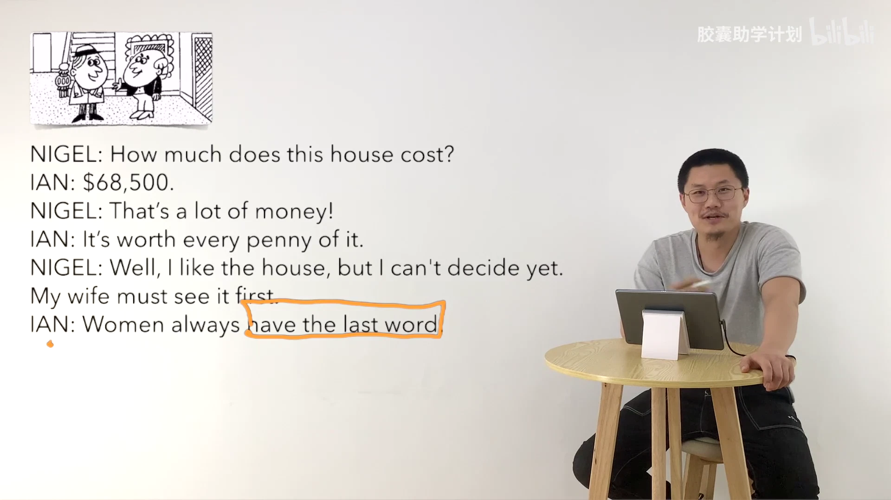

文字识别：胶囊助学计划 / NIGEL: How much does this house cost? / IAN: $68,500. / NIGEL: That's a lot of money! / IAN: It's worth every penny of it. / NIGEL: Well, I like the house, but I can't decide yet. / My wife must see it first. / IAN: Women always have the last word

## 00:06:00–00:06:30

起，你就会发现背后一些非常让人忍俊不禁的真相。OK，好，那不多说，我们接下来做一些小的听力口语练习。好，第一个 comprehension，我问您答。第一题，Whose house is for sale? Ian's。 Next one, who wants to have a look at it? Nigel。 Next one, how long has Ian lived in the house? He's

### 画面 00:06:05

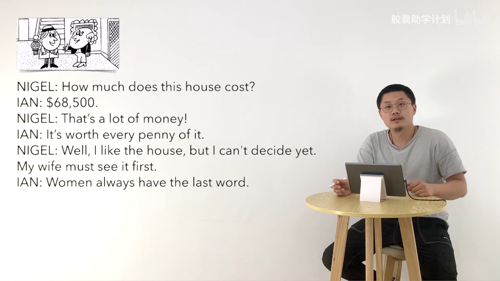

文字识别：胶囊助学计划 / NIGEL: How much does this house cost? / IAN: $68,500. / NIGEL: That's a lot of money! / IAN: It's worth every penny of it. / NIGEL: Well, I like the house, but I can't decide yet. / My wife must see it first. / IAN: Women always have the last word.

### 画面 00:06:09

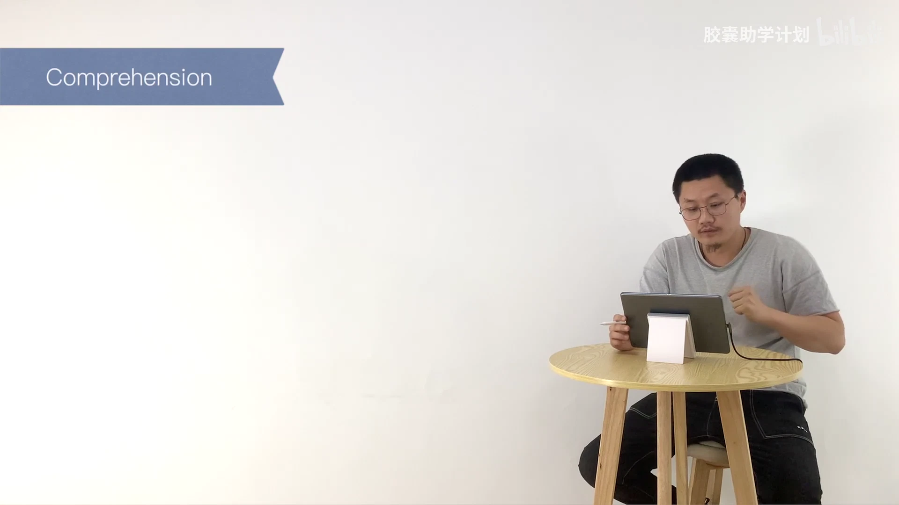

文字识别：胶囊助学计划 / Comprehension

### 画面 00:06:14

文字识别：胶囊助学计划 / Comprehension / 1 T: Whose house is for sale?

### 画面 00:06:28

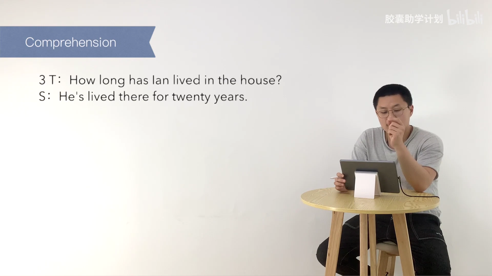

文字识别：胶囊助学计划 / Comprehension / 3 T: How long has lan lived in the house? / S: He's lived there for twenty years.

## 00:06:30–00:07:00

lived there for twenty years. 当然，您直接给 twenty years 也 OK. Next one. Since when has he been there? Since nineteen seventy six. Next one. Why does Yin want to sell his house? Because he has just retired and he wants to buy a small house in the country. Next one. How much does Yin's house cost?

### 画面 00:06:35

文字识别：胶囊助学计划 / Comprehension / 4 T: Since when has he been there?

### 画面 00:06:48

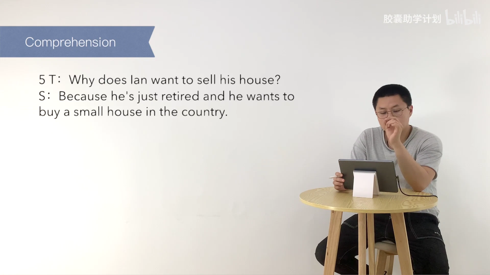

文字识别：胶囊助学计划 / Comprehension / 5 T: Why does lan want to sell his house? / S: Because he's just retired and he wants to / buy a small house in the country.

### 画面 00:06:55

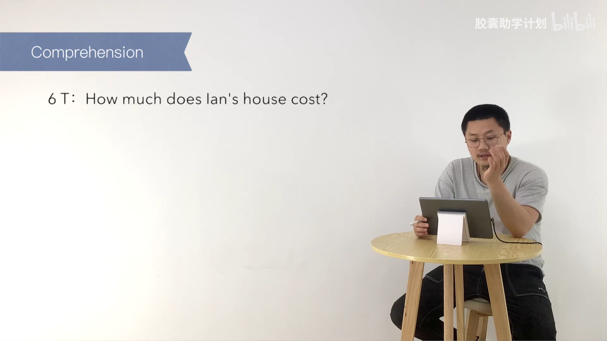

文字识别：胶囊助学计划 / Comprehension / 6 T: How much does lan's house cost?

## 00:07:00–00:07:30

It costs sixty-eight thousand and five hundred pounds. Next one, is it a lot of money to Nigel? Yes, it is. Does Nigel like the house? Yes, he does. Why can't he decide at the moment? Because his wife must see it first. Okay, now asking questions.

### 画面 00:07:22

文字识别：胶囊助学计划 / Comprehension / 9 T: Why can't he decide at the moment? / S: Because his wife must see the house first.

### 画面 00:07:26

文字识别：胶囊助学计划 / Asking questions

## 00:07:30–00:08:00

I ask, I give a肯定句，你们变一般疑问句，特殊疑问句来了。弟弟，Ask me if the house is for sale.一般疑问句Is the house for sale? What What is for sale? Next one. Ask me if In has lived there for twenty years.一般疑问句Has In lived there for twenty

### 画面 00:07:37

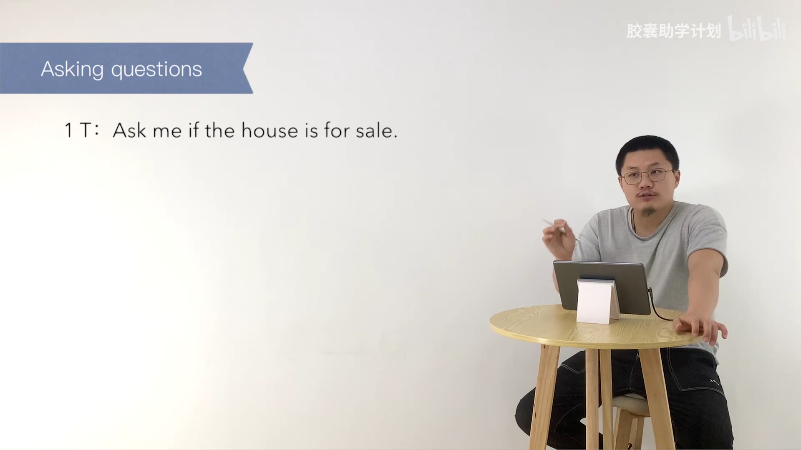

文字识别：胶囊助学计划 / Asking questions / 1 T: Ask me if the house is for sale.

### 画面 00:07:44

文字识别：胶囊助学计划 / Asking questions / 1 T: Ask me if the house is for sale. / S: Is the house for sale? / T:What ..? / S: What is for sale?

### 画面 00:07:48

文字识别：胶囊助学计划 / Asking questions / 2 T: Ask me if lan has lived there for twenty years.

## 00:08:00–00:08:30

years. How long? 对，for twenty years提问，对吧？叫做 How long has in lived there? Next one. Ask me if he wants to sell it.一般疑问句 Does he want to sell it? Why? Why does he want to sell it? Continue. Ask me if it costs sixty eight thousand five hundred.

### 画面 00:08:04

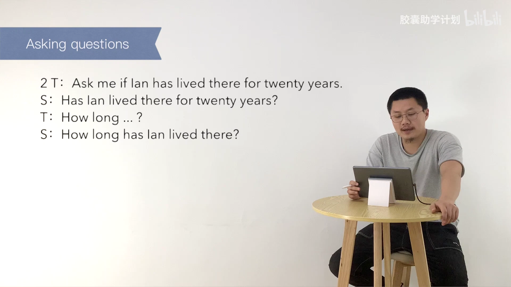

文字识别：胶囊助学计划 / Asking questions / 2 T: Ask me if lan has lived there for twenty years. / S: Has lan lived there for twenty years? / T: How long …? / S: How long has lan lived there?

### 画面 00:08:09

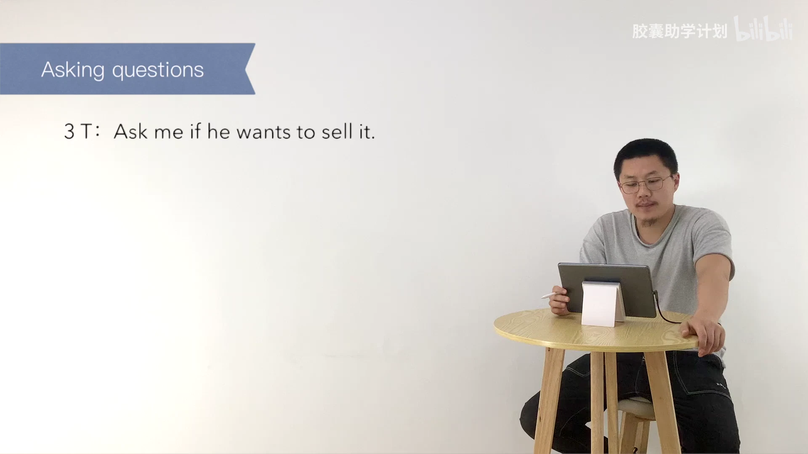

文字识别：胶囊助学计划 / Asking questions / 3 T: Ask me if he wants to sell it.

## 00:08:30–00:09:00

Does it cost sixty-eight thousand and five hundred? How much? How much does it cost? Next one. Ask me if his wife must say it first. Must his wife say it first? Who? 对主语提问，不用变一般疑问句，直接替代主语. Who must say it first? Okay, one more one. Uh, recap. 本

### 画面 00:08:36

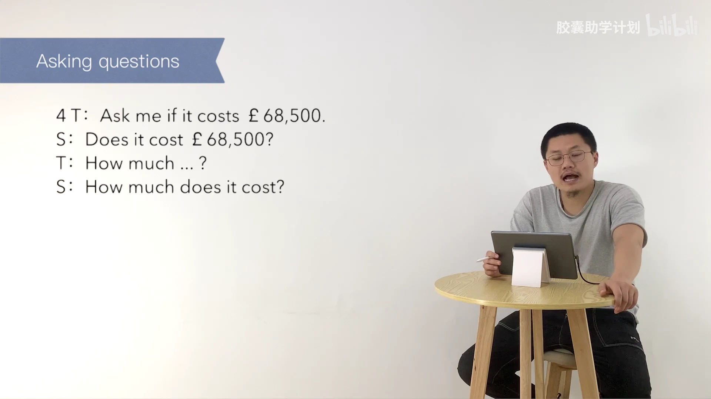

文字识别：胶囊助学计划 / Asking questions / 4 T: Ask me if it costs £ 68,500. / S: Does it cost £ 68,500? / T: How much .? / S: How much does it cost?

### 画面 00:08:39

文字识别：胶囊助学计划 / Asking questions / 5 T: Ask me if his wife must see it first.

### 画面 00:08:53

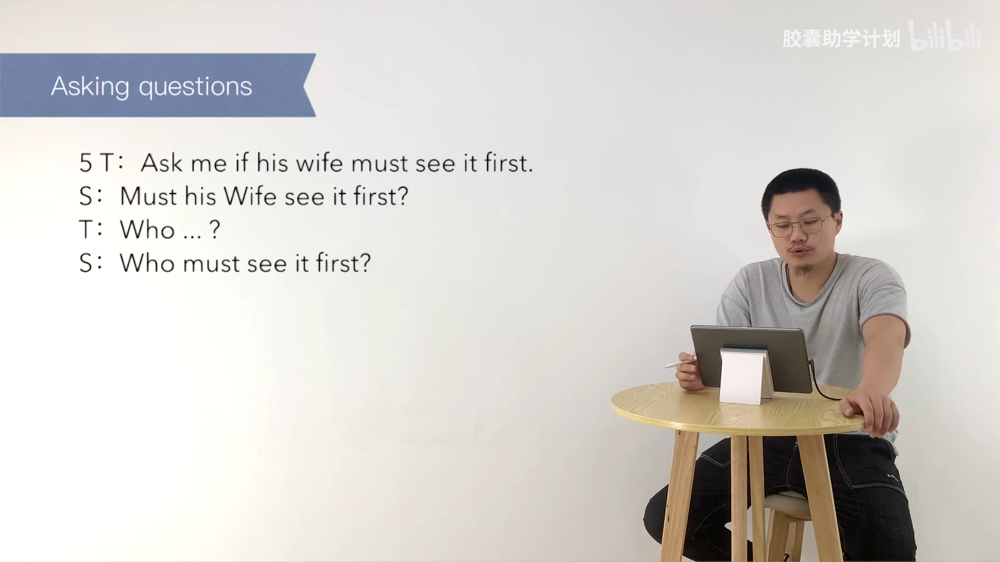

文字识别：胶囊助学计划 / Asking questions / 5 T: Ask me if his wife must see it first. / S: Must his Wife see it first? / T: Who ….? / S: Who must see it first?

### 画面 00:08:58

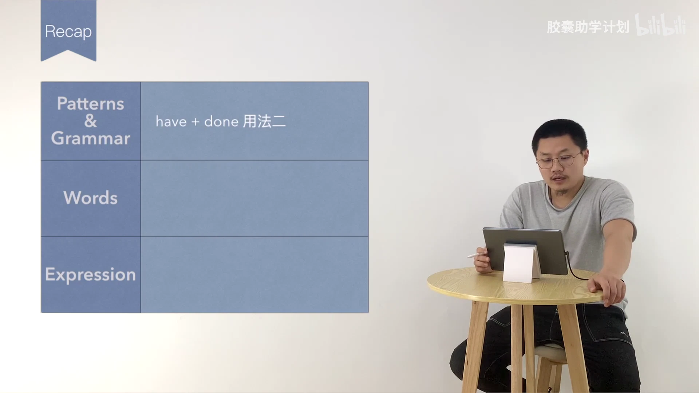

文字识别：胶囊助学计划 / Recap / Patterns / have +done 用法二 / Grammar / Words / Expression

## 00:09:00–00:09:30

课关键点还是不停的出现了现在完成时的第二个用法，从过去重复或持续到现在啊。呃，接下来家庭作业，绿皮书八十九课各位可以写了，文章跟读至熟读成诵，给自己讲解一遍今天的核心知识点。如果大家喜欢我们的课程呢，欢迎大家关注订阅，一键三连，分享给那些需要的朋友来帮助我们成长。最后，我们再来看一句名人名言：Wise men speak

### 画面 00:09:08

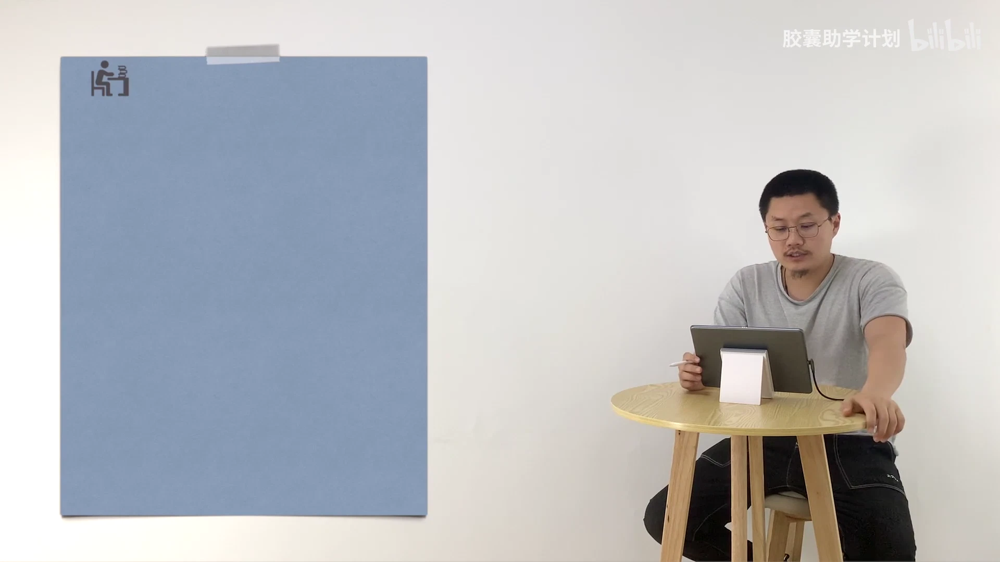

文字识别：胶囊助学计划

### 画面 00:09:11

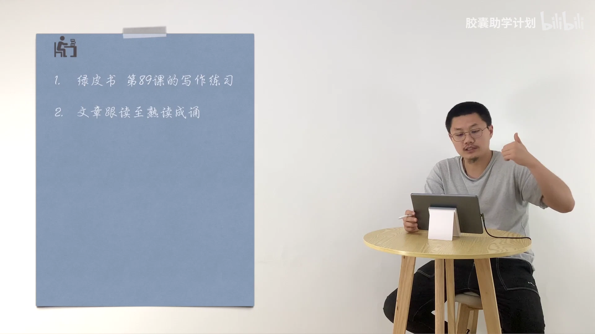

文字识别：胶囊助学计划 / 绿皮书第89课的写作练习 / 2.文章跟读至熟读成诵

### 画面 00:09:17

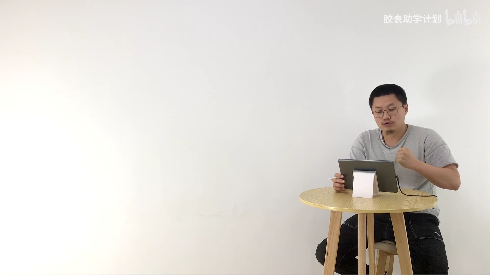

文字识别：胶囊助学计划

### 画面 00:09:25

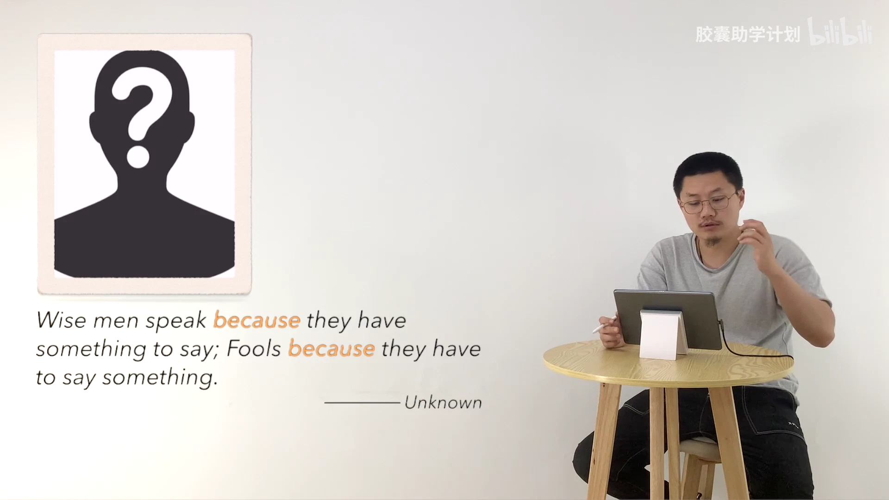

文字识别：胶囊助学计划 / ? / Wise men speak k / because / they have / something to say; Fools / because / they have / to say something. / Unknown

### 画面 00:09:28

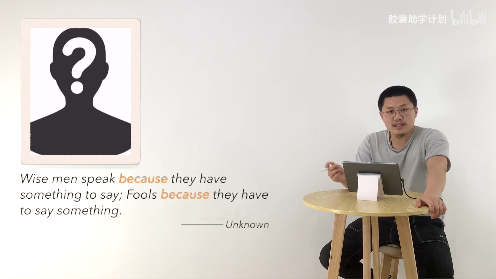

文字识别：胶囊助学计划 / ? / Wise men speak / because / they have / something to say; Fools / because / they have / to say something. / Unknown

## 00:09:30–00:09:51

because they have something to say. Fools because they have to say something. See you next time.

### 画面 00:09:39

### 画面 00:09:41

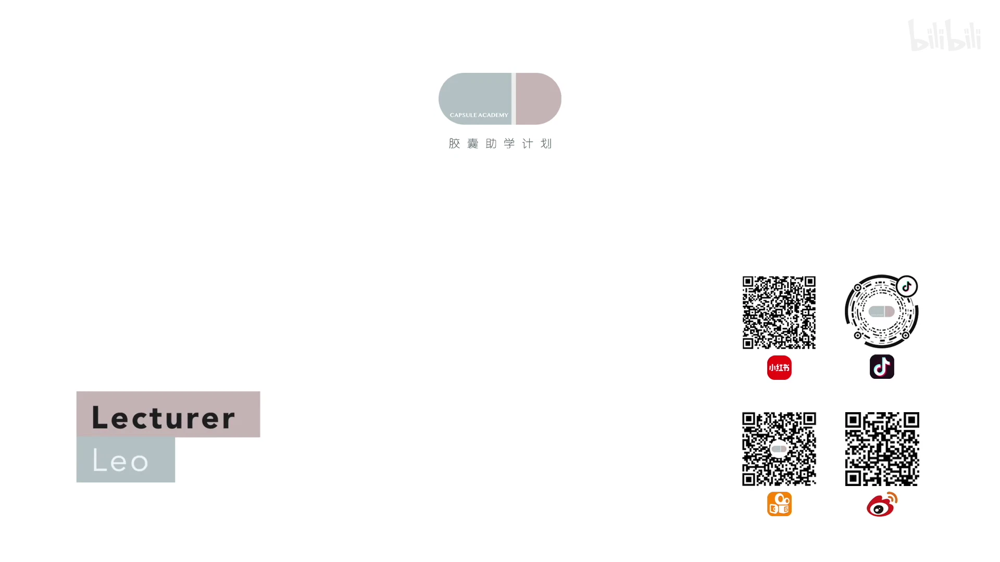

文字识别：CAPSULEACADEMY / 胶囊助学计划 / 『 / 小红书 / Lecturer / □ / Leo / OE

### 画面 00:09:44

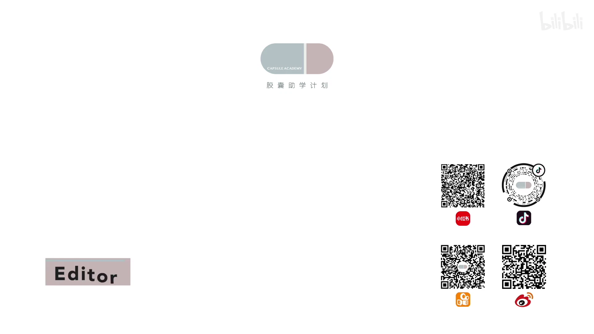

文字识别：CAPSULEACADEMY / 胶囊助学计划 / 『 / 小红书 / □ / Editor / OE

### 画面 00:09:47

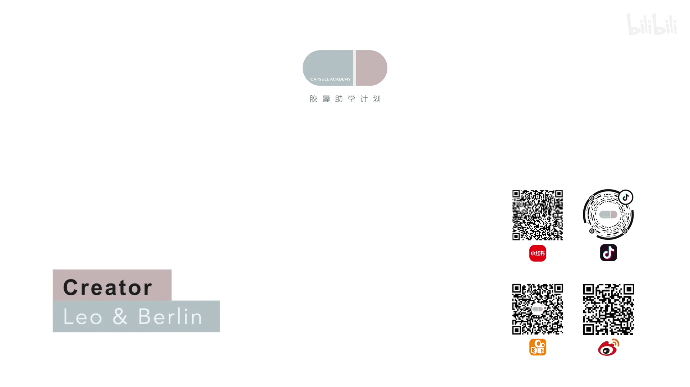

文字识别：CAPSULEACADEMY / 胶囊助学计划 / 小红书 / Creator / Leo & Berlin / OE

### 画面 00:09:49

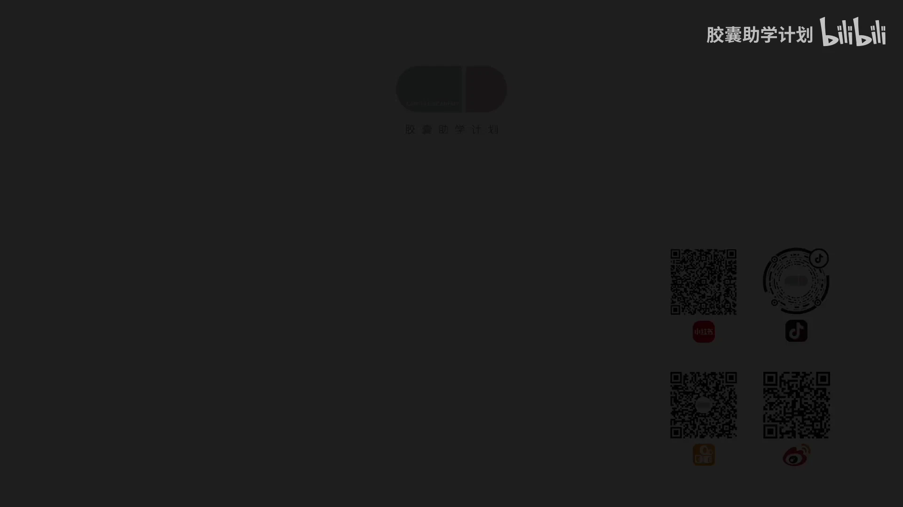

文字识别：Bilibili / 胶囊助学计划 / 小红护 / 5

### 画面 00:09:51

文字识别：bilibili / 胶囊助学计划

