# 090 练习

快速机器解析：语音为单模型转写，未进行独立交叉校对或人工复核；画面每秒采样并按变化选帧，短时文字和标记可能遗漏。截图时间约有 1 秒误差。图片有损压缩；遇到疑点请按时间查看 Google Drive 原视频。

## 00:00:00–00:00:30

Hello everyone, welcome to Capsule Academy. This is Leo. Today we're going to learn New Concept English Book One Lesson Ninety Practices. Hope you guys enjoyed.好，那我们看一下这个表格。呃，这个表格对于各位来说，依旧是您不用着急把它抄下来或背下来，对吧？在各位的书教材对应的教材左下角啊是有这个表格的。我只是放到这儿，简单给各位

### 画面 00:00:00

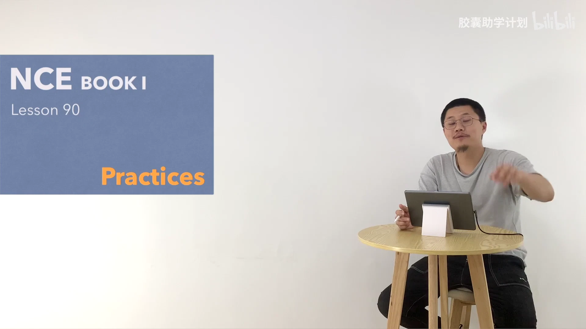

文字识别：胶囊助学计划 / NCE / BOOKI / Lesson 90 / Practices

### 画面 00:00:10

文字识别：胶囊助学计划b出出 / •

### 画面 00:00:14

### 画面 00:00:16

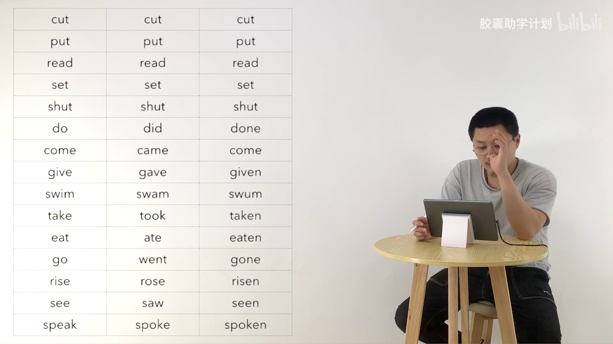

文字识别：cut / cut / cut / 胶囊助学计划 / put / put / put / read / read / read / set / set / set / shut / shut / shut / do / did / done / come / came / come / give / gave / given / swim / swam / swum / take / took / taken / eat / ate / eaten / go / went / gone / rise / rose / risen / see / saw / seen / speak / spoke / spoken

## 00:00:30–00:01:00

讲一下。好，各位先看一下啊，我们先说前面这五啊五个单词。各位看这五个单词的原形、过去式、过去分词长得一模一样，发现了吗？是吧？您就不用专门背了，是吧？好，但是注意一小下它的发音的问题。这个发音我留一个小的家庭作业给各位，看您能不能回去自己尝试着找一下，好吧？它的发

### 画面 00:00:46

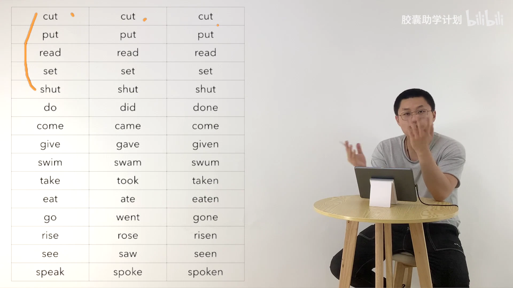

文字识别：cut / cut / cut / 胶囊助学计划 / put / put / put / read / read / read / set / set / set / shut / shut / shut / do / did / done / come / came / come / give / gave / given / swim / swam / swum / take / took / taken / eat / ate / eaten / go / went / gone / rise / rose / risen / see / saw / seen / speak / spoke / spoken

### 画面 00:00:53

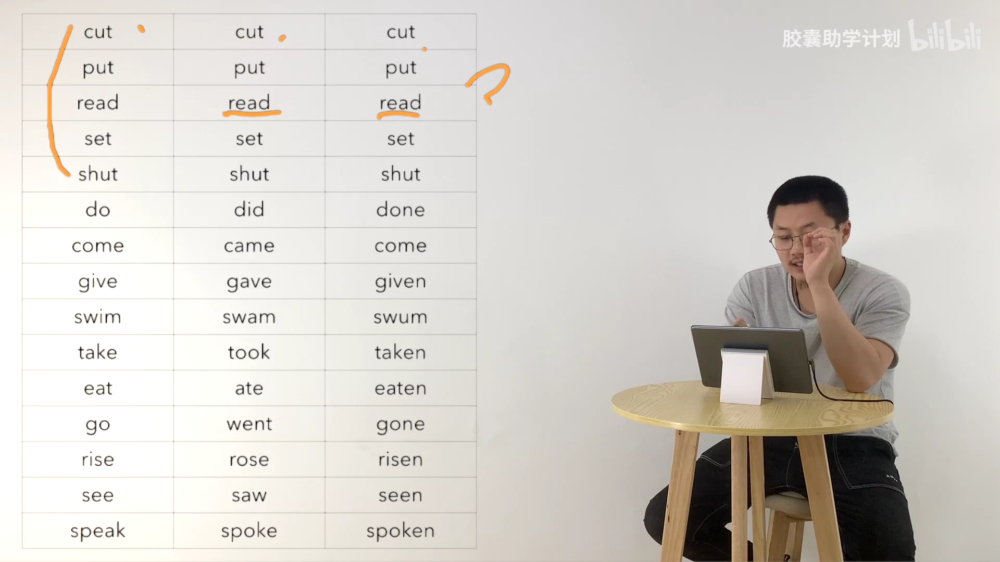

文字识别：cut / cut / cut / 胶囊助学计划 / put / put / put / read / read / read / set / set / set / shut / shut / shut / do / did / done / come / came / come / give / gave / given / swim / swam / swum / take / took / taken / eat / ate / eaten / go / went / gone / rise / rose / risen / see / saw / seen / speak / spoke / spoken

## 00:01:00–00:01:30

跟 read 原形是不太一样的，虽然长得是一样的，这就很神奇啊。接下来呢，下面的这些单词，你会陆陆续续的发现，哎，他们的反正明显都是不规则的了。比如说我们说 see 啊，过去式 saw 对吧？然后过去分词呢叫做 seen。比如说八十五课，我们 I have seen the film 啊，我已经看过这个电影了。这些东西跟之前我大家说的另一个表格是一样的处理方式，您就

### 画面 00:01:10

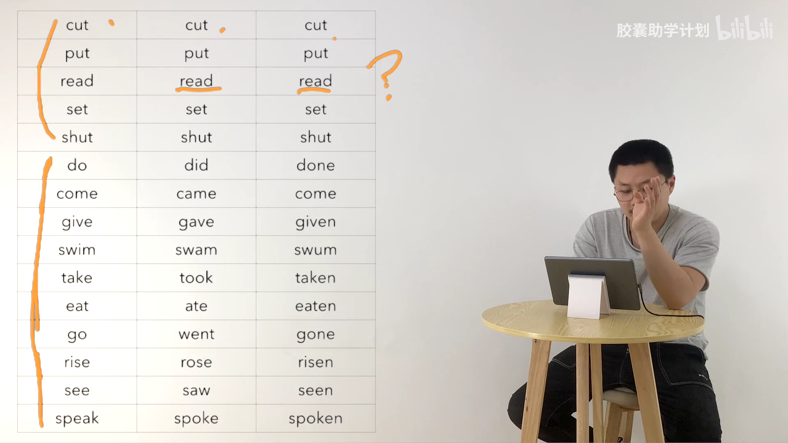

文字识别：cut / cut / cut / 胶囊助学计划 / Bilbili / put / put / put / read / read / read / set / set / set / shut / shut / shut / do / did / done / come / came / come / give / gave / given / swim / swam / swum / take / took / taken / eat / ate / eaten / go / went / gone / rise / rose / risen / see / saw / seen / speak / spoke / spoken

### 画面 00:01:27

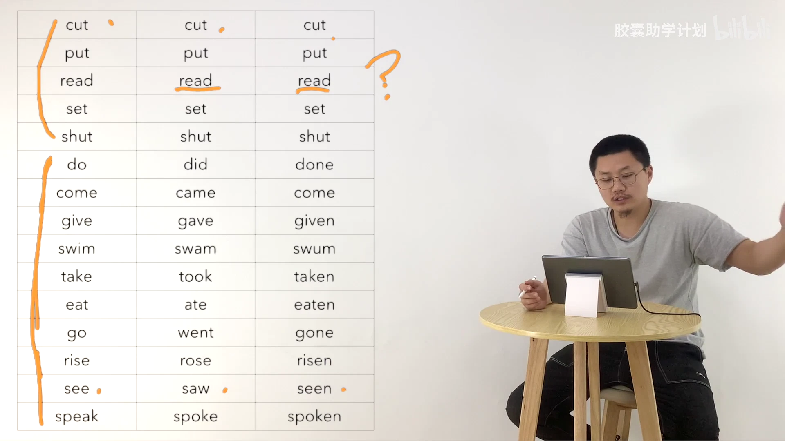

文字识别：cut / cut / cut / 胶囊助学计划 / put / put / put / read / read / read / set / set / set / shut / shut / shut / do / did / done / come / came / come / give / gave / given / swim / swam / swum / take / took / taken / eat / ate / eaten / go / went / gone / rise / rose / risen / see / saw / seen / speak / spoke / spoken

## 00:01:30–00:02:00

每天看几遍，对吧？早中晚各看几遍，不用压力太大，坚持往下学，很容易很快您就都学会了。OK，那我就不再多提了。接下来本课的关键点就是各位张嘴跟我去读就行了。那鉴于我临时给大家留了一个作业，就是让你回去查一下这个单词的发音。第一个练习我暂时先不带大家做了，各位回去查一下，好吧？OK，好，接下来，呃，张嘴跟我去读就好了。来

### 画面 00:01:38

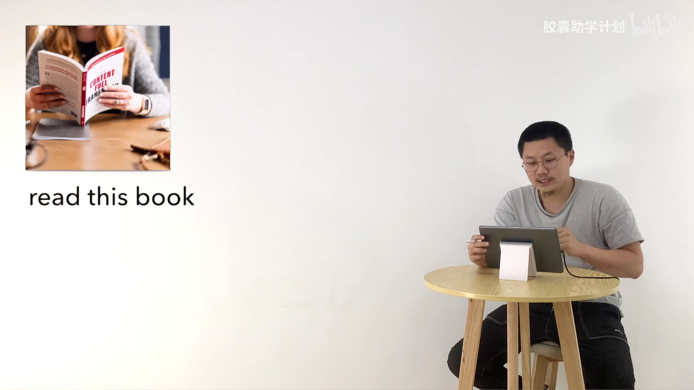

文字识别：胶囊助学计划 / CONTE / read this book

### 画面 00:01:44

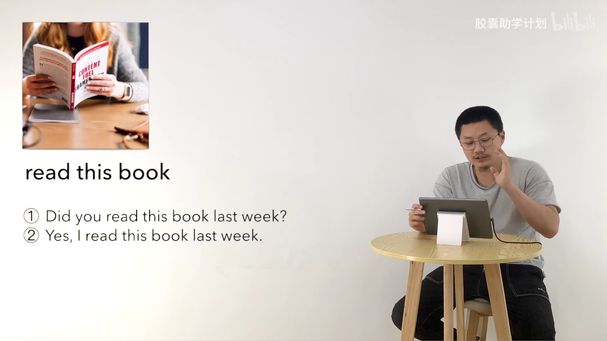

文字识别：胶囊助学计划 / read this book / ① Did you read this book last week? / ② Yes, I read this book last week.

### 画面 00:01:46

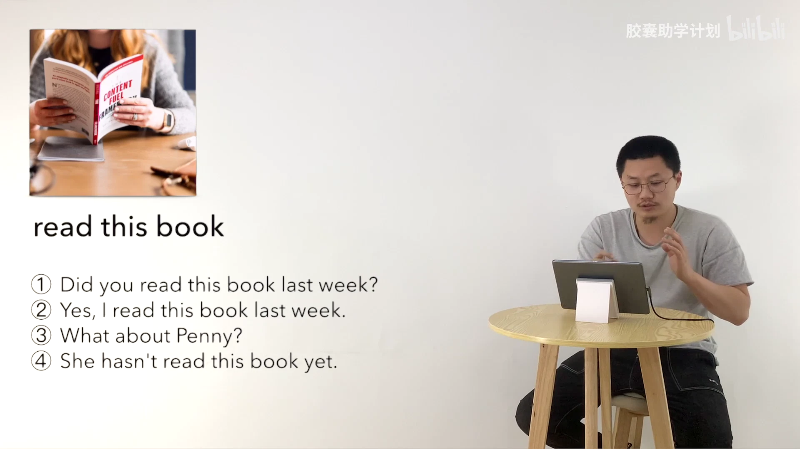

文字识别：胶囊助学计划 / read this book / ① Did you read this book last week? /  Yes, I read this book last week. / 2 / What about Penny? / She hasn't read this book yet.

### 画面 00:01:48

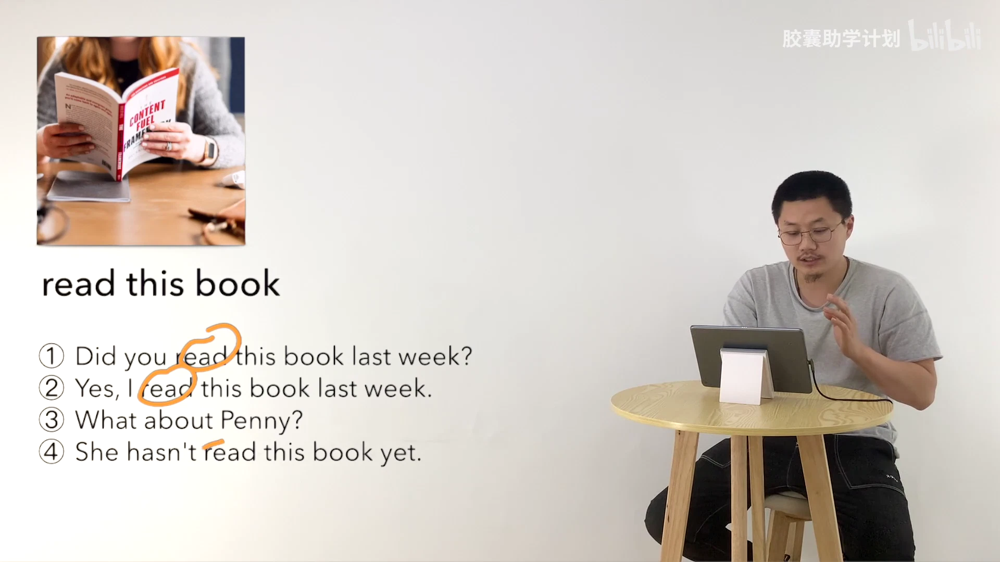

文字识别：胶囊助学计划 / read this book / ① Did you read this book last week? / 2 / Yes,l / ead this book last week. / What about Penny? / She hasn't read this book yet.

### 画面 00:01:50

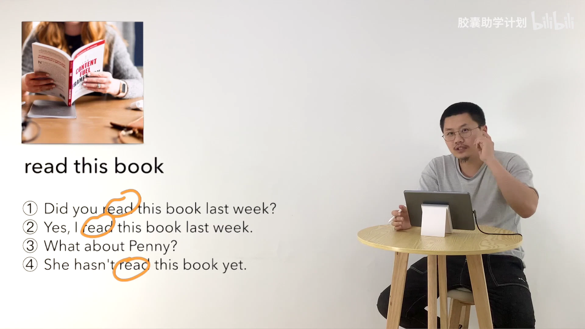

文字识别：胶囊助学计划 / read this book / ① Did you read this book last week? / 2 / Yes,l / ead this book last week. / What about Penny? / She hasn'treao / this book yet.

### 画面 00:01:56

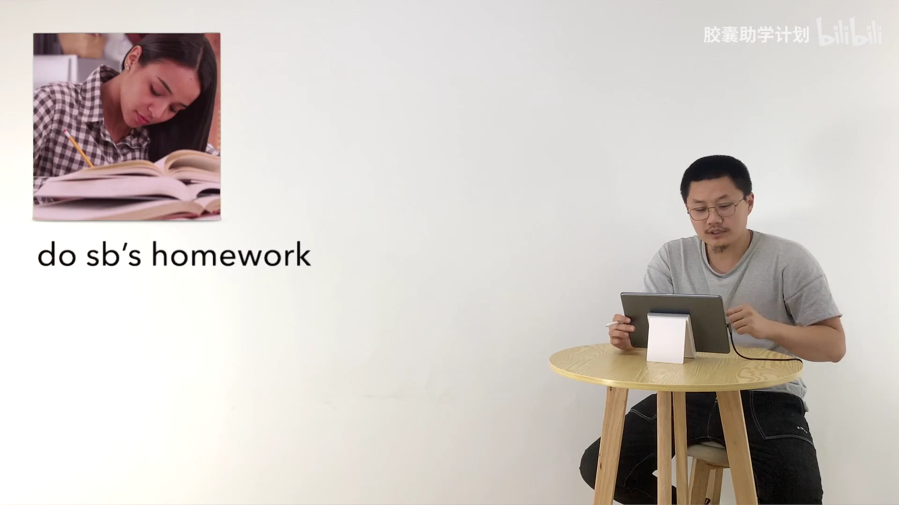

文字识别：胶囊助学计划 / do sb's homework

## 00:02:00–00:02:30

了，Did you do your homework last night? Yes, I did my homework last night. What about Ron? He hasn't done his homework yet. Next one, Did you swim across the river last week? Yes, I swam across the river last week. What about Ron and Betty? They

### 画面 00:02:01

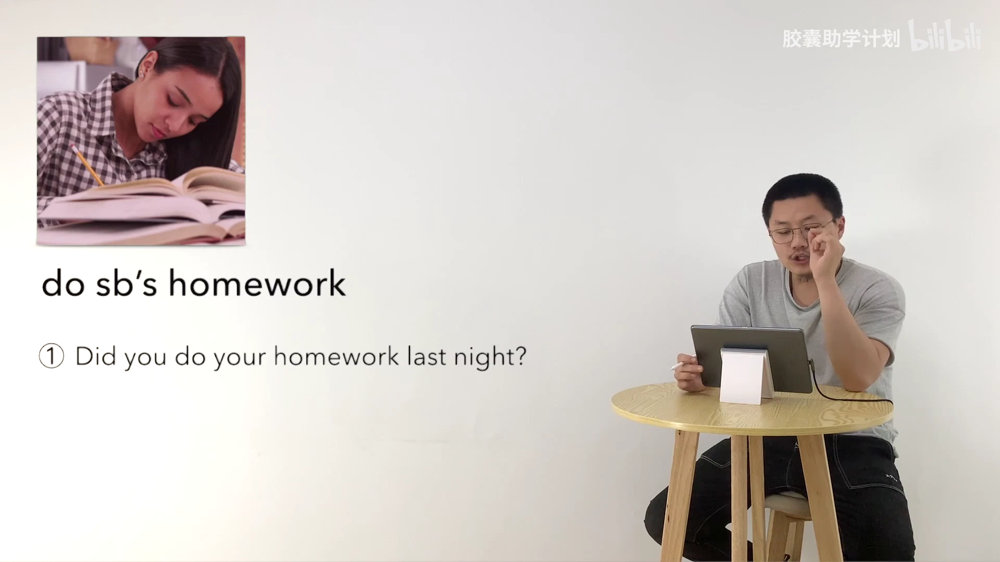

文字识别：胶囊助学计划 / do sb's homework / ① Did you do your homework last night?

### 画面 00:02:10

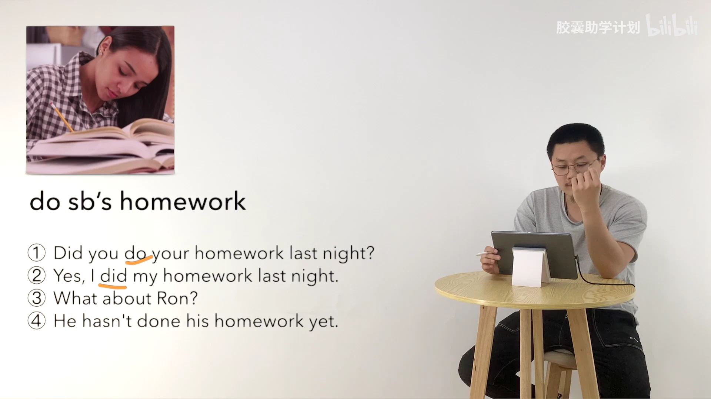

文字识别：胶囊助学计划 / do sb's homework / ① Did you do your homework last night? /  Yes, I did my homework last night. / 2 / What about Ron? / He hasn't done his homework yet.

### 画面 00:02:16

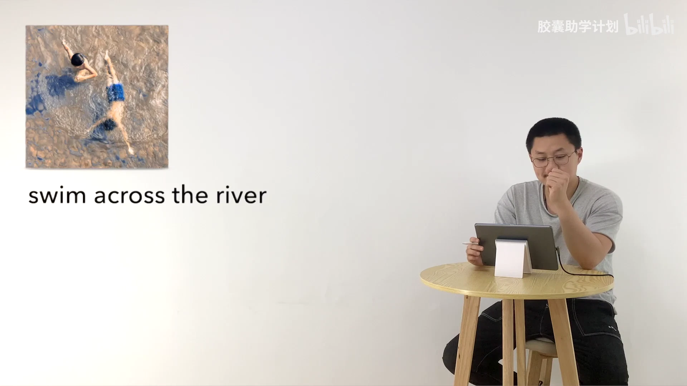

文字识别：胶囊助学计划 / 福 / swim across the river

### 画面 00:02:26

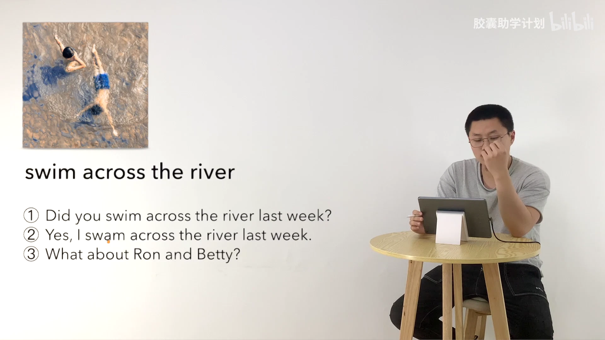

文字识别：胶囊助学计划 / swim across the river / ① Did you swim across the river last week? / ② Yes, I swam across the river last week. / 2 / What about Ron and Betty?

## 00:02:30–00:03:00

haven't swum across the river yet. Next one, did you go to London yesterday? Yes, I went to London yesterday. What about your mother? She hasn't gone to London yet. Continue. Did you see that film last week? Yes, I saw that film last week. What about the children? They haven't seen that film yet.

### 画面 00:02:33

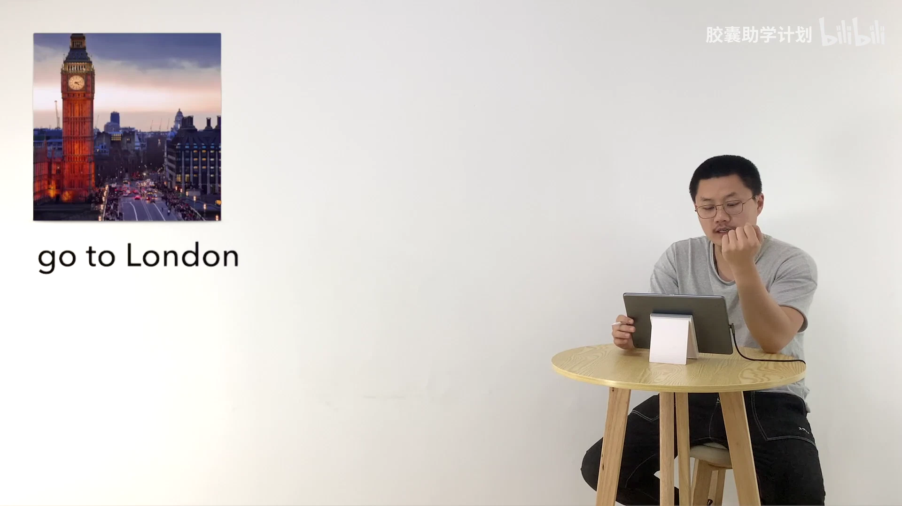

文字识别：胶囊助学计划 / go to London

### 画面 00:02:38

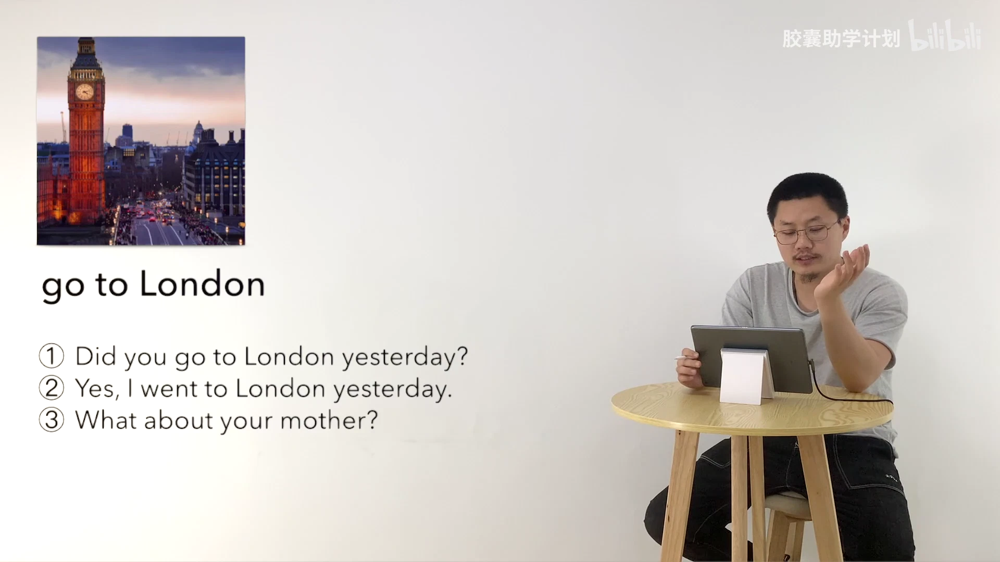

文字识别：胶囊助学计划 / go to London / ① Did you go to London yesterday? / Yes, I went to London yesterday. / 2 / What about your mother?

### 画面 00:02:46

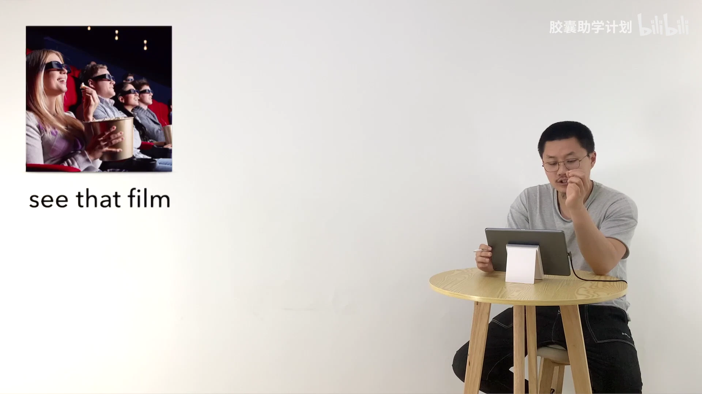

文字识别：胶囊助学计划 / see that film

### 画面 00:02:54

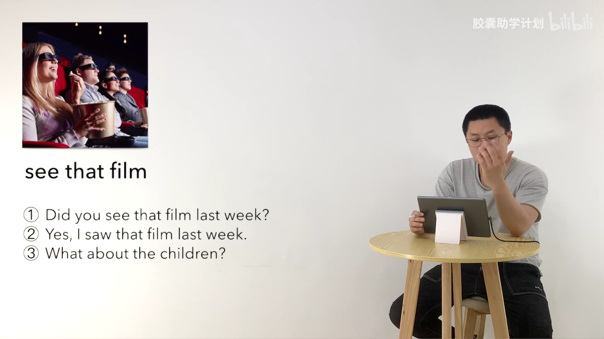

文字识别：胶囊助学计划 / see that film / ① Did you see that film last week? / ② Yes, I saw that film last week. / 2 / What about the children?

## 00:03:00–00:03:30

Next one. Did you speak to the boss this morning? Yeah, I spoke to the boss this morning. What about Mr. Jones? He hasn't spoken to the boss yet. Continue. Did you put on your coat a minute ago? Yes, I put on my coat a minute ago. What about John? He hasn't put on his coat yet.

### 画面 00:03:00

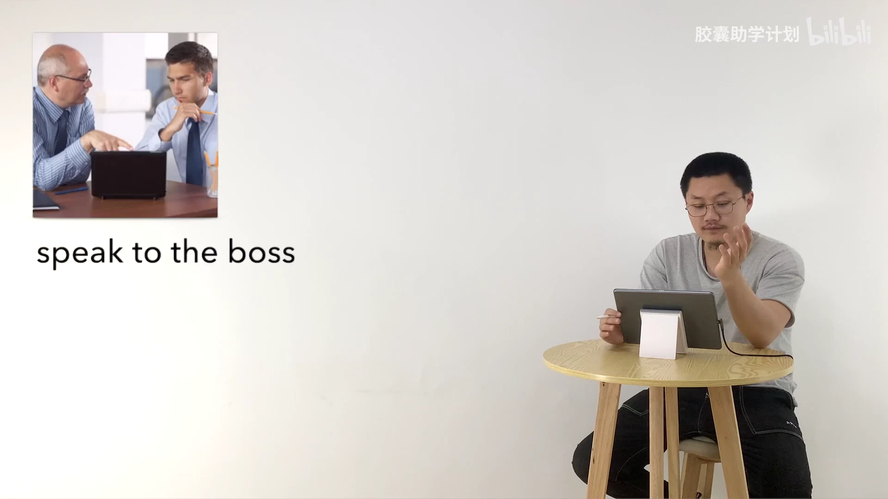

文字识别：胶囊助学计划 / speak to the boss

### 画面 00:03:05

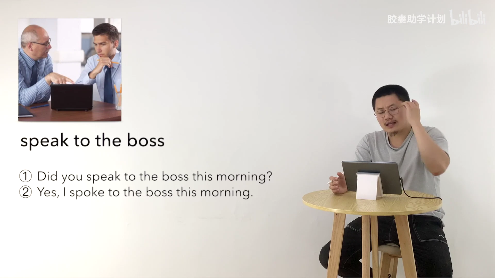

文字识别：胶囊助学计划 / speak to the boss / ① Did you speak to the boss this morning? / ② Yes, I spoke to the boss this morning.

### 画面 00:03:09

文字识别：胶囊助学计划 / speak to the boss / ① Did you speak to the boss this morning? / ② Yes, I spoke to the boss this morning. / 2 / What about Mr. Jones? / He hasn't spoken to the boss yet.

### 画面 00:03:15

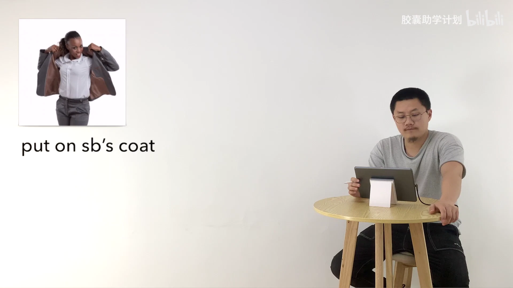

文字识别：胶囊助学计划出 / put on sb's coat

### 画面 00:03:23

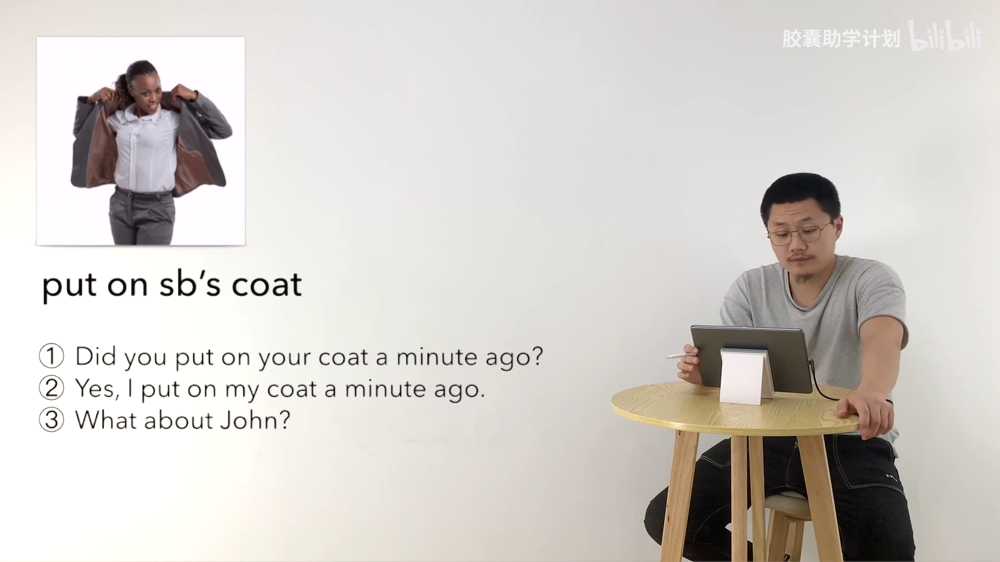

文字识别：胶囊助学计划 / put on sb's coat / ① Did you put on your coat a minute ago? / Yes, I put on my coat a minute ago. / 2 / What about John?

## 00:03:30–00:04:00

Continuing, did you take your medicine this morning? Yes, I took my medicine this morning. What about Penny? She hasn't taken her medicine yet. Continuing. Okay,那 recap本课我们实际上还是have和done对吧？复习这个结构，然后呢，重点其实就是动词的过去式和过去分词啊。这个就是

### 画面 00:03:31

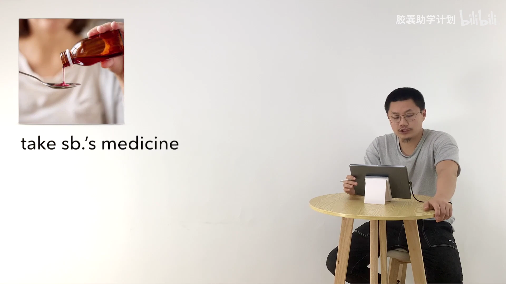

文字识别：胶囊助学计划 / take sb's medicine

### 画面 00:03:39

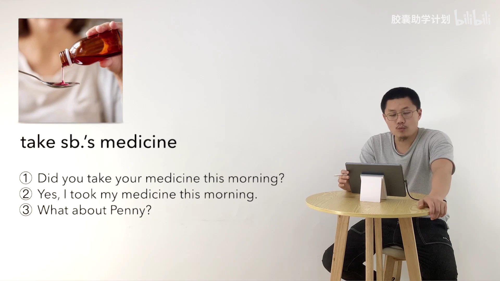

文字识别：胶囊助学计划 / take sb.'s medicine / ① Did you take your medicine this morning? / Yes, I took my medicine this morning. / 2 / What about Penny?

### 画面 00:03:47

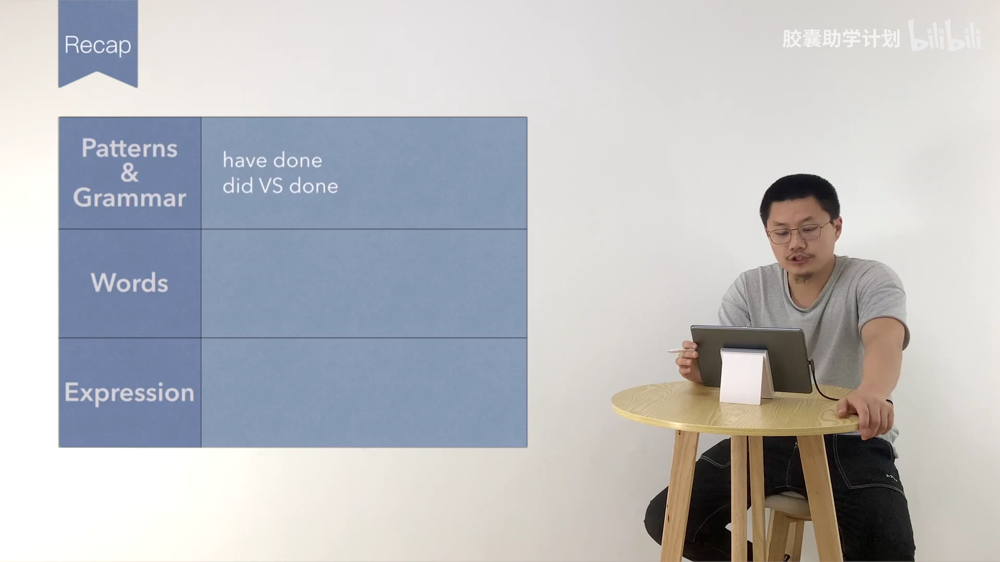

文字识别：胶囊助学计划 / Recap / Patterns / have done / did Vs done / Grammar / Words / Expression

### 画面 00:03:56

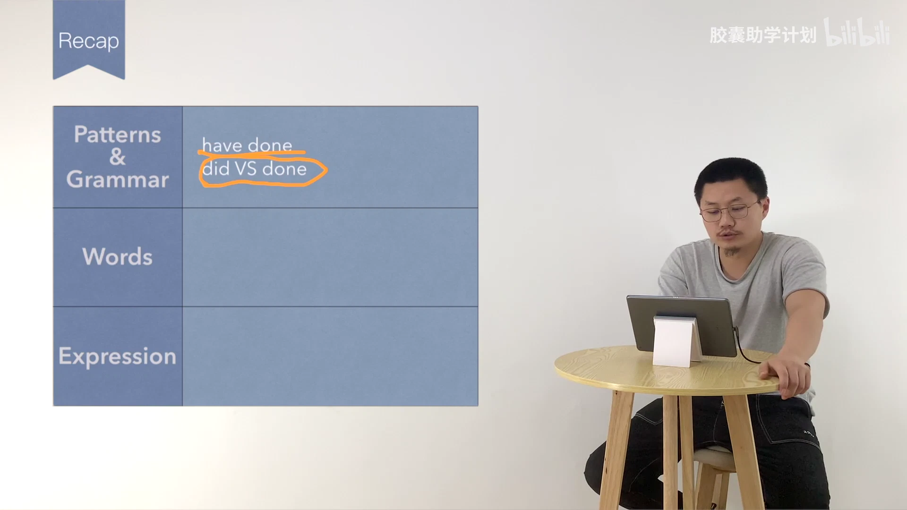

文字识别：胶囊助学计划 / Recap / Patterns / have done / did Vs done / Grammar / Words / Expression

## 00:04:00–00:04:30

各位只要坚持往下去学，见一次查一次，基本上慢慢最常用的那些您就都能记下来了。OK，好，今天作业绿皮书九十课各位可以写了，查找继续红皮书 have 加 but 的用法，第二个用法对吧？从过去持续到现在，如果可以的话，您把左边的讲解再简单的看一下，然后把右边的练习对应尝试去写一下。OK，当然这是比如说您在把别的作业写完

### 画面 00:04:07

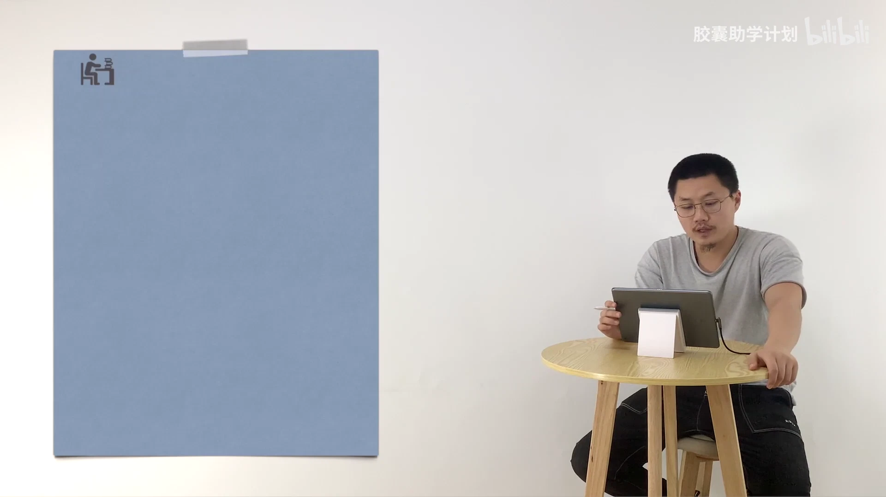

文字识别：胶囊助学计划

## 00:04:30–00:05:00

的前提之下啊，这个可以理解为是额外的作业，给自己讲解一遍今天的核心知识点。如果大家喜欢我们的课程呢，欢迎大家关注、订阅、一键三连，分享给那些需要的朋友来支持我们。最后再来看一句名人名言：You usually have to wait for that which is worth waiting for. See you next time.

### 画面 00:04:32

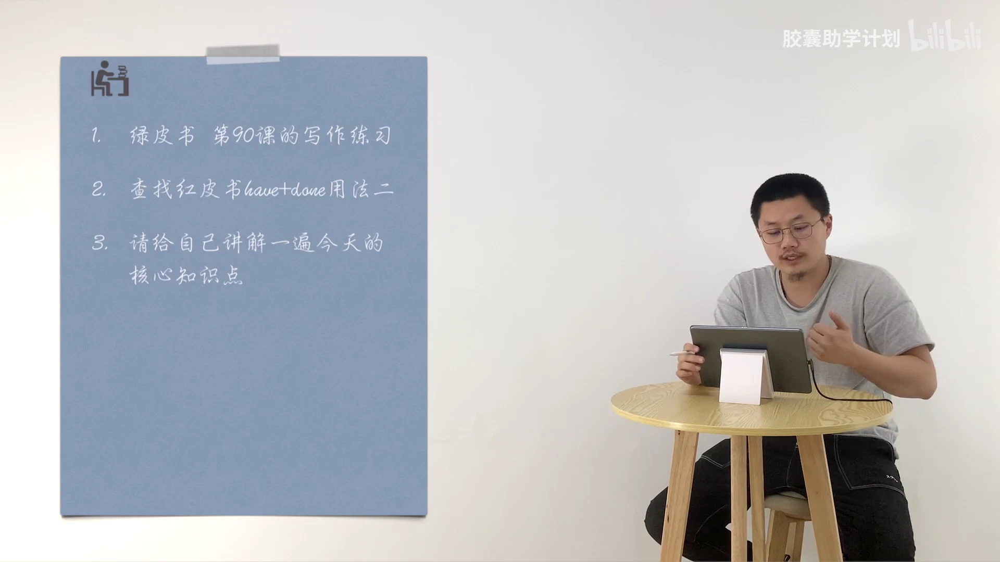

文字识别：胶囊助学计划 / 绿皮书第90课的写作练习 / 2.查找红皮书havetdone用法二 / 3.请给自己讲解一遍今天的 / 核心知识点

### 画面 00:04:35

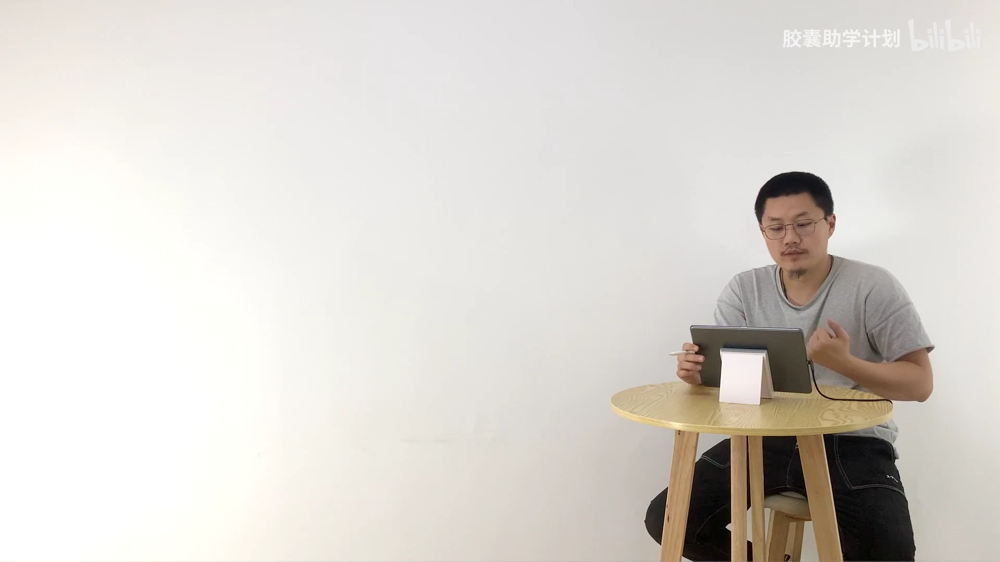

文字识别：胶囊助学计划 / D

### 画面 00:04:42

文字识别：胶囊助学计划 / You usually have to wait for that which is / worth waiting for. / Craig Bruce

### 画面 00:04:53

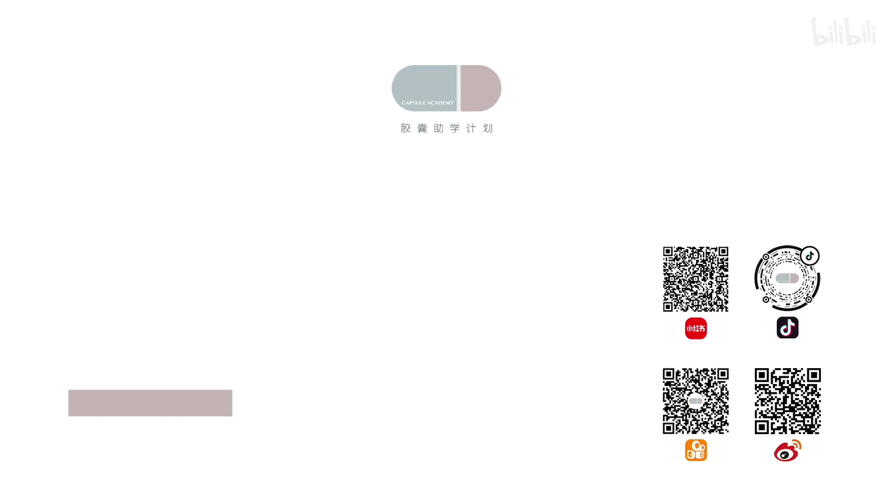

文字识别：CAPSULEACADEMY / 胶囊助学计划 / 小红书 / 品 / OE

### 画面 00:04:55

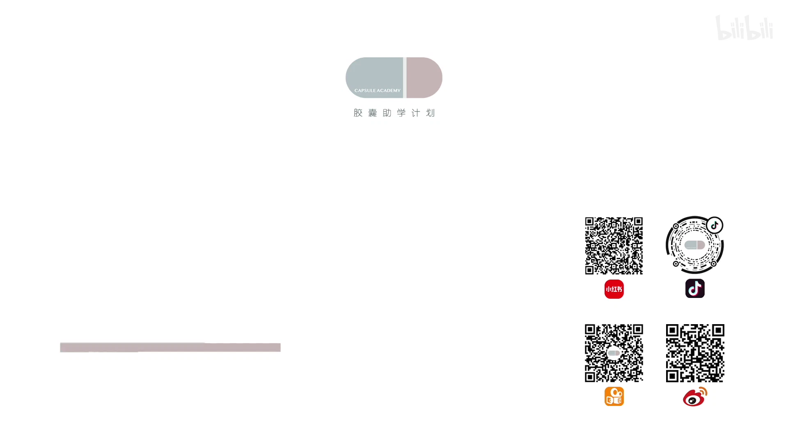

文字识别：CAPSULEACADEMY / 胶囊助学计划 / 小红书 / OE

## 00:05:00–00:05:05

### 画面 00:05:01

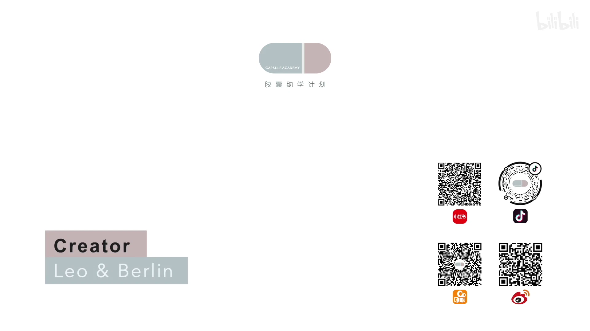

文字识别：CAPSULEACADEMY / 胶囊助学计划 / 小红书 / Creator / Leo & Berlin / OE

### 画面 00:05:03

文字识别：bilibili / 胶囊助学计划

### 画面 00:05:04

文字识别：bilibili / 胶囊助学计划

