# 091 单词

快速机器解析：语音为单模型转写，未进行独立交叉校对或人工复核；画面每秒采样并按变化选帧，短时文字和标记可能遗漏。截图时间约有 1 秒误差。图片有损压缩；遇到疑点请按时间查看 Google Drive 原视频。

## 00:00:00–00:00:30

Hello everyone, welcome to Capsule Academy. This is Leo. Today we are going to learn New Concept English Book One Lesson Ninety One Words.啊，老习惯，我们进入正式课程之前先看几个问题。首先，如何表达搬去某地？接着，如何表达可怜的家伙？最后，如何使用 will 这个单词？那带着这三个问题，Hope you gonna enjoy it.好，

### 画面 00:00:00

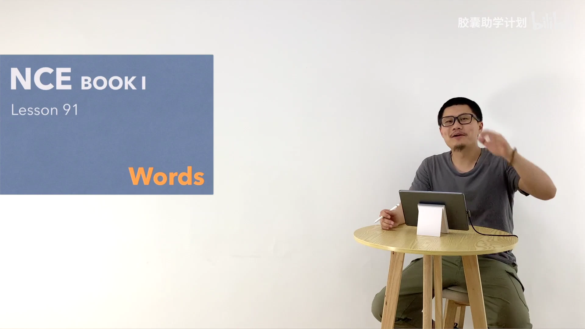

文字识别：胶囊助学计划 / NCE / BOOKI / Lesson 91 / Words

### 画面 00:00:02

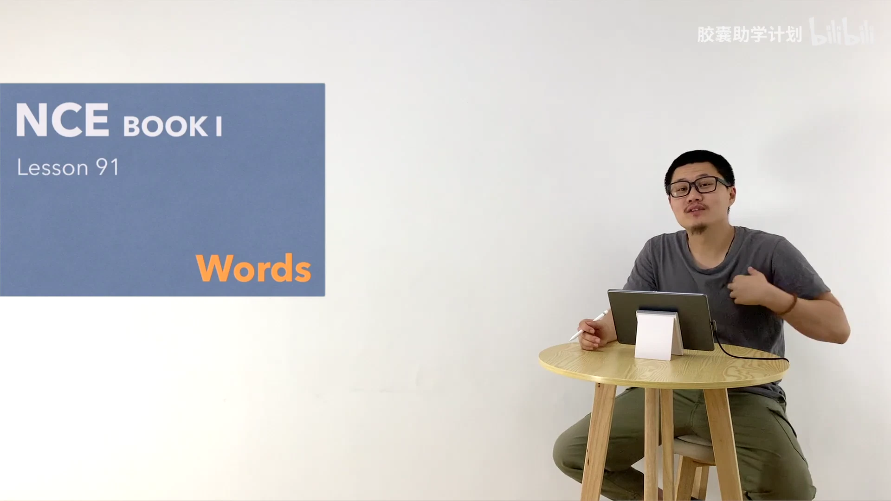

文字识别：胶囊助学计划 / NCE / BOOKI / Lesson 91 / Words

### 画面 00:00:05

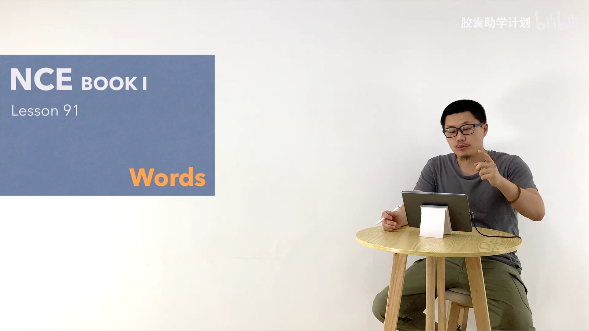

文字识别：胶囊助学计划 / NCE / BOOKI / Lesson 91 / Words

### 画面 00:00:09

文字识别：胶囊助学计划 / 2

### 画面 00:00:11

文字识别：胶囊助学计划 / 搬去某地”?

### 画面 00:00:13

文字识别：胶囊助学计划 / ①如何表达“搬去某地”？

### 画面 00:00:15

文字识别：胶囊助学计划 / ①如何表达“搬去某地”？ / 如何表达“可怜的家伙”？

### 画面 00:00:17

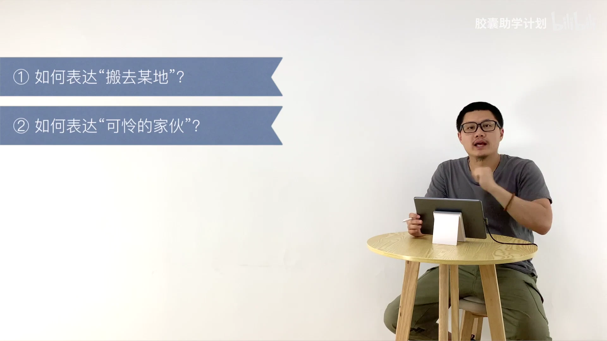

文字识别：胶囊助学计划 / ①如何表达“搬去某地”？ / 如何表达“可怜的家伙”？

### 画面 00:00:19

文字识别：胶囊助学计划 / ①如何表达“搬去某地”？ / 如何表达“可怜的家伙”？ / 如何使用will?

### 画面 00:00:24

文字识别：胶囊助学计划 blb出 / • / •

### 画面 00:00:28

文字识别：胶囊助学计划

## 00:00:30–00:01:00

那首先呢，我们先来讲 will 这个小的单词。 will 这个单词它也是一个时态，虽然它非常简单，但也是一个时态，我们管它叫做一般将来时。其实我们早在三十七课、三十九课就学过一般将来时，各位不知道有没有印象，对吧？但是我一说结构，你肯定有印象，叫做 be going to do 表计划打算，对吧？那今天呢，我们来学 will 这个单词，它很简单，实际上它的用法就是叫做

### 画面 00:00:30

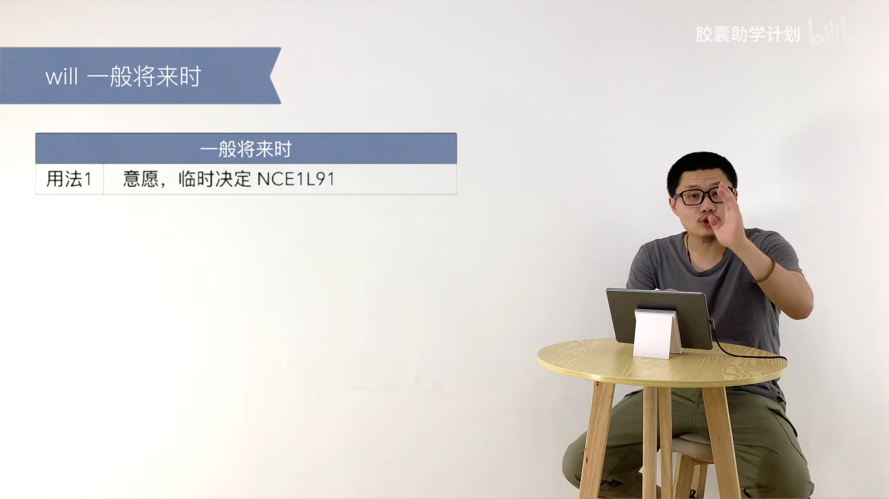

文字识别：胶囊助学计划 / will一般将来时 / 一般将来时 / - / 用法1 / 意愿，临时决定 NCE1L91

### 画面 00:00:36

文字识别：胶囊助学计划 / will / 般将来时 / 般将来时 / 用法1 / 意愿，临时决定NCE1L91

### 画面 00:00:45

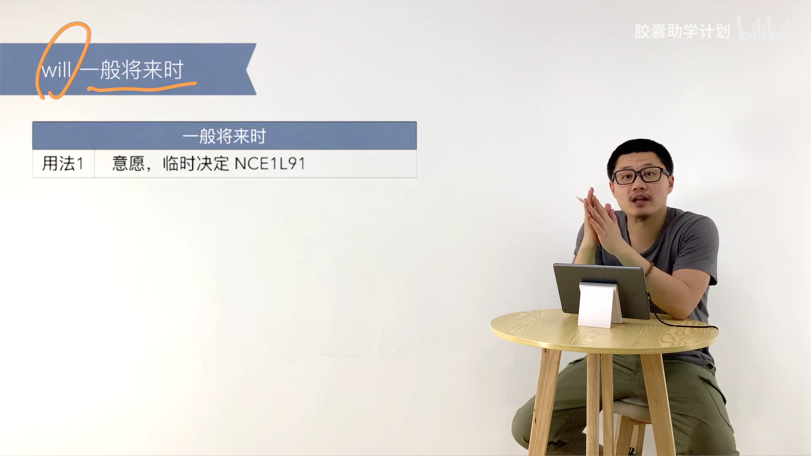

文字识别：胶囊助学计划 / will / 般将来时 / 般将来时 / 用法1 / 意愿，临时决定NCE1L91

### 画面 00:00:54

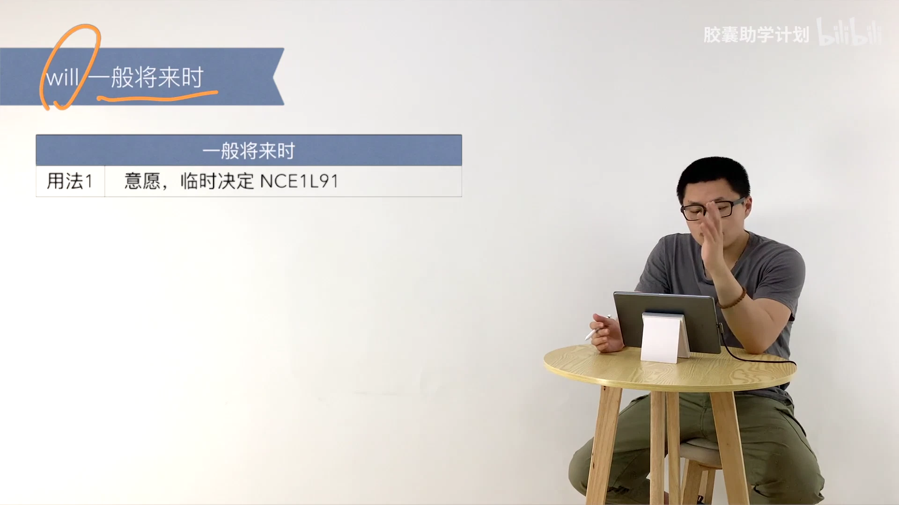

文字识别：胶囊助学计划 / will / 般将来时 / 般将来时 / 用法1 / 意愿，临时决定 NCE1L91

### 画面 00:00:58

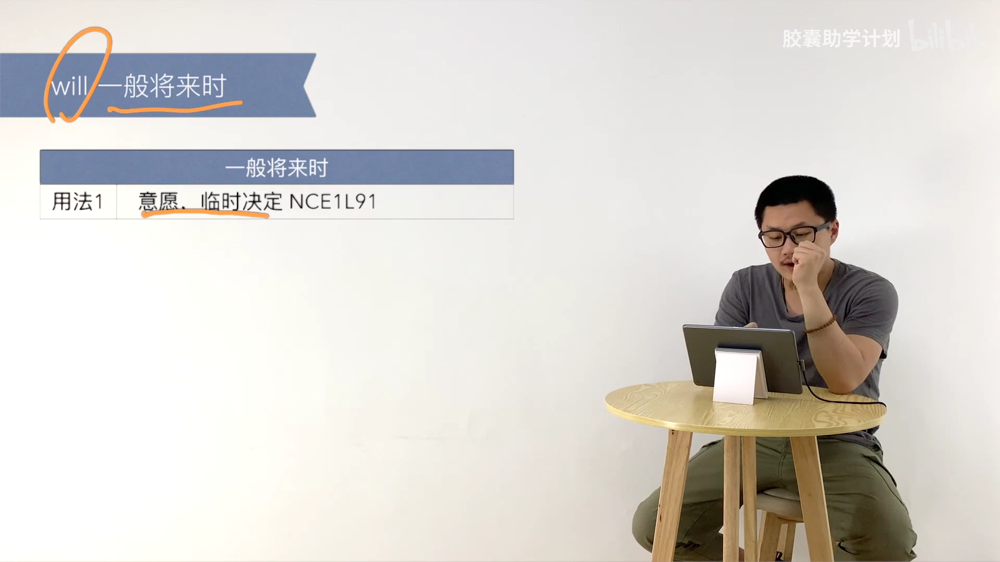

文字识别：胶囊助学计划 / will / 般将来时 / 一般将来时 / 用法1 / 意愿，临时决定 NCE1L91

## 00:01:00–00:01:30

表意愿或者一个临时的决定，那一定临时的决定是表将来的，对不对？OK，所以那我们呢，首先看它的结构，各位要记住，will这个单词后边要加动词原形加do啊，但是注意啊，千万不要在这儿说我们把它完全变成一个规则化，说will后边只能加动词原形，不是，将来我们还会学到被动，OK，但是今天我们现在主动这个角度上就知道will后边加一个动词原形就行了。接下来呢，我们看

### 画面 00:01:19

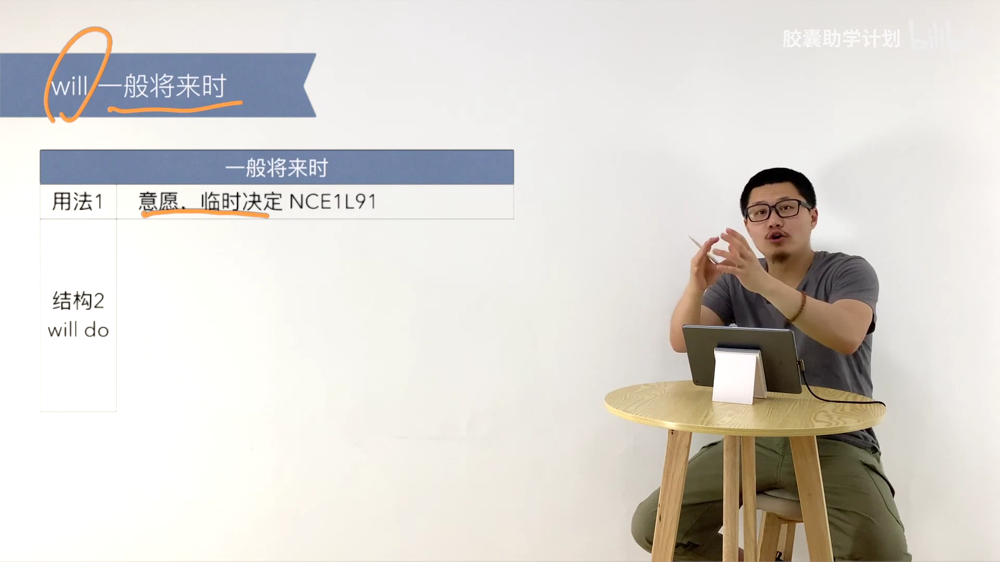

文字识别：胶囊助学计划 / will / 般将来时 / 一般将来时 / 用法1 / 意愿，临时决定NCE1L91 / 结构2 / will do

### 画面 00:01:26

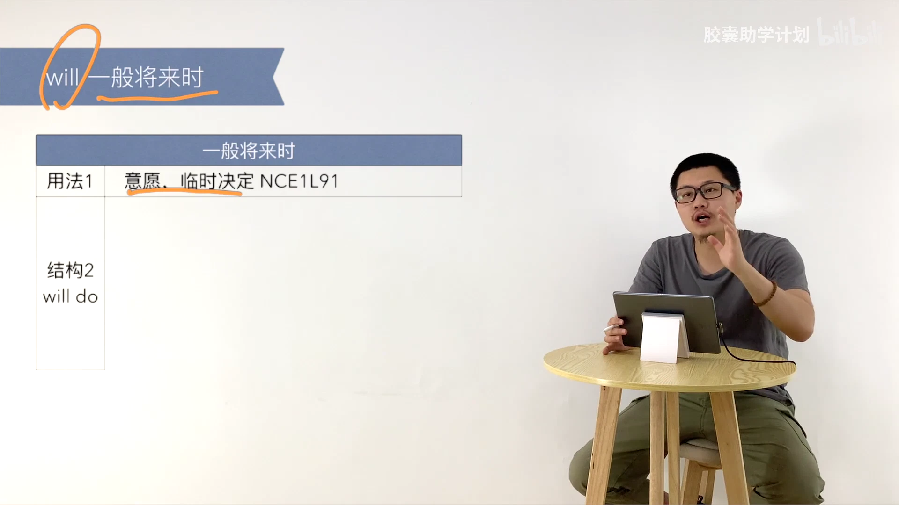

文字识别：胶囊助学计划 / will / 般将来时 / 般将来时 / 用法1 / 意愿，临时决定 NCE1L91 / 结构2 / will do

## 00:01:30–00:02:00

下它的肯定句，比如说 A 说了一句话，说 is heavy，说这个玩意儿好沉呐。然后你临时有一个决定，你这不是知道的，对吧？不是计划打算好要帮他的，而是他说沉，然后你立刻要帮他，于是这句话就变成了 I'll help you。然后这儿注意一个小点，就是看 I 是我撇 L L 就是 will 这个单词的缩写啊。我们目前看到了，比如说 M is 二那个 is 可以缩写成撇 S，

### 画面 00:01:33

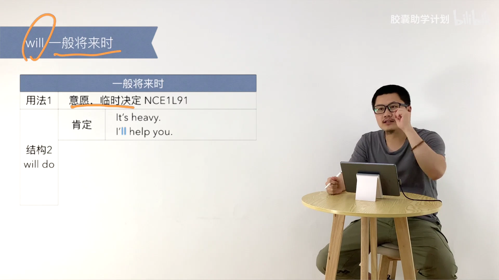

文字识别：胶囊助学计划 / will / 般将来时 / 一般将来时 / 用法1 / 意愿，临时决定NCE1L91 / It's heavy. / 肯定 / I'll help you. / 结构2 / will do

### 画面 00:01:48

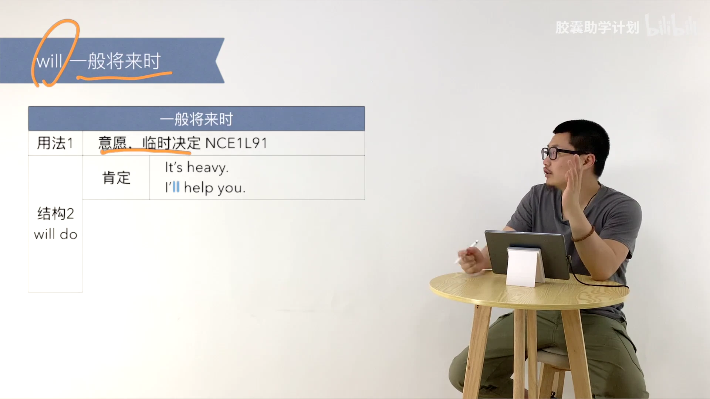

文字识别：胶囊助学计划 / will / 般将来时 / 一般将来时 / 用法1 / 意愿，临时决定 NCE1L91 / It's heavy. / 肯定 / I'll help you. / 结构2 / will do

### 画面 00:01:52

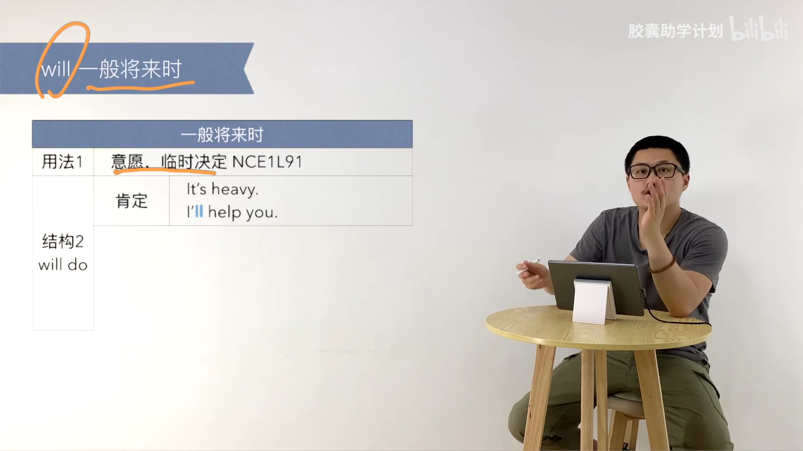

文字识别：胶囊助学计划 / Will / 般将来时 / 一般将来时 / 用法1 / 意愿，临时决定 NCE1L91 / It's heavy. / 肯定 / I'll help you. / 结构2 / will do

### 画面 00:01:55

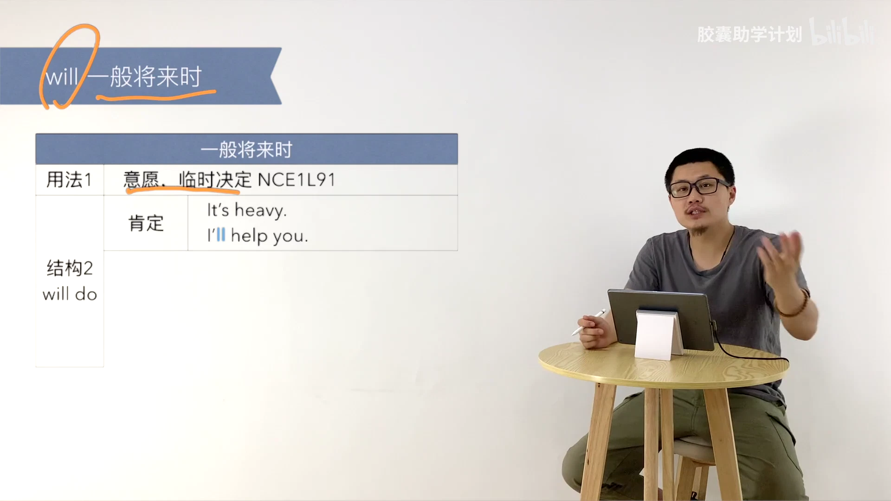

文字识别：胶囊助学计划 / will / 般将来时 / 一般将来时 / 用法1 / 意愿，临时决定 NCE1L91 / It's heavy. / 肯定 / I'll help you. / 结构2 / willdo

## 00:02:00–00:02:30

对吧？这个am可以缩写成pm，那will就可以缩写成pll。OK，那这个单词呢，其实啊，另一个角度我们可以理解为，它其实也是某种程度上的一个情态动词。情态动词对于各位来说比较熟悉的，比如说有两个单词，一个叫can，一个叫must。它们在变否定句和疑问句的时候是高度相似的。那高度相似意味着什么呢？我们回顾一

### 画面 00:02:05

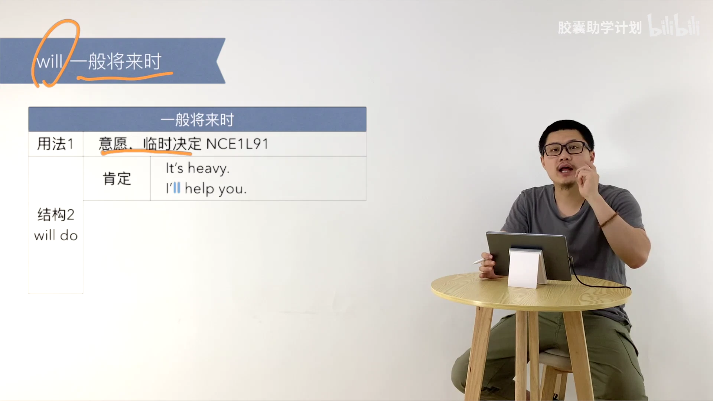

文字识别：胶囊助学计划 / will / 般将来时 / 一般将来时 / 用法1 / 意愿，临时决定 NCE1L91 / It's heavy. / 肯定 / I'll help you. / 结构2 / will do

### 画面 00:02:07

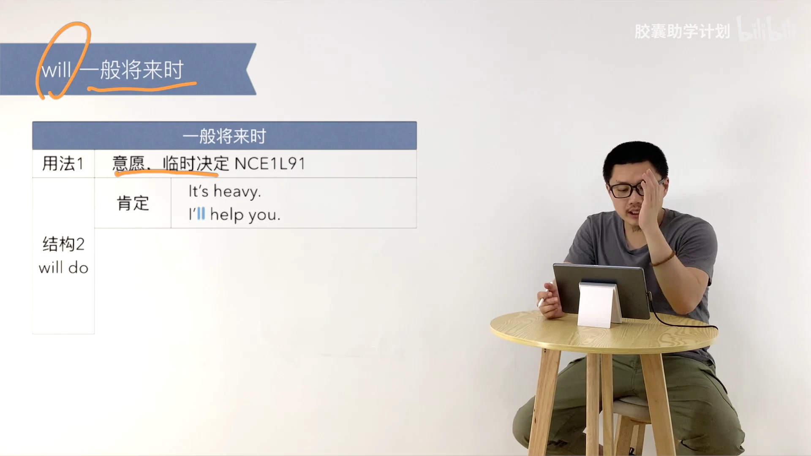

文字识别：胶囊助学计划 / will / 般将来时 / 一般将来时 / 用法1 / 意愿，临时决定 NCE1L91 / It's heavy. / 肯定 / I'll help you. / 结构2 / will do

## 00:02:30–00:03:00

下，can是后边加not，must后边是加not。当然了，must后边加not表的是禁止，对吧？希望各位还记得。那will这个单词表否定的时候，也是在will这个单词的后边加not就可以了。I will not help you，对吧？OK，那它呢？Will加not可以有一个缩写，那它的变化会相对特殊一点啊。W O N撇T，OK，我们一起读一下，叫做won't，won't，OK。

### 画面 00:02:32

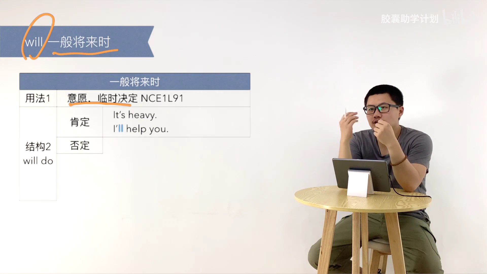

文字识别：胶囊助学计划 / will / 般将来时 / 一般将来时 / 用法1 / 意愿，临时决定 NCE1L91 / It's heavy. / 肯定 / I'll help you. / 结构2 / 否定 / will do

### 画面 00:02:38

文字识别：胶囊助学计划 / will / 般将来时 / 般将来时 / 用法1 / 意愿，临时决定 NCE1L91 / It's heavy. / 肯定 / I'll help you. / 结构2 / 否定 / will do

### 画面 00:02:42

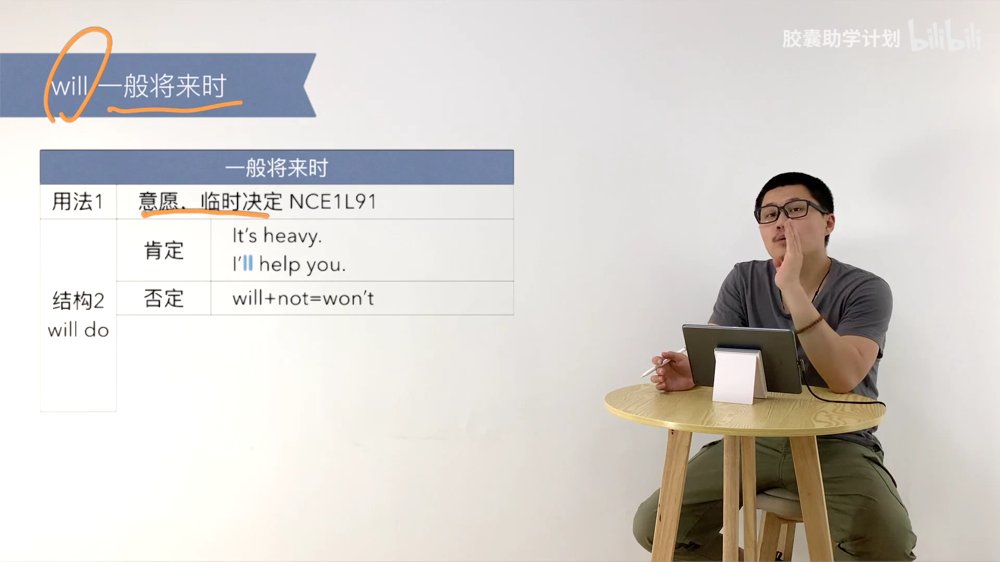

文字识别：胶囊助学计划 / will / 般将来时 / 一般将来时 / - / 用法1 / 意愿，临时决定 NCE1L91 / It's heavy. / 肯定 / I'll help you. / 结构2 / 否定 / will+not=won't / will do

### 画面 00:02:48

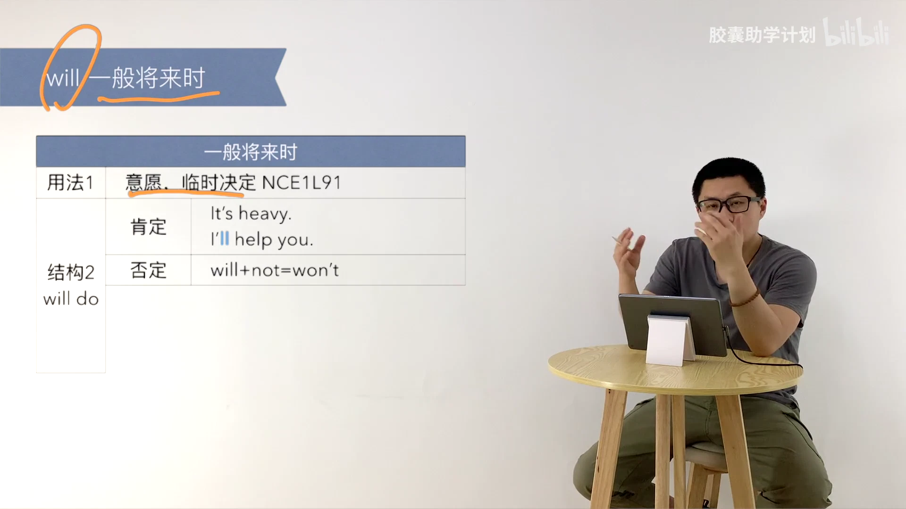

文字识别：胶囊助学计划 / will / 般将来时 / 一般将来时 / 用法1 / 意愿，临时决定NCE1L91 / It's heavy. / 肯定 / I'll help you. / 结构2 / 否定 / will+not=won't / will do

### 画面 00:02:53

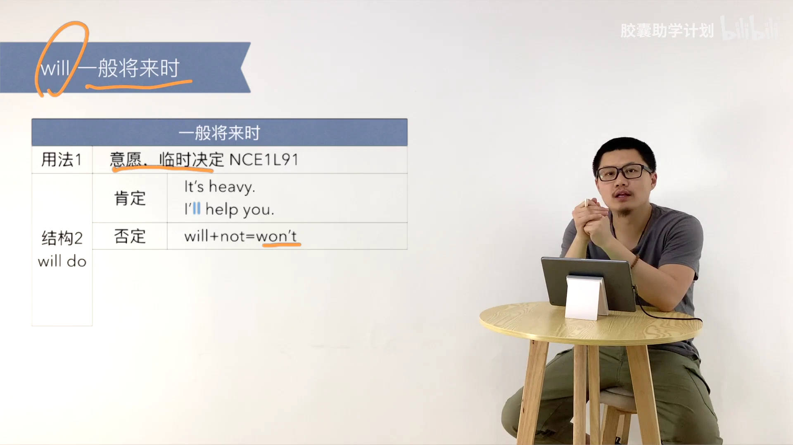

文字识别：胶囊助学计划 / will / 般将来时 / 一般将来时 / 用法1 / 意愿，临时決定 NCE1L91 / It's heavy. / 肯定 / I'll help you. / 结构2 / 否定 / will+not=won't / will do

## 00:03:00–00:03:30

won't, okay.比如说 I won't help you.我不会帮你的。一般疑问句呢？既然我们已经明白了是 will 后边加 not, okay.我们又会了 can 和 must.我跟您说它是很像的。于是对于各位来说，就是把 will 提到句首，这事儿就搞定了。Okay,那它的难点有如下几个。首先第一个实际上是 will 与 am/is/are going to do 的一个对比啊，它们两者是有一些区别的。

### 画面 00:03:02

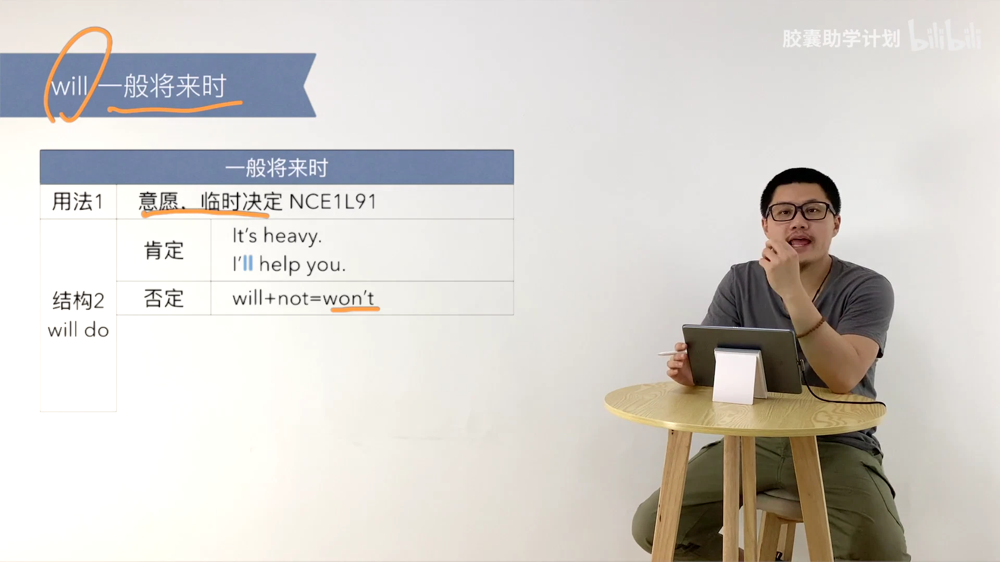

文字识别：胶囊助学计划 / will / 般将来时 / 一般将来时 / 用法1 / 意愿，临时决定 NCE1L91 / It's heavy. / 肯定 / I'll help you. / 结构2 / 否定 / will+not=won't / will do

### 画面 00:03:14

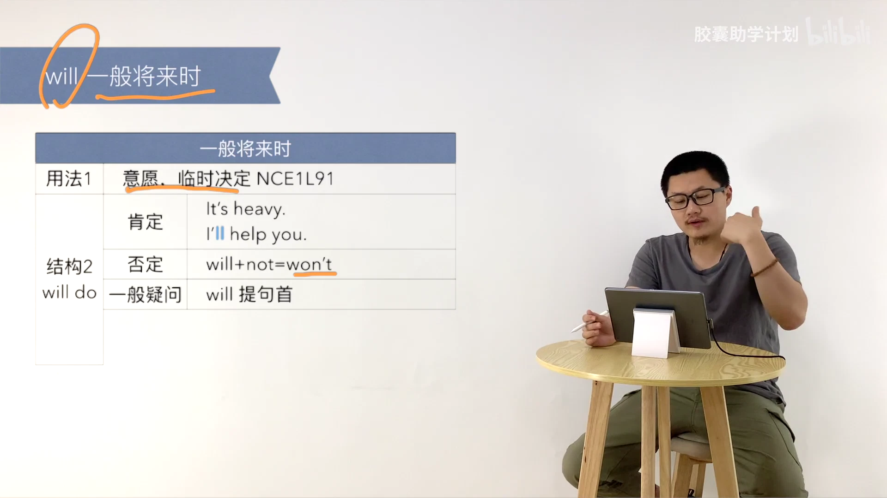

文字识别：胶囊助学计划 / will / 般将来时 / 一般将来时 / 用法1 / 意愿，临时决定 NCE1L91 / It's heavy. / 肯定 / I'll help you. / 结构2 / 否定 / will+not=won't / willdo / 一般疑问 / will 提句首 / 1

### 画面 00:03:18

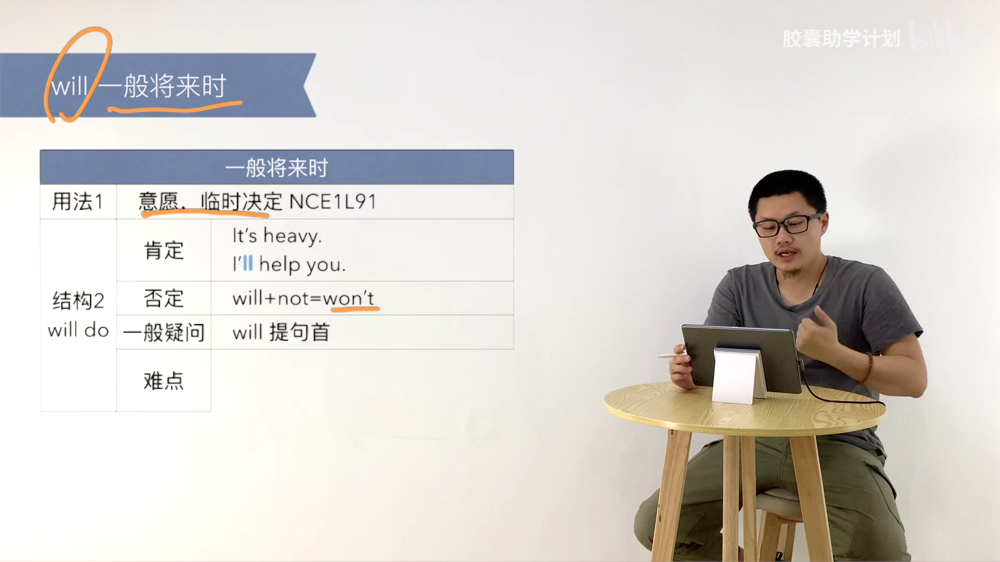

文字识别：胶囊助学计划 / 般将来时 / will / 一般将来时 / 用法1 / 意愿，临时决定 NCE1L91 / It's heavy. / 肯定 / I'll help you. / 结构2 / 否定 / will+not=won't / will do / 一般疑问 / will 提句首 / 难点

### 画面 00:03:23

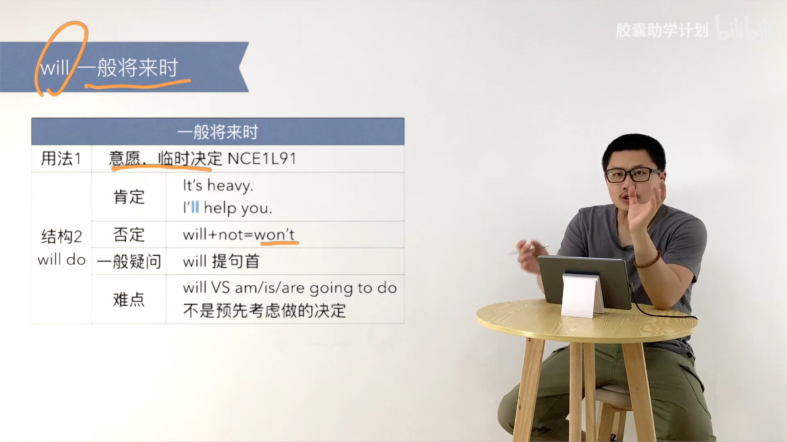

文字识别：胶囊助学计划 / will / 般将来时 / 一般将来时 / 用法1 / 意愿，临时决定 NCE1L91 / It's heavy. / 肯定 / I'll help you. / 结构2 / 否定 / will+not=won't / willdo一般疑问 / will提句首 / willVS am/is/are going to do / 难点 / 不是预先考虑做的决定

## 00:03:30–00:04:00

的，这个呢，我们专门之前已经给大家录制了一个视频，在我们的语法单项当中，您不妨过去找到啊，在文件夹当中找到这个视频合集当中语法单项，然后简单去看一下就可以了啊，在这儿我就不做过多的赘述了。OK，好，那不多说，接下来我们看本课的单词，本课的单词也并不是很难，我们一起读一下啊。第一个单词注意浊化，but变成the，跟我一起读，叫做

### 画面 00:03:32

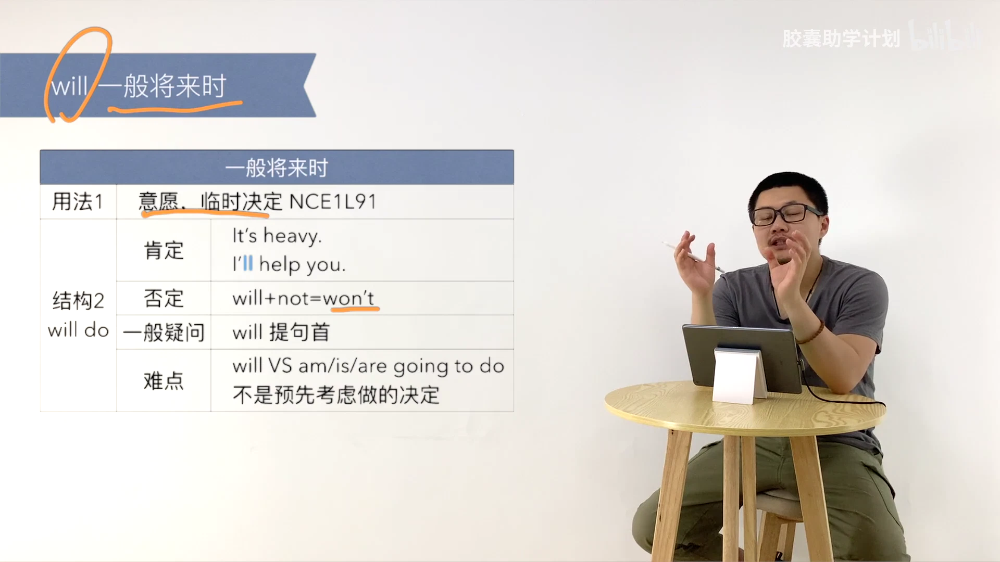

文字识别：胶囊助学计划 / will / 般将来时 / 一般将来时 / 用法1 / 意愿，临时决定 NCE1L91 / It's heavy. / 肯定 / I'll help you. / 结构2 / 否定 / will+not=won't / willdo一般疑问 / will提句首 / willVS am/is/are going to do / 难点 / 不是预先考虑做的决定

### 画面 00:03:36

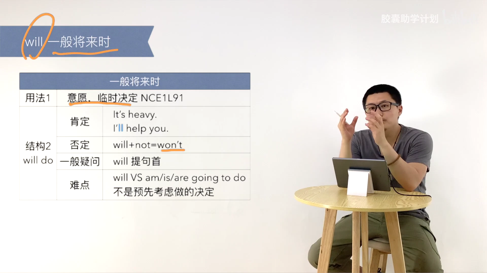

文字识别：will / -般将来时 / 一般将来时 / 用法1 / 意愿，临时决定 NCE1L91 / It's heavy. / 肯定 / I'll help you. / 结构2 / 否定 / will+not=won't / willdo一般疑问 / will 提句首 / willVS am/is/are going to do / 难点 / 不是预先考虑做的决定

### 画面 00:03:49

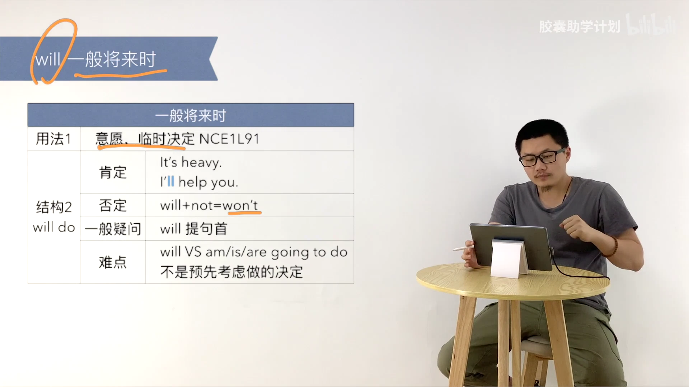

文字识别：胶囊助学计划 / will / 般将来时 / 一般将来时 / 用法1 / 意愿，临时决定 NCE1L91 / It's heavy. / 肯定 / I'll help you. / 结构2 / 否定 / will+not=won't / willdo一般疑问 / will提句首 / willVS am/is/are going to do / 难点 / 不是预先考虑做的决定

### 画面 00:03:51

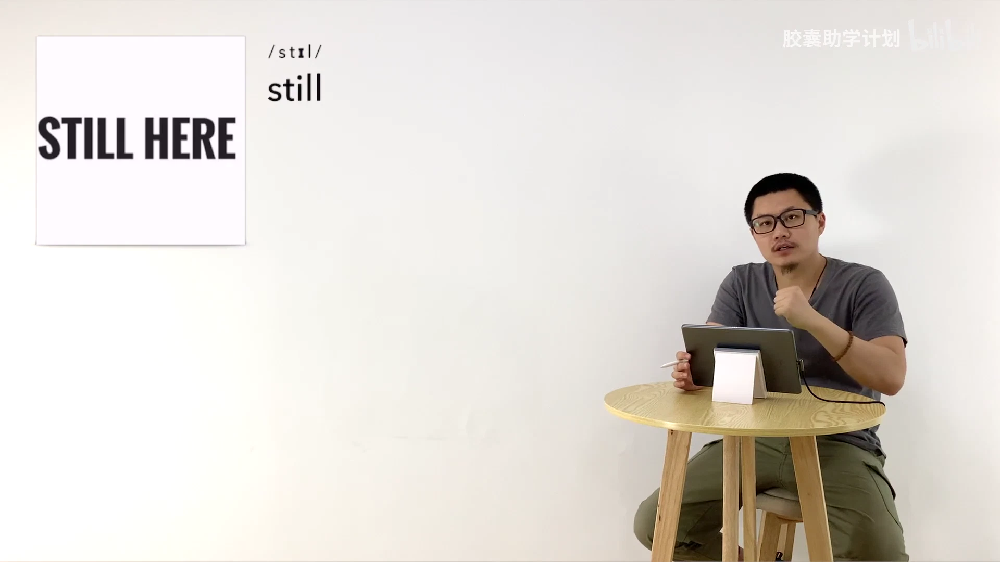

文字识别：胶囊助学计划 / /stil/ / still / STILL HERE

### 画面 00:03:54

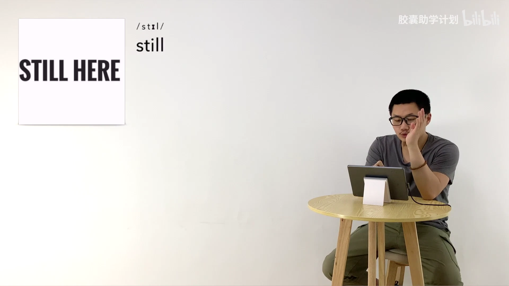

文字识别：胶囊助学计划 / /stil/ / still / STILL HERE / 2

### 画面 00:03:59

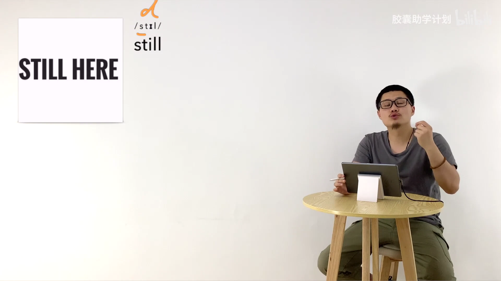

文字识别：胶囊助学计划 / /stil/ / still / STILL HERE

## 00:04:00–00:04:30

still， still啊，叫做依旧，对吧？OK，依旧。比如说， he's still here。我们不加 still 和 he's here，叫他在这里。那 he's still here，叫做他依旧在这里。OK，那变一般疑问句叫做 Is he still here？他还在这里吗？他依旧还在这里吗？以及 Why is he still here？他为什么还在这儿待着呢？依旧在这儿待着呢？OK，very good。好，接下来下一个小

### 画面 00:04:03

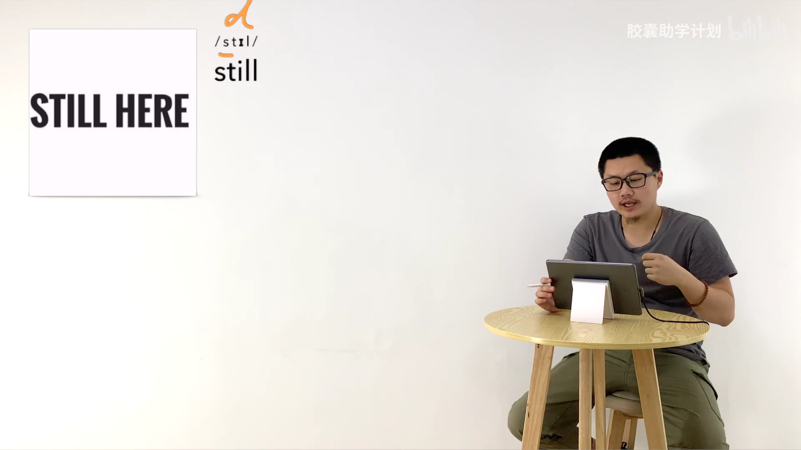

文字识别：胶囊助学计划 / /stil/ / still / STILL HERE

### 画面 00:04:06

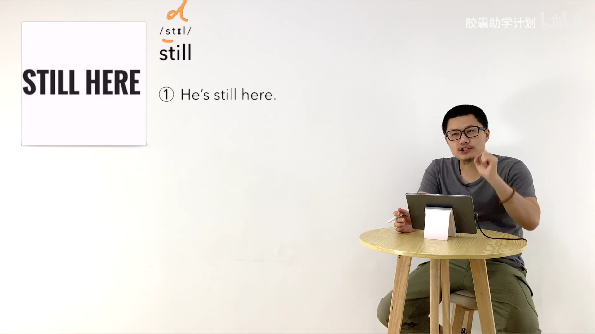

文字识别：胶囊助学计划 / /stil/ / still / STILL HERE / ① He's still here. / D

### 画面 00:04:11

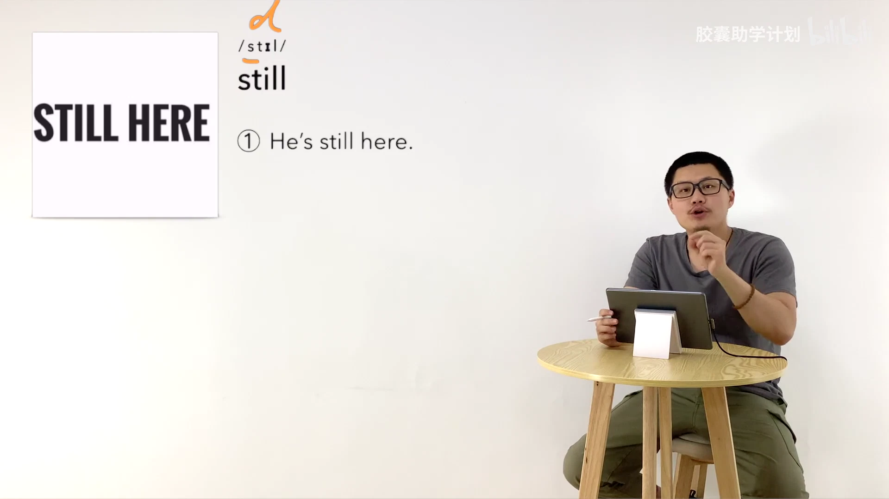

文字识别：胶囊助学计划 / /stil/ / still / STILL HERE / D He's still here. / 1

### 画面 00:04:28

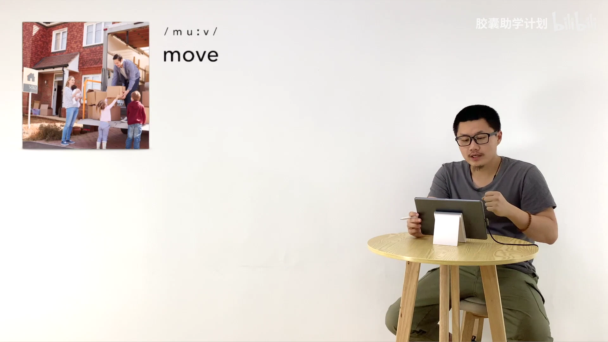

文字识别：胶囊助学计划 / /mu:v/ / move / SOLD

## 00:04:30–00:05:00

单词跟我一起读一下，叫做 move. Okay, 然后注意一个小点， move 这个单词是一个动词。我们拿它去造一个句子，比如说 He is going to move tomorrow. 这是计划打算，对吧？他要搬家了啊。 Move 其实最核心的含义指的就是移动啊， move 移动. Okay, 那它其中可以用到表示的是搬家啊，其中一个含义。比如说，我们还可以造叫做 move to

### 画面 00:04:31

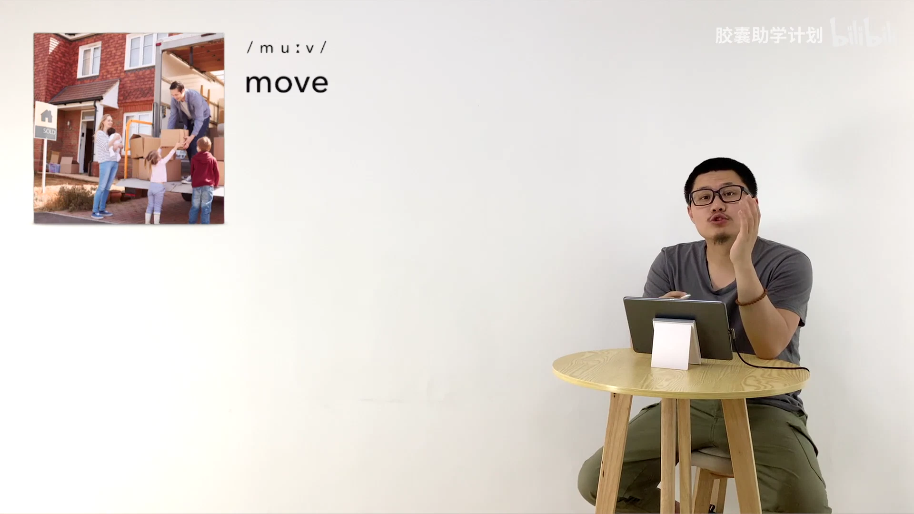

文字识别：胶囊助学计划 / 1mu:v/ / move / SOLD

### 画面 00:04:35

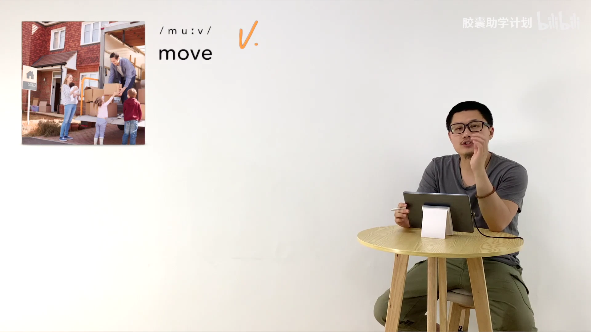

文字识别：胶囊助学计划 / V. / /mu:v/ / move / SOLD / 2

### 画面 00:04:38

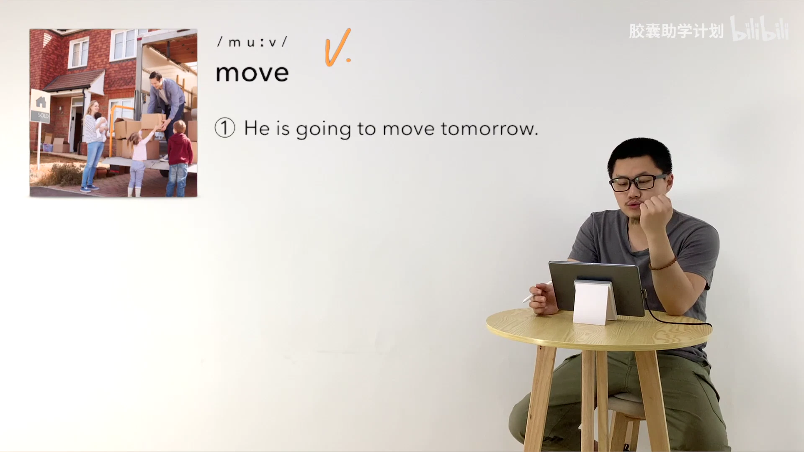

文字识别：胶囊助学计划 / V. / /mu:v/ / move / SOID / ① He is going to move tomorrow.

### 画面 00:04:41

文字识别：胶囊助学计划 / V. / /mu:v/ / move / SOLD / ① He is going to move tomorrow.

### 画面 00:04:45

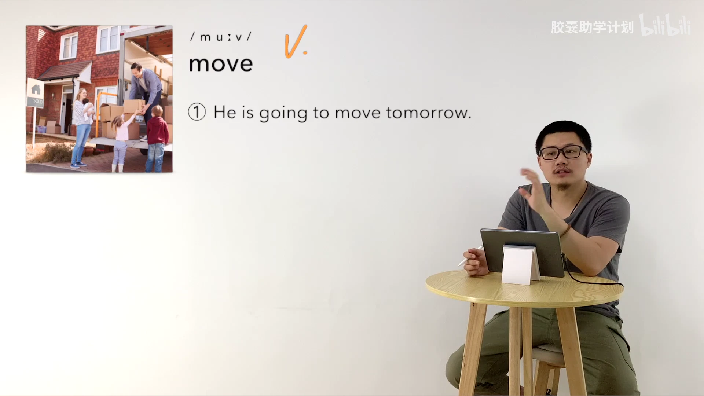

文字识别：胶囊助学计划 / BiiBil / V. / /mu:v/ / move / SOD / ① He is going to move tomorrow.

### 画面 00:04:50

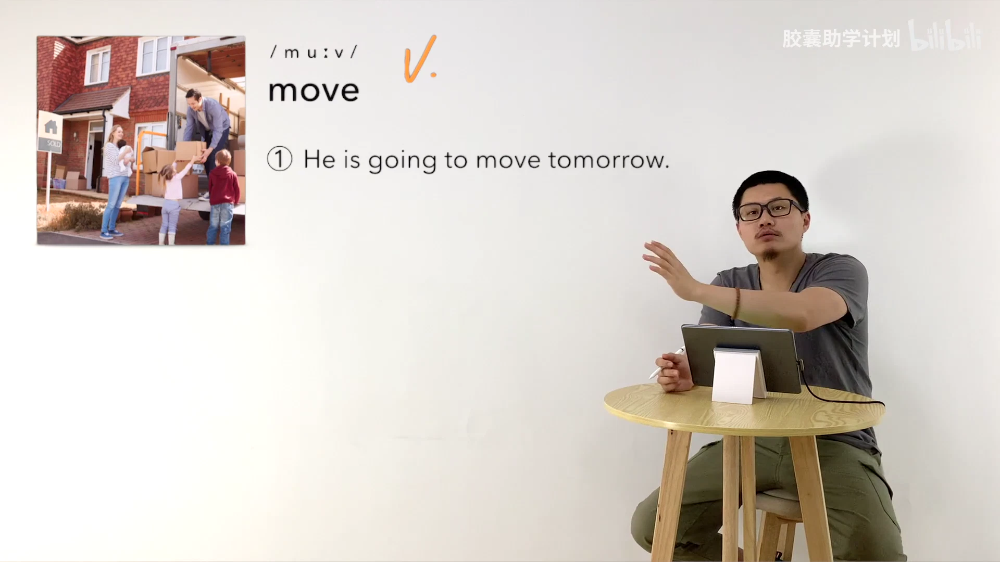

文字识别：胶囊助学计划 / V. / / mu:v/ / move / SOLD / ① He is going to move tomorrow.

### 画面 00:04:53

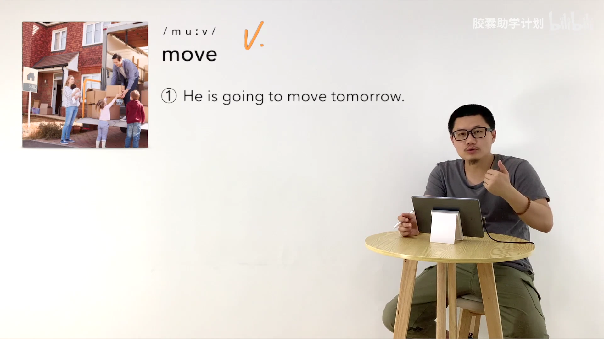

文字识别：胶囊助学计划 / V. / /mu:v/ / move / SOLD / ① He is going to move tomorrow. / D

### 画面 00:04:56

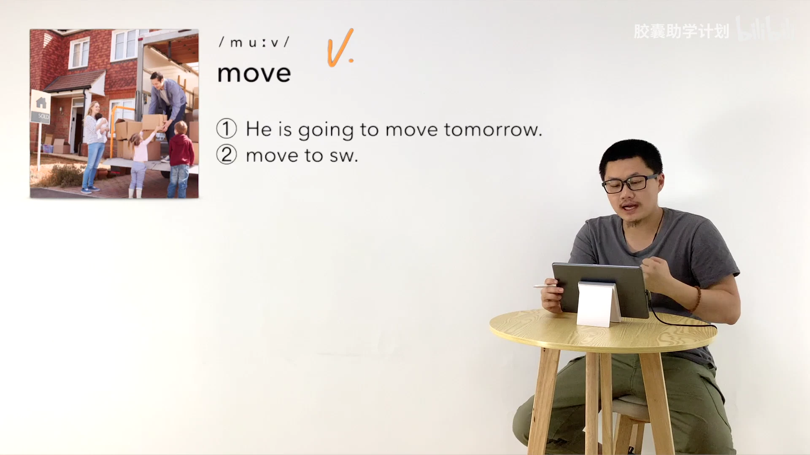

文字识别：胶囊助学计划 / V. / 1mu:v/ / move / SOID / ① He is going to move tomorrow. / move to sw. / 1

## 00:05:00–00:05:30

s w dot somewhere，搬去某地。我们拿它造句呢，比如说 he moved to Beijing last year。好，注意你看我们选择了时态是一般过去时，那变一般疑问句，把 did 提前，动词换回原形，跟我一起读。Did he move to Beijing last year? Okay, very good。以及我对 last year 提问，答案就是 when did he move to Beijing? Very good。下一个单词叫做 miss 啊

### 画面 00:05:00

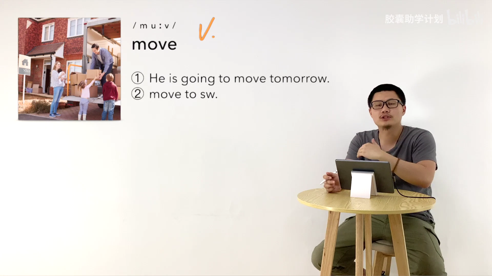

文字识别：胶囊助学计划 / V. / /muiv1 / move / SOID / ① He is going to move tomorrow. / move to sw.

### 画面 00:05:05

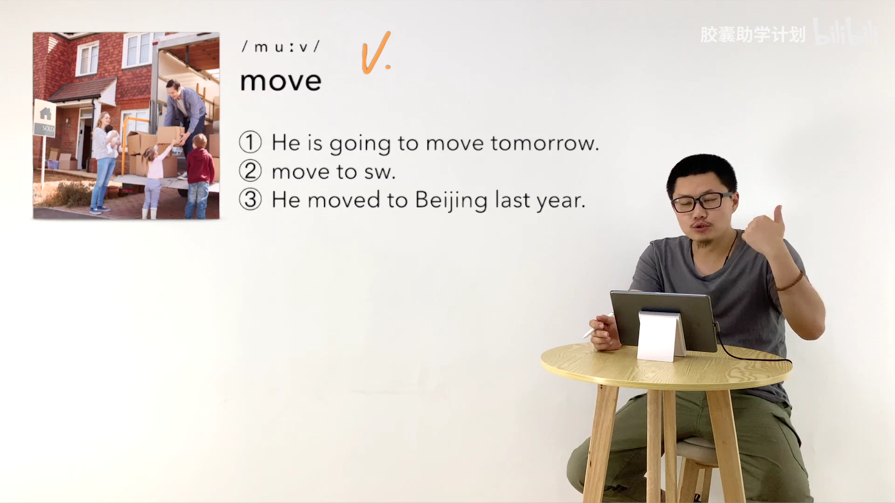

文字识别：胶囊助学计划 / V. / /mu:v/ / move / SOLD / ① He is going to move tomorrow. / move to sw. / He moved to Beijing last year. / 3

### 画面 00:05:08

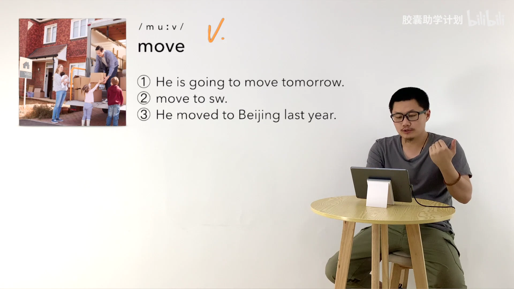

文字识别：胶囊助学计划 / V. / /mu:v/ / move / SOLD / ① He is going to move tomorrow. / move to sw. / He moved to Beijing last year.

### 画面 00:05:10

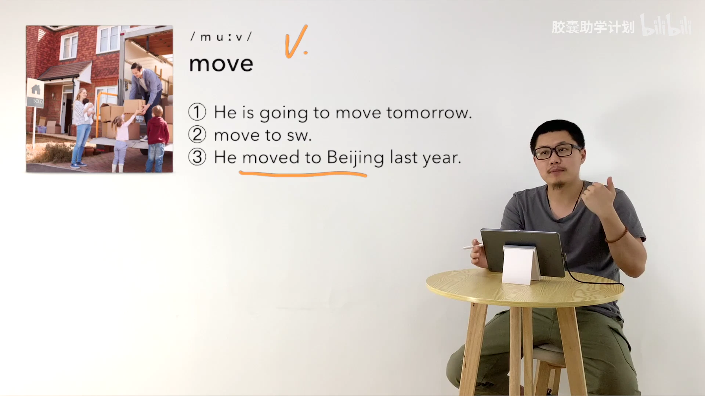

文字识别：胶囊助学计划 / V. / /mu:v/ / move / SOD / ① He is going to move tomorrow. / move to sw. / He moved to Beijing last year.

### 画面 00:05:14

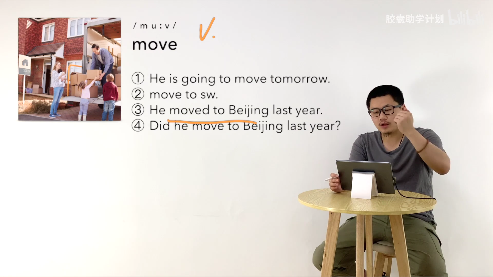

文字识别：胶囊助学计划 / V. / /mu:v1 / move / SOXD / ① He is going to move tomorrow. / move to sw. / He moved to Beijing last year. / Did he move to Beijing last year?

### 画面 00:05:17

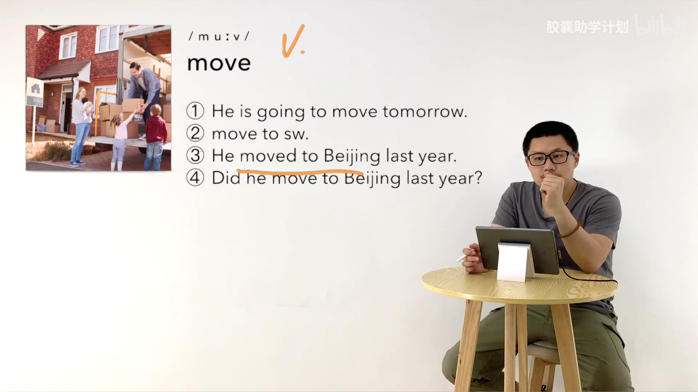

文字识别：胶囊助学计划 / V. / /muiv/ / move / SOD / ① He is going to move tomorrow. / move to sw. / He moved to Beijing last year. / Did he move to Beijing last year?

### 画面 00:05:19

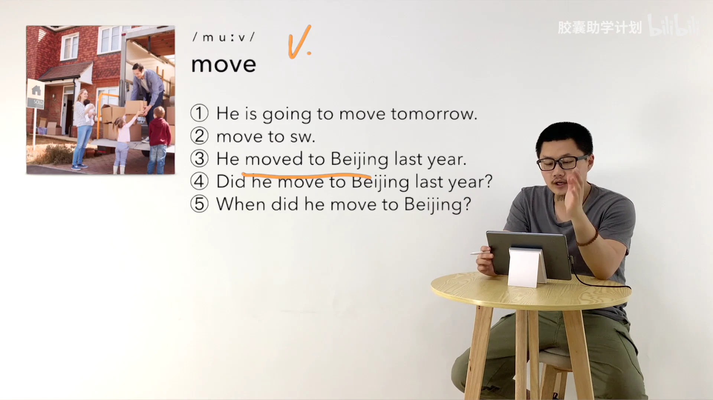

文字识别：胶囊助学计划 / V. / 1mu:v/ / move / SOD / ① He is going to move tomorrow. / move to sw. / He moved to Beijing last year. / Did he move to Beijing / last year? / When did he move to Beijing? / 5

### 画面 00:05:22

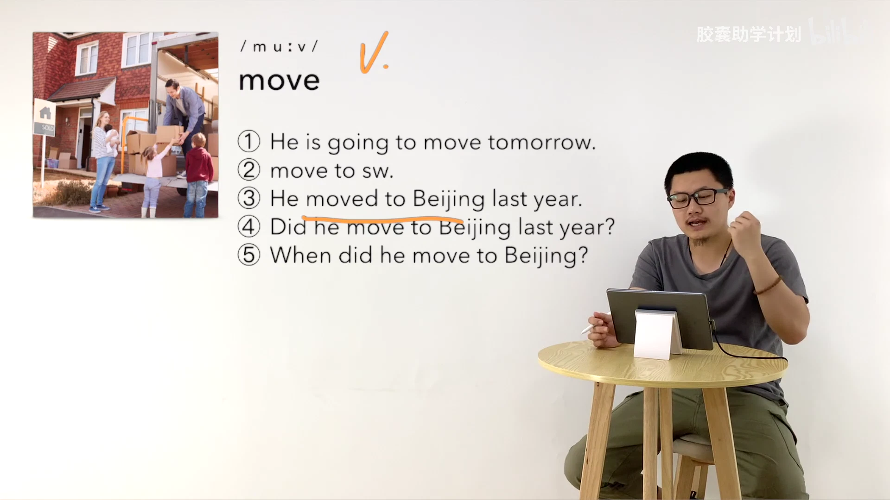

文字识别：胶囊助学计划 / V. / / mu:v/ / move / SOLD / ① He is going to move tomorrow. / move to sw. / He moved to Beijing last year. / Did he move to Beijing I /  last year? / When did he move to Beijing? / 5

### 画面 00:05:25

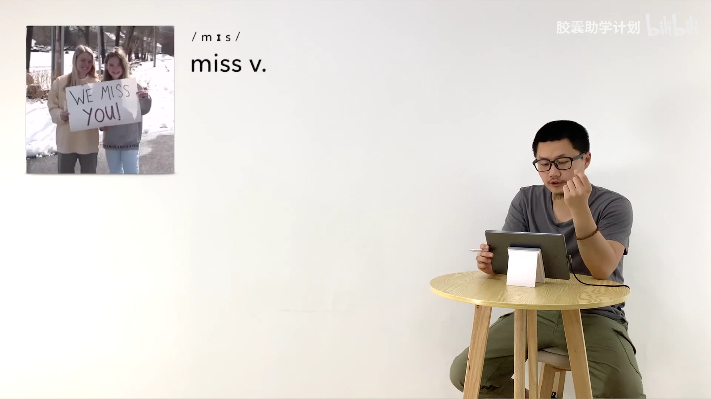

文字识别：胶囊助学计划 / /mIs1 / miss V. / WE MISS / Youl

## 00:05:30–00:06:00

miss，你看我们原来学过 am 去大写的时候 miss 是什么意思，对吧？啊，女士啊，不管你有没有这个结婚啊，女士。好，那 miss am 去小写的时候呢，那它指的就是你看 we miss you 啊，两个姑娘拍张照片，可能是给父亲，就我们想你啊。那造句子叫做 they miss you a lot，在这儿我们给大家补充了一个小的两个单词，对吧？对于各位来说，各位很熟悉，叫 a lot

### 画面 00:05:32

文字识别：M / 胶囊助学计划 / /mIs/ / miss v. / WE MISS / You!

### 画面 00:05:37

文字识别：Miss / 胶囊助学计划 / /mIs / / miss V. / WE MISS / YOU!

### 画面 00:05:41

文字识别：Miss / 胶囊助学计划 / /mIs/ / miss V. / WE MISS / YoU! / L

### 画面 00:05:44

文字识别：Miss / 胶囊助学计划 / /mIs/ / miss V. / WE MISS / Youl

### 画面 00:05:50

文字识别：Miss / 胶囊助学计划 / /mIs/ / miss V. / WE MISS / ① They miss you a lot. / Youl

### 画面 00:05:56

文字识别：Miss / 胶囊助学计划 / /mIs/ / miss v. / WE MISS / ① They miss you a lot. / Youl

## 00:06:00–00:06:30

of，叫许多大量。那 we miss you a lot 的这个 a lot，其实啊，您甚至可以，我很严谨啊，但是对于各位来说，很容易就记住了，也是许多，就我们特别想你啊，想你想的很多，对吧？啊，它其实有点像 very much。 OK，好，以及 do you miss me？啊，你想我不？ OK，玩一个。接下来下一个单词，跟我一起读一下，叫做 neighbor， neighbor，啊，叫邻居。然后注意，

### 画面 00:06:22

文字识别：胶囊助学计划 / ｎｅｌbal / neighbour / neighbor

### 画面 00:06:25

文字识别：胶囊助学计划 / ｎｅтbal / neighbour / neighbor

## 00:06:30–00:07:00

你看它有两个不同的写法。我们书中给的是英式写法，另一个那自然就是美式写法。但是差别并没有很大。大多数情况下，只有极少数情况下明确规定了，你只能用英式或只能用美式。大多数情况下，您随便混着用，没有任何问题，好吧？好的，英国人也看得懂，美国人也看得懂啊！你想嘛，就差一个字母u，怎么可能看不懂嘛？OK，那我们拿它去造句。我们知道了neighbor是一个名词，接下来

### 画面 00:06:35

文字识别：胶囊助学计划 / ｎｅｌba/ / neighbōur / neighbor

### 画面 00:06:48

文字识别：胶囊助学计划 / ｎｅｌｂa/ / neighbōur / neighbor

### 画面 00:06:50

文字识别：胶囊助学计划 / ｎｅｌbａ/ / neighbōur / neiahbor

### 画面 00:06:59

文字识别：胶囊助学计划 / 'nｅｌba/ / neighbōur / neiahbor / ① Do you like your new neighbor?

## 00:07:00–00:07:30

找动词，比如说 Do you like your new neighbor? 很简单的一个动词叫你喜欢你的新邻居吗？回答说 I like them. 我喜欢他们， but my husband doesn't like our new neighbor. 我我还挺喜欢的，但是我老公不是很喜欢我们这些新的邻居。 OK，我们接下来造句变一般疑问句，那就是啊，特殊疑问句就是 Why doesn't he like your your neighbor? Why 他为什么不喜欢你们的邻居呢？各种各样的原因，

### 画面 00:07:01

文字识别：bilbli / 胶囊助学计划 / 'neｌba/ / neighbōur / neiahbor / ① Do you like your new neighbor?

### 画面 00:07:07

文字识别：bilbl / 胶囊助学计划 / 'ｎｅｌba/ / neighbōur / neiahbor / ① Do you like your new neighbor? / I like them, but my husband doesn't / like our new neighbor.

### 画面 00:07:09

文字识别：胶囊助学计划 / 'ｎｅｌba/ / neighbōur / neiahbor / ① Do you like your new neighbor? / I like them, but my husband doesn't / like our new neighbor.

### 画面 00:07:13

文字识别：胶囊助学计划 /  'neiba/ / neighbōur / neiahbor / ① Do you like your new neighbor? / I like them, but my husband doesn't / like our new neighbor.

### 画面 00:07:15

文字识别：胶囊助学计划 / neiba/ / neighbōur / neiahbor / ① Do you like your new neighbor? / Ilike them, but my husband doesn't / like our new neighbor.

### 画面 00:07:18

文字识别：胶囊助学计划 / 1 neib a / / neighbōur / neiahbor / ① Do you like your new neighbor? / I like them, but my husband doesn't / like our new neighbor.

### 画面 00:07:21

文字识别：胶囊助学计划 / / n eib a / / neighbōur / neiahbor / ① Do you like your new neighbor? / ② I like them, but my husband doesn't / like our new neighbor. / Why doesn't he like your neighbor?

### 画面 00:07:28

文字识别：胶囊助学计划 / /  n ei b a / / neighbōur / neiahbor / ① Do you like your new neighbor? / ② I like them, but my husband doesn't / like our new neighbor. / Why doesn't he like your neighbor?

## 00:07:30–00:08:00

我都说了。接下来说 they are talking to。好，这是我们之前六十多课学过的 talk to somebody，对吧？对某人说话，说哎，他们我们看图造句，对吧？他们正在和他们的邻居说话。Be doing 表示现在正在进行。Next one，接下来这两个单词我们放到一起去学。首先看前面这个单词叫做 person 啊人，后边这个单词 people 人啊，区别是什么呢？这就很有意思

### 画面 00:07:32

文字识别：胶囊助学计划 / / 'neība / / neighbōur / neiahbor / ① Do you like your new neighbor? / ② Ilike them, but my husband doesn't / like our new neighbor. / Why doesn't he like your neighbor? / They are talking to their neighbor.

### 画面 00:07:34

文字识别：胶囊助学计划 / / 'n eīb a / / neighbōur / neiahbor / ① Do you like your new neighbor? / ② I like them, but my husband doesn't / like our new neighbor. / Why doesn't he like your neighbor? / They are talking to their neighbor.

### 画面 00:07:39

文字识别：胶囊助学计划 / / 'neiba / / neighbōur / neiahbor / ① Do you like your new neighbor? / ② I like them, but my husband doesn't / like our new neighbor. / Why doesn't he like your neighbor? / They are talking to their neighbor.

### 画面 00:07:42

文字识别：胶囊助学计划 / / n eib a / / neighbōur / neiahbor / ① Do you like your new neighbor? / ② Ilike them, but my husband doesn't / like our new neighbor. / Why doesn't he like your neighbor? / They are talking to their neighbor.

### 画面 00:07:45

文字识别：胶囊助学计划 / 1 neiba / / neighbōur / neiahbor / ① Do you like your new neighbor? / ② Ilike them, but my husband doesn't / like our new neighbor. / Why doesn't he like your neighbor? / They are talking to their neighbor.

### 画面 00:07:47

文字识别：胶囊助学计划 / /'p3isan/ / / 'pi:pal/ / 旺 / person — people

### 画面 00:07:50

文字识别：胶囊助学计划 / /'p3isan/ / / 'piipal/ / 旺 / person – people

### 画面 00:07:53

文字识别：胶囊助学计划 / /'p3isan/ / / 'pi:pal/ / 旺 / person – people

## 00:08:00–00:08:30

了。Person这个单词是人的单数，一个人。One person. People这个单词是person的复数，是人的复数啊。这个很麻烦，是吧？你看，我们汉语八个人，一个人，十个人，十万个人，就是这一个字人。英文就不是了，英文是两个人就叫做two people. Okay, 那我们就拿它尝试去造一些句子。来，张嘴跟我读。There is one person in our living room. Who

### 画面 00:08:09

文字识别：胶囊助学计划 / /'p3isan/ / / 'pi:pal/ / person – people

### 画面 00:08:22

文字识别：胶囊助学计划 / /'p3isan/ / / 'pi:pal/ / person - people / There is one person in our living / room. Who is that?

## 00:08:30–00:09:00

is that? Ah, okay. Continue. Say there are three people in our kitchen. Who are they? Continue.以及a lot of people.你回想一下，a lot of表示的是许多，那be是复数了。Are dancing in the street? Why are they dancing?他们为什么正在跳舞呢？啊，特别多人啊，在路上马路上跳舞呢。他们为什么正在跳舞呢？Okay,所以记住，person

### 画面 00:08:33

文字识别：胶囊助学计划 / /'p3isan/ / / 'pi:pal/ / person - people / D There is one person in our living / room. Who is that? / There are three people in our / kitchen. Who are they?

### 画面 00:08:36

文字识别：胶囊助学计划 / /'p3isan/ / / 'pi:pal/ / person - people / ) There is one person in our living / room. Who is that? / There are three people in our / kitchen. Who are they?

### 画面 00:08:39

文字识别：胶囊助学计划 / /'p3isan/ / / 'pi:pal/ / person – people / ① There is one person in our living / room. Who is that? / There are three people in our / kitchen. Who are they? / ③ A lot of people are dancing in / the street. Why are they / dancing?

### 画面 00:08:42

文字识别：胶囊助学计划 / /'p3isan/ / / 'pi:pal/ / person - people / ① There is one person in our living / room. Who is that? / There are three people in our / kitchen. Who are they? / ③ A lot of people are dancing in / the street. Why are they / dancing?

### 画面 00:08:47

文字识别：胶囊助学计划 / / 'p3isan/ / / 'pi:pal/ / person - people / ① There is one person in our living / room. Who is that? / There are three people in our / kitchen. Who are they? / ③ A lot of people are dancing in / the street. Why are they / dancing?

### 画面 00:08:56

文字识别：胶囊助学计划 / / p3isan/ / /'pi:pal/ / person - people / ① There is one person in our living / room. Who is that? / There are three people in our / kitchen. Who are they? / ③ A lot of people are dancing in / the street. Why are they / dancing?

## 00:09:00–00:09:30

singular, people plural. Okay, let's continue. Next word, we read together. It's called poor, poor. Everyone is familiar with poor. It's actually the opposite of rich. Rich means rich. Poor means poor. Okay, let's continue. Next word, we read together. It's called poor, poor. Everyone is familiar with poor. It's actually the opposite of rich. Rich means rich. Poor means poor. Okay, let's continue. Next word, we read together. It's called poor, poor. Everyone is familiar with poor. It's actually the opposite of rich. Rich

### 画面 00:09:02

文字识别：胶囊助学计划 / 1ρo: 1 / poor adj.

### 画面 00:09:06

文字识别：胶囊助学计划 / /ρo: 1 / poor adj.

### 画面 00:09:10

文字识别：胶囊助学计划 / 1ρo : 1 / Yi / poor adj.

### 画面 00:09:12

文字识别：rich / 胶囊助学计划 / 1ρo: 1 / poor adj.

### 画面 00:09:17

文字识别：rich / 胶囊助学计划 / 1ρ o: 1 / poor adj. / O

### 画面 00:09:21

文字识别：rich / 胶囊助学计划 / 1 p 3: / / poor adj. / ① Look at these poor people. Let's / help them.

### 画面 00:09:24

文字识别：rich / 胶囊助学计划 / poor adj. / ① Look at these poor people. Let's / help them.

### 画面 00:09:28

文字识别：rich / 胶囊助学计划 / 1p o: 1 / poor adj. / ① Look at these poor people. Let's / help them.

## 00:09:30–00:10:00

可以很可怜啊，穷的只剩下钱，对吧？没有任何朋友啊，这个妻离子散是吧？家破人亡，但是你很有钱啊。Okay, look at this poor people.啊，你瞧瞧这些可怜的人。Let's help them.啊，让我们来帮助他们吧。所以注意叫做Oh, that poor guy.他指的可很可能不是在英文当中出现的时候，很可能不指的是Oh，你瞧瞧那个穷人呢？不是啊，他指的是你瞧瞧那个可怜的

### 画面 00:09:34

文字识别：胶囊助学计划b鼎b出 / rich / 1 p 3 : / / poor adj. / ① Look at these poor people. Let's / help them.

### 画面 00:09:38

文字识别：rich / 胶囊助学计划 / 1 ρ ∂: 1 / poor adj. / ① Look at these poor people. Let's / help them.

### 画面 00:09:41

文字识别：rich / 胶囊助学计划 / poor adj. / ① Look at these poor people. Let's / help them.

### 画面 00:09:51

文字识别：rich / 胶囊助学计划 / /ρo: 1 / poor adj. / ① Look at these poor people. Let's / help them. /  Oh, that poor guy.

## 00:10:00–00:10:30

家伙呀。OK，好，那接下来呢，我们看一个小的电影片段。电影片段当中除了出现了 poor old guy，啊，你个可怜的老家伙，还出现了两个我们之前学过的时态，叫 have you seen，现在完成时的一般呃疑问句，对吧？以及 he's just gonna，他仅仅是打算计划去做什么事情，一般将来时。那接下来注意力集中了。Have you seen Doctor Bishop

### 画面 00:10:02

文字识别：M / H ＡN / 胶囊助学计划 / Panl Edgecor / Have you seen... / didn't belie / in mirac / He's just gonna... / Until the / he mct / Poor old guy / THE / GREENMy / From the Director of -The Shawshank R / 绿里奇迹TheGreen Mile(1999) / DECEMBER

### 画面 00:10:04

文字识别：M / H Ａ N / Bilbil / 胶囊助学计划 / Panl Edgecor / Have you seen... / didn't belic / i0 mirac / He's just gonna... / Until the / he met / Poor old guy / THE / GREENMI / From the Director of Tbe shawshank R / 绿里奇迹 The Green Mile(1999) / DECEMBER

### 画面 00:10:07

文字识别：M / HＡＮ / 胶囊助学计划 / Biil / Panl Edgecon / Have you seen... / didn't belie / in mirae / He's just gonna... / Until the / he met / Poor old guy / THE / GREEN林MIy / From the Director of Tbe Shawshank R / 绿里奇迹The Green Mile(1999) / DECEMBER

### 画面 00:10:09

文字识别：M / HAN / Bitbili / 胶囊助学计划 / Paul Edgecon / Have you seen... / didn't belie / i0 mirac / He's just gonna... / Until the / be mct / Poor old guy / THE / GREENMy / From the Director of The shawshank R / 绿里奇迹The Green Mile(1999) / DECEMBER

### 画面 00:10:11

文字识别：M / H ＡＮ / Bilbli / 胶囊助学计划 / Paul Edgecon / Have you seen... / didn't belie / in mirac / Until the / He's just gonna... / he met / Poor old guy / THE / GREENMy / From the Director of Tbe Shawshank R / 绿里奇迹The Green Mile(1999) / DECEMBER

### 画面 00:10:14

文字识别：M / H AN / Bilbli / 胶囊助学计划 / Panl Edgecon / Have you seen... / didn't belie / i0 mirac / Until the / He's just gonna... / he met / Poor old guy / THE / GREENMIy / From the Director of Tbe Shawshank R / 绿里奇迹The Green Mile(1999) / DECEMBER

### 画面 00:10:19

文字识别：M / H A N / bilfbli / 胶囊助学计划 / Paul Edgecon / Have you seen... / didn't belig / io mirac / Until the / He's just gonna... / he met / Poor old guy / THE / GREEN精My / From the Director of Tbe Shawshank R / 绿里奇迹The Green Mile(1999) / DECEMBER

### 画面 00:10:21

文字识别：M / H AN / bilibli / 胶囊助学计划 / Paul Fdgecon / Have you seen... / didn't beli / in mirae / Untnil the / He's just gonna... / he met / Poor old guy / THE / GREENMIy / From the Director ot The Shawshank R / 绿里奇迹The Green Mile(1999) / DECEMBER

### 画面 00:10:24

文字识别：M / H AN / Biltbili / 胶囊助学计划 / Paul Fdgecon / Have you seen... / didn't belig / in mirac / Until the / He's just gonna... / he met / Poor old guy / THE / GREENMIy / From the Director of The Shawshank R / 绿里奇迹The Green Mile(1999) / DECEMBER

### 画面 00:10:27

文字识别：bilibili / 胶囊助学计划

### 画面 00:10:29

文字识别：Bilbili / 胶囊助学计划 / 去找毕太夫没 / Have you seen Doc Bishop yet?

## 00:10:30–00:11:00

No, because he's just going to want me to take sulphate tablets and spend the rest of the week puking every corner of my office. It will run its course all by itself. Thank you very much for your concern. Poor old guy. Okay, ah, poor old guy. Very good. Recap. 本课我们首先学了很快的速度学了 will 这个单词。哎，

### 画面 00:10:31

文字识别：bilibili / 胶囊助学计划

### 画面 00:10:33

文字识别：bilbili / 胶囊助学计划 / 他会给我些磺胺类药片 / Because he's just gonna want me to take sulfa tablets

### 画面 00:10:35

文字识别：bilibili / 胶囊助学计划 / 他会给我些磺胺类药片 / Because he's just gonna want me to take sulfa tablets

### 画面 00:10:37

文字识别：bilbili / 胶囊助学计划 / 害得我在办公室吐上一周 / and I'll spend the week puking in my office.

### 画面 00:10:39

文字识别：bilibili / 胶囊助学计划 / 还是顺其自然吧 / It will run its course by itself.

### 画面 00:10:41

文字识别：bilibli / 胶囊助学计划 / 多谢您的关心 / Thank you very much for your concern.

### 画面 00:10:43

文字识别：bilibli / 胶囊助学计划

### 画面 00:10:45

文字识别：bilibili / 胶囊助学计划 / 可怜的家伙 / Poor old guy.

### 画面 00:10:47

文字识别：bilibili / 胶囊助学计划

### 画面 00:10:49

文字识别：bilibili / 胶囊助学计划

### 画面 00:10:51

文字识别：M / HAN / 胶囊助学计划 / Paal Edgecon / Have you seen... / dida't belie / in mirac / He's just gonna... / Until the / he mct / Poor old guy / THE / GREENMIy / From the Director of -The Shawshank R / 绿里奇迹TheGreen Mile(1999) / DECEMBER

### 画面 00:10:53

文字识别：Recap / 胶囊助学计划 / Patterns / will / Grammar / Words / move to sw. / Expression / poor / guy

### 画面 00:10:56

文字识别：胶囊助学计划 / Recap / Patterns / will / Grammar / Words / move to sw. / Expression / poor guy

## 00:11:00–00:11:30

对于各位来说，你只要知道它表示将，对吧？哎，这个临时的一个决定，然后呢，更多的时候它的结构很容易理解。如果您会了，看和 must 以及哎两个小的不同的表达，我们看一下本课将作业单词造句老习惯讲解一遍今天的核心知识点，迅速过一遍 will 就好了。接下来在文章和偶数课的练习当中，我们会用到它。 OK，如果大家喜欢我们的课程呢，欢迎大家关注、订阅、一键三连，分享给那些需要

### 画面 00:11:02

文字识别：Recap / 胶囊助学计划 / Patterns / & / will / Grammar / Words / move to sw. / Expression / poor guy

### 画面 00:11:10

文字识别：Recap / 胶囊助学计划 / Patterns / will / Grammar / Words / move to sw. / Expression / poor / guy

### 画面 00:11:12

文字识别：胶囊助学计划

### 画面 00:11:24

文字识别：bibili / 胶囊助学计划

### 画面 00:11:27

文字识别：bilbli / 胶囊助学计划 / 不

## 00:11:30–00:11:55

要的朋友啊，来支持我们成长。最后，我们再来看一句名人名言：Even if you fall on your face, you are still moving forward. Okay, see you next time.

### 画面 00:11:32

文字识别：Bilbili / 胶囊助学计划 / Even if you fall on your face, you're still / moving forward. / - Victor Kiam

### 画面 00:11:34

文字识别：胶囊助学计划 / Even if you fall on your face, you're still / moving forward. /  Victor Kiam

### 画面 00:11:38

文字识别：胶囊助学计划 / Even if you fall on your face, you're still / moving forward. / - Victor Kiam

### 画面 00:11:43

文字识别：Even if you fall on your face, you're still / moving forward. / Victor Kiam

### 画面 00:11:45

文字识别：CAPSULEACADEMY / 胶囊助学计划 / 『 / 小红书 / Lecturer / □ / 口 / Leo / OE

### 画面 00:11:48

文字识别：CAPSULEACADEMY / 胶囊助学计划 / 『 / 小红书 / □ / 口 / Editor / OE

### 画面 00:11:51

文字识别：CAPSULEACADEMY / 胶囊助学计划 / 『 / 小红书 / Creator / Leo & Berlin / OE

### 画面 00:11:53

文字识别：bilibili / 胶囊助学计划 / 胶囊助学计划 / 小红书 / • / OE

### 画面 00:11:55

文字识别：bilibili / 胶囊助学计划

