# 091 文章

快速机器解析：语音为单模型转写，未进行独立交叉校对或人工复核；画面每秒采样并按变化选帧，短时文字和标记可能遗漏。截图时间约有 1 秒误差。图片有损压缩；遇到疑点请按时间查看 Google Drive 原视频。

## 00:00:00–00:00:30

Hello everyone, welcome to Capsule Academy. This is Leo. Today we're going to learn New Concept English Book One Lesson Ninety One Story. Hope you can enjoy it.那我们上来直接看文章，文章当中三名女士在聊天，对吧？OK，好，我们直接来了。Catherine，第一个人说，Has in sold his house yet？这一课的文章和上一课是连着的。In就

### 画面 00:00:00

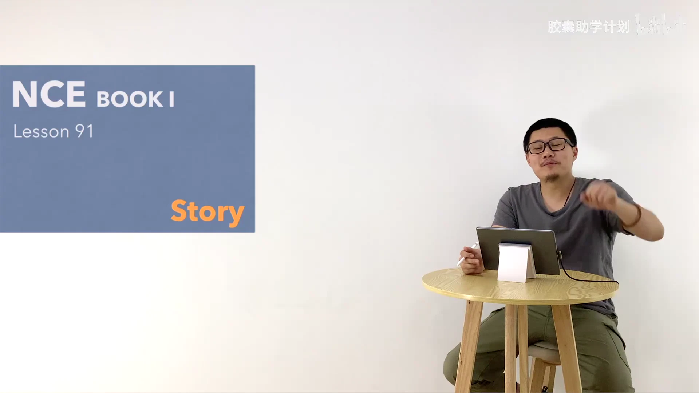

文字识别：胶囊助学计划 / NCE / BOOKI / Lesson 91 / Story

### 画面 00:00:05

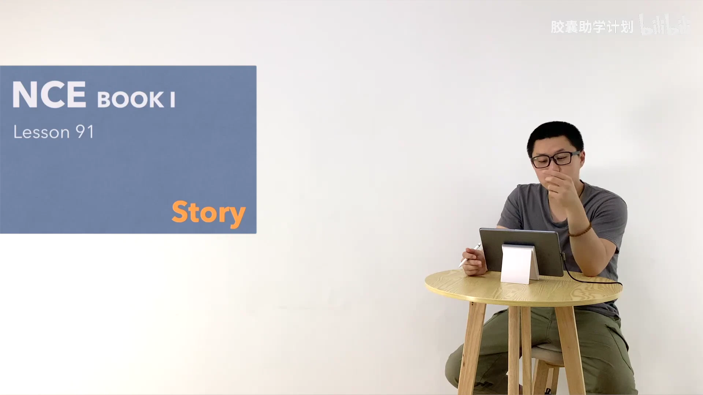

文字识别：胶囊助学计划 / NCE / BOOKI / Lesson 91 / Story

### 画面 00:00:08

文字识别：BiL / 胶囊助学计划 / NCE / BOOKI / Lesson 91 / Story

### 画面 00:00:10

文字识别：胶囊助学计划bi山

### 画面 00:00:13

文字识别：胶囊助学计划 / 胶囊助学计划

### 画面 00:00:15

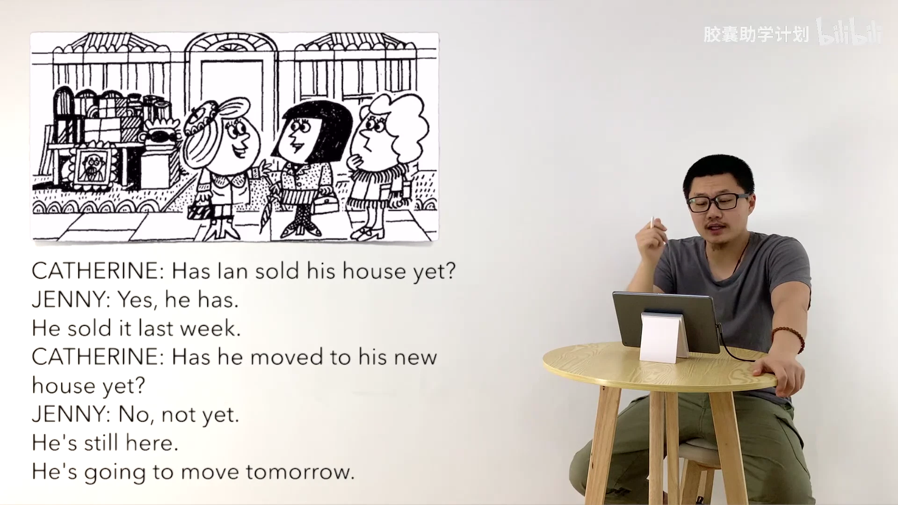

文字识别：胶囊助学计划 / CATHERINE: Has lan sold his house yet? / JENNY: Yes, he has. / He sold it last week. / CATHERINE: Has he moved to his new / house yet? / JENNY: No, not yet. / He's still here. / He's going to move tomorrow.

### 画面 00:00:17

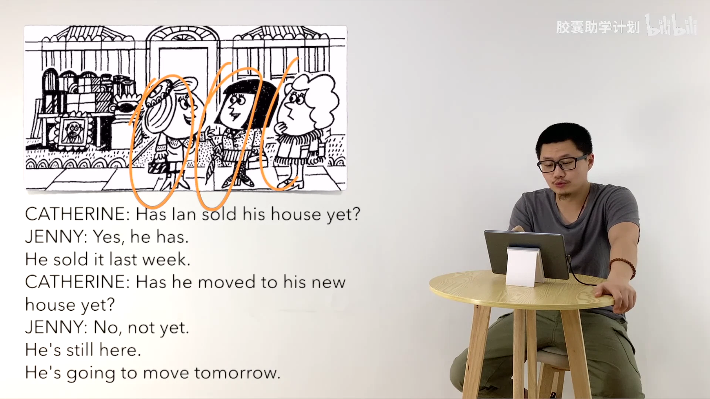

文字识别：胶囊助学计划 / CATHERINE: Has lan sold his house yet? / JENNY: Yes, he has. / He sold it last week. / CATHERINE: Has he moved to his new / house yet? / JENNY: No, not yet. / He's still here. / He's going to move tomorrow.

### 画面 00:00:19

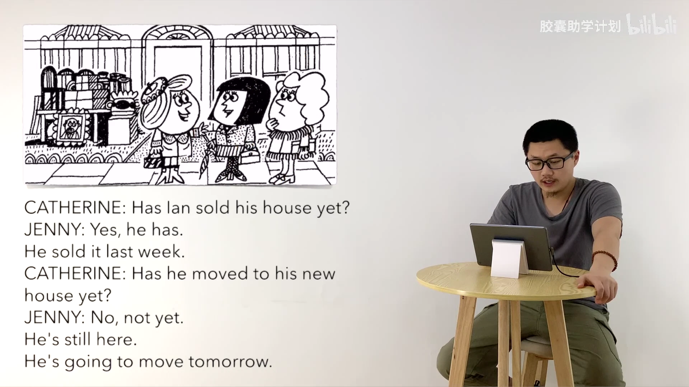

文字识别：胶囊助学计划bl / CATHERINE: Has lan sold his house yet? / JENNY: Yes, he has. / He sold it last week. / CATHERINE: Has he moved to his new / house yet? / JENNY: No, not yet. / He's still here. / He's going to move tomorrow.

## 00:00:30–00:01:00

是卖房子的那个人，对吧？啊，他说这个我退休，为什么问他为什么要卖房子？他说这个我退休了，我想去农村、乡村买一个房子，对吧？OK，这是他说的话啊。他问说，哎，in已经卖了他的房子了吗？杰里说，Yes, he has。是的，他已经卖了。OK，说He sold it last week。好，注意has sold现在完成时，He sold it last week加last week一般

### 画面 00:00:33

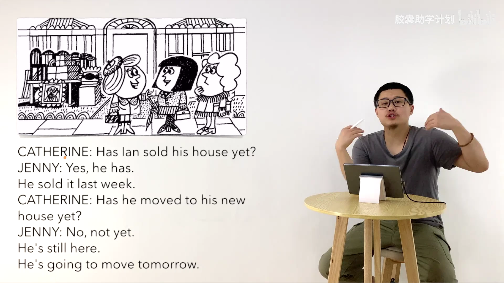

文字识别：胶囊助学计划 / CATHERINE: Has lan sold his house yet? / JENNY: Yes, he has. / He sold it last week. / CATHERINE: Has he moved to his new / house yet? / JENNY: No, not yet. / He's still here. / He's going to move tomorrow.

### 画面 00:00:42

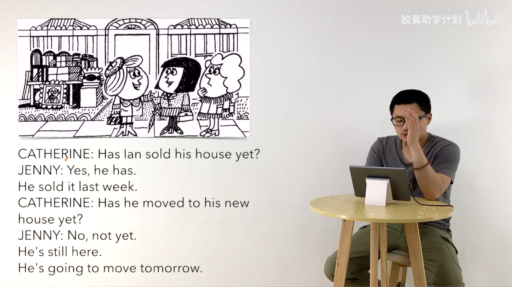

文字识别：胶囊助学计划 / CATHERINE: Has lan sold his house yet? / JENNY: Yes, he has. / He sold it last week. / CATHERINE: Has he moved to his new / house yet? / JENNY: No, not yet. / He's still here. / He's going to move tomorrow.

## 00:01:00–00:01:30

过去式，对吧？呃，上个礼拜卖的。Has he moved to his new house yet?他已经搬去他的新房子了吗？注意 move to somewhere,搬去某地，对吧？他已经搬去他的新房子了吗？No, not yet.不，还没有。He's still here.他依旧在这里。He's going to move tomorrow.他打算明天搬家离开这里。

### 画面 00:01:12

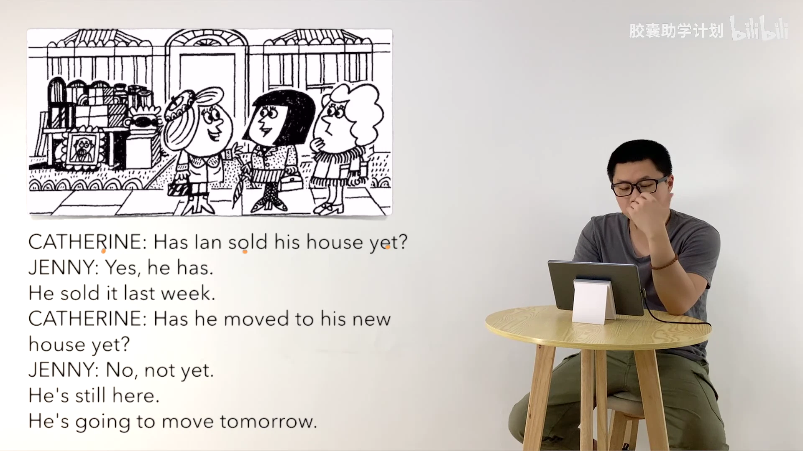

文字识别：胶囊助学计划l出 / CATHERINE: Has lan sold his house yet? / JENNY: Yes, he has. / He sold it last week. / CATHERINE: Has he moved to his new / house yet? / JENNY: No, not yet. / He's still here. / He's going to move tomorrow.

## 00:01:30–00:02:00

OK，好，continue。接下来他又问到说，When什么时候？Tomorrow morning，明儿早上吗？No，no，no。Tomorrow afternoon，明儿下午。你看，然后临时说了一句话，说我会想他的。你说这叫计划打算吗？是我计划打算去想他，就不太对了，对吧？所以说，I'll miss him。但是呢，如果各位看了我们的那个呃语法单项，对吧？Be going to do与will的对比，您

### 画面 00:01:31

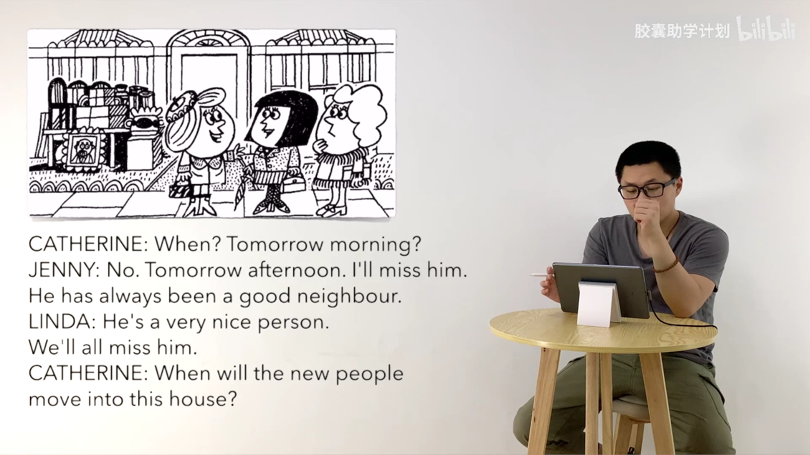

文字识别：胶囊助学计划H出 / CATHERINE: When? Tomorrow morning? / JENNY: No. Tomorrow afternoon. I'll miss him. / He has always been a good neighbour. / LINDA: He's a very nice person. / We'll all miss him. / CATHERINE: When will the new people / move into this house?

### 画面 00:01:46

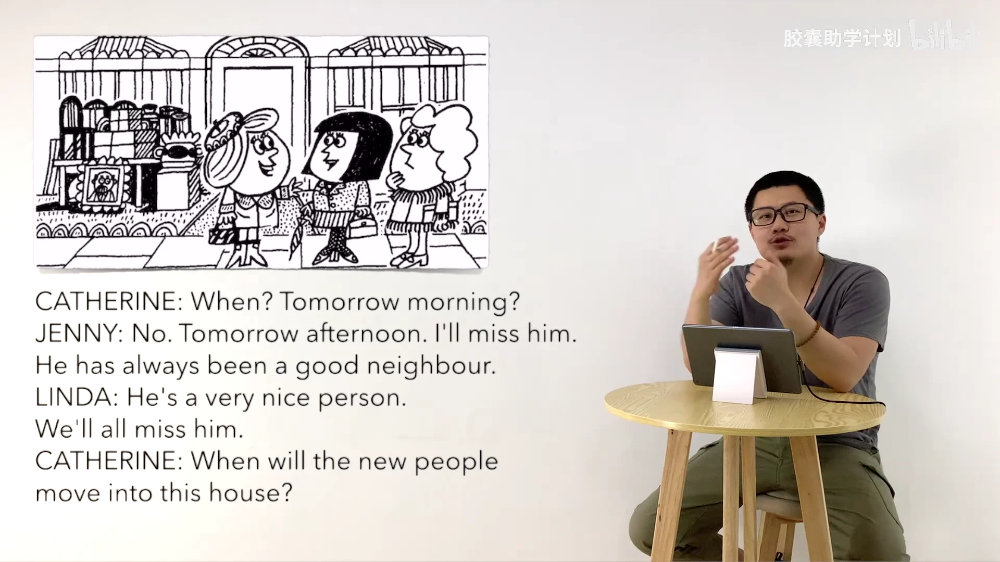

文字识别：胶囊助学计划 / CATHERINE: When? Tomorrow morning? / JENNY: No. Tomorrow afternoon. I'll miss him. / He has always been a good neighbour. / LINDA: He's a very nice person. / We'll all miss him. / CATHERINE: When wil the new people / move into this house?

### 画面 00:01:51

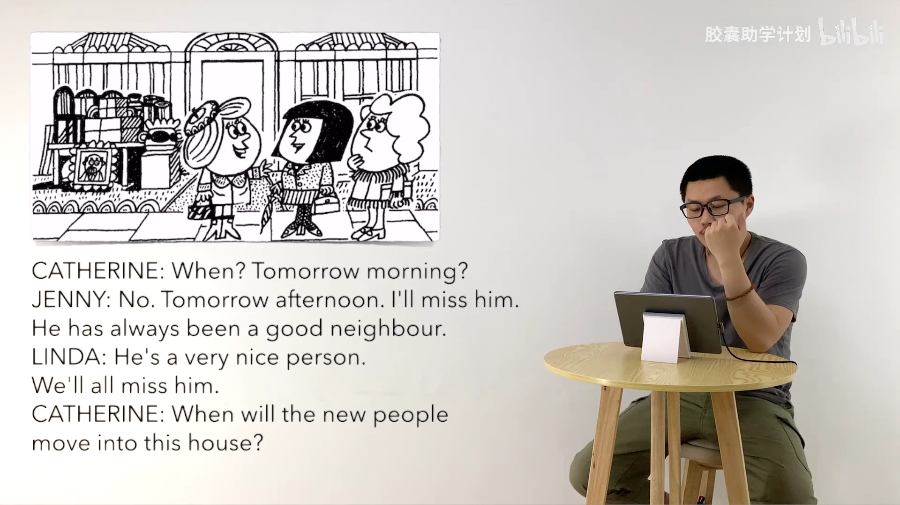

文字识别：胶囊助学计划l / CATHERINE: When? Tomorrow morning? / JENNY: No. Tomorrow afternoon. I'll miss him. / He has always been a good neighbour. / LINDA: He's a very nice person. / We'll all miss him. / CATHERINE: When will the new people / move into this house?

### 画面 00:01:53

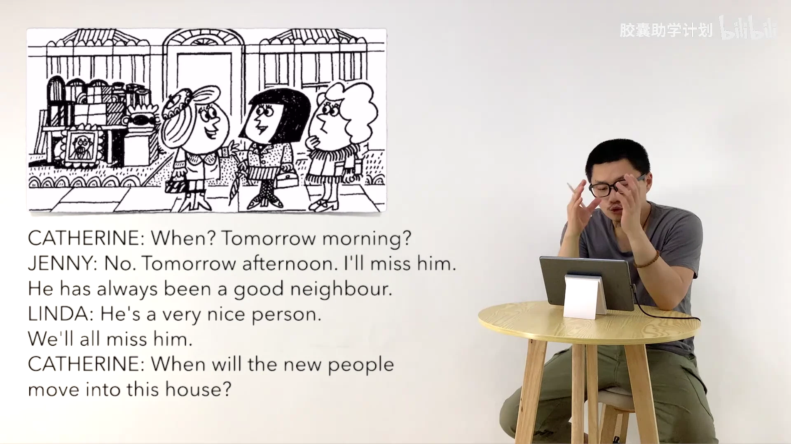

文字识别：胶囊助学计划州 / CATHERINE: When? Tomorrow morning? / JENNY: No. Tomorrow afternoon. I'll miss him. / He has always been a good neighbour. / LINDA: He's a very nice person. / We'll all miss him. / CATHERINE: When will the new people / move into this house?

### 画面 00:01:56

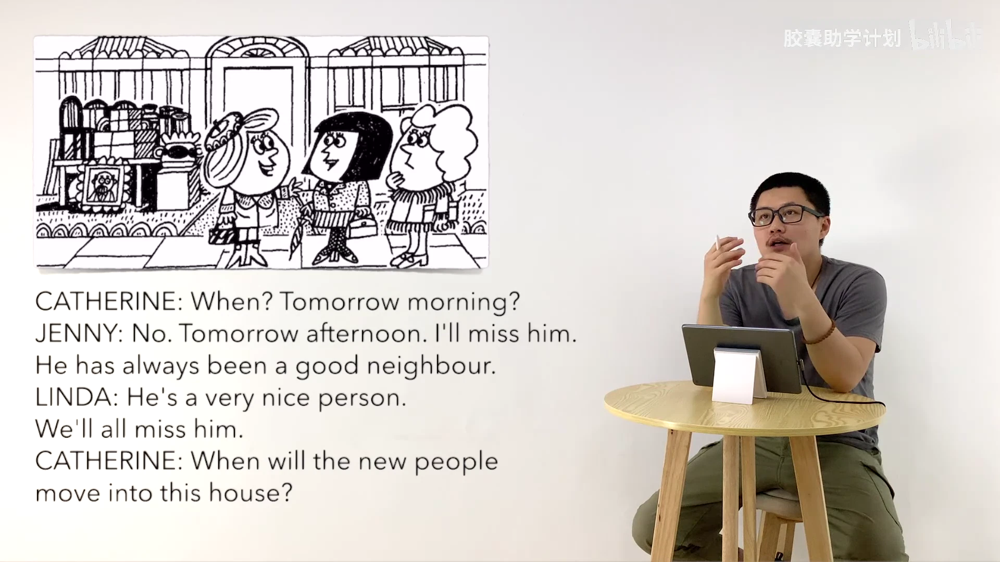

文字识别：胶囊助学计划 / CATHERINE: When? Tomorrow morning? / JENNY: No. Tomorrow afternoon. I'll miss him. / He has always been a good neighbour. / LINDA: He's a very nice person. / We'll all miss him. / CATHERINE: When will the new people / move into this house?

## 00:02:00–00:02:30

可能也得到了这个结论，就是在这儿你用be going to do也不一定错。叫I'm going to miss him，尤其是在美式英语当中。OK，好说。He接下来这句话就很重要了。He has always been a good neighbor。我们先判断结构，has加been，什么都不用管了，后边就没有别的单词了，对吧？没有别的动词了，对吧？现在完成时，been是什么来着？Am is a was were，

### 画面 00:02:11

文字识别：胶囊助学计划l / 110 / CATHERINE: When? Tomorrow morning? / JENNY: No. Tomorrow afternoon. I'll miss him. / He has always been a good neighbour. / LINDA: He's a very nice person. / We'll all miss him. / CATHERINE: When will the new people / move into this house?

### 画面 00:02:24

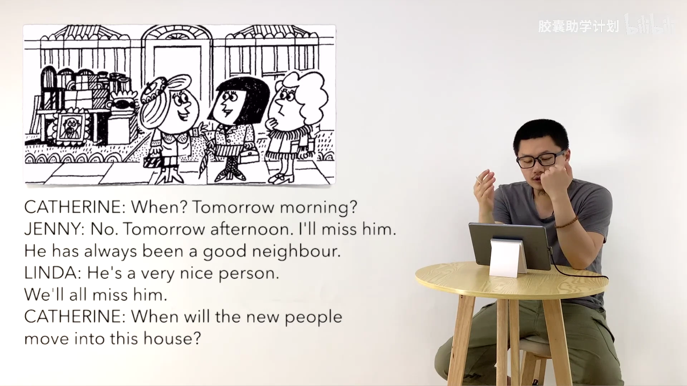

文字识别：胶囊助学计划册 / CATHERINE: When? Tomorrow morning? / JENNY: No. Tomorrow afternoon. I'll miss him. / He has always been a good neighbour. / LINDA: He's a very nice person. / We'll all miss him. / CATHERINE: When will the new people / move into this house?

## 00:02:30–00:03:00

对吧？他们都是一类的啊，就就是这个同根同源的，都是 be 这个单词所带来的各种变化。那 has been a good neighbor，就是他一直都是一个很好的邻居。当然，这句话您完全可以把它换一个时态，换成一般现在时，比如说 he is always a good neighbor。 OK，好，继续说 he's very nice person，啊，

### 画面 00:02:54

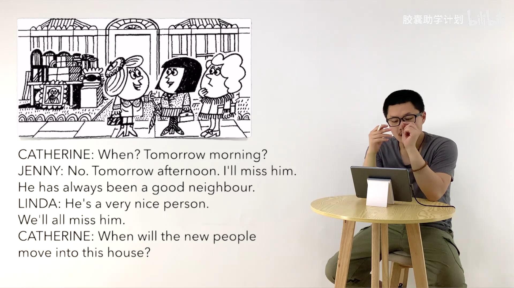

文字识别：胶囊助学计划 / CATHERINE: When? Tomorrow morning? / JENNY: No. Tomorrow afternoon. I'll miss him. / He has always been a good neighbour. / LINDA: He's a very nice person. / We'll all miss him. / CATHERINE: When will the new people / move into this house?

### 画面 00:02:57

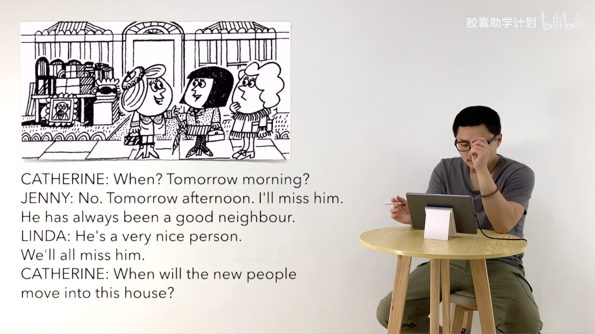

文字识别：bilL / 胶囊助学计划 / CATHERINE: When? Tomorrow morning? / JENNY: No. Tomorrow afternoon. I'll miss him. / He has always been a good neighbour. / LINDA: He's a very nice person. / We'll all miss him. / CATHERINE: When will the new people / move into this house?

## 00:03:00–00:03:30

他人特别的 nice. 啊，我们经常说一个人很 nice，就是很好啊. We'll all miss him. 我们都会想念他的. P L L. Will continue. When will the new people move into this house? 那新人们啊，新搬来的人们打算什么时候啊？什么时候会搬进这个房子呢？ Okay, move into. 搬进来，对吧？他们什么时候会搬进这个房

### 画面 00:03:01

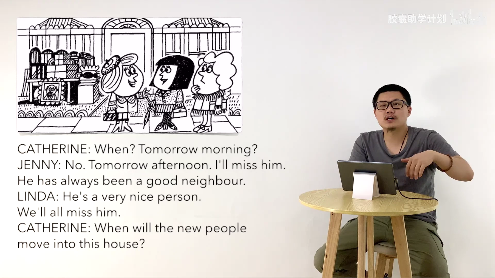

文字识别：胶囊助学计划 / CATHERINE: When? Tomorrow morning? / JENNY: No. Tomorrow afternoon. I'll miss him. / He has always been a good neighbour. / LINDA: He's a very nice person. / We'll all miss him. / CATHERINE: When wil the new people / move into this house?

## 00:03:30–00:04:00

子呢？所以你其实仔细去想，如果您看了我们之前给大家录的这个视频的话，那 When are you going to，是吧？或者说 When are the new people going to move into this house？也是完全正确的。 Continue. I think that好老习惯that先删掉。等到我们九十九课再说。我认为啊，

### 画面 00:03:31

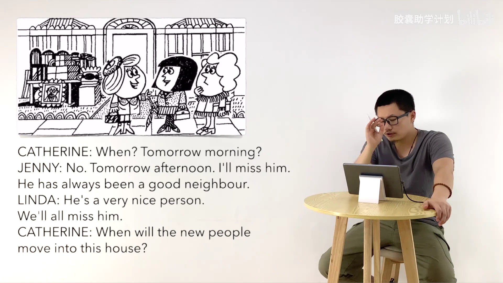

文字识别：胶囊助学计划册 / CATHERINE: When? Tomorrow morning? / JENNY: No. Tomorrow afternoon. I'll miss him. / He has always been a good neighbour. / LINDA: He's a very nice person. / We'll all miss him. / CATHERINE: When wil the new people / move into this house?

### 画面 00:03:40

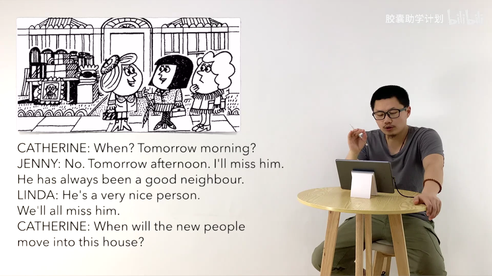

文字识别：胶囊助学计划 / CATHERINE: When? Tomorrow morning? / JENNY: No. Tomorrow afternoon. I'll miss him. / He has always been a good neighbour. / LINDA: He's a very nice person. / We'll all miss him. / CATHERINE: When will the neW people / move into this house?

### 画面 00:03:48

文字识别：胶囊助学计划 / 课堂笔记 / X / 公众号：胶囊助学计划 / 正版教材 / X / 雅思托福课 / ·学员来信 / ·试听课 / ·课程详情

### 画面 00:03:51

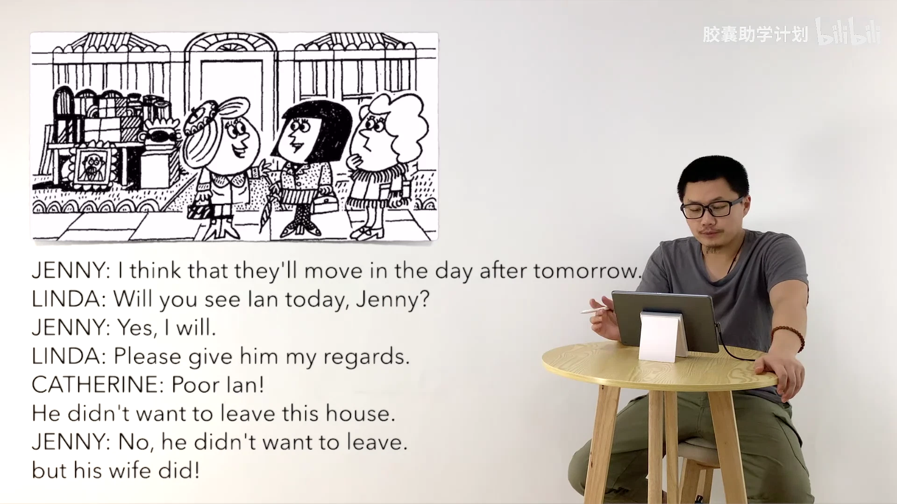

文字识别：胶囊助学计划出 / JENNY: I think that they'll move in the day after tomorrow. / LINDA: Will you see an today, Jenny? / JENNY: Yes, I will. / LINDA: Please give him my regards. / CATHERINE: Poor lan! / He didn't want to leave this house. / JENNY: No, he didn't want to leave. / but his wife did!

### 画面 00:03:58

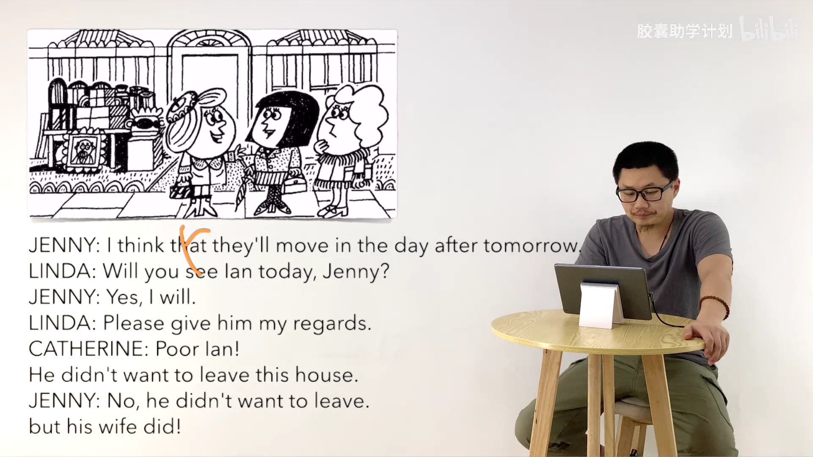

文字识别：胶囊助学计划 / JENNY: I think tl at they'll move in the day after tomorrowy / LINDA: Will you see lan today, Jenny? / JENNY: Yes, I will. / LINDA: Please give him my regards. / CATHERINE: Poor lan! / He didn't want to leave this house. / JENNY: No, he didn't want to leave. / but his wife did!

## 00:04:00–00:04:30

they'll move in.他们会搬进来。The day after tomorrow, tomorrow明天，the day after tomorrow后天。Will you see in today, Jenny?说，哎，你今天会看jam吗？Yes, I will.是的，我会看。Please give him my regards.习惯用法，直接把它记下来。但是它的句式其实就是give somebody something，给某人某物，对吧？说，请

### 画面 00:04:06

文字识别：胶囊助学计划H / JENNY: I think tl at they'll move in the day after tomorroW / LINDA: Will you see lan today, Jenny? / JENNY: Yes, I will. / LINDA: Please give him my regards. / CATHERINE: Poor lan! / He didn't want to leave this house. / JENNY: No, he didn't want to leave. / but his wife did!

### 画面 00:04:19

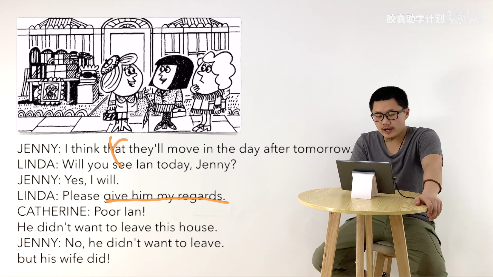

文字识别：胶囊助学计划 / JENNY: I think tl at they'll move in the day after tomorrow, / LINDA: Will you see an today, Jenny? / JENNY: Yes, I will. / LINDA: Please give him my regards. / CATHERINE: Poor lan! / He didn't want to leave this house. / JENNY: No, he didn't want to leave. / but his wife did!

### 画面 00:04:25

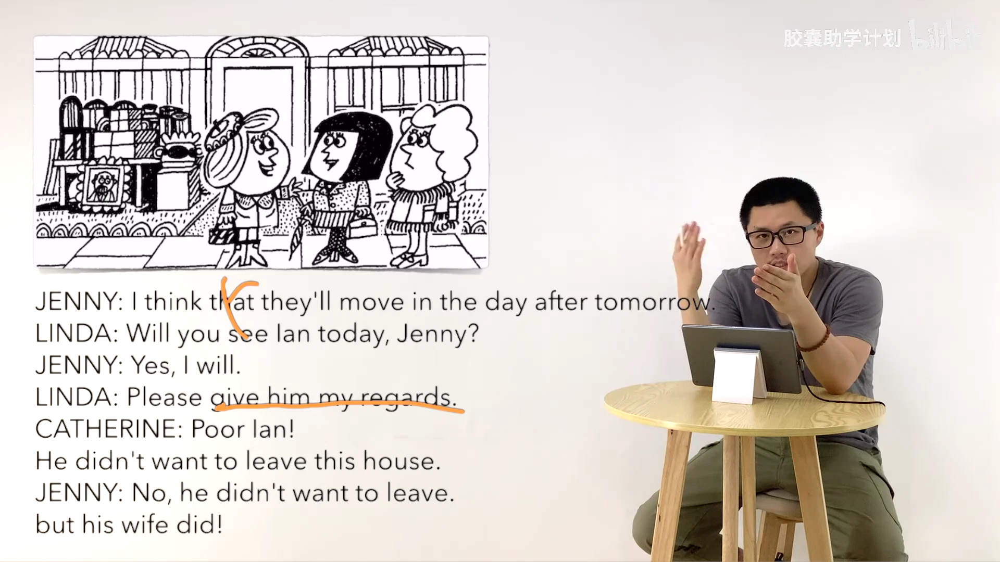

文字识别：胶囊助学计划 / JENNY: think tl at they'll move in the day after tomorrow. / LINDA: Will you see an today, Jenny? / JENNY: Yes, I will. / LINDA: Please give him my regards. / CATHERINE: Poor lan! / He didn't want to leave this house. / JENNY: No, he didn't want to leave. / but his wife did!

## 00:04:30–00:05:00

给他 my regards，叫做我的一些祝福带好啊，其实就是帮我给他带好啊。Poor in，哎，关键点来了，非常有意思。他说可怜的 in 啊， he didn't want to leave this house，他并不想离开这个房子。No， he didn't want to leave，不，他不想离开。But his wife did，但是他老婆想离开。你再结合上一

### 画面 00:04:34

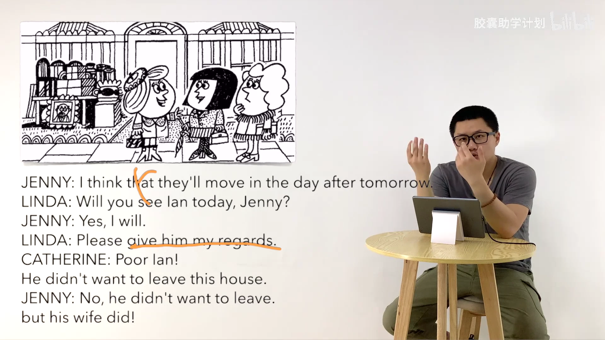

文字识别：胶囊助学计划l / JENNY: think tl at they'll move in the day after tomorrow. / LINDA: Will you see lan today, Jenny? / JENNY: Yes, I will. / LINDA: Please give him my regards. / CATHERINE: Poor lan! / He didn't want to leave this house. / JENNY: No, he didn't want to leave. / but his wife did!

### 画面 00:04:40

文字识别：胶囊助学计划册 / JENNY: Ithink tl at they'll move in the day after tomorrow. / LINDA: Will you see an today, Jenny? / JENNY: Yes, I will. / LINDA: Please give him my regards. / CATHERINE: Poor lan! / He didn't want to leave this house. / JENNY: No, he didn't want to leave. / but his wife did!

### 画面 00:04:42

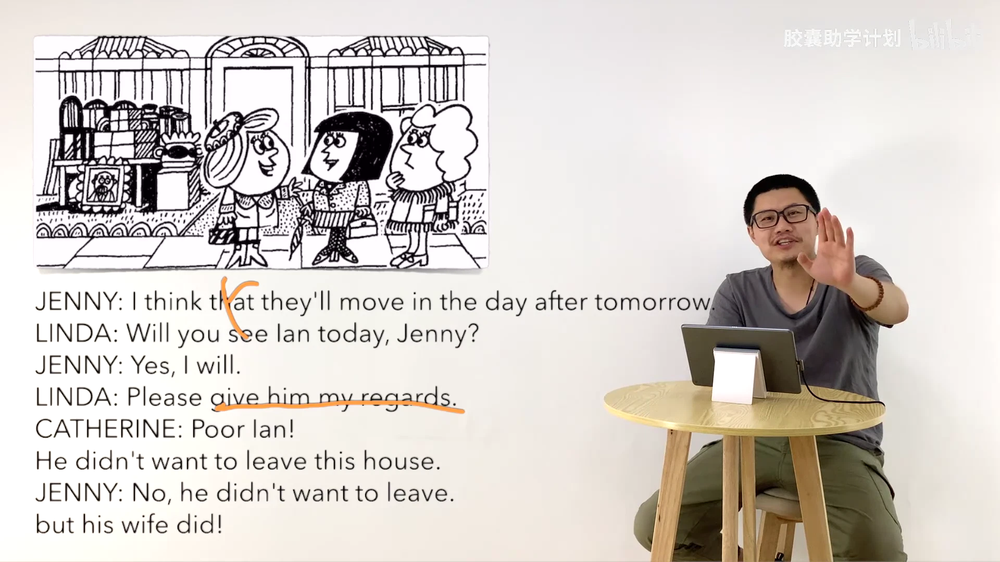

文字识别：胶囊助学计划 / JENNY: I think tl at they'll move in the day after tomorrow. / LINDA: Will you see lan today, Jenny? / JENNY: Yes, I will. / LINDA: Please give him my regards. / CATHERINE: Poor lan! / He didn't want to leave this house. / JENNY: No, he didn't want to leave. / but his wife did!

## 00:05:00–00:05:30

篇文章，问 Nigel 问 In 的时候说，你为什么要卖这个房子呢？他说，哎呀，我退休了，我要去乡村买套房子。然后呢，最后这个买房子的这个 Nigel 说了一句话，说，哎，我这事儿啊，我还真拿不准，我得先问我老婆。然后 In 说了一句特别意味深长的话，你仔细去想，去品，是吧？他说是啊，女人总是拥有最终决定权，

### 画面 00:05:09

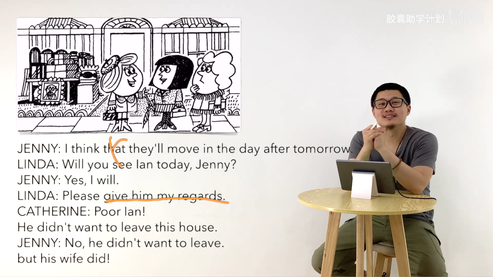

文字识别：胶囊助学计划 / JENNY: Ithink tl at they'll move in the day after tomorrow. / LINDA: Will you see an today, Jenny? / JENNY: Yes, I will. / LINDA: Please give him my regards. / CATHERINE: Poor lan! / He didn't want to leave this house. / JENNY: No, he didn't want to leave. / but his wife did!

## 00:05:30–00:06:00

吧？有感而发，为什么？因为并不是因为他退休了，是吧？他想去乡村买房子，是因为他媳妇儿想走，他不得不走，是吧？OK，好，很有意思啊。接下来呢，我们做一些口语听力练，呃，这个练习啊。我们我问各位先答来了。第一题，Has in sold his house yet? Yes, he has. Next one, Has he moved

### 画面 00:05:39

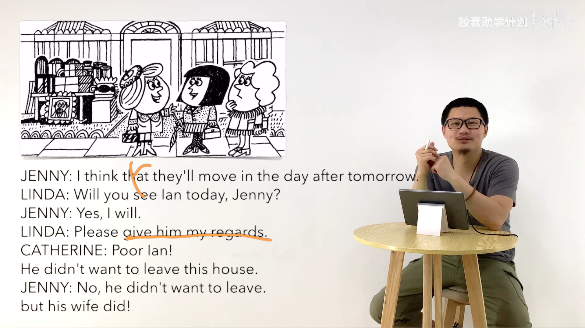

文字识别：胶囊助学计划 / JENNY: think tl at they'll move in the day after tomorrow. / LINDA: Will you see lan today, Jenny? / JENNY: Yes, I will. / LINDA: Please give him my regards. / CATHERINE: Poor lan! / He didn't want to leave this house. / JENNY: No, he didn't want to leave. / but his wife did!

### 画面 00:05:41

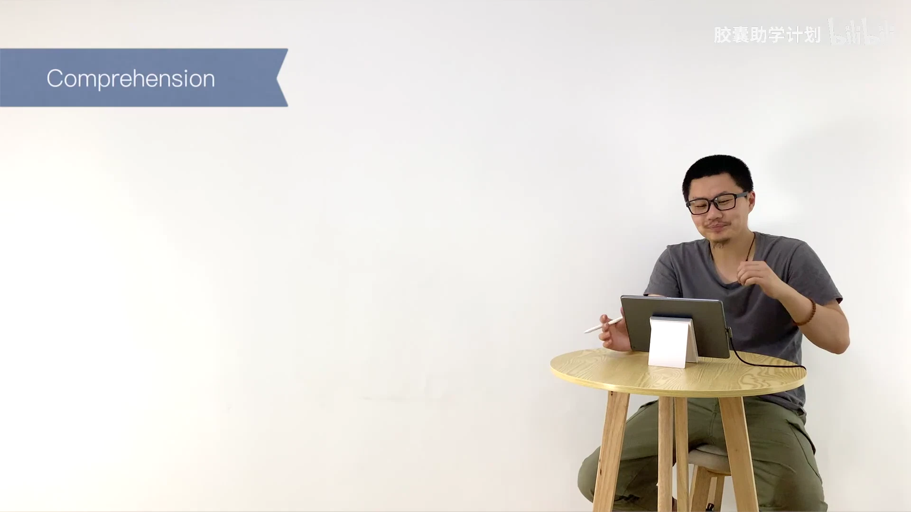

文字识别：胶囊助学计划 / Comprehension

### 画面 00:05:51

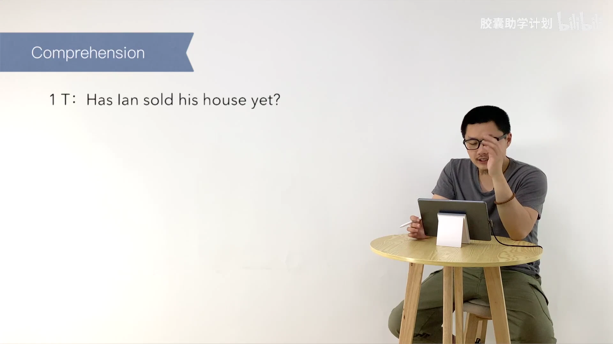

文字识别：胶囊助学计划 / Comprehension / 1 T: Has lan sold his house yet?

### 画面 00:05:54

文字识别：bitL / 胶囊助学计划 / Comprehension / 1 T: Has lan sold his house yet?

## 00:06:00–00:06:30

out yet? No, he hasn't. Next one, when will he move to his new house? Tomorrow afternoon. Next one, has in always been a good neighbor? Yes, he has. Next one, will his neighbors miss him? Yes, they will. Next one, when will the new people move in? The day

### 画面 00:06:08

文字识别：bilbl / 胶囊助学计划 / Comprehension / 3 T: When will he move to his new house? / S: Tomorrow afternoon.

## 00:06:30–00:07:00

after tomorrow.算. Did in want to leave this house? No, he didn't. Continue. Who wanted to sell the house? His wife did.哎，实话对吧？他老婆想卖。好，asking questions.我给肯定句你变一般疑问句，我给特殊疑问词你变特殊疑问句。好了，Ask me if in sold his

### 画面 00:06:38

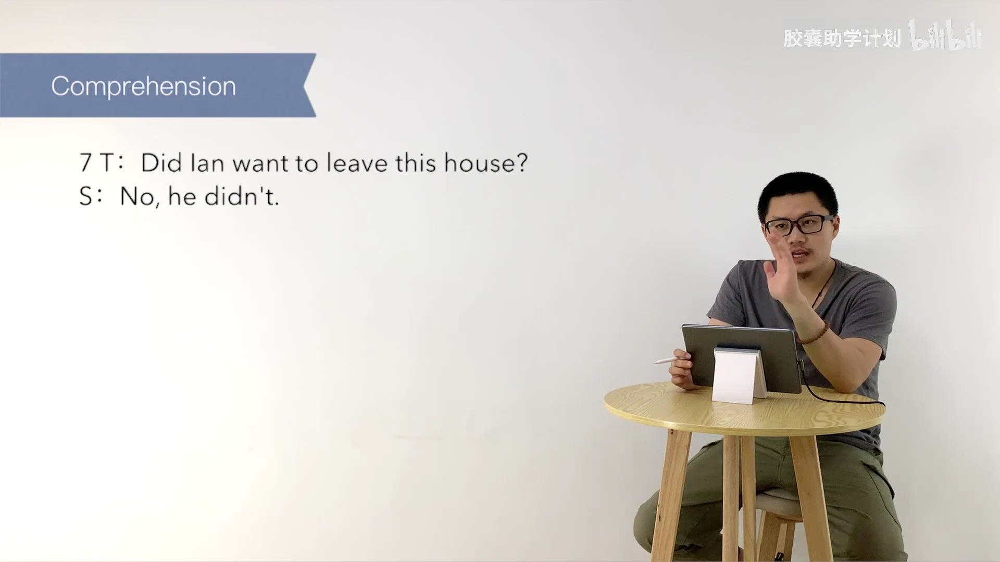

文字识别：bitlil / 胶囊助学计划 / Comprehension / 7 T: Did lan want to leave this house? / S: No, he didn't.

### 画面 00:06:48

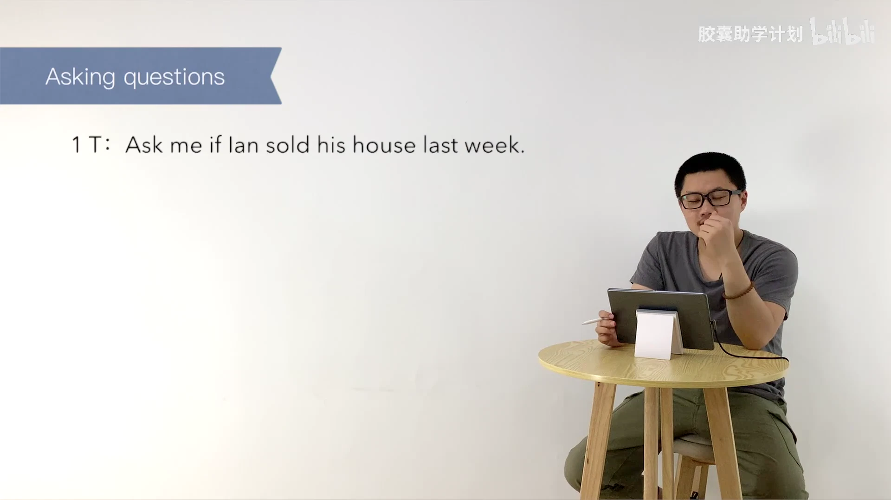

文字识别：bilb出 / 胶囊助学计划 / Asking questions / 1 T: Ask me if lan sold his house last week.

## 00:07:00–00:07:30

house last week.一般疑问句Did in sell his house last week? When? When did in sell his house? Next one. Ask me if he's going to move tomorrow.一般疑问句Is he going to move tomorrow? When? When is he going to move? Okay. Next one.

### 画面 00:07:09

文字识别：bilibi / 胶囊助学计划 / Asking questions / 1 T: Ask me if lan sold his house last week. / S: Did lan sell his house last week? / T: When …..? / S: When did lan sell his house?

### 画面 00:07:12

文字识别：胶囊助学计划 / Asking questions / /

### 画面 00:07:26

文字识别：bil / 胶囊助学计划 / Asking questions / 2 T: Ask me if he's going to move tomorrow. / S: Is he going to move tomorrow? / T: When ..? / S: When is he going to move?

### 画面 00:07:29

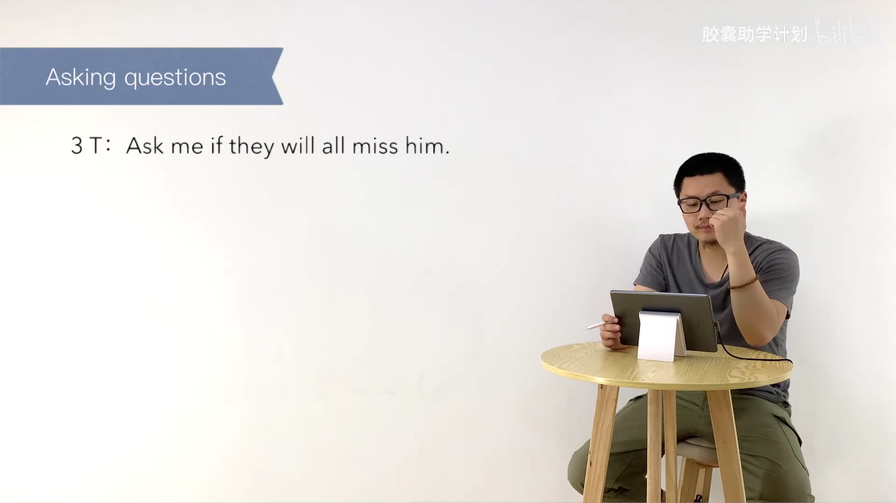

文字识别：胶囊助学计划册 / Asking questions / 3 T: Ask me if they will all miss him.

## 00:07:30–00:08:00

Ask me if they will all miss him. 翻译问句: Will they all miss him? Why? Why will they all miss him? 答案不就是 he has always been a good neighbor, right? 好，下一题. Ask me if in wanted to leave this house. Did in want to

### 画面 00:07:32

文字识别：biibi / 胶囊助学计划 / Asking questions / 3 T: Ask me if they will all miss him.

### 画面 00:07:46

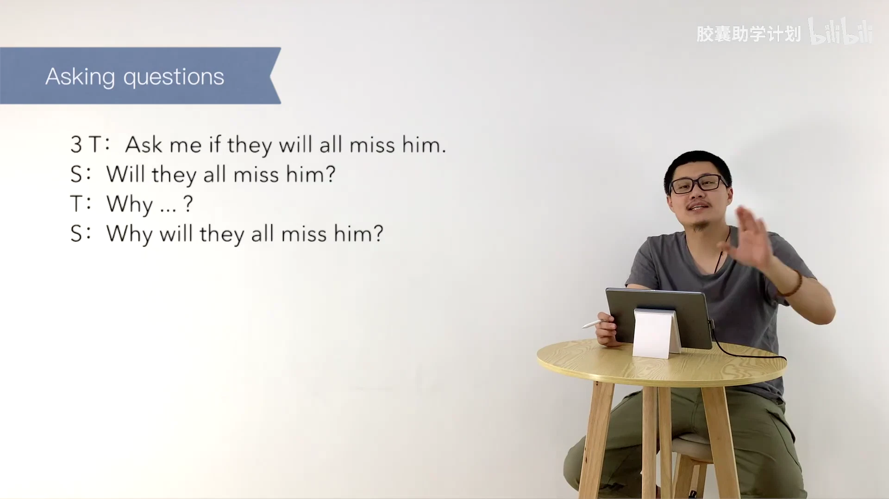

文字识别：bilibi / 胶囊助学计划 / Asking questions / 3 T: Ask me if they will all miss him. / S: Will they all miss him? / T:Why …? / S: Why will they all miss him?

### 画面 00:07:48

文字识别：胶囊助学计划 / Asking questions

### 画面 00:07:50

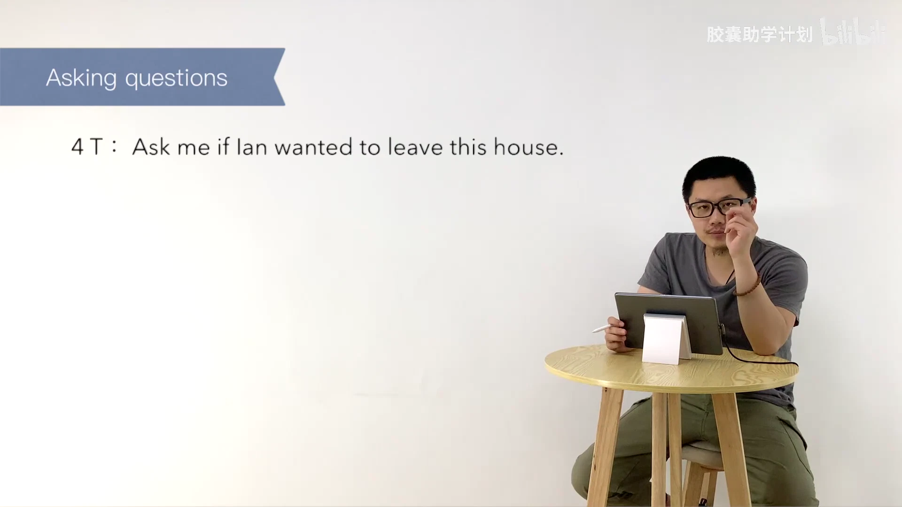

文字识别：胶囊助学计划册 / Asking questions / 4 T : Ask me if lan wanted to leave this house.

## 00:08:00–00:08:30

leave this house, why didn't?为什么不对吧？直接把它去掉，放前面就可以了啊！直接把did去掉，把why didn't放句首。Why didn't in want to leave this house?他为什么不想离开这里，对吧？Next one，住二十年了吗？最后一题，Ask me if his wife wanted to leave. Did his wife want to leave? Why? Why did his wife want to leave?

### 画面 00:08:03

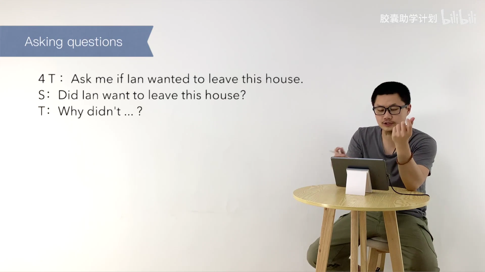

文字识别：bilibi / 胶囊助学计划 / Asking questions / 4T : Ask me if lan wanted to leave this house. / S: Did lan want to leave this house? / T:Why didn't .?

### 画面 00:08:14

文字识别：bitbi / 胶囊助学计划 / Asking questions

### 画面 00:08:23

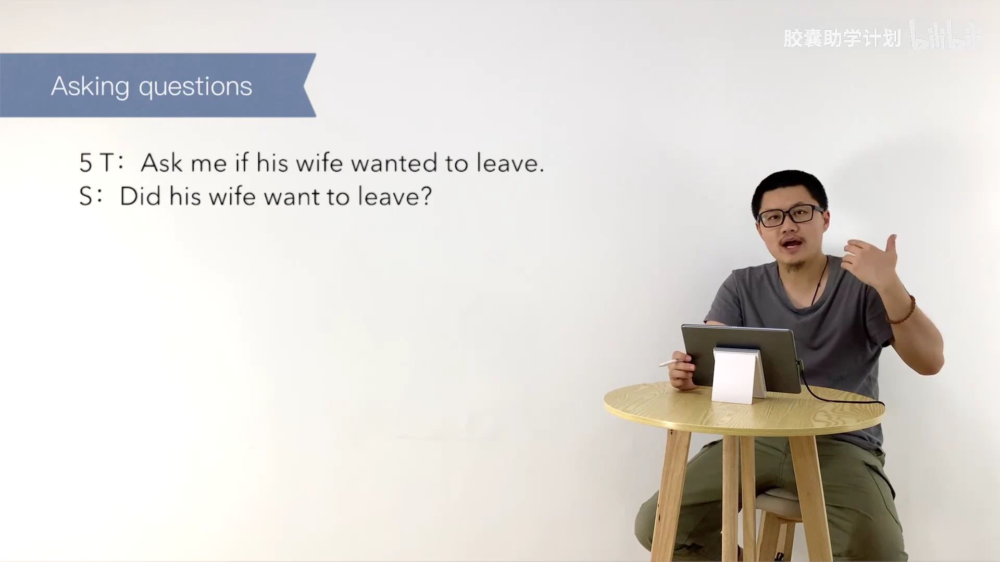

文字识别：胶囊助学计划 / Asking questions / 5 T: Ask me if his wife wanted to leave. / S: Did his wife want to leave?

### 画面 00:08:26

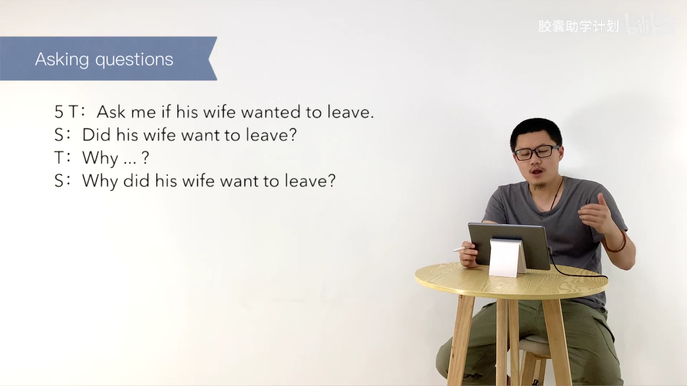

文字识别：胶囊助学计划 / Asking questions / 5 T: Ask me if his wife wanted to leave. / S: Did his wife want to leave? / T：Why…? / S: Why did his wife want to leave?

## 00:08:30–00:09:00

Okay, very good. Recap.本课就是让我们见证了一下 will 在文章当中如何去用。当然还出现了各种各样的表达，复习了一下之前学到的时态。老习惯，加上作业，绿皮书九十一课，各位可以写了。文章要跟读至熟，读成诵，给自己讲解一遍今天的核心知识点。以上啊，就是我们这个课的主要内容了。如果大家喜欢我们的课程呢，

### 画面 00:08:31

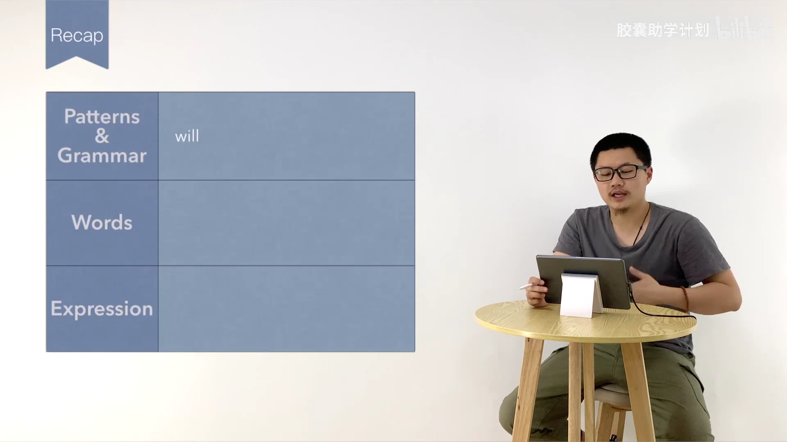

文字识别：胶囊助学计划 / Recap / Patterns / will / Grammar / Words / Expression

### 画面 00:08:34

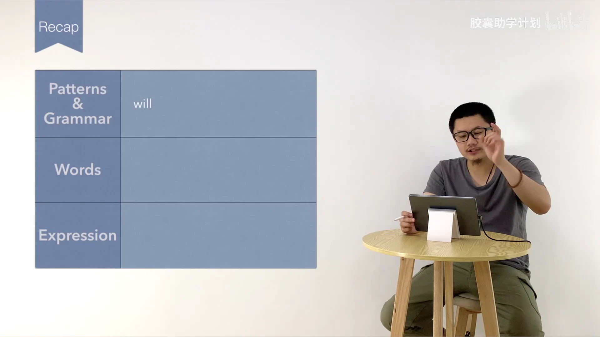

文字识别：胶囊助学计划 / Recap / Patterns / & / will / Grammar / Words / Expression

### 画面 00:08:42

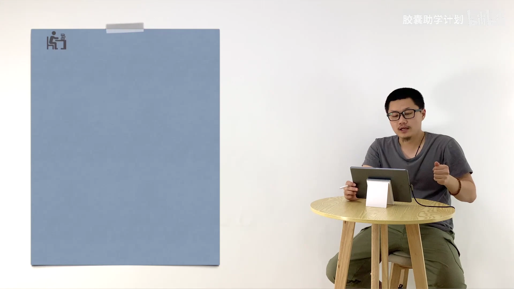

文字识别：胶囊助学计划

### 画面 00:08:49

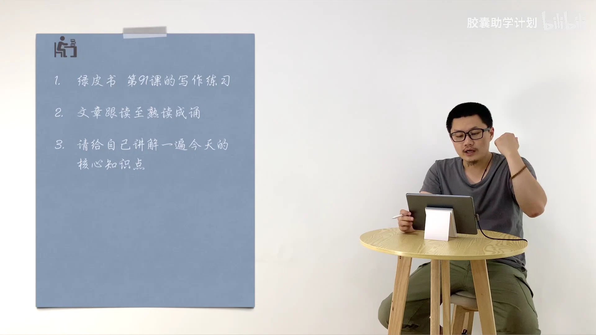

文字识别：胶囊助学计划册 / 绿皮书第91课的写作练习 / 文章跟读至熟读成诵 / 3.请给自己讲解一遍今天的 / 核心知识点

### 画面 00:08:53

文字识别：胶囊助学计划i

### 画面 00:08:58

文字识别：胶囊助学计划 / 不

## 00:09:00–00:09:30

欢迎大家关注、订阅、一键三连、分享给那些需要的朋友。最后，我们再来看一句名人名言：Life is a dream for the wise, a game for the fool, a comedy for the rich, a tragedy for the poor. See you next time.

### 画面 00:09:02

文字识别：胶囊助学计划LiH / 不

### 画面 00:09:05

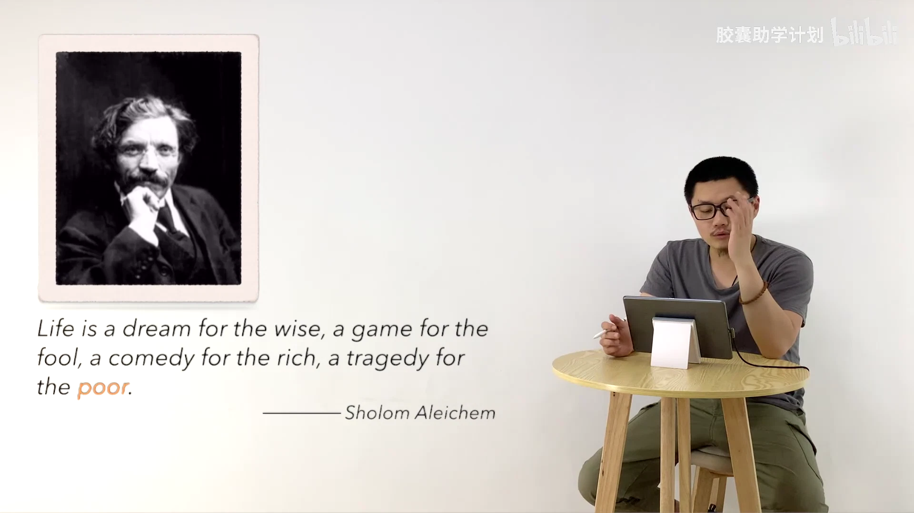

文字识别：胶囊助学计划l / Life is a dream for the wise, a game for the / fool, a comedy for the rich, a tragedy for / thepoor. / -Sholom Aleichem

### 画面 00:09:08

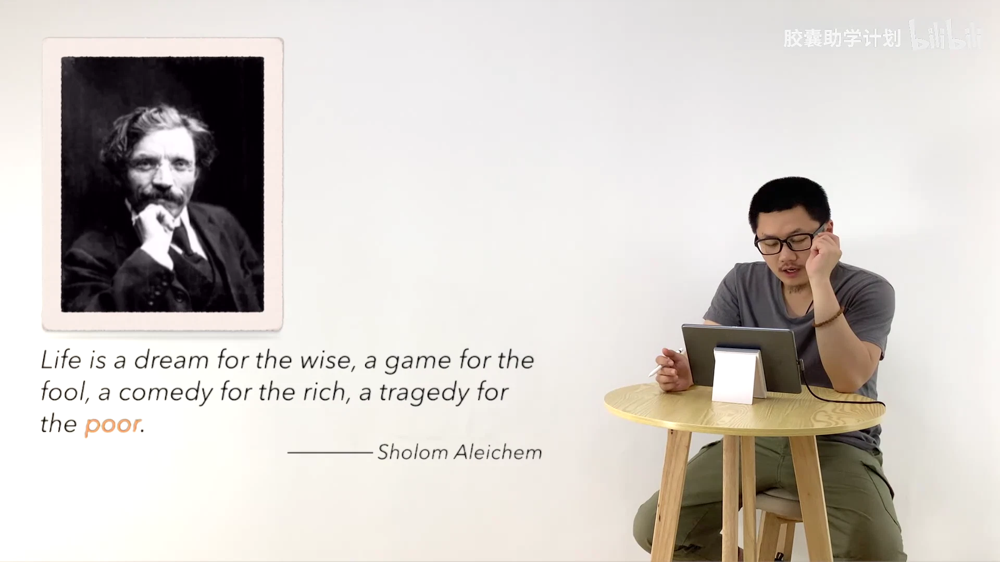

文字识别：胶囊助学计划册 / Life is a dream for the wise, a game for the / fool, a comedy for the rich, a tragedy for / thepoor. / -Sholom Aleichem

### 画面 00:09:11

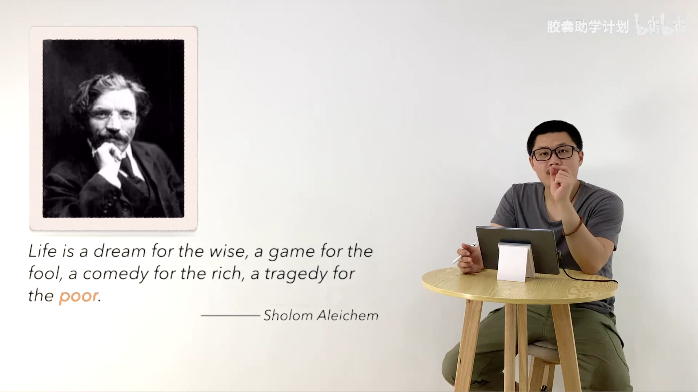

文字识别：胶囊助学计划 / Life is a dream for the wise, a game for the / fool, a comedy for the rich, a tragedy for / thepoor. / -Sholom Aleichem

### 画面 00:09:22

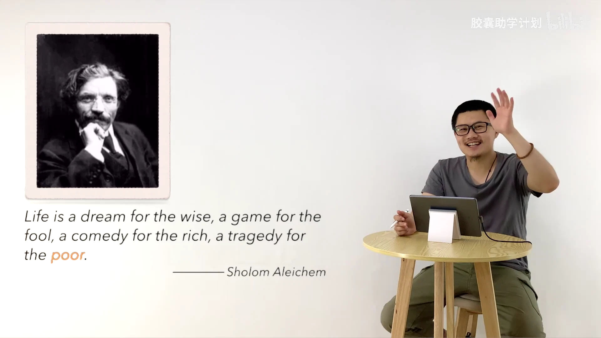

文字识别：胶囊助学计划册 / Life is a dream for the wise, a game for the / fool, a comedy for the rich, a tragedy for / thepoor. / -Sholom Aleichem

### 画面 00:09:24

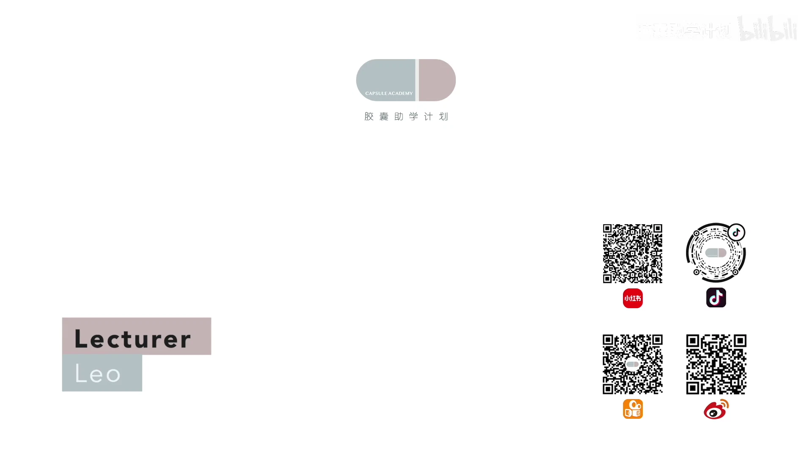

文字识别：CAPSULEACADEMY / 胶囊助学计划 / 小红书 / Lecturer / Leo / OE

### 画面 00:09:27

文字识别：字計切 / CAPSULEACADEMY / 胶囊助学计划 / 小红书 / grapher / Berlin / OE

## 00:09:30–00:09:35

### 画面 00:09:30

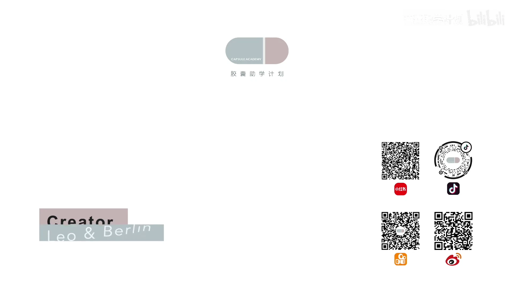

文字识别：CAPSULEACADEMY / 胶囊助学计划 / 小红书 / Creator / □ / 口 / Leo & Berlin / OE

### 画面 00:09:33

文字识别：Bilbili / 胶囊助学计划

### 画面 00:09:34

文字识别：bilbili / 胶囊助学计划

