# 093 语法 单词 文章

快速机器解析：语音为单模型转写，未进行独立交叉校对或人工复核；画面每秒采样并按变化选帧，短时文字和标记可能遗漏。截图时间约有 1 秒误差。图片有损压缩；遇到疑点请按时间查看 Google Drive 原视频。

## 00:00:00–00:00:30

Hello everyone, welcome to Capsule Academy. This is Leo. Today we're going to learn New Concept English Book One, Lesson Ninety Three, Grammar, Words, and Story. That old habit. Before entering the formal course, we will first look at a few questions. How to express returning to a place? The second question is how to express taking a plane to a place. With these two questions, I hope you are going to enjoy it. We will first look at the first word. Spell it:

### 画面 00:00:00

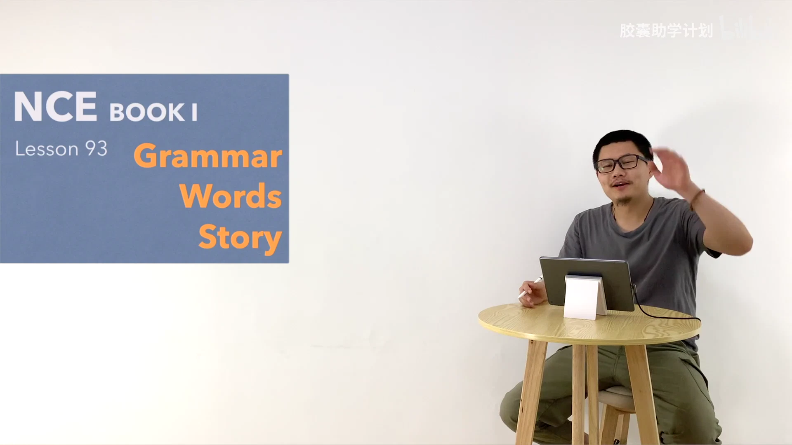

文字识别：胶囊助学计划 / NCE / BOOKI / Lesson 93 / Grammar / Words / Story

### 画面 00:00:02

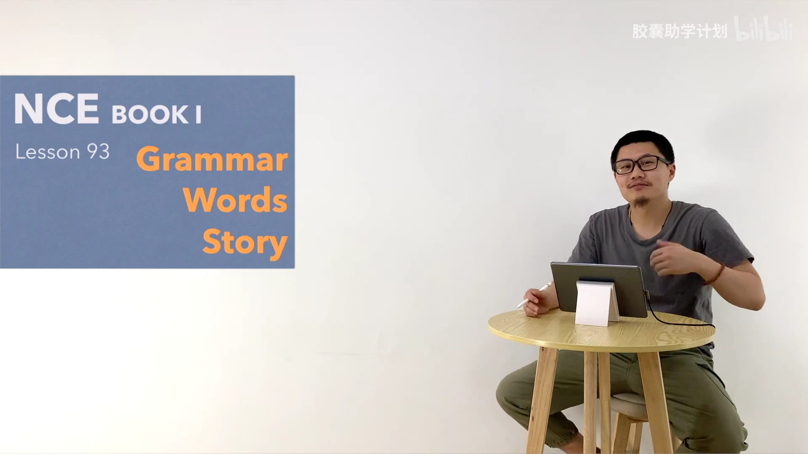

文字识别：胶囊助学计划 / NCE / BOOKI / Lesson 93 / Grammar / Words / Story

### 画面 00:00:04

文字识别：胶囊助学计划 / NCE / BOOKI / Lesson 93 / Grammar / Words / Story

### 画面 00:00:08

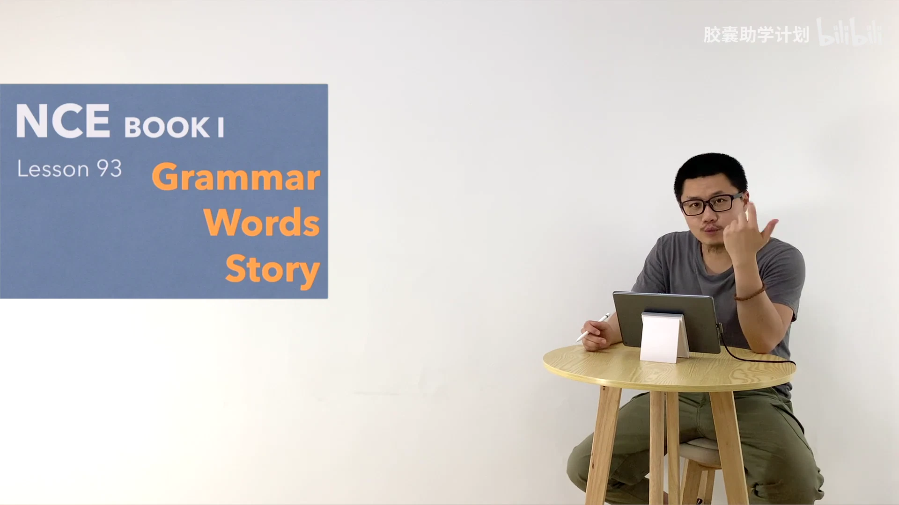

文字识别：胶囊助学计划 / NCE / BOOKI / Lesson 93 / Grammar / Words / Story

### 画面 00:00:11

文字识别：胶囊助学计划 / D

### 画面 00:00:13

文字识别：胶囊助学计划 / ①如何表达“返回某地”？

### 画面 00:00:15

文字识别：胶囊助学计划 / ①如何表达“返回某地”? / “坐飞机去某地”

### 画面 00:00:17

文字识别：胶囊助学计划 / ①如何表达“返回某地”? / 如何表达“坐飞机去某地”?

### 画面 00:00:19

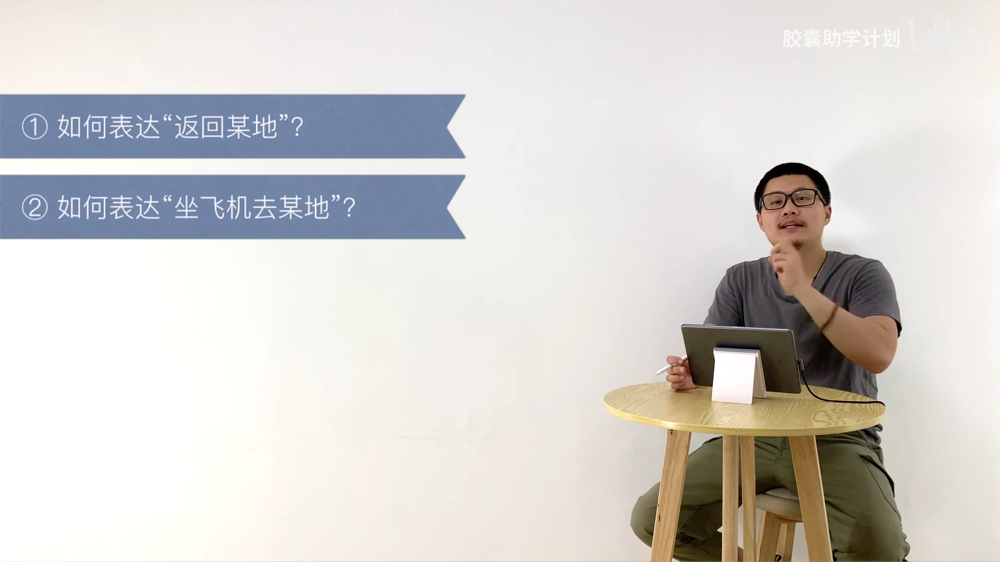

文字识别：胶囊助学计划 / ①如何表达“返回某地”? / 如何表达“坐飞机去某地”？

### 画面 00:00:22

文字识别：胶囊助学计划bill / •

### 画面 00:00:26

文字识别：胶囊助学计划

### 画面 00:00:28

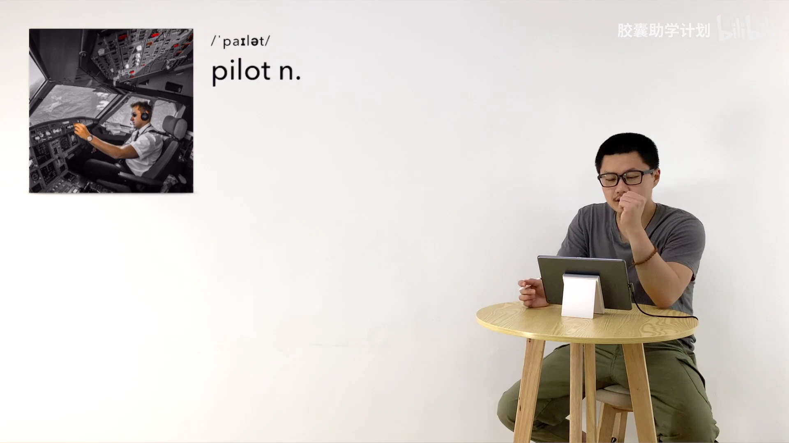

文字识别：胶囊助学计划 / /'parlat/ / pilot n.

## 00:00:30–00:01:00

拼一下 pilot pilot。那图应该说的很清楚了，对吧？飞行员 pilot 名词肯定是要找动词了。当然了，我们也可以去问说 What's your husband's job? 你老公工作是什么呀？ He's a pilot. 啊，他是一个飞行员，对吧？那我们随口造一个，看能不能听懂啊，各位，目前是吧？ Do you know that pilot? Okay, 啊， okay。接下来下一个单词叫做 return。我们之

### 画面 00:00:30

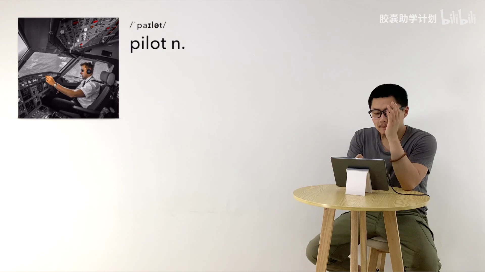

文字识别：胶囊助学计划bi出 / /'pailat/ / pilot n.

### 画面 00:00:32

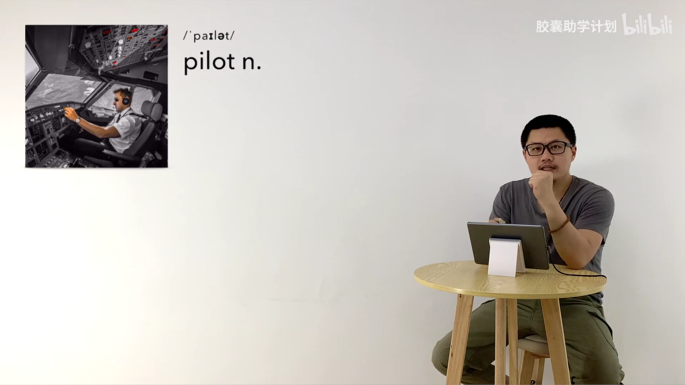

文字识别：胶囊助学计划bilb出 / /'parlat/ / pilot n.

### 画面 00:00:34

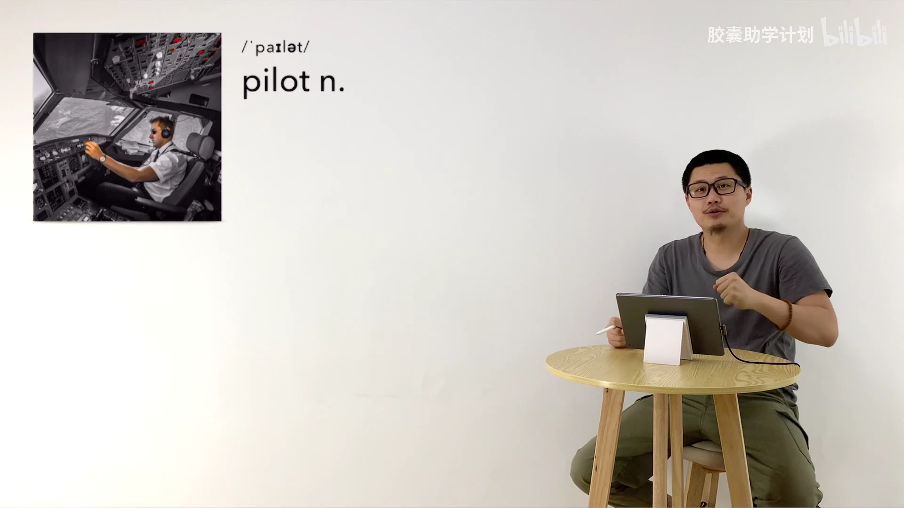

文字识别：胶囊助学计划 / /'pailat/ / pilot n.

### 画面 00:00:36

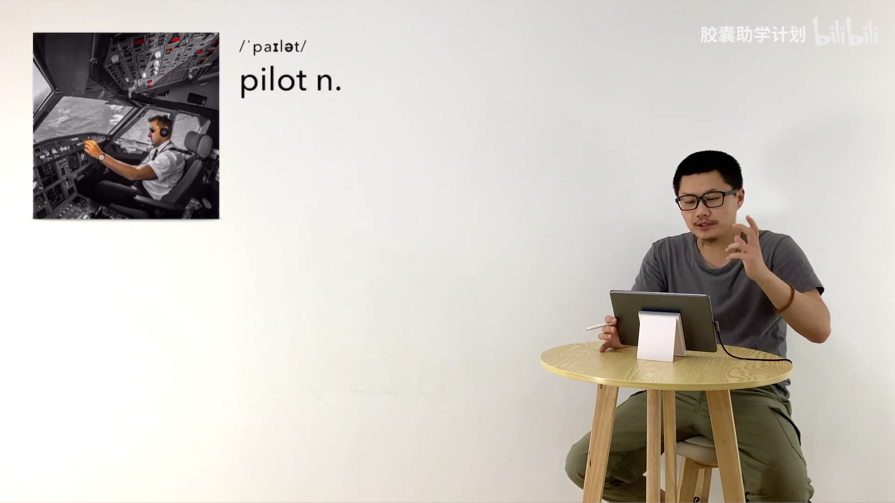

文字识别：胶囊助学计划 / /'parlat/ / pilot n.

### 画面 00:00:39

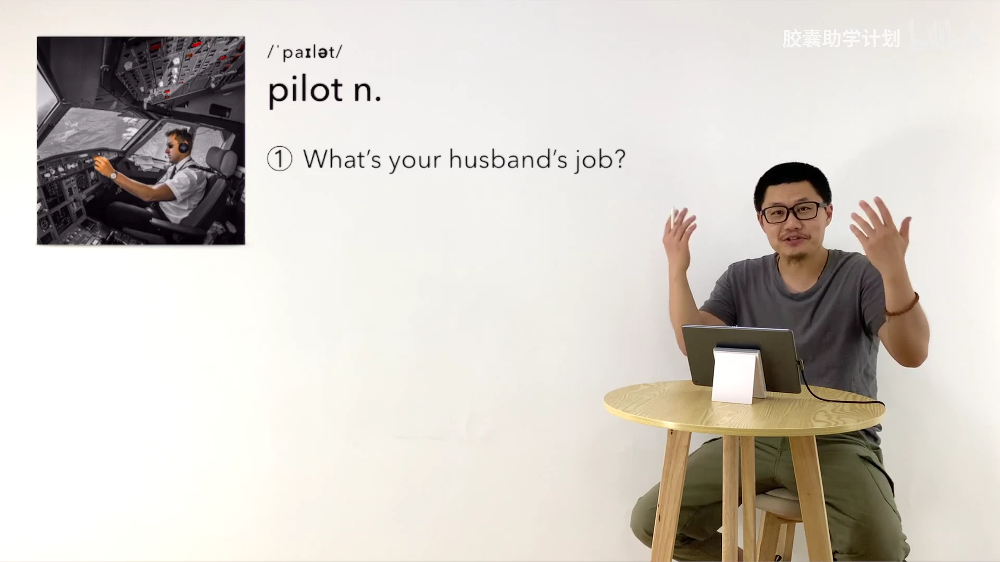

文字识别：胶囊助学计划 / /'pailat/ / pilot n. / ① What's your husband's job?

### 画面 00:00:49

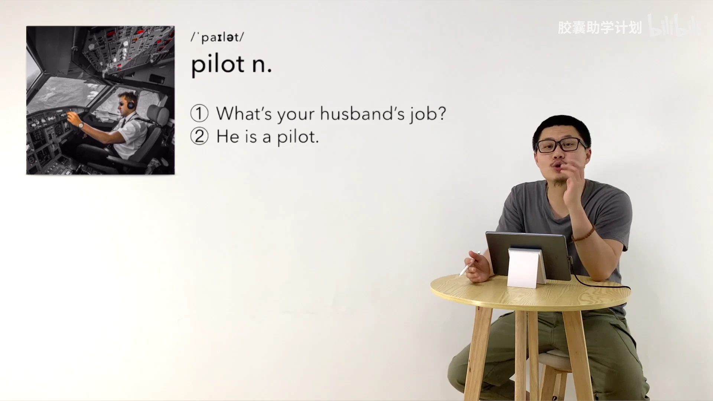

文字识别：胶囊助学计划 / /'parlat/ / pilot n. / ① What's your husband's job? / ② He is a pilot.

### 画面 00:00:52

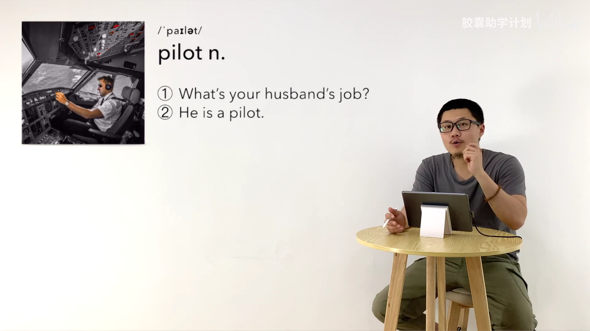

文字识别：胶囊助学计划 / /'parlat/ / pilot n. / ① What's your husband's job? / ② He is a pilot.

### 画面 00:00:54

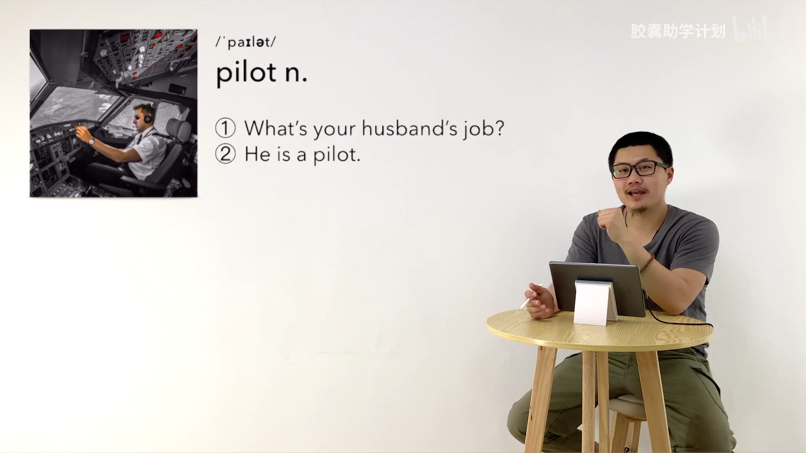

文字识别：胶囊助学计划 / /'parlat/ / pilot n. / ① What's your husband's job? / ② He is a pilot.

### 画面 00:00:56

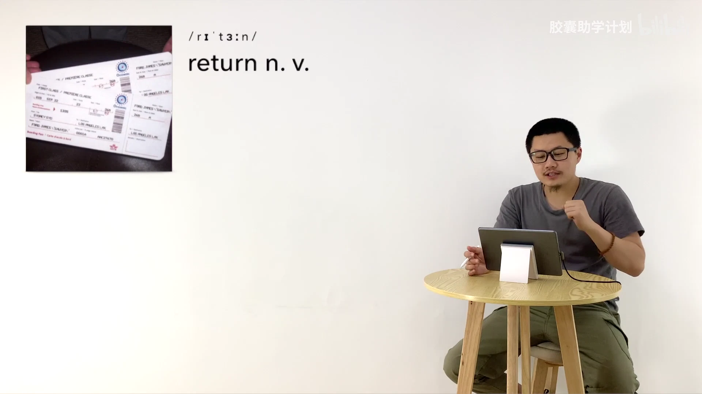

文字识别：胶囊助学计划 / /ri't3:n/ / return n. V. / FORD JIRESSAMR / /POCOUAS / 2un / TO/ / OSLISUK / FORE JNESSAERN / SVOEVSVO / 1.355 / TORE JRESSAMERN / LOS PNLISU / WC27670

### 画面 00:00:58

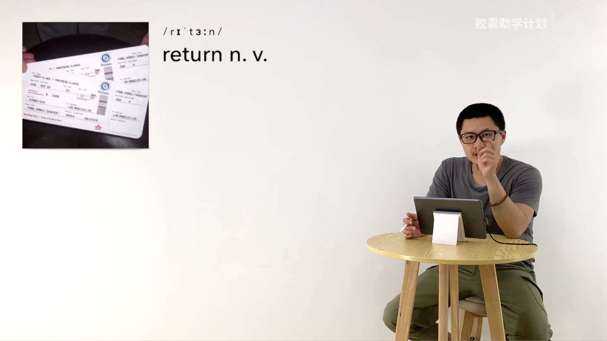

文字识别：胶囊助学计划 / /ri't3:n/ / return n. V. / FOROJINES SAMR / 2un / STOSPIDCE / FORE JINESSAMERN / SVONEVSVO / 335S / FORE JRESSAMORN / LOS ANELCSLR / OOISA / C27670

## 00:01:00–00:01:30

前可能应该我印象当中我们是学过它的名词，对吧？哎，我在讲ticket那个单词的时候讲过single ticket和return ticket啊，往返票，对吧？所以return的动词是什么意思呢？就是返回。那return ticket就是我们之前在讲ticket那个单词的时候说到叫做往返票，以及如果我们用return to somewhere，那叫做返回某地啊。接下来我们造个句子，比如说

### 画面 00:01:00

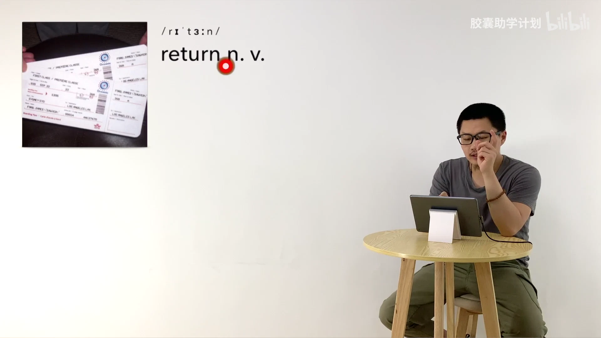

文字识别：胶囊助学计划 / /ri't3:n/ / return n. V. / FOD JRESSAMR / /PNILCCLAGSE / 2un / 2 / FORD JRESSAMRN / 1355 / SONEYSO / 2 / FORE JRESSAUNORN / LOS LISLK / DO01A / WC27670

### 画面 00:01:04

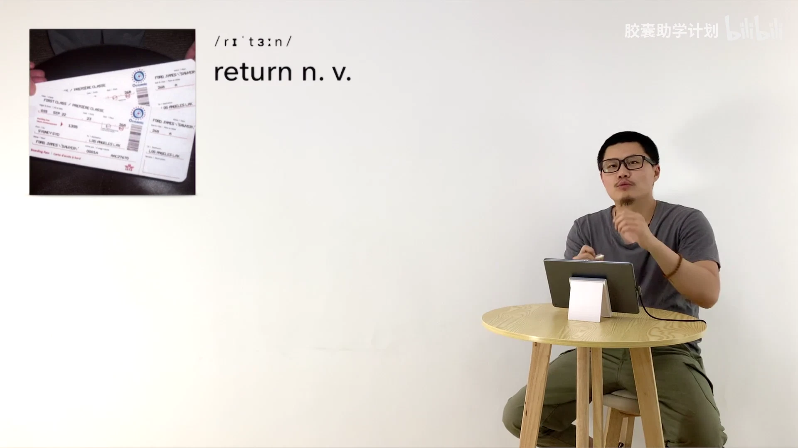

文字识别：胶囊助学计划 / /ri't3:n/ / return n. V. / FOD JMSSAMR / /PONCOUA6SE /  $ 2 / FORD JRESSMN / SENEYSD / 1358 / TORO JMESSAORN' / LOSNGLLSU / LSRLISLR / WC27670

### 画面 00:01:08

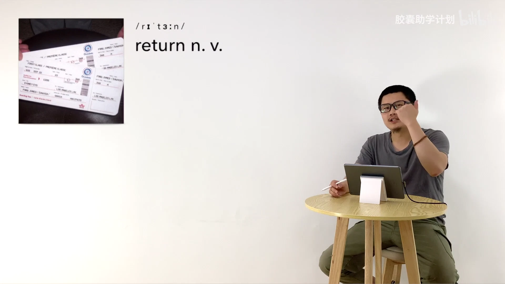

文字识别：胶囊助学计划 / /rI't3:n/ / return n. V. / rOO JRESSAMR / /PNUTECOLASSC / 5 $t9 22 / FORD JRSSAADN / SOEYSD / 1a5s / 269 / FOE JRES SANORN / LOS NLISLR / PWC21670

### 画面 00:01:13

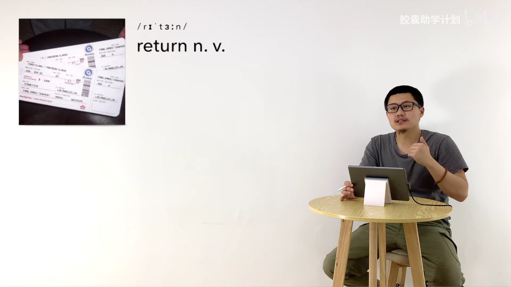

文字识别：胶囊助学计划 / /ri't3:n/ / return n. V. / FORD JEESSAMR / /POLRCCLASSE / 2un / 5$t9 22 / 2Y / FORO JRSSMUR / SIENEYSVD / 1358 / FOROJRESSAMOR / LOS ANGISURK / WC21670

### 画面 00:01:28

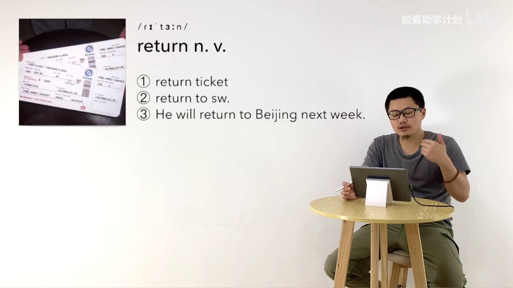

文字识别：胶囊助学计划 / /ri't3in/ / return n. v. / FOD JIRESSAMR / 26m / 935509 22 / SAUSUR / 23 / FORDJPESSAME / return ticket / SOEYSO / 1355 / FOEEJRSSARN / LOS ODLISU / 0001A / return to sw. / He will return to Beijing next week.

## 00:01:30–00:02:00

He will return to Beijing next week. 下周他会回到北京。他从北京出发的，然后回来北京。一般疑问句就是 Will he return to Beijing next week? Okay. 以及 When will he return to Beijing? Very good. 好，接下来下一个单词啊，这个对于各位来说应该是认识的，叫做 New York 啊，纽约啊。 Very good.

### 画面 00:01:31

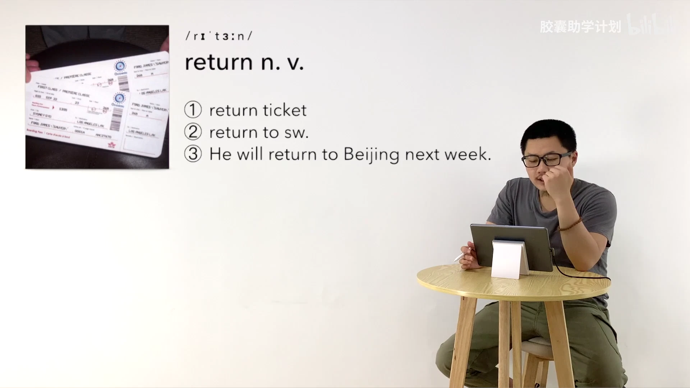

文字识别：胶囊助学计划 / /ri't3:n/ / return n. v. / FOD JIRSSAMR / 26n / 550922 / 23 / FOROJIESSMR / へ / return ticket / 1355 / SREYSO / FOREJRESSAOR / US AGLESUR / LS MLSUR / return to sw. / C27670 / He will return to Beijing next week.

### 画面 00:01:35

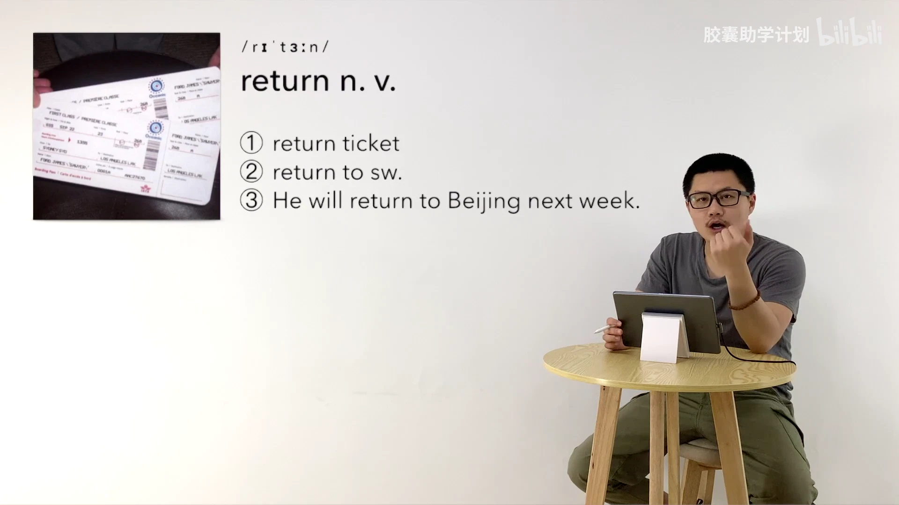

文字识别：胶囊助学计划 / /ri't3:n/ / return n. V. / FOO JRESSAMR / STOS/OA / 22 / FOROJESSN / return ticket / 1355 / SEEYSVO / FORE JRESSAMORN / LOS MELISUR / return to sw. / LOSNLSUR / WC21670 / He will return to Beijing next week.

### 画面 00:01:38

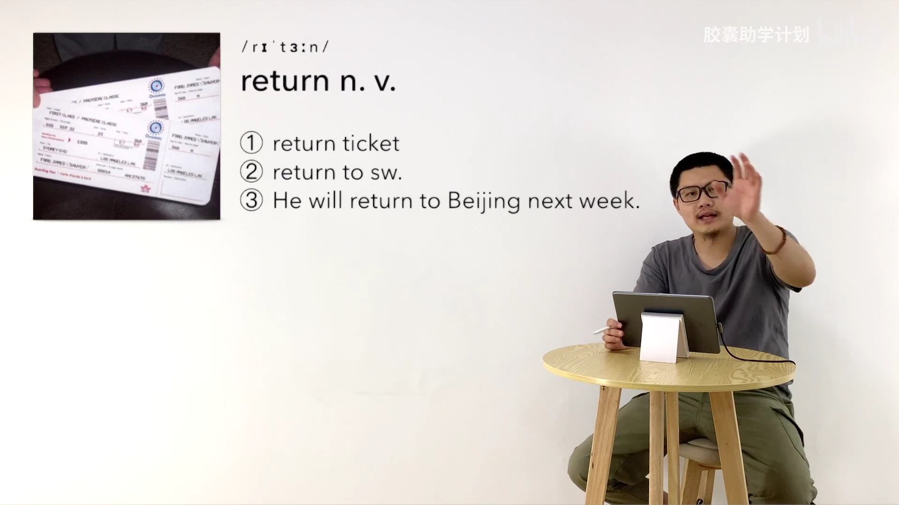

文字识别：胶囊助学计划 / /ri't3:n/ / return n. V. / FOO JRESSAMR / OSALISURK / FORO JNESSR / return ticket / 135s / SOEYSO / FOE JRESSWMORN / LO HLSUR / return to sw. / WC27670 / He will return to Beijing next week. / 3

### 画面 00:01:46

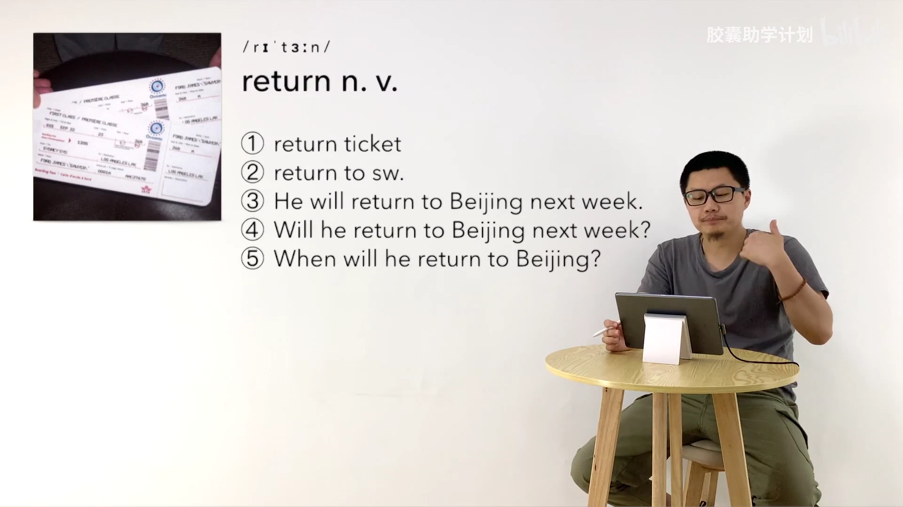

文字识别：胶囊助学计划 / /ri't3:n/ / return n. V. / /POIDECCLASE / 2n / FROJRSSAMORN / return ticket / STNEYSD / 1355 / 1 / TORE JRESSAMOR / LOG AEDLESURC / 0O1A / return to sW. / WC21670 / He will return to Beijing next week. / Will he return to Beijing next week? / When will he return to Beijing? / 5

### 画面 00:01:51

文字识别：胶囊助学计划 / /nju:/ 1jo:k1 / New York

### 画面 00:01:53

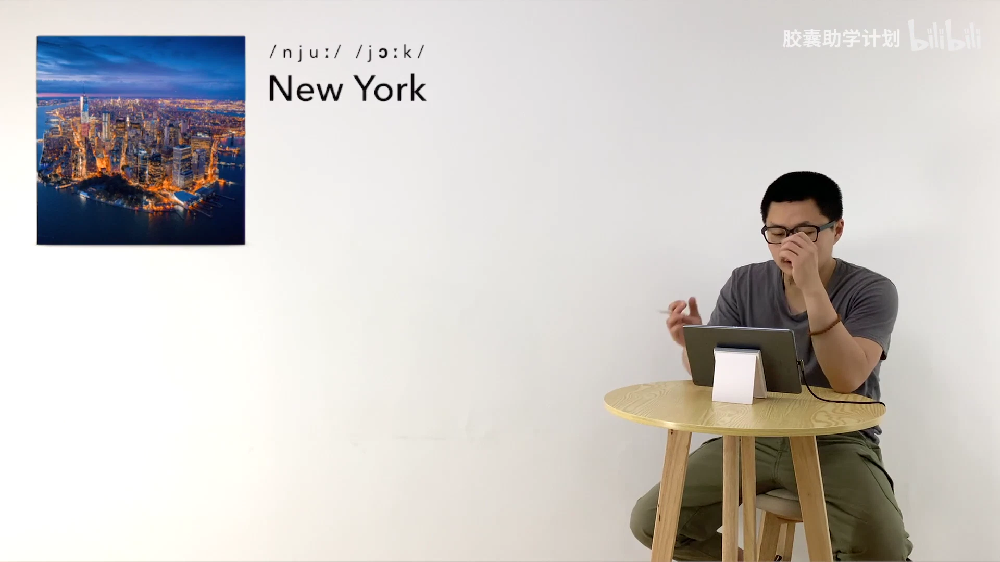

文字识别：胶囊助学计划 / /nju:/ /jo:k1 / New York

### 画面 00:01:56

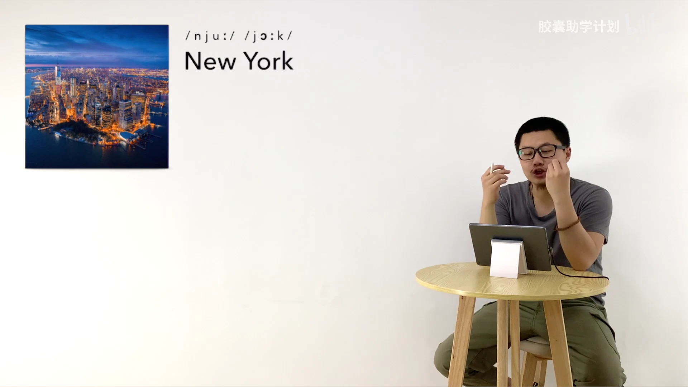

文字识别：胶囊助学计划 / /nju:/ /jo:k1 / New York

## 00:02:00–00:02:30

是这个地点，那我们就造句呗。我们用上八十五课的Have been to，来，Have you ever been to New York?好，我卖一个官司。我告诉各位这句话什么意思？您能不能想起来Have been to和Have gone to的区别？如果您忘了，我的建议是做如下两件事情：第一，红皮书初级当中再去赶紧查一下；第二，八十五课的语法啊，文章那个视频，你

### 画面 00:02:00

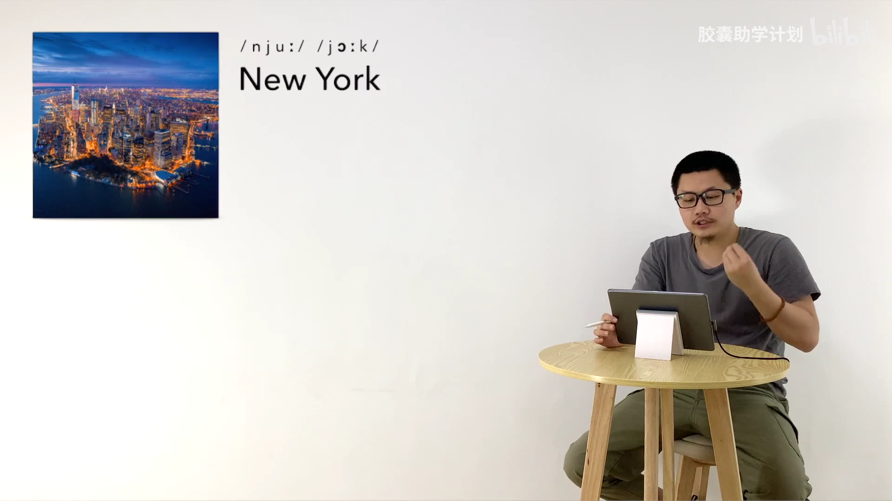

文字识别：胶囊助学计划 / /nju:/ /jo:k1 / New York

### 画面 00:02:03

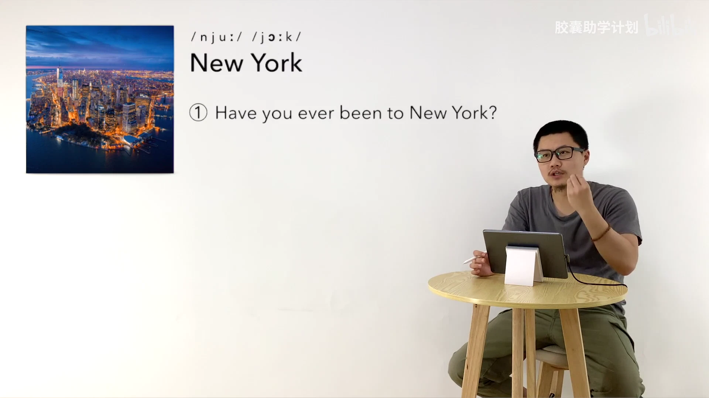

文字识别：胶囊助学计划 / /nju:/ 1jo:k1 / New York / ① Have you ever been to New York?

### 画面 00:02:06

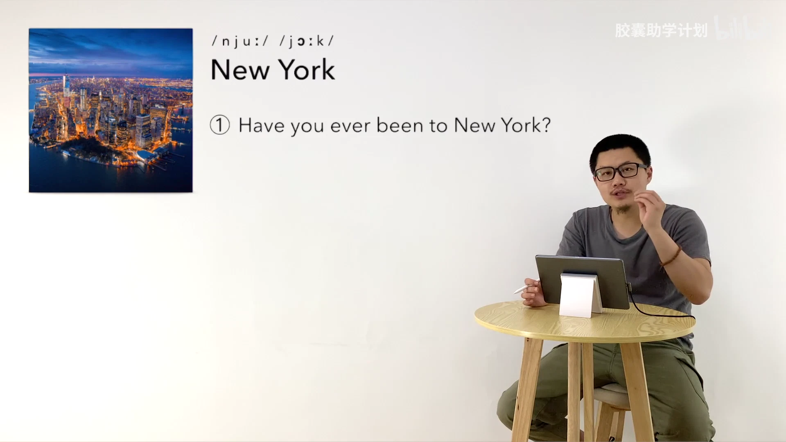

文字识别：胶囊助学计划 / /nju:/ /jo:k/ / New York / ① Have you ever been to New York?

### 画面 00:02:09

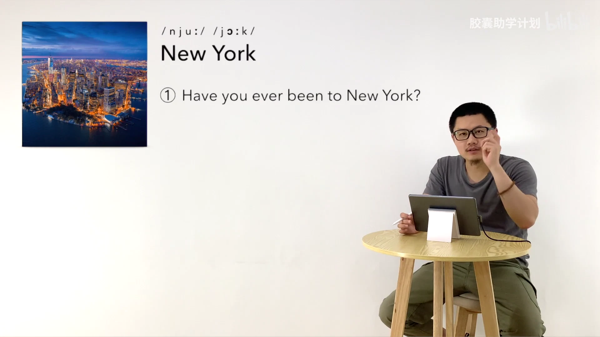

文字识别：胶囊助学计划 / /nju:/ 1jo:k1 / New York / ① Have you ever been to New York?

### 画面 00:02:11

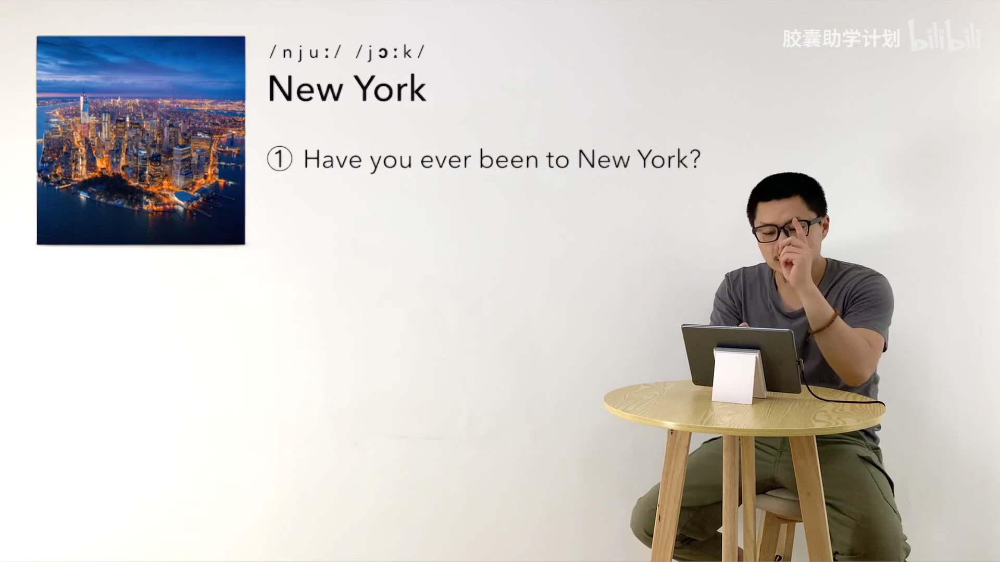

文字识别：胶囊助学计划 / /nju:/ /jo:k1 / New York / ① Have you ever been to New York?

### 画面 00:02:14

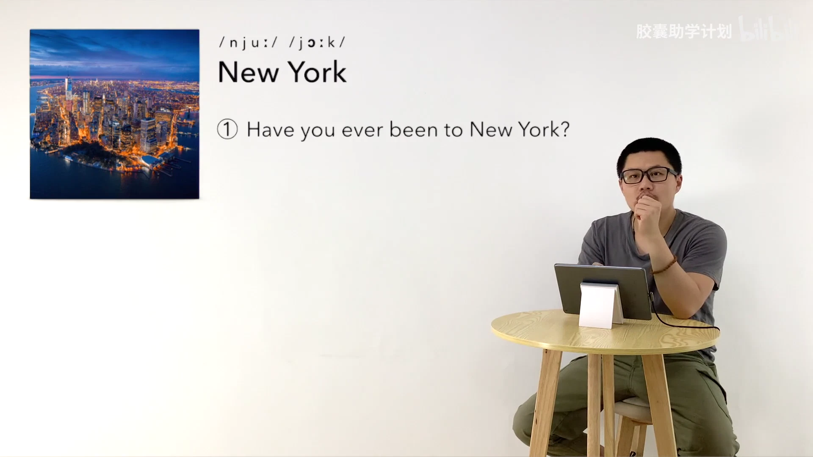

文字识别：胶囊助学计划 / /nju:/ /jo:k/ / New York / ① Have you ever been to New York?

### 画面 00:02:20

文字识别：胶囊助学计划 / /nju:/ /jo:k/ / New York / ① Have you ever been to New York?

### 画面 00:02:22

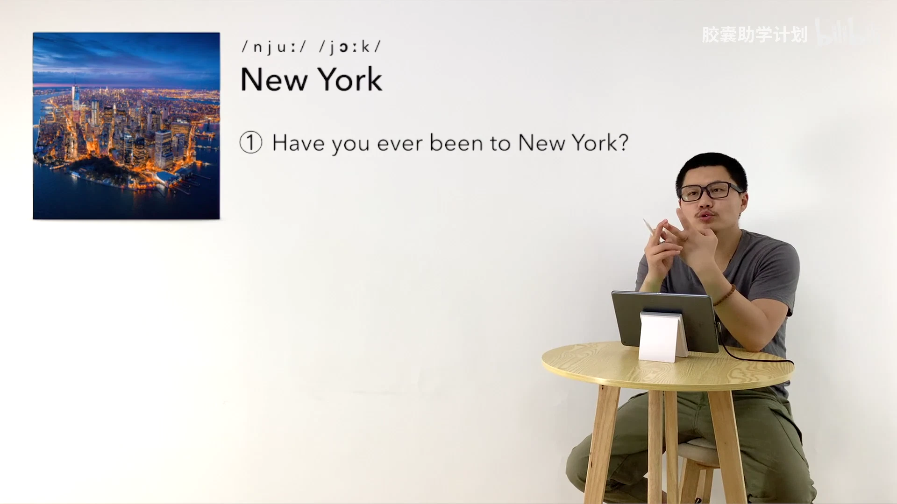

文字识别：胶囊助学计划 / /nju:/ 1jo:k/ / New York / ① Have you ever been to New York?

### 画面 00:02:25

文字识别：胶囊助学计划 / /nju:/ 1jo:k/ / New York / ① Have you ever been to New York?

## 00:02:30–00:03:00

语法文章那个视频一定要仔细再看一遍啊，说明您当时印象不深，对吧？OK，接下来说Sally has gone to New York，一样的，have been to，have gone to啊，我故意不讲了，各位回去复习一下，您自己去查，比我直接告诉给各位答案效果要好很多很多。OK，下一个单词，哎，Tokyo啊，京东啊，东京啊，东京啊，

### 画面 00:02:30

文字识别：胶囊助学计划 / /nju:/ 1jo:k/ / New York / ① Have you ever been to New York?

### 画面 00:02:36

文字识别：胶囊助学计划 / /nju:/ /jo:k1 / New York / ① Have you ever been to New York?

### 画面 00:02:38

文字识别：胶囊助学计划 / /nju:/ /jo:k/ / New York / ① Have you ever been to New York? / ② Sally has gone to New York.

### 画面 00:02:40

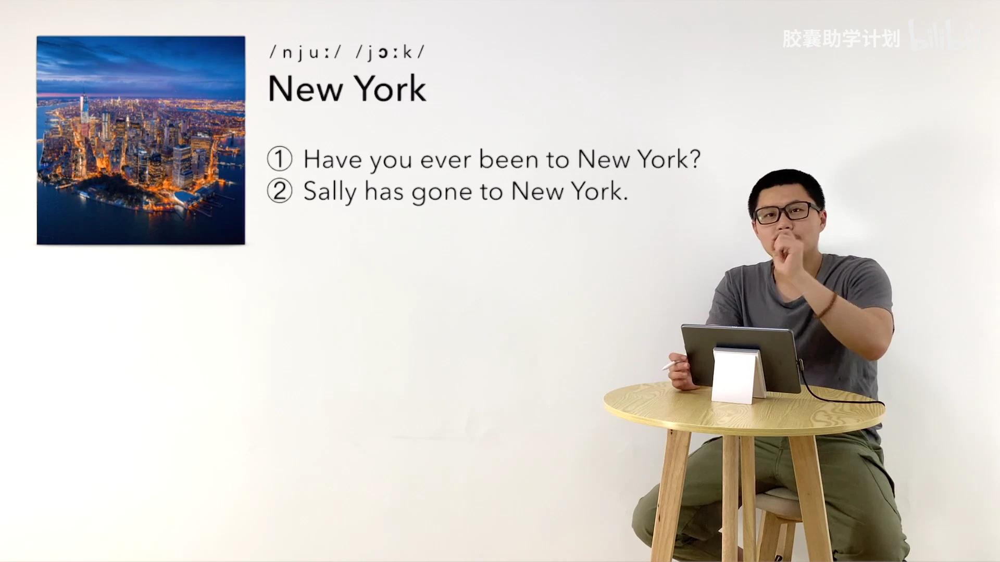

文字识别：胶囊助学计划 / /nju:/ /jo:k/ / New York / ① Have you ever been to New York? / ② Sally has gone to New York.

### 画面 00:02:45

文字识别：胶囊助学计划 / /nju:/ /jo:k/ / New York / ① Have you ever been to New York? / ② Sally has gone to New York.

### 画面 00:02:50

文字识别：胶囊助学计划 / /nju:/ 1jo:k1 / New York / ① Have you ever been to New York? / ② Sally has gone to New York.

### 画面 00:02:52

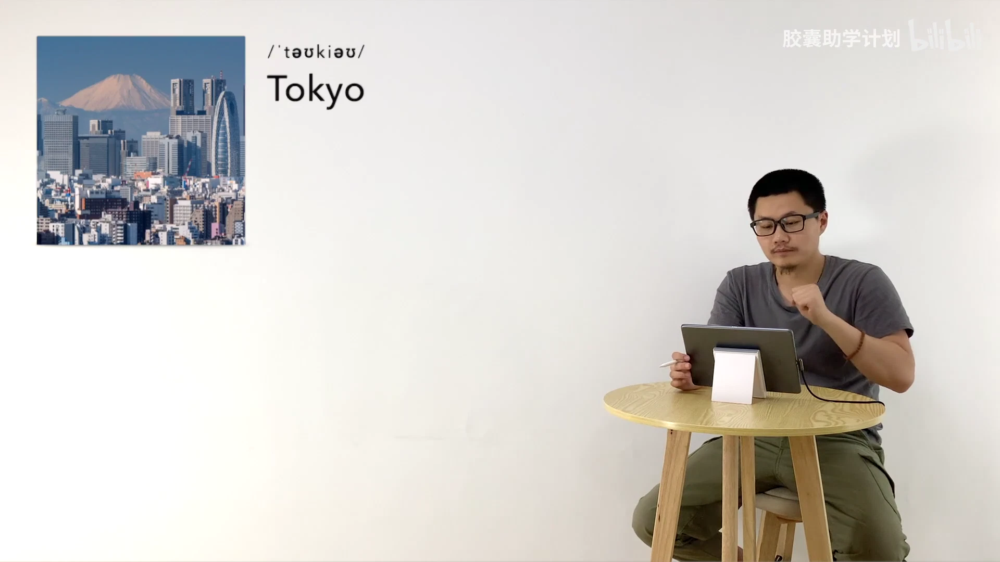

文字识别：胶囊助学计划 / /'taukiau/ / Tokyo

### 画面 00:02:54

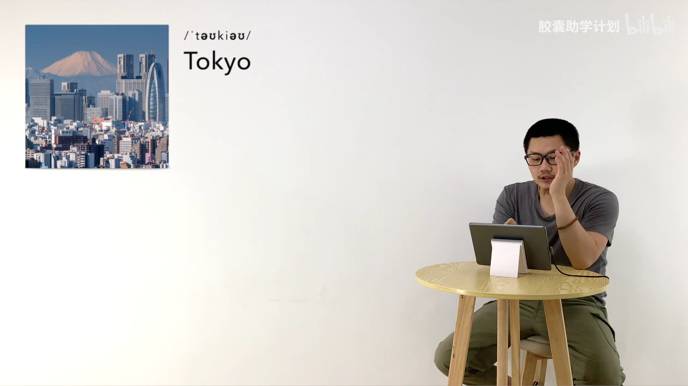

文字识别：胶囊助学计划 / /'taukiau/ / Tokyo

### 画面 00:02:57

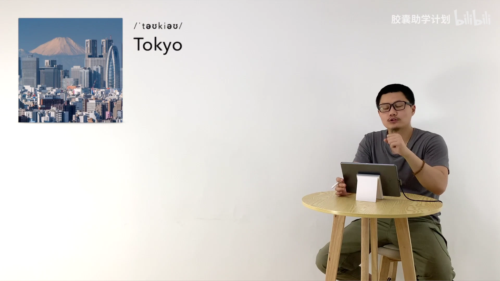

文字识别：胶囊助学计划 / /'taukiau/ / Tokyo

## 00:03:00–00:03:30

Tokyo，Tokyo，OK，我们造个句子说，I'll fly to Tokyo next month，我下个月会飞去东京。再来说，Will you fly to Tokyo next month？一般疑问句对吧？以及 When will you fly to Tokyo？以及 Why will you fly to Tokyo next month？Very good，好。下一个单词，西班牙马德里对吧？来

### 画面 00:03:00

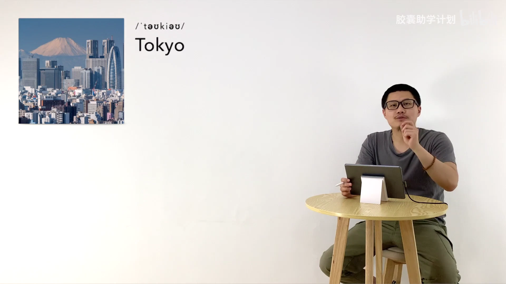

文字识别：胶囊助学计划 / /'taukiau/ / Tokyo

### 画面 00:03:03

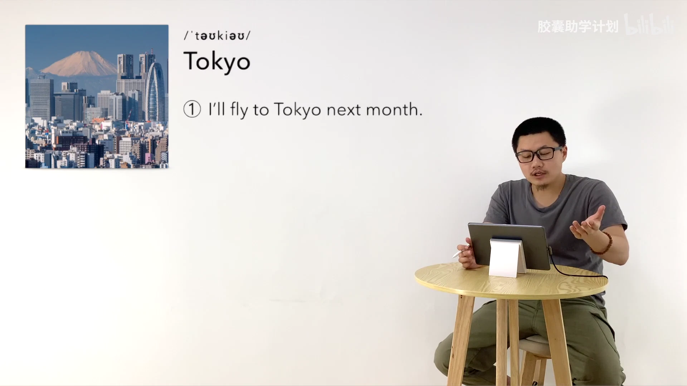

文字识别：胶囊助学计划 / /'taukiau/ / Tokyo / ① I'll fly to Tokyo next month.

### 画面 00:03:05

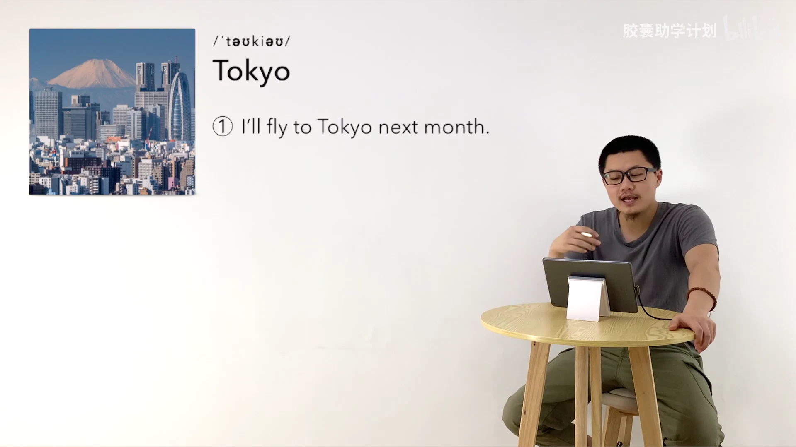

文字识别：胶囊助学计划 / /'taukiau/ / Tokyo / ① I'l fly to Tokyo next month.

### 画面 00:03:16

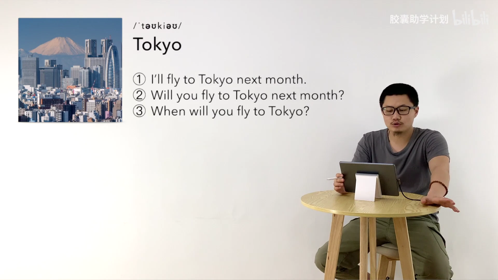

文字识别：胶囊助学计划 / /'taukiau/ / Tokyo / ① I'l fly to Tokyo next month. / Will you fly to Tokyo next month? / 2 / When will you fly to Tokyo?

### 画面 00:03:21

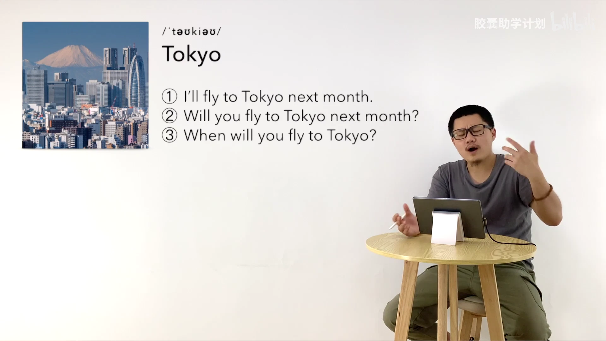

文字识别：胶囊助学计划 / /'taukiau/ / Tokyo / ① I'llfly to Tokyo next month. / Will you fly to Tokyo next month? / When will you fly to Tokyo?

### 画面 00:03:25

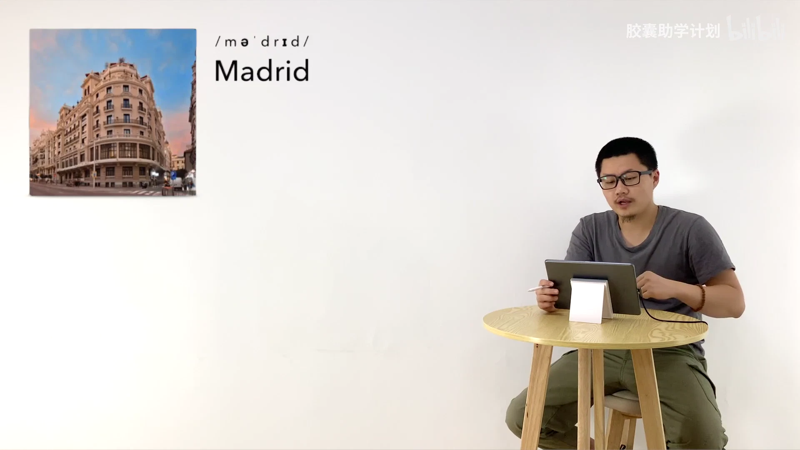

文字识别：胶囊助学计划 / /ma'drid/ / Madrid

### 画面 00:03:27

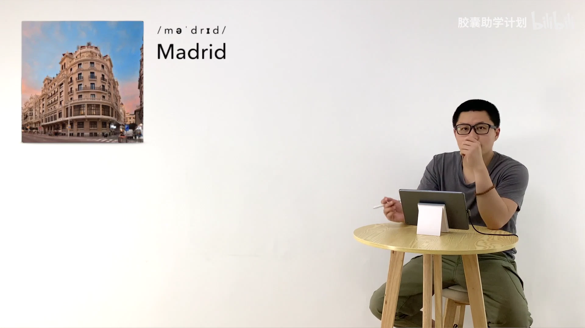

文字识别：胶囊助学计划 / /ma'drid/ / Madrid

## 00:03:30–00:04:00

跟我一起读，叫做 Madrid，注意重音在后面，叫 Madrid 啊马德里。They moved to Madrid last year. Move to somewhere，对吧？搬去某地，一般过去时，一般疑问句，跟我读。Did they move to Madrid last year? Why did they move to Madrid last year? 啊，他为什么要这么干啊？There you go。好，以及 When did they move to Madrid？好，There you go。接下来

### 画面 00:03:35

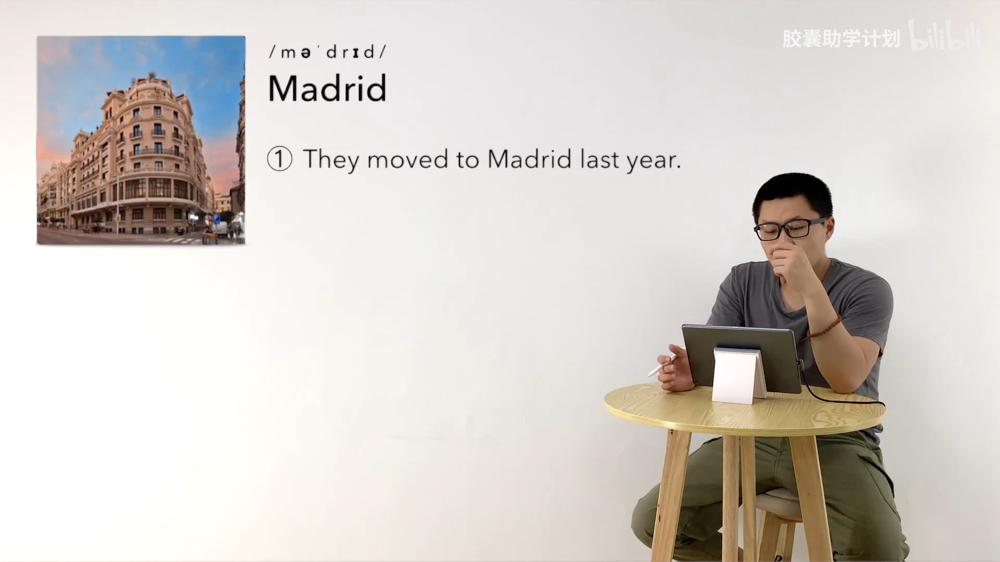

文字识别：胶囊助学计划 / /ma'drid/ / Madrid / ① They moved to Madrid last year.

### 画面 00:03:38

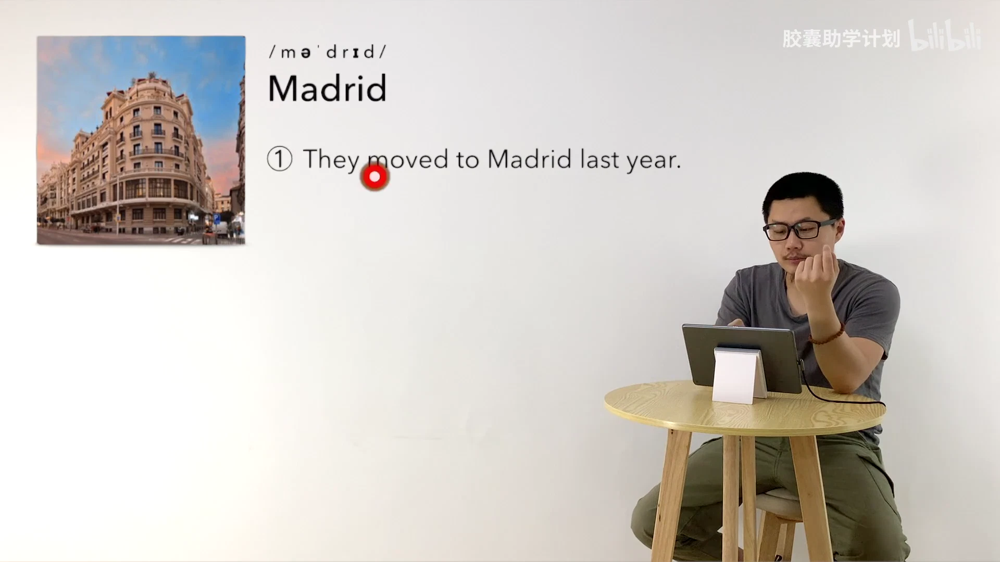

文字识别：胶囊助学计划 / /ma'drid/ / Madrid / ① They moved to Madrid last year.

### 画面 00:03:41

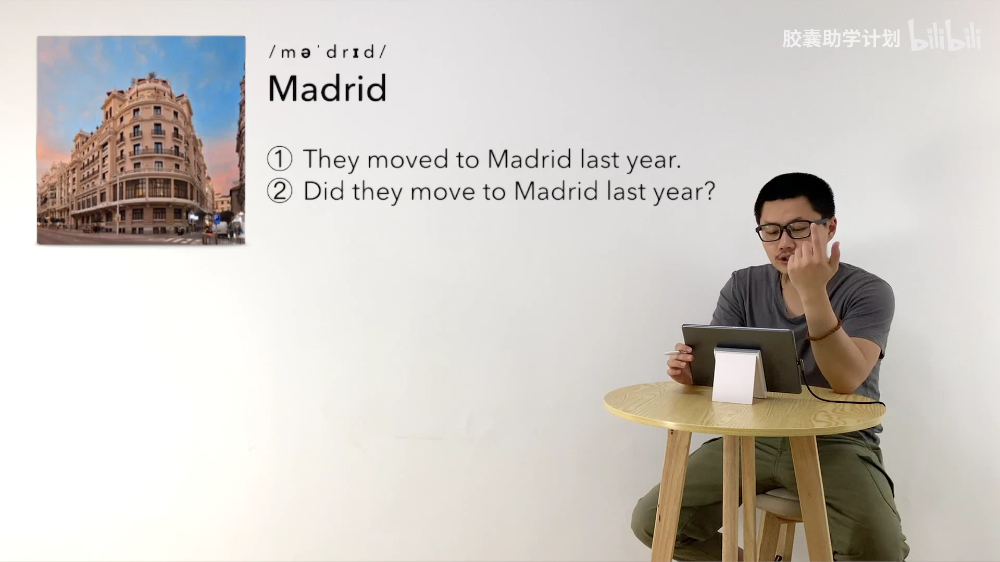

文字识别：胶囊助学计划 / /ma'drid/ / Madrid / ① They moved to Madrid last year. / ) Did they move to Madrid last year?

### 画面 00:03:44

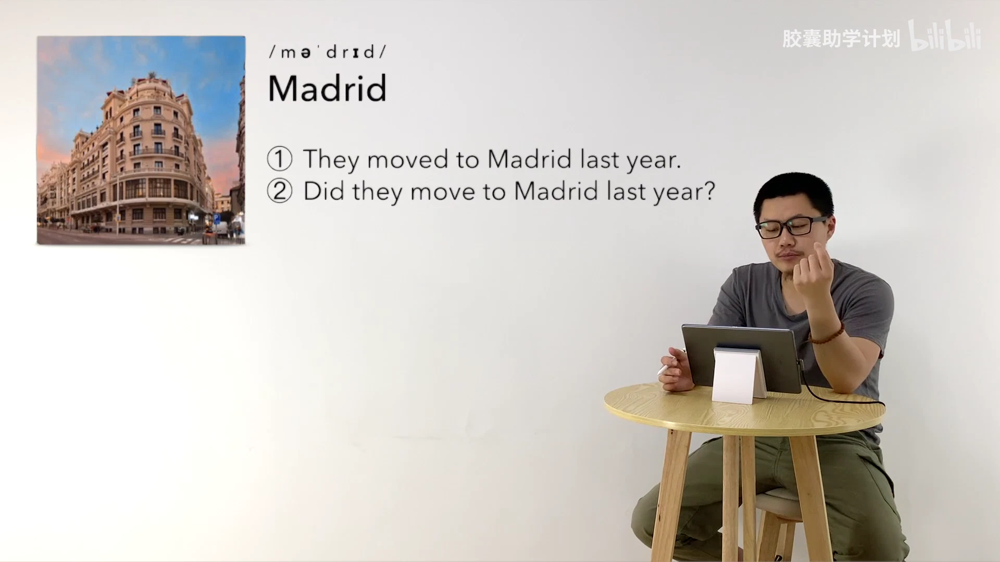

文字识别：Bilibili / 胶囊助学计划 / /ma'drid/ / Madrid / ① They moved to Madrid last year. /  Did they move to Madrid last year?

### 画面 00:03:46

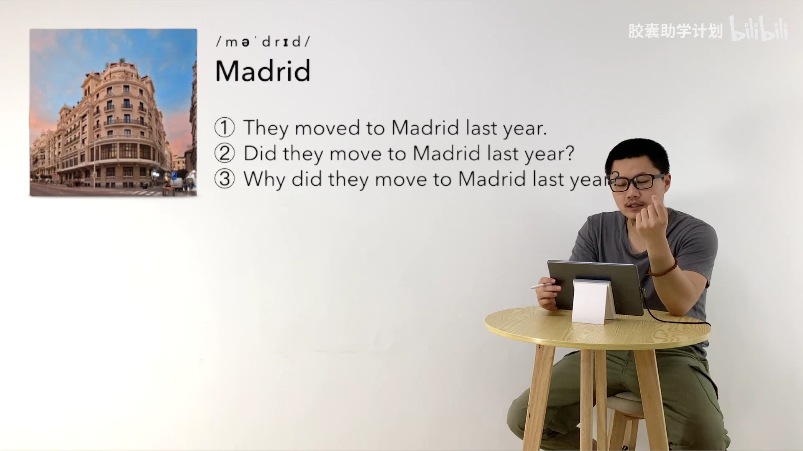

文字识别：胶囊助学计划 / /ma'drid/ / Madrid / ① They moved to Madrid last year. / Did they move to Madrid last year? /  Why did they move to Madrid last yeai

### 画面 00:03:49

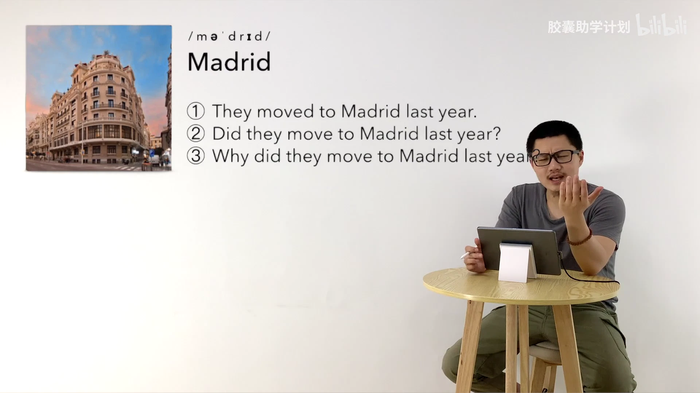

文字识别：胶囊助学计划 / /ma'drid/ / Madrid / ① They moved to Madrid last year. / Did they move to Madrid last year? / Why did they move to Madrid last yea

### 画面 00:03:52

文字识别：胶囊助学计划 / /ma'drid/ / Madrid / ① They moved to Madrid last year. / Did they move to Madrid last year? / 2 / ③ Why did they move to Madrid last yeaB

### 画面 00:03:54

文字识别：胶囊助学计划 / /ma'drid/ / Madrid / ① They moved to Madrid last year. / Did they move to Madrid last year? / Why did they move to Madrid last yea / 3 / 2 / When did they move to Madrid?

### 画面 00:03:57

文字识别：胶囊助学计划 / /ma'drid/ / Madrid / ① They moved to Madrid last year. / Did they move to Madrid last year? / Why did they move to Madrid last year3 / 3 / When did they move to Madrid?

### 画面 00:03:59

文字识别：胶囊助学计划 / /flar/ / / fl u:/ / /flaun/ / fly v. - flew - flown

## 00:04:00–00:04:30

下面这个单词我们很久之前就学过了，今天只不过又见了一下它的过去式和过去分词。先来第一个单词叫做 fly，下一个单词叫做 flew，最后一个单词叫做 flown。原形、过去式、过去分词。OK，好。如果说坐飞机去某地叫 fly to somewhere，它可真的不是说你自己飞去某地啊，它特指的就是

### 画面 00:04:01

文字识别：胶囊助学计划 / /flar/ / 1 fl u:/ / /fl aun/ / fly v. - flew - flown

### 画面 00:04:05

文字识别：胶囊助学计划 / /flar/ / / fl u:/ / /fl aun/ / fly v. - flew - flown

### 画面 00:04:08

文字识别：胶囊助学计划 / /flar/ / 1 fl u:/ / /fl aun/ / fly v. - flew - flown

### 画面 00:04:18

文字识别：胶囊助学计划 / /flar/ / / fl u :/ / /fl aun/ / fly v. - flew - flown

### 画面 00:04:21

文字识别：胶囊助学计划 / /flar/ / / fl u:/ / / fl aun / / fly v. - flew - flown / ① fly to sw.

## 00:04:30–00:05:00

坐飞机去某地啊，fly to somewhere. 造句说，They flew to New York this morning. 啊，今儿早上他们就飞去纽约了。以及 I will fly to Madrid tonight. 今晚我要坐飞机去马德里。 Okay, 本课九十三课实际上是一个总结课程，它并没有新的语法，只不过我们要迅速的回顾一下从三十一课到九十一课的

### 画面 00:04:36

文字识别：胶囊助学计划 / /flai/ / / fl u:/ / /fl aun/ / fly v. - flew - flown / ① fly to sw. / They flew to New York this morning.

### 画面 00:04:46

文字识别：胶囊助学计划 / 复习31-91核心语法

### 画面 00:04:50

文字识别：胶囊助学计划 / 复习31-91核心语法

## 00:05:00–00:05:30

一些核心语法，当然我们也不是复习所有语法，我们只复习时态啊，当然可能有情态动词，对吧？这个两个是非常重要的啊。比如说，我们先说 be 加 doing，三十一课咱们学的，表示一个动作正在进行，现在进行时。 be going to do 加动词原形，三十七课学的，我们管它叫一般将来时，计划打算。四十三课我们学了一个单词叫 can，表示能。四十七课、四十九课啊，我们

### 画面 00:05:05

文字识别：胶囊助学计划blbll / 复习31-91核心语法

### 画面 00:05:15

文字识别：胶囊助学计划 / 复习31-91核心语法 / ① be + v.ing L31 / ② be going to v. L37

### 画面 00:05:18

文字识别：胶囊助学计划 / 复习31-91核心语法 / ① be + v.ing L31 / ② be going to v. L37

## 00:05:30–00:06:00

学了两个不同的单词 do 和 does，当时咱们分开学的，但是我们现在可以放到一起去说，统称为一般现在时，陈述客观事实或者表述生活习惯。六十三课咱们学了一个单词叫做 must，表示必须啊，它跟 can 其实是对应的，都是情态动词。六十七课我们又学了 was 和 were，把 am is are 换成了过去式。七十一课我们学了一个关键

### 画面 00:05:35

文字识别：胶囊助学计划b山 / 复习31-91核心语法 / ① be + v.ing L31 / ② be going to v. L37 / ③ can L43 / do/does L47 / 4）

### 画面 00:05:38

文字识别：胶囊助学计划 / 复习31-91核心语法 / ① be + v.ing L31 / ② be going to v. L37 / ③ can L43 / do/does L47 / 4）

### 画面 00:05:52

文字识别：胶囊助学计划 / 复习31-91核心语法 / ① be + v.ing L31 / ② be going to v. L37 / ③ can L43 / do/does L47 / must L63 / was/were L67

## 00:06:00–00:06:30

的单词叫 did，而 did 这个单词引出了一般过去时这个时态，一个动作发生在过去，对吧？好，七十九课呢，我们又学了一个小的结构叫 have got，叫拥有。那八十三、八十九，我们分别学了 have 加但现在完成时这个时态的两个不同的用法，一个叫做过去的事情在过去结束了，对现在产生了影响。八字真言：言之过

### 画面 00:06:00

文字识别：胶囊助学计划 / 复习31-91核心语法 / ① be + v.ing L31 / ② be going to v. L37 / 3 / can L43 / do/does L47 / must L63 / was/were L67 / did L71

### 画面 00:06:07

文字识别：胶囊助学计划 / 复习31-91核心语法 / ① be + v.ing L31 / ② be going to v. L37 / ③ can L43 / do/does L47 / must L63 / was/were L67 / did L71 / ⑧ have got L79

### 画面 00:06:11

文字识别：胶囊助学计划 / 复习31-91核心语法 / ① be + v.ing L31 / ② be going to v. L37 / 3 / can L43 / do/does L47 / must L63 / was/were L67 / did L71 / ⑧ have got L79

### 画面 00:06:21

文字识别：胶囊助学计划 / 复习31-91核心语法 / ① be + v.ing L31 / ② be going to v. L37 / ③ can L43 / do/does L47 / must L63 / was/were L67 / did L71 / ⑧ have got L79 / ⑨ have done L83/89

### 画面 00:06:23

文字识别：胶囊助学计划 / 复习31-91核心语法 / ① be + v.ing L31 / ② be going to v. L37 / ③ can L43 / do/does L47 / must L63 / was/were L67 / did L71 / ⑧ have got L79 / ⑨ have done L83/89

### 画面 00:06:25

文字识别：胶囊助学计划 / 复习31-91核心语法 / ① be + v.ing L31 / ② be going to v. L37 / ③ can L43 / do/does L47 / must L63 / was/were L67 / did L71 / ⑧ have got L79 / ⑨ have done L83/89

## 00:06:30–00:07:00

去，意在当下。另一个是八十九课我们学过的，说从过去持续或重复到现在。比如说我在北京已经住了十年了。OK，好，最后呢就是我们刚刚九十一课学到的这个小的单词叫 will。那 will 这个单词你可以去对标 must 和 can 这两个单词。如果 must can 您学的还不错，有印象它如何变否定句和一般疑问句？那 will 和他们完全一样。

### 画面 00:06:36

文字识别：胶囊助学计划 / 复习31-91核心语法 / ① be + v.ing L31 / ② be going to v. L37 / ③ can L43 / do/does L47 / must L63 / was/were L67 / did L71 / ⑧ have got L79 / ⑨ have done L83/89

### 画面 00:06:39

文字识别：胶囊助学计划 / 复习31-91核心语法 / ① be + v.ing L31 / ② be going to v. L37 / ③ can L43 / do/does L47 / must L63 / was/were L67 / did L71 / ⑧ have got L79 / ⑨ have done L83/89

### 画面 00:06:42

文字识别：胶囊助学计划 / 复习31-91核心语法 / ① be + v.ing L31 / ② be going to v. L37 / ③ can L43 / do/does L47 / must L63 / was/were L67 / did L71 / ⑧ have got L79 / ⑨ have done L83/89 / 10 will L91

### 画面 00:06:48

文字识别：胶囊助学计划 / 复习31-91核心语法 / ① be + v.ing L31 / ② be going to v. L37 / ③ can L43 / do/does L47 / 5 / must L63 / was/were L67 / did L71 / ⑧ have got L79 / ⑨have done L83/89 /  will L91

### 画面 00:06:50

文字识别：胶囊助学计划 / Bibl / 复习31-91核心语法 / ① be + v.ing L31 / ② be going to v. L37 / ③ can L43 / do/does L47 / 5 / must L63 / was/were L67 / did L71 / ⑧ have got L79 / ⑨have done L83/89 /  will L91

### 画面 00:06:52

文字识别：胶囊助学计划 / 复习31-91核心语法 / ① be + v.ing L31 / ② be going to v. L37 / ③ can L43 / do/does L47 / must L63 / 5 / was/were L67 / did L71 / ⑧ have got L79 / ⑨ have done L83/89 /  will L91

## 00:07:00–00:07:30

OK。好，那接下来呢，我们就直接进入文章，看一下这篇文章非常的短啊，但是它用到了好几个不同的时态，我们一起来看一下。Nigel is our new next door neighbor.哎，各位还记不记得买房子那个对吧？啊，他是我们的新邻居。He's a pilot.他是一个飞行员。这两句话都是一般现在时，没什么太大可讲的。He was in the RAF. RAF是什么

### 画面 00:07:01

文字识别：胶囊助学计划 / Nigel is our new next-door neighbour. / He's a pilot.

### 画面 00:07:03

文字识别：胶囊助学计划 / Nigel is our new next-door neighbour. / He's a pilot.

### 画面 00:07:08

文字识别：胶囊助学计划 / Nigel is our new next-door neighbour. / He's a pilot.

### 画面 00:07:10

文字识别：胶囊助学计划 / Nigel is our new next-door neighbour. / He's a pilot.

### 画面 00:07:14

文字识别：胶囊助学计划 / Nigel is our new pext-door neighbour. / He's a pilot. / OO

### 画面 00:07:22

文字识别：胶囊助学计划bilb出 / Nigel is our new next-door neighbour. / He's a pilot.

### 画面 00:07:28

文字识别：胶囊助学计划bilb出 / Nigel is our new next-door neighbour. / He's a pilot. / He was in the R.A.F. (Royal Air Force)

## 00:07:30–00:08:00

呢？叫 Royal Air Force啊，英国的皇家空军啊。他曾经在这里工作。注意，你看 was 过去对吧？说明现在不是了，现在可能去开民航了，对吧？ Continue. 说 He'll fly to New York next month. 哎，will 加 do 表示这个事儿在未来发生，对吧？将来的事情。 The month after next, he'll fly to Tokyo.

### 画面 00:07:39

文字识别：胶囊助学计划 bilb出 / … / Nigel is our new next-door neighbour. / He's a pilot. / He was in the R.A.F. (Royal Air Force)

### 画面 00:07:41

文字识别：胶囊助学计划 / … / Nigel is our new next-door neighbour. / He's a pilot. / He was in the R.A.F. (Royal Air Force)

### 画面 00:07:44

文字识别：胶囊助学计划 / He will fly to New York next month.

### 画面 00:07:46

文字识别：胶囊助学计划 / He will fly to New York next month.

### 画面 00:07:49

文字识别：bilbil / 胶囊助学计划 / He will fly to New York next month.

### 画面 00:07:58

文字识别：胶囊助学计划 / He will fly to New York next month. / The month after next he'llfly to Tokyo.

## 00:08:00–00:08:30

下个月。Next下个月之后的那个月啊，大下个月。He'll fly to Tokyo.他会飞去京东啊，东京，对吧？Okay, at the moment,现在呢，he's in Madrid.他现在在马德里。He flew一般过去时出来了to Spain a week ago啊，一个礼拜前飞去的西班牙。然后呢，现在还在马德里，对吧？

### 画面 00:08:08

文字识别：胶囊助学计划 / He will fly to New York next month. / The month after next he'llfly to Tokyo.

### 画面 00:08:10

文字识别：胶囊助学计划 / He will fly to New York next month. / The month after next he'llfly to Tokyo.

### 画面 00:08:12

文字识别：胶囊助学计划 / SPAIN / At the moment, he's in Madrid. / He flew to Spain a week ago.

### 画面 00:08:15

文字识别：胶囊助学计划 / Bilbi / SPAIN / At the moment, he's in Madrid. / He flew to Spain a week ago.

### 画面 00:08:18

文字识别：胶囊助学计划 / SPAIN / At the moment, he's in Madrid. / He flew to Spain a week ago.

## 00:08:30–00:09:00

He'll return to London, return to some place, 返回某地。他将回到伦敦。The week after next, next叫下周，after next叫下周之后。The week after next就是大下周。Okay,好。He's only forty-one years old.他只有四十一岁。And he has already been to八十五课我们学过的，对吧？他已经去过了nearly every country in the

### 画面 00:08:33

文字识别：胶囊助学计划 / SPAIN / At the moment, he's in Madrid. / He flew to Spain a week ago. / He'll return to London the week after next.

### 画面 00:08:38

文字识别：胶囊助学计划 / SPAIN / At the moment, he's in Madrid. / He flew to Spain a week ago. / He'll return to Londe / onthe week after next.

### 画面 00:08:41

文字识别：胶囊助学计划 / SPAIN / At the moment, he's in Madrid. / He flew to Spain a week ago. / He'll return to Lond / onthe week after next.

### 画面 00:08:44

文字识别：胶囊助学计划bi出bl / SPAIN / At the moment, he's in Madrid. / He flew to Spain a week ago. / He'll return to londonthe week after next.

### 画面 00:08:46

文字识别：胶囊助学计划 bib出 / He's only forty-one years old, and he has already / been to nearly every country in the world.

### 画面 00:08:49

文字识别：胶囊助学计划 / He's only forty-one years old, and he has already / been to nearly every country in the world.

### 画面 00:08:53

文字识别：胶囊助学计划 / He's only forty-one years old, and he has already / been to nearly every country in the world.

## 00:09:00–00:09:30

world,几乎这个世界上的每一个国家。Nigel is a very lucky man.说Nigel啊是一个特别幸运的男子。But his wife isn't very lucky.说但是他妻子不是特别的幸运。She usually stays at home.啊，他通常状态下总是在家里面待着。Okay,注意usually stays一般现在时。如果我们想把这句话变成呃

### 画面 00:09:01

文字识别：胶囊助学计划 / He's only forty-one years old, and he has already / been to nearly every country in the world.

### 画面 00:09:04

文字识别：胶囊助学计划 / He's only forty-one years old, and he has already / been to nearly every country in the world. / Nigel is a very lucky man. / But his wife isn't very lucky. / She usually stays at home!

### 画面 00:09:09

文字识别：胶囊助学计划 / He's only forty-one years old, and he has already / been to nearly every country in the world. / Nigel is a very lucky man. / But his wife isn't very lucky. / She usually stays at home!

### 画面 00:09:11

文字识别：胶囊助学计划 / He's only forty-one years old, and he has already / been to nearly every country in the world. / Nigel is a very lucky man. / But his wife isn't very lucky. / She usually stays at home!

### 画面 00:09:25

文字识别：胶囊助学计划 / He's only forty-one years old, and he has already / been to nearly every country in the world. / Nigel is a very lucky man. / But his wife isn't very lucky. / She usually stays at home!

## 00:09:30–00:10:00

呃，一般，呃，这个一般疑问句。那你想应该提谁呢？提 does，对不对？OK，接下来我们做一些口语听力练习。我问您答，您看着文章找答案就好了。如果速度太快呢，暂停。OK，来了。Who is our new next door neighbor? Nigel. Next one. What does Nigel do for a living? 好，这个我提一句。What does Nigel do for a

### 画面 00:09:33

文字识别：胶囊助学计划 / He's only forty-one years old, and he has already / been to nearly every country in the world. / Nigel is a very lucky man. / But his wife isn't very lucky. / She usually stays at home!

### 画面 00:09:36

文字识别：胶囊助学计划 / Comprehension / OO

### 画面 00:09:41

文字识别：胶囊助学计划 / Comprehension

### 画面 00:09:46

文字识别：胶囊助学计划 / Comprehension / 1 T: Who is our new next-door neighbour?

### 画面 00:09:55

文字识别：胶囊助学计划 / Comprehension / 2T: What does Nigel do for a living?

## 00:10:00–00:10:30

living? His意思就是What's his job? Okay, he's a pilot. Next one, will he fly to New York next month? Yes, he will. Continue. Where will he be the month after next? He will be in Tokyo. Next one, where is he at the moment? He's in Madrid.

### 画面 00:10:25

文字识别：胶囊助学计划 / Comprehension / 5 T: Where is he at the moment?

## 00:10:30–00:11:00

Next one, when did he fly to Spain? He flew to Spain a week ago. Next one, when will he come back to London? He'll come back the week after next. Continue. How old is Nigel? He's only forty-one. Next one, how many countries has Nigel

### 画面 00:10:44

文字识别：胶囊助学计划b鼎b出 / Comprehension / 7 T: When will he come back to London? / S: He'll come back the week after next.

### 画面 00:10:50

文字识别：Bilbil / 胶囊助学计划 / Comprehension / 8T: How old is Nigel?

## 00:11:00–00:11:30

been to. He's been to nearly every country in the world. Next one. Why is his wife very unlucky? Because she usually stays at home. Very good.好了, asking questions.肯定句,一般疑问句,特殊疑问句.第一题. Ask me if Nigel was in the R

### 画面 00:11:01

文字识别：胶囊助学计划 / 出 / Comprehension / 9 T: How many countries has Nigel been to? / S: He's been to nearly every country in the world.

### 画面 00:11:07

文字识别：Blbili / 胶囊助学计划 / Comprehension / 10 T: Why is his wife very unlucky?

### 画面 00:11:19

文字识别：胶囊助学计划 / Asking questions

### 画面 00:11:22

文字识别：胶囊助学计划 / Asking questions

### 画面 00:11:27

文字识别：胶囊助学计划 / Asking questions / 1 T: Ask me if Nigel was in the R. A. F.

## 00:11:30–00:12:00

RAF. Was Nigel in the RAF? When? When was Nigel in the RAF? Next one. Ask me if he will fly to New York next month. Will he fly to New York next month? 对答案. When? Hey, you. Put out a question. When

### 画面 00:11:50

文字识别：bilbl / 胶囊助学计划 / Asking questions / 2 T: Ask me if he will fly to New York next month. / S: Will he fly to New York next month?

## 00:12:00–00:12:30

来。When will he fly to New York? Next one, ask me if he flew to Madrid a week ago. Did he fly to Madrid a week ago? When? When did he fly to Madrid? Next one, ask me if he's forty-one.很简单, is he forty-one? How old? How old is he?

### 画面 00:12:05

文字识别：Bilbili / 胶囊助学计划 / Asking questions / 3 T: Ask me if he flew to Madrid a week ago.

### 画面 00:12:17

文字识别：胶囊助学计划 / Asking questions / 3 T: Ask me if he flew to Madrid a week ago. / S: Did he fly to Madrid a week ago? / T: When ….? / S: When did he fly to Madrid?

### 画面 00:12:21

文字识别：Bilbil / 胶囊助学计划 / Asking questions / 4T: Ask me if he's forty-one.

## 00:12:30–00:13:00

Ask me if Nigel is lucky. Is Nigel lucky? Why? Why is Nigel lucky? There you go. Recap.本课啊，两个小的习惯用法，以及其实三十一课到九十一课，我给大家总结的那些最核心的语法。你哪个语法错了？注意啊，考试当中错了全扣分啊，这没什么区别。但是在

### 画面 00:12:31

文字识别：胶囊助学计划 / Asking questions / 5 T: Ask me if Nigel is lucky.

### 画面 00:12:33

文字识别：胶囊助学计划 / Asking questions / 5 T: Ask me if Nigel is lucky.

### 画面 00:12:36

文字识别：胶囊助学计划 / Asking questions / 5 T: Ask me if Nigel is lucky. / S: Is Nigel lucky? / T:Why …?

### 画面 00:12:40

文字识别：胶囊助学计划 / Asking questions / 5 T: Ask me if Nigel is lucky. / S: Is Nigel lucky? / T:Why …? / S: Why is Nigel lucky?

### 画面 00:12:42

文字识别：Recap / 胶囊助学计划 / Patterns / Grammar / Words / return to sw. / Expression / fly to sw.

### 画面 00:12:44

文字识别：bilbil / 胶囊助学计划 / Recap / Patterns / Grammar / Words / return to sy / Expression / fly to sw.

### 画面 00:12:48

文字识别：胶囊助学计划 / Recap / Patterns / 2 / Grammar / Words / return to sv / Expression / fly to sw.

### 画面 00:12:50

文字识别：胶囊助学计划 / Recap / Patterns / 31- / Grammar / Words / return to sv / Expression / fly to sw.

### 画面 00:12:52

文字识别：Recap / 胶囊助学计划 / Patterns / 31 / Grammar / Words / return to sy / Expression / fly to sw.

### 画面 00:12:56

文字识别：胶囊助学计划 / Recap / Patterns / 3小 / Grammar / Words / return to sy / Expression / fly to sw.

## 00:13:00–00:13:30

生活当中有一些语法错了，别人依旧能听懂。但是三十一课到九十一课，我总结的那些，如果您语法错了，别人就理解那就千差万别，南辕北辙了。你想说他过去怎么怎么样，然后你应用了一个 will 加度，别人就会理解为这事儿是将来发生的。所以这些是绝对不能错的。各位回去不妨再总结一下。OK，好，家庭作业，绿皮书九十三课文章，老习惯跟

### 画面 00:13:01

文字识别：Recap / 胶囊助学计划 / Patterns / 3小 / Grammar / Words / return to sy / Expression / fly to sw.

### 画面 00:13:07

文字识别：Recap / 胶囊助学计划 / Patterns / 31 / Grammar / Words / return to su / Expression / fly to sw.

### 画面 00:13:10

文字识别：胶囊助学计划 / Recap / Patterns / 31 / Grammar / Words / return to sy / Expression / fly to sw.

### 画面 00:13:15

文字识别：胶囊助学计划 / Recap / Patterns / 31 / Grammar / Words / return to sy / Expression / fly to sw.

### 画面 00:13:21

文字识别：胶囊助学计划 / Recap / Patterns / 31 / Grammar / Words / return to sy / Expression / fly to sw.

### 画面 00:13:25

文字识别：胶囊助学计划

## 00:13:30–00:14:00

读至熟读成诵，给自己讲解一遍今天的核心知识点。那对于各位来说，就是三十一课到九十一课最核心的这些知识点。OK，一口气儿讲下来。如果大家喜欢我们的课程呢，欢迎大家关注、订阅、一键三连，分享给那些需要的朋友，来帮助我们快速成长。最后，我们再来看一句名人名言：Life without dreams is like a bird without with a broken

### 画面 00:13:34

文字识别：胶囊助学计划 / 绿皮书第93课的写作练习 / 文章跟读至熟读成诵 / 3.请给自己讲解一遍今天的 / 核心知识点

### 画面 00:13:40

文字识别：胶囊助学计划 / 专

### 画面 00:13:43

文字识别：胶囊助学计划

### 画面 00:13:48

文字识别：胶囊助学计划 / Life without dreams is like a bird with a / broken wing - it can't fly. / -Dan Pena

### 画面 00:13:55

文字识别：胶囊助学计划 / Life without dreams is like a bird with a / broken wing - it can't fly. / Dan Pena

## 00:14:00–00:14:16

wing, it can't fly. See you next time.

### 画面 00:14:01

文字识别：胶囊助学计划 / Life without dreams is like a bird with a / broken wing - it can't fly. / Dan Pena

### 画面 00:14:04

### 画面 00:14:06

文字识别：CAPSULEACADEMY / 胶囊助学计划 / 『 / 小红书 / Lecturer / □ / Leo / OE

### 画面 00:14:09

文字识别：CAPSULEACADEMY / 胶囊助学计划 / 『 / 小红书 / 口 / Editor / OE

### 画面 00:14:12

文字识别：CAPSULEACADEMY / 胶囊助学计划 / 小红书 / Creator / Leo & Berlin / OE

### 画面 00:14:14

文字识别：bilibili / 胶囊助学计划 / 胶囊助学计划 / 小红书 / OE

### 画面 00:14:16

文字识别：bilibili / 胶囊助学计划

