# 094 单词 练习

快速机器解析：语音为单模型转写，未进行独立交叉校对或人工复核；画面每秒采样并按变化选帧，短时文字和标记可能遗漏。截图时间约有 1 秒误差。图片有损压缩；遇到疑点请按时间查看 Google Drive 原视频。

## 00:00:00–00:00:30

Hello everyone, welcome to Capsule Academy. This is Leo. Today we're going to learn New Concept English Book One Lesson Ninety Four Practices and Words. Hope you gonna enjoy it.好，本课的单词啊，大多数都是一个地点的名称啊，我们就一个一个读一下，练一下这些地点。如果您不能一口气儿把它背下来，就跟国家的名字是一样的啊，您不用太焦虑，太紧张。OK，

### 画面 00:00:00

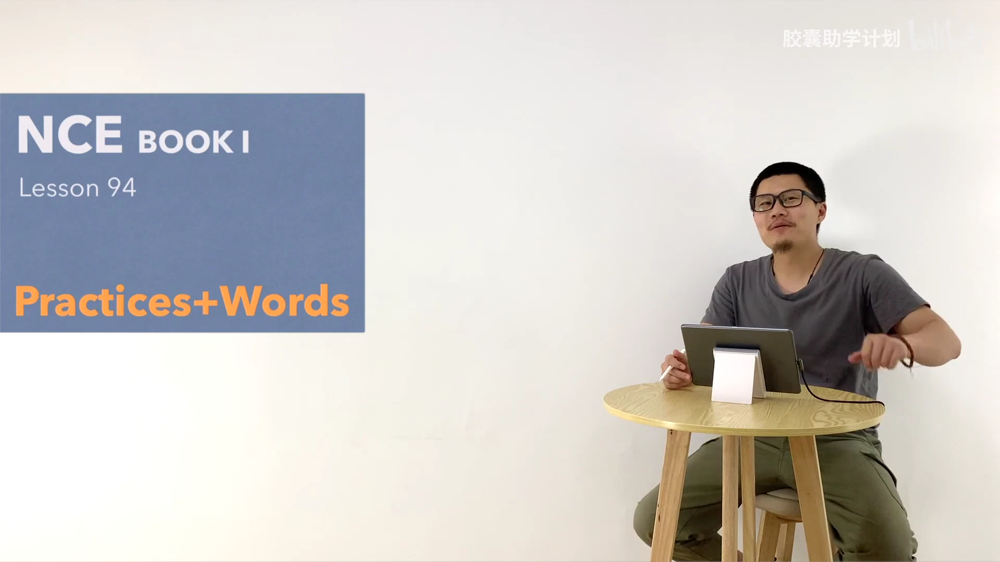

文字识别：胶囊助学计划 / NCE / BOOKI / Lesson 94 / Practices+Words

### 画面 00:00:02

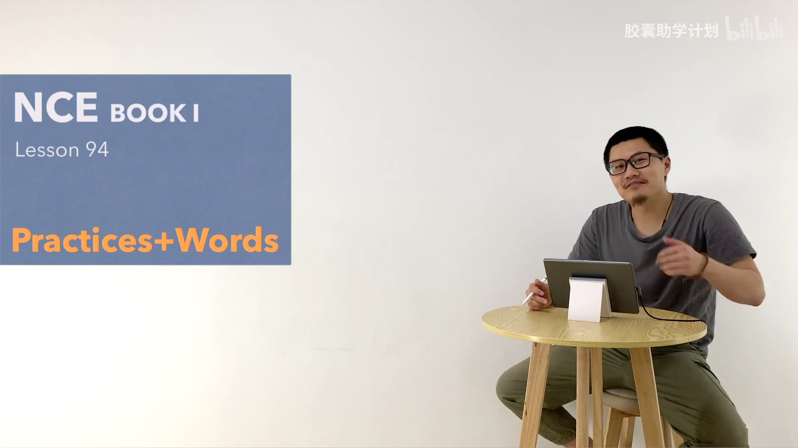

文字识别：胶囊助学计划 / NCE / BOOKI / Lesson 94 / Practices+Words

### 画面 00:00:04

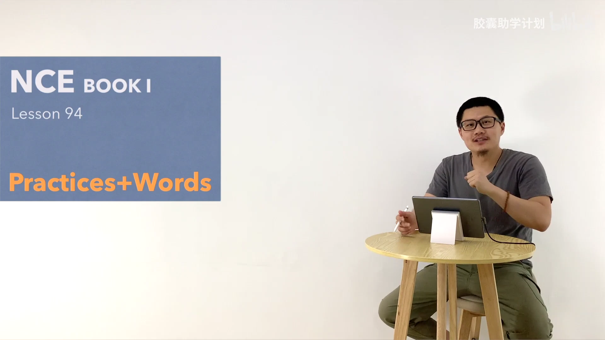

文字识别：胶囊助学计划 / NCE / BOOKI / Lesson 94 / Practices+Words

### 画面 00:00:07

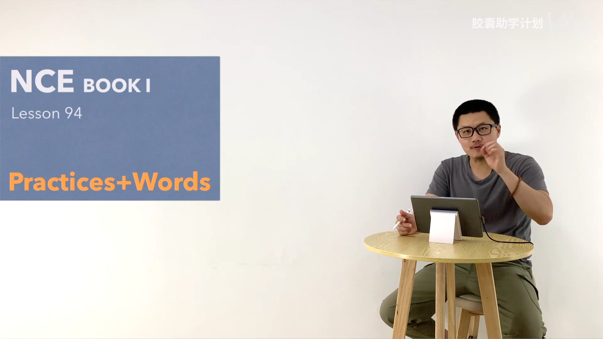

文字识别：胶囊助学计划 / NCE / BOOKI / Lesson 94 / Practices+Words

### 画面 00:00:09

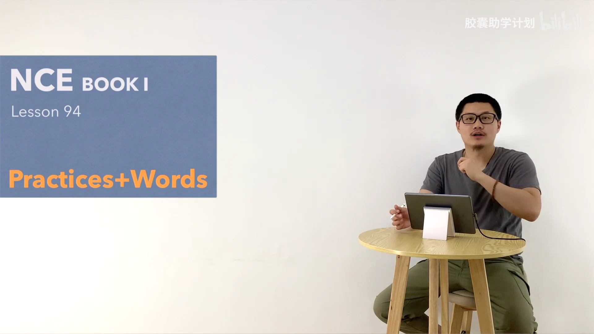

文字识别：胶囊助学计划 / NCE / BOOKI / Lesson 94 / Practices+Words

### 画面 00:00:12

文字识别：胶囊助学计划bill / •

### 画面 00:00:15

文字识别：胶囊助学计划 / 胶囊助学计划

### 画面 00:00:17

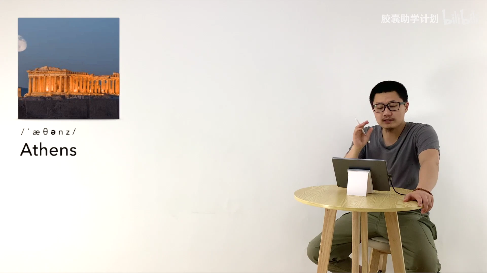

文字识别：胶囊助学计划 / /'æθanz/ / Athens

### 画面 00:00:19

文字识别：胶囊助学计划 / /'æθanz/ / Athens

### 画面 00:00:22

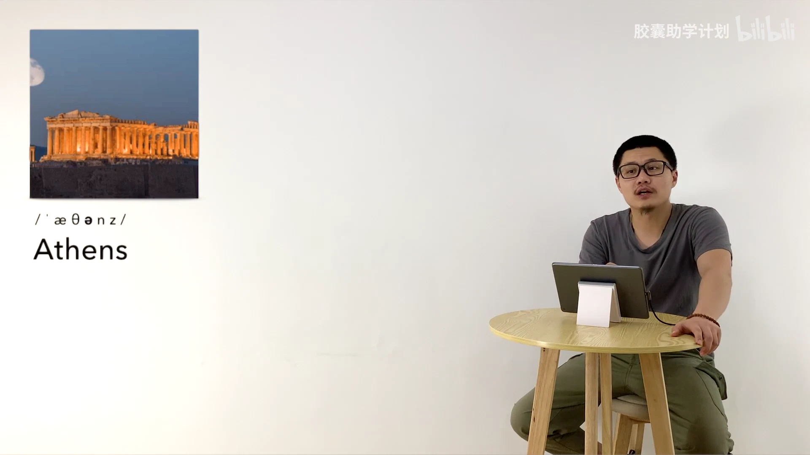

文字识别：胶囊助学计划 / /'æθanz/ / Athens

### 画面 00:00:26

文字识别：胶囊助学计划 / /'æθanz/ / Athens

## 00:00:30–00:01:00

好，我们先看第一个，正好就复习一下音标吧。来，Athens, Athens. OK，雅典啊，连起来读说，Will you go to Athens next week? No, I shan't go to Athens next week.好，如果各位认真听了我们的那个语法单项课，那您就很清楚，shan't其实就是 shall加not，以及

### 画面 00:00:38

文字识别：Bilbili / 胶囊助学计划 / /xeθanzl / Athens

### 画面 00:00:40

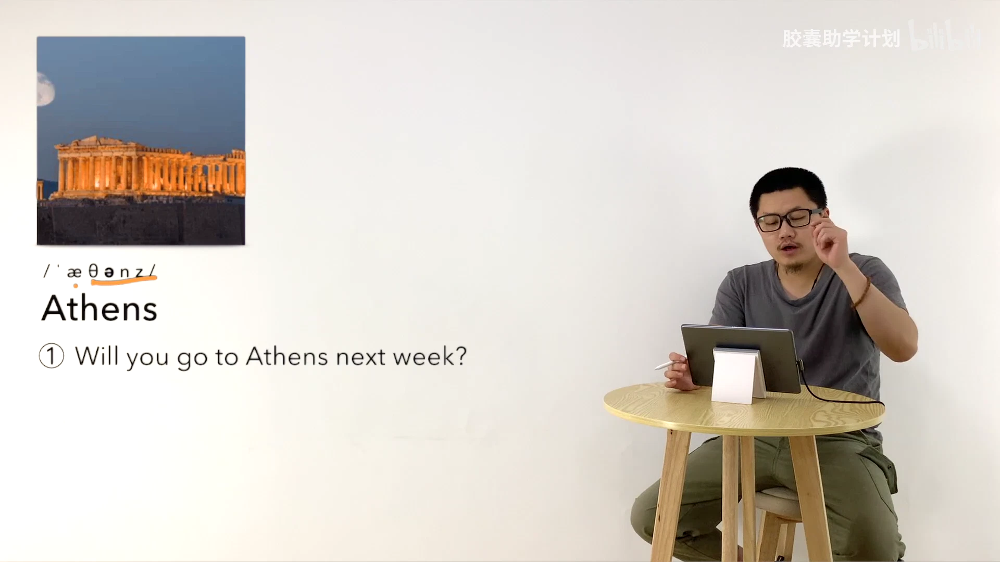

文字识别：胶囊助学计划 / /xeθanzl / Athens / ① Will you go to Athens next week?

### 画面 00:00:47

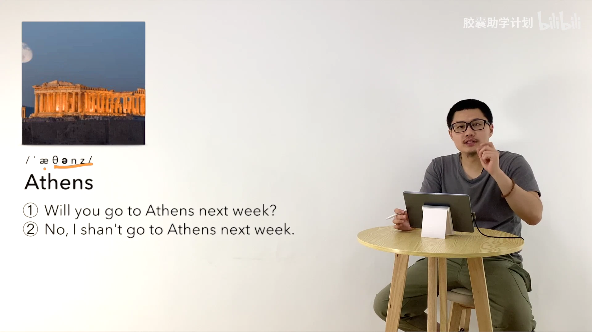

文字识别：胶囊助学计划 / /æθanzl / Athens / ① Will you go to Athens next week? /  No, I shan't go to Athens next week. / 2

### 画面 00:00:50

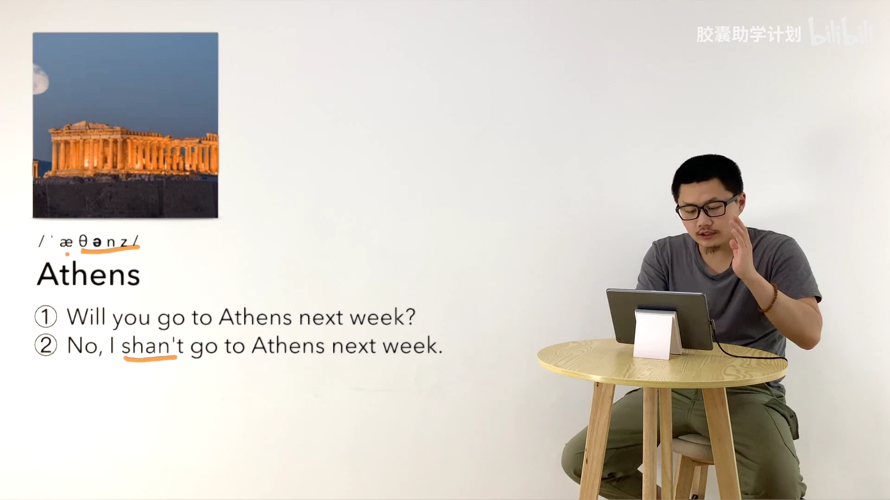

文字识别：胶囊助学计划 / /xeθanzl / Athens /  Willyou go to Athens next week? /  No, I shan't go to Athens next week. / 2

### 画面 00:00:56

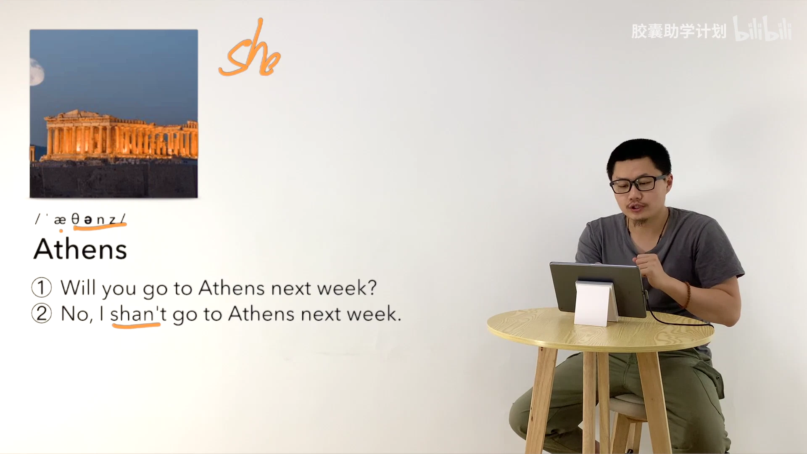

文字识别：胶囊助学计划 / /xθanzl / Athens /  Will you go to Athens next week? / No, I shan't go to Athens next week. / 2

### 画面 00:00:58

文字识别：Shal fno / 胶囊助学计划 / /eθanzl / Athens / Will you go to Athens next week? / No, I shan't go to Athens next week.

## 00:01:00–00:01:30

什么时候用 shall 呢？主语是 I 或者 we 的时候，当然了，对于各位来说，您全用 will 就可以了。看到知道它是 shall 跟 will 是一码事儿就可以了。您主动去用的时候，全用 will 就可以。OK，好，来继续跟我读。I shall go to Beijing. Next one, Berlin. OK，啊，那怎么说柏林对吧？来，Will you go? Will you and Jane fly to

### 画面 00:01:00

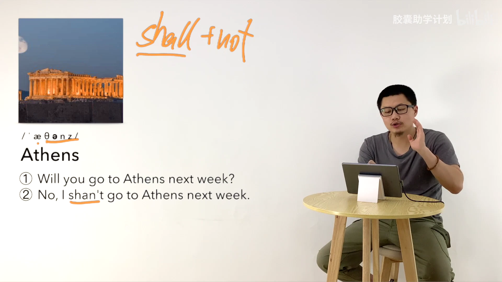

文字识别：Shal fuot / 胶囊助学计划 / /eθanzl / Athens / Willyou go to Athens next week? / No, I shan't go to Athens next week.

### 画面 00:01:03

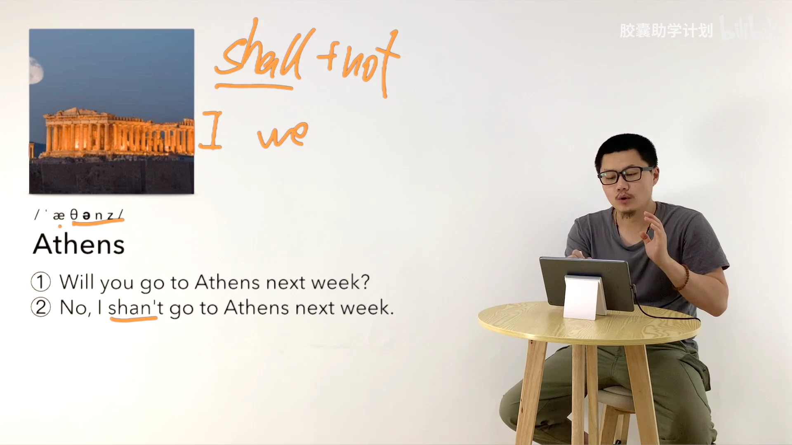

文字识别：hal - uot / 胶囊助学计划 / I / we / /eθanzl / Athens / Will you go to Athens next week? / No, I shan't go to Athens next week.

### 画面 00:01:06

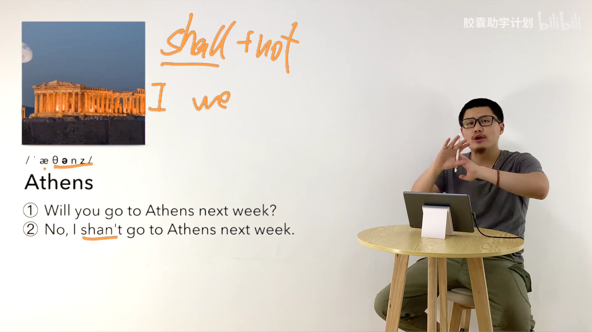

文字识别：Shal - uot / 胶囊助学计划 / I / we / /eθanzl / Athens / Willyou go to Athens next week? / No, I shan't go to Athens next week.

### 画面 00:01:10

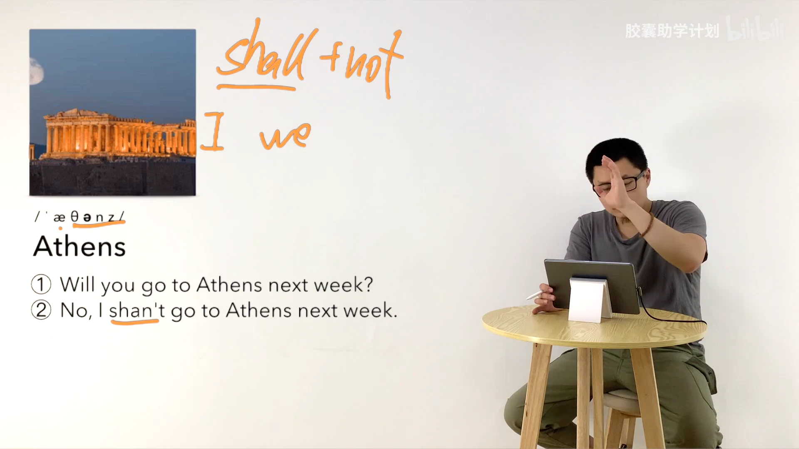

文字识别：shal f uot / 胶囊助学计划 / I / we / /xeθanzl / Athens / Willyou go to Athens next week? / No, I shan't go to Athens next week.

### 画面 00:01:21

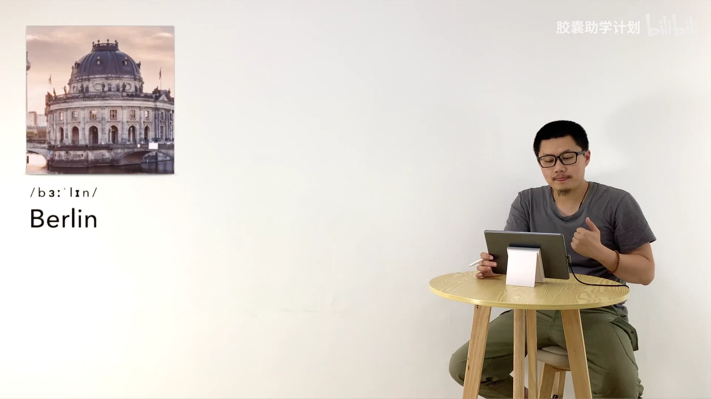

文字识别：胶囊助学计划 / /b3:'lIn/ / Berlin

## 00:01:30–00:02:00

Berlin this week? No, we shall fly to Berlin this week. We shall fly to Athens. Next one, Bombay,孟买. Will Sam leave for Bombay next month?啊，他会离开去这个地方吗？离开去孟买吗？No, he won't leave for Bombay next month. He'll he will leave for Berlin.他会离开去柏林

### 画面 00:01:31

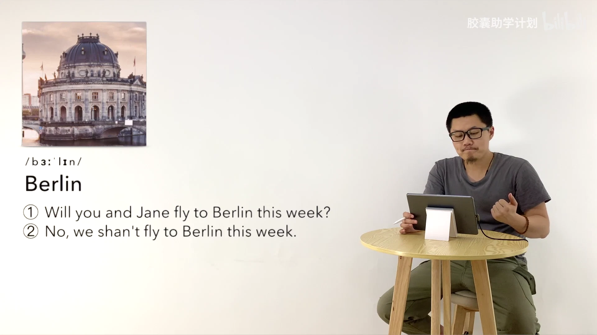

文字识别：胶囊助学计划 / /b3:lIn/ / Berlin / ① Will you and Jane fly to Berlin this week? / ② No, we shan't fly to Berlin this week. / 2)

### 画面 00:01:38

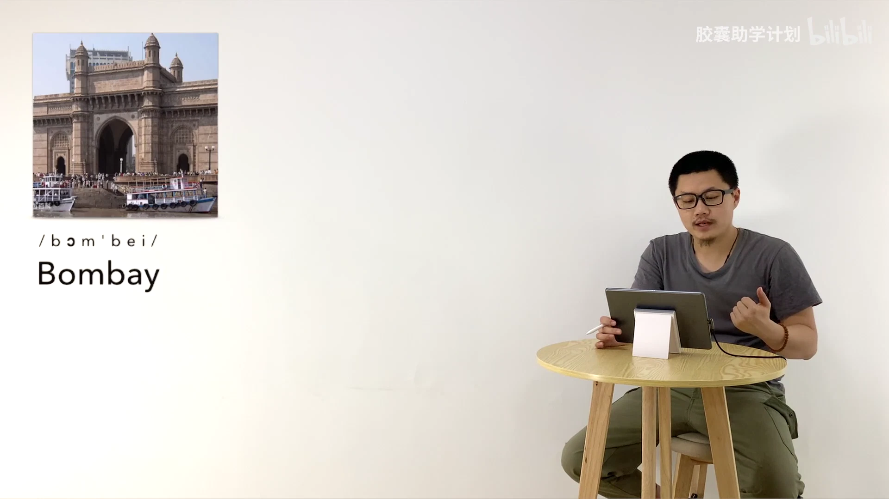

文字识别：胶囊助学计划 / /bom'bei/ / Bombay

### 画面 00:01:50

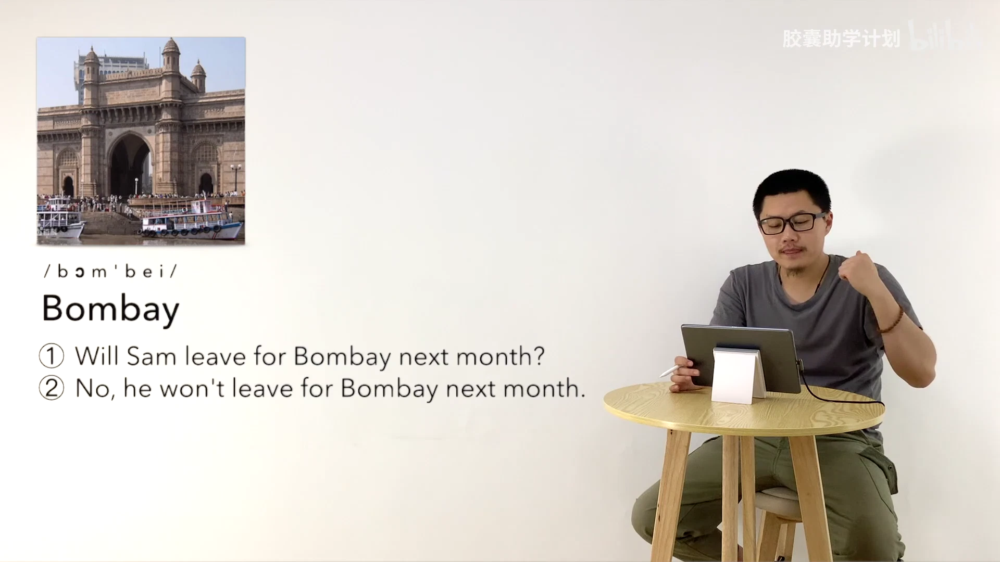

文字识别：胶囊助学计划 / / bom'bei/ / Bombay / Will Sam leave for Bombay next month? / ② No, he won't leave for Bombay next month. / 2

### 画面 00:01:57

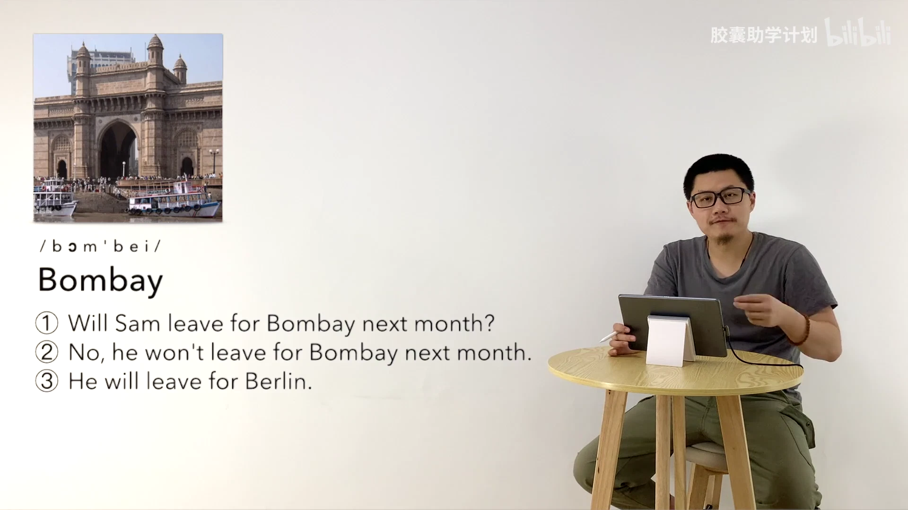

文字识别：胶囊助学计划 / / bom'bei/ / Bombay / Will Sam leave for Bombay next month? /  No, he won't leave for Bombay next month. / 2 / He will leave for Berlin.

## 00:02:00–00:02:30

啊。注意leave for somewhere，离开去某地啊。Geneva，日内瓦。Will Penny return to Geneva next year? No, she won't return to Geneva next year. She will return to Bombay. Swan, London. Will you fly to London next呃tomorrow?啊，你看我们在这练的是

### 画面 00:02:00

文字识别：胶囊助学计划 / /bom'bei/ / Bombay /  Will Sam leave for Bombay next month? /  No, he won't leave for Bombay next month. / 2 / He will leave for Berlin.

### 画面 00:02:04

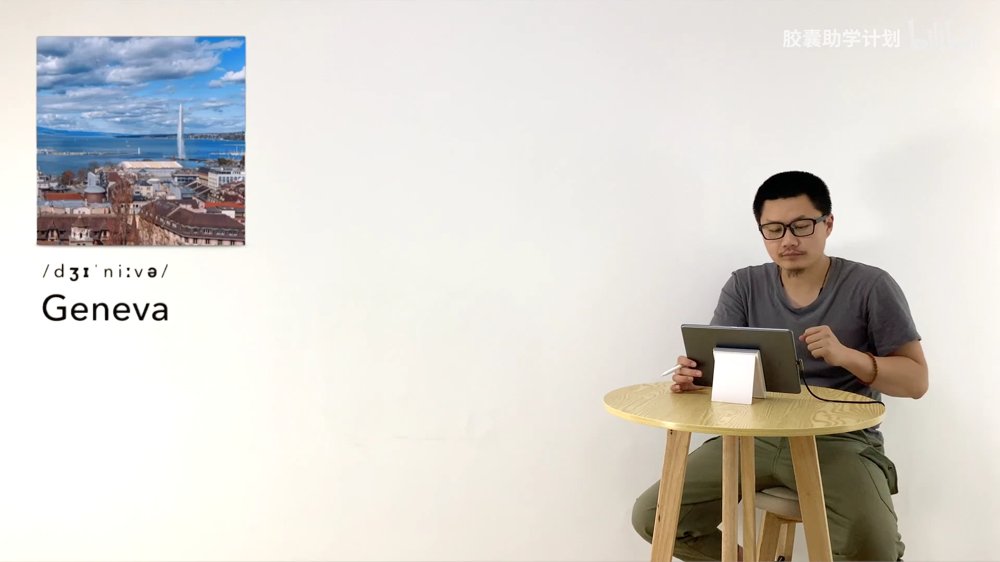

文字识别：胶囊助学计划 / /d3r'ni:va/ / Geneva

### 画面 00:02:07

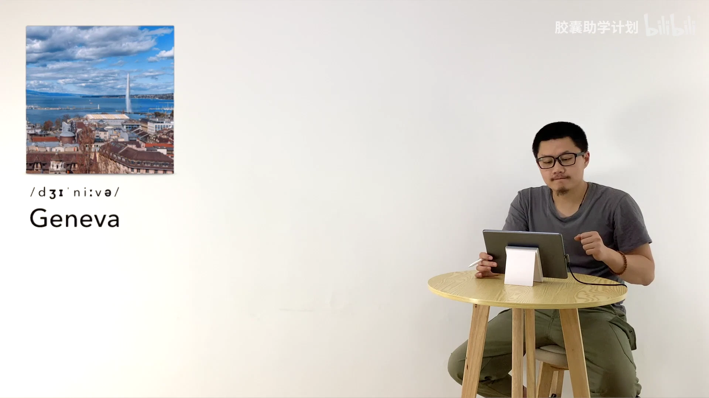

文字识别：胶囊助学计划 / /d3r'ni:va/ / Geneva

### 画面 00:02:13

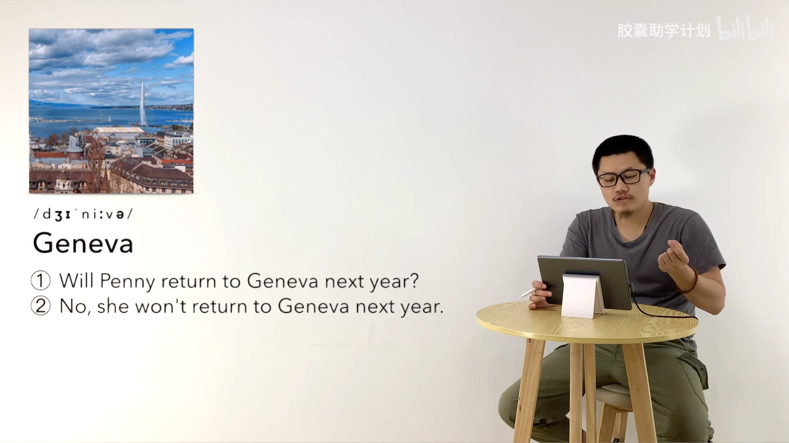

文字识别：胶囊助学计划 / /d3r'ni:va/ / Geneva / Will Penny return to Geneva next year? /  No, she won't return to Geneva next year. / 2

### 画面 00:02:22

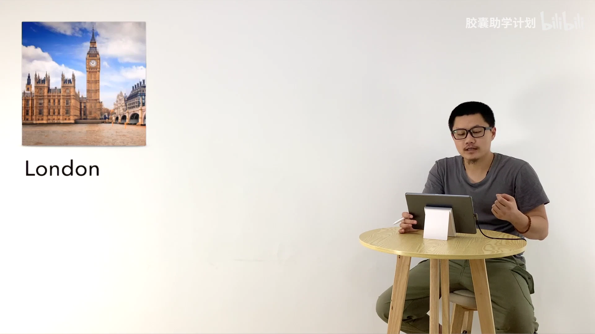

文字识别：胶囊助学计划 / London

### 画面 00:02:26

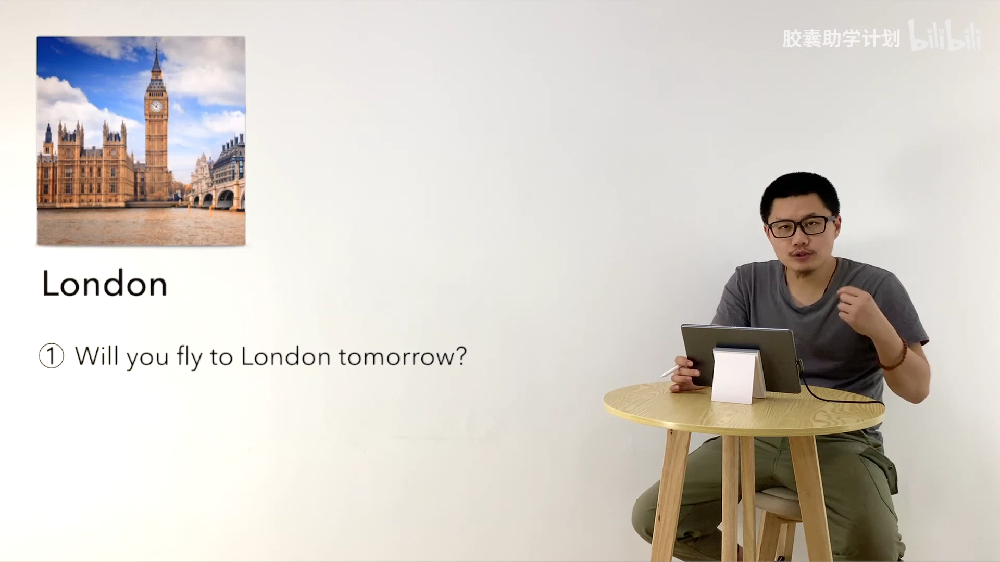

文字识别：胶囊助学计划 / London / ① Will you fly to London tomorrow?

## 00:02:30–00:03:00

will的一般疑问句，对吧？No, I shall't fly to London tomorrow. I shall fly to Geneva. Next one, Madrid. Will you and Tom go to Madrid next year? No, we shall't go to Madrid next year. We shall go to London. Next one, Moscow.莫斯科Will

### 画面 00:02:30

文字识别：bilbi / 胶囊助学计划 / London / ① Will you fly to London tomorrow?

### 画面 00:02:35

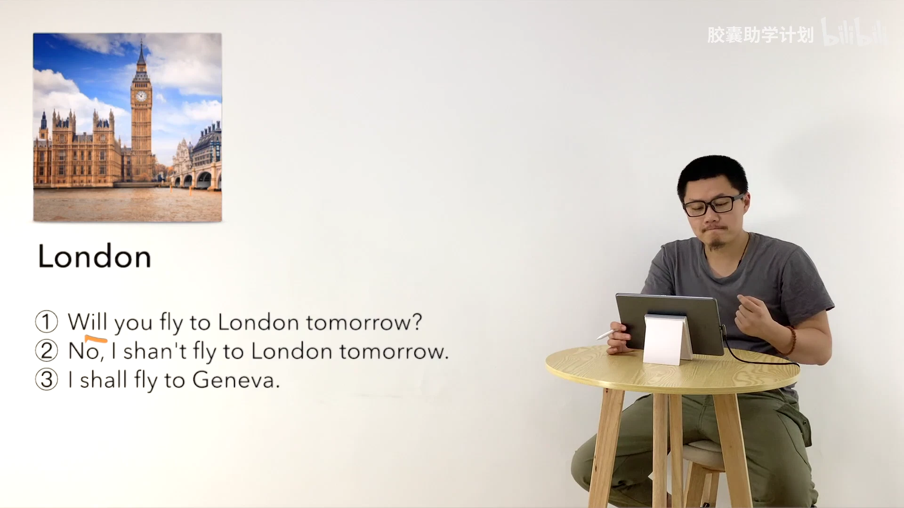

文字识别：胶囊助学计划 / London /  Will you fly to London tomorrow? / ② No, I shan't fly to London tomorrow. /  I shall fly to Geneva.

### 画面 00:02:39

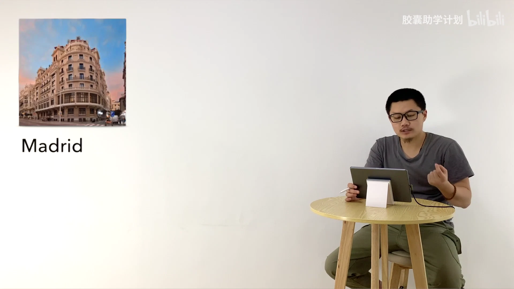

文字识别：胶囊助学计划 / Bibi / Madrid

### 画面 00:02:44

文字识别：胶囊助学计划 / Madrid / ① Will you and Tom go to Madrid next year?

### 画面 00:02:54

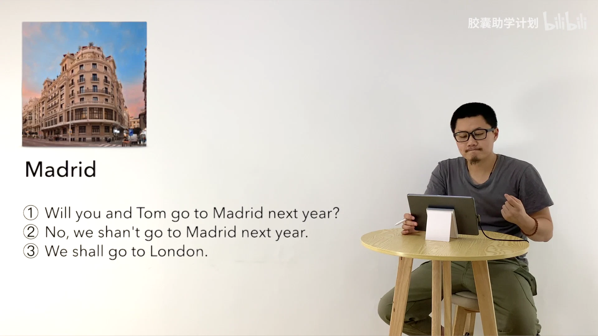

文字识别：胶囊助学计划 / Madrid /  Will you and Tom go to Madrid next year? / 1 / No, we shan't go to Madrid next year. / We shall go to London.

### 画面 00:02:56

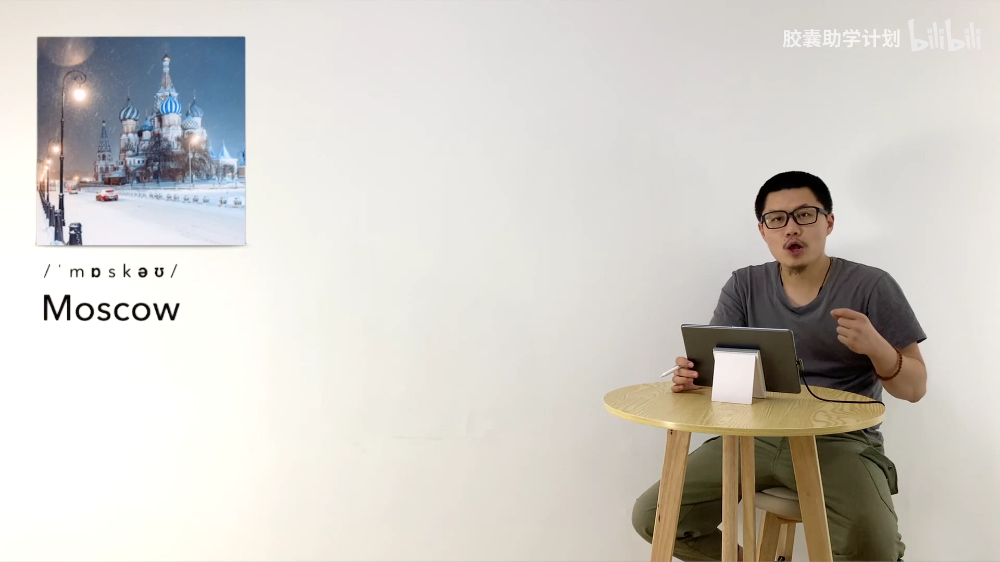

文字识别：Bilbili / 胶囊助学计划 / /'mpskau/ / Moscow

## 00:03:00–00:03:30

Tom arrive from Moscow the week after next? No, he won't arrive from Moscow the week after next. He will arrive from Madrid. Okay, next one. New York. Will Alice and Mary stay in New York next month? No, they won't stay in New York

### 画面 00:03:05

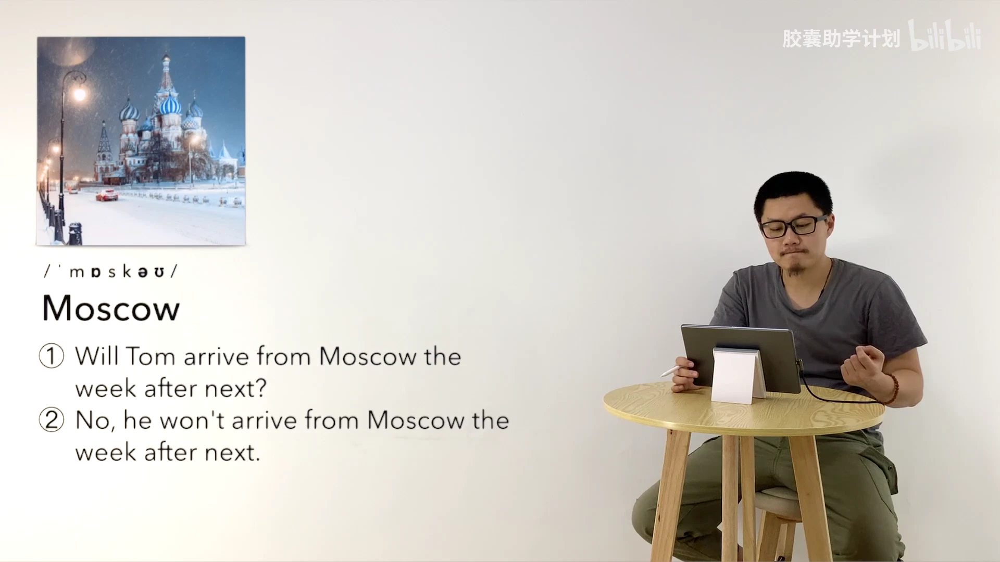

文字识别：Bilbil / 胶囊助学计划 / /'mpskau/ / Moscow / Will Tom arrive from Moscow the / week after next? / No, he won't arrive from Moscow the / week after next.

### 画面 00:03:18

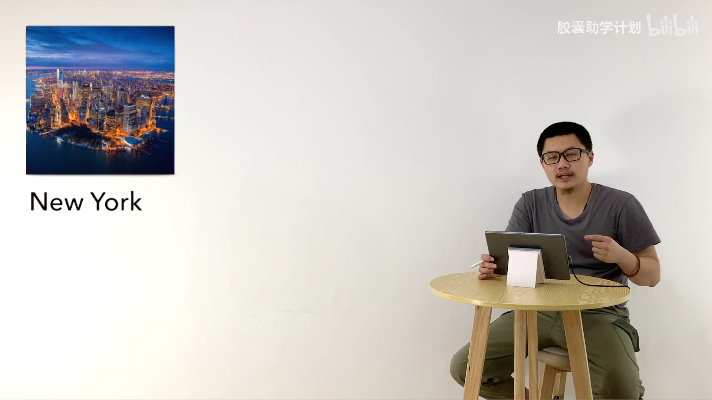

文字识别：bilbili / 胶囊助学计划 / New York

### 画面 00:03:21

文字识别：胶囊助学计划b出b出 / New York /  Will Alice and Mary stay in New York next month?

### 画面 00:03:27

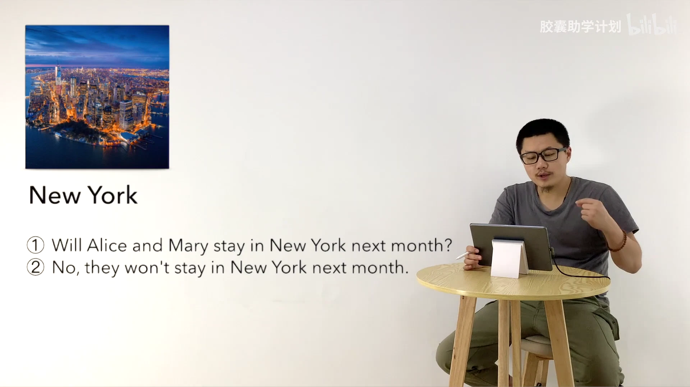

文字识别：胶囊助学计划 / New York / Will Alice and Mary stay in New York next month? / ② No, they won't stay in New York next month.

## 00:03:30–00:04:00

next month. They will stay in Moscow. Next one, Paris. Will you fly to Paris tomorrow? No, I shall't fly to Paris tomorrow. I shall fly to New York. Next one, Rome,罗马. Will Tom and George go to Rome next year?

### 画面 00:03:36

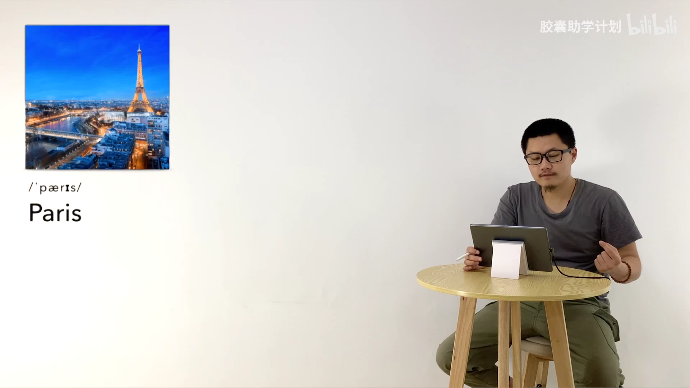

文字识别：胶囊助学计划 / /'pæris/ / Paris

### 画面 00:03:43

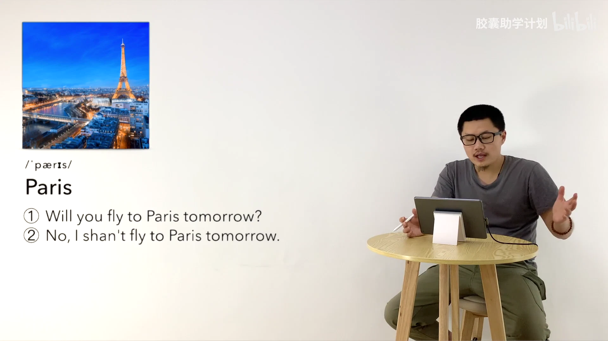

文字识别：胶囊助学计划 / /'pæris/ / Paris / Will you fly to Paris tomorrow? / No, I shan't fly to Paris tomorrow.

### 画面 00:03:48

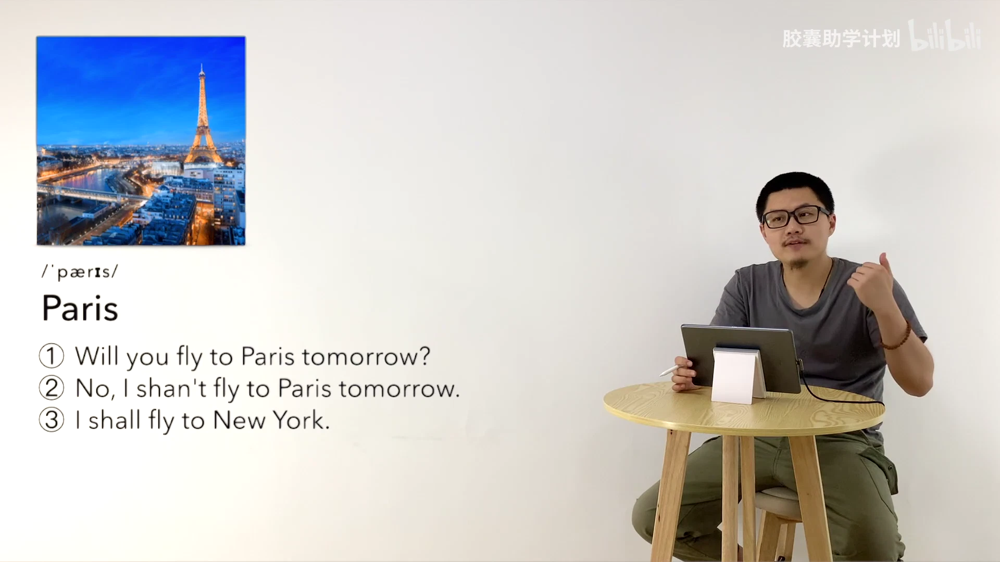

文字识别：胶囊助学计划 / /'pæris/ / Paris / Will you fly to Paris tomorrow? / No, I shan't fly to Paris tomorrow. / I shall fly to New York.

### 画面 00:03:51

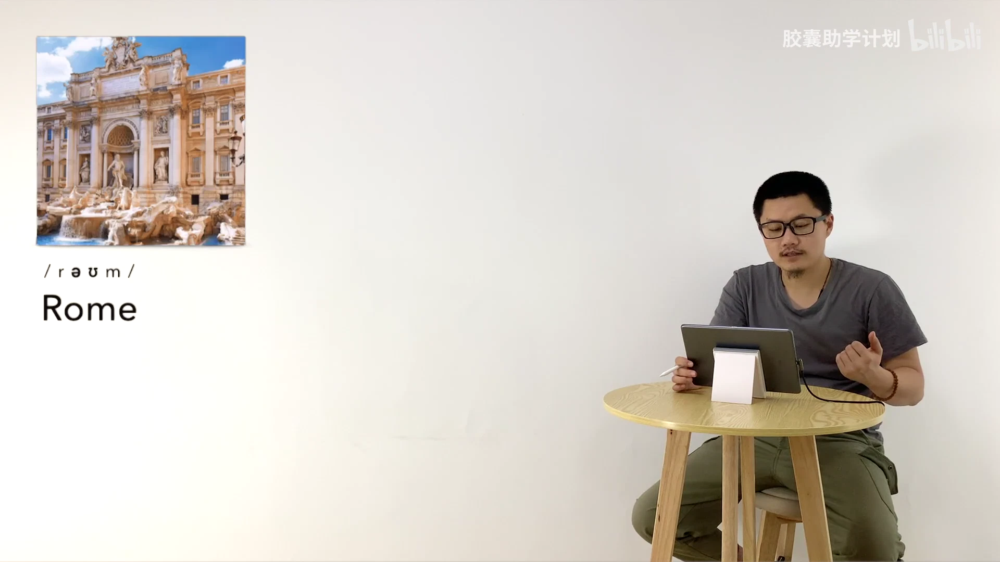

文字识别：胶囊助学计划 / /raum/ / Rome

### 画面 00:03:56

文字识别：胶囊助学计划 / O / /raum/ / Rome /  Will Tom and George go to Rome next year?

## 00:04:00–00:04:30

no, they won't go to Rome next year. They will go to Paris.他们去巴黎，对吧？Okay,那Rome这个单词啊，其实还真的有好几个在英文当中经常啊，这是拉丁语的一个最主要曾经的使用地，是吧？而拉丁语对英文影响非常的深，所以Rome这个单词在英文当中还真的有好几个啊，我们可以理解为是俗语吧，对吧？比如说这句话，When in

### 画面 00:04:00

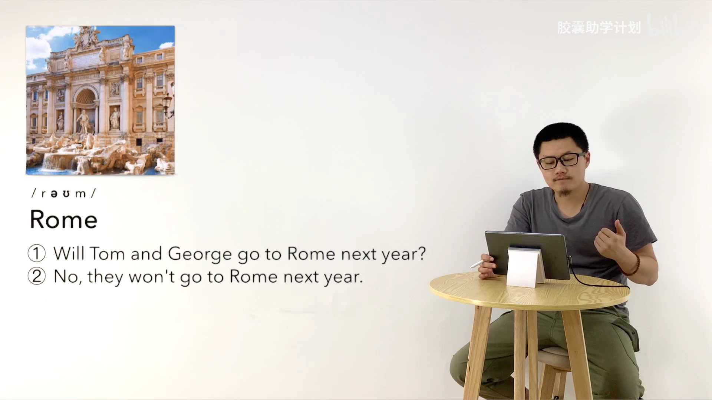

文字识别：胶囊助学计划 / /raum/ / Rome / Will Tom and George go to Rome next year? / ② No, they won't go to Rome next year.

### 画面 00:04:05

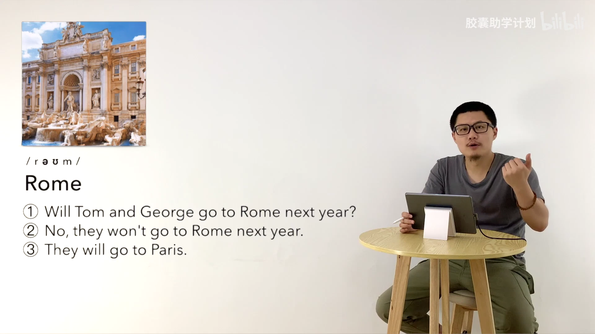

文字识别：胶囊助学计划 / /raum/ / Rome / Will Tom and George go to Rome next year? / No, they won't go to Rome next year. / They will go to Paris.

### 画面 00:04:07

文字识别：snatci / 胶囊助学计划 / When in / Rome, / Do as / the / Romans / Do / NICIODELTORO / DENNIS FARINA / VINNIE JONES BRAD PITT RADE SHERBEDC' / SCREEN / 偷拐抢骗Snatch(2000) / sony.com/snatch / coming

### 画面 00:04:09

文字识别：snatci / 胶囊助学计划 / Whenin / Rome, / Do as / the / Romans / Do / NICIO DEL TORO DENNIS FARINA VINNIE JONES BRAD PITT RADE SHERBEDG' / 偷拐抢骗 Snatch(2000) / sony.com/snatch / coming

### 画面 00:04:11

文字识别：snatci / 胶囊助学计划 / When in / Rome, / Do as / the / Romans / Do / NICIODELTORO / DENNIS FARINA / VINNIE JONES BRAD PITT RADE SHERBEDC' / SCREEN / 偷拐抢骗 Snatch(2000) / sony.com/snatch / coming

### 画面 00:04:16

文字识别：snatci / 胶囊助学计划 / When in / Rome, / Do as / the / Romans / Do / NICIO DEL TORO DENNIS FARINA VINNIE JONES BRAD PITT RADE SHERBEDG' / SCREEN GEMS / PRESENTS INASSOCIATION / 偷拐抢骗 Snatch(2000) / sony.com/snatch / coming

### 画面 00:04:21

文字识别：snatci / 胶囊助学计划 / When in / Rome, / Do as / the / Romans / Do / NICIODELTORO / DENNIS FARINA / VINNIE JONES BRAD PITT RADE SHERBEDC' / SCREEN / 偷拐抢骗 Snatch(2000) / sony.com/snatch / coming

### 画面 00:04:27

文字识别：snatci / 胶囊助学计划 / When in / Rome, / Do as / the / Romans / Do / NICIODELTORO / DENNISFARINA / VINNIE JONES BRAD PITT RADE SHERBEDC' / SCREEN GEMS / PRESENISINASSOCIATIO / 偷拐抢骗Snatch(2000) / sony.com/snatch / coming

### 画面 00:04:29

文字识别：snatci / 胶囊助学计划 / When in / Rome, / Do as / the / Romans / Do / NICIODEL TORO DENNIS FARINA / VINNIE JONES BRAD PITT RADE SHERBEDC' / SCREEN GEMS / PRESENTS INASSOCIATION / 偷拐抢骗 Snatch(2000) / sony.com/snatch / coming

## 00:04:30–00:05:00

Rome, do as the Romans do.啊，说当你在罗马的时候啊，就像罗马人那样去做啊。翻译成汉语就四个字儿，入乡随俗。OK，好，那接下来我们看一个小电影片段，他就用到了叫做When in Rome。当然，他用的不是全句，他不是用的When in Rome, do as the Romans do。他用的是When in Rome。OK，注意力集中。Slow down, Frankie, my son. When in Rome, I am not

### 画面 00:04:32

文字识别：snatci / 胶囊助学计划 / When in / Rome, / Do as / the / Romans / Do / NICIODELTORO / DENNISFARINA / VINNIE JONES BRAD PITT RADE SHERBEDC' / SCREEN GEMS / PRESENISINASSOCIATION / 偷拐抢骗 Snatch(2000) / sony.com/snatch / coming

### 画面 00:04:34

文字识别：snatci / 胶囊助学计划 / When in / Rome, / Do as / the / Romans / Do / NICIODELTORO / DENNIS FARINA / VINNIE JONES BRAD PITT RADE SHERBEDC' / 偷拐抢骗Snatch(2000) / sony.com/snatch / coming

### 画面 00:04:37

文字识别：snatci / 胶囊助学计划 / When in / Rome, / Do as / the / Romans / Do / NICIODEL TORO BENNIS FARINA / VINNIE JONES BRAD PITT RADE SHERBEDC' / SCREEN GEMS / PRESENISINASSOCIATION / 偷拐抢骗Snatch(2000) / sony.com/snatch / coming

### 画面 00:04:41

文字识别：snatci / 胶囊助学计划 / When in / Rome, / Do as / the / Romans / Do / NICIODELTORO / DENNISFARINA / VINNIE JONES BRAD PITT RADE SHERBEDC' / SCREEN GEMS / PRESENIS IN ASSOCIATI / 偷拐抢骗 Snatch(2000) / sony.com/snatch / coming

### 画面 00:04:43

文字识别：snatci / 胶囊助学计划 / When in / Rome, / Do as / the / Romans / Do / NICIODEL TORO / DENNISFARINA / VINNIE JONES BRAD PITT RADE SHERBEDC' / SCREEN GEMS / PRESENIS IN ASSOCIATIO / 偷拐抢骗 Snatch(2000) / sony.com/snatch / coming

### 画面 00:04:53

文字识别：snatci / 胶囊助学计划 / When in / Rome, / Do as / the / Romans / Do / NICIODEL TORO / DENNIS FARINA / VINNIE JONES BRAD PITT RADE SHERBEDC' / SCREEN / 偷拐抢骗 Snatch (2000) / sony.com/snatch / coming

### 画面 00:04:55

文字识别：bilibili / 胶囊助学计划 / 耐心点弗兰克入境要随俗 / Slow down, Franky, my son. When in Rome.

### 画面 00:04:57

文字识别：bilibili / 胶囊助学计划 / 耐心点弗兰克入境要随俗 / Slow down, Franky, my son. When in Rome.

### 画面 00:04:59

文字识别：Bilibili / 胶囊助学计划

## 00:05:00–00:05:30

in the room, Doc. I am in a rush. Got to make the cookies. Okay, ah, when in Rome,后半句就不用说了，对吧？当你在罗马的时候，别人就明白了，其实你想说的是入乡随俗。Okay,好，呃，recap，接下这一课基本上我们就是练在will，当然了，又出来了一个小单词叫shall啊，我们在语法单项的部分讲的已经很清楚了，我们就不再多说了。然后呢，多给大家补了一个小的习惯用法，叫

### 画面 00:05:01

文字识别：LIIOVIIZ / Bilbili / 胶囊助学计划 / 我可不管这些 / I am not in Rome, Doug.

### 画面 00:05:03

文字识别：TOVIZ / Bilibili / 胶囊助学计划 / 我很急 / I am in a rush.

### 画面 00:05:05

文字识别：TIOVIIZ / Bilbili / 胶囊助学计划 / 我要去赌场 / I got to make the bookies.

### 画面 00:05:07

文字识别：snatci / 胶囊助学计划 / When in / Rome, / Do as / the / Romans / Do / NICIO DEL TORO DENNIS FARINA / VINNIE JONES BRAD PITT RADE SHERBEDC' / PRESENIS INASSOCIATION / 偷拐抢骗 Snatch (2000) / sony.com/snatch / coming

### 画面 00:05:13

文字识别：snatci / 胶囊助学计划 / When in / Rome, / Do as / the / Romans / Do / NICIODEL TORO DENNIS FARINA / VINNIE JONES BRAD PITT RADE SHERBEDC' / 偷拐抢骗 Snatch (2000) / sony.com/snatch / coming

### 画面 00:05:15

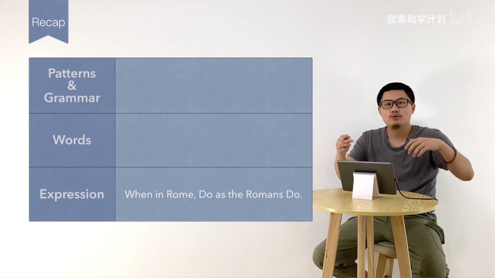

文字识别：胶囊助学计划 / Recap / Patterns / Grammar / Words / Expression / When in Rome, Do as the Romans / Do.

### 画面 00:05:19

文字识别：胶囊助学计划 / Recap / wiu / Patterns / & / Grammar / Words / Expression / When in Rome, Do as the / Romans / Do.

### 画面 00:05:21

文字识别：Bifbili / 胶囊助学计划 / Recap / chaM / wiu / Patterns / Grammar / Words / Expression / When in Rome, Do as the / Romans / Do.

### 画面 00:05:24

文字识别：胶囊助学计划 / Recap / Sho / win / Patterns / Grammar / Words / Expression / When in Rome, Do as / the / Romans / Do.

### 画面 00:05:27

文字识别：胶囊助学计划 / Recap / wiu / Shau / Patterns / Grammar / Words / Expression / When inF / Rome, Do as the Romans / Do.

## 00:05:30–00:06:00

做入乡随俗，对吧？OK，那家庭作业九十四课绿皮书各位可以写了啊。这个文章跟读至熟读成诵啊，就应该是没有这个作业了，对吧？我们这课是没有这个文章熟读成诵了。然后给自己讲解一遍今天的核心知识点。OK，那如果大家喜欢我们的课程呢，欢迎大家关注、订阅、一键三连，分享给那些需要的朋友。最后我们再来看一句，呃，这不能叫名人名言了啊。最后我们再来看一句俗话，说的

### 画面 00:05:32

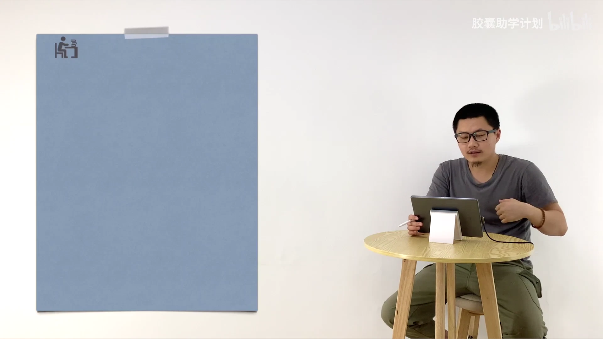

文字识别：胶囊助学计划

### 画面 00:05:40

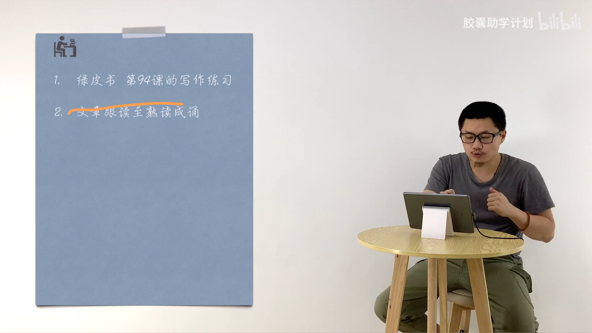

文字识别：胶囊助学计划 / 绿皮书第94课的写作练习 / 文章跟读至熟读成诵

### 画面 00:05:47

文字识别：胶囊助学计划

### 画面 00:05:50

文字识别：胶囊助学计划

### 画面 00:05:54

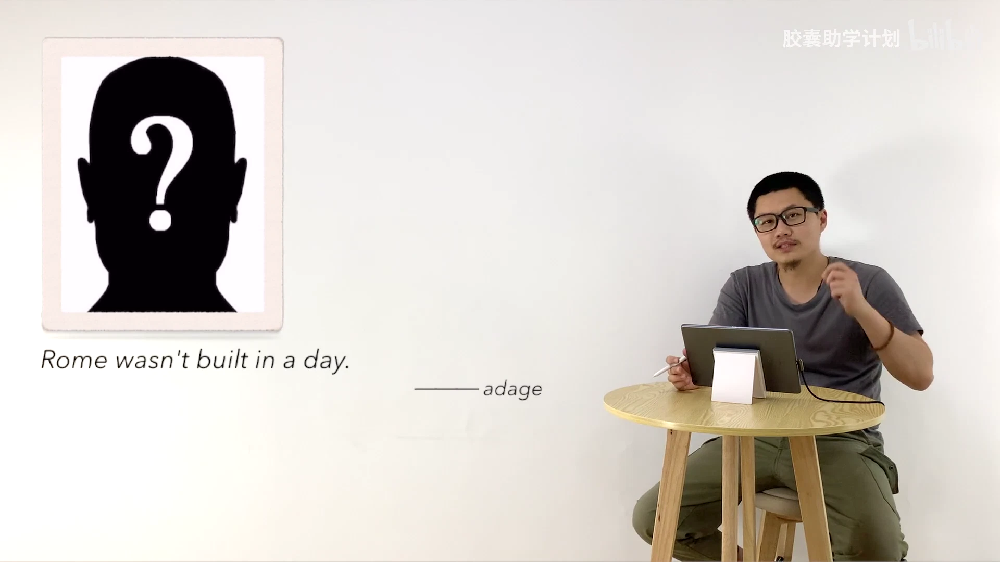

文字识别：胶囊助学计划 / Rome wasn't built in a day. / -adage

## 00:06:00–00:06:23

好啊，叫做“Rome wasn't built in a day”。那它是什么意思呢？交给各位了，各位自己尝试去想一下。See you next time.

### 画面 00:06:03

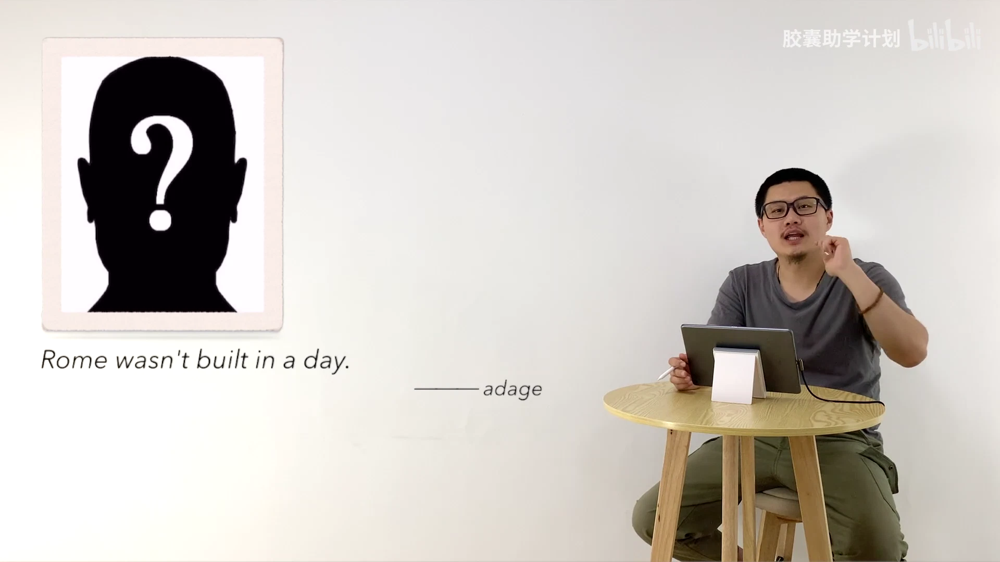

文字识别：胶囊助学计划 / Rome wasn't built in a day. / -adage

### 画面 00:06:10

文字识别：胶囊助学计划 / ? / Rome wasn't built in a day. / -adage

### 画面 00:06:12

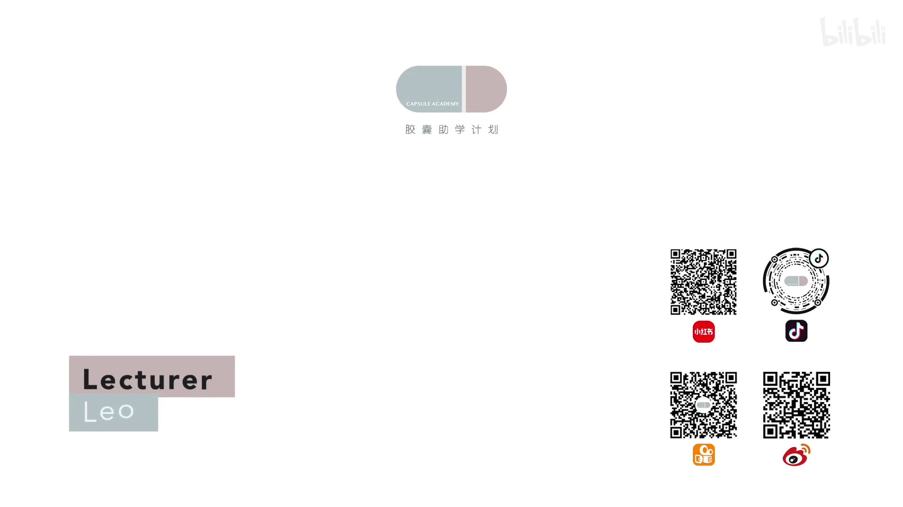

文字识别：CAPSULEACADEMY / 胶囊助学计划 / 小红书 / Lecturer / 口 / Leo / OE

### 画面 00:06:15

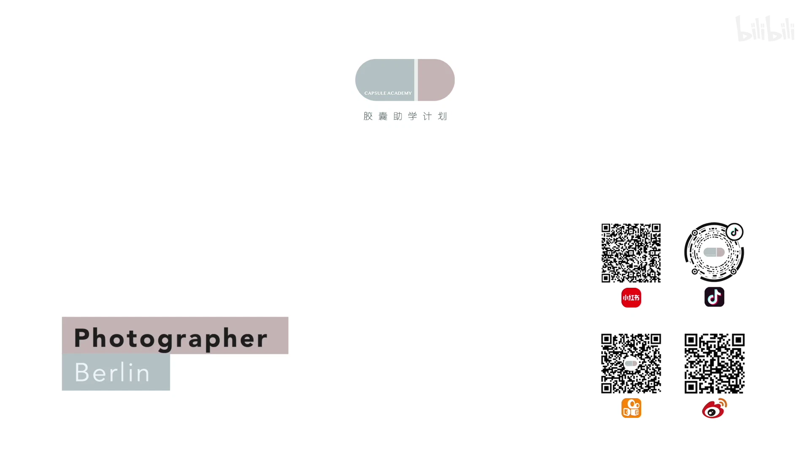

文字识别：CAPSULEACADEMY / 胶囊助学计划 / 『 / 小红书 / Photographer / Berlin / OE

### 画面 00:06:17

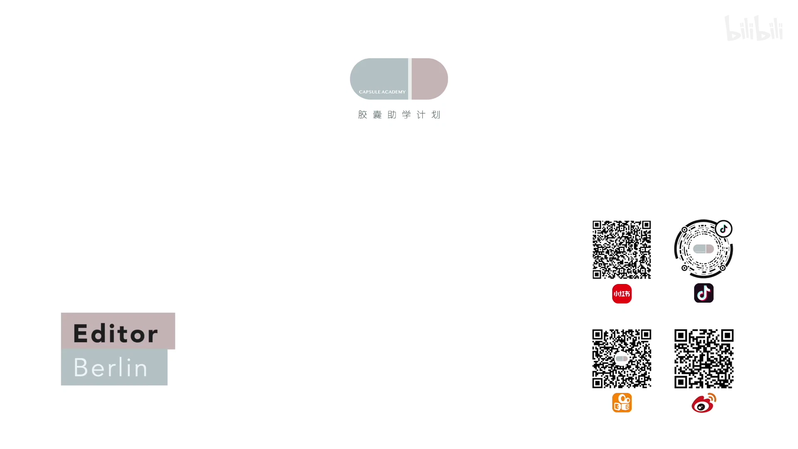

文字识别：CAPSULEACADEMY / 胶囊助学计划 / 『 / 小红书 / Editor / □ / 口 / Berlin / OE

### 画面 00:06:20

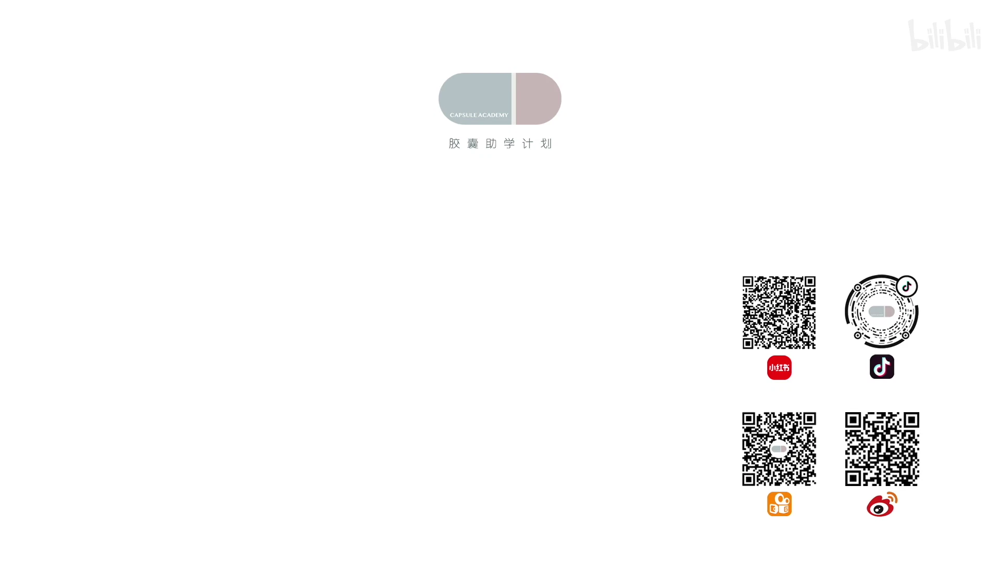

文字识别：CAPSULEACADEMY / 胶囊助学计划 / 小红书 / OE

### 画面 00:06:22

文字识别：bilibili / 胶囊助学计划

