# 095 文章

快速机器解析：语音为单模型转写，未进行独立交叉校对或人工复核；画面每秒采样并按变化选帧，短时文字和标记可能遗漏。截图时间约有 1 秒误差。图片有损压缩；遇到疑点请按时间查看 Google Drive 原视频。

## 00:00:00–00:00:30

Hello everyone, welcome to Capsule Academy. This is Leo. Today we're going to learn New Concept English Book One Lesson Ninety Five Story. Hope you gonna enjoy it.好，我们直接看两个人对话是吧？呃，一个人来买票，另一个人是售票员啊。然后他说，Two return tickets to London，两张往返的票去伦敦啊。To London啊，比如 go to London 去

### 画面 00:00:00

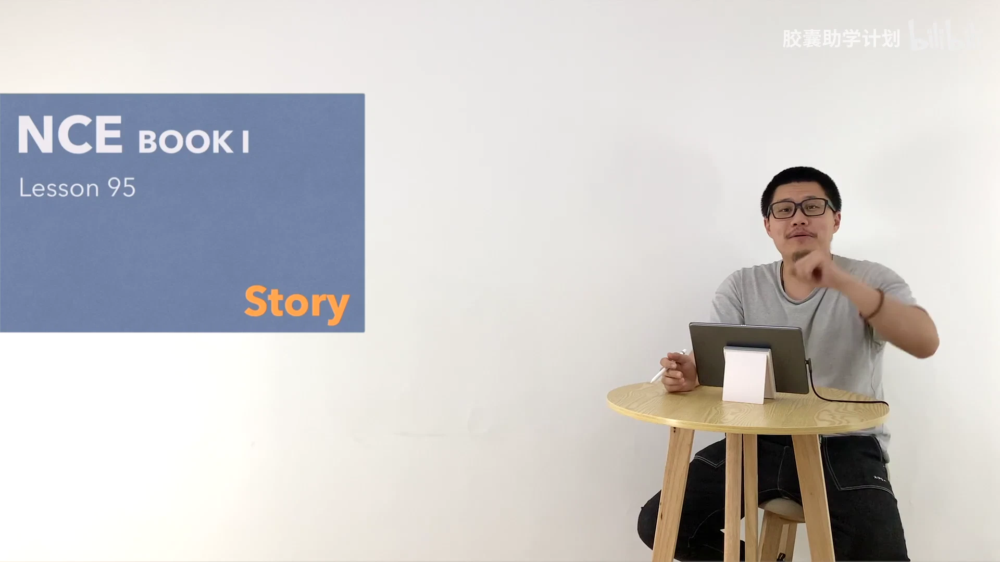

文字识别：胶囊助学计划 / NCE / BOOKI / Lesson 95 / Story

### 画面 00:00:02

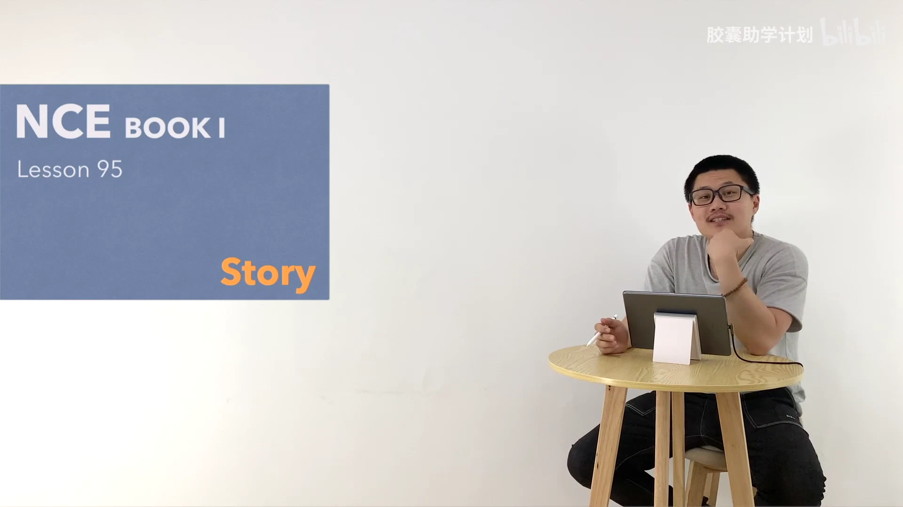

文字识别：胶囊助学计划 / NCE / BOOKI / Lesson 95 / Story

### 画面 00:00:10

文字识别：胶囊助学计划b出出 / •

### 画面 00:00:13

文字识别：胶囊助学计划 / 胶囊助学计划

### 画面 00:00:15

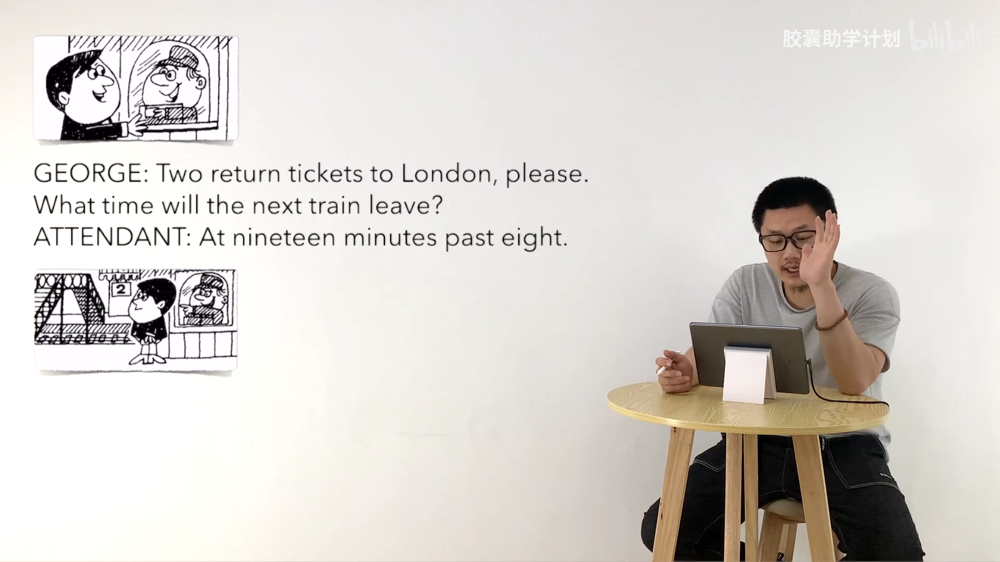

文字识别：胶囊助学计划 / GEORGE: Two return tickets to London, please. / What time will the next train leave? / ATTENDANT: At nineteen minutes past eight. / 2

### 画面 00:00:18

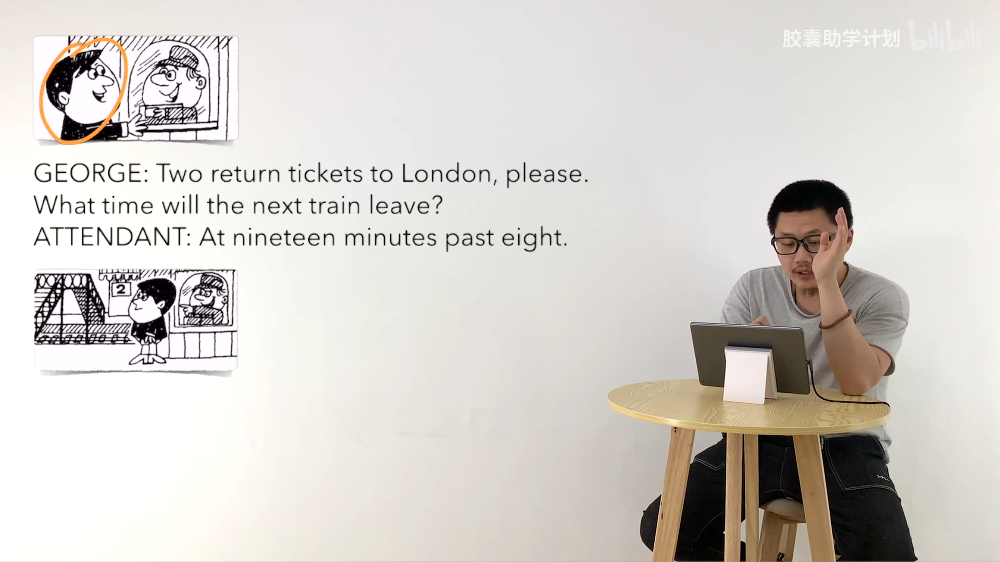

文字识别：胶囊助学计划 / GEORGE: Two return tickets to London, please. / What time will the next train leave? / ATTENDANT: At nineteen minutes past eight.

### 画面 00:00:25

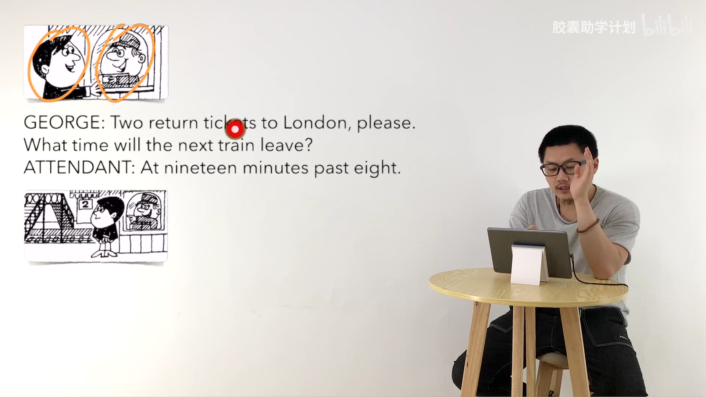

文字识别：胶囊助学计划 / GEORGE: Two return ticlots to London, please. / What time will the next train leave? / ATTENDANT: At nineteen minutes past eight.

## 00:00:30–00:01:00

去伦敦，对吧？哎，两张去伦敦的往返票，多谢了。What time? What time? 和 when 的差别在口语当中几乎不太大，各位放心去替换着用。只不过相对来说，what time 更偏向于具体问的是几点钟，而 when 的回答可以是什么周一周二周三是吧？下个月一号这样的一些说法。Will the next train leave? 下一趟火车

### 画面 00:00:55

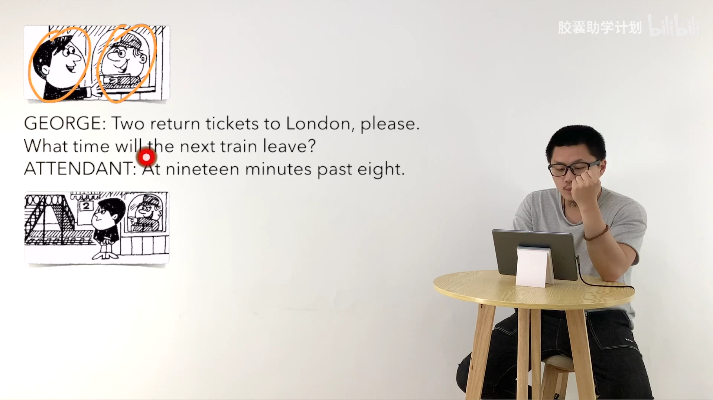

文字识别：胶囊助学计划 / GEORGE: Two return tickets to London, please. / What time will the next train leave? / ATTENDANT: At nineteen minutes past eight.

## 00:01:00–00:01:30

next 下一个对吧？Leave 离开。下一趟火车离开的时间是什么呢？看他说 at nineteen minutes past eight past 过八点过十九分钟，八点十九. Continue which platform 哪个站台呢？Attendant 他说 platform two 啊，他说二站台 over the bridge 跨越桥，在桥的对面对吧？你要跨过

### 画面 00:01:16

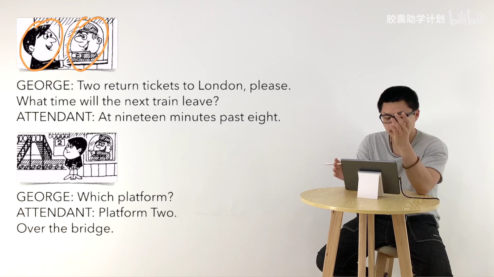

文字识别：胶囊助学计划 / GEORGE: Two return tickets to London, please. / What time will the next train leave? / ATTENDANT: At nineteen minutes past eight. / GEORGE: Which platform? / ATTENDANT: Platform Two. / Over the bridge.

### 画面 00:01:20

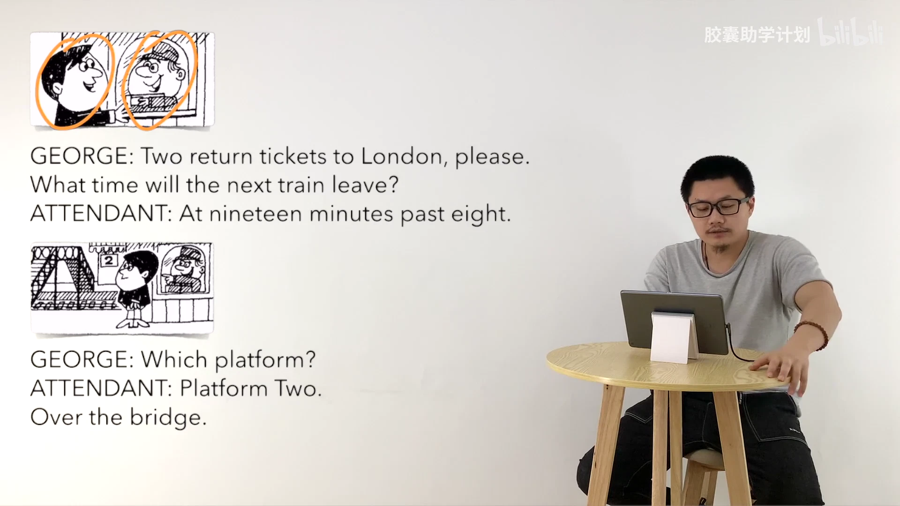

文字识别：胶囊助学计划 / GEORGE: Two return tickets to London, please. / What time will the next train leave? / ATTENDANT: At nineteen minutes past eight. / GEORGE: Which platform? / ATTENDANT: Platform Two. / Over the bridge.

### 画面 00:01:27

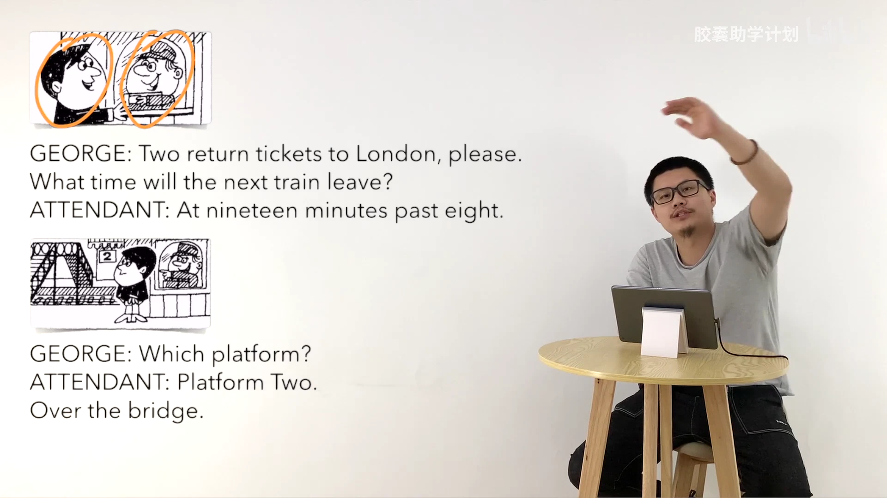

文字识别：胶囊助学计划 / GEORGE: Two return tickets to London, please. / What time will the next train leave? / ATTENDANT: At nineteen minutes past eight. / GEORGE: Which platform? / ATTENDANT: Platform Two. / Over the bridge. / 2

## 00:01:30–00:02:00

桥。OK，这个其实 over the bridge 和我们三十五课学的那个 over 的含义是保持一致的，基本上啊，跨过。Continuing. 哎，你看他买完票回来了，和他好朋友说话，俩人聊天啊。现在是看一下时间，差五分八点，应该是八点十九开车。Ken 说，What time will the next train leave? 下一趟火车什么时间离开呢？George 说，At eight nineteen. 啊，在八点十九。然后 Ken，

### 画面 00:01:30

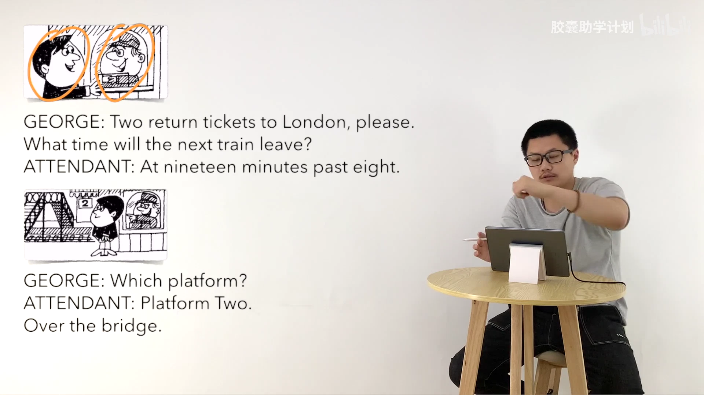

文字识别：胶囊助学计划 / GEORGE: Two return tickets to London, please. / What time will the next train leave? / ATTENDANT: At nineteen minutes past eight. / GEORGE: Which platform? / ATTENDANT: Platform Two. / Over the bridge.

### 画面 00:01:38

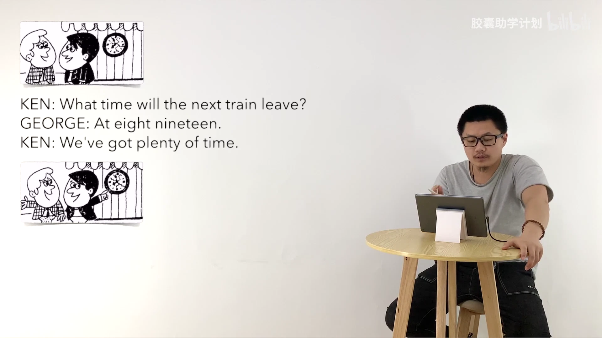

文字识别：胶囊助学计划 / KEN: What time will the next train leave? / GEORGE: At eight nineteen. / KEN: We've got plenty of time.

## 00:02:00–00:02:30

你注意，你看这个时候他其实只剩十九加五分钟，我们理解为就二十四分钟，对吧？然后他竟然说了一句话，说 We've got plenty of money，我们拥有足够多的时间，也不知道他怎么算出来的是吧？然后两个人提了个亿啊啊，还不是八差五分差三分钟，他说 It's only three minutes to eight，啊，现在才only才差三分钟八点，咱八点十九开车，对吧？

### 画面 00:02:02

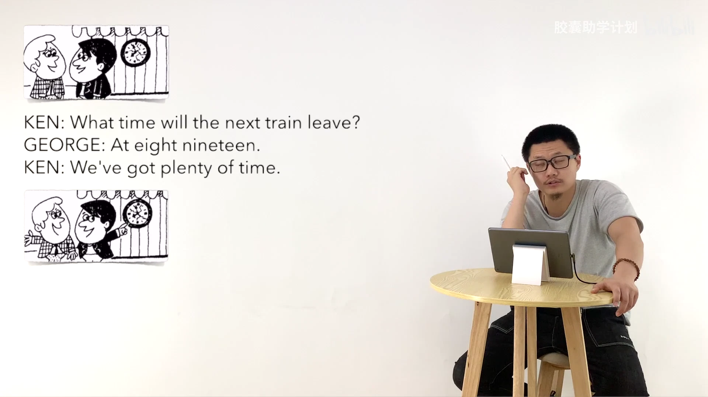

文字识别：KEN: What time will the next train leave? / GEORGE: At eight nineteen. / KEN: We've got plenty of time.

### 画面 00:02:07

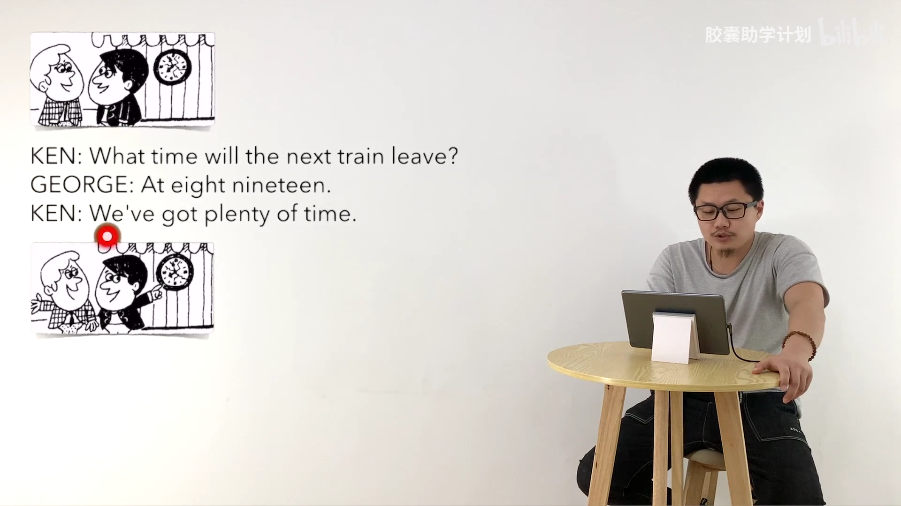

文字识别：胶囊助学计划 / KEN: What time will the next train leave? / GEORGE: At eight nineteen. / KEN: We've got plenty of time.

### 画面 00:02:15

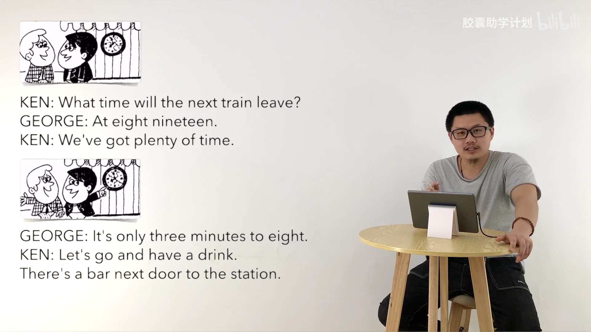

文字识别：胶囊助学计划 / KEN: What time will the next train leave? / GEORGE: At eight nineteen. / KEN: We've got plenty of time. / GEORGE: It's only three minutes to eight. / KEN: Let's go and have a drink. / There's a bar next door to the station.

## 00:02:30–00:03:00

啊，他说时间足够充裕。说Let's go and have a drink。说咱走吧，然后have a drink。八十一课我讲过have a drink。我提到过，当我们英文当中说have a drink的时候，跟北方话当中说啊，咱咱们整整一杯是吧？整一盅啊，这个感觉是一样的。没有人这个时候说整一盅，然后拿出来什么这个各种各样的饮料喝的，对吧？它一定是带酒精的东西。所以have a

### 画面 00:02:40

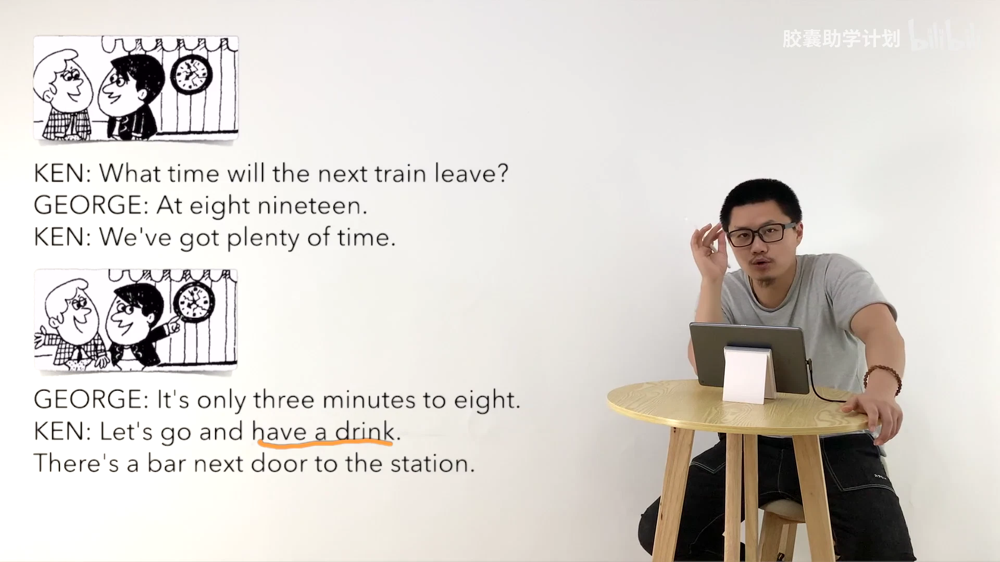

文字识别：胶囊助学计划 / KEN: What time will the next train leave? / GEORGE: At eight nineteen. / KEN: We've got plenty of time. / GEORGE: It's only three minutes to eight. / KEN: Let's go and have a drink. / There's a bar next door to the station.

## 00:03:00–00:03:30

drink 在英文当中一定指的是含有酒精的这类饮品。 Okay, 所以他然后他说 there is a bar，说有这么一个酒吧 next door。 哎，这我们之前学过，叫在隔壁 to the station。 哎，在啊，我们这个火车站的隔壁。 Continue，两个人到酒吧了，两个人开始喝，然后两个人说 we had better go back to the station now. Can 我们

### 画面 00:03:00

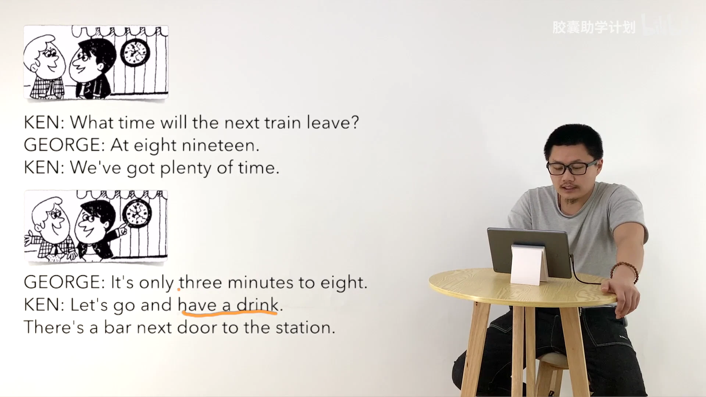

文字识别：胶囊助学计划 / KEN: What time will the next train leave? / GEORGE: At eight nineteen. / KEN: We've got plenty of time. / 八月月用 / GEORGE: It's only three minutes to eight. / KEN: Let's go and have a drink. / There's a bar next door to the station.

### 画面 00:03:02

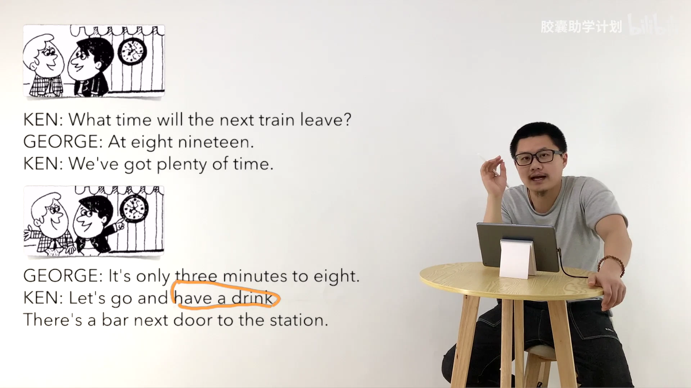

文字识别：胶囊助学计划 / KEN: What time will the next train leave? / GEORGE: At eight nineteen. / KEN: We've got plenty of time. / GEORGE: It's only three minutes to eight. / KEN: Let's go and have a drink / There's a bar next door to the station.

### 画面 00:03:10

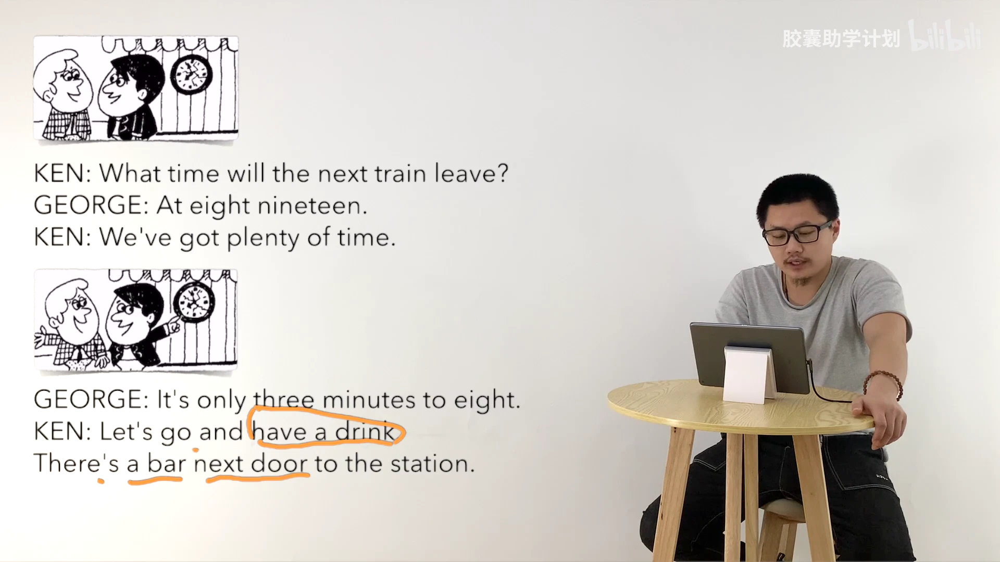

文字识别：胶囊助学计划 / KEN: What time willthe next train leave? / GEORGE: At eight nineteen. / KEN: We've got plenty of time. / GEORGE: It's only three minutes to eight. / KEN: Let's go and have a drink / There's a bar next door to the station.

### 画面 00:03:13

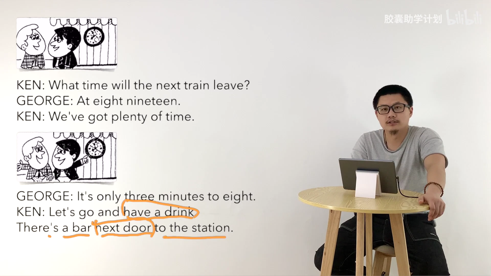

文字识别：胶囊助学计划 / KEN: What time will the next train leave? / GEORGE: At eight nineteen. / KEN: We've got plenty of time. / GEORGE: It's only three minutes to eight. / KEN: Let's go and have a drink / There's a bar fext doorto the station.

### 画面 00:03:19

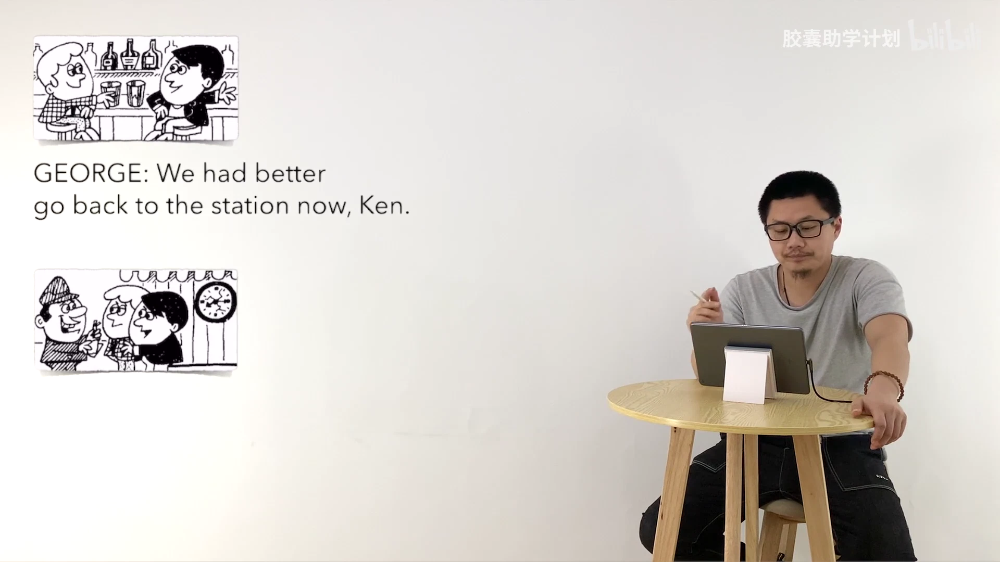

文字识别：胶囊助学计划 / GEORGE: We had better / go back to the station now, Ken.

### 画面 00:03:25

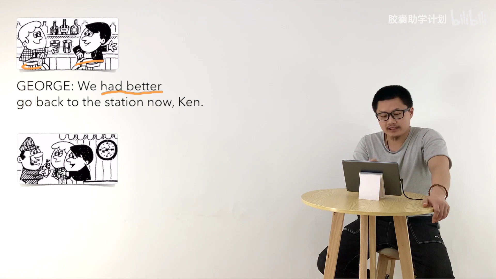

文字识别：胶囊助学计划 / GEORGE: We had better / go back to the station now, Ken.

## 00:03:30–00:04:00

最好go to the station叫去车站, back to the station就是我们要回到车站。为什么用back呢？因为你从车站去的酒吧，从酒吧再回到刚才那个地方，所以叫go back to. Okay,我们最好还是回去吧。喝了一会儿，那为那你看这个地方用had better是指的是当下两个人的对话。首先不表过去，其次他为什么用had better呢？

### 画面 00:03:32

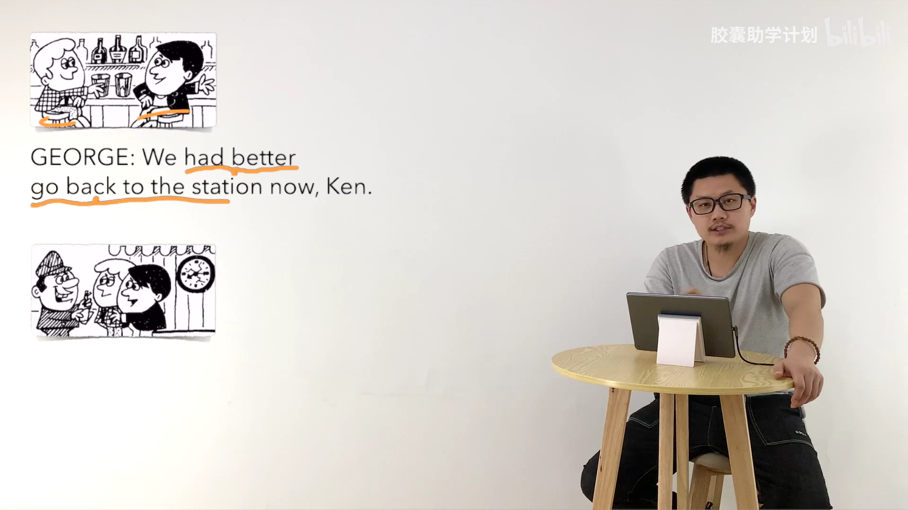

文字识别：胶囊助学计划 / GEORGE: We had better / go back to the station now, Ken.

### 画面 00:03:49

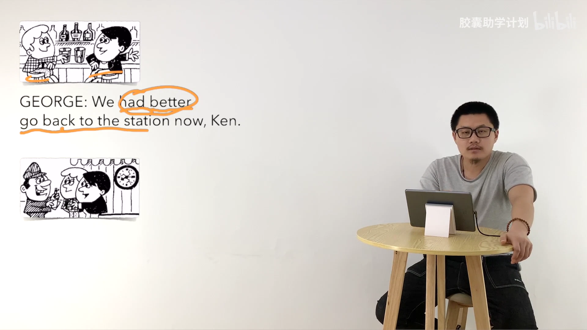

文字识别：胶囊助学计划 / GEORGE: We / dad better / go back to the station now, Ken.

### 画面 00:03:51

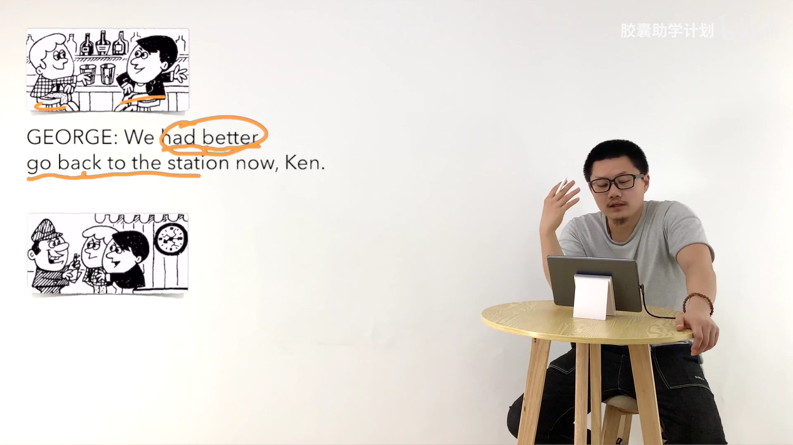

文字识别：胶囊助学计划 / GEORGE: We / Dad better / go back to the station now, Ken.

## 00:04:00–00:04:30

如果你不回去，你赶不上火车了，麻烦、困难、危险，对吧？OK。然后两个人，porter 说，tickets please，啊，拿一下票。然后这儿说，we want to catch，我们想赶上 the eight nineteen to London。哎，八点十九那趟车去伦敦。porter 说，you've just missed it。说你们刚刚错过了这辆火车。我们看一下为什么？因为你看时间上来说，应该还没到十九呢，对不对？

### 画面 00:04:04

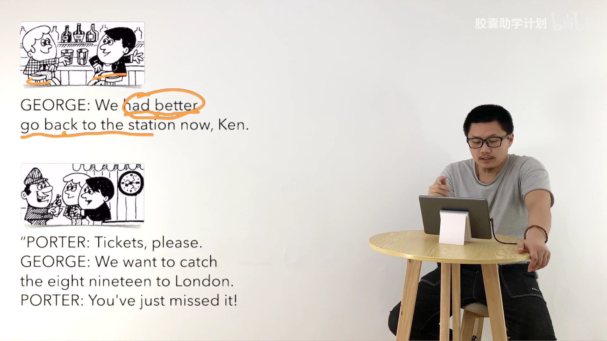

文字识别：胶囊助学计划 / GEORGE: We / dad better / go back to the station now, Ken. / "PORTER: Tickets, please. / GEORGE: We want to catch / the eight nineteen to London. / PORTER: You've just missed it!

### 画面 00:04:13

文字识别：胶囊助学计划 / GEORGE: We / dad better / go back to the station now, Ken. / "PORTER: Tickets, please. / GEORGE: We want to catch / the eight nineteen to London. / PORTER: You've just missed it!

### 画面 00:04:15

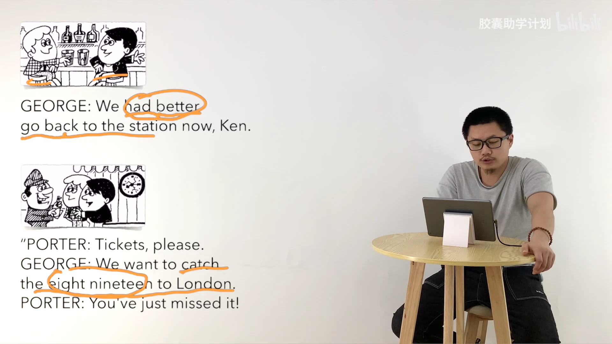

文字识别：胶囊助学计划 / GEORGE: / We / dad better / go back to the s / station now, Ken. / "PORTER: Tickets, please. / GEORGE: We want to catch / the Cight nineteen to London. / PORTER: You've just missed it!

### 画面 00:04:20

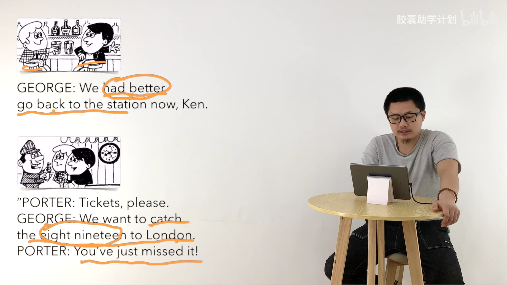

文字识别：胶囊助学计划 / GEORGE: / :We / dad better / go back to the / station now, Ken. / 风 / "PORTER: Tickets, please. / GEORGE: We want to catch / the Qight nineteen to London. / PORTER: You've just missed it!

### 画面 00:04:23

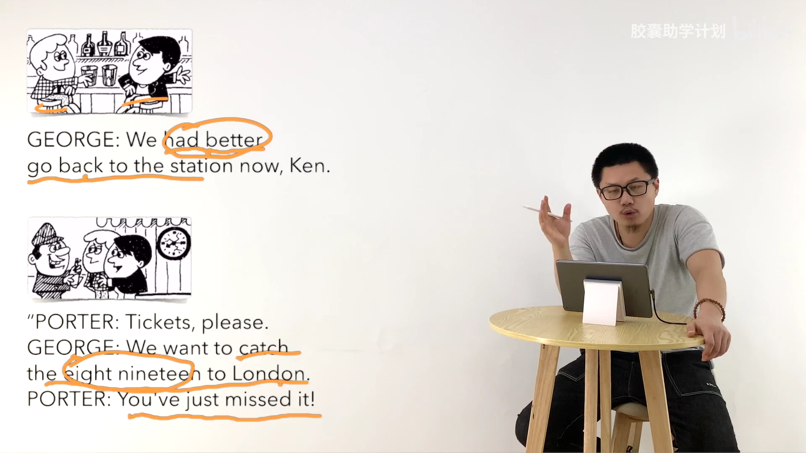

文字识别：胶囊助学计划 / GEORGE: / We / dad better / go back to the / station now, Ken. / "PORTER: Tickets, please. / GEORGE: We want to catch / the Qight nineteen to London. / PORTER: You've just missed it!

### 画面 00:04:29

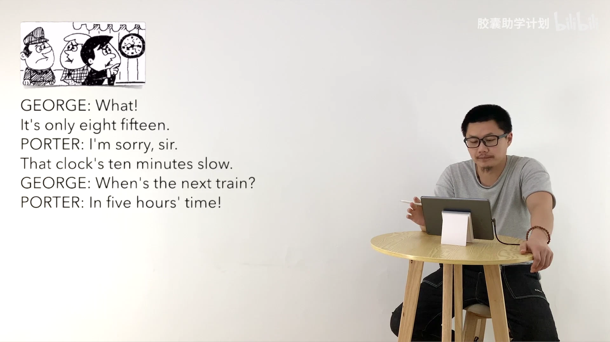

文字识别：胶囊助学计划 / GEORGE: What! / It's only eight fifteen. / PORTER: I'm sorry, sir. / That clock's ten minutes slow. / GEORGE: When's the next train? / PORTER: In five hours' time!

## 00:04:30–00:05:00

他说 What？他说啥？他说 It's only eight fifteen。他说才八点十五啊，你不是八点十九开吗？或者说 I'm sorry, sir。我很抱歉，先生。That clock, P.S. is ten minutes slow. Ten minutes叫十分钟，slow叫慢的那个表慢十分钟。你以后把这句话记下来，是不是就会表达表慢十分钟怎么

### 画面 00:04:57

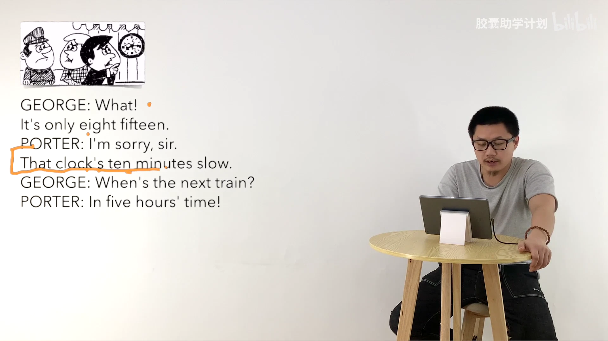

文字识别：胶囊助学计划 / GEORGE: What! / It's only eight fifteen. / PORTER: I'm sorry, sir. / That clock's ten minutes slow. / GEORGE: When's the next train? / PORTER: In five hours' time!

### 画面 00:04:59

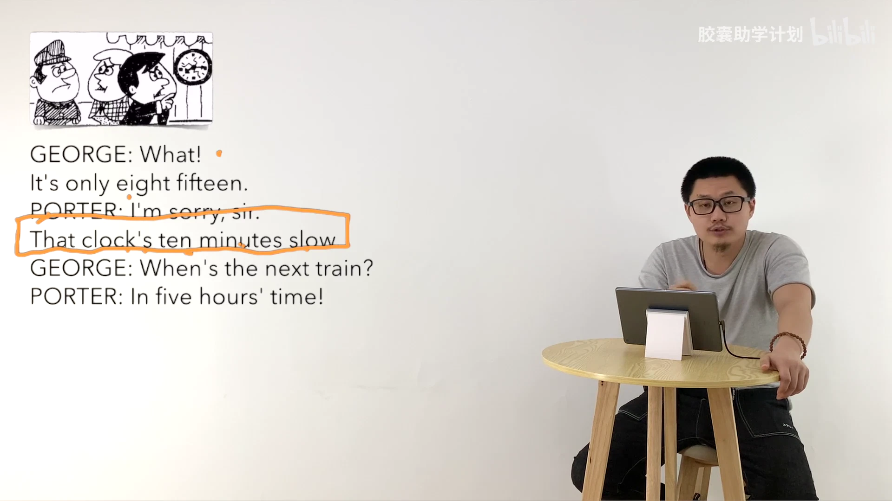

文字识别：胶囊助学计划 / GEORGE: What! / It's only eight fifteen. / PORTER·|' / That clock's ten minutes slow / GEORGE: When's the next train? / PORTER: In five hours' time!

## 00:05:00–00:05:30

表达了呢？Mary问，When's the next train？俩人问了，说那下一趟火车是多长时间呢？porter回答，In five hours time。这个time有没有都可以，in five hours就足够了，叫五个小时之后。OK，那五天之后，in five days。OK，然后在这个地方我提一个小点，你看它这个five

### 画面 00:05:11

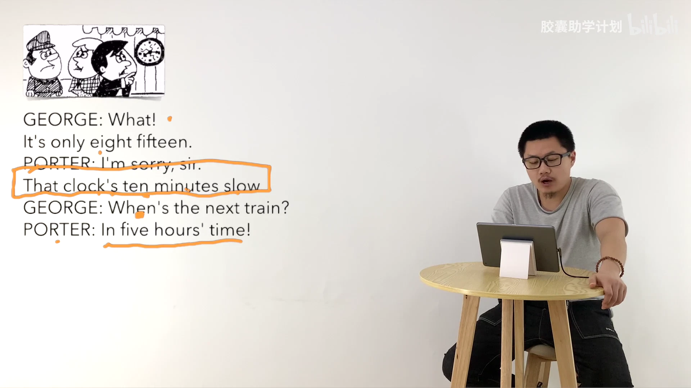

文字识别：胶囊助学计划 / GEORGE: / What! / It's only / eight / fifteen. / PORTER· / That clock's ten minutes slow / GEORGE: When's the / next train? / PORTER: In five / hours' / time!

### 画面 00:05:15

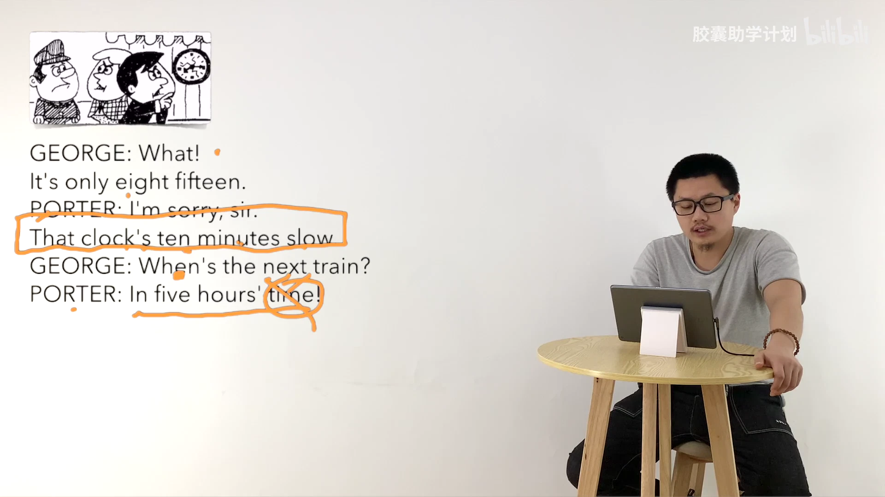

文字识别：胶囊助学计划 / GEORGE: / What! / It's only / eight / fifteen. / PORTER· / That clock's ten minutes slow / GEORGE: / When's the / next train? / PORTER:In / five / hours' / e

### 画面 00:05:18

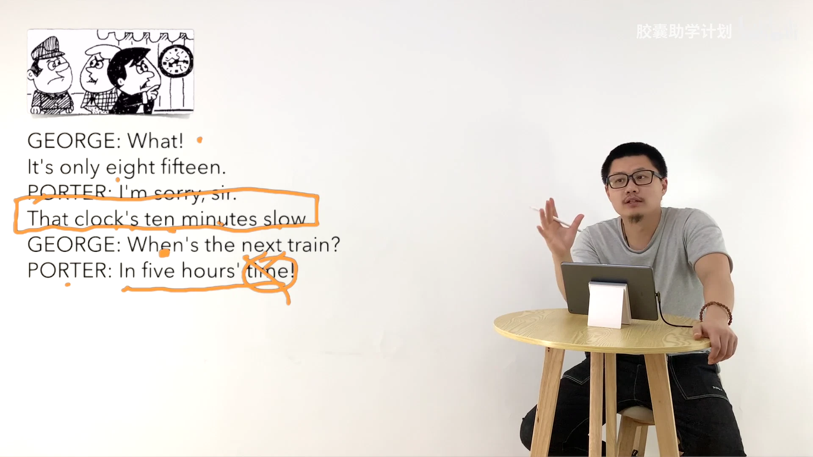

文字识别：GEORGE: / What! / It's only / eight / fifteen. / PORTER· / That clock's ten minutes slow / GEORGE: When's the / next train? / PORTER:In / five / hours' / e

### 画面 00:05:27

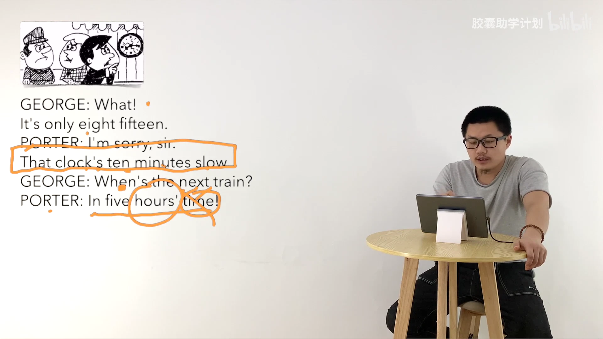

文字识别：胶囊助学计划 / GEORGE: / What! / It's / only / eight / fifteen. / PORTER / That clock's ten minutes slow / GEORGE: / When's the next train? / PORTER: In five hours' / ne

## 00:05:30–00:06:00

五个小时叫 five hours，对吧？然后它这个撇是没有在这儿又加一个 s，所以这个点要注意一小下啊。这个点是直接在这儿加撇就可以表示所有格了。Very good. 那不多说，我们接下来做一些口语听力练习。您可以在书中去找这个答案。当然，如果文章您特别熟了呢，也可以直接闭目听我问，然后您口语回答。好，来了，第一题。

### 画面 00:05:30

文字识别：胶囊助学计划 / honr / GEORGE: / What! / It's / only / eight / fifteen. / PORTER· / That clock's ten minutes slow / GEORGE: / When's tho next train? / PORTER:In / n fivehours' / he

### 画面 00:05:33

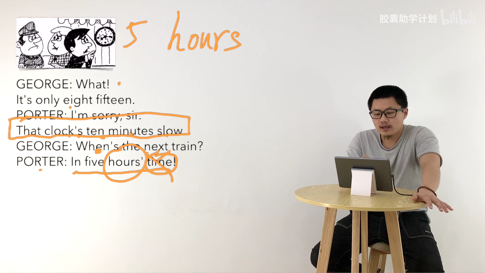

文字识别：胶囊助学计划 / honrs / GEORGE: / What! / It's only / eight / fifteen. / PORTER / That clock's ten minutes slow / GEORGE: / When's the next train? / PORTER: In fivehours' / ne

### 画面 00:05:45

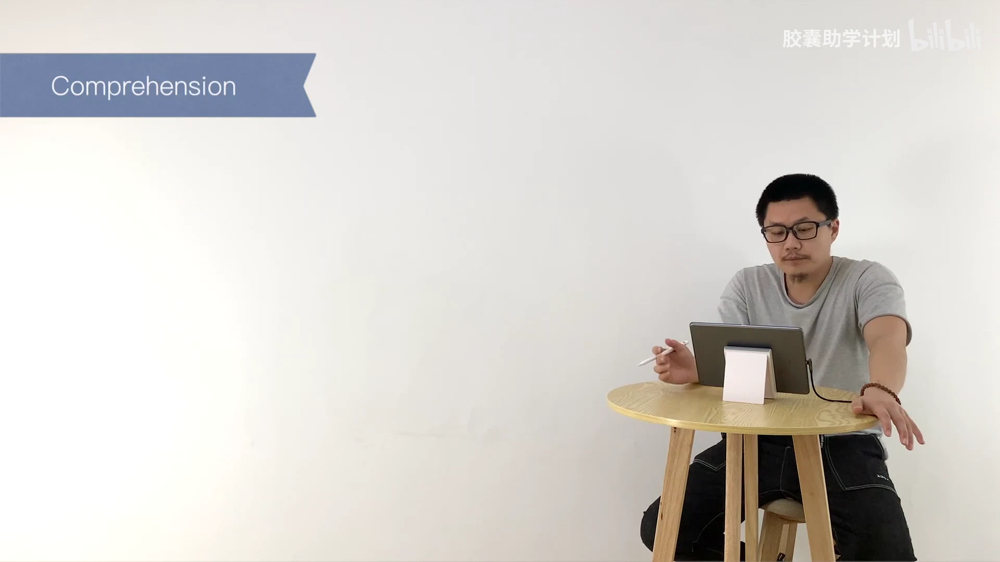

文字识别：胶囊助学计划 / Comprehension

### 画面 00:05:47

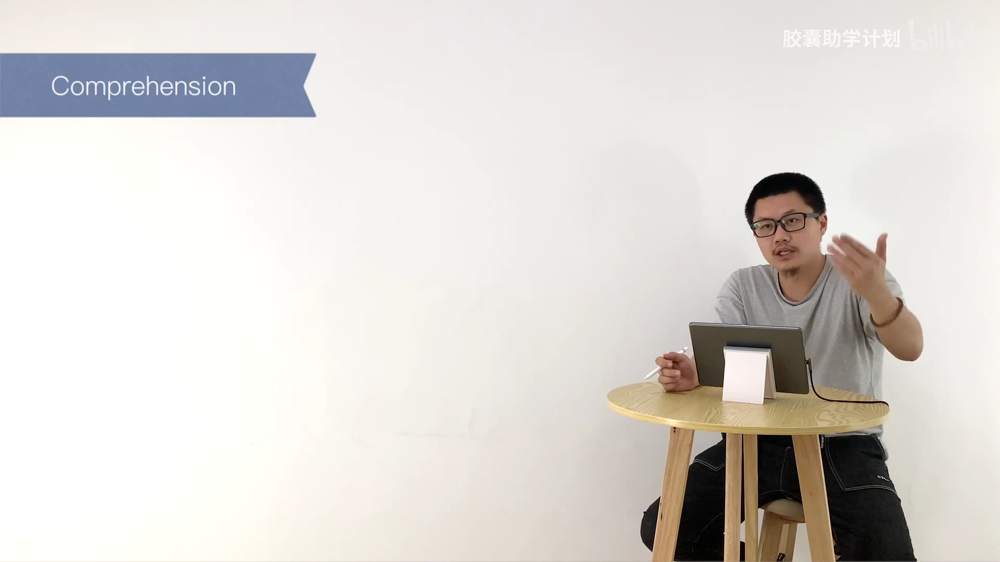

文字识别：胶囊助学计划 / Comprehension

### 画面 00:05:57

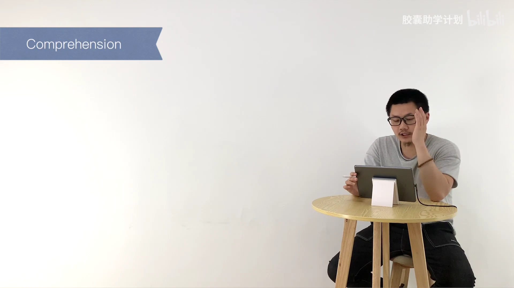

文字识别：胶囊助学计划 / Comprehension

## 00:06:00–00:06:30

Where do George and Ken want to go? To London. Next one. Do they buy two single tickets? This word I have talked about before. Single tickets. No, they don't. They buy two return tickets, or they want to buy return tickets. Next one. What time will the next train leave?

### 画面 00:06:00

文字识别：胶囊助学计划 / Comprehension / 1 T: Where do George and Ken want to go?

### 画面 00:06:15

文字识别：胶囊助学计划 / Comprehension / 2 T: Do they buy two single tickets? / S: No, they don't. They buy two return tickets.

### 画面 00:06:24

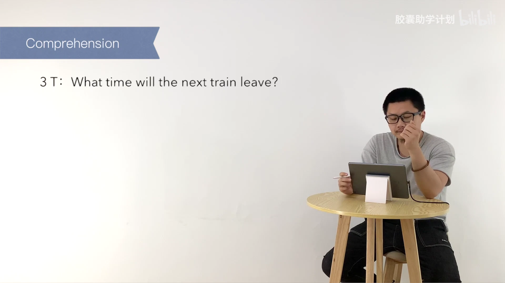

文字识别：胶囊助学计划 / Comprehension / 3 T: What time will the next train leave?

## 00:06:30–00:07:00

at nineteen minutes past eight. Continue. Where will their train leave from? Leave from就是从哪个地方离开啊? From platform two over the bridge. Next one. How much time have they got? They've got twenty two minutes.这就是个数学题，差三分钟八点，然后再加上十九分钟开，对吧？他们有二十二分钟。Next one.

### 画面 00:06:41

文字识别：胶囊助学计划 / Comprehension / 4 T: Where will their train leave from? / S: From Platform Two, over the bridge.

### 画面 00:06:46

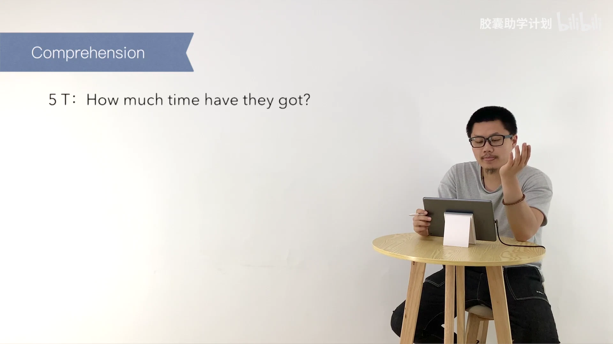

文字识别：胶囊助学计划 / Comprehension / 5 T: How much time have they got?

### 画面 00:06:53

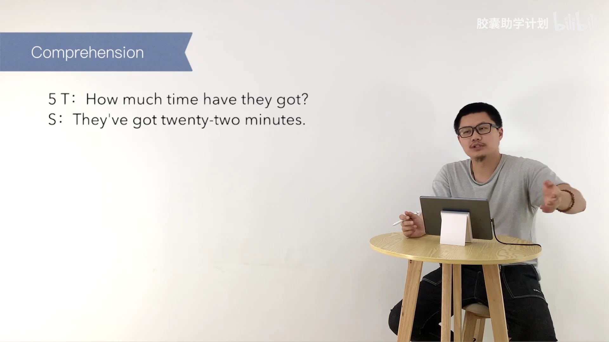

文字识别：胶囊助学计划 / Comprehension / 5 T: How much time have they got? / S: They've got twenty-two minutes.

### 画面 00:06:59

文字识别：胶囊助学计划 / Comprehension / 6 T: Where do they go for a drink?

## 00:07:00–00:07:30

where do they go for a drink? To a bar next door to the station. Next one, have they missed the train? Yes, they have. Ah, they've just missed the train. Next one, what's the matter with the clock? This clock has a problem. What's wrong with it? It's ten minutes slow. Continue. When is the next

### 画面 00:07:12

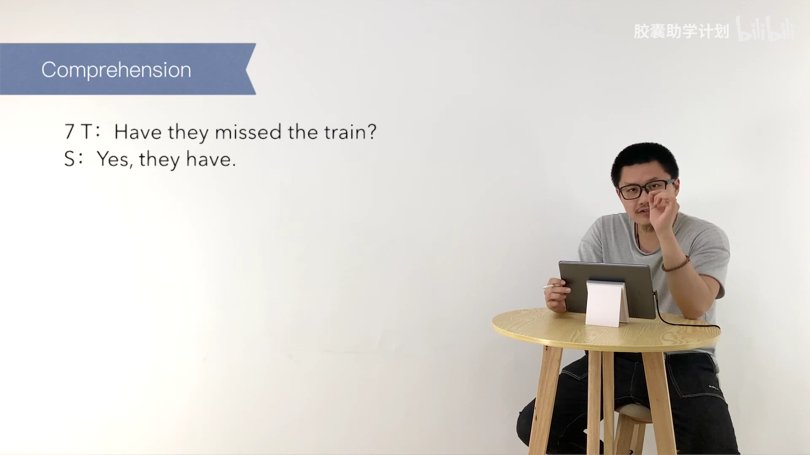

文字识别：胶囊助学计划 / Comprehension / 7 T: Have they missed the train? / S: Yes, they have.

### 画面 00:07:18

文字识别：胶囊助学计划 / Comprehension / 8 T: What's the matter with the clock?

## 00:07:30–00:08:00

train to London? In five hours' time. Continue.好，接下来我说肯定句，你们变一般疑问句。我给特殊疑问词，你们变特殊疑问句。来了。Ask me if George wants two return tickets.一般疑问句Does George want two return tickets? How many?

### 画面 00:07:32

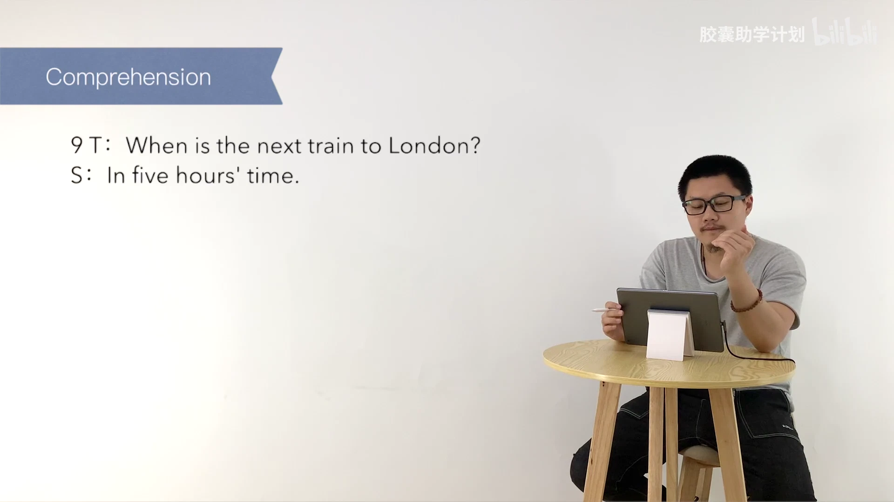

文字识别：胶囊助学计划 / Comprehension / 9 T: When is the next train to London? / S: In five hours'time.

### 画面 00:07:37

文字识别：胶囊助学计划 / Asking questions / 1 T: Ask me if George wants two return tickets.

## 00:08:00–00:08:30

How many return tickets does George want? George want. 好，注意一个焦点，How many是对to提问，但你一定要把return tickets一起提起来，好吧？ Next one. Ask me if platform two is over the bridge. 一般疑问句，答案 is platform two over the bridge? Where? Where is

### 画面 00:08:00

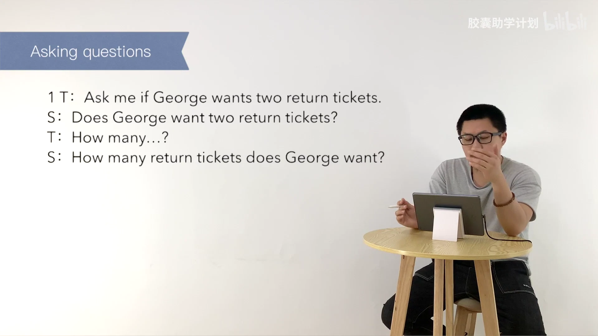

文字识别：胶囊助学计划 / Asking questions / 1 T: Ask me if George wants two return tickets. / S: Does George want two return tickets? / T: How many...? / S: How many return tickets does George want?

### 画面 00:08:07

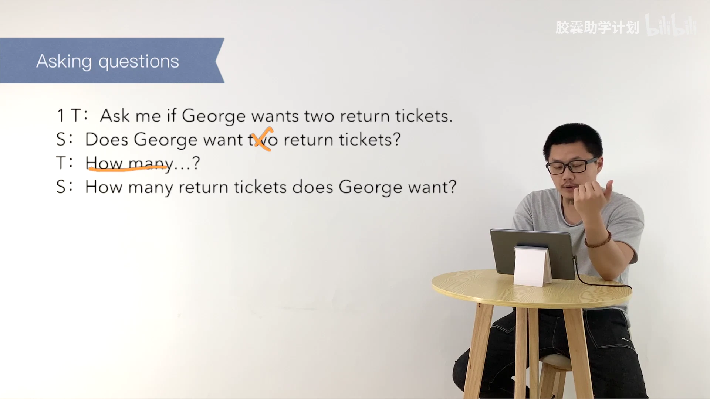

文字识别：胶囊助学计划 / Asking questions / 1 T: Ask me if George wants two return tickets. / S: Does George Want to return tickets? / T: How many..? / S: How many return tickets does George want?

### 画面 00:08:10

文字识别：胶囊助学计划 / Asking questions / 1 T: Ask me if George wants two return tickets. / S: Does George want t / return tickets? / T: How many. / S: How many return tickets does George want?

### 画面 00:08:12

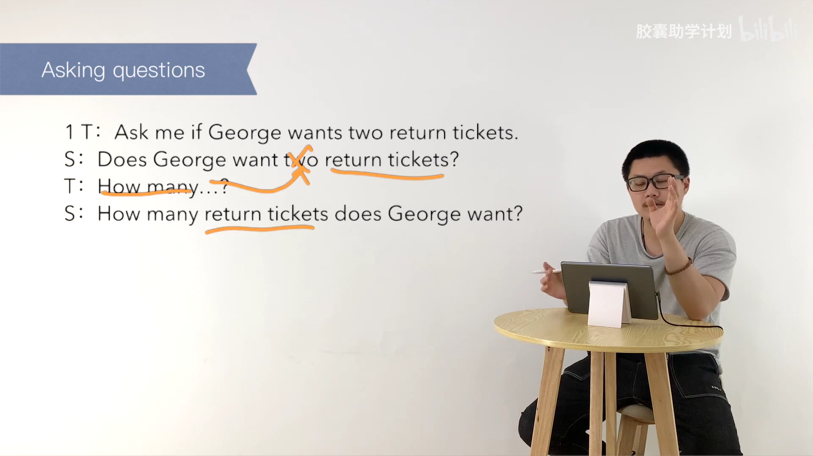

文字识别：胶囊助学计划 / Asking questions / 1 T: Ask me if George wants two return tickets. / S:Does George want t / return tickets? / 10 / T: How many. / S: How many return tickets does George want?

### 画面 00:08:14

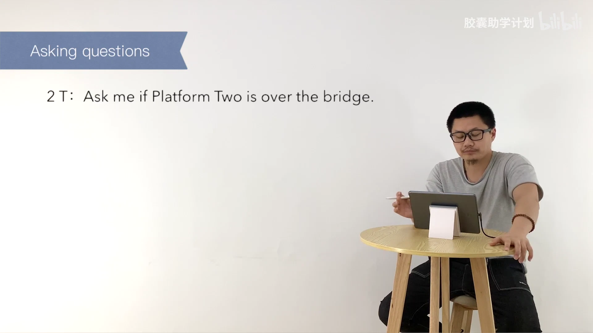

文字识别：胶囊助学计划 / Asking questions / 2 T: Ask me if Platform Two is over the bridge.

### 画面 00:08:16

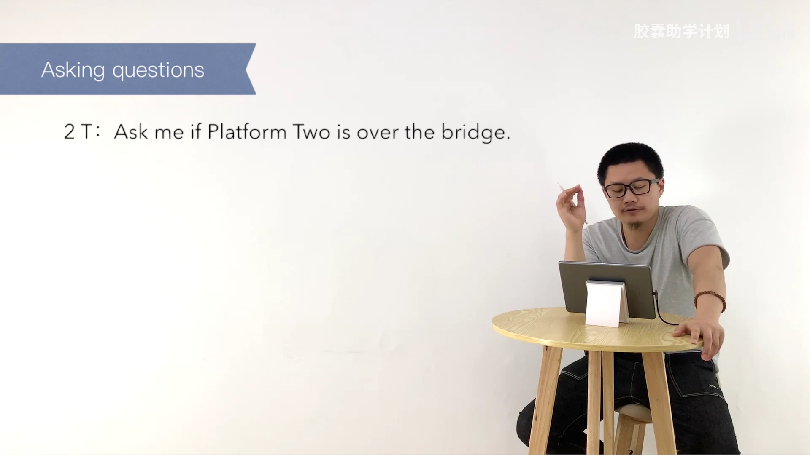

文字识别：Asking questions / 2 T: Ask me if Platform Two is over the bridge.

### 画面 00:08:27

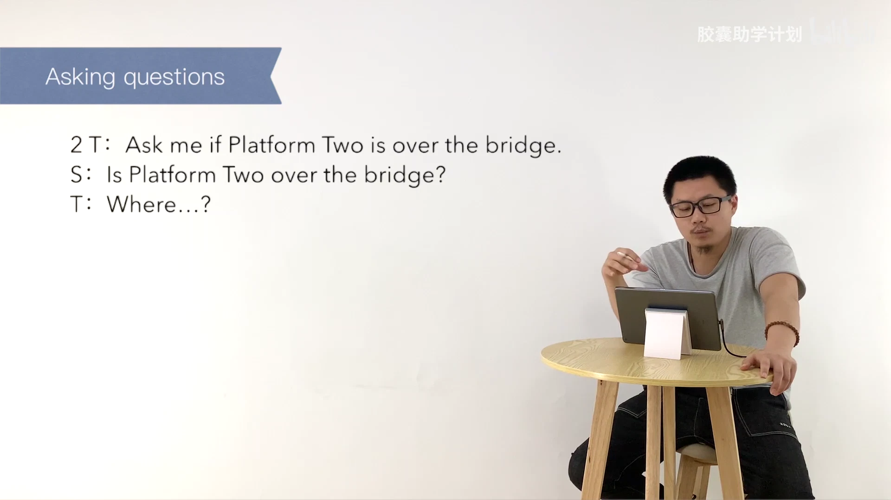

文字识别：胶囊助学计划 / Asking questions / 2 T: Ask me if Platform Two is over the bridge. / S: Is Platform Two over the bridge? / T:Where...?

## 00:08:30–00:09:00

platform two? Very good. Next one. Ask me if the next train will leave at eight nineteen.一般疑问句Will the next train leave at eight nineteen? When? When will the next train leave? Continue. Ask me if. Is three minutes to eight.

### 画面 00:08:33

文字识别：胶囊助学计划 / Asking questions / 3 T: Ask me if the next train will leave at eight nineteen.

### 画面 00:08:49

文字识别：胶囊助学计划 / Asking questions / 3 T: Ask me if the next train will leave at eight nineteen. / S: Will the next train leave at eight nineteen? / T:When...? / S: When will the next train leave?

### 画面 00:08:53

文字识别：胶囊助学计划 / Asking questions / 4 T : Ask me if it's three minutes to eight.

## 00:09:00–00:09:30

Is it three minutes to eight? What time? What time is it? Ah, this is very simple. Next one, ask me if they want to catch the eight nineteen. Do they want to catch the eight nineteen? Which train? You see, which train is the eight nineteen? Question, right? In this, we use time to represent that train. Eight, eight

### 画面 00:09:07

文字识别：胶囊助学计划 / Asking questions / 4 T : Ask me if it's three minutes to eight. / S: Is it three minutes to eight? / T: What time...? / S: What time is it?

### 画面 00:09:09

文字识别：胶囊助学计划 / Asking questions / 5 T: Ask me if they want to catch the eight nineteen.

### 画面 00:09:23

文字识别：胶囊助学计划 / Asking questions / 5 T: Ask me if they want to catch the eight nineteen. / S: Do they want to catch the eight nineteen? / T: Which train...?

### 画面 00:09:26

文字识别：胶囊助学计划 / Asking questions / 5 T: Ask me if they want to catch the eight nineteen. / S: Do they want to catch the eight nineteen? / T: Which train...?

## 00:09:30–00:10:00

八就是八点十九的那趟车。Okay，叫做 Which train do they want to catch? They want to catch.

### 画面 00:09:40

文字识别：Recap / 胶囊助学计划 / Patterns / had better / Grammar / Words / Expression / In five hours' / time

### 画面 00:09:44

文字识别：Recap / 胶囊助学计划 / Patterns / had better / Grammar / Words / Expression / In five hours't / time

### 画面 00:09:53

文字识别：胶囊助学计划

## 00:10:00–00:10:30

给自己讲解一遍今天的核心知识点。那如果大家喜欢我们的课程呢，欢迎大家关注、订阅、一键三连，分享给那些需要的朋友。最后我们再来看一句很有意思的名人名言。Oh, you hate your job? Why didn't you say so? There is a support group for that. It's called Everyone, Everybody, and they meet at the bar. Okay, see you next time.

### 画面 00:10:03

文字识别：胶囊助学计划

### 画面 00:10:10

文字识别：胶囊助学计划 / Oh, you hate your job? Why didn't you say / so? There's a support group for that. It's / called everybody, and they meet at the bar. / - Drew Carey

### 画面 00:10:26

文字识别：胶囊助学计划 / Oh, you hate your job? Why didn't you say / so? There's a support group for that. It's / called everybody, and they meet at the bar. / - Drew Carey

### 画面 00:10:28

文字识别：CAPSULEACADEMY / 胶囊助学计划 / 『 / 小红书

## 00:10:30–00:10:40

### 画面 00:10:30

文字识别：CAPSULEACADEMY / 胶囊助学计划 / 『 / 小红书 / 品 / OE

### 画面 00:10:36

文字识别：CAPSULEACADEMY / 胶囊助学计划 / 『 / 小红书 / Creator / □ / Leo & Berlin / OE

### 画面 00:10:38

文字识别：bilibili / 胶囊助学计划

### 画面 00:10:39

文字识别：bilibili / 胶囊助学计划

