# 096 练习

快速机器解析：语音为单模型转写，未进行独立交叉校对或人工复核；画面每秒采样并按变化选帧，短时文字和标记可能遗漏。截图时间约有 1 秒误差。图片有损压缩；遇到疑点请按时间查看 Google Drive 原视频。

## 00:00:00–00:00:30

Hello everyone, welcome to Capsule Academy. This is Leo. Today we're going to learn New Concept English Book One Lesson Ninety Six Practices. Hope you gonna enjoy it.那偶数课啊，我们最重要的事情就是练习，练习还是练习，对吧？各位就张开嘴，大声跟我读就可以了，非常简单。来，I went to Beijing a year ago. What about you?

### 画面 00:00:00

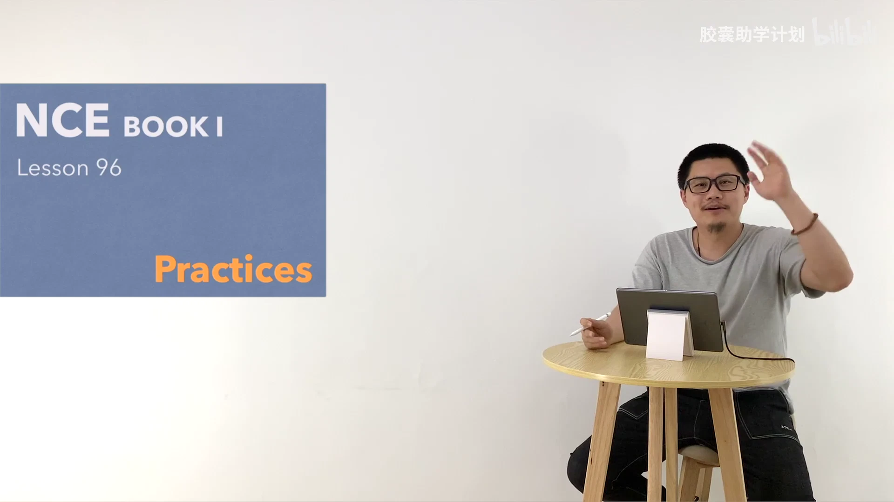

文字识别：胶囊助学计划 / NCE / BOOKI / Lesson 96 / Practices

### 画面 00:00:02

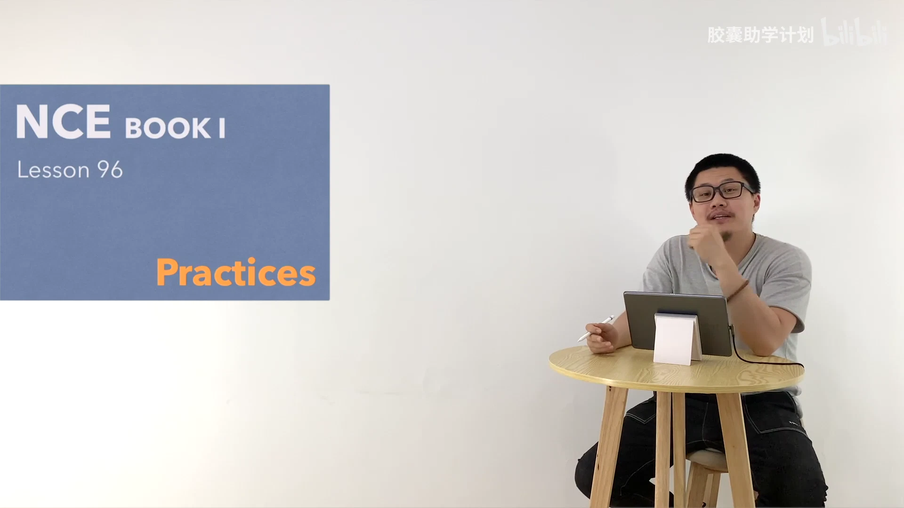

文字识别：胶囊助学计划 / NCE / BOOKI / Lesson 96 / Practices

### 画面 00:00:11

文字识别：胶囊助学计划bll / •

### 画面 00:00:15

### 画面 00:00:17

文字识别：胶囊助学计划 / Beijing

### 画面 00:00:21

文字识别：胶囊助学计划 / Beijing

### 画面 00:00:25

文字识别：胶囊助学计划 / Beijing / ①I went to Beijing a year ago.

## 00:00:30–00:01:00

I shall go to Beijing in a year's time. 好，这儿提几个小点：第一，一般过去时；第二，一般将来时；第三，我们上个文章当中视频讲到非常重要的一个小的表达，叫一年之后，是吧？没错。哎，我先带各位读一下这个单词，叫 Stockholm。啊，斯德哥尔摩，Stockholm。 Here we go. 注意着话，来，Tom

### 画面 00:00:31

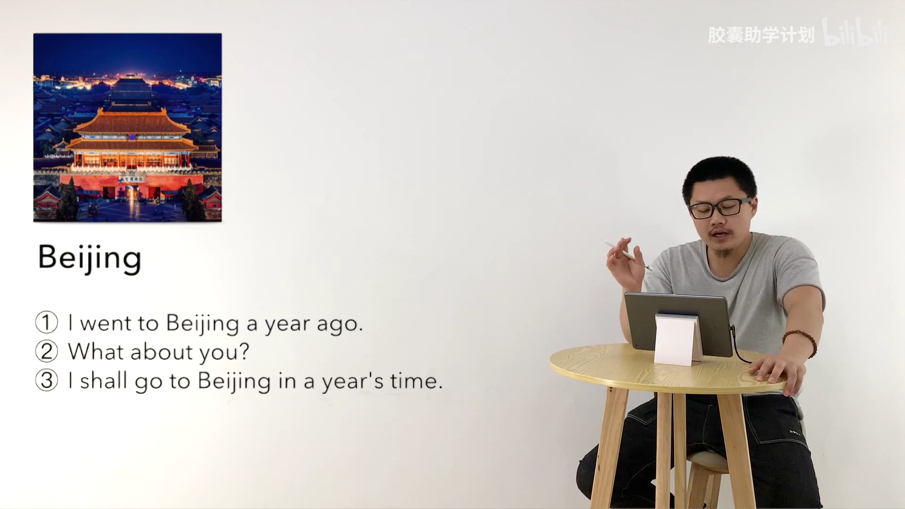

文字识别：胶囊助学计划 / Beijing / ①I went to Beijing a year ago. / What about you? /  I shall go to Beijing in a year's time.

### 画面 00:00:38

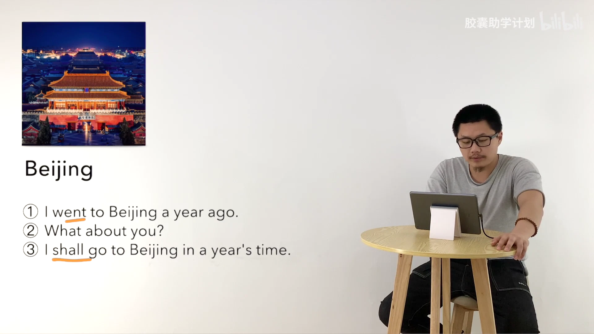

文字识别：胶囊助学计划 / Beijing / ① / I went to Beijing a year ago. / What about you? / I shall go to Beijing in a year's time.

### 画面 00:00:40

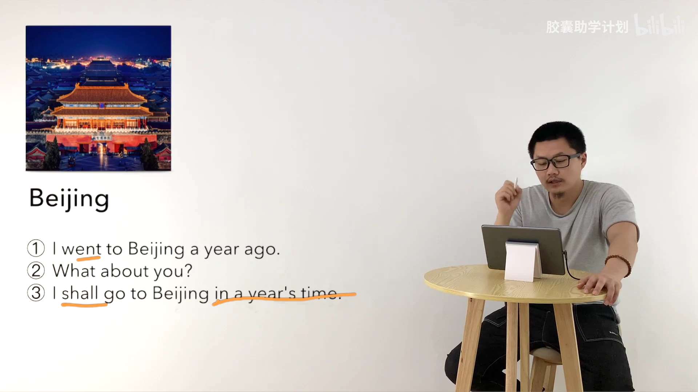

文字识别：胶囊助学计划 / Beijing / I went to Beijing a year ago. / Whata / about you? / I shall go to Beijing in a year's time.

### 画面 00:00:48

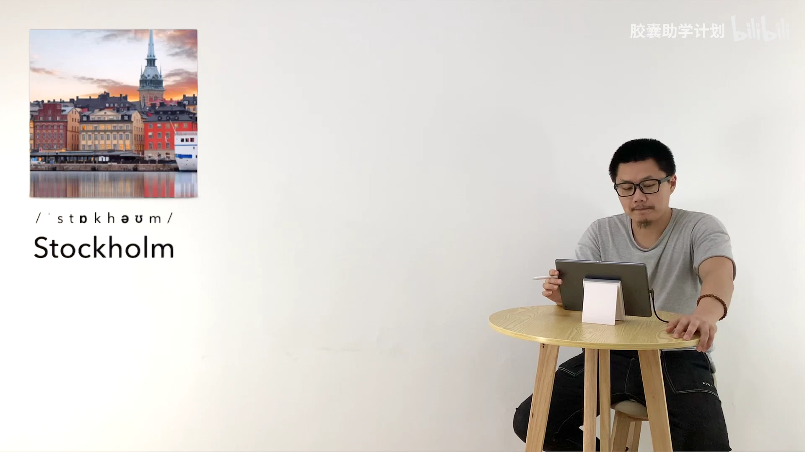

文字识别：胶囊助学计划 / stpkhaum/ / Stockholm

### 画面 00:00:58

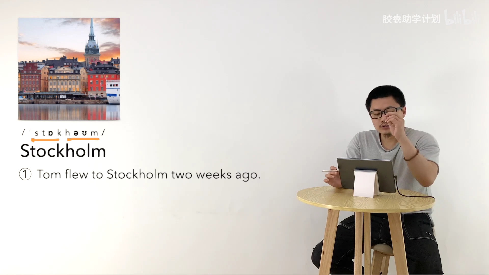

文字识别：胶囊助学计划 / stkhaum/ / Stockholm / ① Tom flew to Stockholm two weeks ago.

## 00:01:00–00:01:30

flew to Stockholm two weeks ago. What about Penny? She will fly to Stockholm in two weeks' time.看，一到复数，这个撇儿就跑后边去了，对吧？Next one, Tokyo. Frank and Alan returned to Tokyo two days ago.返回到Tokyo. What about you and Jane? We

### 画面 00:01:05

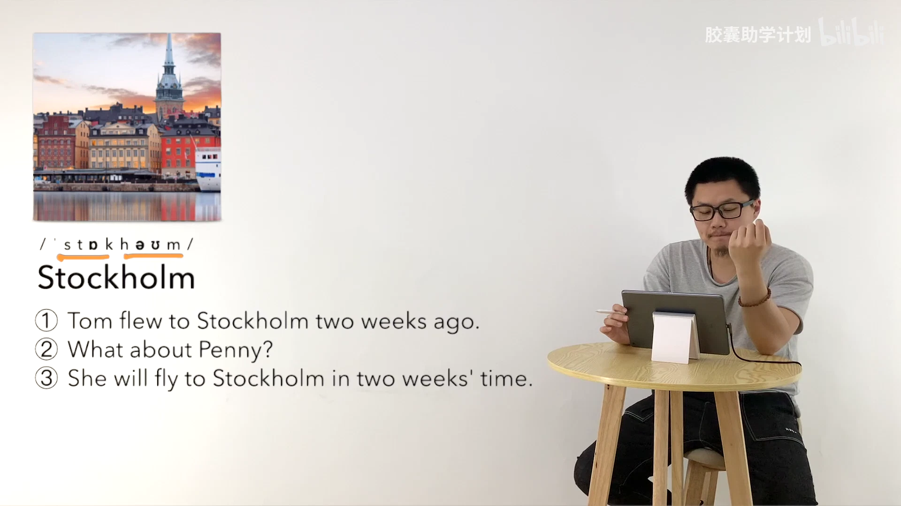

文字识别：胶囊助学计划 / stokhaum/ / Stockholm /  Tom flew to Stockholm two weeks ago. / What about Penny? / She will fly to Stockholm in two weeks' time.

### 画面 00:01:15

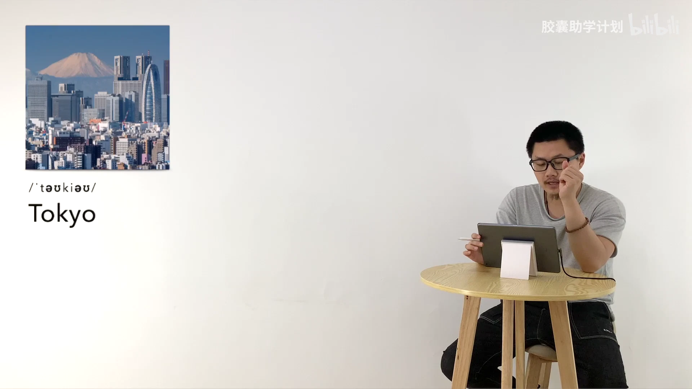

文字识别：胶囊助学计划 / /'taukiau/ / Tokyo

### 画面 00:01:24

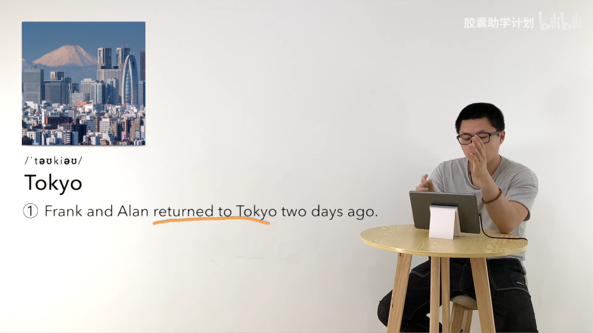

文字识别：胶囊助学计划 / /'taukiau/ / Tokyo / ① Frank and Alan returned to Tokyo two days ago.

### 画面 00:01:28

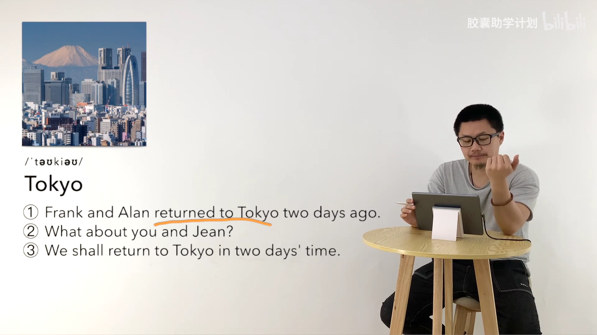

文字识别：胶囊助学计划 / /'taukiau/ / Tokyo /  Frank and Alan returned to Tokyo two days ago. / What about you and Jean? / We shall return to Tokyo in two days' time.

## 00:01:30–00:02:00

shall return to Tokyo in two days' time. Next one, Sydney. You went to Sydney a month ago. What about me? You will go to Sydney in a year's time. Continue, Geneva,日内瓦. A train left for Geneva an hour ago.

### 画面 00:01:35

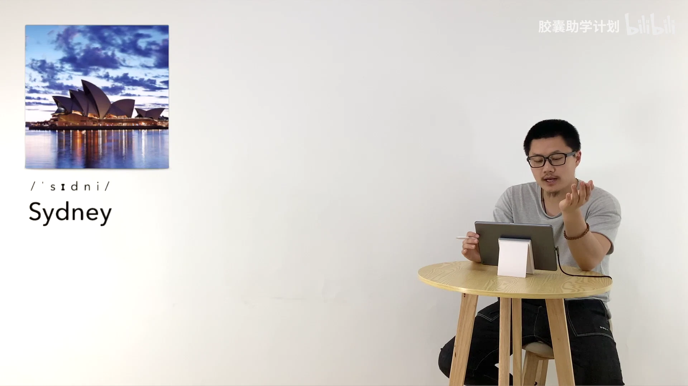

文字识别：胶囊助学计划 / /sidni/ / Sydney

### 画面 00:01:44

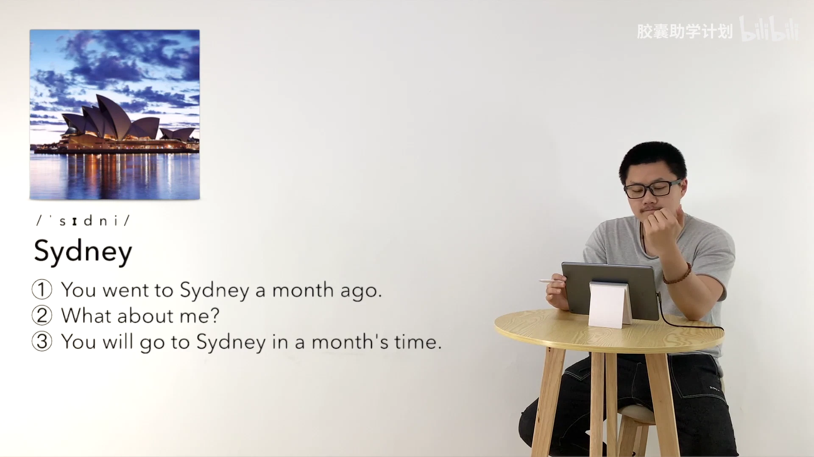

文字识别：胶囊助学计划 / /sidni/ / Sydney / D You went to Sydney a month ago. / 1 / What about me? / ③ You will go to Sydney in a month's time.

### 画面 00:01:52

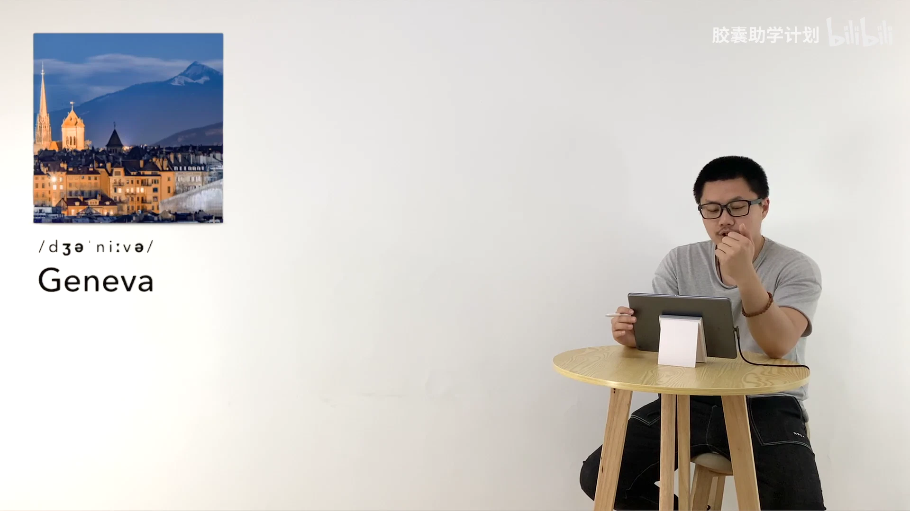

文字识别：胶囊助学计划 / /d3a'ni:va/ / Geneva

### 画面 00:01:55

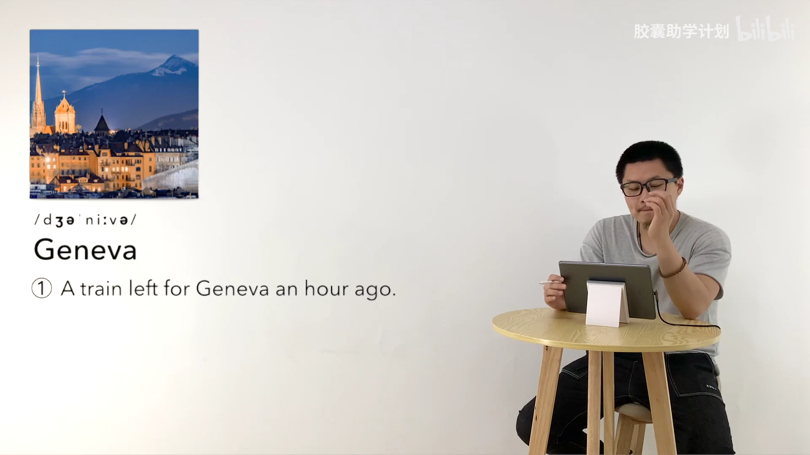

文字识别：胶囊助学计划 / /d3a'ni:va/ / Geneva / ① A train left for Geneva an hour ago.

## 00:02:00–00:02:30

leave for Geneva. What about the next train? It will leave for Geneva in an hour's time. 注意，你看单数就是 p s 对吧？复数就是 s p。这是我们很久之前学过的 Rome, Rome. Alice flew to Rome two days ago. What about you?跟我读, I

### 画面 00:02:01

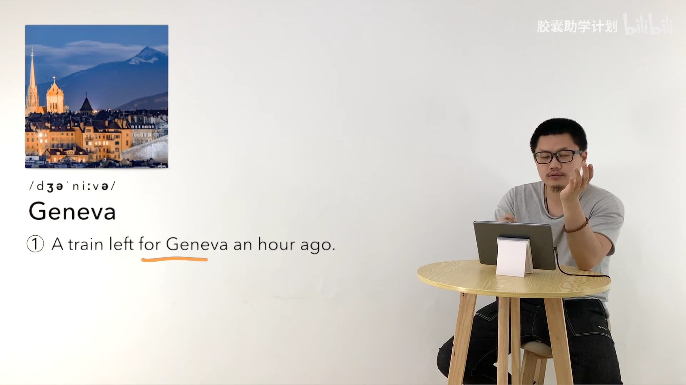

文字识别：胶囊助学计划 / /d3a'ni:va/ / Geneva / ① A train left for Geneva an hour ago.

### 画面 00:02:05

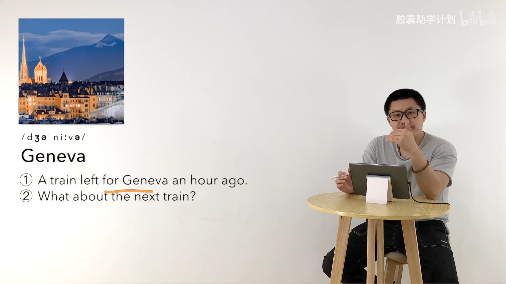

文字识别：胶囊助学计划 / /d3a'ni:va/ / Geneva / D A train left for Geneva an hour ago. / 1 / What about the next train?

### 画面 00:02:12

文字识别：胶囊助学计划 / /d3a'ni:va/ / Geneva / ① A train left for Geneva an hour ago. / What about the next train? / ) It will leave for Geneva in an hour's time.

### 画面 00:02:16

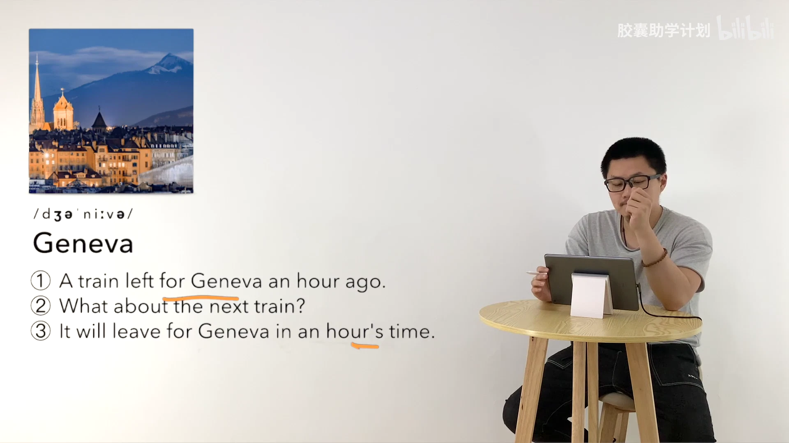

文字识别：胶囊助学计划 / /d3a'ni:va/ / Geneva / ① A train left for Geneva an hour ago. / What about the next train? /  It will leave for Geneva in an hour's time.

### 画面 00:02:18

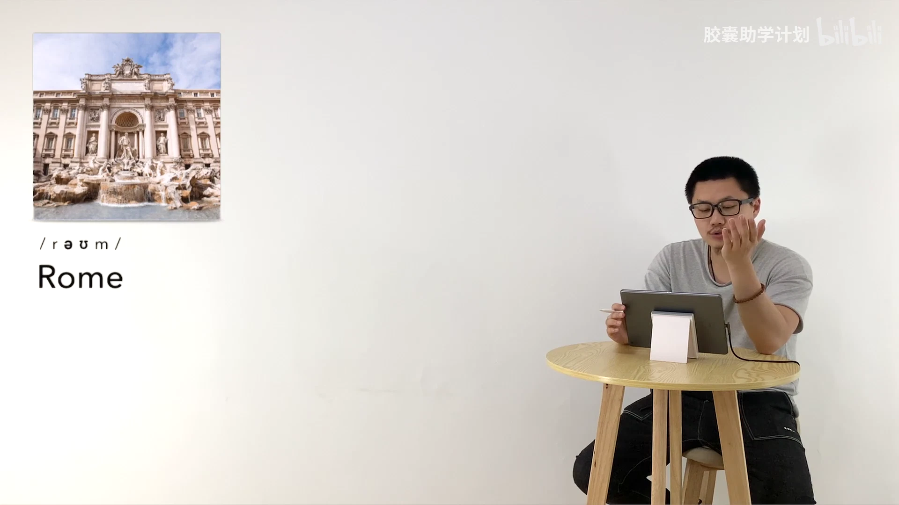

文字识别：胶囊助学计划 / /raum/ / Rome

### 画面 00:02:29

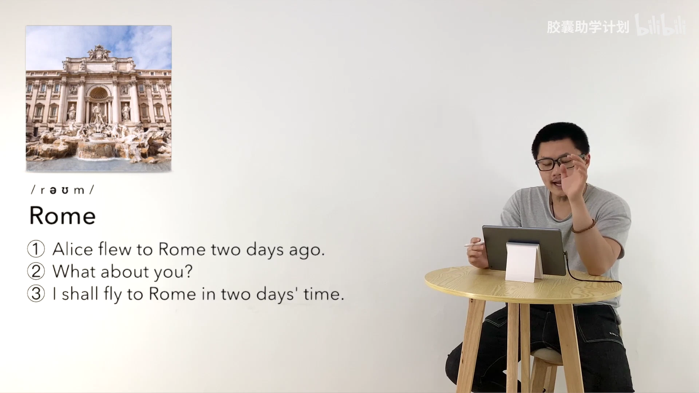

文字识别：胶囊助学计划 / /raum/ / Rome /  Alice flew to Rome two days ago. / What about you? / ③ I shallfly to Rome in two days' time.

## 00:02:30–00:03:00

shall fly to Rome in two days' time. 啊，你看这节课其实就是在对比一般过去时和一般将来时，对吧？ Continue. London. Tom and Mary went to London an hour ago. What about you and Jane? We shall go to London in an hour's time. Next one. Berlin. A plane left for Berlin three

### 画面 00:02:35

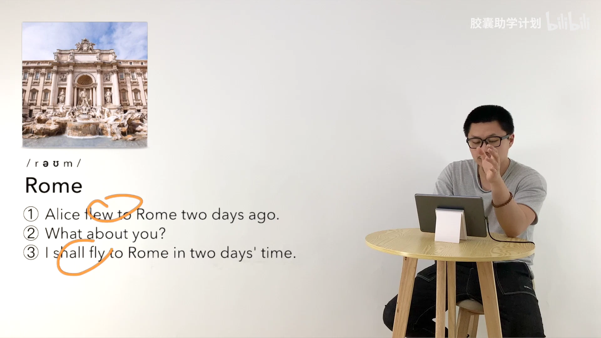

文字识别：胶囊助学计划 / /raum/ / Rome / Alice / ewt Rome two days ago. / What about you? / I shall fly to Rome in two days' time.

### 画面 00:02:37

文字识别：胶囊助学计划 / /landan/ / London

### 画面 00:02:39

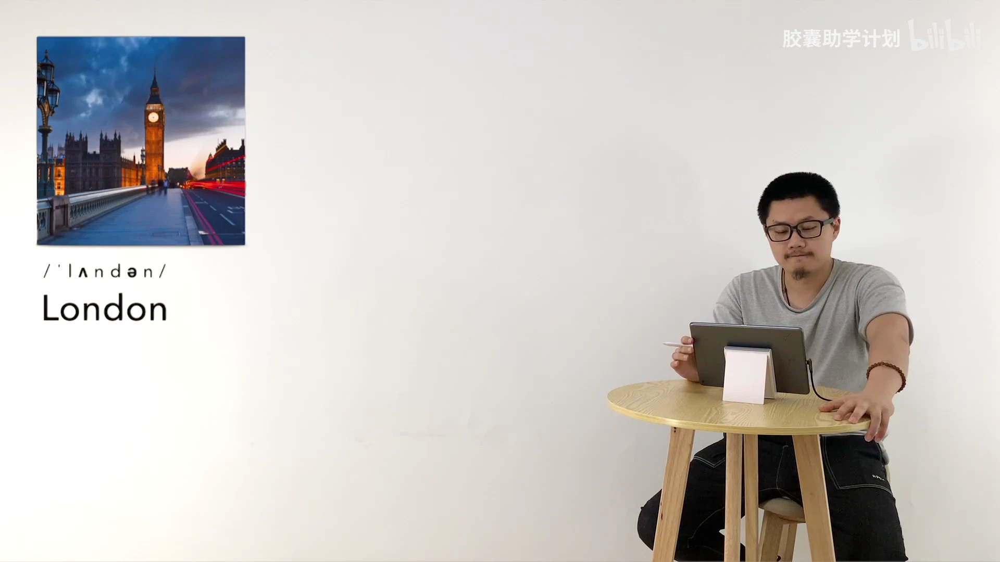

文字识别：胶囊助学计划 / /landan/ / London

### 画面 00:02:44

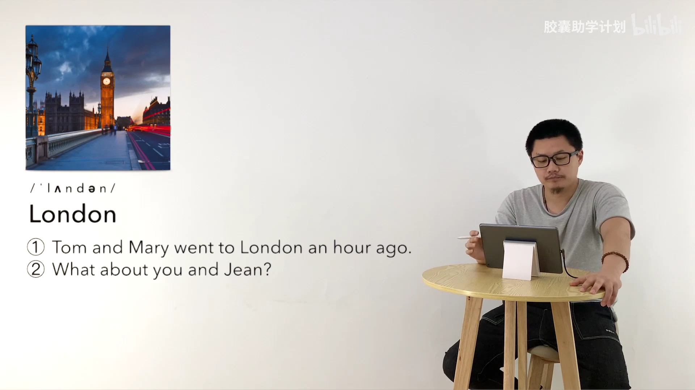

文字识别：胶囊助学计划 / /landan/ / London /  Tom and Mary went to London an hour ago. / What about you and Jean?

### 画面 00:02:53

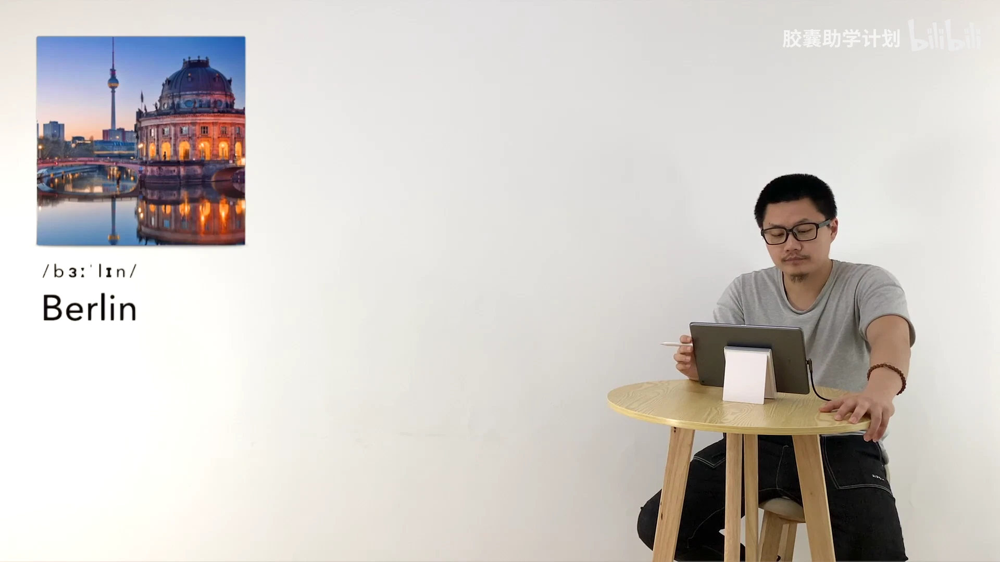

文字识别：胶囊助学计划 / /b3:'lin/ / Berlin

## 00:03:00–00:03:30

hours ago. What about the next plane? It will leave for Berlin in three hours' time. 哎，三个小时之后，这个 time 有没有都可以啊？可以完全说成 in three hours. Okay, 新二我们会见到. Next one, New York. Smith returned to New York a year ago. What about Jones? He will return to New York in a

### 画面 00:03:01

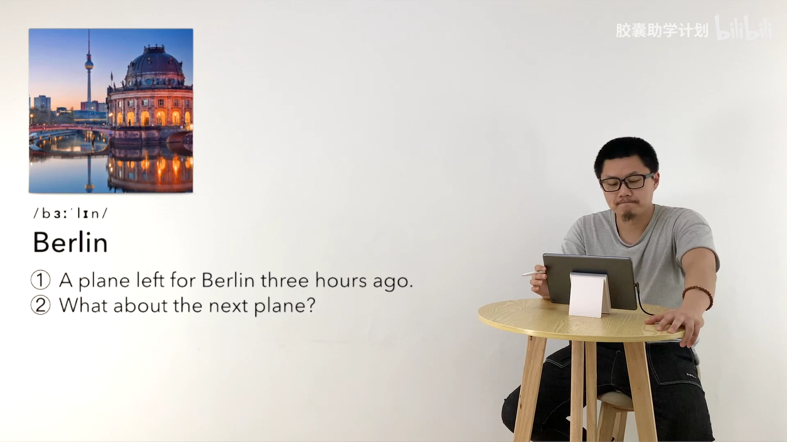

文字识别：胶囊助学计划 / /b3:lin/ / Berlin / ① A plane left for Berlin three hours ago. / What about the next plane?

### 画面 00:03:10

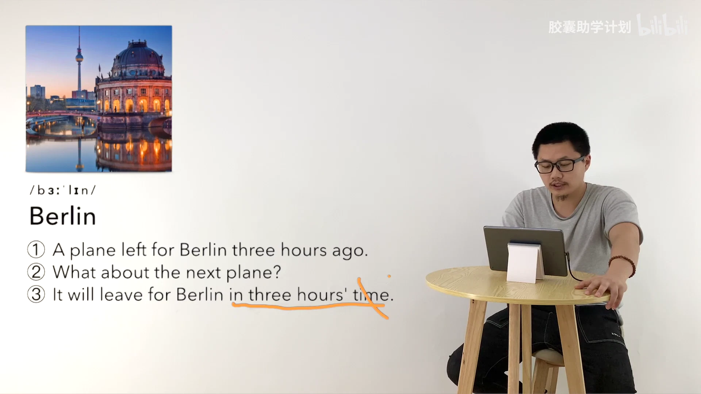

文字识别：胶囊助学计划 / /b3:lin/ / Berlin / ① A plane left for Berlin three hours ago. / What about the next plane? / 3 It wil leave for Berlin in three hours' tine.

### 画面 00:03:17

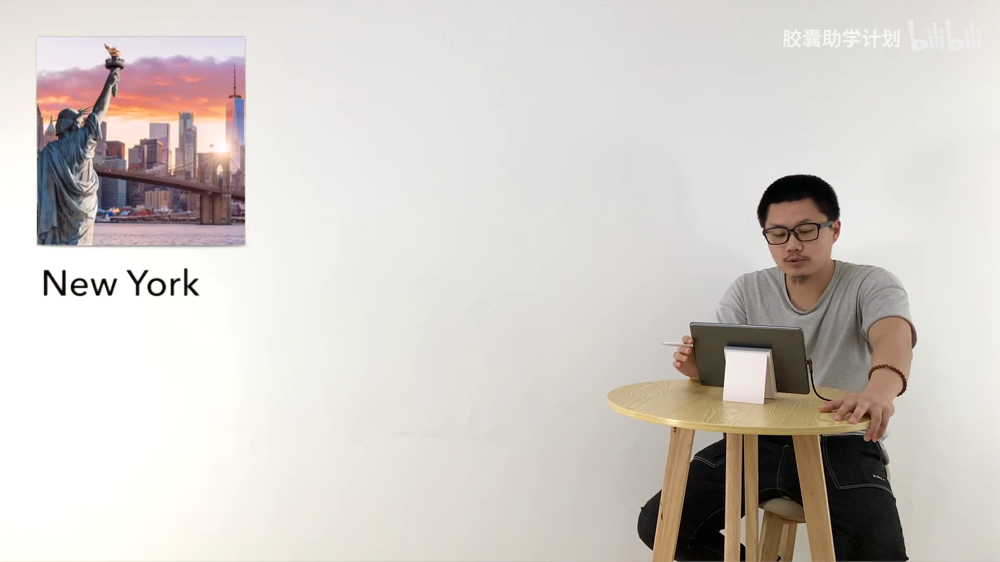

文字识别：胶囊助学计划 / New York

### 画面 00:03:26

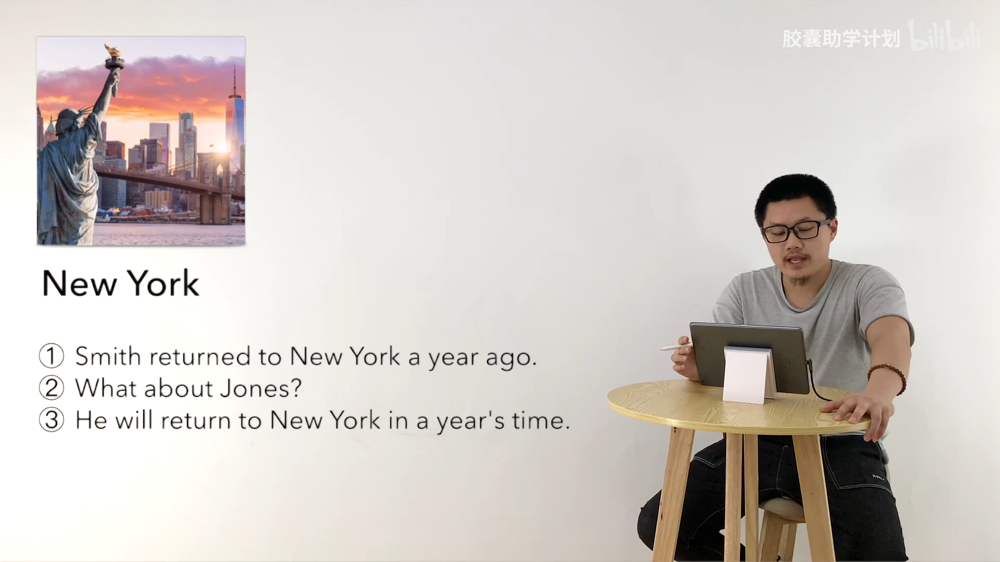

文字识别：胶囊助学计划 / New York /  Smith returned to New York a year ago. / What about Jones? / He will return to New York in a year's time.

## 00:03:30–00:04:00

year's time.张嘴跟我读Paris，巴黎。Janet returned from Paris six weeks ago.哎，注意return叫返回，从哪儿返回呢？从巴黎返回。我们不知道她回到了什么地方，但我们知道她是从巴黎回来了啊。What about her husband?那她老公呢？He will return from Paris in six weeks'

### 画面 00:03:32

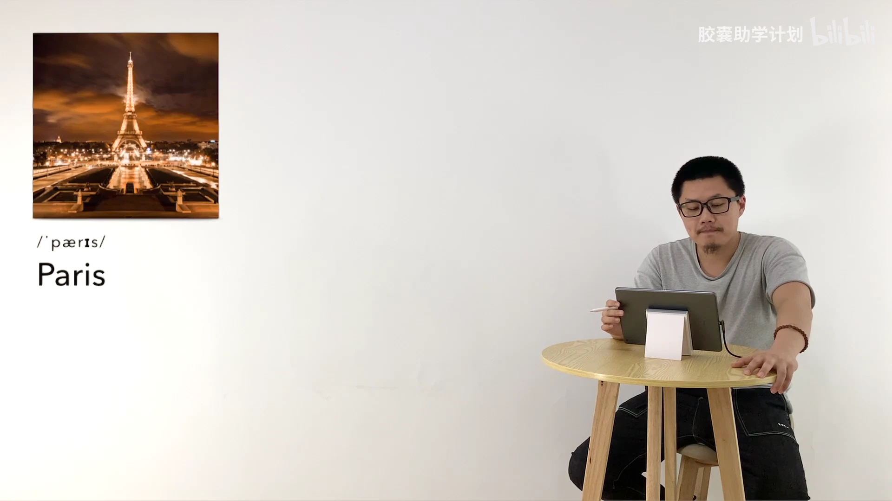

文字识别：胶囊助学计划 / /'pæris/ / Paris

### 画面 00:03:38

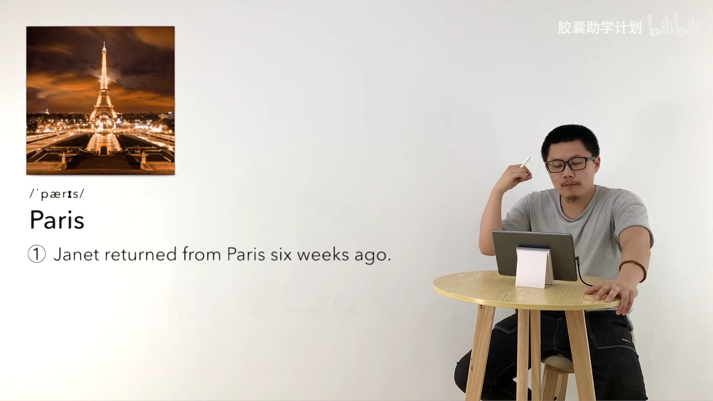

文字识别：胶囊助学计划 / /'pæris/ / Paris / D Janet returned from Paris six weeks ago. / 1

### 画面 00:03:44

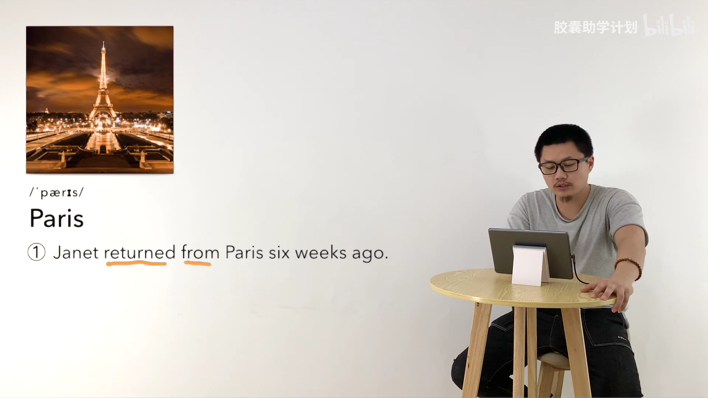

文字识别：胶囊助学计划 / /'pæris/ / Paris /  Janet returned from Paris six weeks ago.

### 画面 00:03:53

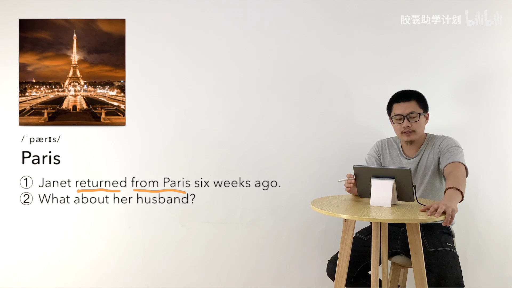

文字识别：胶囊助学计划 / /'pæris/ / Paris / Janet returned from Paris six weeks ago. / What about her husband?

## 00:04:00–00:04:30

time.看复数片对吧？而一个 recap，本课我们就是对比练了一一下 did 和 will，没有什么新的东西啊。那家庭作业绿皮书各位可以写了，给自己讲解一遍，回顾一下一般过去时和一般将来时。给各各位啊，给自己讲的越熟练，这个知识点您越清楚啊。而一个，那如果大家喜欢我们的课程，欢迎大家关注、订阅、一键三连，分享给那些需要的朋友，来帮助我

### 画面 00:04:01

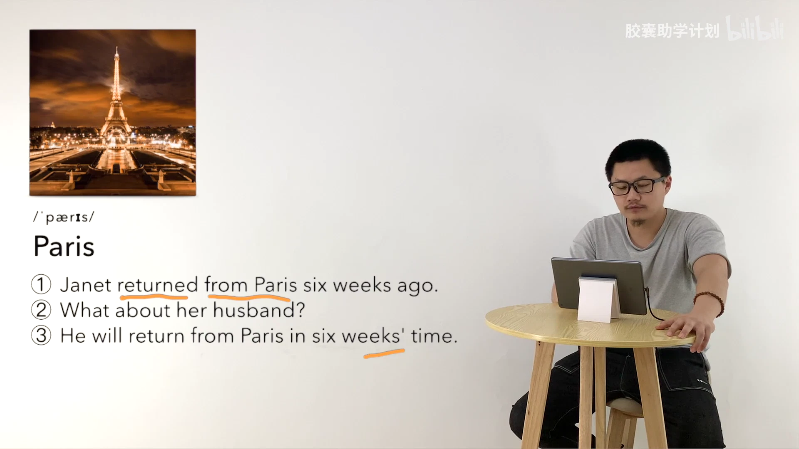

文字识别：胶囊助学计划 / /'pæris/ / Paris / Janet returned from Paris six weeks ago. / What about her husband? / He will return from Paris in six weeks' time.

### 画面 00:04:03

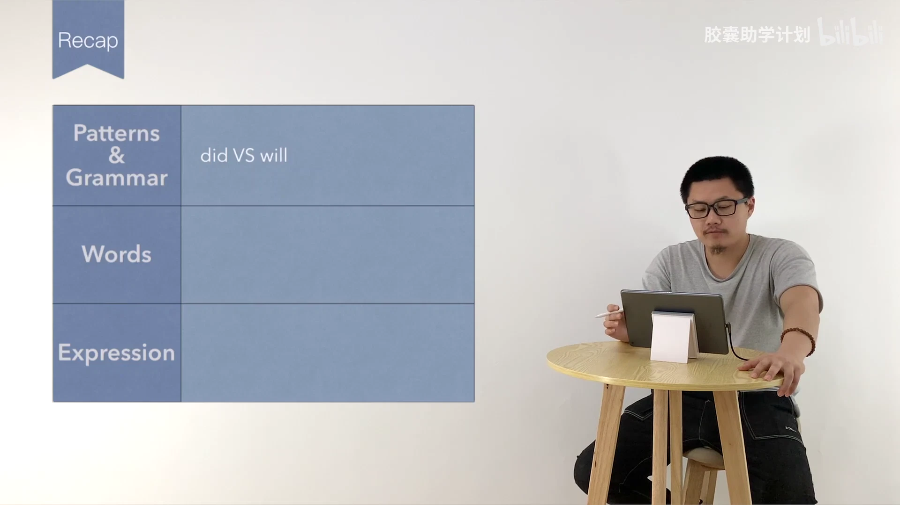

文字识别：Recap / 胶囊助学计划 / Patterns / did VS will / Grammar / Words / Expression

### 画面 00:04:08

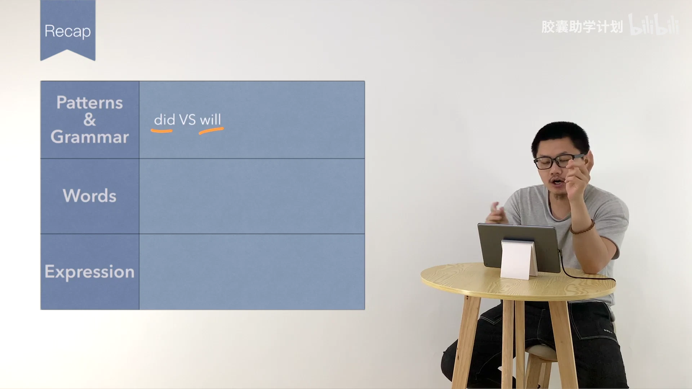

文字识别：胶囊助学计划 / Recap / Patterns / & / did VS will / Grammar / Words / Expression

### 画面 00:04:11

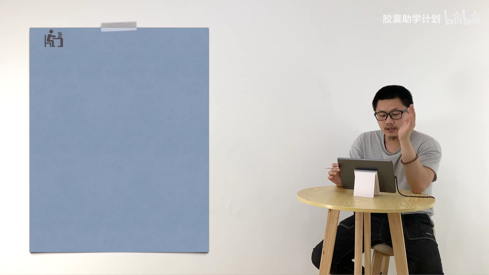

文字识别：胶囊助学计划

### 画面 00:04:23

文字识别：胶囊助学计划 / e

## 00:04:30–00:04:55

们快速成长。最后，我们再来看一句名人名言：Perfection is not attainable, but if we chase perfection, we can catch excellence. See you next time.

### 画面 00:04:31

文字识别：胶囊助学计划 / Perfection is not attainable, but if we chase / perfection we can catch excellence. / - Vince Lombardi

### 画面 00:04:43

### 画面 00:04:45

文字识别：CAPSULEACADEMY / 胶囊助学计划 / 『 / 小红书 / Lecturer / □ / Leo / OE

### 画面 00:04:48

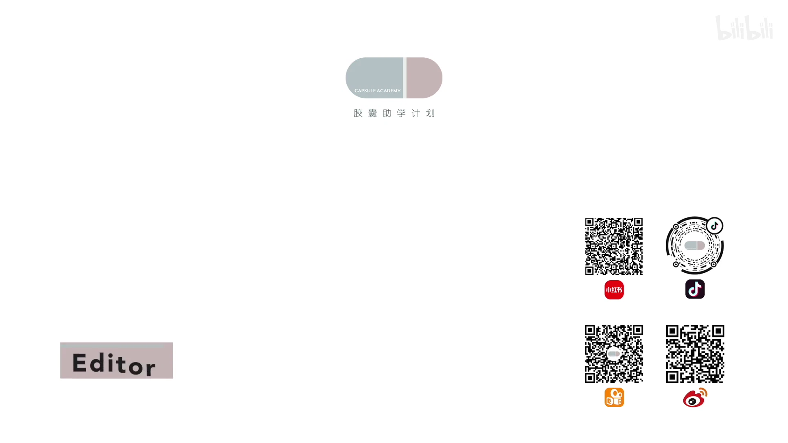

文字识别：CAPSULEACADEMY / 胶囊助学计划 / 『 / 小红书 / □ / Editor / OE

### 画面 00:04:51

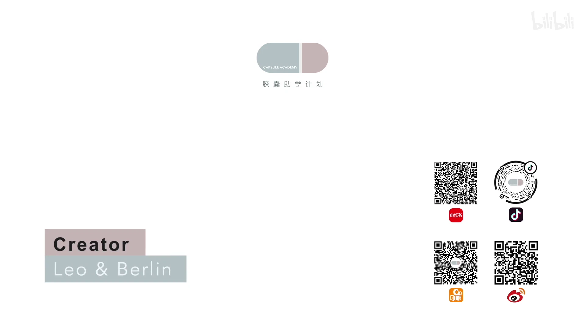

文字识别：CAPSULEACADEMY / 胶囊助学计划 / 『 / 小红书 / Creator / Leo & Berlin / OE

### 画面 00:04:53

文字识别：BiliBili / 胶囊助学计划 / 小红书

### 画面 00:04:55

文字识别：bilibili / 胶囊助学计划

