# 097 单词

快速机器解析：语音为单模型转写，未进行独立交叉校对或人工复核；画面每秒采样并按变化选帧，短时文字和标记可能遗漏。截图时间约有 1 秒误差。图片有损压缩；遇到疑点请按时间查看 Google Drive 原视频。

## 00:00:00–00:00:30

Hello everyone, welcome to Capsule Academy. This is Leo. Today we're going to learn New Concept English Book One Lesson Ninety Seven Words. 老习惯进入正式课程之前，我们看几个小的问题啊。如何表达你能处理某件事情吗？那下一个如何表达某物属于某人？那带着这两个问题，Hope you gonna enjoy. 那我们先看第一个单

### 画面 00:00:00

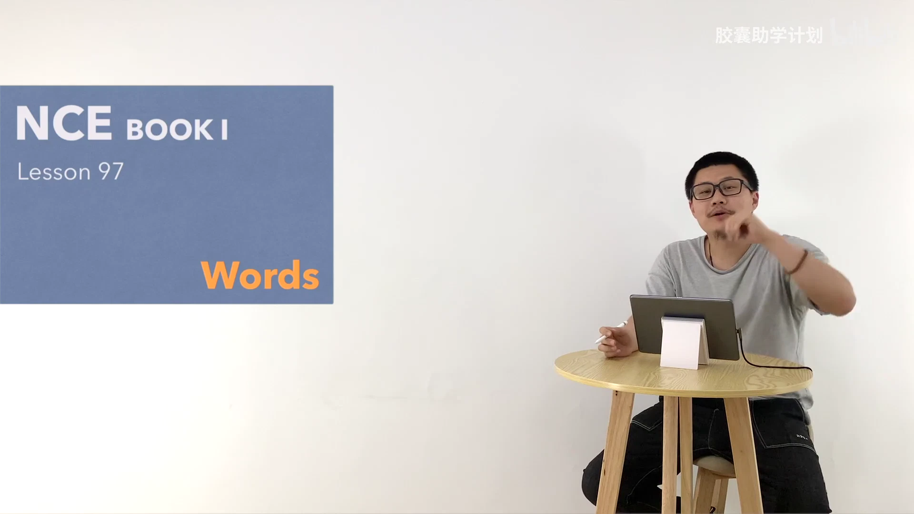

文字识别：胶囊助学计划 / NCE / BOOKI / Lesson 97 / Words

### 画面 00:00:05

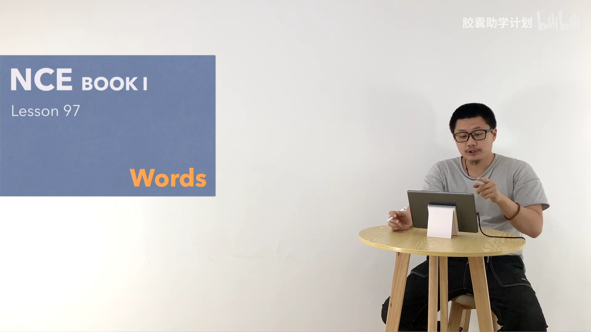

文字识别：胶囊助学计划 / NCE / BOOKI / Lesson 97 / Words / D

### 画面 00:00:09

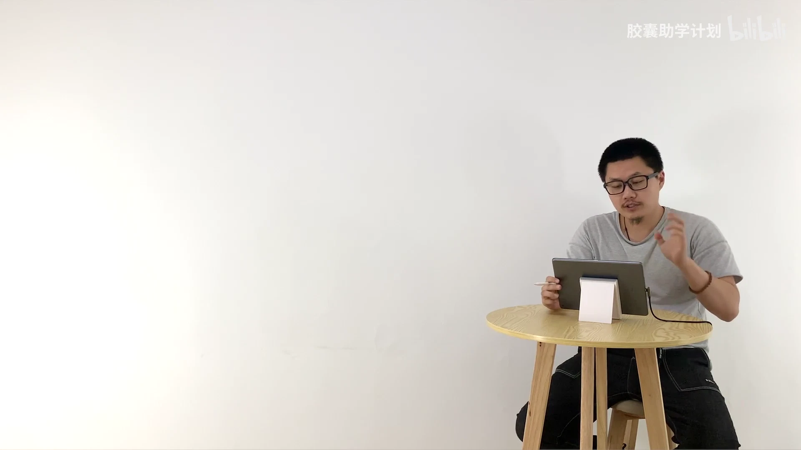

文字识别：胶囊助学计划 / -

### 画面 00:00:11

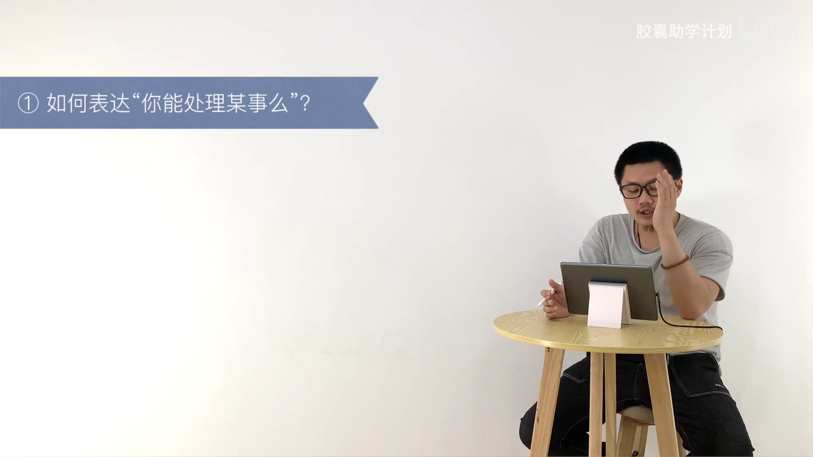

文字识别：胶囊助学计划 / ①如何表达“你能处理某事么”?

### 画面 00:00:16

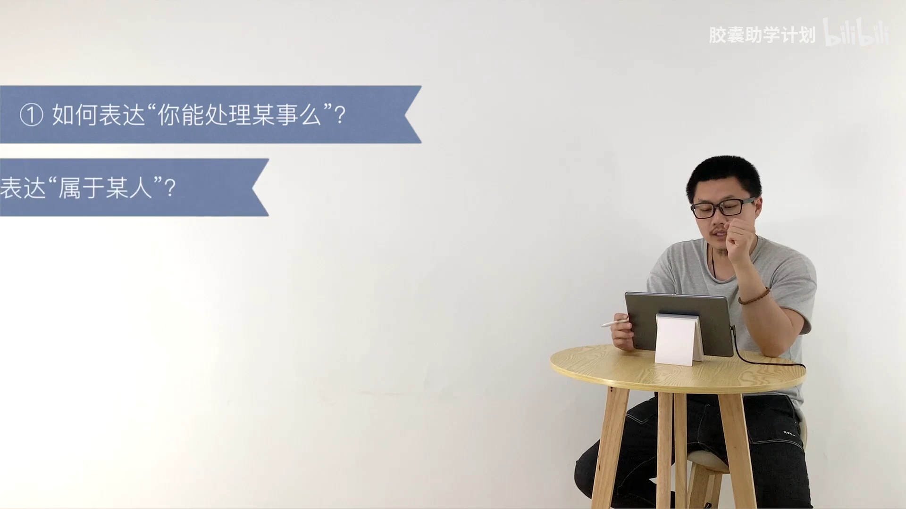

文字识别：胶囊助学计划 / ①如何表达“你能处理某事么”？ / 表达“属于某人”?

### 画面 00:00:18

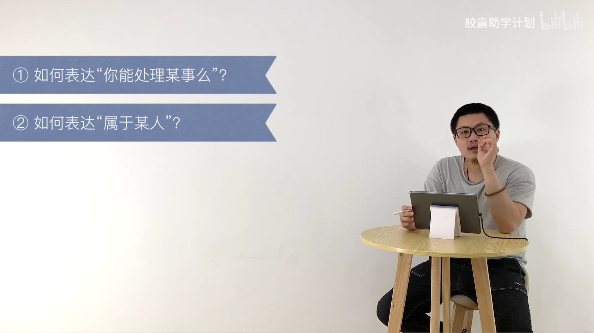

文字识别：胶囊助学计划 / ①如何表达“你能处理某事么”？ / 如何表达“属于某人”？

### 画面 00:00:24

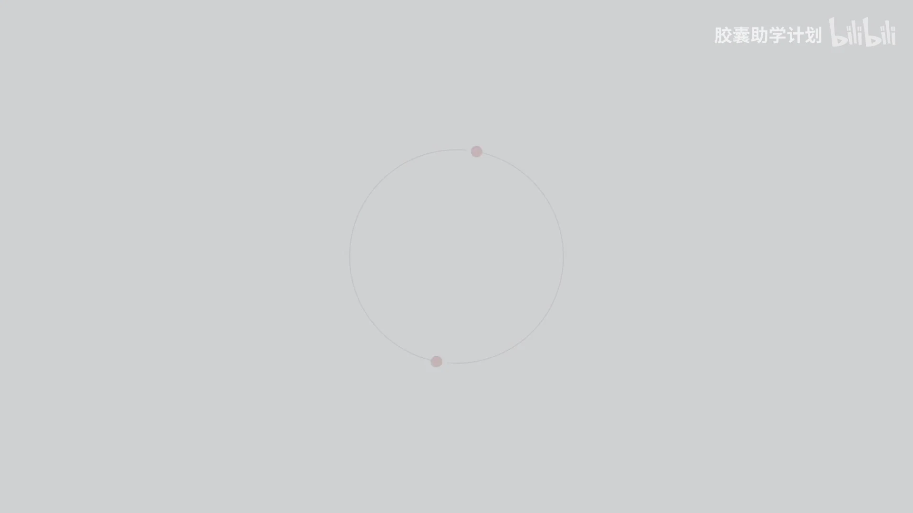

文字识别：胶囊助学计划bll / •

### 画面 00:00:27

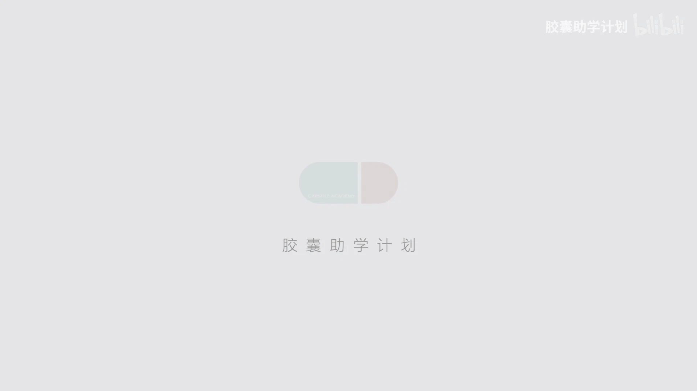

文字识别：胶囊助学计划 / 胶囊助学计划

### 画面 00:00:29

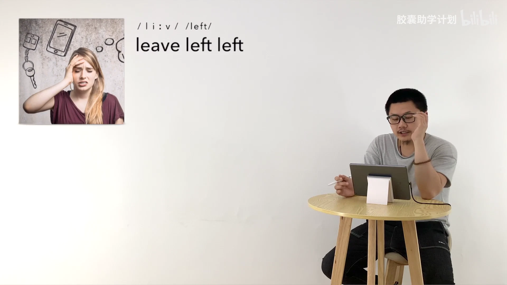

文字识别：胶囊助学计划 / /li:v/ /left/ / leave left left

## 00:00:30–00:01:00

词啊，各位先读一下，叫做 leave。哎，各位最熟悉的这个单词的意思叫离开，对吧？今天学到它另一个新的意思，叫做遗留、落下，把某个东西落在了某个地方啊，留在了某个地方。过去式、过去分词长得是一样的，张嘴跟我读一下，叫做 left， left。 OK，其实就是我们左手啊，左的那个单词叫 left，那儿一个长得是一样的。我们造一些句子，各位张嘴跟我读，

### 画面 00:00:52

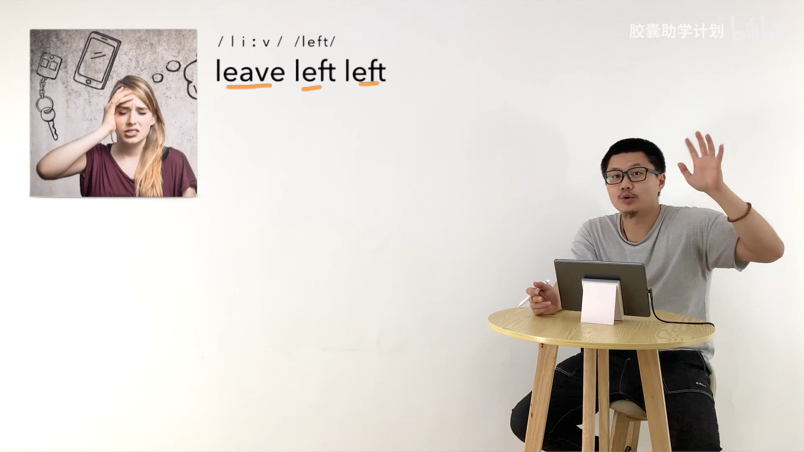

文字识别：胶囊助学计划 / /li:v/ /left/ / leave left left

### 画面 00:00:56

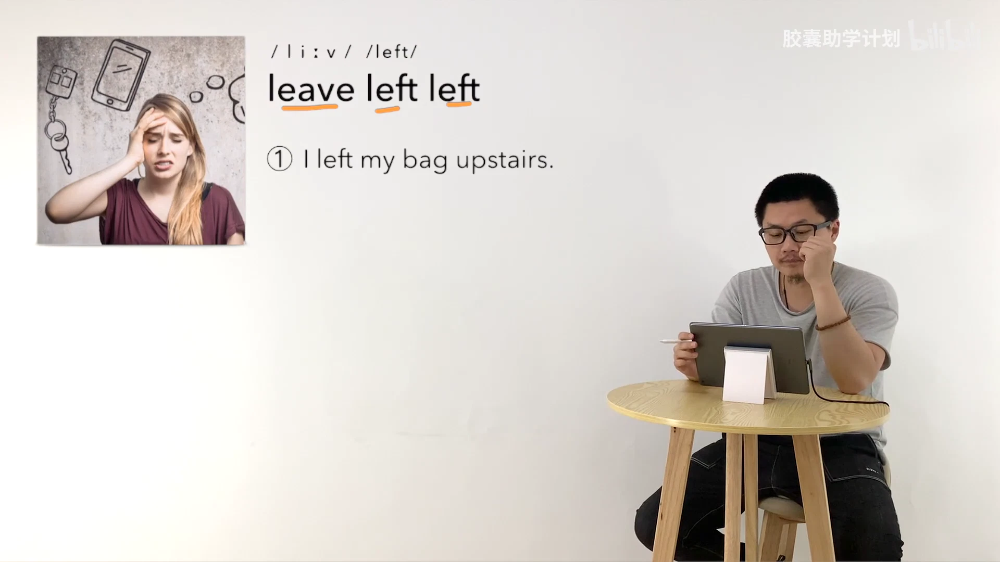

文字识别：胶囊助学计划 / / li:v/ /left/ / leave left left / ① Ileft my bag upstairs.

## 00:01:00–00:01:30

I left my bag upstairs. 哎，我把我的包儿落在楼上了。那我当机立断的决定，我们连着九十一课一起造一个对话，叫做 I'll get it for you. 啊，我帮你拿。 Continue. Did you leave your bag upstairs? 我们把第一句话变一般疑问句，再来个特殊疑问句。 What did you leave upstairs? 你把什么玩意儿放在落在楼上了，是吧？

### 画面 00:01:17

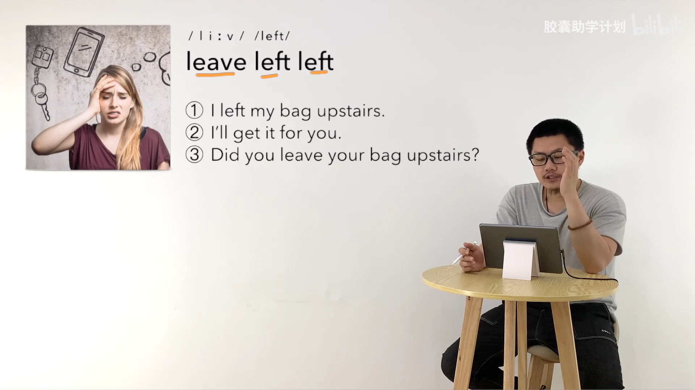

文字识别：胶囊助学计划 / / li:v/ /left/ / leave left left / ① Ileft my bag upstairs. / ② I'll get it for you. / ③ Did you leave your bag upstairs? / 3

## 00:01:30–00:02:00

OK，下一个单词这儿注意浊化一下，g对吧？叫做describe，不是scribe啊，describe，describe，OK，叫做描述。那它呢，往往其实跟can这个单词描述呃呃放在一起用的时间特别多。比如说，Can you describe that for me？你能帮我描述一下那件事情吗？或者那个东西吗？以及I can describe that，

### 画面 00:01:31

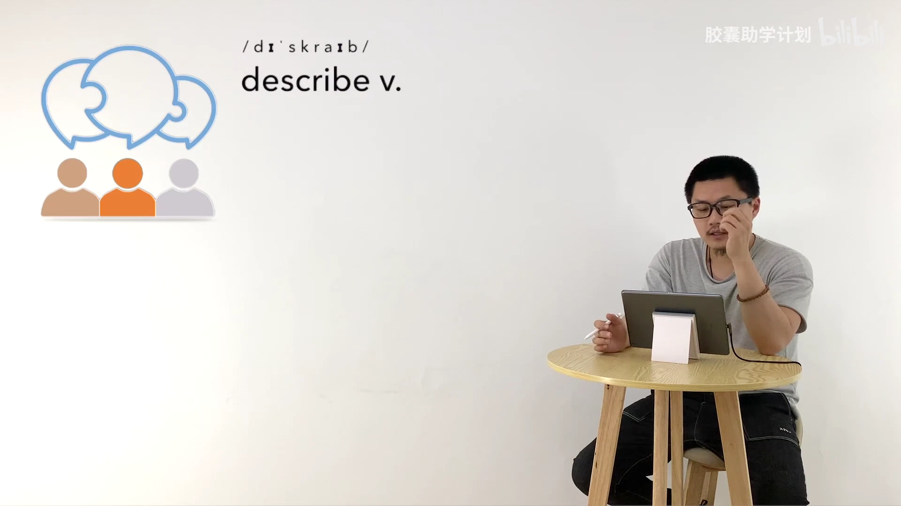

文字识别：胶囊助学计划 / /dI'skraib/ / describe v.

## 00:02:00–00:02:30

说我可以描述一下这个东西。好，来说，比如说你丢了东西，你现在去呃失物招领处，你要拿某个东西，那别人不能直接给你，对吧？别人会说 You must describe that first. 你必须要先描述一下那个东西。好， next one 下一个单词跟我一起读，很简单一个单词叫做 zip, zip. Okay, 那 zip 就是我们经常说这个拉链，对吧？你衣服上的这个拉链。那

### 画面 00:02:01

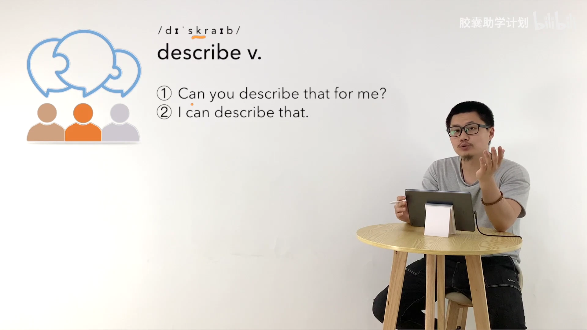

文字识别：胶囊助学计划 / /dι'skraib/ / describe v. / ① Can you describe that for me? / ② I can describe that.

### 画面 00:02:05

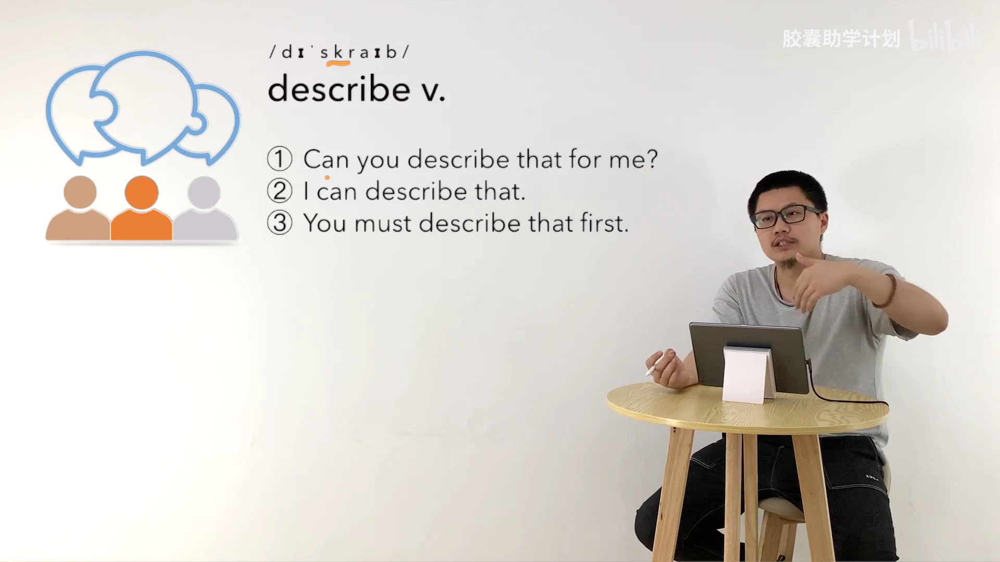

文字识别：胶囊助学计划 / /di'skraib/ / describe v. / ① Can you describe that for me? / ② I can describe that. / ③ You must describe that first.

### 画面 00:02:17

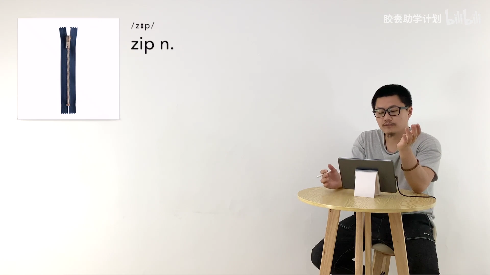

文字识别：胶囊助学计划 / /zip/ / zip n.

## 00:02:30–00:03:00

名词找动词呗。来，I need to buy a new zip. 再来，He's gonna buy a new zip. 你看这两句话含义就不一样了，对不对？时态也不同了。来，再来，You'd better buy a new zip. 你看，buy a new zip其实是没变的，只不过在这儿有变化，对不对啊？你最好还是买一个新的吧，要不你这很快就坏，容易出事儿。再来，I like this zip. Do you

### 画面 00:02:34

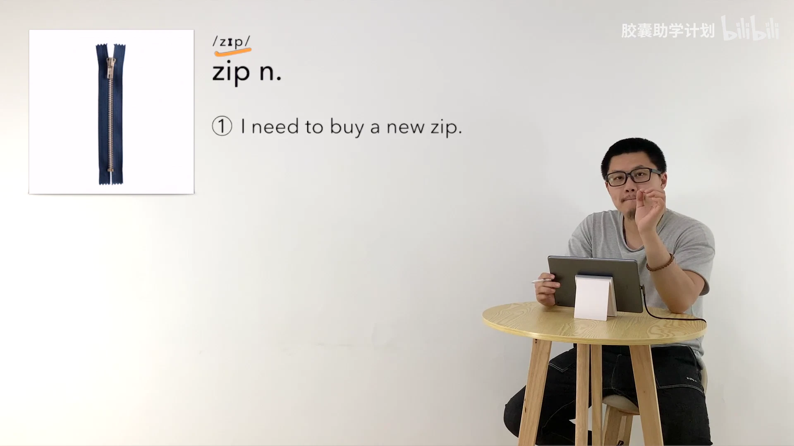

文字识别：胶囊助学计划 / /zIp/ / zip n. / ① I need to buy a new zip.

### 画面 00:02:46

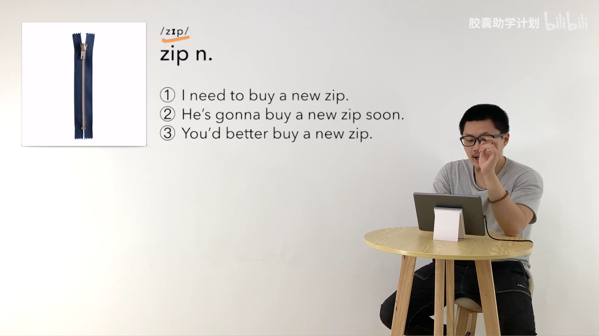

文字识别：胶囊助学计划 / /zIp/ / zip n. / ① I need to buy a new zip. / He's gonna buy a new zip soon. / You'd better buy a new zip. / 3

### 画面 00:02:48

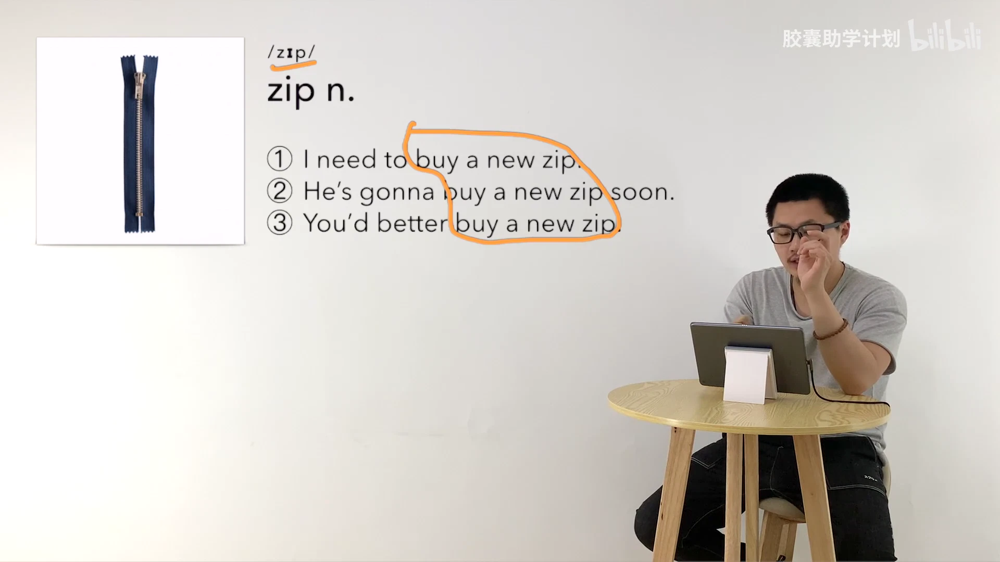

文字识别：胶囊助学计划 / /zIp/ / zip n. / ① Ineed to buy a new zip / He's gonnauy a new zip soon. / You'd betterbuy a new zip

### 画面 00:02:51

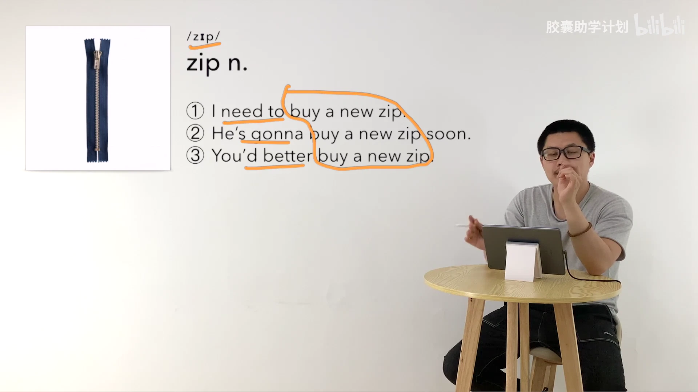

文字识别：胶囊助学计划 / /zIp/ / zip n. / ① I need to buy a new zip / He's gonnauy a new zip soon. / You'd betterbuy a new zip

### 画面 00:02:53

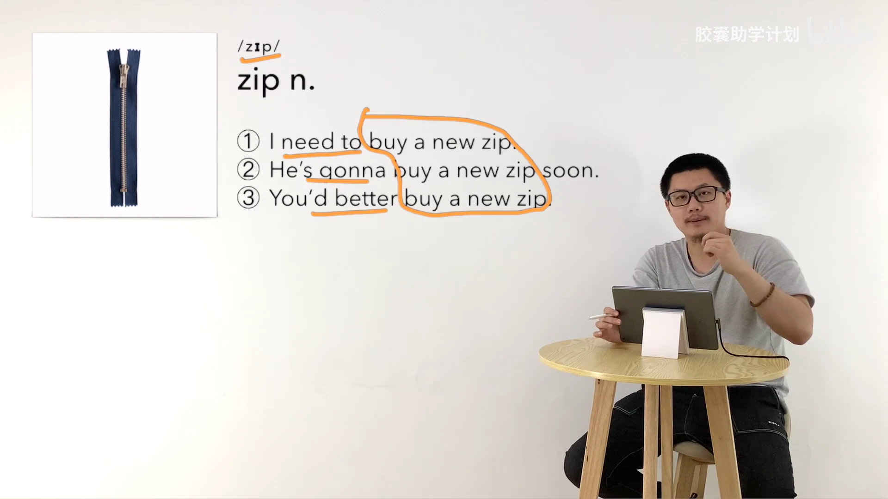

文字识别：胶囊助学计划 / /z1p/ / zip n. / ① I need to buy a new zip / He's gonnauy a new zip soon. / You'd betterbuy a new zip

### 画面 00:02:59

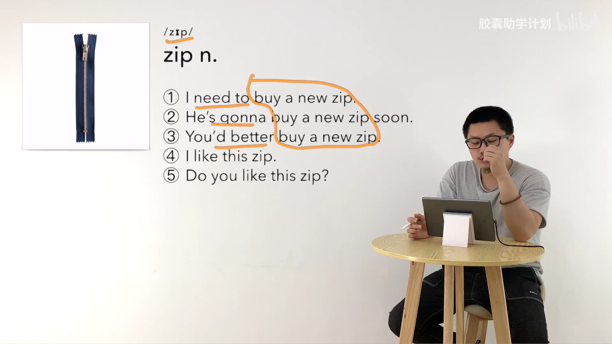

文字识别：胶囊助学计划 / /zIp/ / zip n. / ① I need to buy a new zip / He's gonnauy a new zip soon. / You'd betterbuy a new zio / I like this zip. / Do you like this zip? / 5

## 00:03:00–00:03:30

like this dip? 很简单啊，我们就不再多说了。下一个单词，跟我一起读，叫做 label, label. 好，就是我们这个标签这种东西，我们统称它叫做 label. OK, 那我们可以造一个句子, there be 句型，说 there is a label on the bottle. Have a look at it. 好，说这个瓶子上是有一个标签的，你去看一下它上面这些信息。再来, is there a label on

### 画面 00:03:02

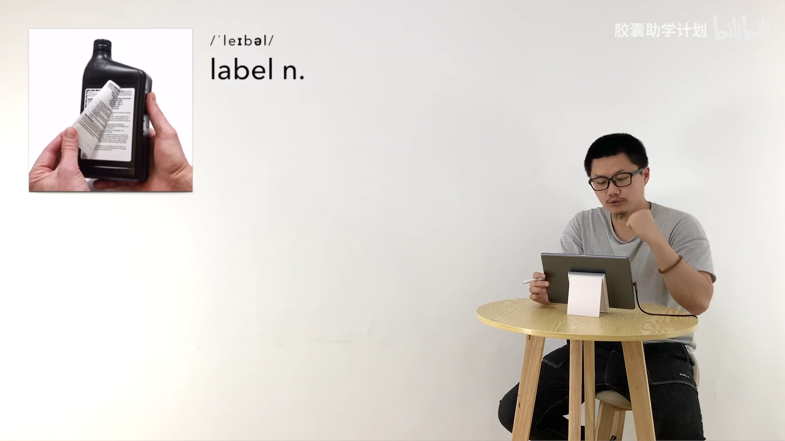

文字识别：胶囊助学计划 / /'lerbal/ / label n.

### 画面 00:03:11

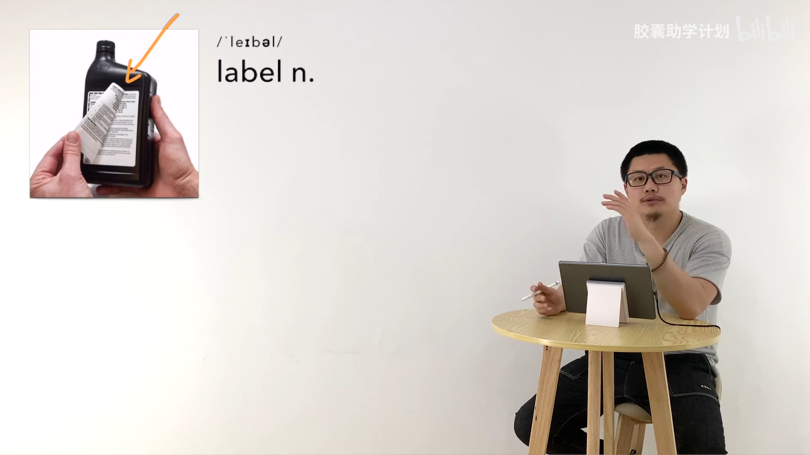

文字识别：胶囊助学计划 / /'lerbal/ / label n.

### 画面 00:03:27

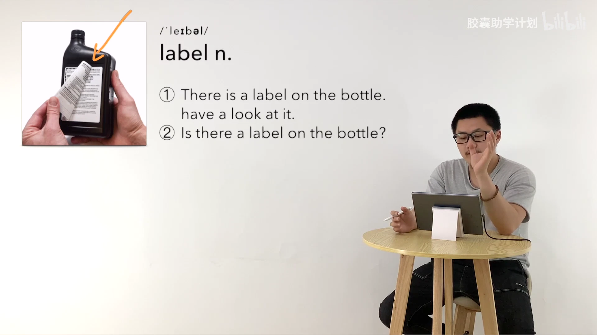

文字识别：胶囊助学计划 / /'leibal/ / label n. / ① There is a label on the bottle. / have a look at it. /  Is there a label on the bottle?

## 00:03:30–00:04:00

the bottle?变一般疑问句很容易，对吧？Okay, next one.下一个单词 handle handle把手啊，门把手那个把手就可以叫 handle.那它其实还有一个动词的含义。那一会儿我们再说啊。我们先来说它的名词。名词造句要找动词 clean 动词。说 he cleans the door handle every day.他打扫这个

### 画面 00:03:33

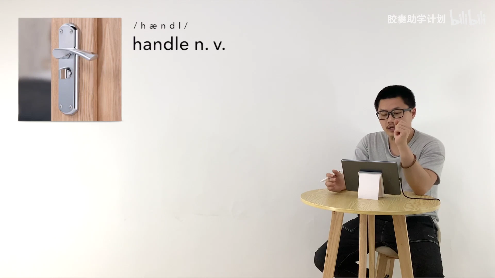

文字识别：胶囊助学计划 / / h ænd l/ / handle n. v. / O

### 画面 00:03:58

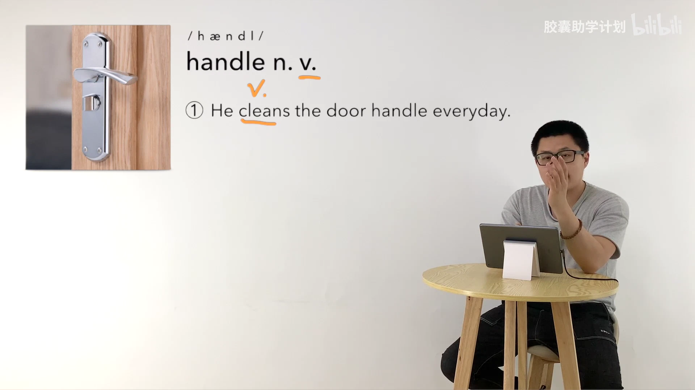

文字识别：胶囊助学计划 / / h æe n d l / / handle n. V. / V / ① He cleans the door handle everyday.

## 00:04:00–00:04:30

门把手，每天都打扫。一般现在时，看这儿加了 s，对吧？动词三单。Next one，一般疑问句：Does he clean the door handle every day？各种特殊疑问词：Why 加整句？What 对 door handle 提问？How often 就是对 every day 提问，对吧？他多久打扫一次这个门把手啊？这怎么上面都是泥了都，对吧？啊，都都包浆了，是吧？Next one，他还

### 画面 00:04:03

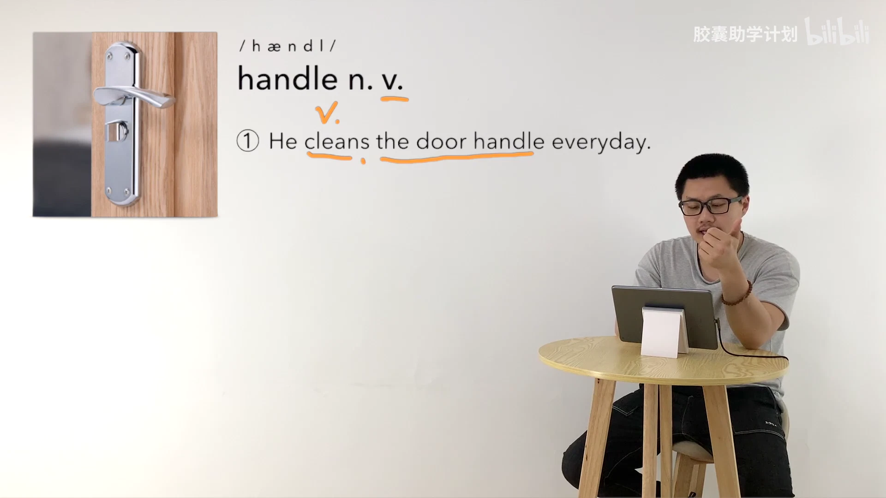

文字识别：胶囊助学计划 / / h æ n d l / / handle n. V. / √. / ① He cleans the door handle everyday.

### 画面 00:04:11

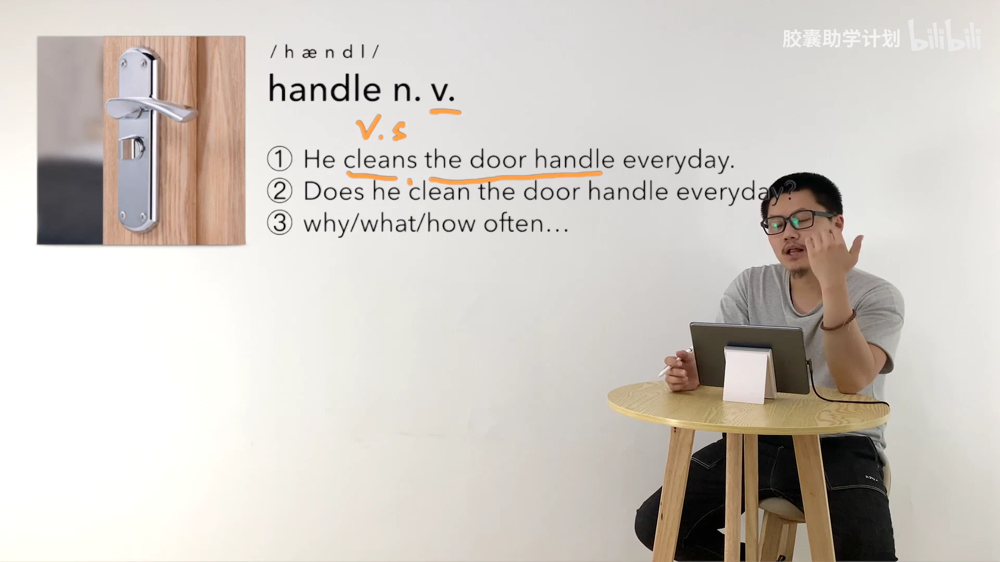

文字识别：胶囊助学计划 / / h æ n d l / / handle n. v. / v.s / ① He cleans the door handle everyday. / Does he clean the door handle everyda / 2 / why/what/how often...

### 画面 00:04:18

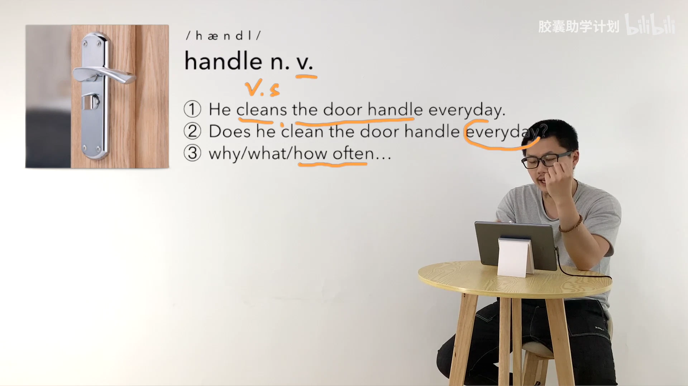

文字识别：胶囊助学计划 / / h æ n d l / / handle n. v. / V.s / ① He cleans the door handle everyday. / Does he clean the door handleeveryda / why/what/how often...

### 画面 00:04:23

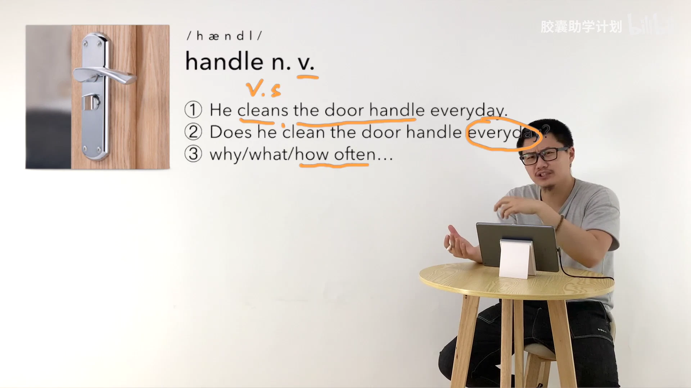

文字识别：胶囊助学计划 / / h æ n d l / / handle n. V. / √.s / ① He cleans the door handle everyday. / Does he clean the door handleeveryd / why/what/how often...

## 00:04:30–00:05:00

特别常用的一个含义是动词，叫做处理。你能处理好这件事情吗？啊，你能自己搞定这件事情吗？Can you handle this？你能处理好这件事情吗？再跟我读一遍，Can you handle this？Very good。下一个单词很简单，我们直接看句子就行了。What's your name？叫你的名字是什么，对吧？What's your address？叫做地址是什么？

### 画面 00:04:39

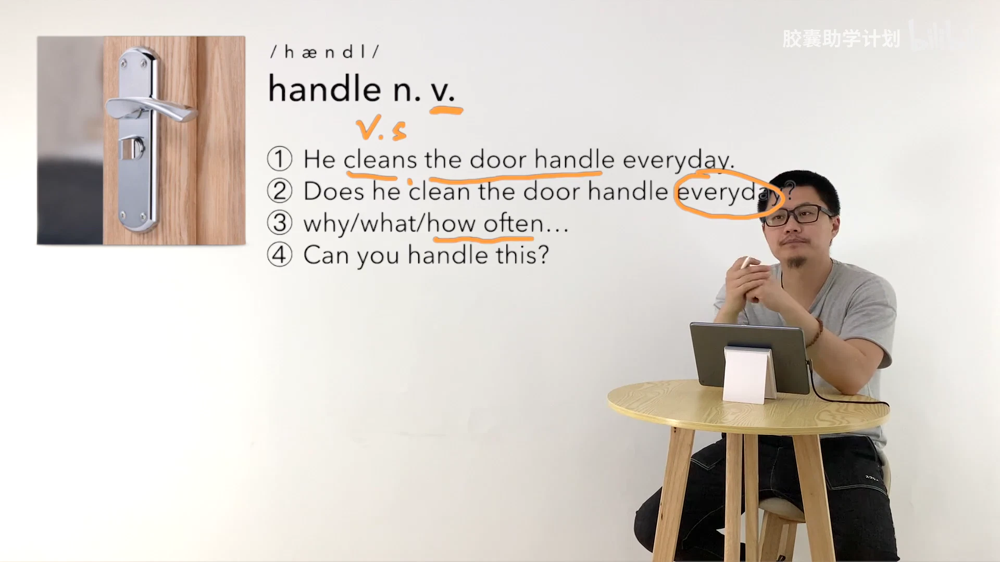

文字识别：胶囊助学计划 / / h æ n d l / / handle n. v. / √.s / ① He cleans the door handle everyday. / Does he clean the door handleeveryde / why/what/how often... / Can you handle this?

### 画面 00:04:48

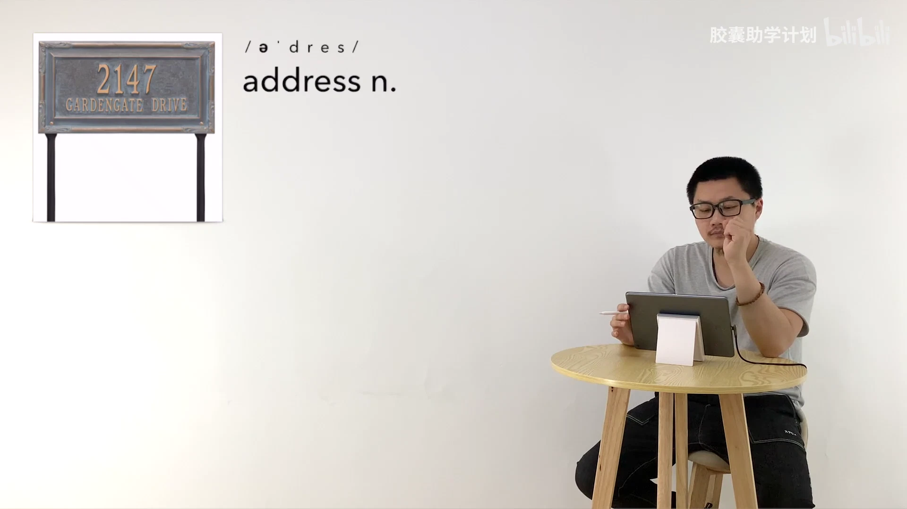

文字识别：胶囊助学计划 / /a'dres / / 2147 / address n. / GARDENGATE DRIVE

### 画面 00:04:53

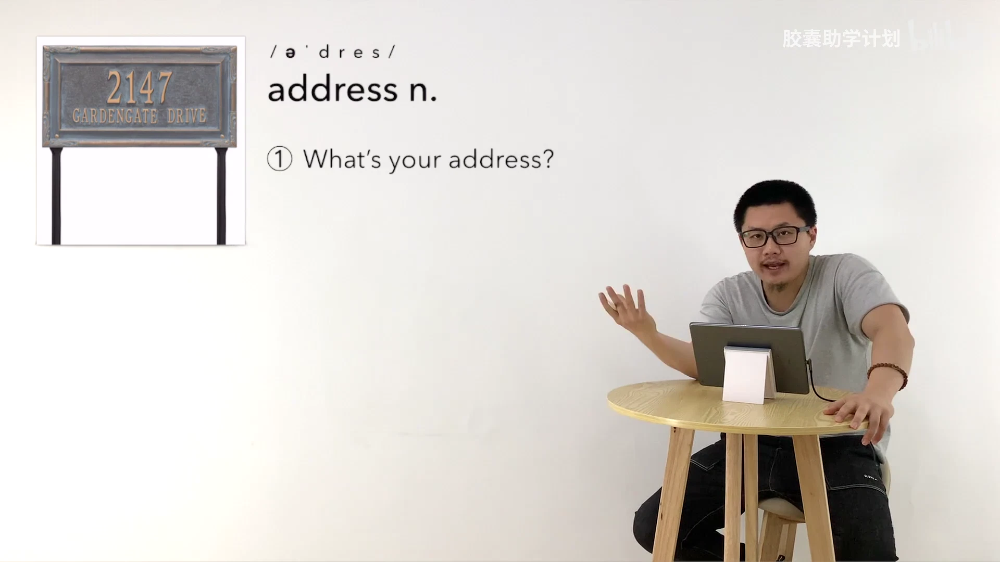

文字识别：胶囊助学计划 / /a'dres / / 2147 / address n. / GARDENGATE DRIVE / ① What's your address?

## 00:05:00–00:05:30

但注意一下这个地方的地址啊。首先，如果你只用 address 表示的，真的就是你的物理意义上的地址，就你家住在哪儿，对吧？你给别人寄个快递、点个外卖的时候的那个地址。那如果是 What's your email address？那指的就是你的邮件地址是什么？就把你的邮箱啊那个名字告诉我，我给你发个邮件，对吧？叫 email address 都是非常常用的两句话。OK，好，下一个单

### 画面 00:05:14

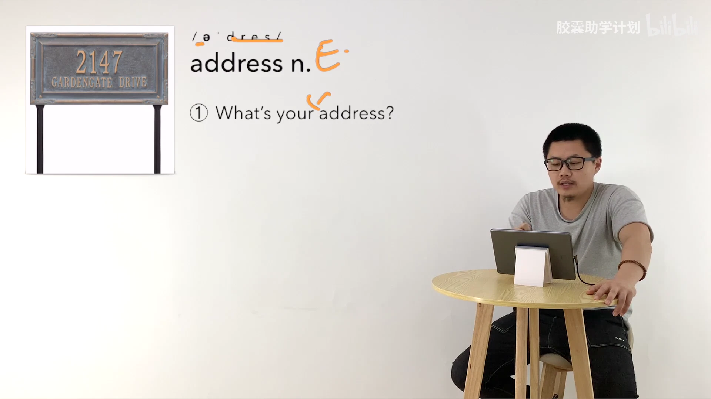

文字识别：胶囊助学计划 / /a'dresl / E / 2147 / address n. / GARDENGATE DRIVE / ① What's your address?

### 画面 00:05:28

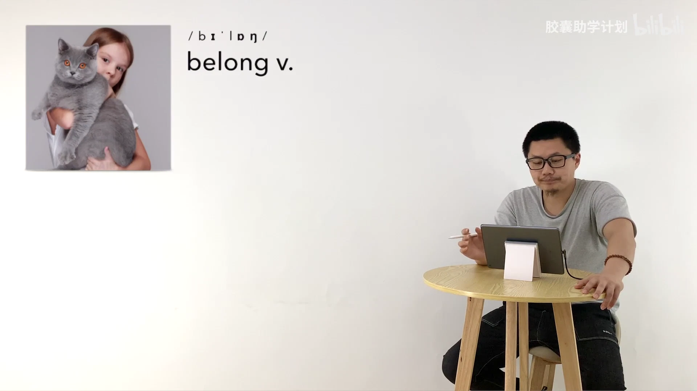

文字识别：胶囊助学计划 / /bιlｐn/ / belong V.

## 00:05:30–00:06:00

跟我读一下，叫做是这课比较关键的一个单词啊。belong， belong 属于它的一个短语最常出现的叫 belong to somebody，叫属于某人 belong to somebody。比如说 this cat belongs to me。注意一个小点，belong 后边加 s 了。我陈述客观事实一般现在时，

### 画面 00:05:43

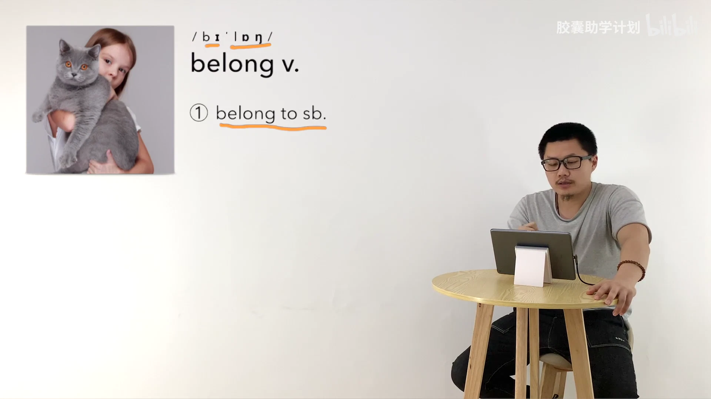

文字识别：胶囊助学计划 / /b1'lpn/ / belong v. / ① belong to sb.

### 画面 00:05:49

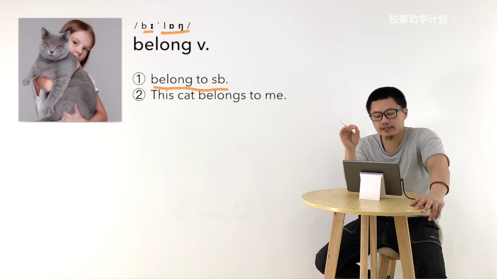

文字识别：胶囊助学计划 / / b1'lpn/ / belong V. / ① belong to sb. / This cat belongs to me.

## 00:06:00–00:06:30

动主语是 this cat 是三单，那我动词就要加 s，对不对？This cat belongs to me。我现在想把它变成一般疑问句，很简单嘛，Does 提前就可以了，动词换回原形，这是您在四十七、四十九课学过的一般现在时那个时态。Does this cat belong to you？但其实我们这句话，我个人的语感上很少用，我几乎也没听过。呃，这个猫属于你吗？我们大

### 画面 00:06:02

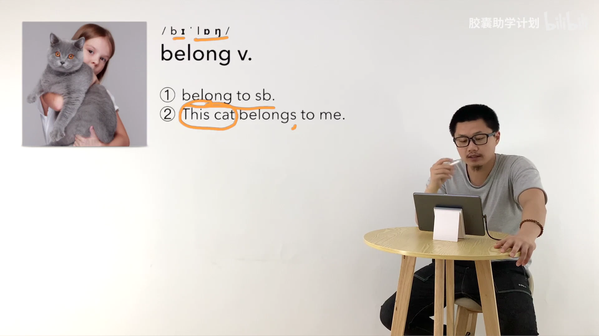

文字识别：胶囊助学计划 / / bⅠ'lpn/ / belong / V. / ① belong to sb. / This cat belongs to me.

### 画面 00:06:04

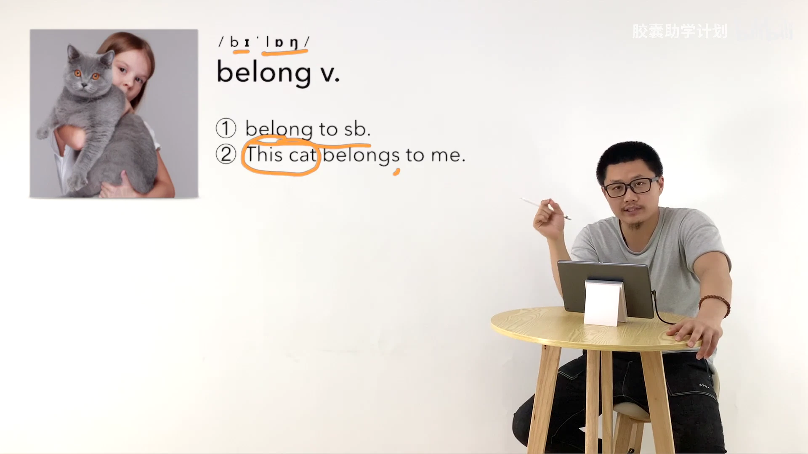

文字识别：/ bⅠ'lpn/ / belong / V. / ① belong to sb. / This catbelongs to me.

### 画面 00:06:06

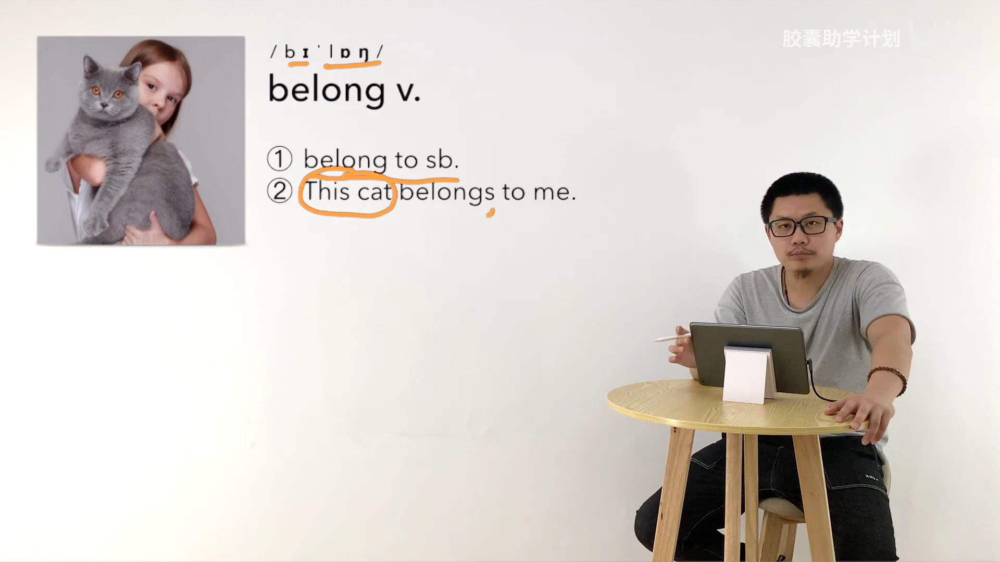

文字识别：胶囊助学计划 / / b1'lpn/ / belong v. / ① belong to sb. / This catbelongs to me.

### 画面 00:06:09

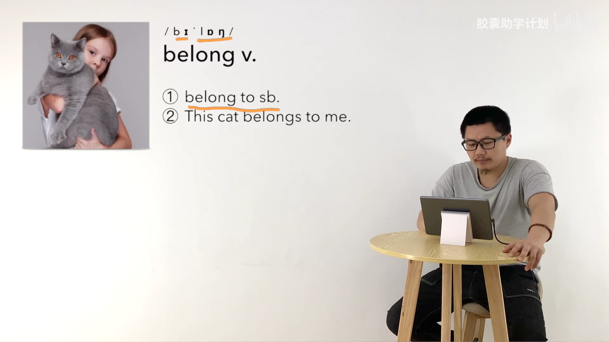

文字识别：胶囊助学计划 / /bⅠ'lpn/ / belong V. / ① belong to sb. / This cat belongs to me.

### 画面 00:06:17

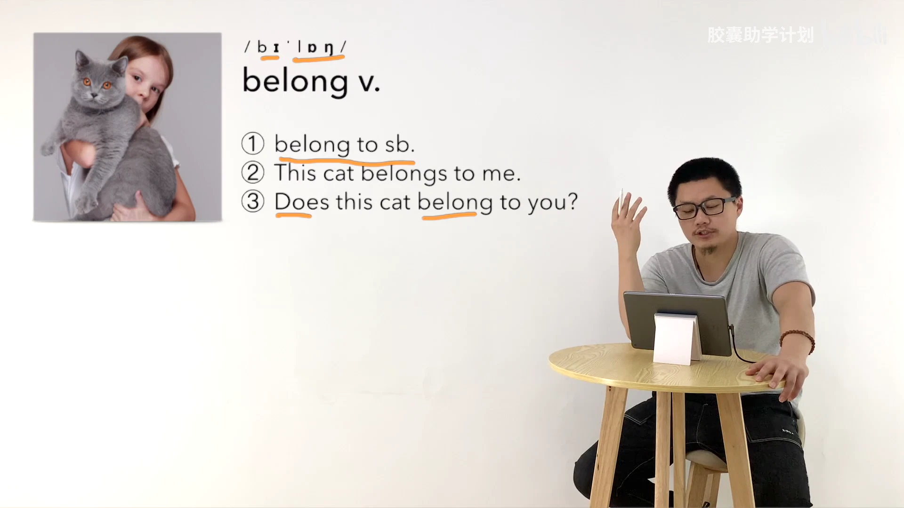

文字识别：/ b1'lpn/ / belong / V. / ① belong to sb. / This cat belongs to me. / Does this cat belong to you?

## 00:06:30–00:07:00

大多数情况下就用前二十个，甚至各位第一课学过的那句话就可以了，叫做 Is this your cat？这是你的猫吗？OK，很简单。那 recap 本课对吧？除了本身的单词很重要以外，belong to somebody 属于某人，以及 handle 的动词用法那句话叫 Can you handle this？家庭作业，绿皮书九十七课各位可以写了，文

### 画面 00:06:39

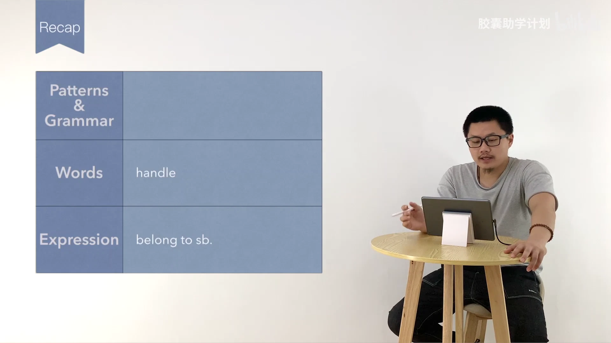

文字识别：Recap / 胶囊助学计划 / Patterns / Grammar / Words / handle / Expression / belong to sb.

### 画面 00:06:46

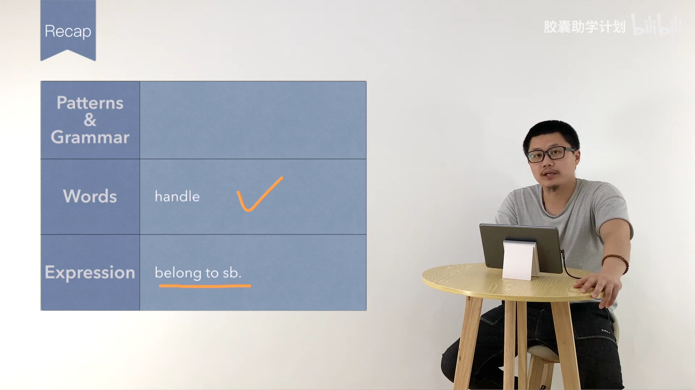

文字识别：胶囊助学计划 / Recap / Patterns / Grammar / Words / handle / Expression / belong to sb.

### 画面 00:06:51

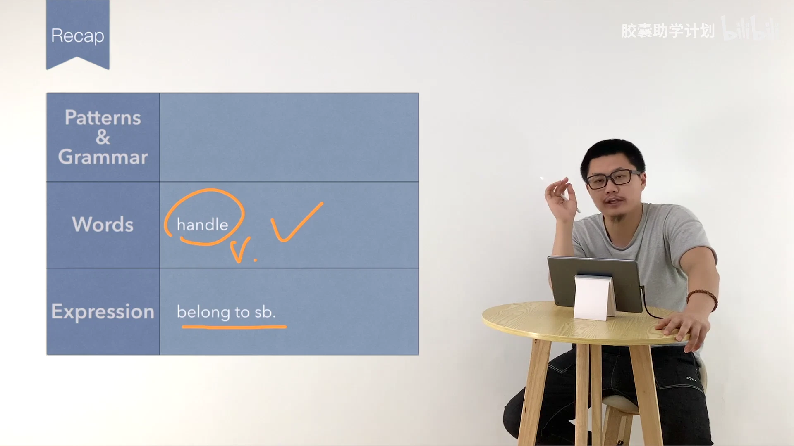

文字识别：胶囊助学计划 / Recap / Patterns / Grammar / Words / handle / Expression / belong to sb.

### 画面 00:06:53

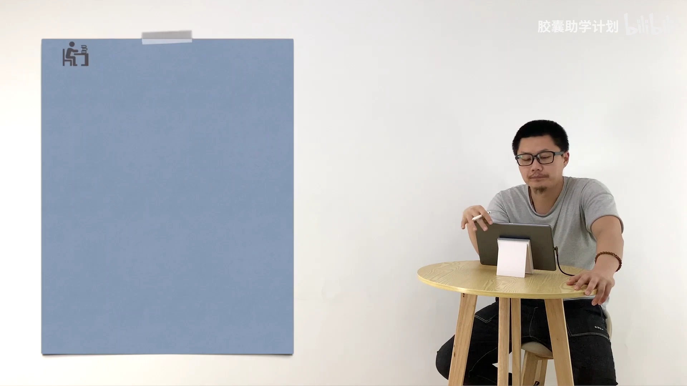

文字识别：胶囊助学计划

## 00:07:00–00:07:30

章老习惯，熟读成诵，给自己讲解一遍今天的核心知识点。那如果大家喜欢我们的课程，欢迎大家关注、订阅、一键三连、分享给那些需要的朋友，来帮助我们快速成长。最后呢，我们看一句名人名言：Peace is not absence of conflict. It is the ability to handle conflict by peaceful means. See you next time.

### 画面 00:07:05

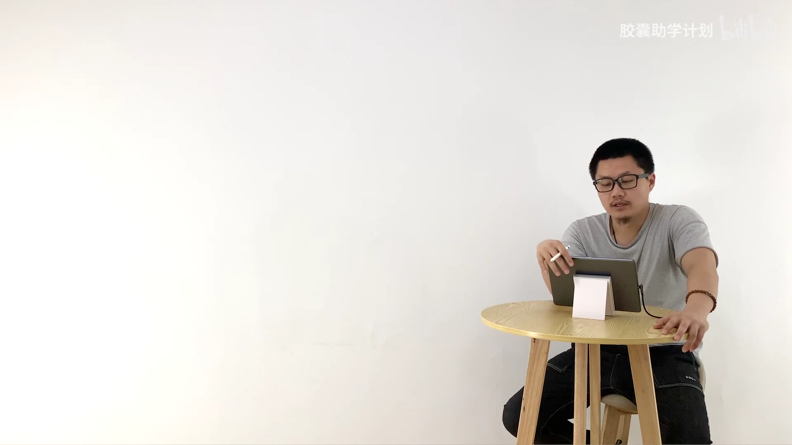

文字识别：胶囊助学计划

### 画面 00:07:14

文字识别：Peace is not absence of conflict, it is the / ability to handle conflict by peaceful / means. / Ronald Reagan

## 00:07:30–00:07:42

### 画面 00:07:30

### 画面 00:07:32

文字识别：CAPSULEACADEMY / 胶囊助学计划 / 小红书 / Lecturer / Leo / OE

### 画面 00:07:35

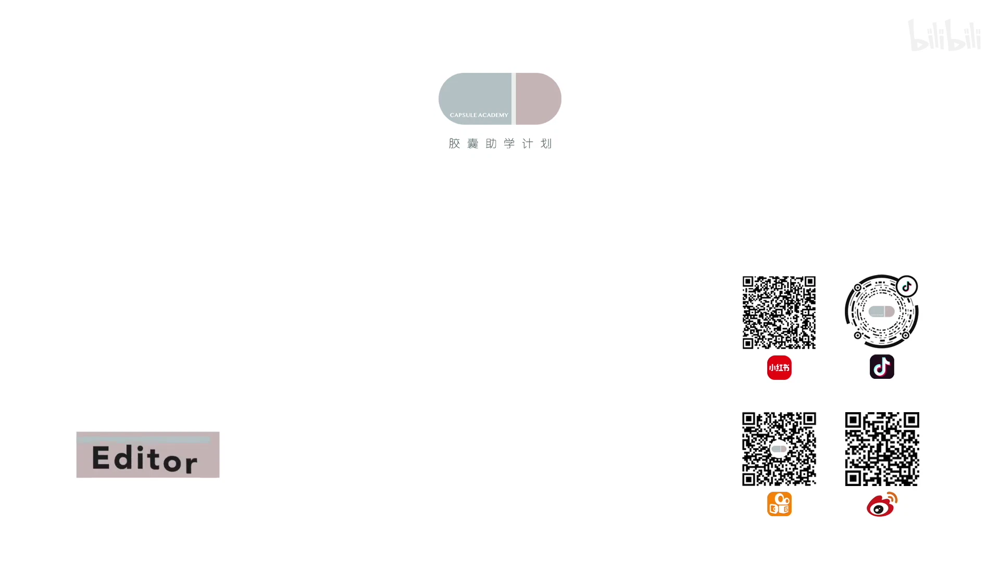

文字识别：CAPSULEACADEMY / 胶囊助学计划 / 小红书 / Editor / OE

### 画面 00:07:38

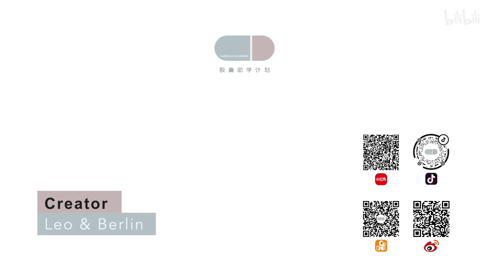

文字识别：CAPSULEACADEMY / 胶囊助学计划 / 小红书 / Creator / □ / Leo & Berlin / OE

### 画面 00:07:40

文字识别：bilibili / 胶囊助学计划

### 画面 00:07:42

文字识别：bilibili / 胶囊助学计划

