# 097 语法 文章

快速机器解析：语音为单模型转写，未进行独立交叉校对或人工复核；画面每秒采样并按变化选帧，短时文字和标记可能遗漏。截图时间约有 1 秒误差。图片有损压缩；遇到疑点请按时间查看 Google Drive 原视频。

## 00:00:00–00:00:30

Hello everyone, welcome to Capsule Academy. This is Leo. Today we're going to learn New Concept English Book One Lesson Ninety Seven Grammar and Story. Hope you guys enjoy it. Good. Okay, let's start. Okay, let

### 画面 00:00:00

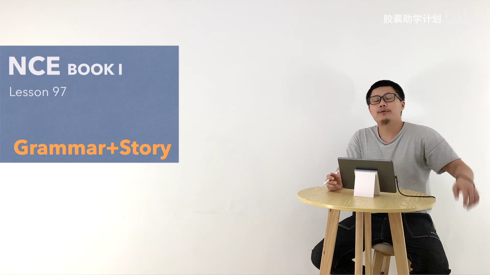

文字识别：胶囊助学计划 / NCE / BOOKI / Lesson 97 / Grammar+Story

### 画面 00:00:05

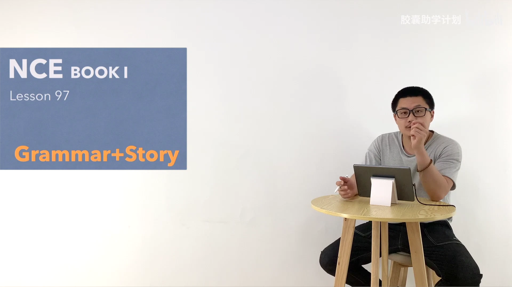

文字识别：NCE / BOOKI / Lesson 97 / Grammar+Story

### 画面 00:00:11

文字识别：胶囊助学计划 bilbl

### 画面 00:00:15

文字识别：胶囊助学计划

### 画面 00:00:17

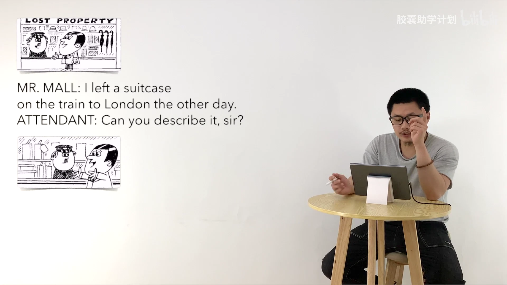

文字识别：胶囊助学计划 / LOST PROPERTY / 1 / MR. MALL: Ileft a suitcase / on the train to London the other day. / ATTENDANT: Can you describe it, sir?

### 画面 00:00:21

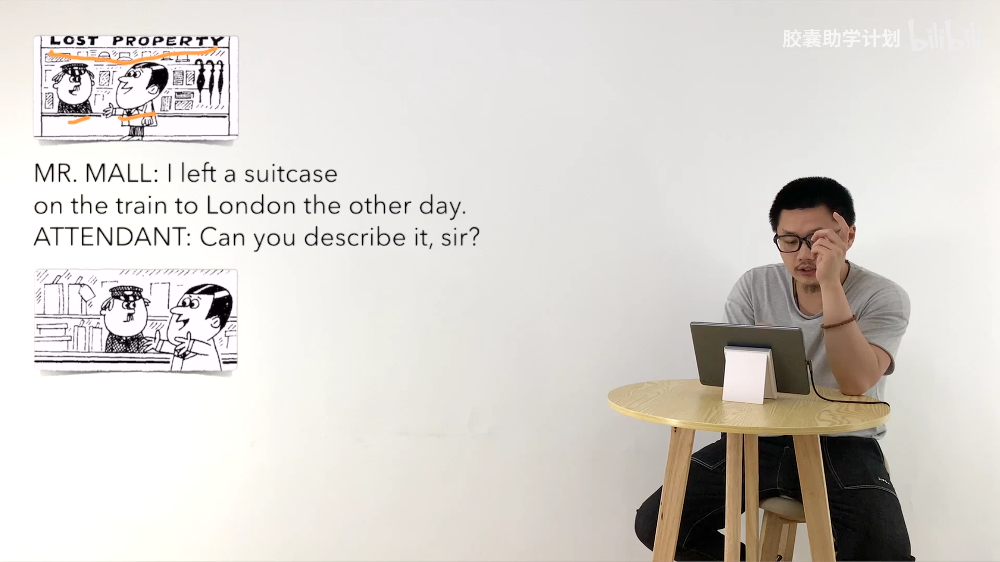

文字识别：胶囊助学计划 / LOST PROPERTY / MR. MALL: Ileft a suitcase / on the train to London the other day. / ATTENDANT: Can you describe it, sir?

### 画面 00:00:23

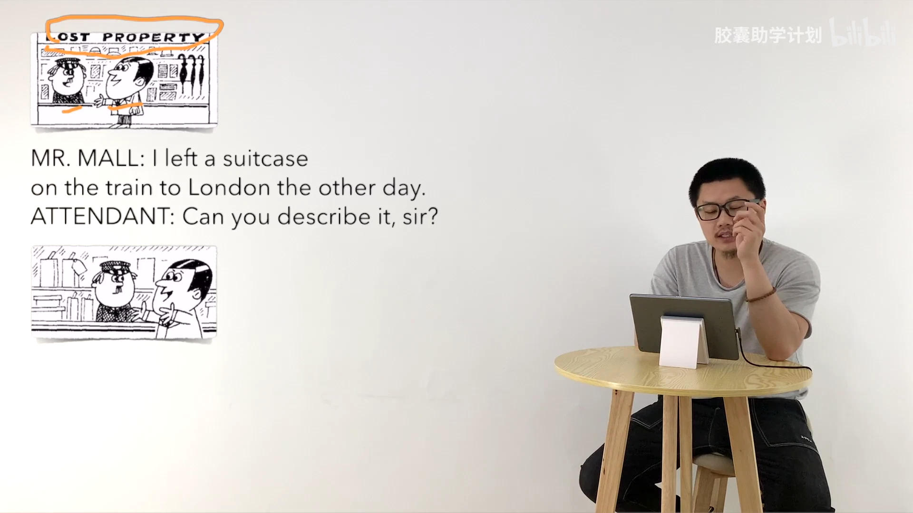

文字识别：胶囊助学计划 / OST PROPERTY / MR. MALL: Ileft a suitcase / on the train to London the other day. / ATTENDANT: Can you describe it, sir?

## 00:00:30–00:01:00

啊，就失物招领处。Lost 就丢了的，Found 就找到的，对吧？失物招领处。Mr. Mail 说说，I left a suitcase. 我遗留留落下了一个箱子 on the train to London. 在去伦敦的火车上。The other day, the other day 这个小的短语就是另一天，那一定是之前的某一天，所以它是一般过去时，对吧？其实就是前几天

### 画面 00:00:46

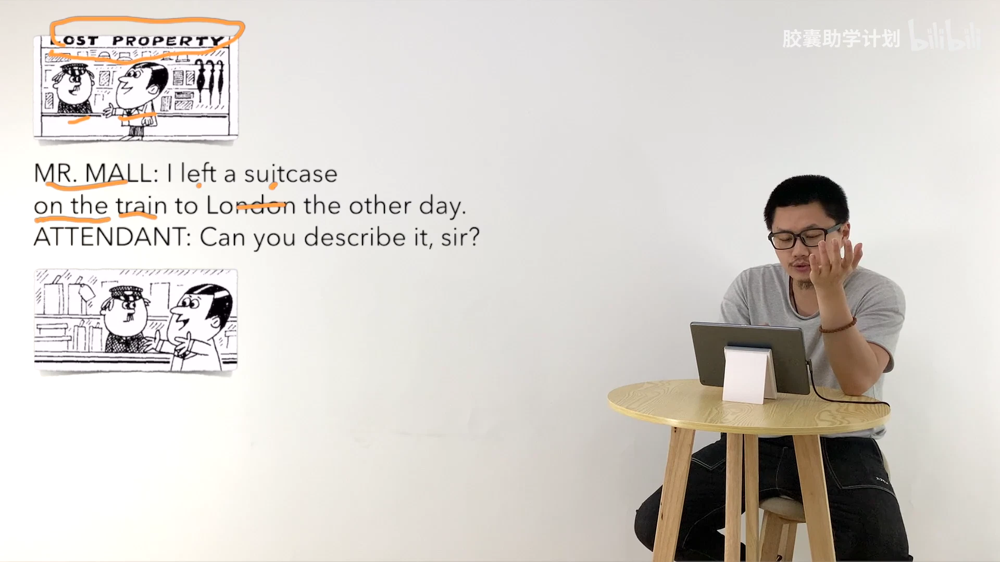

文字识别：OST PROPERTY / 胶囊助学计划 / 图 / MR. MALL: Ileft a suitcase / on the train to London t / the other day. / ATTENDANT: Can you describe it, sir?

### 画面 00:00:51

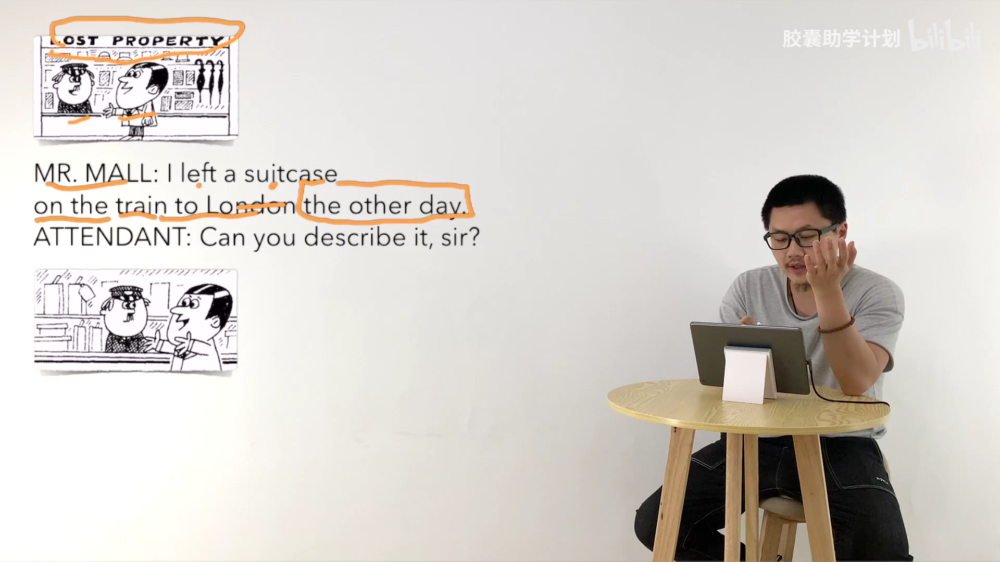

文字识别：胶囊助学计划 / OST PROPERTY / 图 / 图 / MR. MALL: Ileft a suitcase / on the / train to Londont / the other day. / ATTENDANT: Can you  / describe it, / sir?

## 00:01:00–00:01:30

啊，several days ago，大概是这样一种感觉。Attendant, 那当然了，说Can you describe it, sir? 啊，我这东西很多，你能先描述一下吗？Is a small blue a blue case? 说是啊，一个小的蓝色的箱子。And it's got a zip. 这个P.S.是谁？P.S.是has，不是is，不是it is got a zip，是it has

### 画面 00:01:11

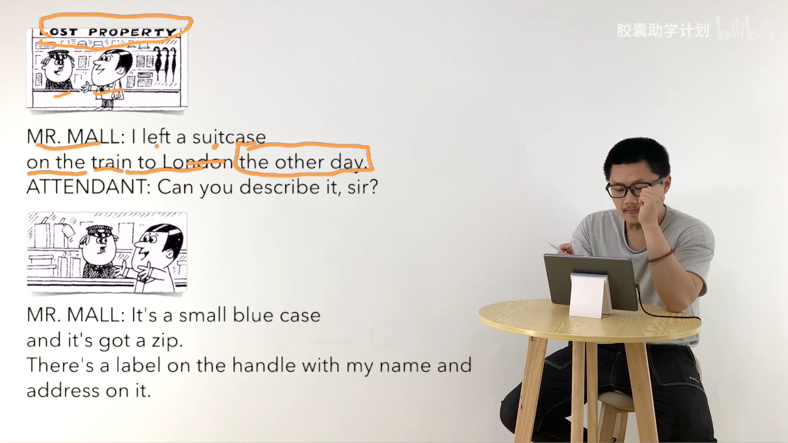

文字识别：OST PROPERTY / 胶囊助学计划 / 图 / MR. MALL: Ileft a suitcase / on the train to Lomdonthe other dav. / ATTENDANT: Can you describe it, sir? / MR. MALL: It's a small blue case / and it's got a zip. / There's a label on the handle with my name and / address on it.

### 画面 00:01:17

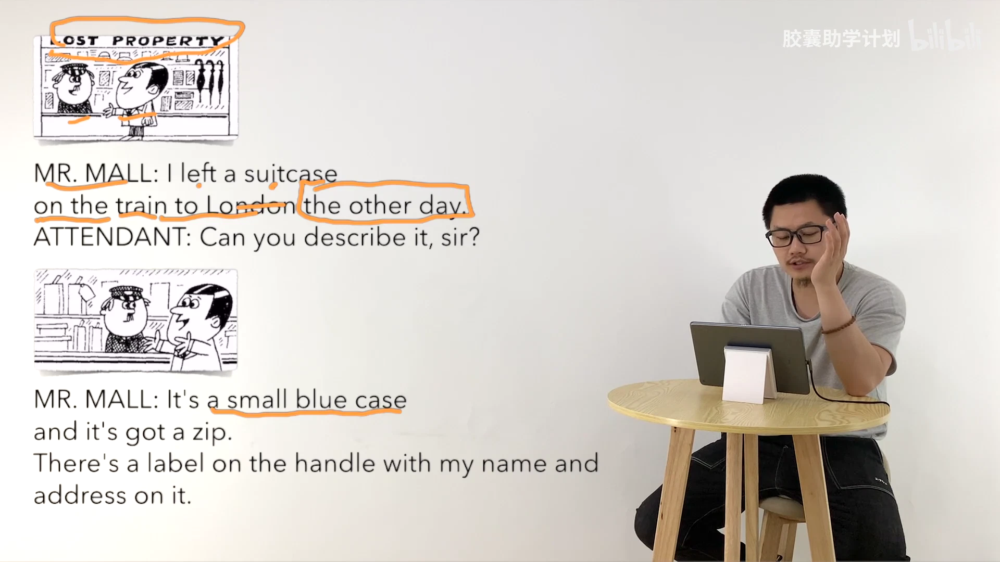

文字识别：胶囊助学计划 / OST PROPERTY / 图 / MR. MALL: Ileft a suitcase / on the train to Londonthe other day. / ATTENDANT: Can you describe it, sir? / MR. MALL: It's a small blue case / and it's got a zip. / There's a label on the handle with my name and / address on it.

### 画面 00:01:23

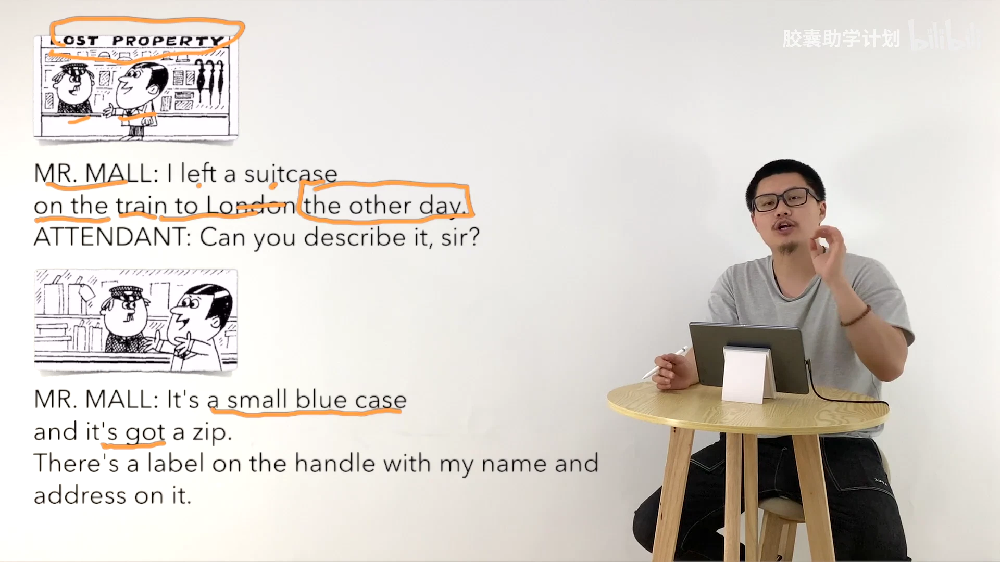

文字识别：OST PROPERTY / 胶囊助学计划 / MR. MALL: Ileft a suitcase / on the train to Londonthe other day. / ATTENDANT: Can you describe it, sir? / MR. MALL: It's a small blue case / and it's got a zip. / There's a label on the handle with my name and / address on it.

## 00:01:30–00:02:00

got a zip. 如果 has 加 got 在这儿对于您来说特别陌生，一定要回到七十九课 have 加 got 那课仔细去看一下，学一下，对吧？ OK，叫做它有一个小的拉链。接下来第二句型说 there is a label on the handle. 在这个这个这个箱子的把手上呢有一个小的标签，对吧？啊，有一个小的出来的东西，上面可能写了东西呢。

### 画面 00:01:33

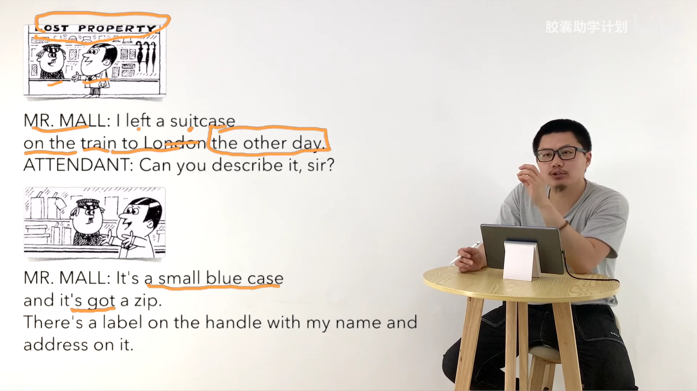

文字识别：OST PROPERTY / 胶囊助学计划 / 图 / MR. MALL: Ileft a suitcase / on the train to Lonconthe other day. / ATTENDANT: Can you describe it, sir? / MR. MALL: It's a small blue case / and it's got a zip. / There's a label on the handle with my name and / address on it.

### 画面 00:01:41

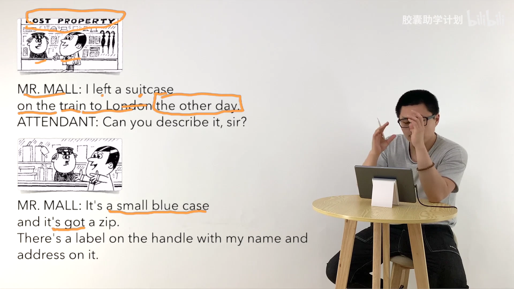

文字识别：OST PROPERTY / 胶囊助学计划 / 图 / MR. MALL: Ieft a suitcase / on the train to Lonconthe other day. / ATTENDANT: Can you describe it, sir? / MR. MALL: It's a small blue case / and it's got a zip. / There's a label on the handle with my name and / address on it.

### 画面 00:01:48

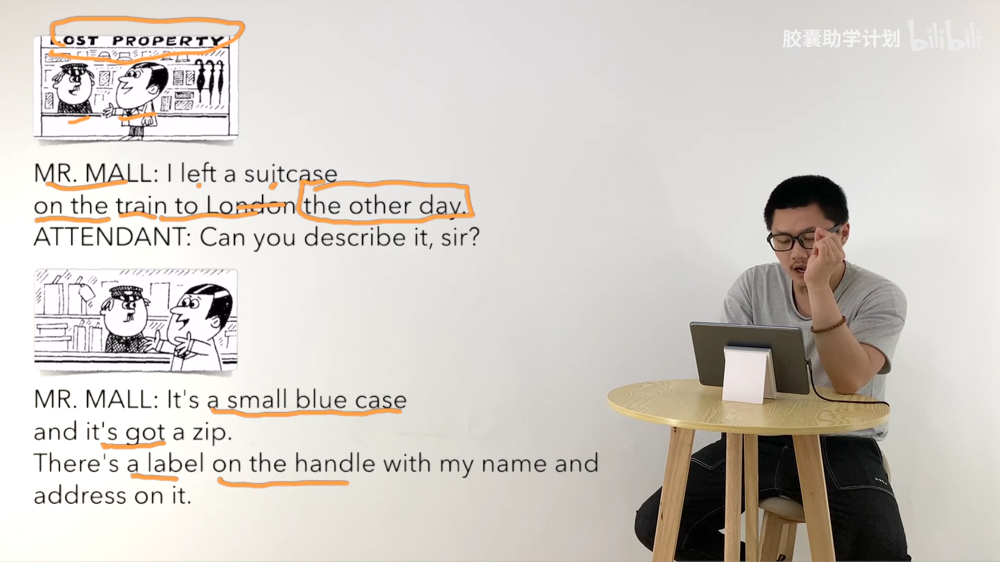

文字识别：胶囊助学计划 / OST PROPERTY / MR. MALL: Ileft a suitcase / on the train to Londonthe other day. / ATTENDANT: Can you describe it, sir? / MR. MALL: It's a small blue case / and it's got a zip. / There's a label on the handle with my name and / address on it.

### 画面 00:01:54

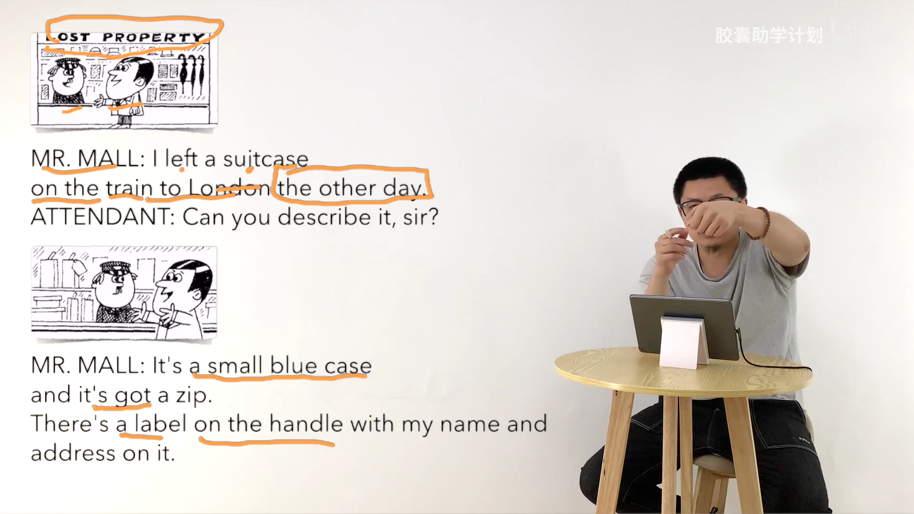

文字识别：胶囊助学计划 / OST PROPERTY / MR. MALL: Ileft a suitcase / on the train to Londonthe other day. / ATTENDANT: Can you describe it, sir? / MR. MALL: It's a small blue case / and it's got a zip. / There's a label on the handle with my name and / address on it.

## 00:02:00–00:02:30

有什么东西呢？有 my name and address on it，说有我的名字和地址在它上面啊，这就好说了。接着往下看，他拿了一个，他说 is this case yours？好，注意你看 yours 这个单词，如果您学的足够仔细，我们从来没见过，我们见过 you 啊，是吧？我们还见过 your，但我们从来没见过后边加一个 s 的，这个就是本课的一个小的语法，

### 画面 00:02:00

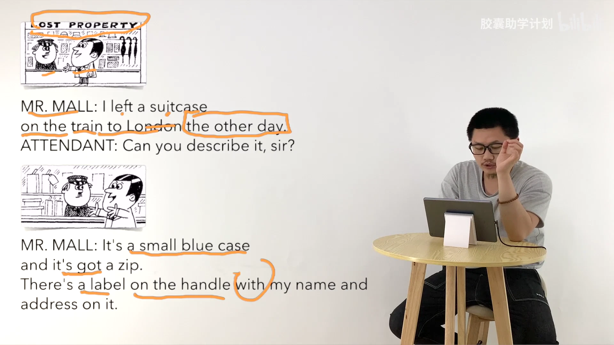

文字识别：胶囊助学计划 / OST PROPERTY / 图 / 图 / MR. MALL: Ileft a suitcase / on the train to Londonthe other day. / ATTENDANT: Can you describe it, sir? / MR. MALL: It's a small blue case / and it's got a zip. / There's a label on the handle / with my name and / address on it.

### 画面 00:02:03

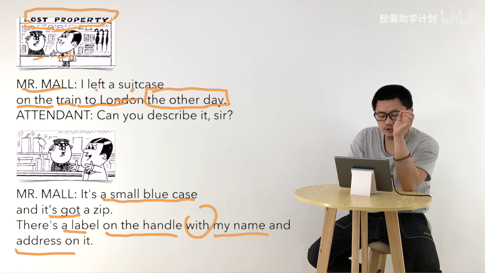

文字识别：OST PROPERTY / 胶囊助学计划 / 图 / MR. MALL: Ileft a suitcase / on the train to Loncdonthe other dav. / ATTENDANT: Can you describe it, sir? / MR. MALL: It's a small blue case / and it's got a zip. / There's a label on the handle / with my name and / address on it.

### 画面 00:02:08

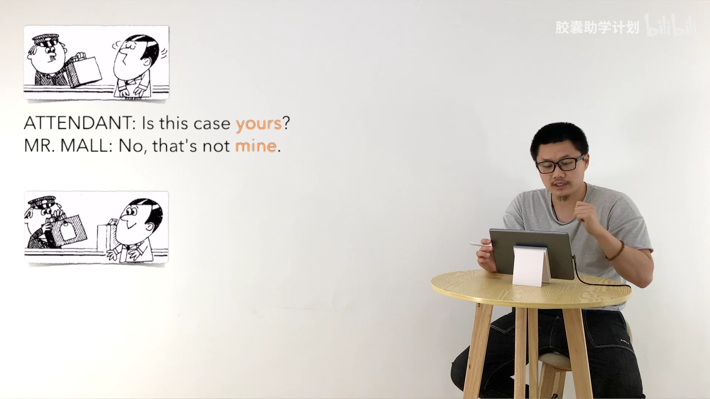

文字识别：胶囊助学计划 / ATTENDANT: Is this case yours? / MR. MALL: No, that's not mine.

### 画面 00:02:17

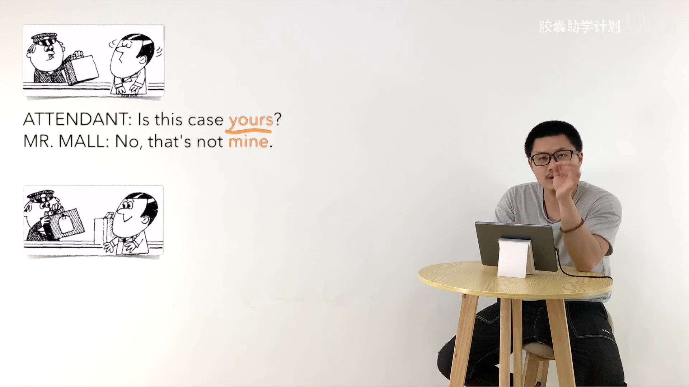

文字识别：胶囊助学计划 / ATTENDANT: Is this case yours? / MR. MALL: No, that's not mine.

### 画面 00:02:19

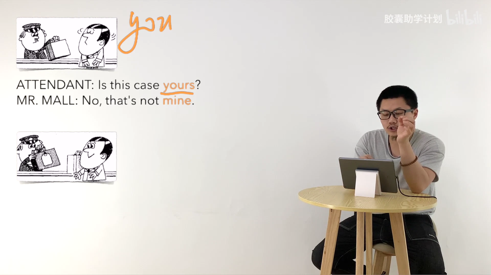

文字识别：yu / 胶囊助学计划 / ATTENDANT: Is this case yours? / MR. MALL: No, that's not mine.

### 画面 00:02:21

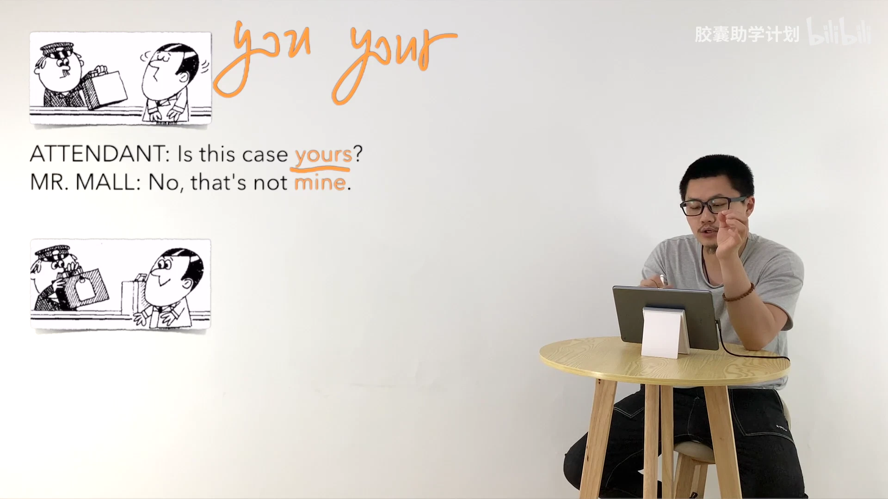

文字识别：you / youf / 胶囊助学计划 / ATTENDANT: Is this case yours? / MR. MALL: No, that's not mine.

### 画面 00:02:26

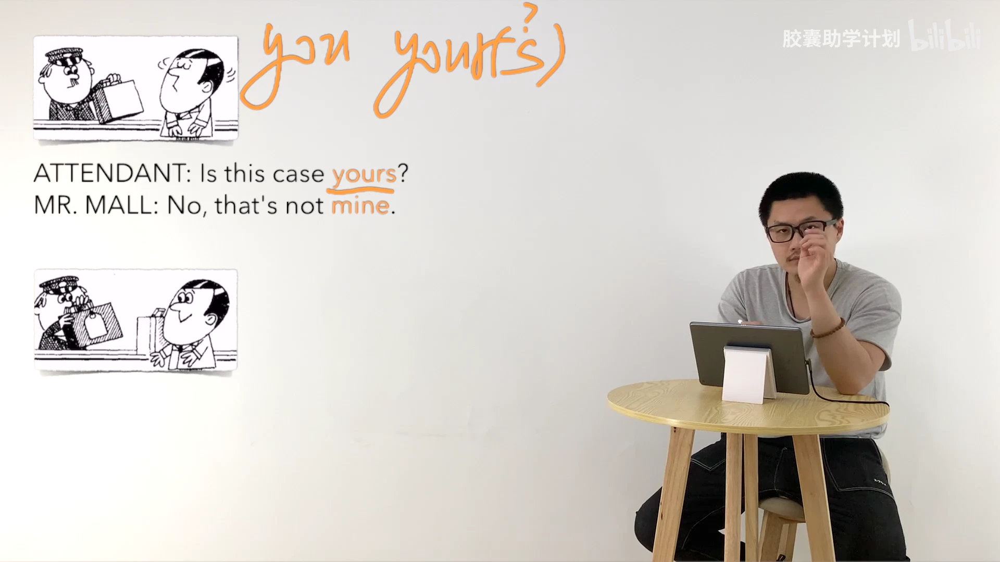

文字识别：you / yourts / 胶囊助学计划 / ATTENDANT: Is this case / eyours? / MR. MALL: No, that's not mine.

## 00:02:30–00:03:00

但并不难，很容易理解啊。而且我们猜也能猜出来，他这句话大概的意思就是这个箱子是你的吗？对吧？好像和 is this your case 没有什么差别，对吧？一会儿我们讲，一会儿我们再去讲啊。他说 no that's not mine。你看 mine 你也不认的，但是你可能是见过 me，对吧？见过 mine，但是咱没见过 m i n e mine 这个单词啊。一会儿我们马上讲，我先告诉各位，它的意

### 画面 00:02:51

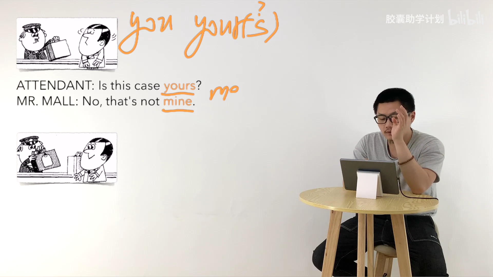

文字识别：yourtis / 胶囊助学计划 / ATTENDANT: Is this / case / yours? / Mo / MR. MALL: No, that's not / mine.

### 画面 00:02:53

文字识别：yousrtis / 胶囊助学计划 / ATTENDANT: Is this case / yours? / me / my / MR. MALL: No, that's not / t mine.

### 画面 00:02:55

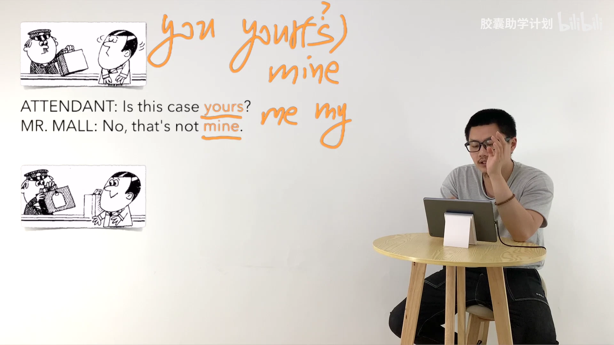

文字识别：yourt's) / 胶囊助学计划 / mine / ATTENDANT: Is / this / case / yours? / ? / Me / My / MR. MALL: No, that's not / mine.

### 画面 00:02:57

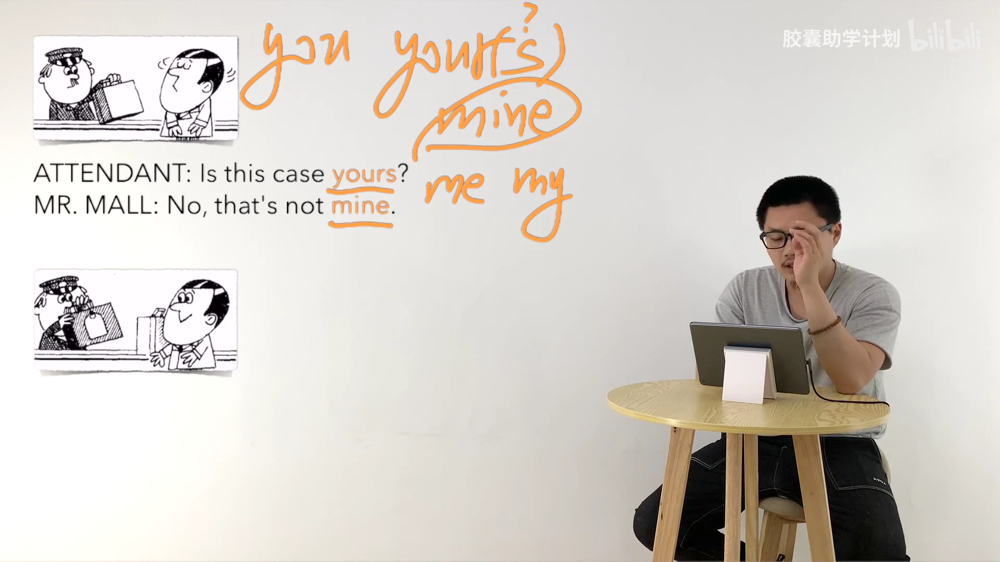

文字识别：Yyourt's / 胶囊助学计划 / mine / ATTENDANT: Is / this / case / yours? / Me / My / MR. MALL: No, that's not / mine.

## 00:03:00–00:03:30

思就是我的啊。我们汉语是不这么用的，不太这么用的。但英文有这么一个，但出现频率也并不高。不，那不是我的。再来，What about this one？那这一个呢？说This one's got a label。说这一个呀，有一个小的标签。Let me see it。让我看一下。好，我们先不管文章，我们先一起给大家总结一下刚才出现的yours、mine，它到底是什么，

### 画面 00:03:08

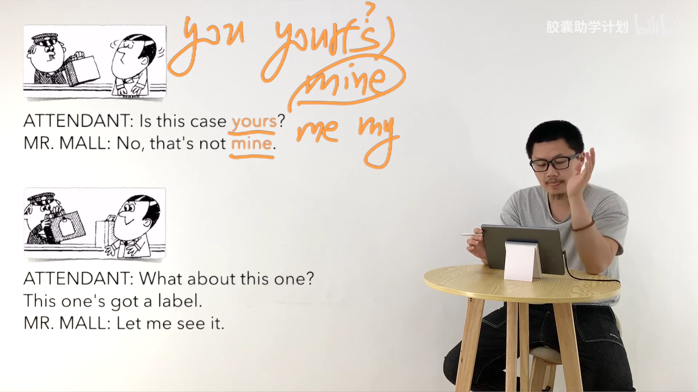

文字识别：Youfts / 胶囊助学计划 / mine / ATTENDANT: Is this case / yours? / me / my / MR. MALL: No, that's not mine. / ATTENDANT: What about this one? / This one's got a label. / MR. MALL: Let me see it.

### 画面 00:03:15

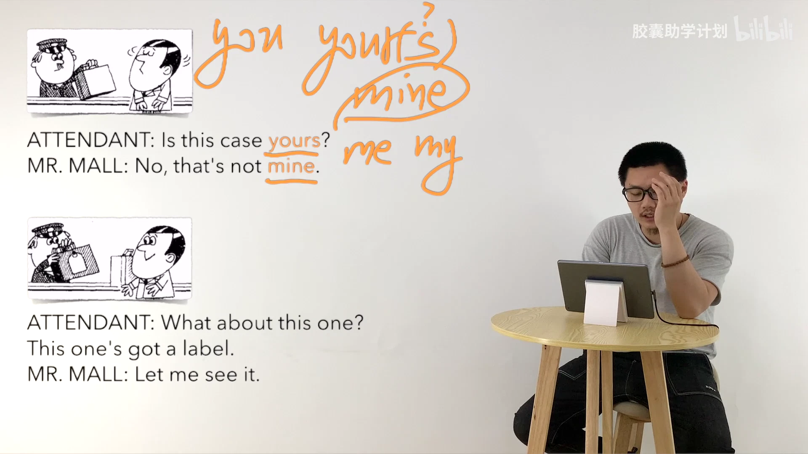

文字识别：Youft's / 胶囊助学计划 / mine / ATTENDANT: Is this case / eyours / me / My / MR. MALL: No, that's not mine. / ATTENDANT: What about this one? / This one's got a label. / MR. MALL: Let me see it.

### 画面 00:03:17

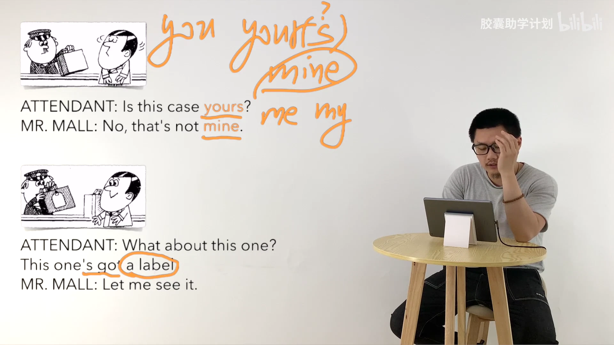

文字识别：Youft's / 胶囊助学计划 / mine / ATTENDANT: Is this case / yours? / me / My / MR. MALL: No, that's not mine. / ATTENDANT: What about this one? / This one's goa label / MR. MALL: Let me see it.

### 画面 00:03:21

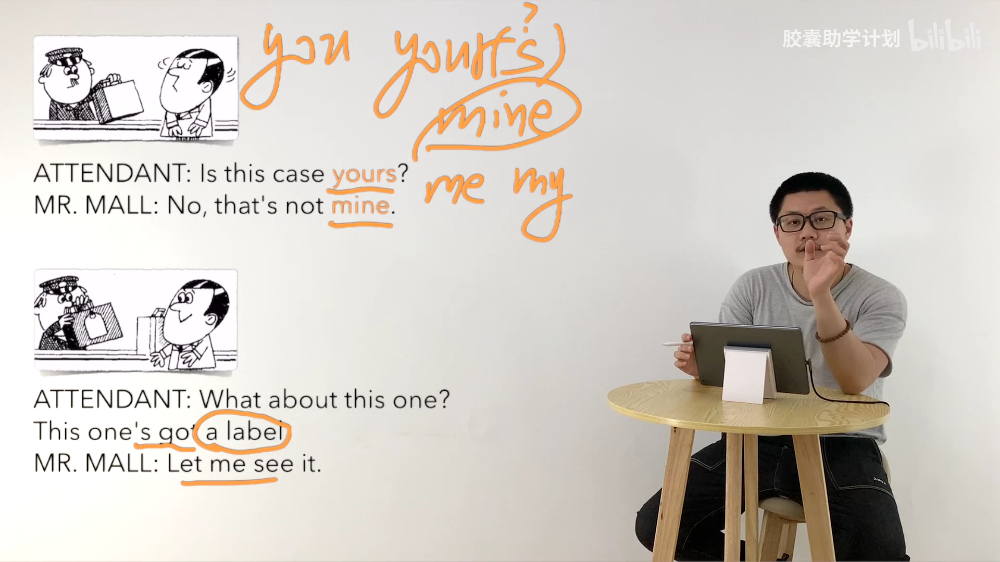

文字识别：Youft's / 胶囊助学计划 / mine / ATTENDANT: Is this case / yours? / Me / my / MR. MALL: No, that's not mine. / ATTENDANT: What about this one? / This one's goa label / MR. MALL: Let me see it.

### 画面 00:03:23

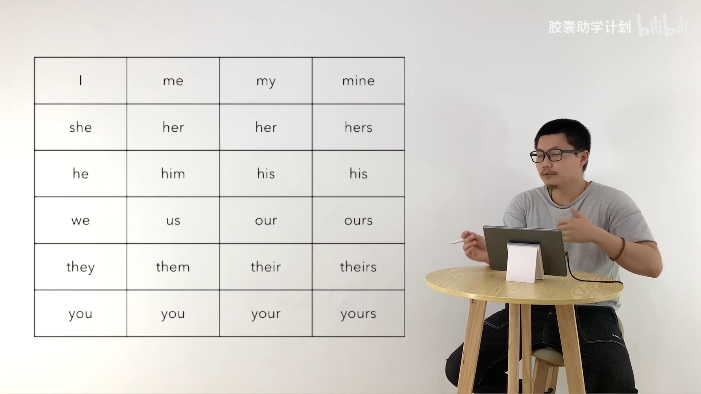

文字识别：胶囊助学计划 / me / my / mine / she / her / her / hers / he / him / his / his / we / us / our / ours / they / them / their / theirs / you / you / your / yours

### 画面 00:03:27

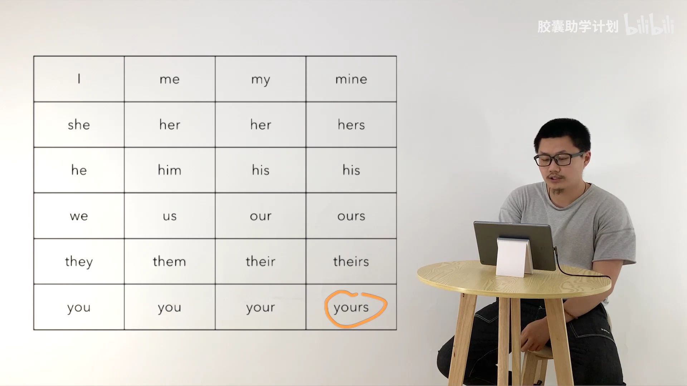

文字识别：胶囊助学计划 / me / my / mine / she / her / her / hers / he / him / his / his / we / us / our / ours / they / them / their / theirs / you / you / your / yours

### 画面 00:03:29

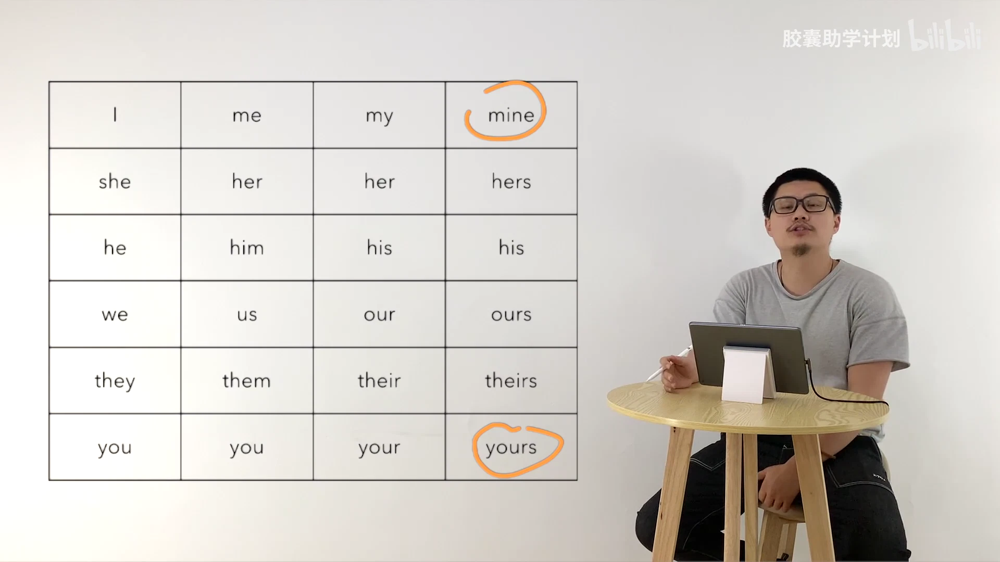

文字识别：胶囊助学计划 / me / my / mine / she / her / her / hers / he / him / his / his / we / us / our / ours / they / them / their / theirs / you / you / your / yours

## 00:03:30–00:04:00

right? We first look at the first three columns. For example, I, me, mine. You see, she, her, he, him, we, us, they, them, you, you. This is the word that you should have fixed in the twenty-first and twenty-third lessons. That is, when we say give somebody something, give someone something, we mentioned such a point. For the initial stage, it is the easiest to understand, right? The error rate is the lowest, but it is not completely correct, right? It is not very rigorous.

### 画面 00:03:31

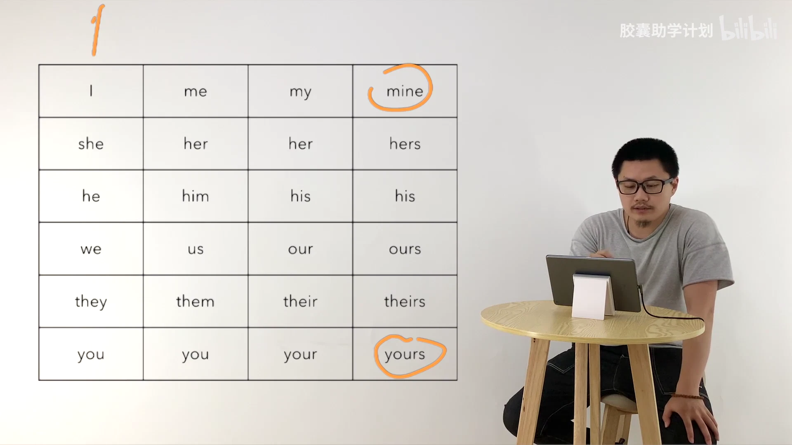

文字识别：胶囊助学计划 / me / my / mine / she / her / her / hers / he / him / his / his / we / us / our / ours / they / them / their / theirs / you / you / your / yours

### 画面 00:03:34

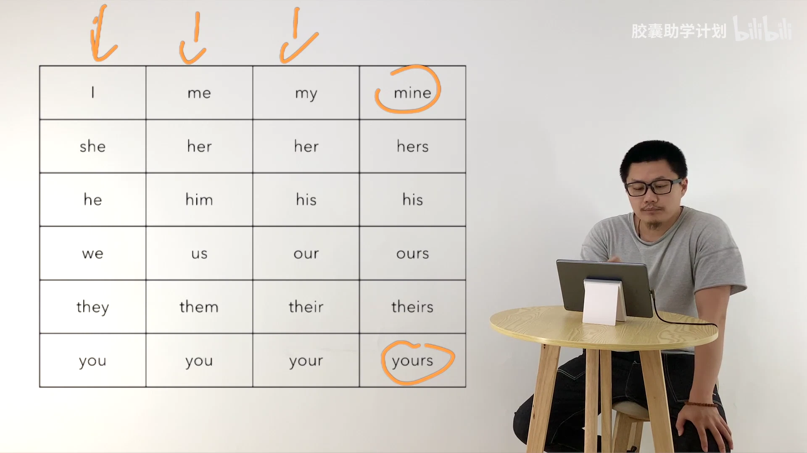

文字识别：胶囊助学计划 / me / my / mine / she / her / her / hers / he / him / his / his / we / us / our / ours / they / them / their / theirs / you / you / your / yours

### 画面 00:03:44

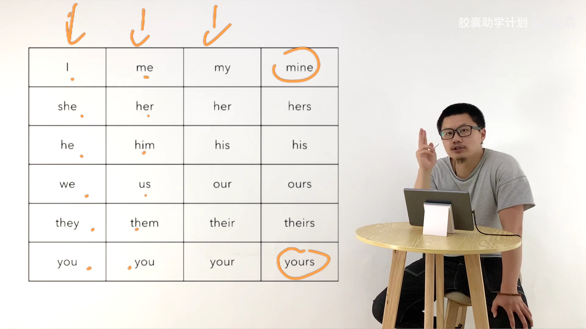

文字识别：胶囊 / me / my / mine / she / her / her / hers / he / him / his / his / we / us / our / ours / they / them / their / theirs / you / you / your / yours

### 画面 00:03:50

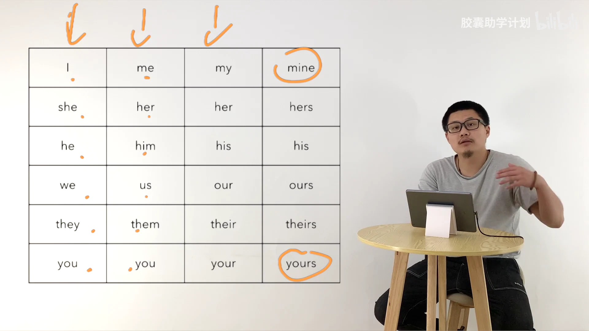

文字识别：胶囊助学计划 / me / my / mine / she / her / her / hers / he / him / his / his / we / us / our / ours / they / them / their / theirs / you / you / your / yours

### 画面 00:03:56

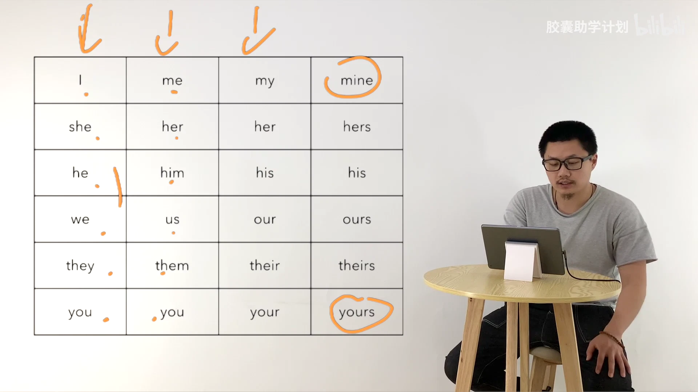

文字识别：胶囊助学计划 / me / my / mine / she / her / her / hers / he / him / his / his / we / us / our / ours / they / them / their / theirs / you / you / your / yours

## 00:04:00–00:04:30

对，是吧？不是非常严谨，但是对于各位来说，理解成本是最低的，就是你动词前面用左边这个，对吧？I love you，是吧？I love you，啊，OK，好理解，对吧？She love him，he love her，we love them，they love me，好理解吧？OK，所以动词前是左边这一列，动词后是右边这一列，这一两个列我们

### 画面 00:04:02

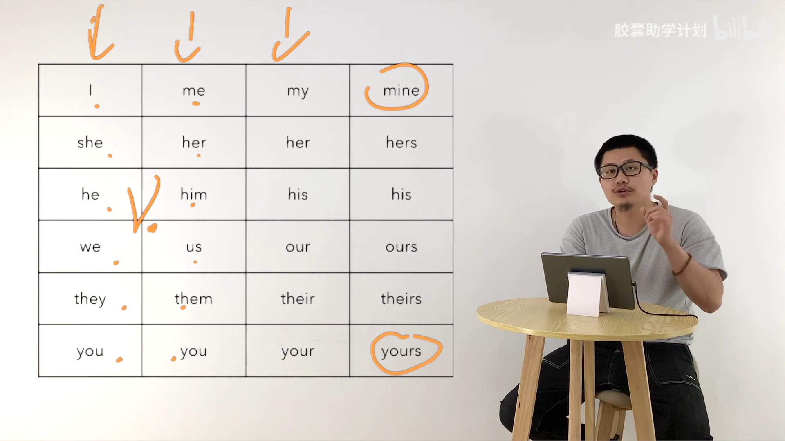

文字识别：胶囊助学计划 / me / my / mine / she / her / her / hers / he / him / his / his / we / us / our / ours / they / them / their / theirs / you / you / your / yours

### 画面 00:04:09

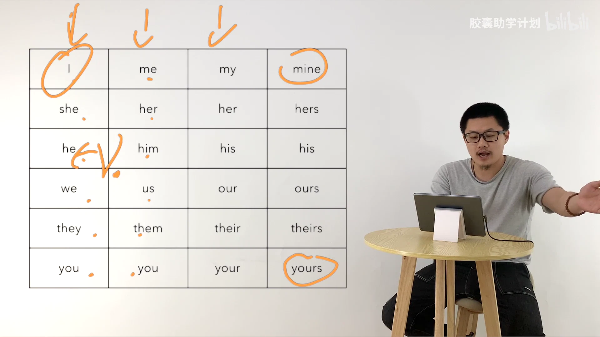

文字识别：胶囊助学计划 / me / my / mine / she / her / her / hers / him / his / his / we / us / our / ours / they / them / their / theirs / you / you / your / yours

### 画面 00:04:11

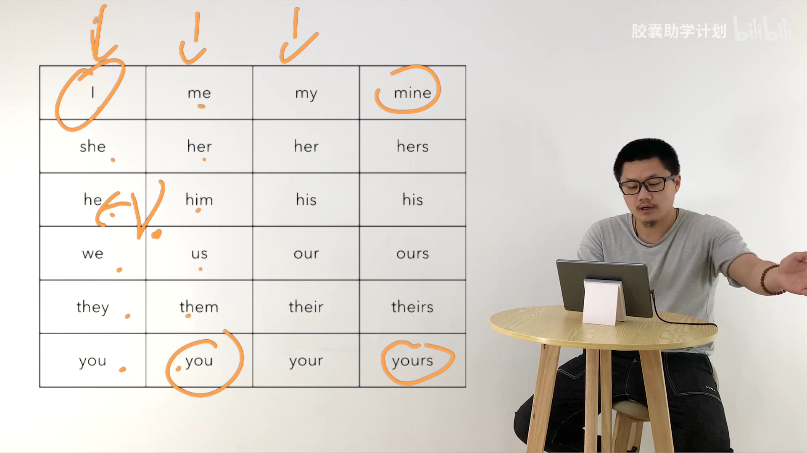

文字识别：胶囊助学计划 / me / my / mine / she / her / her / hers / him / his / his / we / us / our / ours / they / them / their / theirs / you / you / your / yours

### 画面 00:04:13

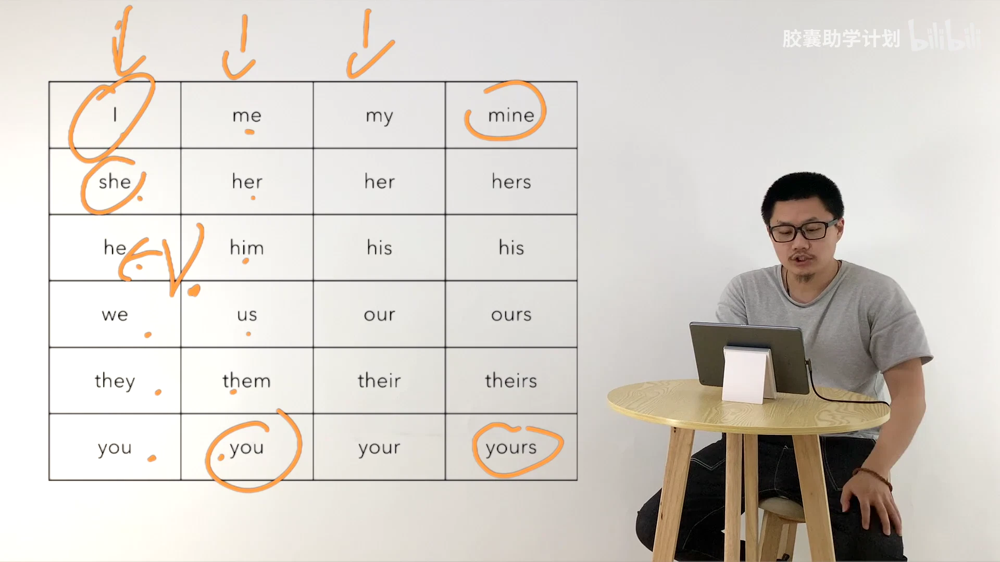

文字识别：胶囊助学计划 / me / my / mine / she / her / her / hers / him / his / his / we / us / our / ours / they / them / their / theirs / you / you / your / yours

### 画面 00:04:15

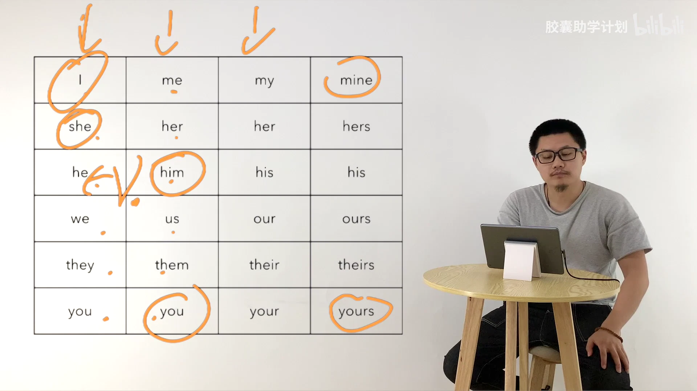

文字识别：胶囊助学计划 / me / my / mine / she / her / her / hers / him / his / his / we / us / our / ours / they / them / their / theirs / you / you / your / yours

### 画面 00:04:17

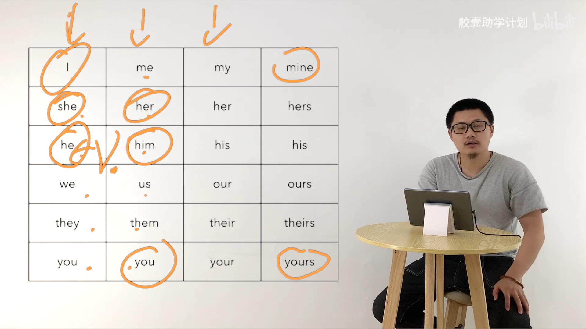

文字识别：胶囊助学计划 / me / my / mine / she / her / her / hers / him / his / his / we / us / our / ours / they / them / their / theirs / you / you / your / yours

### 画面 00:04:19

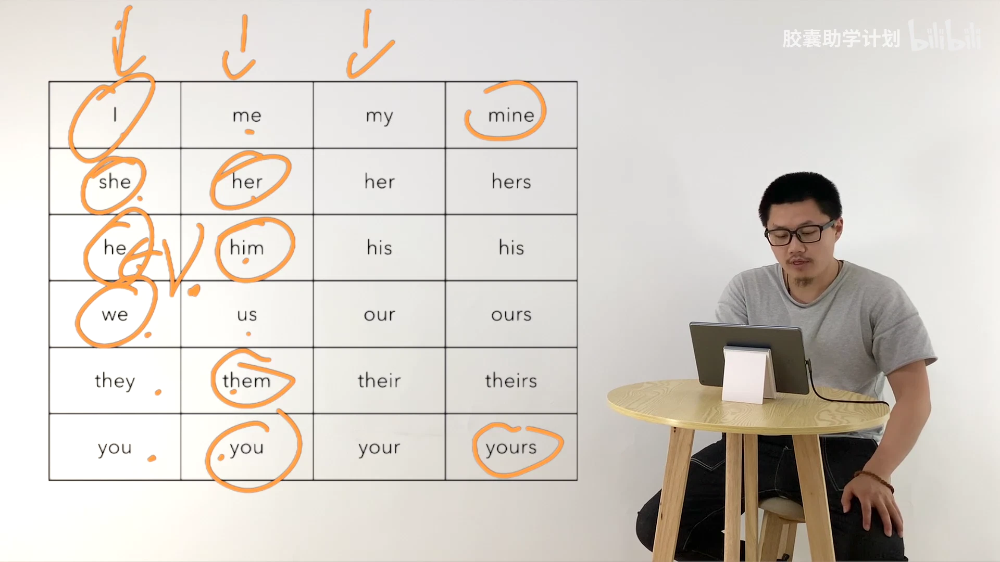

文字识别：胶囊助学计划 / me / my / mine / she / her / her / hers / him / his / his / we / us / our / ours / they / them / their / theirs / you / you / your / yours

### 画面 00:04:21

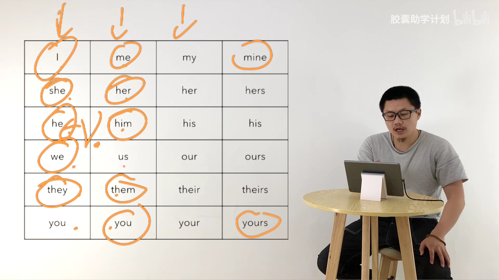

文字识别：胶囊助学计划 / me / my / mine / she / her / her / hers / him / his / his / we / us / our / ours / they / them / their / theirs / you / you / your / yours

### 画面 00:04:25

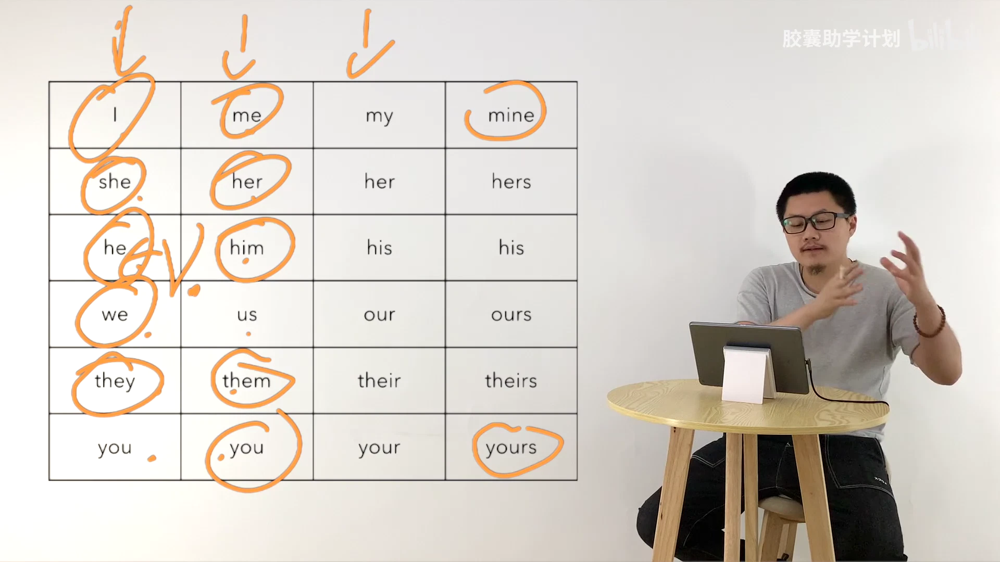

文字识别：胶囊助学计划 / me / my / mine / she / her / her / hers / him / his / his / we / us / our / ours / they / them / their / theirs / you / you / your / yours

## 00:04:30–00:05:00

很久之前就学会了。第三列呢，说 my, her, his, our, their, your 呢，是我们前二十课学的，表示谁的啊，我的、他的、他的各种各样的。最后这一列是今天咱们刚见过的，以后出现频率也不会特别的高。它也表示谁的，mine 也表示的是我的。那自然而然你就会有一个问题，就是 my 表示我的，mine 还是表示我的，有什么区

### 画面 00:04:32

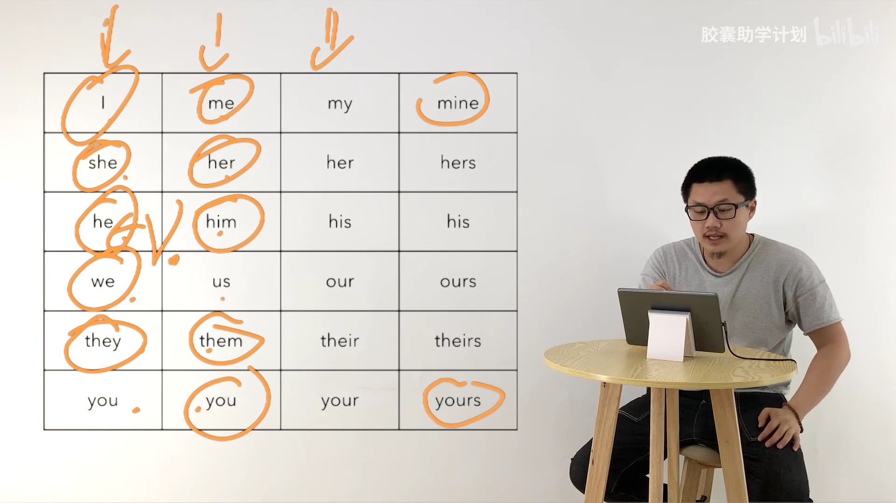

文字识别：胶囊助学计划 / me / my / mine / she / her / her / hers / him / his / his / we / us / our / ours / they / them / their / theirs / you / you / your / yours

### 画面 00:04:37

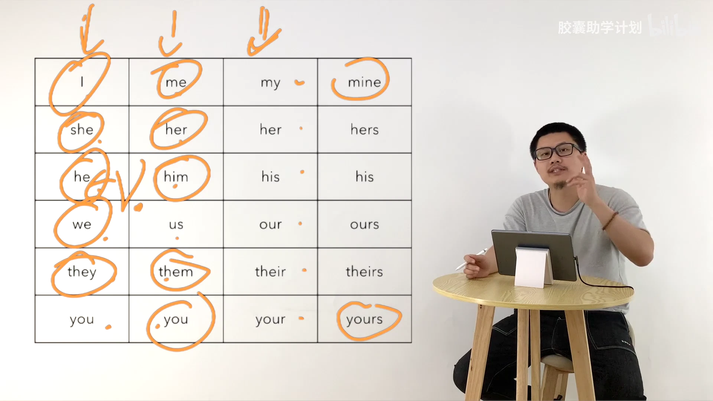

文字识别：胶囊助学计划 / me / my / mine / she / her / her / hers / him / his / his / we / us / our / ours / they / them / their / theirs / you / you / your / yours

### 画面 00:04:43

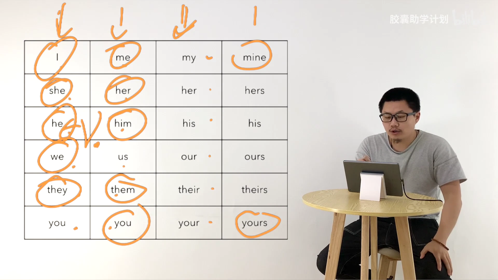

文字识别：胶囊助学计划 / me / my / mine / she / her / her / hers / him / his / his / we / us / our / ours / they / them / their / theirs / you / you / your / yours

### 画面 00:04:45

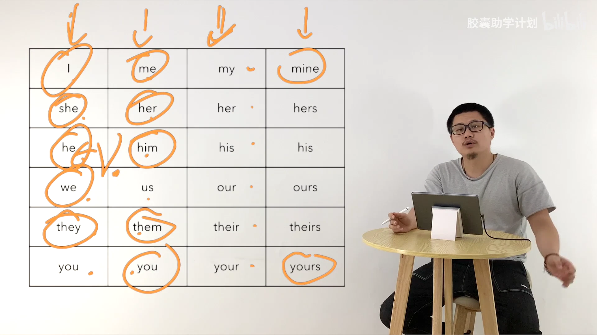

文字识别：胶囊助学计划 / me / my / mine / she / her / her / hers / him / his / his / we / us / our / ours / they / them / their / theirs / you / you / your / yours

### 画面 00:04:51

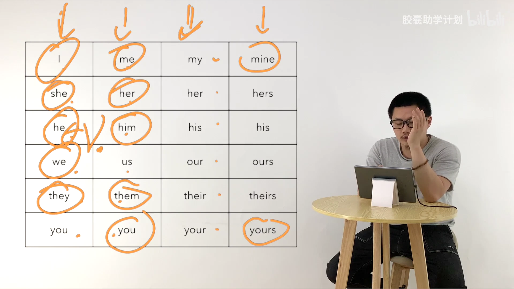

文字识别：胶囊助学计划 / me / my / mine / she / her / her / hers / him / his / his / we / us / our / ours / they / them / their / theirs / you / you / your / yours

### 画面 00:04:57

文字识别：胶囊助学计划 / me / my / mine / she / her / her / hers / him / his / his / we / us / our / ours / they / them / their / theirs / you / you / your / yours

## 00:05:00–00:05:30

别吗？好，我们先看一下它的构成方式，我们再讲区别啊。这个两个看起来第一列就没什么感觉构成上的太大的逻辑关系是吧？但是你看这个好像就有点逻辑关系了，好像是在它后边加了个s，这个没区别。但是这个你看后边加了个s，后边加了个s，后边加了个s，对吧？所以这一列很容易背下来，就是在您已经学会的这一列后边加了个s，大多数百分之八十的东西就处理完了。

### 画面 00:05:10

文字识别：胶囊助学计划 / me / my / mine / she / her / her / hers / him / his / his / we / us / our / ours / they / them / their / theirs / you / you / your / yours

### 画面 00:05:28

文字识别：胶囊助学计划 / me / my / mine / she / her / her / hers / him / his / his / we / us / our / ours / they / them / their / theirs / you / you / your / yours

## 00:05:30–00:06:00

单独记一下，无非就是这个不加 s 了，保持一致。这个是 mine，对吧？好，如何去用呢？我们看一下，很简单。There is a book on the desk. Is her book,或者说is his book，或者您可以直接 her book 等同于 hers，就是把 book 省略掉。her 加 book 等于 hers，his 加 book 等于 his。好理解吧？或者说 is

### 画面 00:05:36

文字识别：胶囊助学计划 / me / my / mine / she / her / her / hers / him / his / his / we / us / our / ours / they / them / their / theirs / you / you / your / yours

### 画面 00:05:38

文字识别：胶囊助学计划 / mine / O

### 画面 00:05:41

文字识别：胶囊助学计划 / mine / There is a book on the desk. / It's her book/his book. (hers/his)

### 画面 00:05:50

文字识别：胶囊助学计划 / mine / There is a book on the desk. / It's her book/his book. (hers/his)

## 00:06:00–00:06:30

my book 等于 mine。在这儿呢，我提一个小点，就是在使用 hers, his, mine 的时候，有一个小的前提。它既然等于 her, his, mine 加一个名词，那如果上下文没有这个场景，您直接用 mine，是不是别人容易不懂啊？你想想，你不知道你加的是什么名词，对吧？但还好，大多数现实生

### 画面 00:06:00

文字识别：胶囊助学计划 / mine / There is a book on the desk. / It's her book/his book. (hers/his) / It's my book. (mine)

### 画面 00:06:06

文字识别：胶囊助学计划 / mine / There is a book on the desk / It's her book/his book. / (ners/his) / It's my book. (mine)

### 画面 00:06:08

文字识别：胶囊助学计划 / mine / There is a book on the desl / It's her book/his book. / hers / his) / It's my book. (mine)

### 画面 00:06:13

文字识别：胶囊助学计划 / mine / Therejs a book on the desl / It'she bookhis book. / hers / his) / It's my book. (mine)

### 画面 00:06:15

文字识别：胶囊助学计划 / mine / Therejs a boc on the desk / It's / her bookhisbook. / hers / /his) / It's / my book. (mine)

### 画面 00:06:17

文字识别：胶囊助学计划 / mine / Thersjs a boc on the desl / It's / ber book.his book. / hers / his) / It's / my book. (mine)

### 画面 00:06:23

文字识别：胶囊助学计划 / mine / There js a boc on the desk / It's / her bookhis book. / ners / his) / It's / mybook. (mine)

### 画面 00:06:29

文字识别：胶囊助学计划 / mine / There js a boc on the desk / It's / her bookhis book. / his) / hers / It's / mybook. (mine)

## 00:06:30–00:07:00

活场景当中，别人问说 Whose passport is this? 啊，然后你说 Mine, mine. Okay, 说我的，我的，对吧？就可以了。 Again, 啊，不多说，我们回到文章。 Attendant继续问 What's your name and address? 名字地址合理。 Mr. Hall 开始说了 David Hall, 我的名字八十三号 Great Street 大桥街。 Attendant 说 That's right, 没问题啊。 David Hall, eighty-three Great Street. 啊，都重

### 画面 00:06:31

文字识别：胶囊助学计划 / mine / Therejs a boc on the desk / It's / her bookhis book. / hers / his) / It's / my book. (mine)

### 画面 00:06:34

文字识别：胶囊助学计划 / mine / There js a boc on the desk / It's / her bookhis book. / hers / his) / It's / my book. (mine)

### 画面 00:06:36

文字识别：mine / There js a boc on the desk / It's / her book hisbook. / hers / his) / It's / my book. (mine)

### 画面 00:06:39

文字识别：D.N.HALL / 83BRIDGEO / STREET. / ATTENDANT: What's your name and address? / MR. MALL: David Hall, 83, Bridge Street. / ATTENDANT: That's right. D.N. Hall, 83, Bridge Street.

### 画面 00:06:41

文字识别：胶囊助学计划 / D.N.HALL / 83BRIDGEC / STREET. / ATTENDANT: What's your name and address? / MR. MALL: David Hall, 83, Bridge Street. / ATTENDANT: That's right. D.N. Hall 83, Bridge Street.

### 画面 00:06:50

文字识别：胶囊助学计划 / D.N.HALL / 838RIDGEO / STREET. / ATTENDANT: What's your name and address? / MR. MALL: David Hall, 83, Bridge Street. / ATTENDANT: That's right. D.N. Hall, 83, Bridge Street.

### 画面 00:06:57

文字识别：胶囊助学计划 / D.N.HALL / 83BRIDGEO / STREET. / ATTENDANT: What's your name and a / address? / MR. MALL: David Hall, 83, Bridge Street. / ATTENDANT: That's right. D.N. Hall, 83, Bridge Street.

## 00:07:00–00:07:30

### 画面 00:07:00

文字识别：胶囊助学计划 bilbl / D.N.HALL / 838RIDGEO / STREET. / ATTENDANT: What's your name and address? / MR. MALL: David Hall, 83, Bridge Street. / ATTENDANT: That's right. D.N. Hall, 83, Bridae Street. / ATTENDANT: Three pounds fifty pence, please. / MR. MALL: Here you are. / ATTENDANT: Thank you.

### 画面 00:07:03

文字识别：胶囊助学计划 / D.N.HALL / 83BRIDGEC / STREET. / ATTENDANT: What's your name and address? / MR. MALL: David Hall, 83, Bridge Street. / ATTENDANT: That's right. D.N. Hall, 83, Bridae Street. / ATTENDANT: Three pounds fifty pence, please. / MR. MALL: Here you are. / ATTENDANT: Thank you.

### 画面 00:07:05

文字识别：胶囊助学计划 / D.N.HALL / 838RIDGEC / STREET. / ATTENDANT: What's your name and address? / MR. MALL: David Hall, 83, Bridge Street. / ATTENDANT: That's right. D.N. Hall, 83, Bridae Street. / ATTENDANT: Three pounds fifty pence, please. / MR. MALL: Here you are. / ATTENDANT: Thank you.

### 画面 00:07:08

文字识别：胶囊助学计划 / D.N.HALL / 83BRIDGEO / STREET. / ATTENDANT: What's your name and address? / MR. MALL: David Hall, 83, Bridge Street. / ATTENDANT: That's right. D.N. Hall, 83, Bridae Street. / ATTENDANT: Three pounds fifty pence, please. / MR. MALL: Here you are. / ATTENDANT: Thank you.

### 画面 00:07:21

文字识别：胶囊助学计划 / MR. MALL: Hey! / ATTENDANT: What's matter?

### 画面 00:07:26

文字识别：胶囊助学计划 / MR. MALL: Hey! / ATTENDANT: What's matter?

### 画面 00:07:28

文字识别：胶囊助学计划 / MR. MALL: Hey! / ATTENDANT: What's matter? / MR. MALL: This case doesn't belong to me! / You've given me the wrong case!

## 00:07:30–00:08:00

doesn't belong to me. Ah, say this box, yeah, doesn't belong to me. You've given me the wrong case. You've given me the wrong case. You've given me the wrong case. You've given me the wrong case. You've given me the wrong case. You've given me the wrong case. You've given me the wrong case. You've given me the wrong case. You've given me the wrong case. You've given me the wrong case. You've given me the wrong case. You've given me the wrong case. You've given me the wrong case. You've given me the wrong case. You've given me the wrong case. You've given me the wrong case. You've given me the wrong case. You've given me the wrong case. You've given me the wrong

### 画面 00:07:33

文字识别：胶囊助学计划 / MR. MALL: Hey! / ATTENDANT: What's matter? / MR. MALL: This case doesn't belong to me! / You've given me the wrong case!

### 画面 00:07:38

文字识别：胶囊助学计划bi出b出 / MR. MALL: Hey! / ATTENDANT: What's matter? / MR. MALL: This case doesn't belong to me! / You've aiven me the wrong case!

### 画面 00:07:41

文字识别：胶囊助学计划b出出 / MR. MALL: Hey! / ATTENDANT: What's matter? / MR. MALL: This case doesn't belong to me! / You've aiven me the wrong case!

### 画面 00:07:44

文字识别：胶囊助学计划 / MR. MALL: Hey! / ATTENDANT: What's matter? / MR. MALL: This case doesn't belong to me! / You've aiven me the wrong case!

### 画面 00:07:49

文字识别：胶囊助学计划 / Comprehension

### 画面 00:07:57

文字识别：胶囊助学计划 / Comprehension / 1 T: Did Mr. Hall leave his umbrella on the train?

## 00:08:00–00:08:30

leave his umbrella on the train? No, he didn't. Next one. What did he leave on the train? A suitcase. Next one. What does Mr. Hall's suitcase look like? It's a small blue case. Does it have a zip? Yes, it does.

### 画面 00:08:09

文字识别：胶囊助学计划 / Comprehension / 2 T: What did he leave on the train? / S: A suitcase.

## 00:08:30–00:09:00

Is there a label on the case? Yes, there is a label on the handle, with his name and address on it. 后面那句话有没有都行. Is the first case Mr. Hall's? The first box is his, no, it isn't. Continue. What's Mr. Hall's address? Eighty-three

### 画面 00:08:34

文字识别：胶囊助学计划 / Comprehension / 5 T: Is there a label on the case? / S: Yes, there's a label on the handle with his / name and address on it.

### 画面 00:08:42

文字识别：胶囊助学计划 / Comprehension

### 画面 00:08:50

文字识别：胶囊助学计划 / Comprehension / 6 T: Is the first case Mr. Hall's? / S: No, it isn't.

### 画面 00:08:53

文字识别：胶囊助学计划 / Comprehension / 7 T: What's Mr. Hall's address?

## 00:09:00–00:09:30

Bridge Street. Next one is that the address on the case. Yes, it is. Next one, what's the matter with the case? The case doesn't belong to Mr. Hall. Good. Ask me if,肯定句，一般疑问句，特殊疑问句。我问，您答。Ask me if he left his suitcase on the train.

### 画面 00:09:06

文字识别：胶囊助学计划 / Comprehension / 8 T: Is that the address on the case? / O

### 画面 00:09:14

文字识别：胶囊助学计划 / Comprehension / 9 T: What's the matter with the case? / S: The case doesn't belong to Mr. Hall.

### 画面 00:09:18

文字识别：胶囊助学计划 / Asking questions / 1 T: Ask me if he left his suitcase on the train.

## 00:09:30–00:10:00

Left. Did he leave his suitcase on the train? Where? Where did he leave his suitcase? Next one. Ask me if the label is on the handle. Is the label on the handle? Where? Where is the label? Next one.

### 画面 00:09:33

文字识别：胶囊助学计划 / Asking questions / 1 T: Ask me if he left his suitcase on the train. / S: Did he leave his suitcase on the train?

### 画面 00:09:45

文字识别：胶囊助学计划 / Asking questions / 2 T: Ask me if the label is on the handle.

### 画面 00:09:56

文字识别：胶囊助学计划 / Asking questions / 2 T: Ask me if the label is on the handle. / S: Is the label on the handle? / T: Where ..? / S: Where is the label?

### 画面 00:09:59

文字识别：胶囊助学计划 / Asking questions / 3 T: Ask me if this case is his.

## 00:10:00–00:10:30

ask me if this case is his. Is this case his? Whose? Ah,那就whose is this case,或者是whose case is this? 十一课我们学的很舒服了啊。 Continue, ask me if he lives in Bridge Street. Does he live in Bridge Street? Where? Where does he live?

### 画面 00:10:11

文字识别：胶囊助学计划 / Asking questions / 3 T: Ask me if this case is his. / S: Is this case his? / T: Whose …..? / S: Whose is this case?

### 画面 00:10:15

文字识别：胶囊助学计划 / Asking questions / 4 T: Ask me if he lives in Bridge Street.

### 画面 00:10:20

文字识别：胶囊助学计划 / Asking questions / 4 T: Ask me if he lives in Bridge Street.

### 画面 00:10:23

文字识别：胶囊助学计划 / Asking questions / 4 T: Ask me if he lives in Bridge Street.

### 画面 00:10:28

文字识别：胶囊助学计划 / Asking questions / 4 T: Ask me if he lives in Bridge Street. / S: Does he live in Bridge Street? / T: Where …..? / S: Where does he live?

## 00:10:30–00:11:00

Next one. Ask me if the case belongs to him. Does the case belong to him? Who? Who does the case belong to? Very good. Recap. 本课的关键单词就是这些啊，没有新的了。对于各位来说呢，嗯，我认为初期的要求就是各位看到能懂就可以了啊。让见到这些单词，知道它是说另一个单词加一个名词

### 画面 00:10:31

文字识别：胶囊助学计划 / Asking questions / 5 T: Ask me if the case belongs to him. / 1

### 画面 00:10:38

文字识别：胶囊助学计划 / Asking questions / 5 T: Ask me if the case belongs to him. / S: Does the case belong to him? / T： Who ...? / S: Who does the case belong to?

### 画面 00:10:42

文字识别：胶囊助学计划 / Recap / Patterns / Grammar / Words / mine/his/hers/yours/ours/theirs / Expression

### 画面 00:10:45

文字识别：胶囊助学计划 / Recap / Patterns / & / Grammar / Words / mine/his/hers/yours/ours/theirs / Expression

### 画面 00:10:50

文字识别：胶囊助学计划 / Recap / Patterns / 8 / Grammar / Words / mine/his/hers/yours/ours/theirs / Expression

## 00:11:00–00:11:30

等于它，它是什么意思就可以了啊？您初期主动用不出来是不用担心的，因为你有另外一组对吧？就是我们第三列那一列单词能供各位去使用表达这个含义的是没有问题的对吧？你不会说 mine 啊，你至少会说 my bad 对吧？Very good。家庭作业绿皮书九十七课文啊，然后呢给自己讲解一遍今天的核心知识点。当然了，应该还有一个就是各位文章要熟读成诵对吧？OK，

### 画面 00:11:08

文字识别：胶囊助学计划 / Recap / Patterns / 8 / Grammar / Words / mine/his/hers/yours/ours/theirs / Expression

### 画面 00:11:12

文字识别：胶囊助学计划 / Recap / Patterns / & / Grammar / Words / mine/his/hers/yours/ours/theirs / Expression

### 画面 00:11:17

文字识别：胶囊助学计划

### 画面 00:11:29

文字识别：胶囊助学计划

## 00:11:30–00:12:00

那如果大家喜欢我们的课程呢，欢迎大家呃关注订阅一键三连，分享给那些需要的朋友。那我们最后再来看一句名人名言。I believe that every human being has a finite number of heartbeats. I don't intend to waste any of mine. See you next time.

### 画面 00:11:38

文字识别：胶囊助学计划 / /'fainait/ / I believe every human has a finite number / of heartbeats. I don't intend to waste any / of mine. / Neil Armstrong

### 画面 00:11:52

文字识别：/fainait/ / I believe every human has a finite number / of heartbeats. I don't intend to waste any / of mine. / Neil Armstrong

### 画面 00:11:54

文字识别：CAPSULEACADEMY / 胶囊助学计划 / 小红书 / Lecturer / Leo / OE

### 画面 00:11:57

文字识别：CAPSULEACADEMY / 胶囊助学计划 / 小红书 / OE

## 00:12:00–00:12:04

### 画面 00:12:00

文字识别：CAPSULEACADEMY / 胶囊助学计划 / 小红书 / Creator / 回 / Leo & Berlin / OE

### 画面 00:12:02

文字识别：bilbili / 胶囊助学计划 / CAPSULEACADEMY / 胶囊助学计划 / 小红书 / OE

### 画面 00:12:04

文字识别：bilibili / 胶囊助学计划

