# 099 单词 语法

快速机器解析：语音为单模型转写，未进行独立交叉校对或人工复核；画面每秒采样并按变化选帧，短时文字和标记可能遗漏。截图时间约有 1 秒误差。图片有损压缩；遇到疑点请按时间查看 Google Drive 原视频。

## 00:00:00–00:00:30

Hello everyone, welcome to Capsule Academy. This is Leo. Today we're going to learn New Concept English Book One, Lesson Ninety Nine, Grammar and Words. 那老习惯进入正式课程之前呢，我们先看两个小的问题。那第一，如何使用宾语从句啊？这是我们接触到的第一个从句。第二呢，如何表达你确定吗？带着这两个问题，Hope you gonna enjoy it.

### 画面 00:00:00

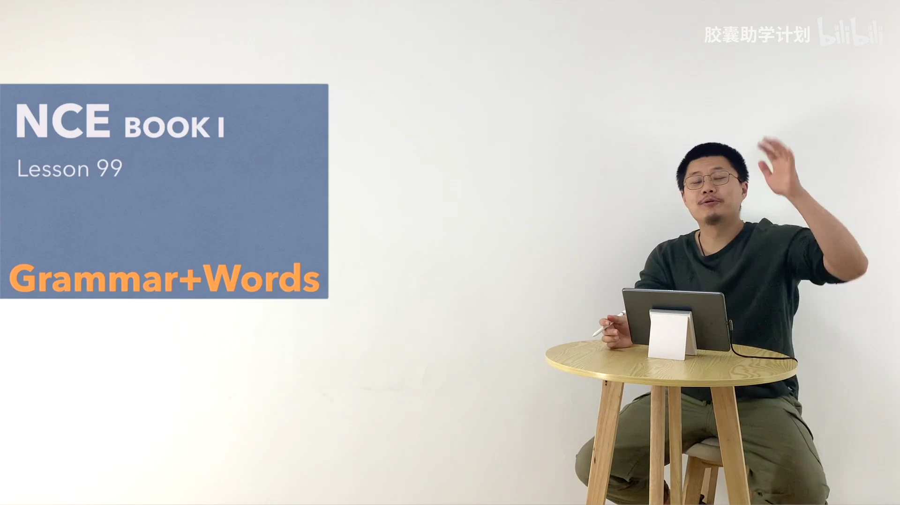

文字识别：胶囊助学计划 / NCE / BOOKI / Lesson 99 / Grammar+Words

### 画面 00:00:02

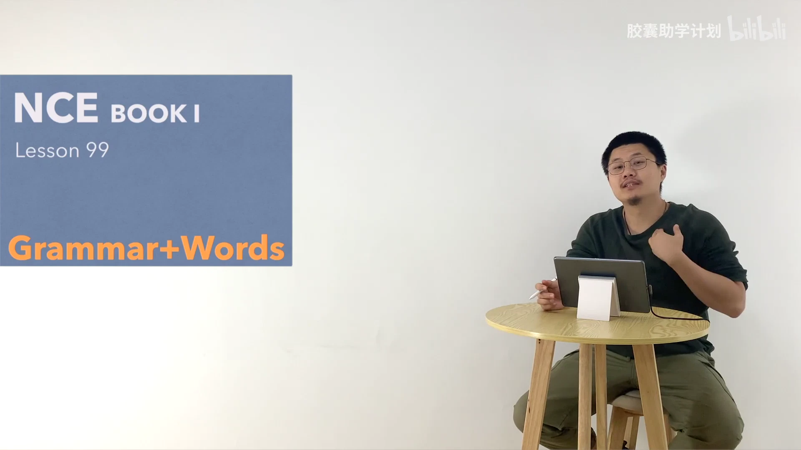

文字识别：胶囊助学计划 / NCE / BOOKI / Lesson 99 / Grammar+Words

### 画面 00:00:13

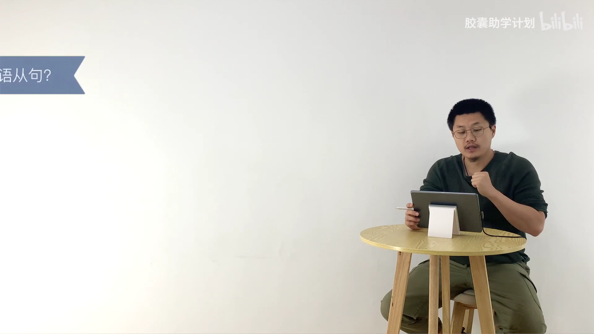

文字识别：胶囊助学计划 / Biltbl / 语从句？

### 画面 00:00:15

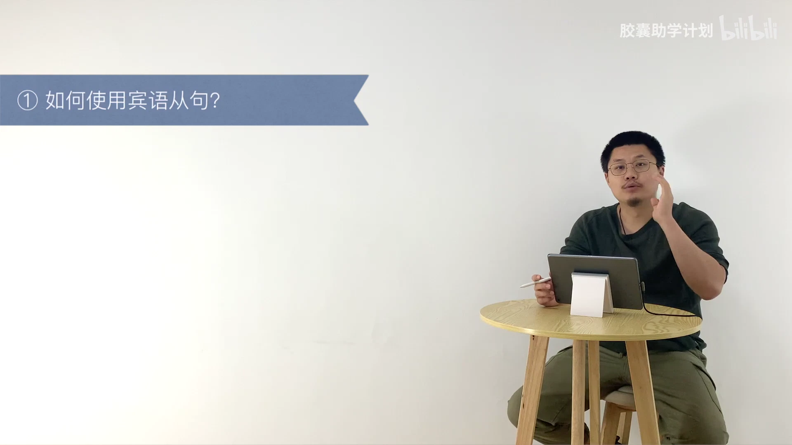

文字识别：胶囊助学计划b出b出 / ①如何使用宾语从句？

### 画面 00:00:19

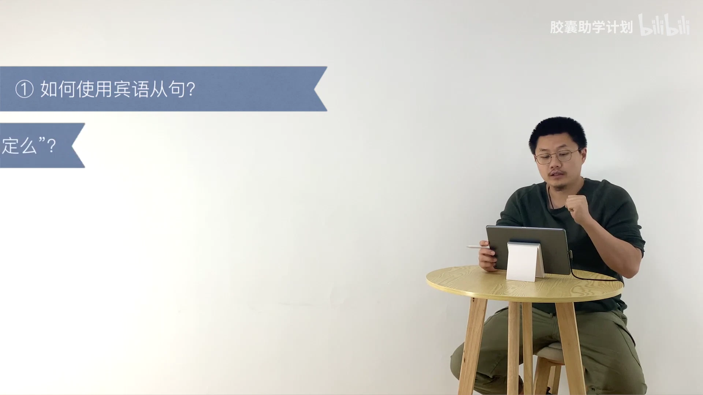

文字识别：胶囊助学计划 bl出 / ①如何使用宾语从句？ / 定么

### 画面 00:00:21

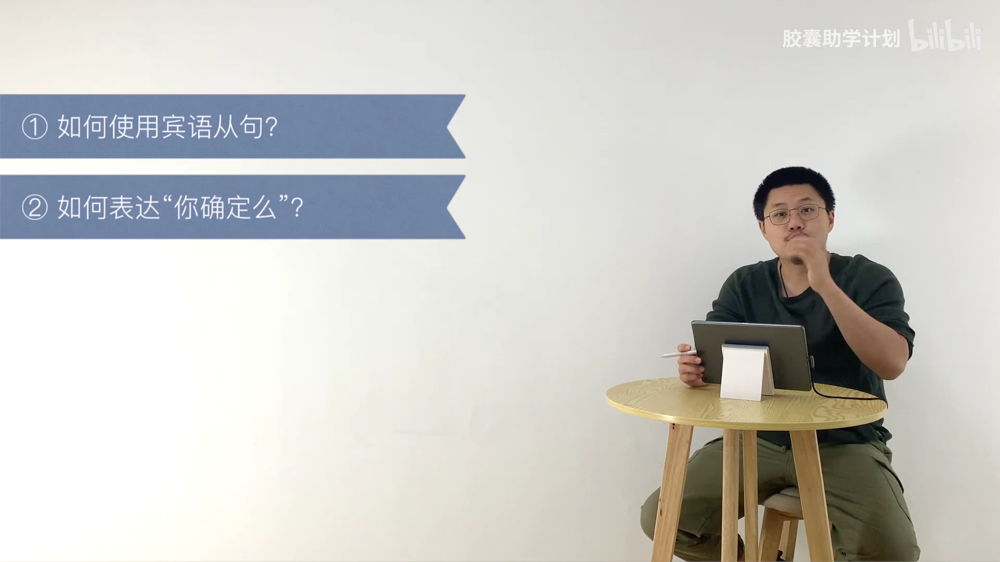

文字识别：Bilbili / 胶囊助学计划 / ①如何使用宾语从句？ / 如何表达“你确定么”?

### 画面 00:00:25

文字识别：胶囊助学计划b出出

### 画面 00:00:29

## 00:00:30–00:01:00

好，那上来我们先说一下到底什么是宾语从句啊？我们先给大家一个定义，说如果你用一个句子去充当宾语的时候，我们就管这个句子叫宾语从句。所以您可以其实看到它，宾语从句是两个概念组成的，一个叫宾语，第二个叫从句。那我们先简单解释一下什么叫宾语。其实英文的宾语跟汉语的宾语几乎是类似的。

### 画面 00:00:31

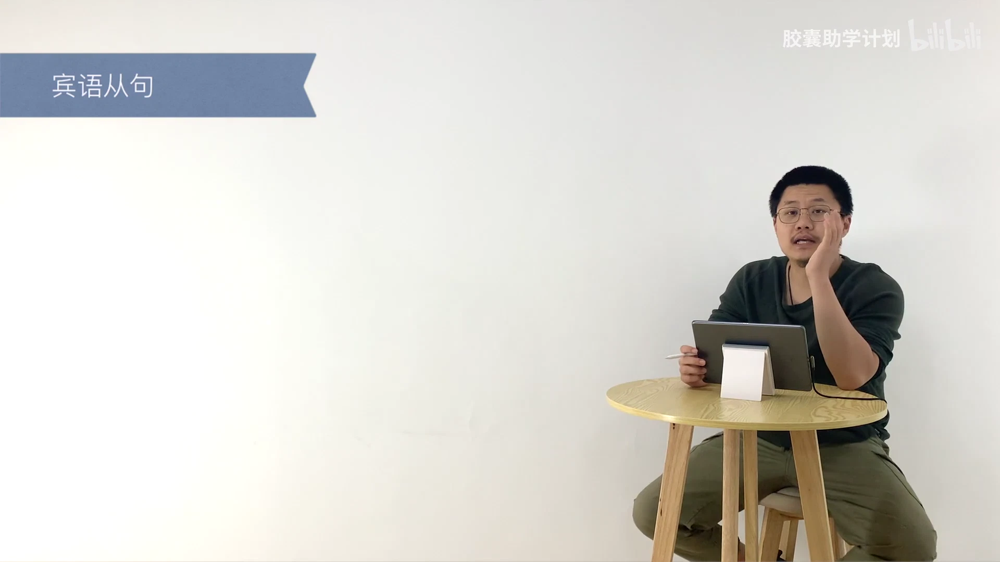

文字识别：胶囊助学计划 / 宾语从句

### 画面 00:00:35

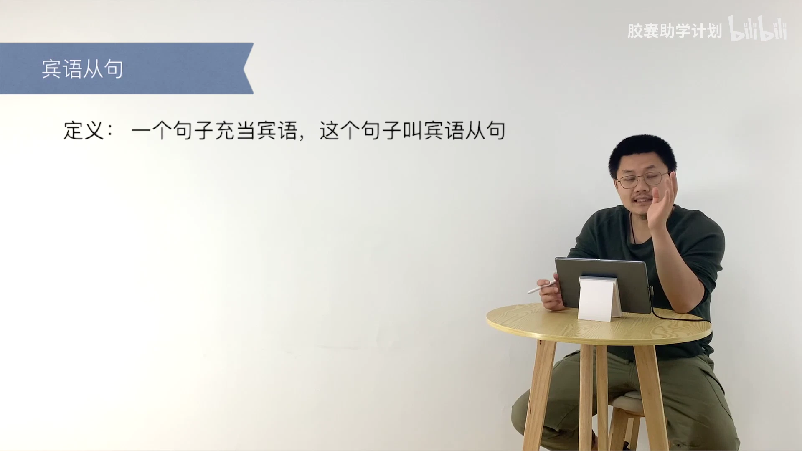

文字识别：胶囊助学计划bi鼎b出 / 宾语从句 / 定义：一个句子充当宾语，这个句子叫宾语从句

## 00:01:00–00:01:30

比如说汉语我们叫我爱你，那你就是咱们这个主谓宾当中的宾语，对吧？而英文说 I love you，这个 you 就是这个句子当中的宾语。那我们本来是用一个单词或者一个词组去做一个宾语，OK？比如说 I like your dog，your 加 dog 这两个单词组合在一起，我们管它叫宾语。那现在呢变了，现在是用一

### 画面 00:01:02

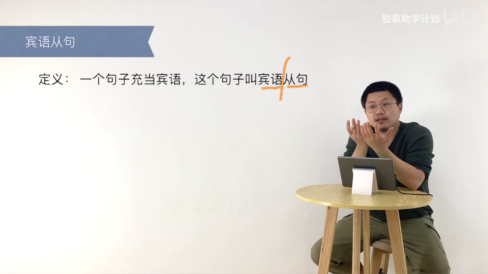

文字识别：胶囊助学计划 / 宾语从句 / 定义：一个句子充当宾语，这个句子叫宾语 / 从句

## 00:01:30–00:02:00

个句子去充当这个宾语，哎，那我们就管这个句子叫宾语从句。其实之前在我们学过的文章当中，我们已经见过了很多宾语从句，它其实非常的简单。那个时候我们看到这句话的时候，我跟大家说，您直接把 that 去掉，然后一个单词一个单词翻译，跟汉语语序一模一样，对吧？所以宾语从句对于大家来说，目前这个点是比较容易学习的。比如说 I hope that you've got some

### 画面 00:01:32

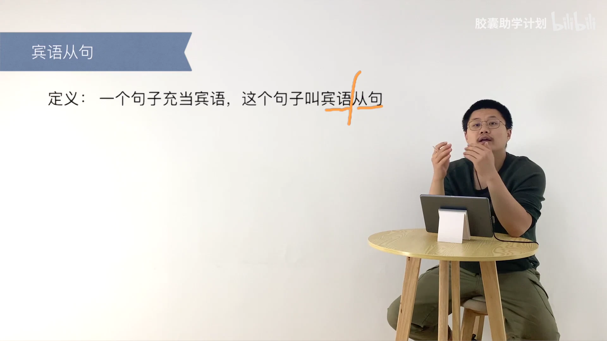

文字识别：胶囊助学计划 / 宾语从句 / 定义：一个句子充当宾语，这个句子叫宾语 / 吾从句

### 画面 00:01:49

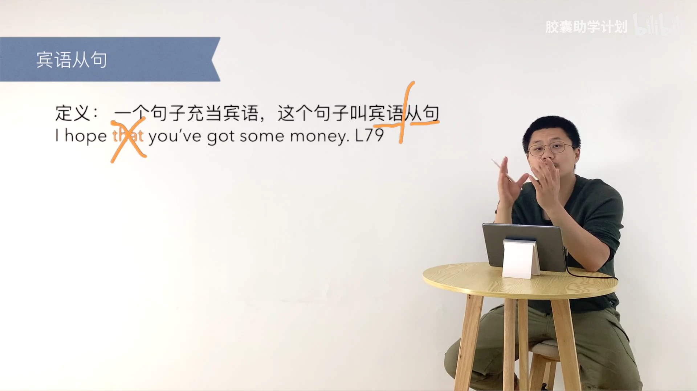

文字识别：胶囊助学计划 / 宾语从句 / 定义：一个句子充当宾语，这个句子叫宾语从句 / tt you've got some money. L79 / Ihope

## 00:02:00–00:02:30

啊，我希望啊你有一些钱。这个that是可以省略的，可以不翻译的，对吧？那I就是主语，hope就是宾语，后面that啊就是谓语。That you've got some money就是我们说到的叫做宾语啊。那它现在是you've got some money，这一看是一个句子，对吧？那一个句子去做宾语的时候，我们管这个句子you've got some money就叫做宾语从句啊，还是比较简单的。再来，比

### 画面 00:02:02

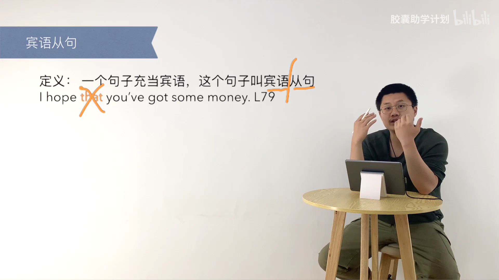

文字识别：胶囊助学计划 / 宾语从句 / 定义：一个句子充当宾语，这个句子叫宾语从句 / Ihope / tt / you've got some money. L79

### 画面 00:02:11

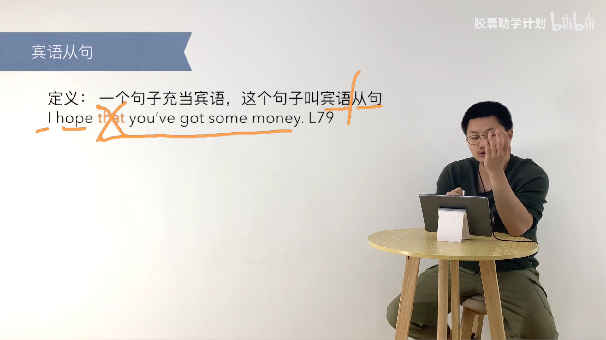

文字识别：biibili / 胶囊助学计划 / 宾语从句 / 定义：一个句子充当宾语，这个句子叫宾语从句 / Ihope / tiat /  you've got some money. L79

### 画面 00:02:15

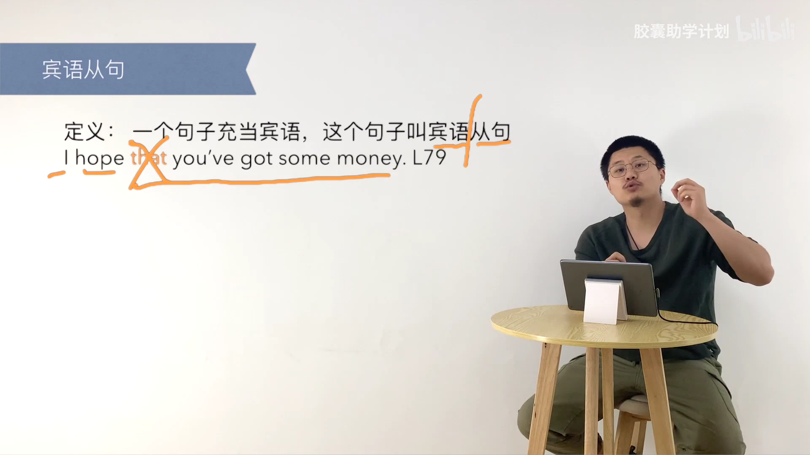

文字识别：胶囊助学计划 / 宾语从句 / 定义：一个句子充当宾语，这个句子叫宾语从句 / Ihope / tt /  you've got some money. L79

## 00:02:30–00:03:00

如说，I believe that this house is for sale. 八十九课学过的这句话，我们当时还是一样把 that 实际上我们忽略不计啊，不理它。I believe 我相信，相信的是一件事情，这件事情是这个房子是待售的，这个房子是出售的。OK，那这句话 this house is for sale 是用一句话去做了宾语，叫宾语从句。好，我们再来看一个，说九十一课，I

### 画面 00:02:31

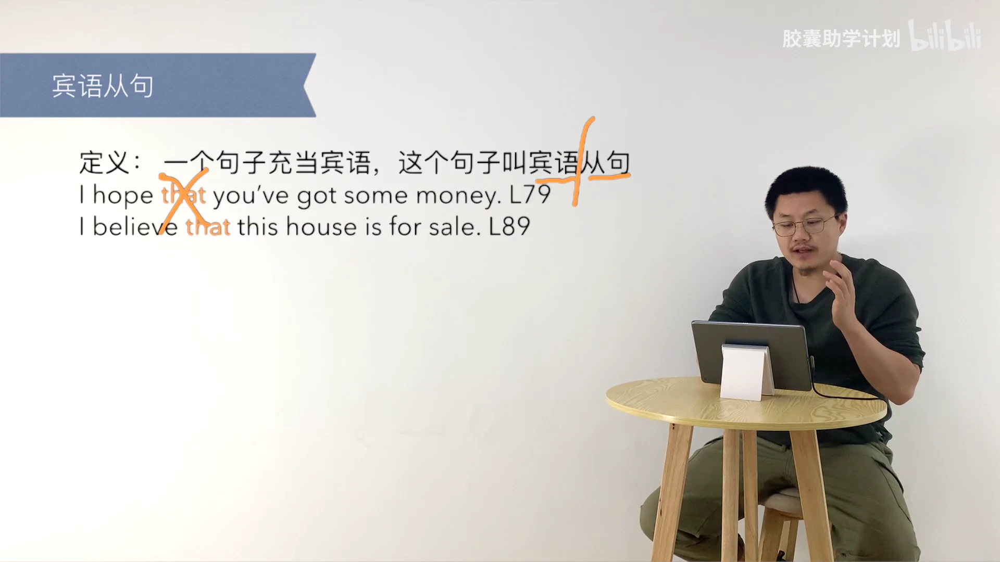

文字识别：胶囊助学计划 / 宾语从句 / 定义：一个句子充当宾语，这个句子叫宾语从句 / tt you've got some money. L79 / I hopet / I believe that this house is for sale. L89

### 画面 00:02:34

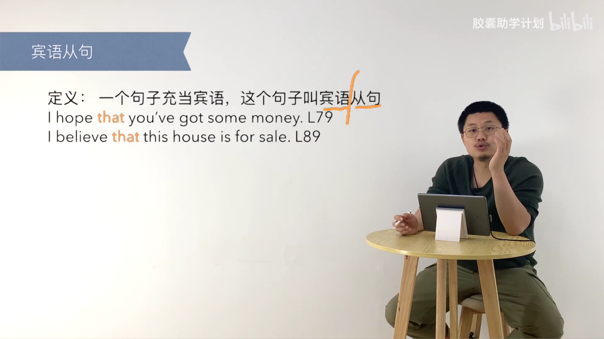

文字识别：bilbil / 胶囊助学计划 / 宾语从句 / 定义：一个句子充当宾语，这个句子叫宾语从句 / I hope that you've got some money. L79 / I believe that this house is for sale. L89

### 画面 00:02:41

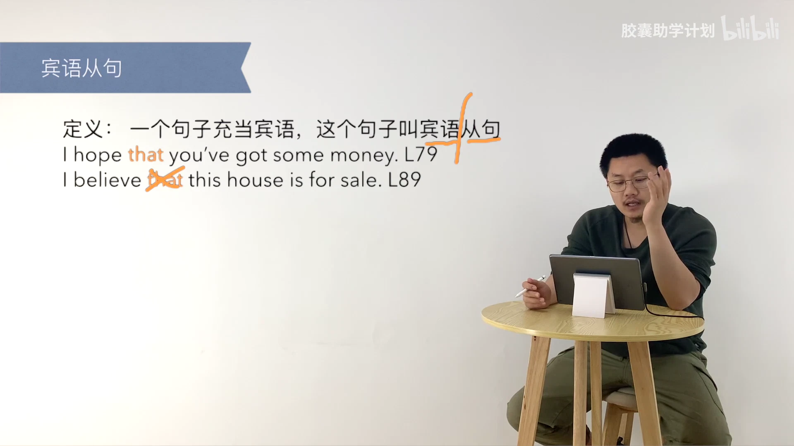

文字识别：biltbli / 胶囊助学计划 / 宾语从句 / 定义：一个句子充当宾语，这个句子叫宾语从句 / I hope that you've got some money. L79 / I believe / eetthis house is for sale. L89

### 画面 00:02:45

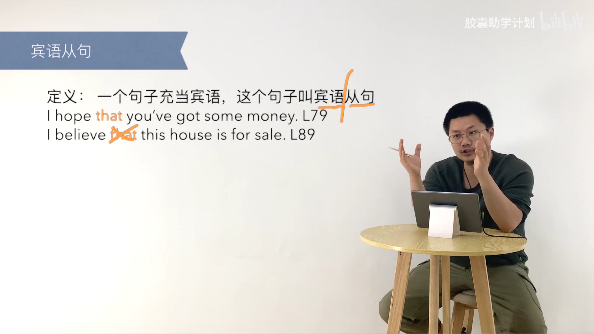

文字识别：胶囊助学计划 / 宾语从句 / 定义：一个句子充当宾语，这个句子叫宾语从句 / I hope that you've got some money. L79 / I believe / atthis house is for sale. L89

### 画面 00:02:57

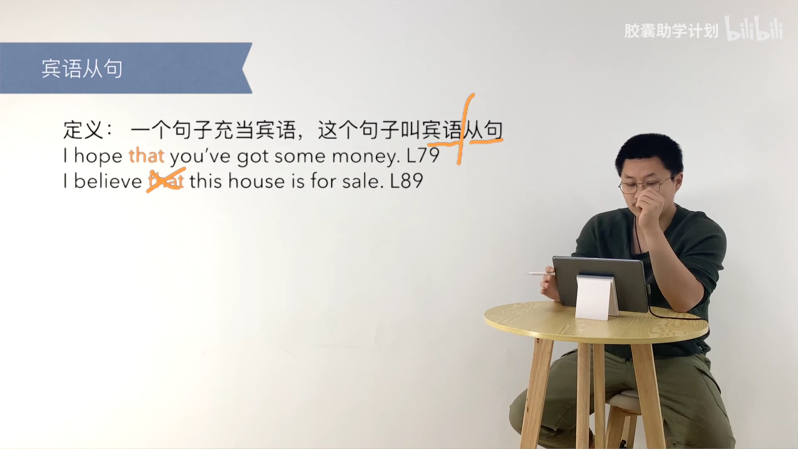

文字识别：bilbili / 胶囊助学计划 / 宾语从句 / 定义：一个句子充当宾语，这个句子叫宾语从句 / I hope that you've got some money. L79 / I believeetthis house is for sale. L89

## 00:03:00–00:03:30

think that that可以删掉，叫They will move in the day after tomorrow.好了，不多说了，各位看到这三个例子应该有感觉了，什么叫做宾语从句，以及目前的这个宾语从句，对吧？它为什么简单？因为它的语序跟汉语，各位可以理解为几乎是完全一致的，对吧？OK，好，那我们给大家一个小小的公式啊，这个公式呢，我们看一下，首先最前面你要有一个主语啊，人啊或者

### 画面 00:03:06

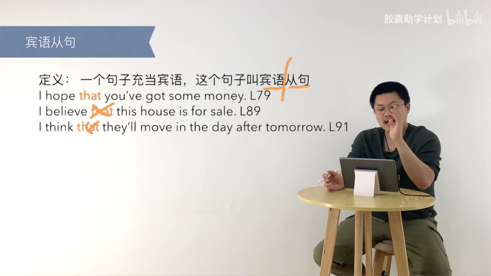

文字识别：bilbil / 胶囊助学计划 / 宾语从句 / 定义：一个句子充当宾语，这个句子叫宾语从句 / I hope that you've got some money. L79 / I believeet this house is for sale. L89 / I think tHt they'll move in the day after tomorrow. L91

### 画面 00:03:08

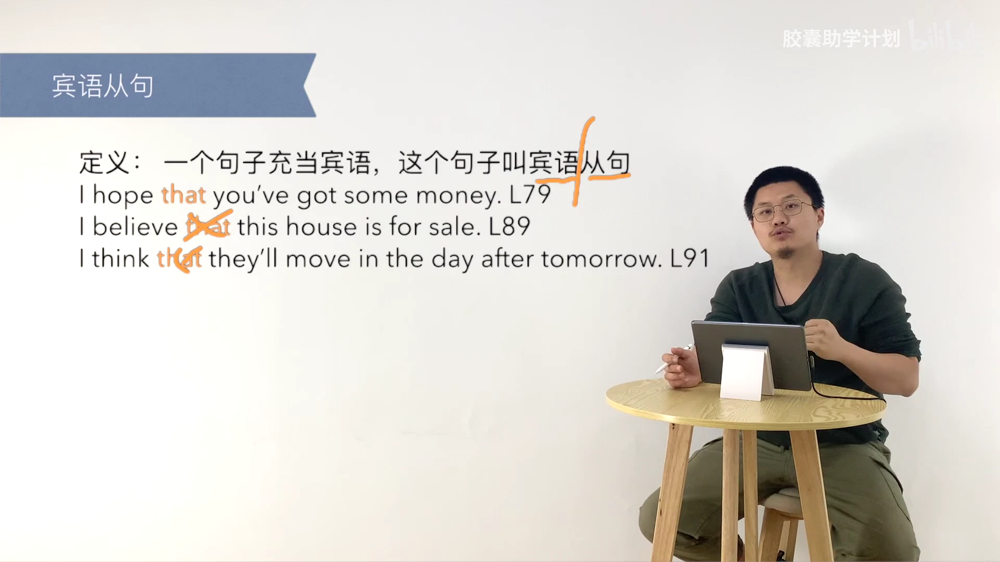

文字识别：胶囊助学计划 / 宾语从句 / 定义：一个句子充当宾语，这个句子叫宾语从句 / I hope that you've got some money. L79 / I believeat this house is for sale. L89 / I think tHt they'll move in the day after tomorrow. L91

### 画面 00:03:11

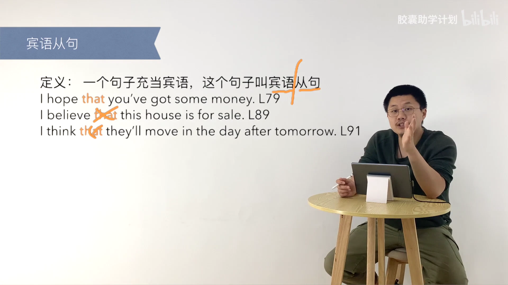

文字识别：胶囊助学计划 / 宾语从句 / 定义：一个句子充当宾语，这个句子叫宾语从句 / I hope that you've got some money. L79 / I believefat this house is for sale. L89 / I think tHt they'll move in the day after tomorrow. L91

### 画面 00:03:22

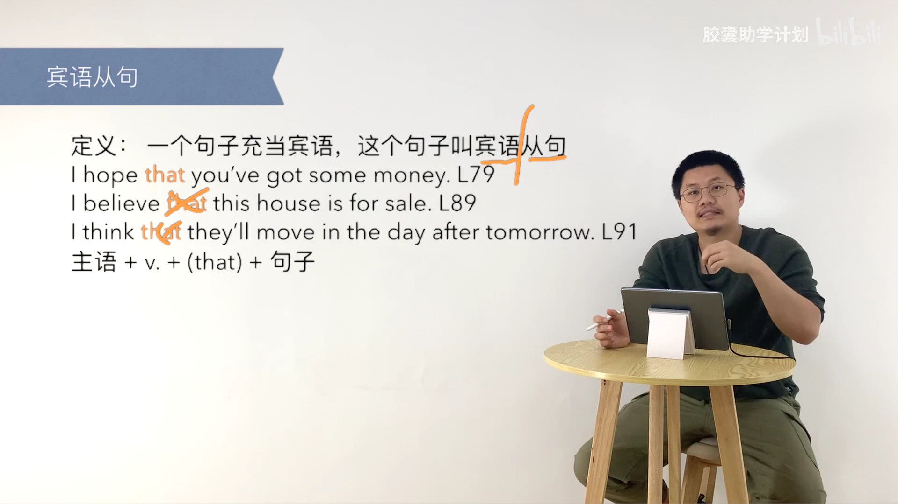

文字识别：胶囊助学计划 / 宾语从句 / 定义：一个句子充当宾语，这个句子叫宾语从句 / I hope that you've got some money. L79 / I believe etthis house is for sale. L89 / I think tHt they'll move in the day after tomorrow. L91 / 主语+ v.+(that)+ 句子

### 画面 00:03:25

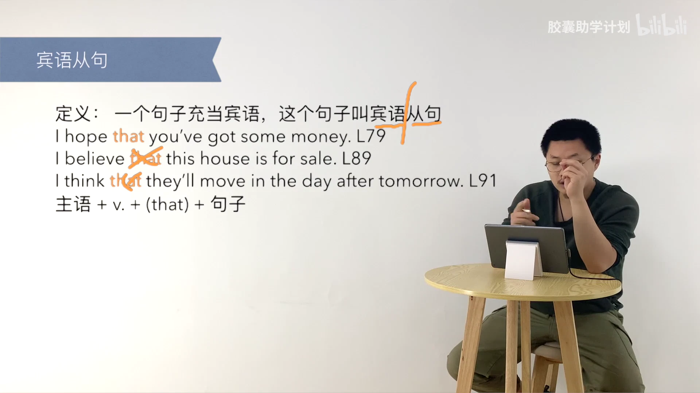

文字识别：胶囊助学计划 / 宾语从句 / 定义：一个句子充当宾语，这个句子叫宾语从句 / I hope that you've got some money. L79 / I believe et this house is for sale. L89 / I think tHt they'll move in the day after tomorrow. L91 / 主语+ v. + (that)+ 句子

### 画面 00:03:28

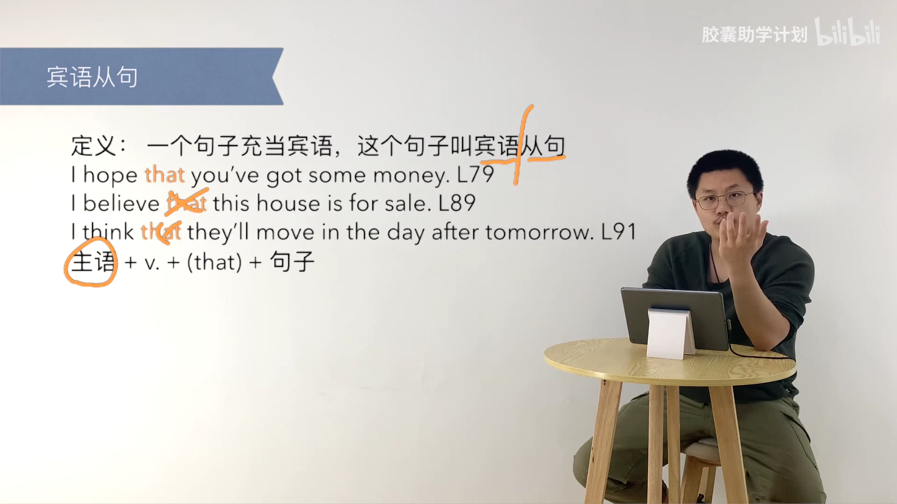

文字识别：bilbili / 胶囊助学计划 / 宾语从句 / 定义：一个句子充当宾语，这个句子叫宾语从句 / I hope that you've got some money. L79 / I believe bat this house is for sale. L89 / I think tk(t they'll move in the day after tomorrow. L91 / 主语 / + v. +(that) + 句子

## 00:03:30–00:04:00

物，然后呢一个动词，比如说在这儿给了大家三个动词，hope， believe 和 think，一会儿我们还会再拓展一些经常连着宾语从句的小的单词，动词啊，然后这个 that 加括弧里告诉各位是一件事情，叫做它是可以被省略的，后面再加上一个句子，而后面的这个句子就是我们今天提到的叫宾语从句。那 that 这个点我再稍微多说一句，就是我们加了括弧告诉告

### 画面 00:03:38

文字识别：bilibili / 胶囊助学计划 / 宾语从句 / 定义：一个句子充当宾语，这个句子叫宾语从句 / I hope that you've got some money. L79 / I believeatthis house is for sale. L89 / I think th(t they'll move in the day after tomorrow. L91 / 主语 / + v. +(that)+句子

### 画面 00:03:45

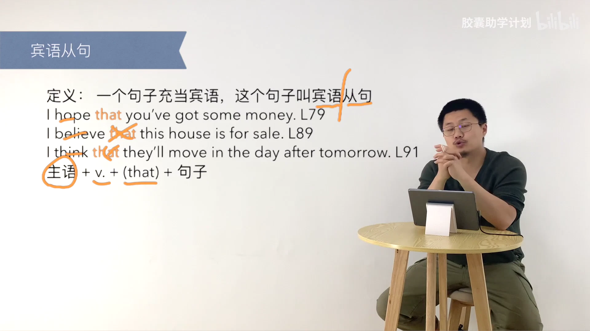

文字识别：胶囊助学计划 / 宾语从句 / 定义：一个句子充当宾语，这个句子叫宾语从句 / I hope that you've got some money. L79 / I believe fet this house is for sale. L89 / I think th(t they'll move in the day after tomorrow. L91 / 主语 / + v. +(that) +句子

### 画面 00:03:53

文字识别：Bilbil / 胶囊助学计划 / 宾语从句 / 定义：一个句子充当宾语，这个句子叫宾语从句 / I hope that you've got some money. L79 / I believebat this / s house is for sale. L89 / I think th@t they'll move in the day after tomorrow. 91 / 主语 / +V.+( / (that) / 句子

## 00:04:00–00:04:30

诉各位可以省略，对吧？其实对于各位来说，初期它不省略，对于各位来说更容易一些，因为它起到一个类似于路标性的一个作用啊，提示性的一个作用。一出现了 that 在这个地方，哎，某种程度上根据各位现有的语法基础，就提醒了你，哎，后边可能是接了一个宾语从句的。我这么说，各位应该能理解了哈。等各位语法基础非常好的时候，就不用加它了。初期我的个人建议是，您

### 画面 00:04:23

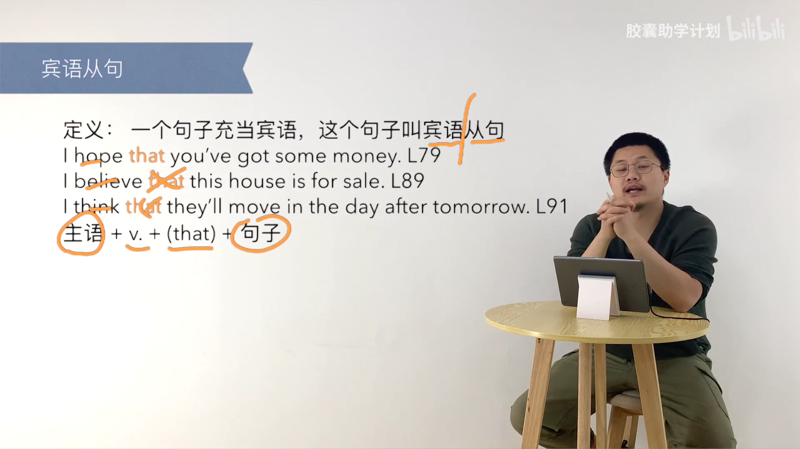

文字识别：胶囊助学计划 / 宾语从句 / 定义：一个句子充当宾语，这个句子叫宾语从句 / I hope that you've got some money. L79 / I believe fet this / s house is for sale. L89 / I think th@rt they'll move in the day after tomorrow. L91 / 主语 / + V. + (that) / 句子

## 00:04:30–00:05:00

还是不妨给他加一下，OK，好，那接下来呢，我们就利用这个公式尝试给大家造一些句子，然后各位会发现这些句子的语序跟汉语几乎是一样的，OK，那刚才我提到了，我说有一些这样的小的动词，它经常放在这个位置，然后后边加一个宾语从句，我们就给它一个一个的造一些小的句子来了，说I think that you are right。

### 画面 00:04:33

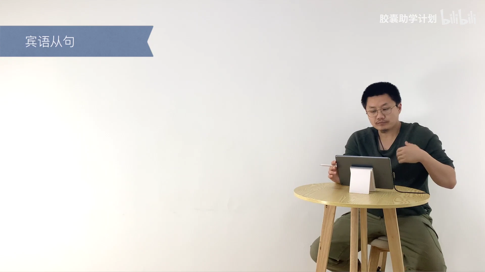

文字识别：胶囊助学计划 / 宾语从句

### 画面 00:04:42

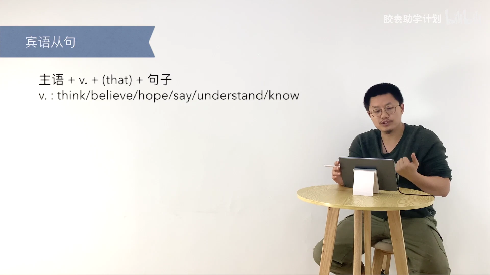

文字识别：胶囊助学计划 / 宾语从句 / 主语 + v. + (that) + 句子 / v.:think/believe/hope/say/understand/know

### 画面 00:04:45

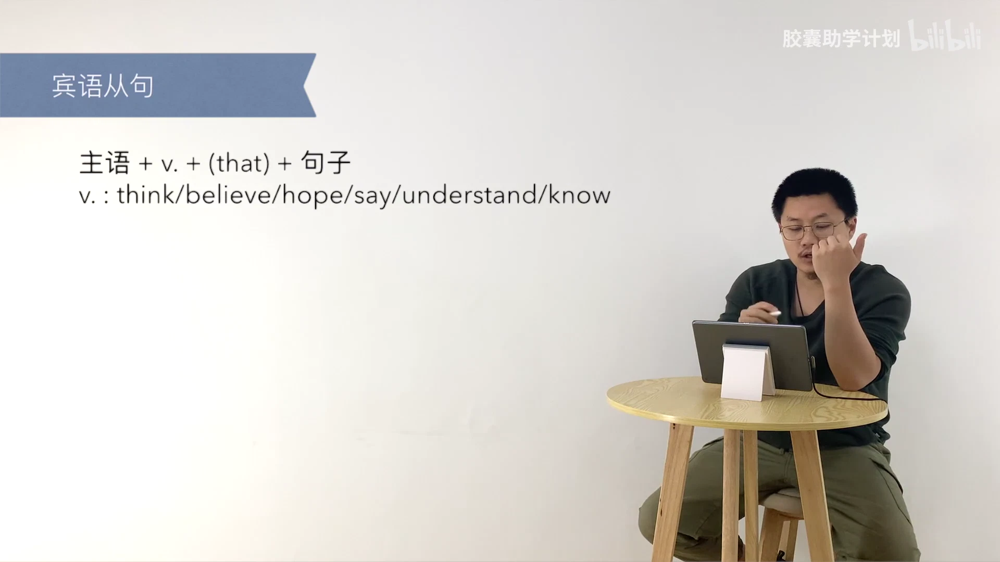

文字识别：胶囊助学计划 / 宾语从句 / 主语+ v. +(that)+ 句子 / v.:think/believe/hope/say/understand/know

### 画面 00:04:48

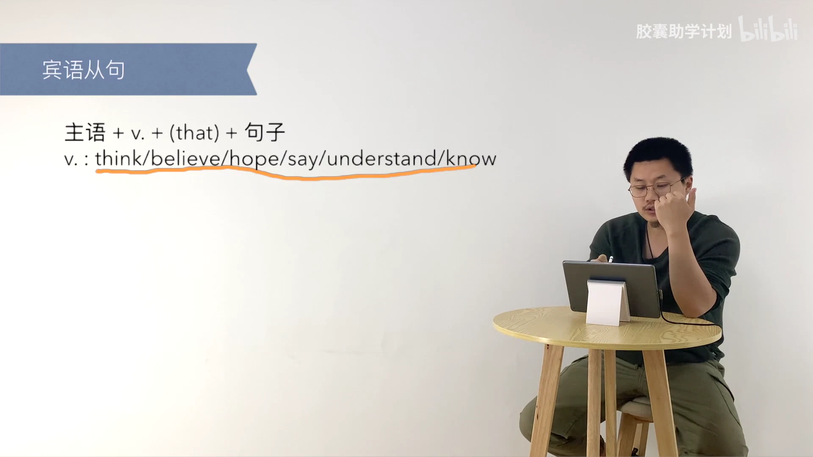

文字识别：bilbili / 胶囊助学计划 / 宾语从句 / 主语+ v. +(that) + 句子 / v.: think/believe/hope/say/understand/know

### 画面 00:04:50

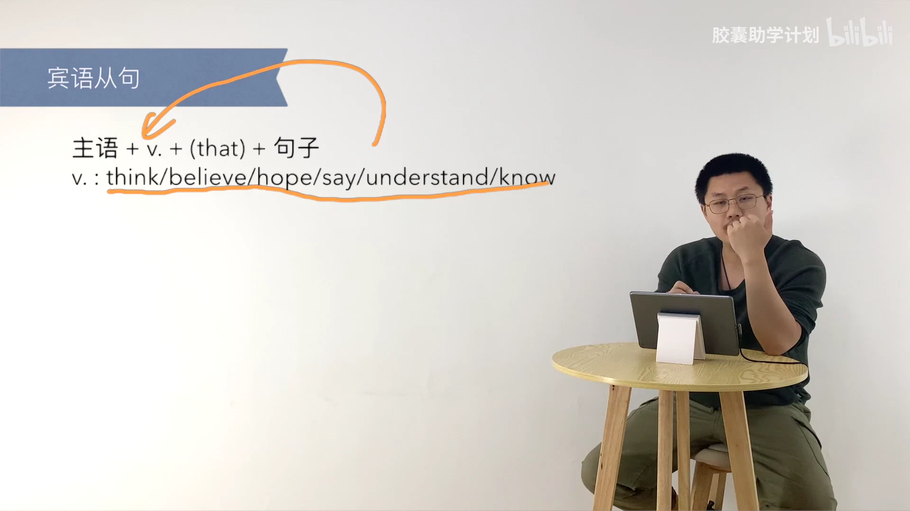

文字识别：胶囊助学计划b出出 / 宾语从句 / 主语+v. + (that) + 句子 / v.:think/believe/hope/say/understand/know

## 00:05:00–00:05:30

好，其实这句话在口语当中很常见，说I think you are right.哎，或者说I think he's right,对吧？这个that经常是省略的，在口语当中，注意啊。但因为我说了，我们刚开始学，我们先留着它，好吧？您看，主语动词后边that you are right这一句话，我们合起来管它叫宾语从句。OK，好，接下来说He believes that they will help him.各位注意，你看，虽

### 画面 00:05:17

文字识别：biibili / 胶囊助学计划 / 宾语从句 / 主语+ V. +(that) + 句子 / v.: think/believe/hope/say/understand/know / Lthink t / that you are right.

### 画面 00:05:24

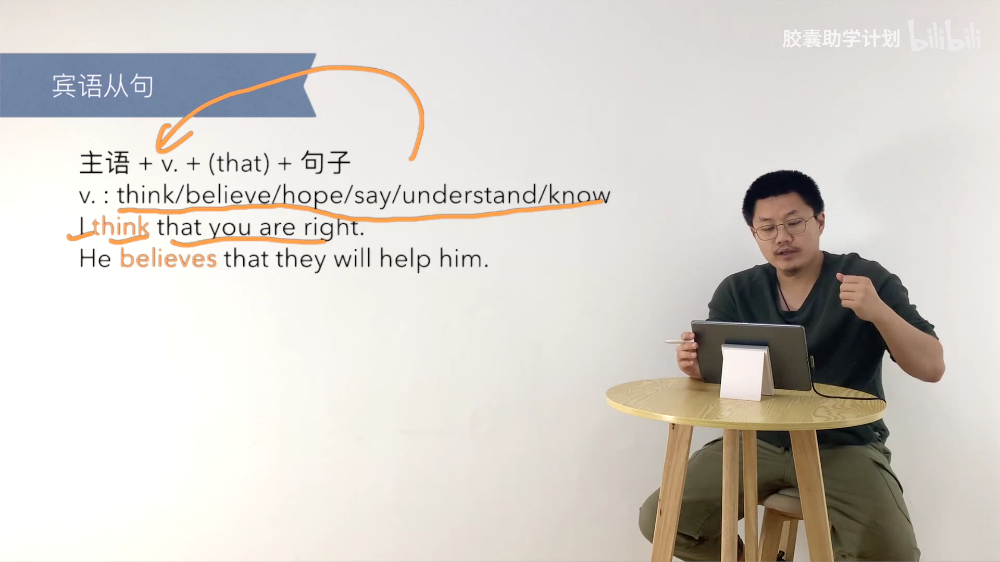

文字识别：胶囊助学计划 / 宾语从句 / 主语+ V. + (that) + 句子 / v.:think/believe/hope/say/understand/know / Lthink that you are / right. / He believes that they will help him.

## 00:05:30–00:06:00

然你是宾语从句，但是你还是满足第三人称单数这个概念，对吧？陈述客观事实，he后边还是加的believes. Okay,再然后说that they will help him.啊，他相信说他们会帮助他的。再来，I hope that the food is safe here.说，我希望啊，后面是一句话，这一句话表达了一个事儿，这个事儿叫做这里的食物是安全的。再来，She says that.

### 画面 00:05:31

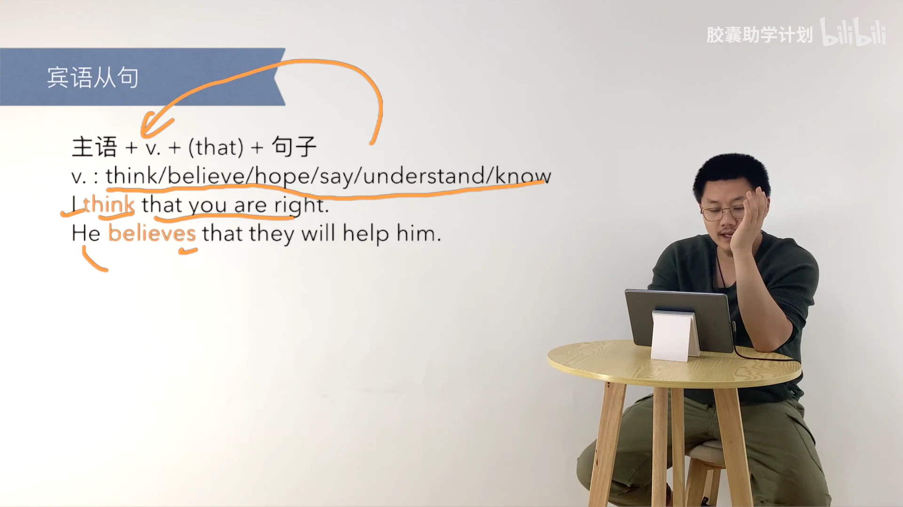

文字识别：Bibii / 胶囊助学计划 / 宾语从句 / 主语+V. + (that) + 句子 / v.:think/believe/hope/say/understand/know / Lthink t / that you are / right. / He believes that they will help him.

### 画面 00:05:37

文字识别：胶囊助学计划 / 宾语从句 / 主语 +V. + (that) + 句子 / v.: think/believe/hope/say/understand/know / Lthink that you are right. / He believes that they will help him.

### 画面 00:05:42

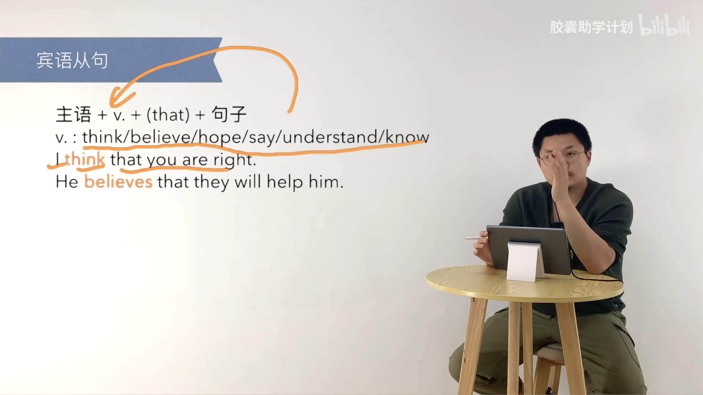

文字识别：biltbili / 胶囊助学计划 / 宾语从句 / 主语+V. + (that) + 句子 / v.: think/believe/hope/say/understand/know / Lthink t / that you are / right. / He believes that they will help him.

### 画面 00:05:57

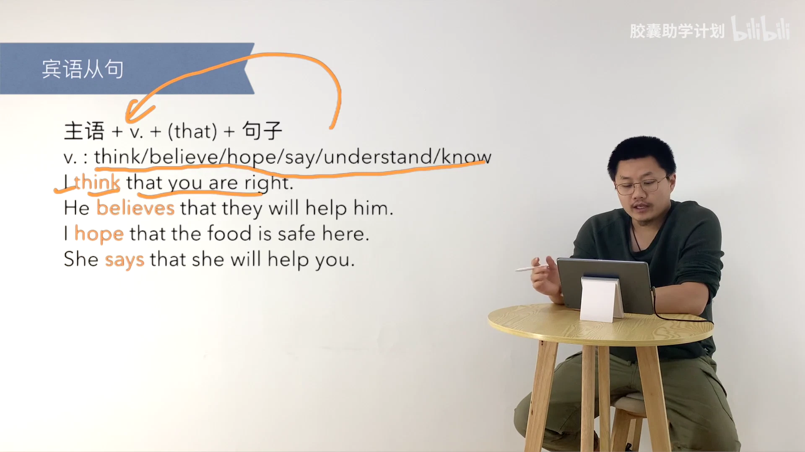

文字识别：Bilbil / 胶囊助学计划 / 宾语从句 / 主语+v. +(that) + 句子 / v.: think/believe/hope/say/understand/know / Lthink that you are right. / He believes that they will help him. / I hope that the food is safe / here. / She says / that she will help you.

## 00:06:00–00:06:30

好，你看她说的是 she will help you. 她会帮助你的。我给你转个话，对吧？再来，We must we understand that we mustn't talk in the library. 说我们清楚，说我们禁止啊，不允许在图书馆当中说话。再来一个啊，OK。好，那刚才这些呢，对于各位来说，各位关键点其实就是大概了解他的语序习惯就可以了。所以这个语法并不难啊，跟汉语几乎是一样的，只不过你可以理解

### 画面 00:06:11

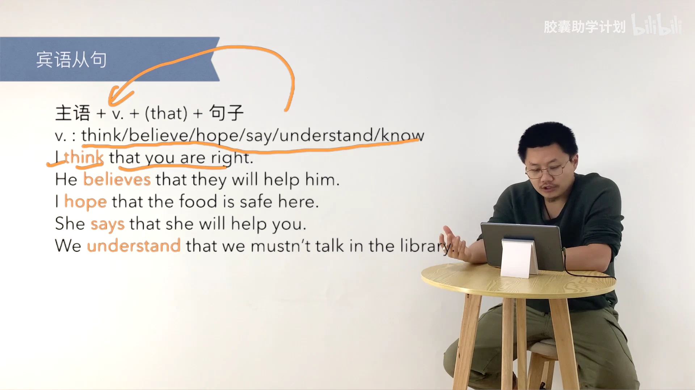

文字识别：胶囊助学计划 / 宾语从句 / 主语 +V. + (that) + 句子 / v.: think/believe/hope/say/understand/know / Lthink that you are right. / He believes that they will help him. / I hope that the food is safe / here. / She / says / that she will help / you. / that we mustn't talk in the library. / We / understand

### 画面 00:06:16

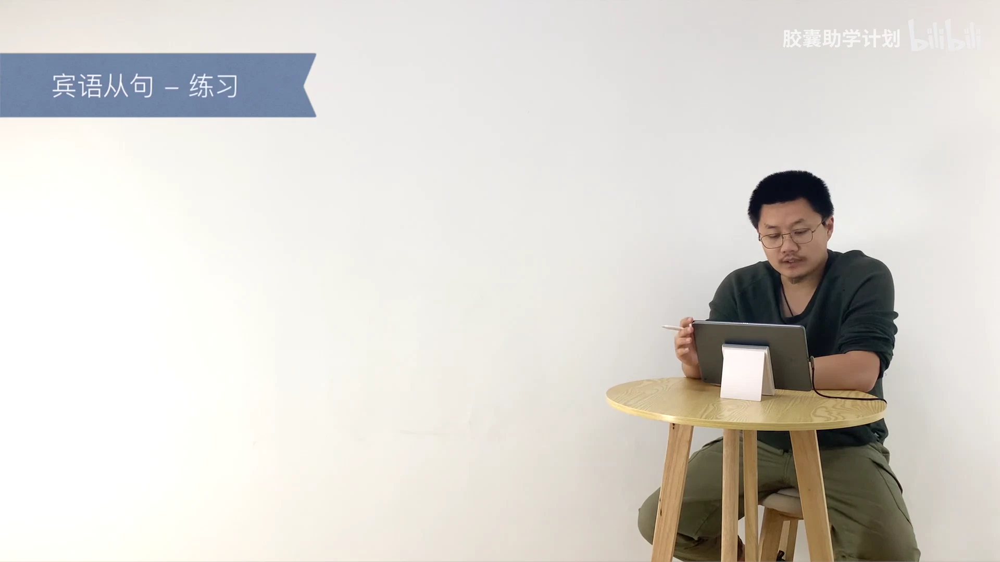

文字识别：胶囊助学计划 / 宾语从句－ 练习

## 00:06:30–00:07:00

为多了一个小单词 that，而这个 that 还是可以省略的。接下来呢，我们做一点小的练习。这个练习我课上带着各位做一一部分，剩下的下课您自己再去做。这也算是我们本期视频的家庭作业之一。我们先来，比如说 describe your mom, dad, best friend, gf, girlfriend,女朋友, bf啊, best friend forever不是bf啊，是boyfriend对吧？这个男朋友。那比如说说

### 画面 00:06:46

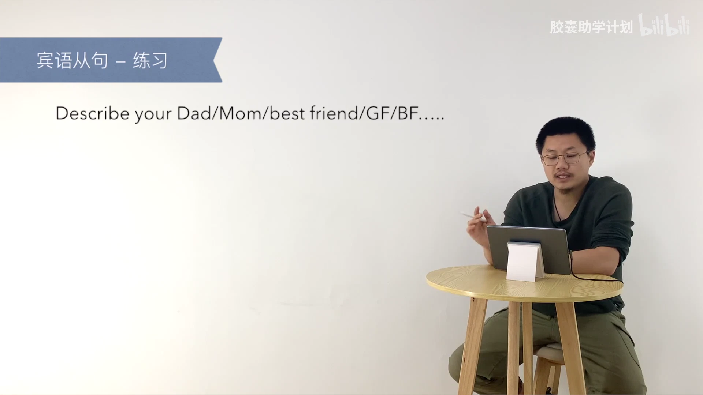

文字识别：Bilibil / 胶囊助学计划 / 宾语从句－练习 / Describe your Dad/Mom/best friend/GF/BF.

### 画面 00:06:48

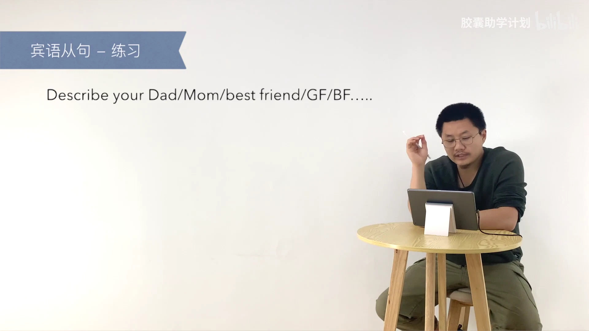

文字识别：胶囊助学计划 / 宾语从句－练习 / Describe your Dad/Mom/best friend/GF/BF. / 2

### 画面 00:06:57

文字识别：胶囊助学计划 / 宾语从句－练习 / Describe your Dad/Mom/best friend/GF/BF.

## 00:07:00–00:07:30

I know that he's twenty nine. 说我知道啊，他二十九岁了。 I know that 我知道的事情是 he likes ice cream. 你看后面别忘了，它是一句话，这句话叫宾语从句。那这句话它还是满足一些时态、人称上的习惯。你陈述客观事实，你还是用一般现在时。主语是 he，对吧？三单。然后呢，你的动词还是要用第三人称单数 like 后边加

### 画面 00:07:12

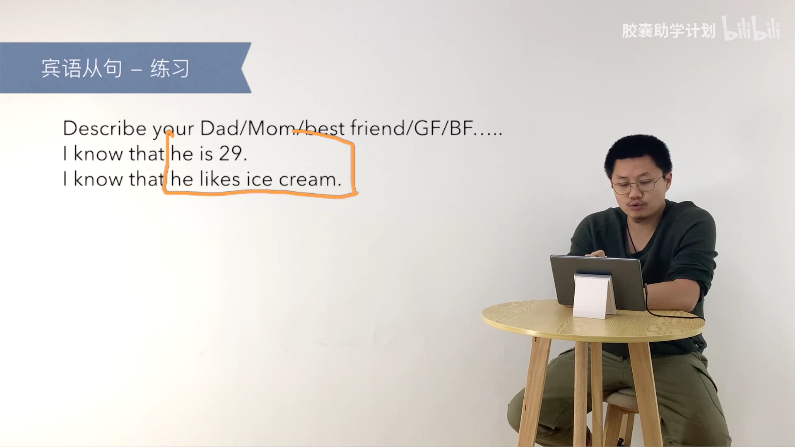

文字识别：bilbili / 胶囊助学计划 / 宾语从句－练习 / Describe yqur Dad/Mom/best friend/GF/BF. / I know thathe is 29. / I know thathe likes ice cream.

### 画面 00:07:15

文字识别：bilibili / 胶囊助学计划 / 宾语从句－练习 / Describe ypur Dad/Mom/best friend/GF/BF. / I know thathe is 29. / I know thathe likes ice cream.

### 画面 00:07:20

文字识别：胶囊助学计划 / 宾语从句－练习 / Describe ypur Dad/Mom/best friend/GF/BF. / I know thathe is 29. / I know thathe likes ice cream.

## 00:07:30–00:08:00

一个s。I know that he lives in Beijing.说我知道他住在北京。I know that he or she，对吧？你自己注意，你描述的是男的，就是he；女的，就是she。Will be a good wife或者good husband。Continue。I know that he can play basketball。Continue。说好，那剩下的这个点点点就是各位下课要自己去完成的。哎，您尝试去描述您的母

### 画面 00:07:30

文字识别：胶囊助学计划 / 宾语从句－练习 / Describe ypur Dad/Mom/best friend/GF/BF. / I know thathe is 29. / I know thathe likes ice cream.

### 画面 00:07:33

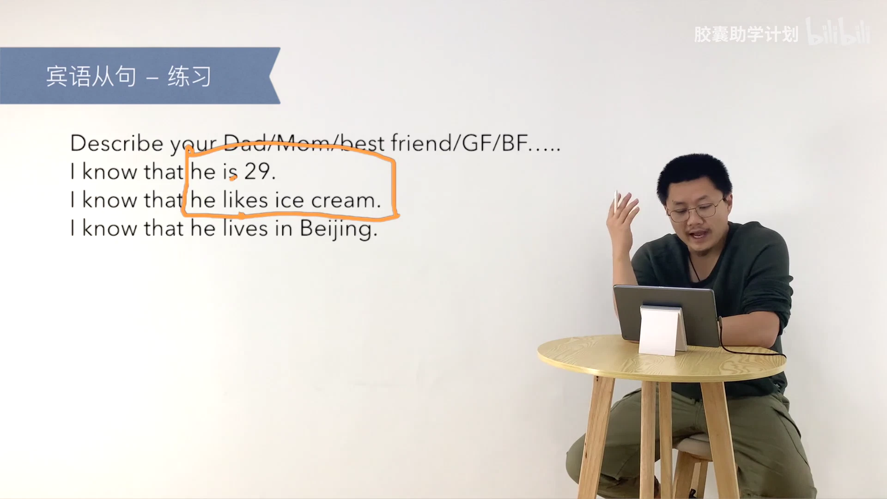

文字识别：胶囊助学计划 / 宾语从句－练习 / Describe ypur Dad/Mom/best friend/GF/BF. / I know thathe is 29. / I know thathe likes ice cream. / I know that he lives in Beijing.

### 画面 00:07:44

文字识别：胶囊助学计划 / 宾语从句－练习 / Describe ypur Dad/Mom/best friend/GF/BF. / I know thathe is 29. / I know thathe likes ice cream. / I know that he lives in Beijing. / I know that she/he will be a good wife/husband.

## 00:08:00–00:08:30

亲或父亲啊，或者任何你最好的朋友都可以描述一个人，甚至描述你自己。用的句式是统一的，叫做 I know that，然后后边加一句宾从。OK，好，这是各位的第一个小的练习，您下课去做。我个人建议呢，有两种方式。第一个方式是您自己去把它写出来，然后大声朗读。第二种方式呢，如果对啊，你和你的小伙伴啊一起在听我们的视频，这是我比较鼓励各

### 画面 00:08:08

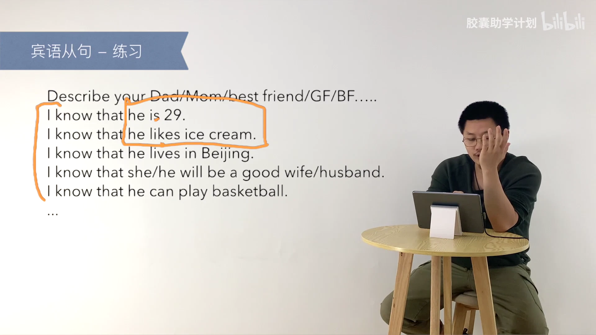

文字识别：胶囊助学计划b鼎b出 / 宾语从句－练习 / Describe ypur Dad/Mom/best friend/GF/BF. / I know thathe is 29. / I know thathe likes ice cream. / I know that he lives in Beijing. / I know that she/he will be a good wife/husband. / I know that he can play basketball.

### 画面 00:08:10

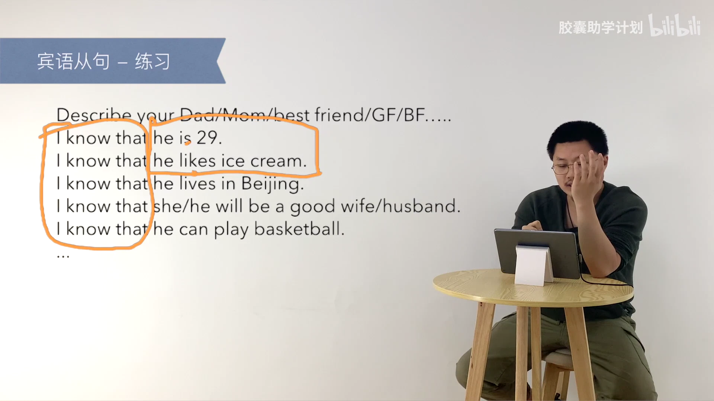

文字识别：bilibili / 胶囊助学计划 / 宾语从句－练习 / Describe your / Dad/Mem/best friend/GF/BF. / Tknow that he is 29. / I know thathe likes ice cream. / I know thathe lives in Beijing. / I know thatshe/he will be a good wife/husband. / I know that he can play basketball.

### 画面 00:08:12

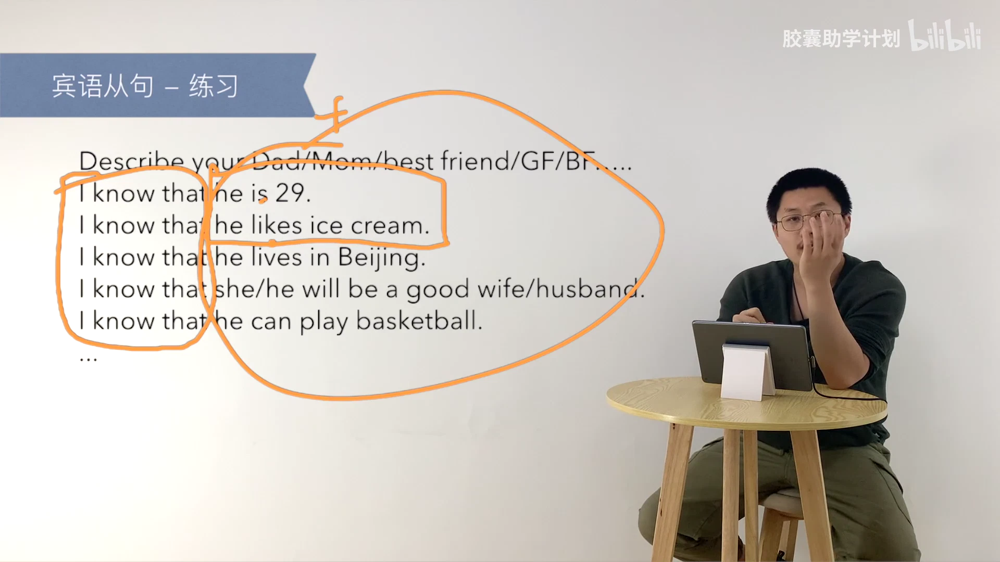

文字识别：biibli / 胶囊助学计划 / 宾语从句－练习 / Describe your / /Mom/best friend/GF/Bi / Tknow thathe is 29. / I know thahe likes ice cream. / I know thalhe lives in Beijing. / I know thatshe/he will be a good wife/husbang / I know that he can play basketball.

### 画面 00:08:14

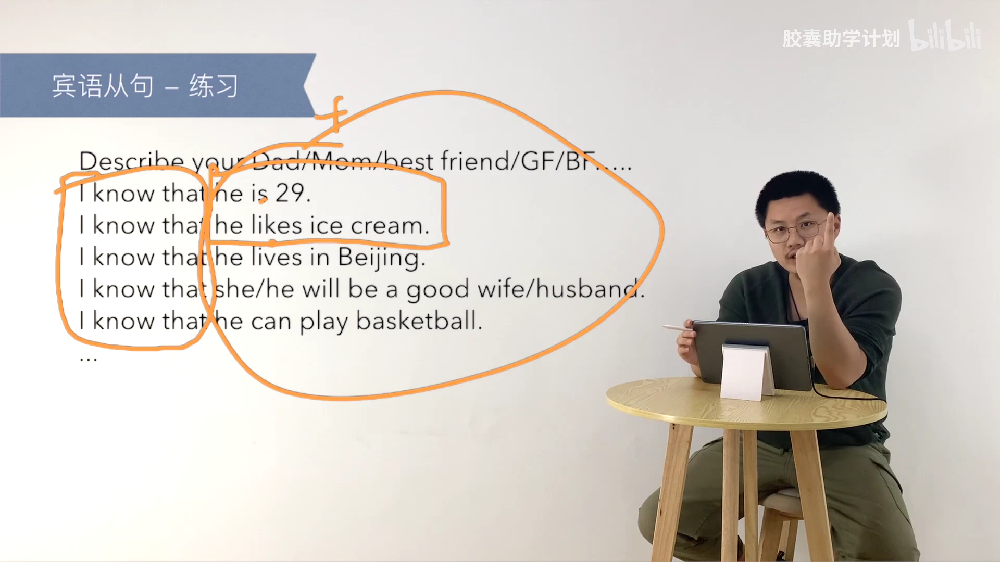

文字识别：BiliBili / 胶囊助学计划 / 宾语从句－练习 / Describe your / Mem/best friend/GF/Bi / Tknow thathe is 29. / I know thahe likes ice cream. / I know thalhe lives in Beijing. / I know that she/he will be a good wife/husbang / I know that he can play basketball.

## 00:08:30–00:09:00

位的是吧？抱团学习非常的好。然后呢，各位可以做的事情是两个人，哎，口语对答，你说一段，我说一段啊。我说的时候，我练了口语，你练了听力；你说的时候呢，你练了口语，我练了听力。不懂的地方，二者还可以互相沟通一下，一起查阅一下，校对。OK，好，下一个练习呢，很简单，就是商量去做饭啊，两个菜，你讨论买什么东西，比如说你要买鱼啊，要做鱼香肉丝啊，要做什么，那你就说，

### 画面 00:08:44

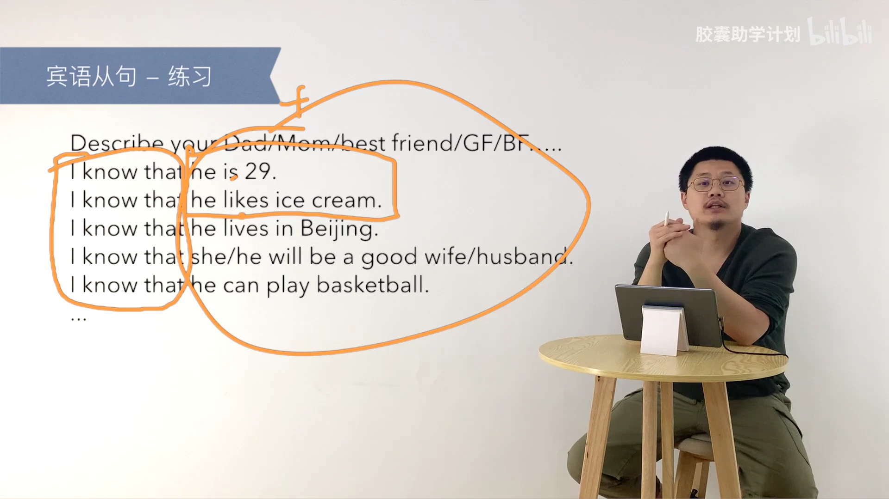

文字识别：胶囊助学计划 / 宾语从句－练习 / Describe your / Mem/best friend/GF/BT / Tknow thathe is 29. / I know thahe likes ice cream. / I know thal he lives in Beijing. / I know thatshe/he will be a good wife/husbang / I know that he can play basketball.

### 画面 00:08:50

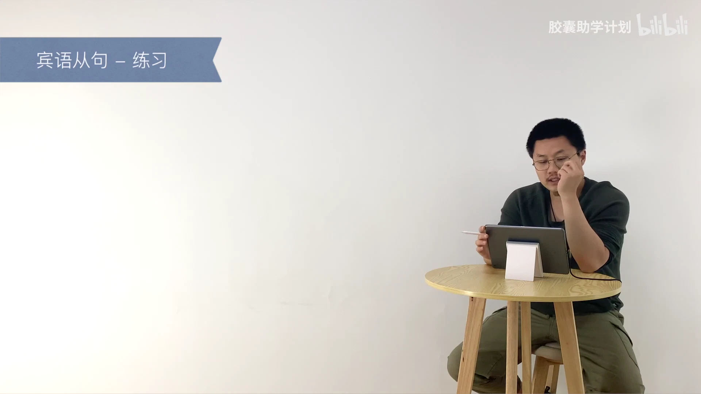

文字识别：胶囊助学计划bi出 / 宾语从句－ 练习

### 画面 00:08:53

文字识别：胶囊助学计划 / 宾语从句－练习 / 商量做饭(两菜)，讨论买什么东西。

### 画面 00:08:57

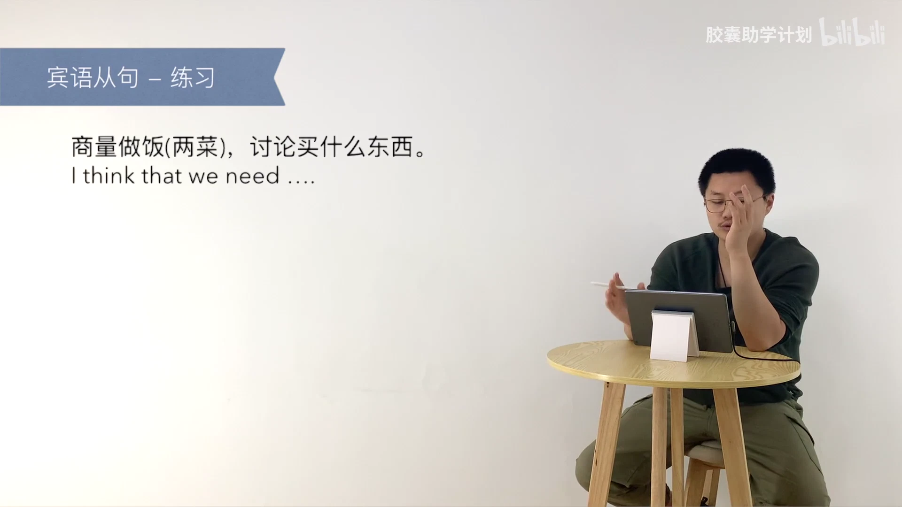

文字识别：胶囊助学计划bib出 / 宾语从句－练习 / 商量做饭(两菜)，讨论买什么东西。 / I think that we need

## 00:09:00–00:09:30

I think that we need a. 然后需要什么菜呢？我胡萝卜，您不会，正好是一个学习单词的过程，自己去查一下胡萝卜英文应该怎么说，对吧？哎，香菇，哎，怎么说，对吧？等等等等，笋应该怎么说？OK，所以用的句式很简单，叫 I think that we need，其实是高度重复的啊。两个人去做一道菜啊，做两道菜。OK，而一个这也是我们今天的家庭作业之一，各位去做这个练习，利用宾

### 画面 00:09:00

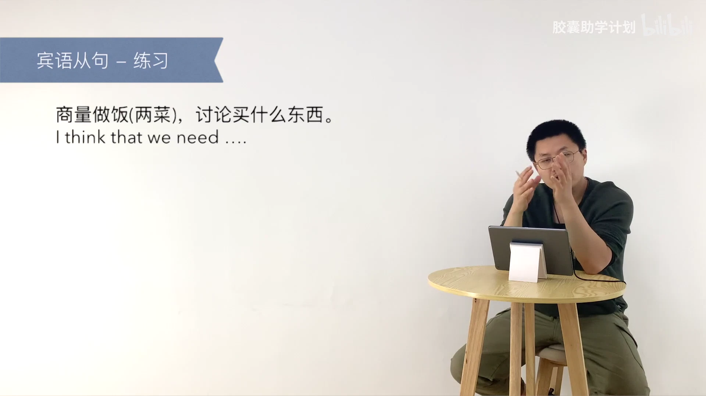

文字识别：胶囊助学计划 / 宾语从句－练习 / 商量做饭(两菜)，讨论买什么东西。 / I think that we need

### 画面 00:09:17

文字识别：胶囊助学计划 / 宾语从句－练习 / 商量做饭(两菜)，讨论买什么东西。 / I think that we need

### 画面 00:09:19

文字识别：bilbil / 胶囊助学计划 / 宾语从句－练习 / 商量做饭(两菜)，讨论买什么东西。 / I think that we need

## 00:09:30–00:10:00

语从句这个语法解决我们生活当中实际的问题。OK，接下来呢，我们听一段啊，今天不看电影了，听一个小的歌曲，它的歌词当中就出现了叫 I believe I can fly，我相信我能飞，是吧？OK，那你注意，你看这个 believe 后边那个 that 就被这个歌词省略了，I believe that I can fly 就不好听了，是吧？I believe I can fly 就好听很多。那各

### 画面 00:09:34

文字识别：I believe I can fly / 胶囊助学计划 / If I can see it, then I can do / it / If I just believe it, there's / nothing to it / I believe I can fly

### 画面 00:09:39

文字识别：I believe I can fly / 胶囊助学计划 / If I can see it, then I can do / it / If I just believe it, there's / nothing to it / I believeI can fly

### 画面 00:09:46

文字识别：I believe I can fly / 胶囊助学计划 / If I can see it, then I can do / it / If 1 just believe it, there's / nothing to it / I believe I can fly

## 00:10:00–00:10:30

位注意力集中，我们来一起听一下。

### 画面 00:10:03

文字识别：I believe I can fly / biibili / 胶囊助学计划 / If I can see it, then I can do / it / If I just believe it, there's / nothing to it / I believe l can fly

### 画面 00:10:05

文字识别：I believe I can fly / bilbli / 胶囊助学计划 / I believe I can fly / I believe I can touch the sky / I think about it every night and day / Spread my wings and fly away / I believe I can fly

### 画面 00:10:20

文字识别：I believe I can fly / 胶囊助学计划 / I believe I can fly / I believe I can touch the sky / I think about it every night and day / Spread my wings and fly away / I believe I can soar / I see me running through that open door / I believe I can Fly / I believe I / I believe I can fly

## 00:10:30–00:11:00

你看它这里面至少出现了我们啊，随手一看至少三个是吧？一个I believe I can fly, I believe I can touch the sky, I believe I can soar啊，应该是这样的三句宾语从句。你看实际上你翻译起来跟汉语没有什么区别，一个单词一个单词往下翻译就可以了，很舒服。Okay,那我们看一

### 画面 00:10:37

文字识别：I believe I can fly / 胶囊助学计划 / I believe I can fly / I believe I can touch the sky / I think about it every night and day / Spread my wings and fly away / I believe I can soar / I see me running through that open door / I believe I can Fly / I believe I / I believe I can fly

### 画面 00:10:39

文字识别：I believe I can fly / 胶囊助学计划 / I believe l can fly

### 画面 00:10:53

文字识别：I believe I can fly / 刘Bibii / 胶囊助学计划 / I believe I can fly

### 画面 00:10:58

文字识别：胶囊助学计划bilb出 / /au/ / OW

## 00:11:00–00:11:30

下本课的单词。本课的单词大多数都是我们之前见过的，我们尽量稍微快一点来。第一个其实它不是单词啊，就是一个语气词啊，它不是个单词，各位注意啊，就是发音ow啊，拽了一下或者别人打ow，或者你磕了一下ow啊，它不是一个单词，它就是一个语气词，各位这样去理解就行了，不用单独去背它。下一个单词这是单词了，跟我一起读一下，来叫做sleep，sleep，

### 画面 00:11:10

文字识别：胶囊助学计划 / /au/ / OW

### 画面 00:11:18

文字识别：胶囊助学计划blb出 / /au/ / OW

### 画面 00:11:24

文字识别：胶囊助学计划b出b山 / /s|Ip/ / slip v. / CAUTION

## 00:11:30–00:12:00

sleep, 哎，叫做滑倒了。Sleep啊，滑。OK，那比如说 I slipped，哎，我滑了一下。注意，你看滑了这一下。当你说这句话的时候，你已经滑完了，它是个一般过去式，很神奇啊。那我想问说，你刚才滑了一下吗？叫做 Did you sleep？你看我们汉语也说的是你刚才滑了一下嘛，对吧？OK，你滑倒了吗？以及 How did you sleep？啊，地上这么干，你怎么摔倒的呢？怎么滑倒的呢？How did you sleep？

### 画面 00:11:54

文字识别：胶囊助学计划bi出 / /slIp/ / slip v. / CAUTION / ① I slipped. / Did you slip? / How did you slip?

## 00:12:00–00:12:30

Ah,记住这个单词，再跟我读一遍sleep. Okay, very good.下面接下来有两个单词，第一个单词是跟我一起读fall，过去式fell，过去分词fallen.啊，你比如说这个堕落天使啊，就有这个fallen angel，是吧？Lucifer，路西法。那注意fall这个意思是什么意思呢？就是自由落体，或者说你摔倒掉下来了，这个过程就叫fall. Okay,

### 画面 00:12:04

文字识别：胶囊助学计划 / /fo:l/ /fel/ /'fo:lan/ / /daun'steaz / / fall fell fallen v. downstairs

### 画面 00:12:09

文字识别：胶囊助学计划blb出 / /fo:l/ /fel/ /'fo:lan/ / /daun'steaz l / fall fell fallen v. downstairs

### 画面 00:12:21

文字识别：胶囊助学计划bilb出 / fo:1/ / /fel/ /'fo:lan/ / /daun'steaz/ / fall fell fallen v. downstairs

### 画面 00:12:23

文字识别：胶囊助学计划 / fo:1/ / /fel/ /'fo:lan/ / /daun'steaz/ / fall fell fallen v. downstairs

## 00:12:30–00:13:00

那 downstairs 是我们早在十三课就学过的两组对应的单词，一个叫 upstairs，一个叫 downstairs。好，叫做楼下楼的这个过程，对吧？Upstairs 就是上楼。那如果我说我这个呃掉到楼下去了，是吧？顺着这个楼梯掉下来了，那叫做就像这个图展示的这样，叫做 I fell downstairs. OK.注意为什么没有用 fall 这个原形？你想一下，这肯定是你已经摔下来了，你

### 画面 00:12:31

文字识别：胶囊助学计划 / fo:1/ / /fel/ / /'fo:lan/ / /daun'steaz / / fall fell fallen v. downstairs

### 画面 00:12:47

文字识别：胶囊助学计划 / fo:1/ / /fel/ /'fo:lan/ / /daun'steazl / fall fell fallen v. downstairs / ① I fell downstairs.

### 画面 00:12:55

文字识别：胶囊助学计划 / fo:1/ / /fel/ /'fo:lan/ / /daun'steazl / fall fell fallen v. downstairs / ① I fell downstairs.

## 00:13:00–00:13:30

才说的这句话是一般过去式，对吧？所以那我可以问叫Did you fall downstairs？比如说你看到一个人坐在这个呃楼梯的最底下，对吧？然后呢，哎呀，呲牙咧嘴的，然后呢，文件散落了一地，那你就问他Did you fall downstairs？Okay，以及Be careful，don't fall down啊，说小心啊，别掉下去啊，叫做fall down. Very good.好，Next one，

### 画面 00:13:19

文字识别：胶囊助学计划 / fo:1/ / /fel/ /'fo:lan/ / /daun'steaz / / fall fell fallen v. downstairs / ① Ifell downstairs. / Did you fall downstairs? / Be careful, don't fall down. / 3）

### 画面 00:13:22

文字识别：胶囊助学计划b出b出 / fo:1/ / /fel/ /'fo:lan/ / /daun'steaz/ / fall fell fallen v. downstairs / ① I fell downstairs. / Did you fall downstairs? / Be careful, don't fall down. / 3

### 画面 00:13:26

文字识别：胶囊助学计划 / fo:1/ / /fel/ /'fo:lan/ / /daun'steaz/ / fallfell fallen v. downstairs / ① I fell downstairs. / Did you fall downstairs? / Be careful, don't fall down. / 3)

### 画面 00:13:28

文字识别：胶囊助学计划 / /h3:t/ / / bæ k / / hurt v. back / 2

## 00:13:30–00:14:00

两个小单词，第一个先跟我读一下，叫做hurt啊，叫做伤害了啊。注意它是个动词。那back，其实back最本质的含义就是我们的后方、后面啊，叫做back。好，那它还有一个指的我们身体的部分啊，指的是我们这个下腰，对吧？背啊，我们俗称的叫腰背啊，back。那我们造一个句子叫I hurt my back yesterday. 好，这儿提醒了各位一个小点，一个yesterday，一个hurt，

### 画面 00:13:30

文字识别：胶囊助学计划b出出 / /h3:t/ / / bæ k / / hurt v. back

### 画面 00:13:35

文字识别：胶囊助学计划 / /h3:t/ / / b æe k / / hurt v. back

### 画面 00:13:40

文字识别：胶囊助学计划bl业 / /h3:t/ / / b æe k / / hurt v. back

### 画面 00:13:46

文字识别：胶囊助学计划blb出 / /h3:t/ / / b æe k / / hurt v. back

### 画面 00:13:52

文字识别：胶囊助学计划b出b出 / /h3:t/ / / b æ k / / hurt v. back / ① I hurt my back yesterday.

### 画面 00:13:58

文字识别：胶囊助学计划b出b出 / /h3:t/ / / b æe k / / hurt v. back / ① I hurt my back yesterday.

## 00:14:00–00:14:30

提醒了你，它的过去式跟原形长得是一样的，都叫 hurt，对吧？那在这儿肯定句当中你看不出来，但如果你想，你比如说啊，我们先不看下一句话，我们把它变成一般疑问句，你把谁提前？你不能提 do，对不对？它不是原形，你要提 did，叫做 did you hurt your back yesterday？昨天你把背给弄伤了吗？Where are you？我们换一个时态说，She hurts her back every summer。

### 画面 00:14:01

文字识别：胶囊助学计划bilb出 / /h3:t/ / / b æe k / / hurt v. back / ① I hurt my back yesterday.

### 画面 00:14:12

文字识别：胶囊助学计划 / /h3:t/ / / b æ k / / hurt v. back / ① I hurt my back yesterday. / She hurts her back every summer.

## 00:14:30–00:15:00

说每到夏天，他就总把他的背给弄伤了。 Okay, 咱也不知道为什么，对吧？所以就问了一下，叫 Why does he/she hurt her back every summer? 是吧？啊， Tell me the reason. 你给我讲一下为什么是这个样子的。所以两个单词，各位记住 hurt and back. Very good. 接下来下一个单词是我们很久之前就学过的，本课出现了，我们就带着大家读一遍。好，正好讲

### 画面 00:14:36

文字识别：胶囊助学计划bib出 / /h3:t/ / / b æ k 1 / hurt v. back / ① I hurt my back yesterday. / She hurts her back every summer. / Why does she hurt her back every / 3 / summer?

### 画面 00:14:38

文字识别：胶囊助学计划 / /h3:t/ / / b æ k / / hurt v. back / ① I hurt my back yesterday. / She hurts her back every summer. / Why does she hurt her back every / 3 / summer?

### 画面 00:14:50

文字识别：胶囊助学计划bil出 / /h3:t/ / / bæ k / / hurt v. back / ① I hurt my back yesterday. / She hurts her back every summer. / Why does she hurt her back every / 3 / summer?

### 画面 00:14:52

文字识别：胶囊助学计划bib出 / stand up

## 00:15:00–00:15:30

一个小的连读，叫做如果不连不连着读，分开读叫做 stand up stand up，OK，这并不算错啊，不像我们很多说教连读的那个概念，说这是错的，这并不错，你这么去读，老外一定读的听得懂，但老外他不是这么说的，是吧？我们就说英语是母语的人，他们在这么去读的时候，会把他们这样连起来分开，叫做 stand

### 画面 00:15:04

文字识别：胶囊助学计划 / stand up

### 画面 00:15:24

文字识别：胶囊助学计划blb山 / stand up

## 00:15:30–00:16:00

up up，听见了啊？d 是这个字母，d 是给后面的 up，所以它叫做 stand up。 OK，和 stand up 是不是稍有不同？听起来对吧？ OK，那另一个就是我们之前就学过叫 sit down。 OK，这就不多说了，叫坐下。 Continue，下一个单词跟我一起读一下，叫做 help help。我们在很早之前就带着大家学过这个单词了，所以我们简单造几个句子，您张嘴跟我

### 画面 00:15:35

文字识别：胶囊助学计划 / stan / up

### 画面 00:15:48

文字识别：胶囊助学计划blb出 / /help/ / help v. / HELP

## 00:16:00–00:16:30

读一下就可以了。来，Can you help me? Next one, I need some help. Next one, I can help you. Very good.好，Next one，接下来呢是两个小的单词组成的一个小短语，叫立刻马上啊。先跟我读一下，叫做at once. At once. Okay,我们拿它造句，比如说Can you come at once?你能立刻就来吗？你能马上来吗？Very good. Next one,说Will the doctor see

### 画面 00:16:07

文字识别：胶囊助学计划bi出 / /help/ / help v. / HELP / ① Can you help me? / ② I need some help. / ③ I can help you.

### 画面 00:16:10

文字识别：胶囊助学计划 / at once / 8

### 画面 00:16:27

文字识别：胶囊助学计划bib出 / at once / ① Can you come at once? / ) Will the doctor see me at once?

## 00:16:30–00:17:00

me at once? 说医生能立刻看一下我吗? Will the doctor see me at once? Very good. 再接下来呢，我们看，先看一个小单词，叫做 sure 啊。比如说这个单词应该是呃比还挺简单。比如说 Are you sure? I'm sure, 对吧？你确定吗？我很确定。那我说你对这件事情确定吗？叫做 Are you sure about this? 就关于这件事情，你很确定吗？About 在

### 画面 00:16:37

文字识别：DBERT / CHRIS / MARK / CHRIS / SCARLETT / JEREMY / Bilbili / INEY JR. / EVANSRUFFALO HEMSWORTH / JOHANSSON / RENNER / 胶囊助学计划 / 1 ∫0:1 / Are you sure / about this? / MARVEL / AVENGEF / THE / 复仇者联盟The Avengers (2012) / IN 3DEN

### 画面 00:16:39

文字识别：DBERT / CHRIS / MARK / CHRIS / SCARLETT / JEREMY / INEY JR. / EVANS / RUFFALO HEMSWORTH / JOHANSSON / RENNER / 胶囊助学计划 / 1 ∫0:1 / Are you s / sure / about this? / MARVEL / AVENGEF / THE / 复仇者联盟TheAvengers(2012) / IN 3DEN

### 画面 00:16:41

文字识别：DBERT / CHRIS / MARK / CHRIS / SCARLETT / JEREMY / Biibill / INEY JR. / EVANS / RUFFALO HEMSWORTH / JOHANSSON / RENNER / 胶囊助学计划 / Are you / sure / about this? / MARVEL / AVENGEF / 复仇者联盟TheAvengers (2012) / IN 3DEN

### 画面 00:16:44

文字识别：DBERT / CHRIS / MARK / CHRIS / SCARLETT / JEREMY / INEY JR. / EVANS RUIFFALO HEMSWORTH / JOHANSSON / RENNER / 胶囊助学计划 / 1S0:1 / Are you / sure / about this? / MARVEL / AVENGER / 复仇者联盟TheAvengers (2012) / IN 3D EN

### 画面 00:16:46

文字识别：DBERT / CHRIS / MARK / CHRIS / SCARLETT / JEREMY / INEYJR. / EVANSRUFFALO HEMSWORTH / JDHANSSON / RENNER / 胶囊助学计划 / 1 ∫0:1 / Are you / sure / about this? / MARVEL / AVENGEF / 复仇者联盟 The Avengers (2012) / IN3DEN

### 画面 00:16:50

文字识别：OBERT / CHRIS / MARK / CHRIS / SCARLETT / JEREMY / INEY JR. / EVANS / RUFFALO HEMSWORTH / JOHANSSON / RENNER / 胶囊助学计划 / 1 ∫0:1 / Are you / sure / about this? / MARVEL / AVENGEF / 复仇者联盟 The Avengers (2012) / IN3DEN

### 画面 00:16:59

文字识别：DBERT / CHRIS / MARK / CHRIS / SCARLETT / JEREMY / INEY JR. / EVANS / RUFFALO HEMSWORTH / JDHANSSON / RENNER / 胶囊助学计划 / 1 S0:1 / Are you / sure / about this? / MARVEL / AVENGEF / THE / 复仇者联盟 The Avengers (2012) / IN 3DEN

## 00:17:00–00:17:30

这有关于的感觉啊，就关于这件事情，涉及到这件事情，你很确定吗？叫 Are you sure about this? Okay, 接下来呢，我们看一个小的电影片段，当中出现了这句话，注意力集中，我们做一个听力练习。 You want to get up there? You're gonna need a ride. I got a ride. I can use the boost, though. Sure about this? Yeah, it's gonna be fun.

### 画面 00:17:02

文字识别：DBERT / CHRIS / MARK / CHRIS / SCARLETT / JEREMY / INEY JR. / EVANSRUFFALO HEMSWORTH / JOHANSSON / RENNER / 胶囊助学计划 / 1 S0:1 / Are you / sure / about this? / MARVEL / AVENGEP / THE / 复仇者联盟The Avengers(2012) / IN 3DEN

### 画面 00:17:04

文字识别：DBERT / CHRIS / MARK / CHRIS / SCARLETT / JEREMY / NEY JR. / EVANSRUFFALO HEMSWORTH / JOHANSSON / RENNER / 胶囊助学计划 / 1 S0:1 / Are you / sure / about this? / MARVEL / AVENGEP / THE / 复仇者联盟The Avengers(2012) / IN3DEN

### 画面 00:17:06

文字识别：DBERT / CHRIS / MARK / CHRIS / SCARLETT / JEREMY / INEY JR. / EVANS / RUFFALO HEMSWORTH / JOHANSSON / RENNER / 胶囊助学计划 / Are you / sure / about this? / MARVEL / AVENGEF / THE / 复仇者联盟The Avengers (2012) / IN 3D EN

### 画面 00:17:09

文字识别：DBERT / CHRIS / MARK / CHRIS / SCARLETT / JEREMY / INEY JR. / EVANS / RUFFALO HEMSWORTH / JOHANSSON / RENNER / 胶囊助学计划 / Are you / sure / about this? / MARVEL / AVENGEF / THE / 复仇者联盟The Avengers (2012) / IN 3DEN

### 画面 00:17:13

文字识别：OBERT / CHRIS / MARK / CHRIS / SCARLETT / JEREMY / bilbili / INEY JR. / EVANS / RUFFALO HEMSWORTH / JOHANSSON / RENNER / 胶囊助学计划 / 1 S0:1 / Are you / sure / about this? / MARVEL / AVENGEF / THE / 复仇者联盟The Avengers (2012) / IN 3DEN

### 画面 00:17:16

文字识别：bilibili / 胶囊助学计划 / 你上去要搭个便车 / If you want to get up there, you're going to need a ride.

### 画面 00:17:18

文字识别：bilbili / 胶囊助学计划 / 你上去要搭个便车 / If you want to get up there, you're goling to meed a ride.

### 画面 00:17:20

文字识别：Bilibili / 胶囊助学计划 / A / ★ / 我有车搭 / I got a ride.

### 画面 00:17:22

文字识别：胶囊助学 / 不过你得推我一把 / I could use a boost, though.

### 画面 00:17:24

文字识别：Bilibili / 胶囊助学计划 / A / -

### 画面 00:17:26

文字识别：Bilibili / 助学计划 / 你确定吗 / Are you sure about this?

### 画面 00:17:28

文字识别：划biibil / 嗯 / 肯定很有趣 / Yeah. It's gonna be fun.

## 00:17:30–00:18:00

Okay, there you go.我们再一起来一遍，叫做Are you sure about this？口语当中非常常用啊。别人提了一个点，说他想去做一件事儿，那你认为，比如说有一些小的担心、焦虑或者疑虑，对吧？或者危险，那你就会问他说Are you sure about this？Okay, there you go.接下来下一个单词，它其实是一个字母加了一个单词，是吧？放到一起变成了一个新的单词。跟我读一下，叫做

### 画面 00:17:30

文字识别：Bilibii / 胶囊助学计划

### 画面 00:17:32

文字识别：bilbili / 胶囊助学计划

### 画面 00:17:34

文字识别：DBERT / CHRIS / MARK / CHRIS / SCARLETT / JEREMY / INEY JR. / EVANS / RUFFALO HEMSWORTH / JDHANSSON / RENNER / 胶囊助学计划 / 1 J0:1 / Are you sure / about this? / MARVEL / AVENGEF / THE / 复仇者联盟The Avengers(2012) / IN3DEN

### 画面 00:17:36

文字识别：DBERT / CHRIS / MARK / CHRIS / SCARLETT / JEREMY / INEY JR. / EVANSRUFFALO HEMSWORTH / JOHANSSON / RENNER / 胶囊助学计划 / 1 ∫0:1 / Are you s / sure / about this? / MARVEL / AVENGER / 复仇者联盟The Avengers (2012) / IN3DEN

### 画面 00:17:39

文字识别：DBERT / CHRIS / MARK / CHRIS / SCARLETT / JEREMY / INEY JR. / EVANSRUFFALO HEMSWORTH / JOHANSSON / RENNER / 胶囊助学计划 / Are you s / sure / about this? / MARVEL / AVENGEF / 复仇者联盟The Avengers (2012) / IN30EN

### 画面 00:17:42

文字识别：DBERT / CHRIS / MARK / CHRIS / SCARLETT / JEREMY / INEY JR. / EVANSRUFFALO HEMSWORTH / JOHANSSON / RENNER / 胶囊助学计划 / 1S0:1 / Are you sure / about this? / MARVEL / AVENGEP / THE / 复仇者联盟 The Avengers (2012) / IN 3DEN

### 画面 00:17:46

文字识别：DBERT / CHRIS / MARK / CHRIS / SCARLETT / JEREMY / Bilbil / INEY JR. / EVANSRUFFALD HEMSWORTH / JOHANSSON / RENNER / 胶囊助学计划 / 1 S0:1 / Are you sure / about this? / MARVEL / AVENGEP / THE / 复仇者联盟The Avengers (2012) / IN3DEN

### 画面 00:17:50

文字识别：DBERT / CHRIS / MARK / CHRIS / SCARLETT / JEREMY / INEY JR. / EVANS / RUFFALO HEMSWORTH / JOHANSSON / RENNER / 胶囊助学计划 / Are you s / sure / about this? / MARVEL / AVENGER / 复仇者联盟TheAvengers(2012) / IN30EN

### 画面 00:17:52

文字识别：胶囊助学计划 / /'eks rei/ / X-ray

## 00:18:00–00:18:30

X ray 啊，X 就是大字母啊，就是这个字母大写就可以了，就是 X 这个字母后面这个单词叫做 ray 啊，叫做 X ray，就如图所示，对吧？X ray，好，比如说我们造句子说 She needs an X ray 啊，她需要拍一张 X 光片，对吧？She needs an X ray。一般疑问句，咱们把它变了，叫 Does she need an X ray？然后呢，我们可以问说 Why

### 画面 00:18:17

文字识别：胶囊助学计划bilbl / /'eks rei/ / X-ray / ① She needs an X-ray.

## 00:18:30–00:19:00

does she need an X-ray?她为什么需要拍张X光片呢？你看这个拍，其实我们就不用把它翻译出来了。如果让各位去造句子，你可能造这句话的时候说拍X光片，然后你接下来就开始去找拍照片的这个动词，这个拍，对吧？其实不是这样，就说need就可以了。她需要一张X光片，就是需要去拍X光片。OK，Very good。以及最后说，Who needs an X-ray?谁

### 画面 00:18:36

文字识别：胶囊助学计划bib出 / /'eks reI/ / X-ray / ① She needs an X-ray. / ② Does she need an X-ray? / 2） / ③ Why does she need an X-ray?

### 画面 00:18:43

文字识别：胶囊助学计划 / /'eks rei/ / X-ray / ① She needs an X-ray. / ② Does she need an X-ray? / 2 / ③ Why does she need an X-ray?

### 画面 00:18:58

文字识别：胶囊助学计划 / /'eks rei/ / X-ray / ① She needs an X-ray. / Does she need an X-ray? / Why does she need an X-ray? / 3 / Who needs an X-ray?

## 00:19:00–00:19:30

需要拍张X光片呢？玩一个。Recap.本视频我们最重要的讲了，除了当然还是本课的单词以外，给大家第一拓展了一个口语当中非常常用的小句型。跟我在一起读一遍。Are you sure about this?玩一个。接下来呢，我们学到了一个非常核心的语法，叫做宾语从句啊。各位一定要把它记住。接下来的几课啊，我们都会

### 画面 00:19:03

文字识别：bilbili / 胶囊助学计划 / Recap / Patterns / 宾语从句 / Grammar / Words / Expression / Are you sure about this?

### 画面 00:19:11

文字识别：bibili / 胶囊助学计划 / Recap / Patterns / 宾语从句 / Grammar / Words / Expression / Are you sure about this?

### 画面 00:19:15

文字识别：胶囊助学计划 / Recap / Patterns / 宾语从句 / Grammar / Words / Expression / Are you sure about this?

### 画面 00:19:20

文字识别：Bilbili / 胶囊助学计划 / Recap / Patterns / 宾语从句 / Grammar / Words / Expression / Are you sure about this?

## 00:19:30–00:20:00

围绕着宾语从句去进行一个练习与讲解，它会不停的出现。OK，那家庭作业呢？单词造句，再然后要完成宾语从句的那两个练习的活动，一个是买菜，另外一个还有就是描述一个你熟悉的人啊，可以是你自己用宾语从句的固定句式啊。OK，再然后给自己讲解一遍今天的核心知识点。那如果大家喜欢我们的课程呢，欢迎大家关注、订阅、一

### 画面 00:19:35

文字识别：胶囊助学计划bi出

### 画面 00:19:46

文字识别：胶囊助学计划 / 单词造句3 / 完成宾语从句的两个练习 / 活动

### 画面 00:19:49

文字识别：胶囊助学计划blb鼎 / 单词造句3 / 完成宾语从句的两个练习 / 活动

### 画面 00:19:56

文字识别：胶囊助学计划bl出

### 画面 00:19:59

文字识别：胶囊助学计划 / 2

## 00:20:00–00:20:30

键三连，分享给那些需要的朋友，来帮助我们快速成长。最后，我们再来看一句名人名言：You can have everything in life you want if you will just help other people get what they want. OK, see you next time.

### 画面 00:20:05

文字识别：胶囊助学计划 / You can have everything in life you want, if / you will just help other people get what / they want. / -Zig Ziglar

### 画面 00:20:09

文字识别：胶囊助学计划 / You can have everything in life you want, if / you wil just help other people get what / they want. / -Zig Ziglar

### 画面 00:20:19

文字识别：You can have everything in life you want, if / you will just help other people get what / they want. / Zig Ziglar

### 画面 00:20:21

文字识别：CAPSULEACADEMY / 胶囊助学计划 / 小红书 / Lecturer / Leo / OE

### 画面 00:20:24

文字识别：CAPSULEACADEMY / 胶囊助学计划 / 小红书 / □ / 口 / Editor / OE

### 画面 00:20:27

文字识别：CAPSULEACADEMY / 胶囊助学计划 / 小红书 / Creator / □ / Leo & Berlin / OE

### 画面 00:20:29

文字识别：bilibili / 胶囊助学计划 / 胶囊助学计划 / 小红书 / OE

## 00:20:30–00:20:31

### 画面 00:20:31

文字识别：bilibili / 胶囊助学计划

