# 099 文章

快速机器解析：语音为单模型转写，未进行独立交叉校对或人工复核；画面每秒采样并按变化选帧，短时文字和标记可能遗漏。截图时间约有 1 秒误差。图片有损压缩；遇到疑点请按时间查看 Google Drive 原视频。

## 00:00:00–00:00:30

Hello everyone, welcome to Capsule Academy. This is Leo. Today we're going to learn New Concept English Book One Lesson Ninety Nine Story. Hope you guys enjoyed.好，那我们直接看文章啊。我们看一下这个场景，说一个人说 ow ow 是吧？其实就是个语气词，这不是英文单词啊。OK，好，接下来呢，他掉楼了是吧？从就从这个这个台

### 画面 00:00:00

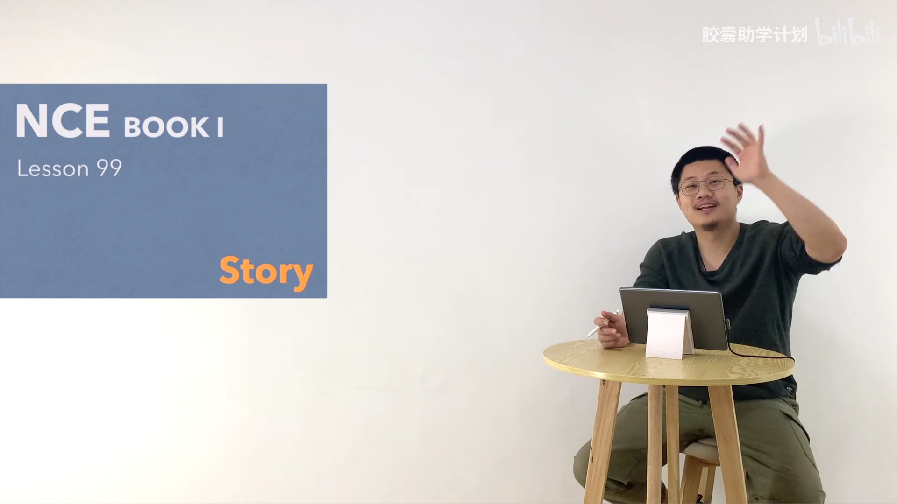

文字识别：胶囊助学计划 / NCE / BOOKI / Lesson 99 / Story

### 画面 00:00:02

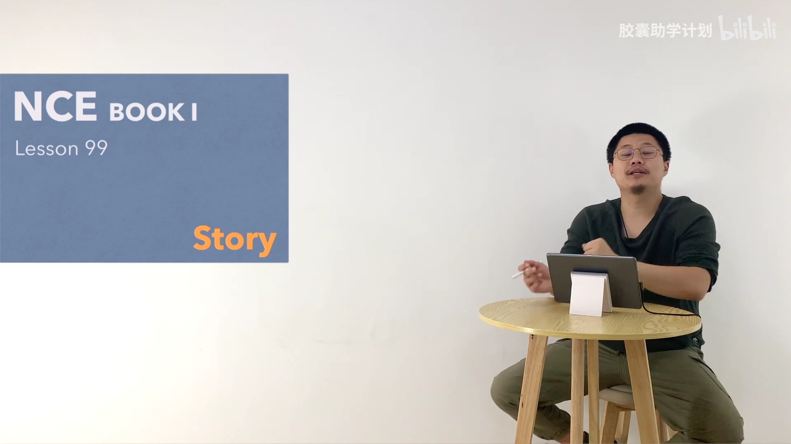

文字识别：胶囊助学计划 / NCE / BOOKI / Lesson 99 / Story

### 画面 00:00:06

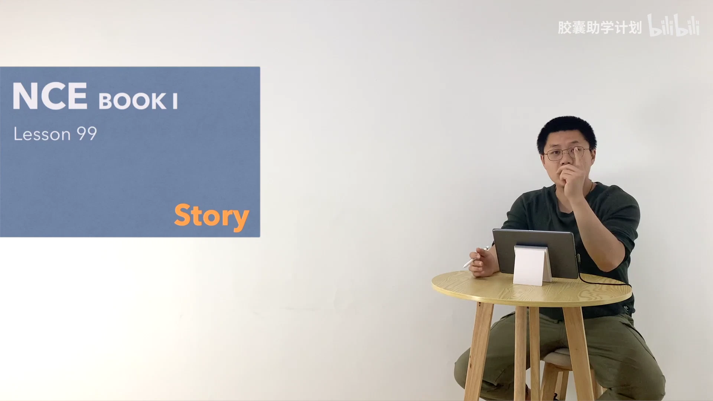

文字识别：Biltbili / 胶囊助学计划 / NCE / BOOKI / Lesson 99 / Story

### 画面 00:00:10

文字识别：胶囊助学计划bill

### 画面 00:00:14

### 画面 00:00:16

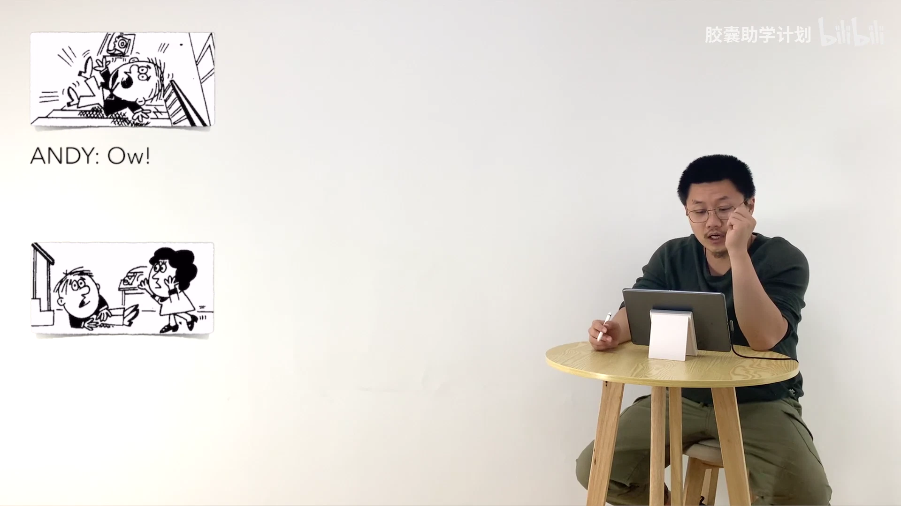

文字识别：胶囊助学计划 / ANDY: Ow!

### 画面 00:00:26

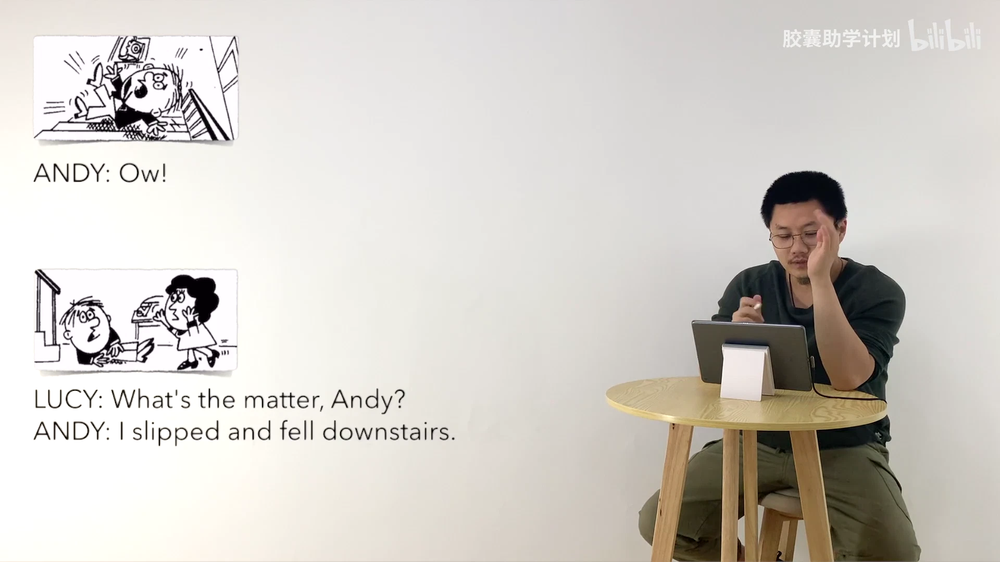

文字识别：胶囊助学计划bib出 / = / ANDY: Ow! / LUCY: What's the matter, Andy? / ANDY: I slipped and fell downstairs.

## 00:00:30–00:01:00

阶上摔下来了啊！然后他老婆可能问说：“What's the matter, Andy？”说怎么了，Andy？然后你看Andy在这种特别紧急的状态下啊，他还记得用一般过去时，就说明他其实并不是记得用一般过去时，这是他语言的一个习惯了。他张嘴下意识的就用到了一般过去时。我们什么时候能练成这个样子？什么时候那英语就太厉

### 画面 00:00:34

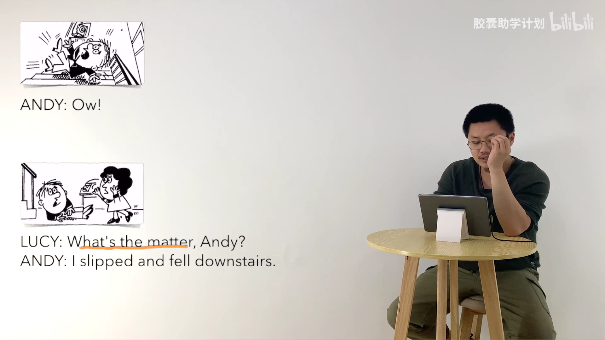

文字识别：胶囊助学计划blb出 / = / ANDY: Ow! / LUCY: What's the matter, Andy? / ANDY: I slipped and fell downstairs.

### 画面 00:00:40

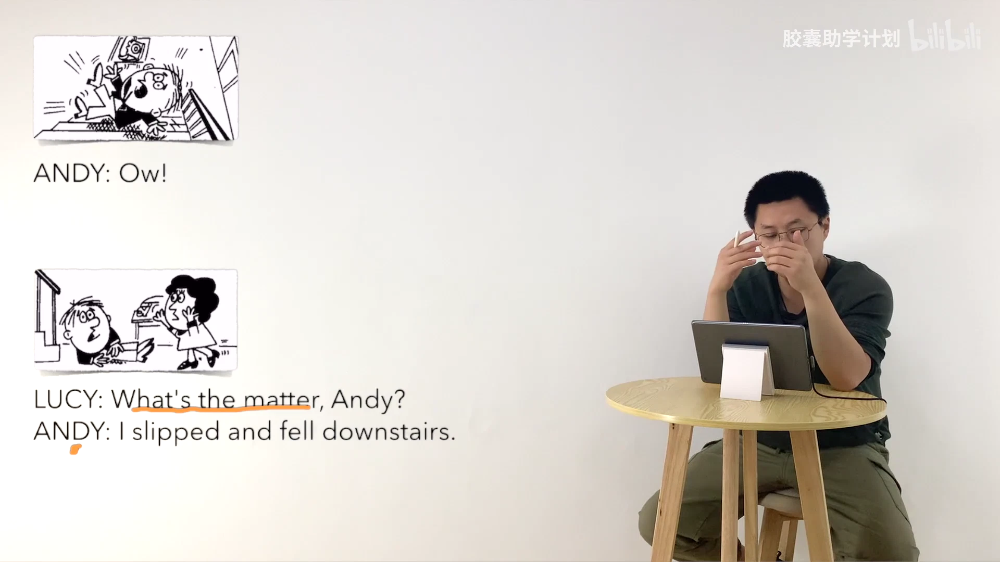

文字识别：胶囊助学计划 / 三 / ANDY: Ow! / LUCY: What's the matter, Andy? / ANDY: I slipped and fell downstairs.

### 画面 00:00:45

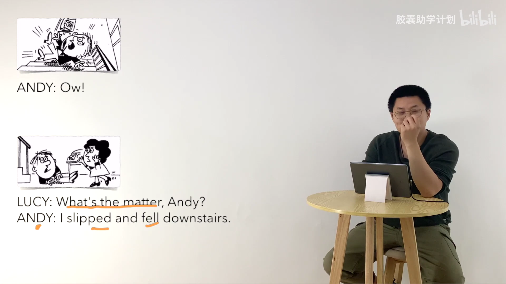

文字识别：胶囊助学计划bil出 / ANDY: Ow! / LUCY: What's the matter, Andy? / ANDY: I slipped and fell downstairs.

### 画面 00:00:47

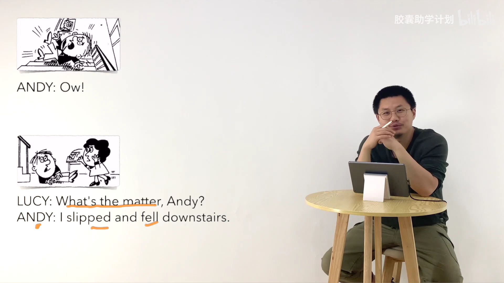

文字识别：胶囊助学计划 / 三 / ANDY: Ow! / LUCY: What's the matter, Andy? / ANDY: I slipped and fell downstairs.

## 00:01:00–00:01:30

害了，几乎就可以理解为是接近于母语了，还是比较困难的一件事情啊。呃，他说 I slipped and fell downstairs，说我滑了一下，然后从然后就从台阶上摔到楼下来了。OK，再来。Have you hurt yourself？你伤到自己了吗？这句话我们完全可以用叫 Did you hurt yourself？去替代。所以我们原来在上课的时候，经常有学员会问我一个问题，说 Leo，你说

### 画面 00:01:06

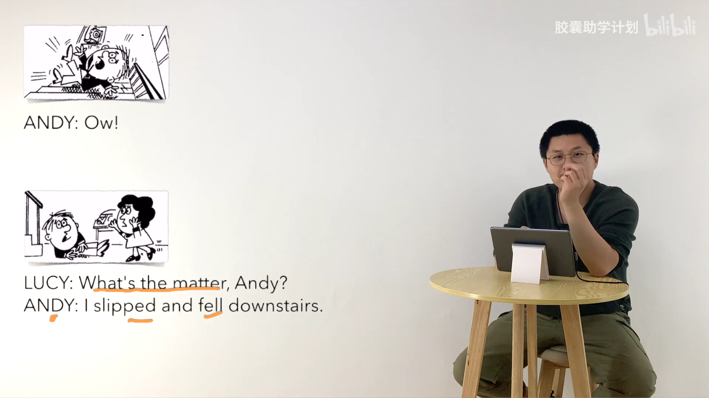

文字识别：胶囊助学计划bil出 / ANDY: Ow! / LUCY: What's the matter, Andy? / ANDY: I slipped and fell downstairs.

### 画面 00:01:08

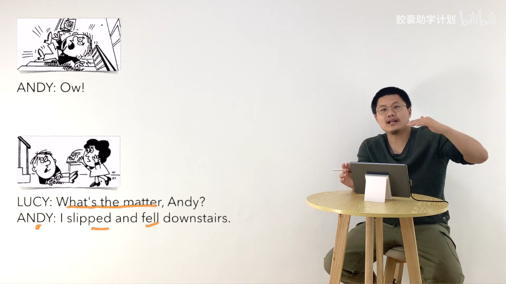

文字识别：胶囊助学计划 / ANDY: Ow! / LUCY: What's the matter, Andy? / ANDY: I slipped and fell downstairs.

### 画面 00:01:10

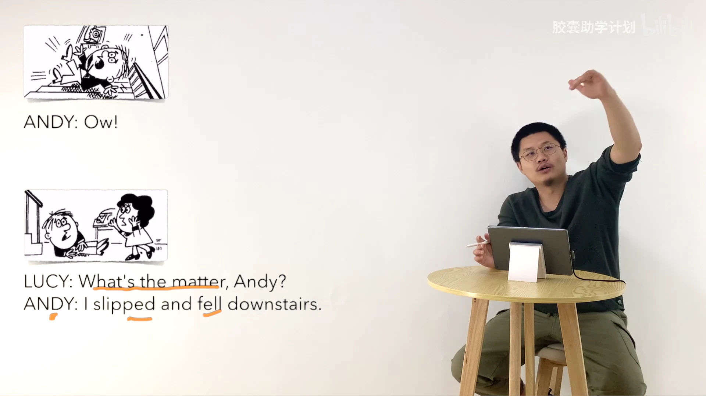

文字识别：胶囊助学计划 / = / ANDY: Ow! / LUCY: What's the matter, Andy? / ANDY: I slipped and fell downstairs.

### 画面 00:01:14

文字识别：胶囊助学计划 / LUCY: Have you hurt yourself? / ANDY: Yes, I have.I think that / I've hurt my back.

### 画面 00:01:16

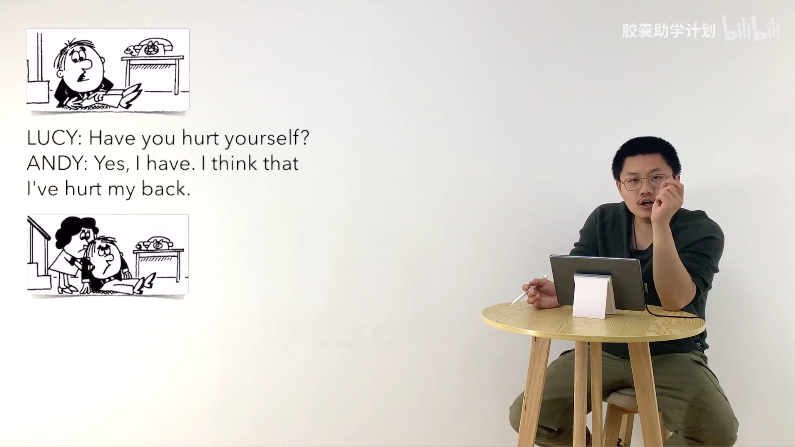

文字识别：胶囊助学计划 / LUCY: Have you hurt yourself? / ANDY: Yes, I have.I think that / I've hurt my back.

### 画面 00:01:28

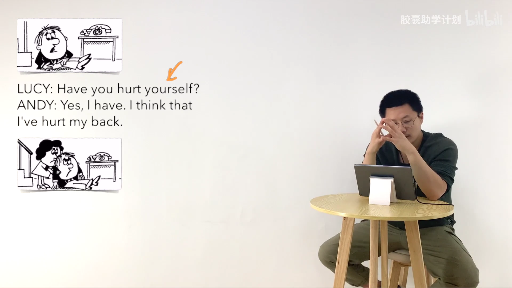

文字识别：胶囊助学计划 / LUCY: Have you hurt yourself? / ANDY: Yes, I have.I think that / I've hurt my back.

## 00:01:30–00:02:00

这个地方，呃，他为什么没有用 did you hurt yourself？好，我往往可能给他的一个回答是可以用啊，只不过如果这个地方有十个不同的选择，我们最终不可能把十个不同的选择都罗列出来吧，对吧？他没有用不代表他不能用啊，你要先清楚这个逻辑，对吧？不是说是错的，但是还有没有其他的可能性呢？还是有的，对吧？所以这其实就是时态的一个有意思的点，尤其当

### 画面 00:01:48

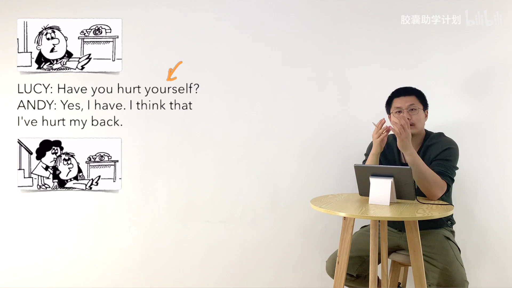

文字识别：胶囊助学计划 / LUCY: Have you hurt yourself? / ANDY: Yes, I have.I think that / I've hurt my back.

### 画面 00:01:57

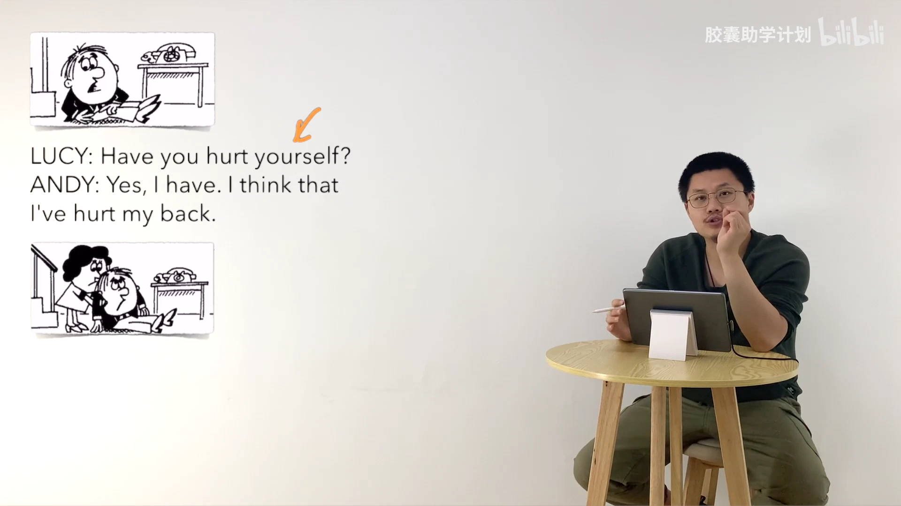

文字识别：胶囊助学计划bi山 / LUCY: Have you hurt yourself? / ANDY: Yes, I have.Ithink that / I've hurt my back.

## 00:02:00–00:02:30

我们有一天进入二册学习的时候，你会发现很多的时态都是重合的，好吧？那我们这儿先不多说了，继续往下走。说 Yes, I have. 是的，我伤到自己了。I think that that 提醒了你宾语从句叫做 I've hurt my back. 我认为啊，我刚刚伤到了我的这个背啊和腰。Can Jenny? 他说 Try and stand up. 来试一下站起来。Can you stand up? 你能站起来吗？

### 画面 00:02:11

文字识别：胶囊助学计划 b鼎b出 / LUCY: Have you hurt yourself? / ANDY: Yes, I have.I thinkthat / I've hurt my back.

### 画面 00:02:14

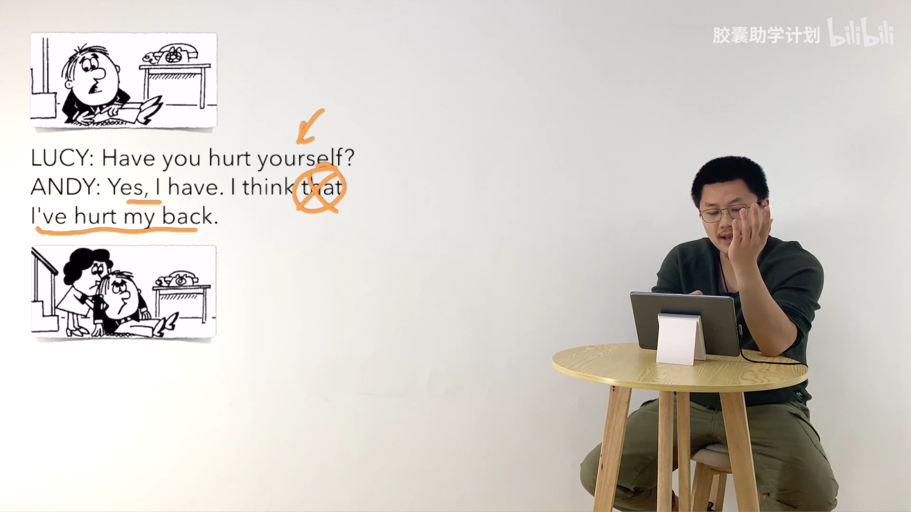

文字识别：胶囊助学计划b鼎b出 / LUCY: Have you hurt yourself? / ANDY: Yes, I have.Ithink / I've hurt my back. / 2

### 画面 00:02:16

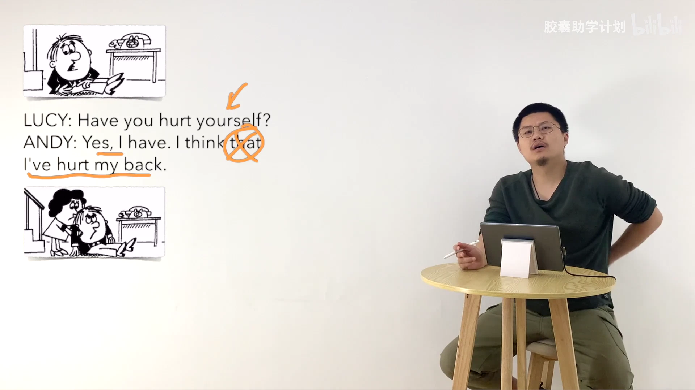

文字识别：胶囊助学计划 / LUCY: Have you hurt yourself? / ANDY: Yes, I have.Ithink / I've hurt my back.

### 画面 00:02:20

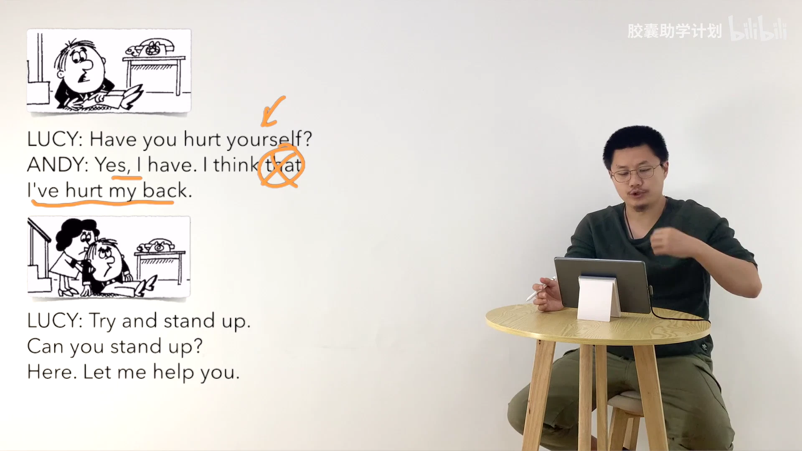

文字识别：胶囊助学计划 / LUCY: Have you hurt yourself? / ANDY: Yes, I have.I think / I've hurt my back. / LUCY: Try and stand up. / Can you stand up? / Here. Let me help you.

### 画面 00:02:25

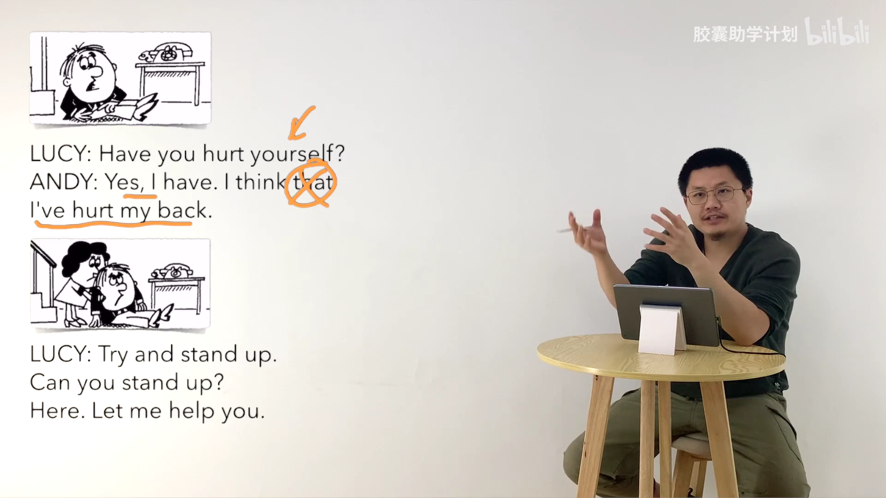

文字识别：胶囊助学计划bil出 / LUCY: Have you hurt yourself? / ANDY: Yes, I have.Ithink / I've hurt my back. / LUCY: Try and stand up. / Can you stand up? / Here. Let me help you.

## 00:02:30–00:03:00

Let here啊这儿来，Let me help you，让我来帮你一下。OK，很简单。I'm sorry, Lucy，很抱歉。I'm afraid that好，宾语从句。I can't stand up，我没有办法站起来。I'm afraid是口语当中经常出现的一个小的短语，叫我恐怕怎么怎么样。我恐怕这事儿我做不到。我恐怕我没有办法帮你。比如说，I'm afraid I can't help you，对吧？

### 画面 00:02:37

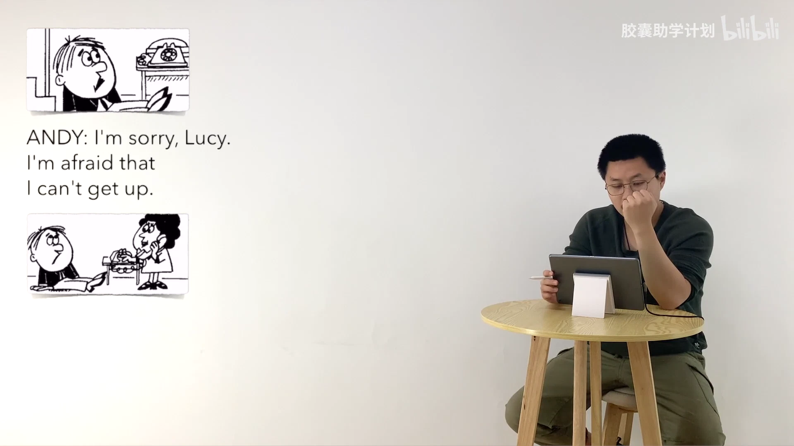

文字识别：胶囊助学计划 bl出 / ANDY: I'm sorry, Lucy. / I'm afraid that / I can't get up.

### 画面 00:02:42

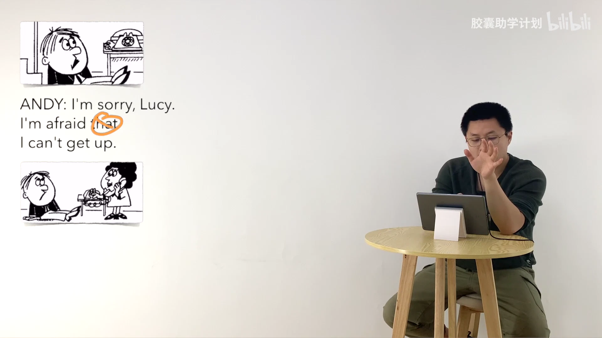

文字识别：胶囊助学计划bilbl / ANDY: I'm sorry, Lucy. / I'm afraid / I can't get up.

### 画面 00:02:46

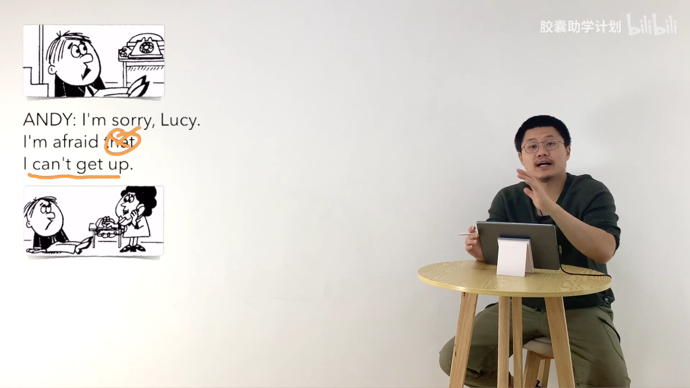

文字识别：胶囊助学计划b鼎b出 / ANDY: I'm sorry, Lucy. / I'm afraid / I can't get up.

## 00:03:00–00:03:30

啊，我恐怕我没办法早起。I'm afraid that I can't get up early in the morning. Very good. Lucy说，I think that the doctor had better see you. 我认为啊，that宾语从句，the doctor had better see you. Had better九十五课我们刚刚学，最好去做某件事情，否则会有麻烦、困难、危险，对吧？他宁愿从楼上摔下来，躺在这个趴在地啊，这个蹲在地上，对吧？啊，这个坐在地上，

### 画面 00:03:06

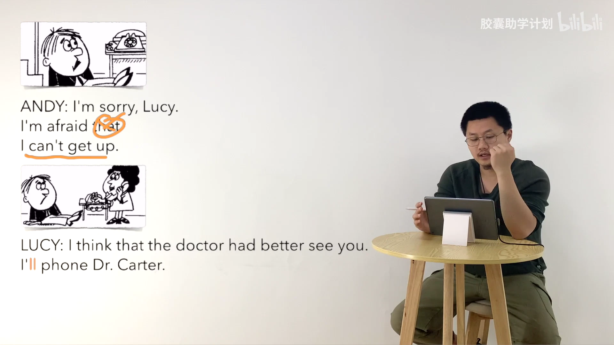

文字识别：胶囊助学计划b出b出 / ANDY: I'm sorry, Lucy. / I'm afraid / I can't get up. / LUCY: I think that the doctor had better see you. / I'llphone Dr. Carter.

### 画面 00:03:08

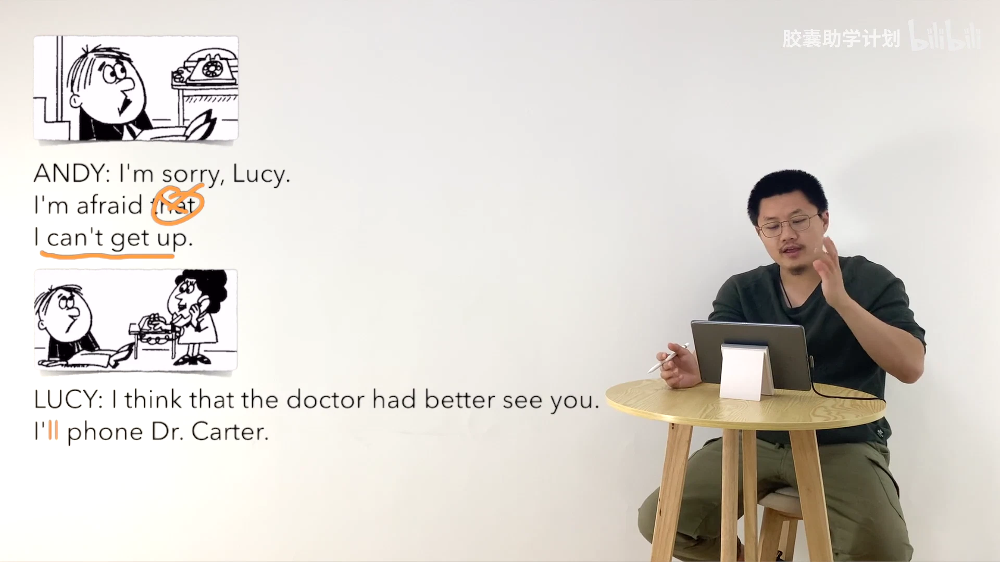

文字识别：胶囊助学计划 / ANDY: I'm sorry, Lucy. / I'm afraid / I can't get up. / LUCY: I think that the doctor had better see you. / I'llphone Dr. Carter.

### 画面 00:03:12

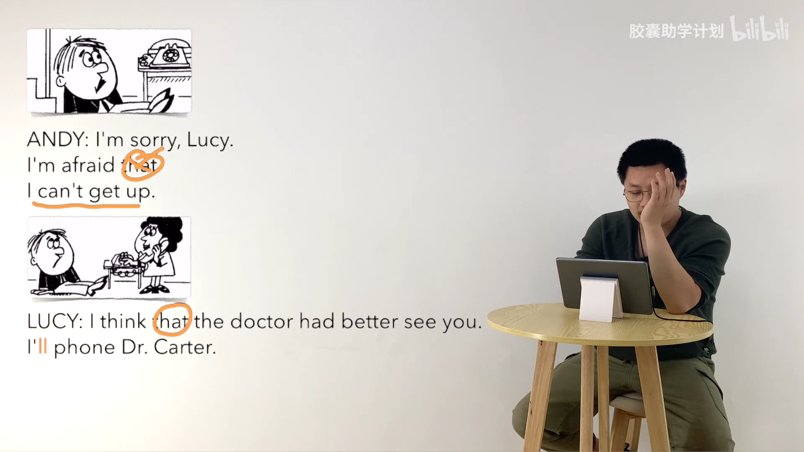

文字识别：胶囊助学计划bilb出 / ANDY: I'm sorry, Lucy. / I'm afraid / I can't get up. / LUCY: I think hatthe doctor had better see you. / I'Il phone Dr. Carter.

### 画面 00:03:14

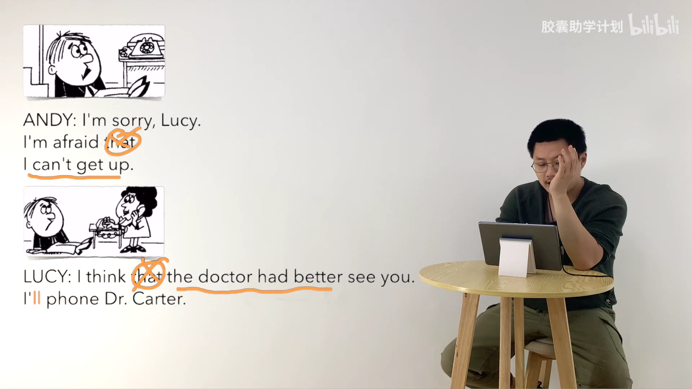

文字识别：胶囊助学计划bil出 / ANDY: I'm sorry, Lucy. / I'm afraid / I can't get up. / LUCY: I think / the doctor had better see you. / I'Il phone Dr. Carter.

### 画面 00:03:16

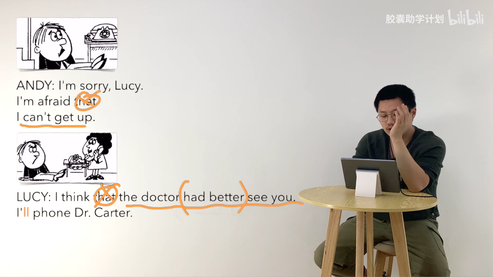

文字识别：胶囊助学计划bill / ANDY: I'm sorry, Lucy. / I'm afraid / I can't get up. / the doctor had better see you. / LUCY: I think / I'Il phone Dr. Carter.

### 画面 00:03:18

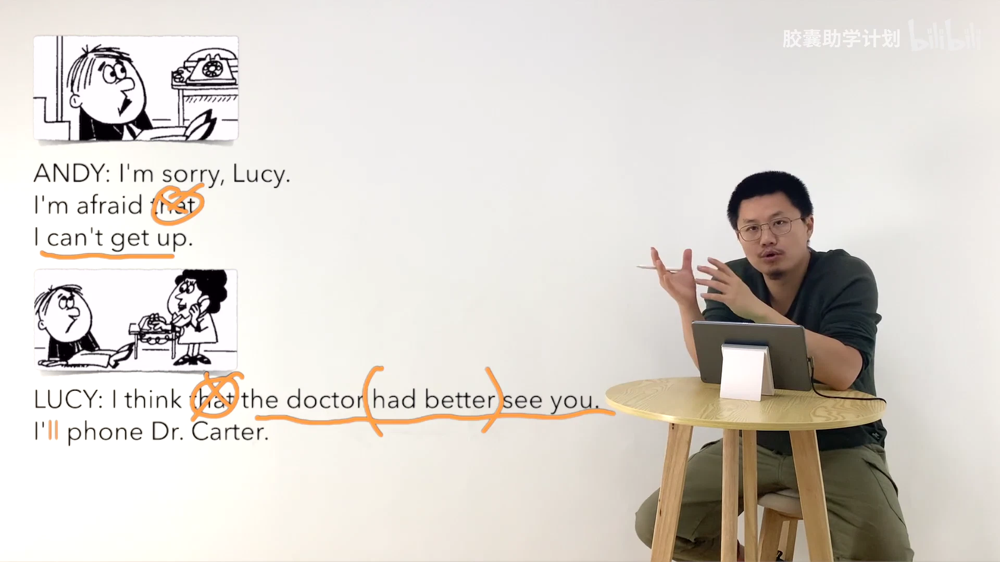

文字识别：胶囊助学计划 / ANDY: I'm sorry, Lucy. / I'm afraid / I can't get up. / the doctor had better see you. / LUCY: I think / I'Il phone Dr. Carter.

## 00:03:30–00:04:00

然后呢，他也站不起来了。如果你不去看医生，是不是会有麻烦、困难、威胁，对吧？OK， I'll phone Doctor Carter。你看，他说的是我这就给卡特医生打一个电话。你注意，他没有用 be going to do，对吧？他是当机立断的一个决定。你说你站不起来了，我现在在给 Doctor Carter 打一个电话，不是我本来计划就要给 Doctor Carter 打一个电话的。OK， one again， continue。

### 画面 00:03:37

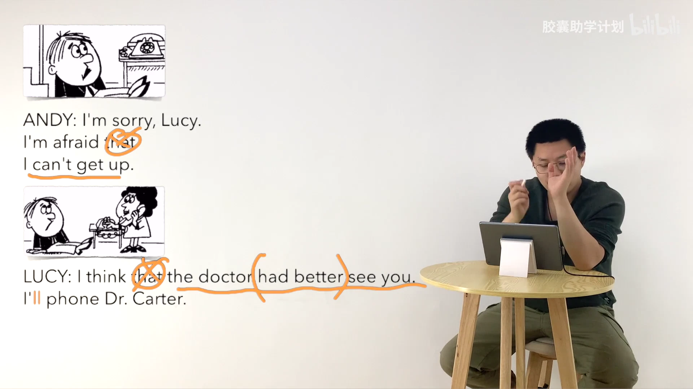

文字识别：胶囊助学计划 / ANDY: I'm sorry, Lucy. / I'm afraid / I can't get up. / the doctor had better see you. / LUCY: I think / I'Il phone Dr. Carter.

### 画面 00:03:59

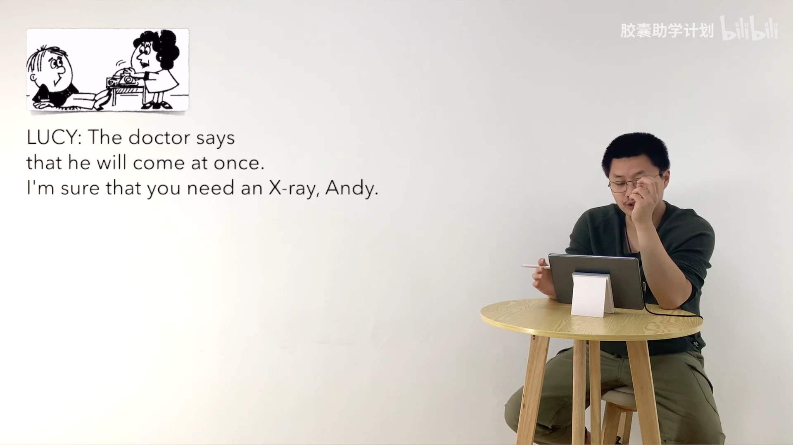

文字识别：胶囊助学计划bi出b出 / LUCY: The doctor says / that he will come at once. / I'm sure that you need an X-ray, Andy.

## 00:04:00–00:04:30

Then Lucy said, "The doctor says." He said, "He said."

### 画面 00:04:05

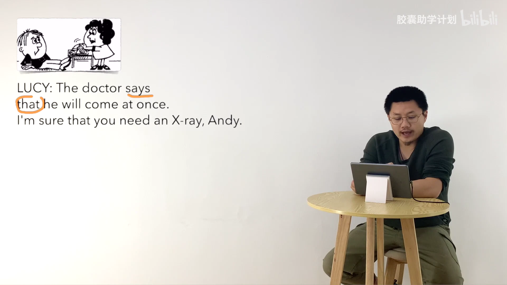

文字识别：Biibil / 胶囊助学计划 / LUCY: The doctor says / that he will come at once. / I'm sure that you need an X-ray, Andy.

### 画面 00:04:08

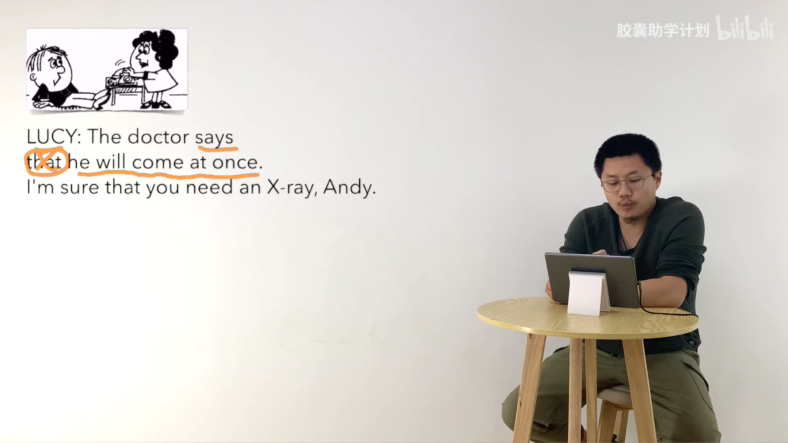

文字识别：biibili / 胶囊助学计划 / LUCY: The doctor says / tlat he will come at once. / I'm sure that you need an X-ray, Andy.

### 画面 00:04:12

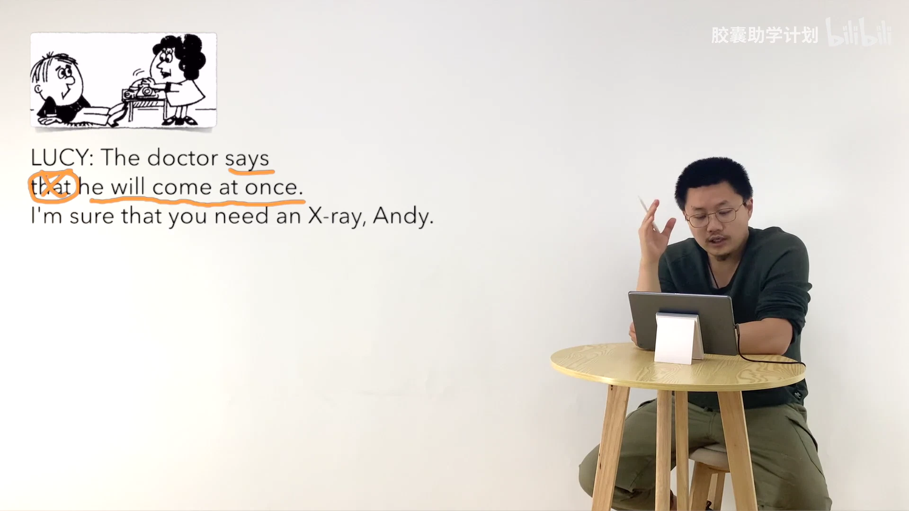

文字识别：胶囊助学计划 / LUCY: The doctor says / tlthe will come at once. / I'm sure / that you need an X-ray, Andy.

### 画面 00:04:15

文字识别：Bilibll / 胶囊助学计划 / LUCY: The doctor says / tlat he will come at once. / I'm sure / thest you need an X-ray, Andy.

### 画面 00:04:18

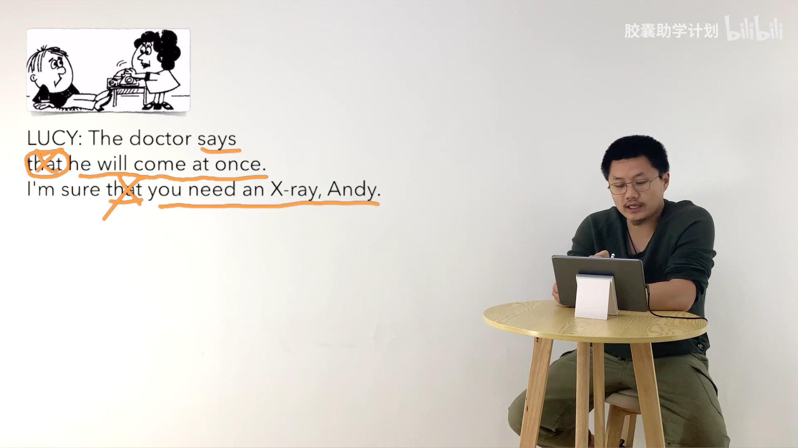

文字识别：bilibili / 胶囊助学计划 / LUCY: The doctor says / tlat he will come at once. / I'm sure / tht you need an X-ray, Andy.

### 画面 00:04:21

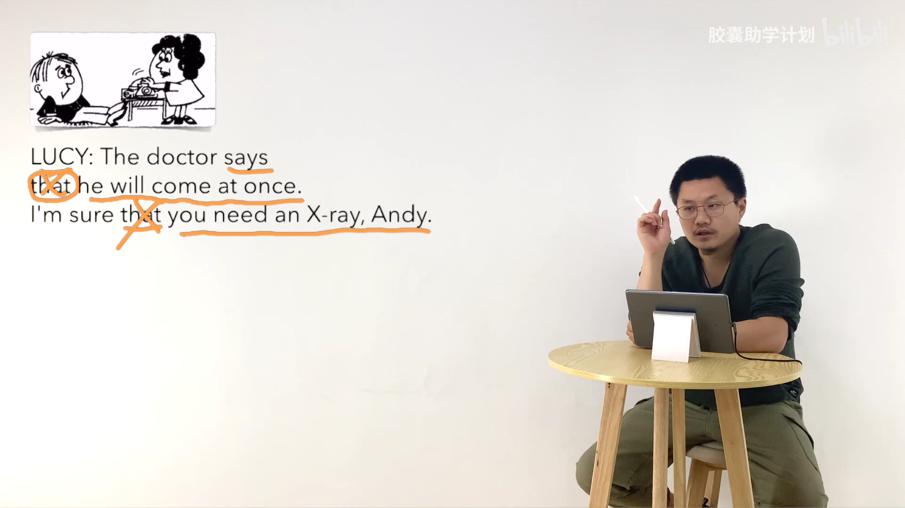

文字识别：胶囊助学计划 / LUCY: The doctor says / tlXt he will come at once. / I'm sure / tht you need an X-ray, Andy.

### 画面 00:04:29

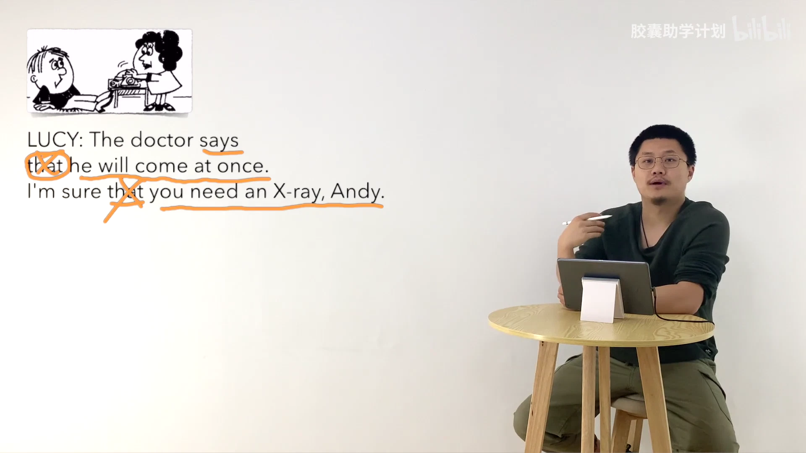

文字识别：胶囊助学计划 / LUCY: The doctor says / tlat he will come at once. / I'm sure t /  tht you need an X-ray, Andy.

## 00:04:30–00:05:00

个，呃，这个 span 有没有问题，对吧？ OK，玩一个。好，那接下来呢，我们做一些小的听力口语练习，我问您答。来了，Didi， What did Andy do? He slipped and fell downstairs. Next one. Has Andy hurt himself? Yes, he has. Next one. Does he

### 画面 00:04:35

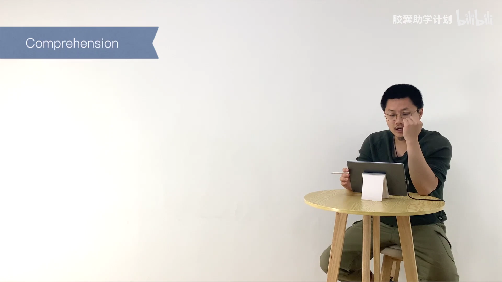

文字识别：胶囊助学计划 / Comprehension

## 00:05:00–00:05:30

think he's hurt his back? Yes, he does. Next one, can Andy stand up? No, he can't. Next one, what does Lucy think? She thinks that the doctor had better see Andy. Next one, who will phone the doctor? Lucy.

### 画面 00:05:05

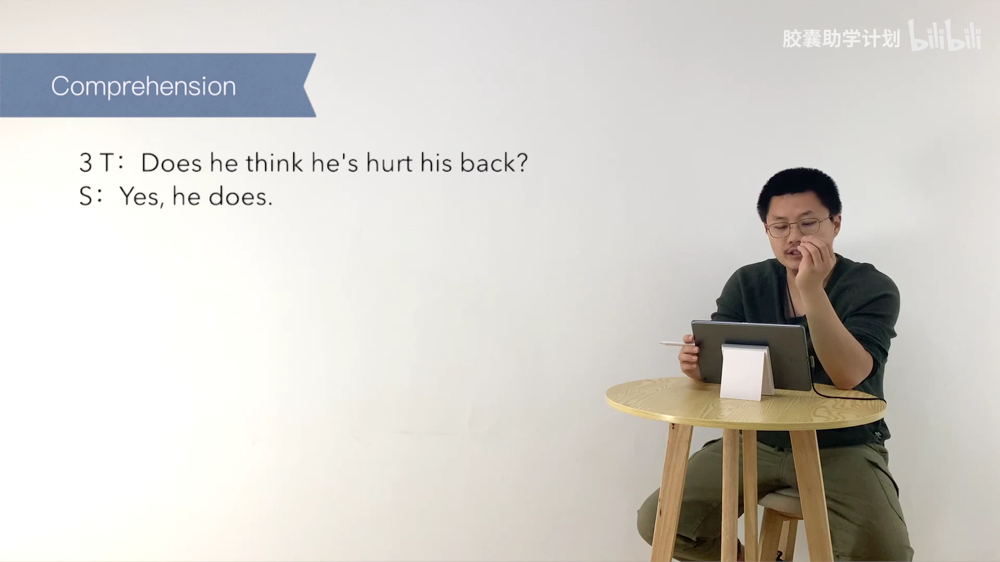

文字识别：胶囊助学计划b出b出 / Comprehension / 3 T: Does he think he's hurt his back? / S: Yes, he does.

### 画面 00:05:18

文字识别：胶囊助学计划bib出 / Comprehension / 5 T: What does Lucy think? / S: She thinks that the doctor had better see Andy.

### 画面 00:05:24

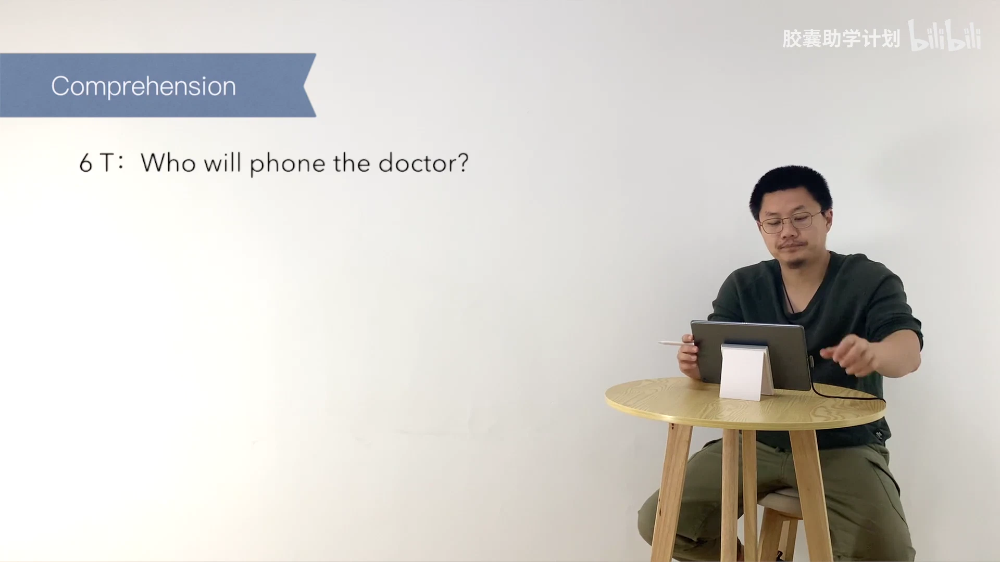

文字识别：胶囊助学计划b鼎bi / Comprehension / 6 T: Who will phone the doctor?

## 00:05:30–00:06:00

next one. What does the doctor say? The doctor says that he will come at once. 当然，您也可以直接说 he will come at once. 啊, next one. Asking questions. 我给肯定句，您口语把它变成一般疑问句。我给特殊疑问词，您变特殊疑问句。来了, ask me if Andy lived downstairs. 变一般疑问句。您看，我们目前

### 画面 00:05:33

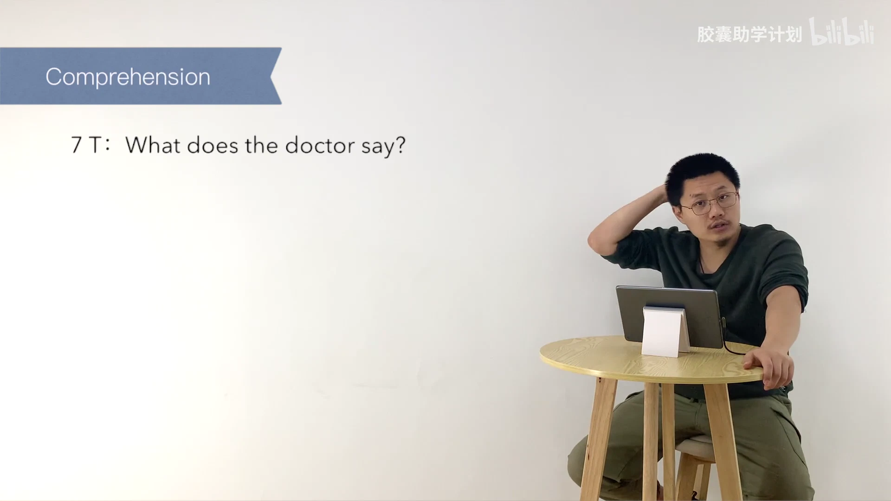

文字识别：bilb出 / 胶囊助学计划 / Comprehension / 7 T: What does the doctor say?

### 画面 00:05:35

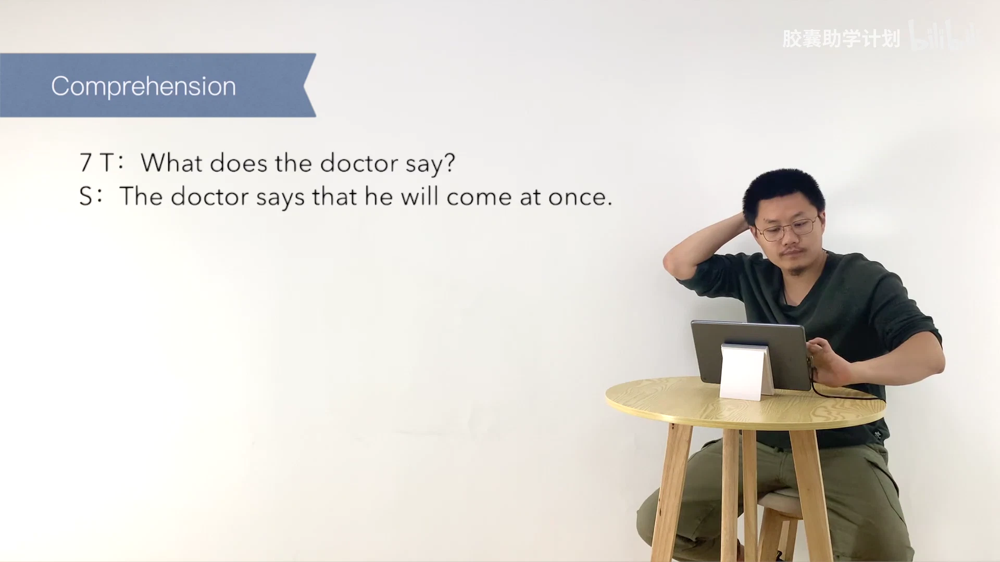

文字识别：胶囊助学计划 / Comprehension / 7 T: What does the doctor say? / S: The doctor says that he will come at once.

### 画面 00:05:41

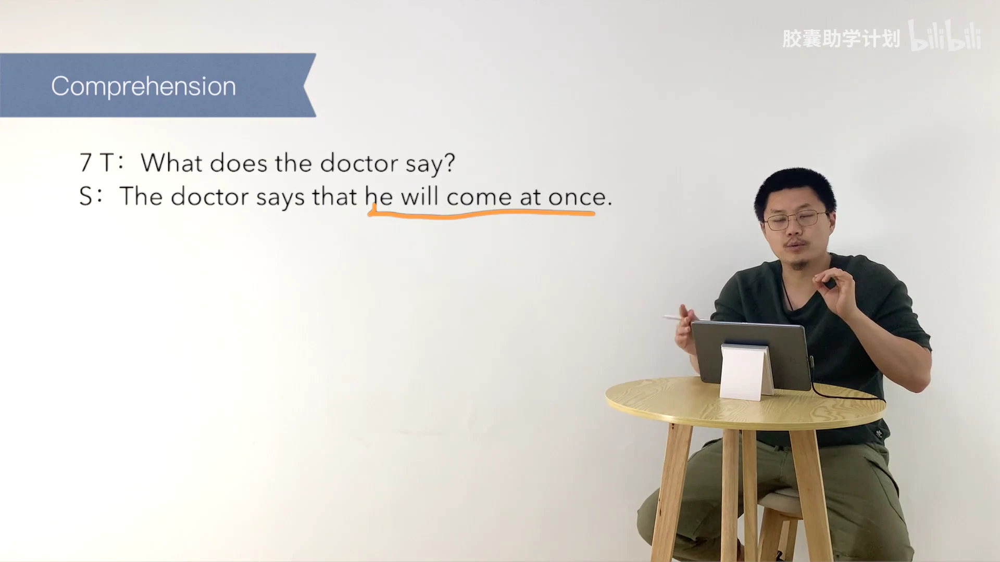

文字识别：胶囊助学计划 / Comprehension / 7 T: What does the doctor say? / S: The doctor says that he will come at once.

### 画面 00:05:44

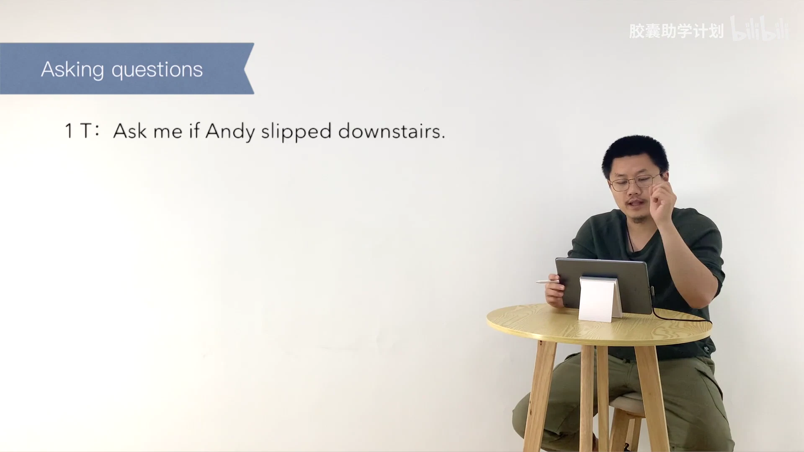

文字识别：胶囊助学计划 / Asking questions / 1 T: Ask me if Andy slipped downstairs.

### 画面 00:05:46

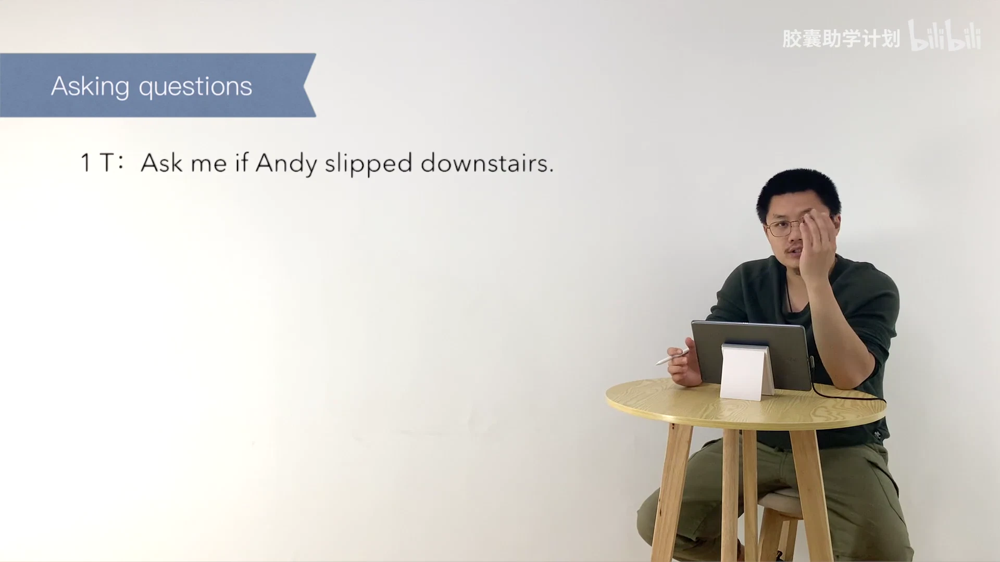

文字识别：Blbli / 胶囊助学计划 / Asking questions / 1 T: Ask me if Andy slipped downstairs.

## 00:06:00–00:06:30

为止啊，为什么要总做这个练习？我在这儿简单说一下。你看，我们实际上目前能提到前面变一般疑问句的单词已经非常多了。你看，你看这些都是啊， do does, am is are, was were, must, can，对吧？包括 did, have, has。我们在一个单词变一般疑问句的时候，理论上已经有这么多单词可以提前了。我们学语法学

### 画面 00:06:02

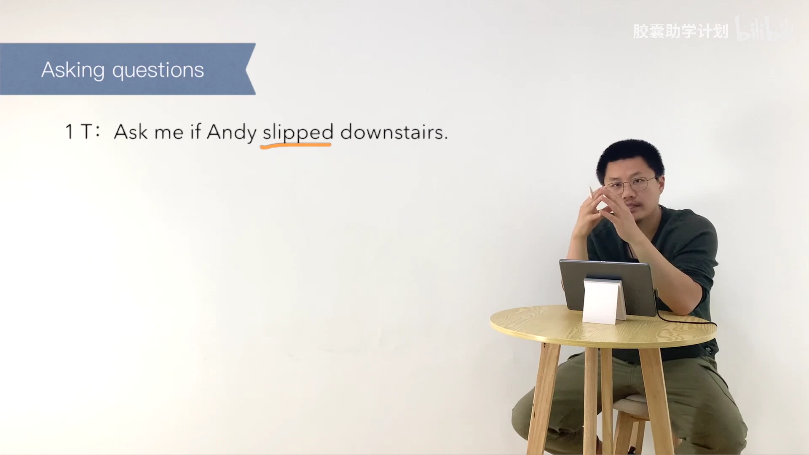

文字识别：胶囊助学计划 / Asking questions / 1 T: Ask me if Andy slipped downstairs.

### 画面 00:06:04

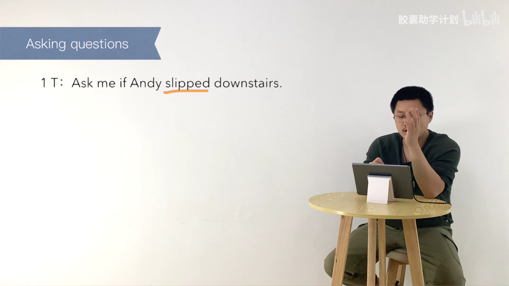

文字识别：胶囊助学计划 / Asking questions / 1 T: Ask me if Andy slipped downstairs.

### 画面 00:06:06

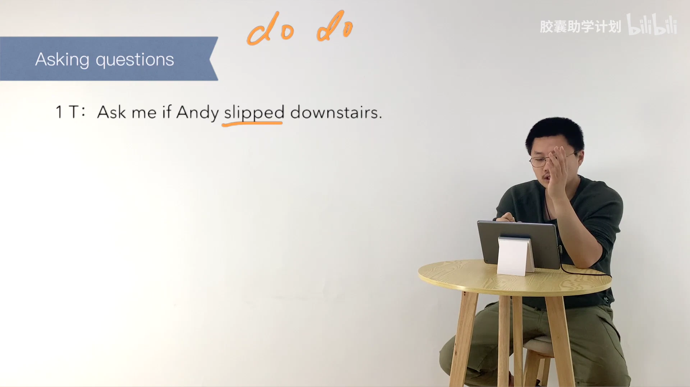

文字识别：dodo / 胶囊助学计划bilb出 / Asking questions / 1 T: Ask me if Andy slipped downstairs.

### 画面 00:06:08

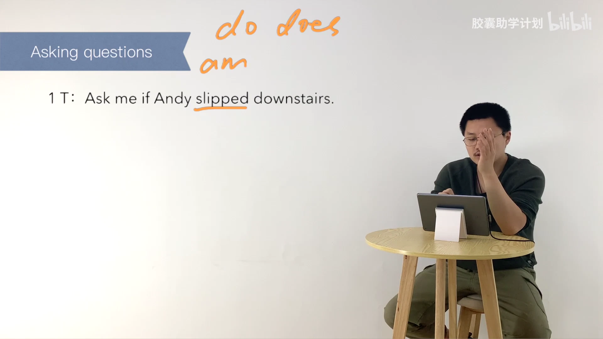

文字识别：do does / bilibili / 胶囊助学计划 / Asking questions / am / 1 T: Ask me if Andy slipped downstairs.

### 画面 00:06:10

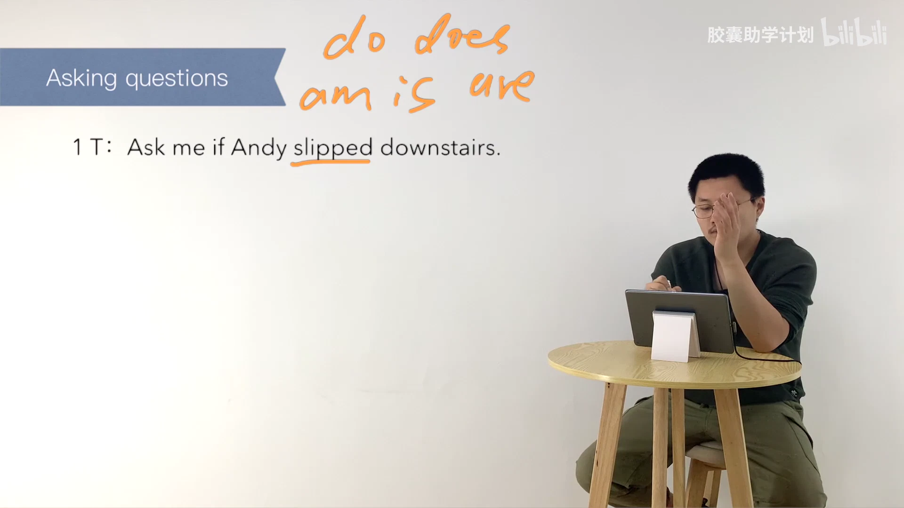

文字识别：do does / bilbili / 胶囊助学计划 / Asking / questions / amis / uve / 1 T: Ask me if Andy / slipped downstairs.

### 画面 00:06:12

文字识别：do does / Bilbili / 胶囊助学计划 / Asking / questions / amis / uve / 1 T: Ask me if Andy / slipped / downstairs. / wens

### 画面 00:06:15

文字识别：do / does / Bilbili / 胶囊助学计划 / Asking / questions / am / uve / 1 T: Ask me if Andy / slipped / downstairs. / Were / wens / n

### 画面 00:06:17

文字识别：do / does / bilbili / 胶囊助学计划 / Asking / questions / am / uve / 1 T: Ask me if Andy / slipped / downstairs. / Were / wens / mnst

### 画面 00:06:20

文字识别：do / does / bilbil / 胶囊助学计划 / drd / Asking / questions / am / iš / uve / 1 T: Ask me if Andy / slipped / downstairs. / Vere / wens / mnst / Can

### 画面 00:06:22

文字识别：does / do / bilbili / 胶囊助学计划 / drd / Asking / questions / am / uve / 1 T: Ask me if Andy / slipped / downstairs. / hove / Vere / wens / h / mnst / Can

### 画面 00:06:24

文字识别：does / do / Bilbili / 胶囊助学计划 / Asking / questions / am / uve / drd / 1 T: Ask me if Andy / slipped / downstairs. / hove / Vere / weWs / has / mnst / Can

### 画面 00:06:26

文字识别：does / do / 胶囊助学计划 / Asking / questions / am / uve / drd / 1T： / Ask / me ifAndy / slipped / downstairs. / hove / Vere / wens / hos / mnst / Can

## 00:06:30–00:07:00

的是什么？就是告诉各位到底提哪个单词，对吧？那在这个地方您看到它是 slept，它是一般过去时，所以把 did 提前。你要从这么堆当中去挑出一个正确答案。OK，来，Did Andy sleep downstairs？How 整句话？How did Andy sleep downstairs？Next one。Ask me if Andy hurt himself。Did

### 画面 00:06:32

文字识别：do / does / 胶囊助学计划 / drd / Asking / questions / am / iš / uve / 1 T: Ask me if Andy / slipped / downstairs. / ho / Vere / wens / mnst / Can

### 画面 00:06:34

文字识别：do / does / 胶囊助学计划 / Asking / questions / am / iš / uve / 1 T: Ask me if Andy / slipped / downstairs. / Were / wns / M

### 画面 00:06:36

文字识别：dod / 胶囊助学计划b出b出 / Asking questions / 1 T: Ask me if Andy slipped downstairs.

### 画面 00:06:38

文字识别：Jbilibili / 胶囊助学计划 / Asking questions / 1 T: Ask me if Andy slipped downstairs.

### 画面 00:06:45

文字识别：胶囊助学计划 / Asking questions / 1 T: Ask me if Andy slipped downstairs. / S: Did Andy slip downstairs?

### 画面 00:06:54

文字识别：胶囊助学计划bilb出 / Asking questions / 2T: Ask me if Andy hurt himself.

## 00:07:00–00:07:30

Andy hurt himself? How? How did Andy hurt himself? Next one, ask me if Andy can stand up.一般疑问句, Can Andy stand up? Why can't? Why can't? Okay,这个直直接加就行了，对吧？把can去掉，加句首。Why can't Andy stand up? Next one, ask me if the doctor had better see him.

### 画面 00:07:20

文字识别：bilbil / 胶囊助学计划 / Asking questions / 3 T: Ask me if Andy can stand up. / S: Can Andy stand up? / T: Why can't ..?

### 画面 00:07:26

文字识别：胶囊助学计划blb出 / Asking questions / 4 T: Ask me if the doctor had better see him.

## 00:07:30–00:08:00

你看，其实首先我提一句啊，had better其实变一般疑问句的情况非常非常少，我几乎没有在别的地方见过。那在这儿见到，我们知道就行了，对吧？叫做Had the doctor better better see him? Who? Who had better see him?对主语提问，the doctor. Okay, next one. Ask me if the doctor will come at once.哎，然后您把它变成一般疑问句，

### 画面 00:07:31

文字识别：胶囊助学计划blb出 / Asking questions / 4 T: Ask me if the doctor had better see him.

### 画面 00:07:46

文字识别：胶囊助学计划bi出出 / Asking questions / 4 T: Ask me if the doctor had better see him. / S: Had the doctor better see him? / T: Who ...? / S: Who had better see him?

### 画面 00:07:50

文字识别：胶囊助学计划b鼎b出 / Asking questions / 5 T: Ask me if the doctor will come at once.

### 画面 00:07:58

文字识别：胶囊助学计划 / Asking questions / 5 T: Ask me if the doctor will come at once. / 2

## 00:08:00–00:08:30

对一下答案。Will the doctor come at once? When对at once提问。When will the doctor come? There you go。好，Recap，本课我们还是在文章当中连续见了好几次的宾语从句，对吧？这个宾语从句很简单，宾语从句学好了，某种程度上会帮助我们去学习未来特别难的那个定语从句啊，以及我们将

### 画面 00:08:03

文字识别：bilbl / 胶囊助学计划 / Asking questions / 5 T: Ask me if the doctor will come at once. / S: Will the doctor come at once?

### 画面 00:08:11

文字识别：胶囊助学计划 / Recap / Patterns / 宾语从句 / Grammar / Words / Expression

### 画面 00:08:15

文字识别：bifbli / 胶囊助学计划 / Recap / Patterns / 宾语从句 / Grammar / Words / Expression

### 画面 00:08:22

文字识别：胶囊助学计划 / Recap / Patterns / 宾语从句 / Grammar / Words / Expression

## 00:08:30–00:09:00

来在呃新二当中还会学到各种各样别的从句，对吧？都是有帮助的啊。OK，好，那家庭作业绿皮书九十九课文章，各位熟读成诵，然后给自己讲解一遍核心知识点。OK，那如果大家喜欢我们的课程呢，欢迎大家关注、订阅、一键三连、分享那些给那些需要的朋友，对吧？来支持我们快速成长。那最后呢，我们再来看一句名人名言：Work like you don't need

### 画面 00:08:37

文字识别：胶囊助学计划

### 画面 00:08:45

文字识别：胶囊助学计划 / - / 2

### 画面 00:08:50

文字识别：胶囊助学计划 / 2

### 画面 00:08:54

文字识别：胶囊助学计划 / BRO WNS / Work like you don't need the money. Love / like you've never been hurt. Dance like / nobody's watching. / -Satchel Paige

## 00:09:00–00:09:19

money. Love like you've never been hurt. Dance like nobody's watching. See you next time.

### 画面 00:09:01

文字识别：Bilbl / 胶囊助学计划 / BRPWNS / Work like you don't need the money. Love / like you've never been hurt. Dance like / nobody's watching. / -Satchel Paige

### 画面 00:09:07

### 画面 00:09:09

文字识别：CAPSULEACADEMY / 胶囊助学计划 / 小红书 / Lecturer / □ / 口 / Leo / OE

### 画面 00:09:12

文字识别：CAPSULEACADEMY / 胶囊助学计划 / 『 / 小红书 / Editor / OE

### 画面 00:09:15

文字识别：CAPSULEACADEMY / 胶囊助学计划 / 『 / 小红书 / Creator / □ / Leo & Berlin / OE

### 画面 00:09:17

文字识别：bilibili / 胶囊助学计划 / 胶囊助学计划 / 小红书 / 只识

### 画面 00:09:19

文字识别：bilibili / 胶囊助学计划

