# 101 文章

快速机器解析：语音为单模型转写，未进行独立交叉校对或人工复核；画面每秒采样并按变化选帧，短时文字和标记可能遗漏。截图时间约有 1 秒误差。图片有损压缩；遇到疑点请按时间查看 Google Drive 原视频。

## 00:00:00–00:00:30

Hello, everyone. Welcome to Capsule Academy. This is Liu. Today, we're going to learn New Concept English Book One, Lesson One Hundred and One Story. 那进入老进入课程之前呢，我们老习惯先看一个问题，是吧？如何使用反义疑问句？哎，这是一个新的语法。那带着这个问题，Hope you gonna enjoy it. 好，那我们直接看文章来了。首先，我们

### 画面 00:00:00

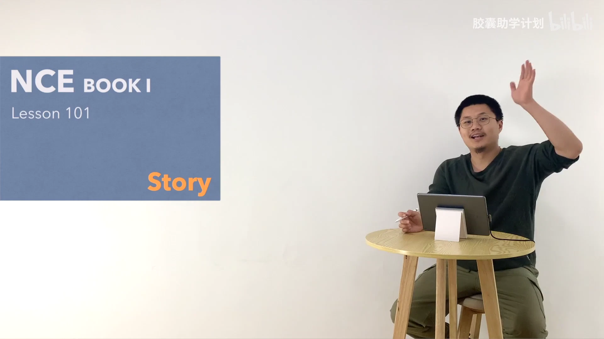

文字识别：胶囊助学计划 / NCE / BOOKI / Lesson 101 / Story

### 画面 00:00:02

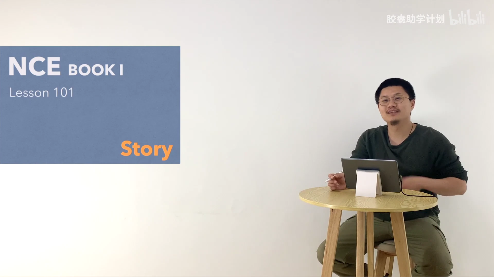

文字识别：胶囊助学计划 / NCE / BOOKI / Lesson 101 / Story

### 画面 00:00:05

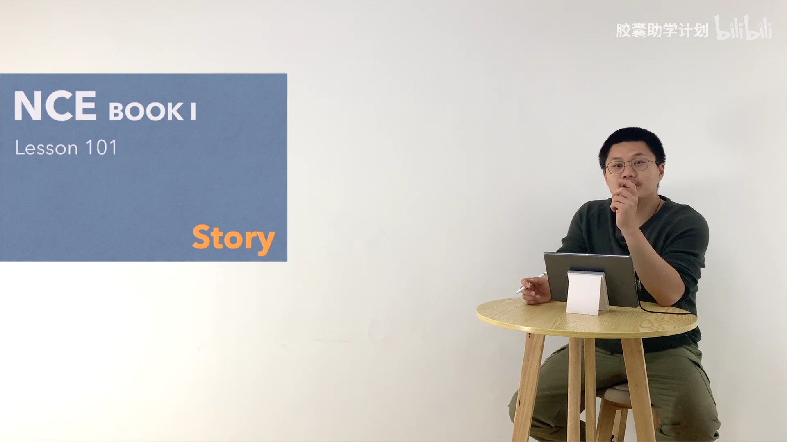

文字识别：Biibili / 胶囊助学计划 / NCE / BOOKI / Lesson 101 / Story

### 画面 00:00:10

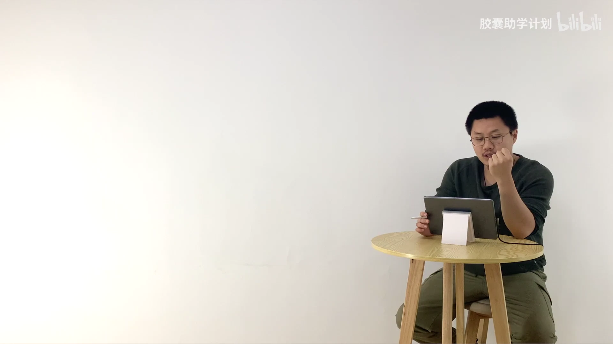

文字识别：胶囊助学计划bilb出

### 画面 00:00:13

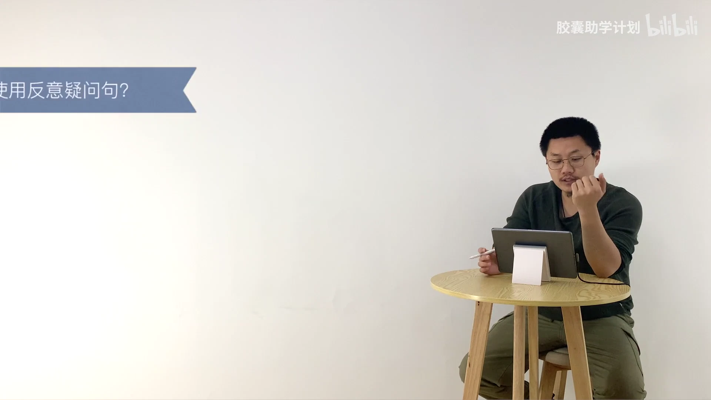

文字识别：胶囊助学计划b出出 / 使用反意疑问句？

### 画面 00:00:15

文字识别：胶囊助学计划 lb出 / ①如何使用反意疑问句？

### 画面 00:00:22

文字识别：胶囊助学计划 bilbl / •

### 画面 00:00:25

文字识别：胶囊助学计划 / 胶囊助学计划

### 画面 00:00:27

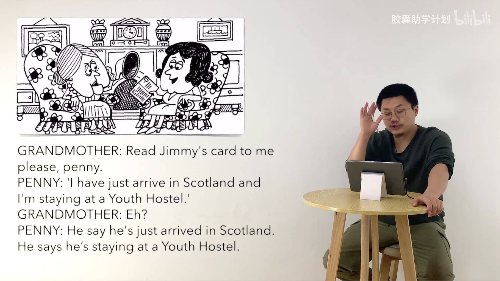

文字识别：胶囊助学计划 / B出出 / 30E / GRANDMOTHER: Read Jimmy's card to me / please, penny. / PENNY: 'I have just arrive in Scotland and / I'm staying at a Youth Hostel.' / GRANDMOTHER: Eh? / PENNY: He say he's just arrived in Scotland. / He says he's staying at a Youth Hostel.

## 00:00:30–00:01:00

先确定这两个人啊，一个叫 grandmother，直接告诉各位了，是吧？看图也能看出来，是吧？这个是奶奶、姥姥，上岁数的人。Penny呢，我们猜测应该就是她的女儿。然后两个人在对话啊。Grandmother说，Read Jimmy's card to me, please. Penny说，读Jimmy的卡片，读给我听。多谢了，Penny. Penny说，I have just arrived in Scotland and I'm

### 画面 00:00:57

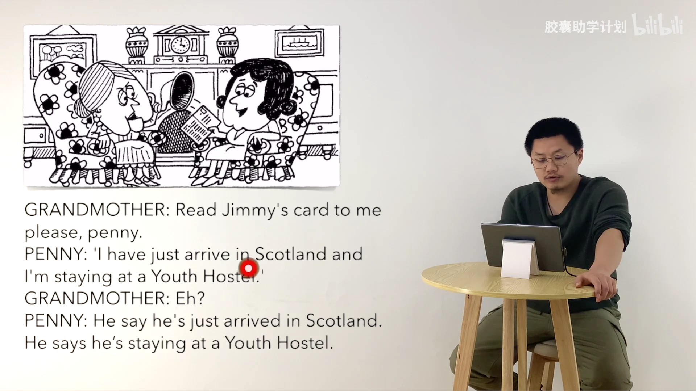

文字识别：胶囊助学计划blbl / m / 30E / GRANDMOTHER: Read Jimmy's card to me / please, penny. / PENNY: 'I have just arrive in Scotland and / I'm staying at a Youth Hostel. / GRANDMOTHER: Eh? / PENNY: He say he's just arrived in Scotland. / He says he's staying at a Youth Hostel.

## 00:01:00–00:01:30

staying at a youth hostel. 说我刚刚到达苏格兰，然后我正待在一个青年旅社里。注意这儿的引号和这儿的引号，这不是 Penny 本人说，对吧？他不是在说他自己，他在读卡片的原文，所以他我们管他叫直接英语，对吧？然后这个老奶奶说啊，没听清，是吧？然后呢，Penny 不得不又重复了一遍，他就变成了间

### 画面 00:01:14

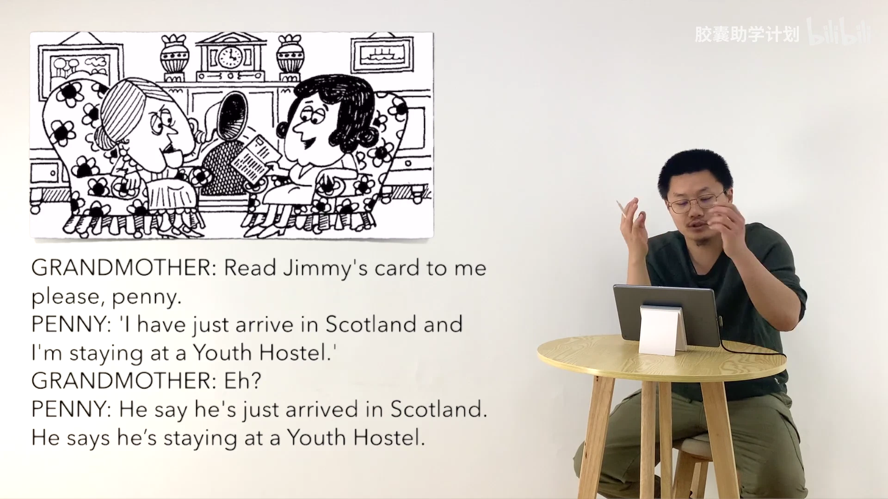

文字识别：胶囊助学计划 / mm / 30E / GRANDMOTHER: Read Jimmy's card to me / please, penny. / PENNY: 'I have just arrive in Scotland and / I'm staying at a Youth Hostel.' / GRANDMOTHER: Eh? / PENNY: He say he's just arrived in Scotland. / He says he's staying at a Youth Hostel.

### 画面 00:01:16

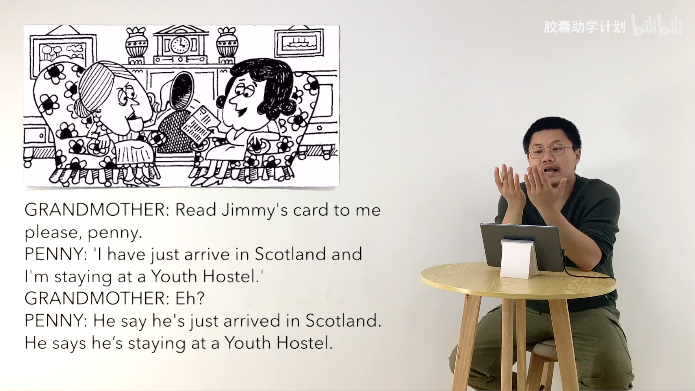

文字识别：胶囊助学计划 / m / 30E / GRANDMOTHER: Read Jimmy's card to me / please, penny. / PENNY: 'I have just arrive in Scotland and / I'm staying at a Youth Hostel.' / GRANDMOTHER: Eh? / PENNY: He say he's just arrived in Scotland. / He says he's staying at a Youth Hostel.

### 画面 00:01:25

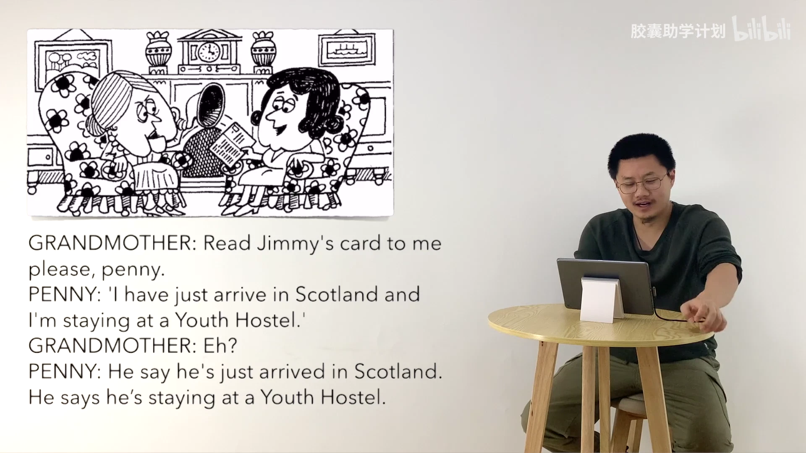

文字识别：胶囊助学计划bl / m / 30E / GRANDMOTHER: Read Jimmy's card to me / please, penny. / PENNY: 'I have just arrive in Scotland and / I'm staying at a Youth Hostel.' / GRANDMOTHER: Eh? / PENNY: He say he's just arrived in Scotland. / He says he's staying at a Youth Hostel.

## 00:01:30–00:02:00

接引语。 He said he he says. 注意，这应该是 says，对吧？ He says. 哎， he says he's just arrived in Scotland. 您看到，其实就是把这句话变成了这句话，对不对？时态、人称做了一些改变。他说他刚刚到达苏格兰。 He says he's staying at a youth hostel. 他说呀，他正待在一个青年旅社。您看，引号去掉。第一步，对吧？第二步， that 啊，把

### 画面 00:01:55

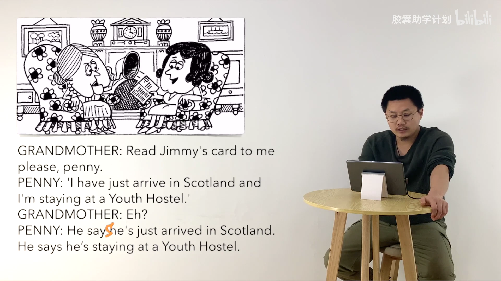

文字识别：胶囊助学计划bib出 / mm / 308 / GRANDMOTHER: Read Jimmy's card to me / please, penny. / PENNY: 'I have just arrive in Scotland and / I'm staying at a Youth Hostel.' / GRANDMOTHER: Eh? / PENNY: He sayShe's just arrived in Scotland. / He says he's staying at a Youth Hostel.

## 00:02:00–00:02:30

人称做了一个改变，I换成了he，那对应的am就要换成了is，对不对？am换成了is，然后that它没有加，对吧？我们说这个可以省略嘛，对不对？Continuing，you know，说你知道啊，说he's a member of the YHA，a of b结构，由后往前翻译，他是YHA的一个成员，member会员或成员，对吧？他是YHA成员。The what

### 画面 00:02:13

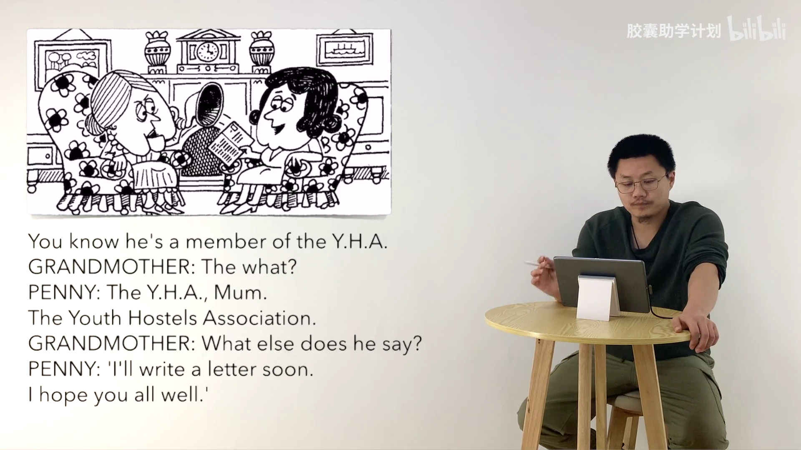

文字识别：胶囊助学计划bil出 / mm / 30E / 川 / You know he's a member of the Y.H.A. / GRANDMOTHER: The what? / PENNY: The Y.H.A., Mum. / The Youth Hostels Association. / GRANDMOTHER: What else does he say? / PENNY: 'I'll write a letter soon. / I hope you all well.'

## 00:02:30–00:03:00

什么玩意儿？The YHA mom，他给他大声说，他耳背了，是吧？他说YHA呀，YHA是什么呢？说The Youth Hostel Association，是吧？国际青年旅社。Grandmother说，What else does he say？哎，What else do you want？I want my change。这我们之前学过的原文，对吧？如果您读的特别特别熟，我刚才说这句话，你应该是有点印象的。那他还说什么其他的了呢？注意引

### 画面 00:02:43

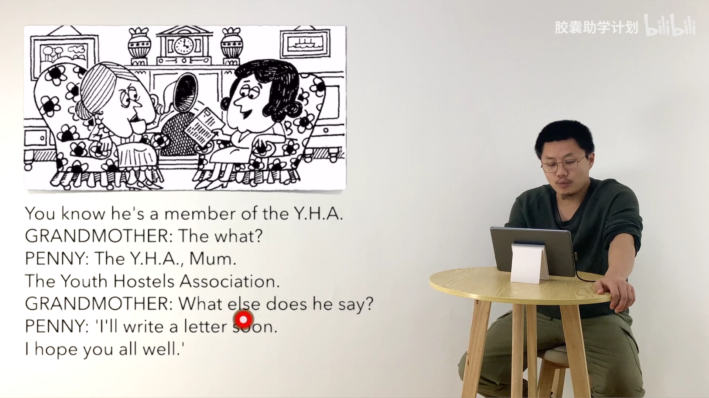

文字识别：胶囊助学计划bib出 / mm / 30E / 川 / You know he's a member of the Y.H.A. / GRANDMOTHER: The what? / PENNY: The Y.H.A., Mum. / The Youth Hostels Association. / GRANDMOTHER: What else does he say? / PENNY: 'I'll write a letter SOon. / I hope you all well.'

### 画面 00:02:54

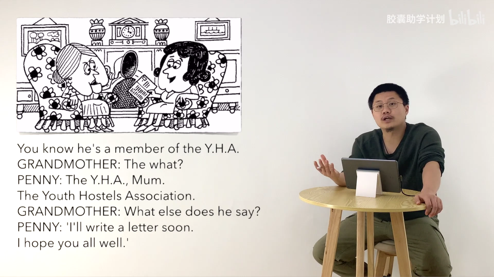

文字识别：胶囊助学计划 / m / 30E / You know he's a member of the Y.H.A. / GRANDMOTHER: The what? / PENNY: The Y.H.A., Mum. / The Youth Hostels Association. / GRANDMOTHER: What else does he say? / PENNY: 'I'll write a letter soon. / I hope you all well.'

### 画面 00:02:58

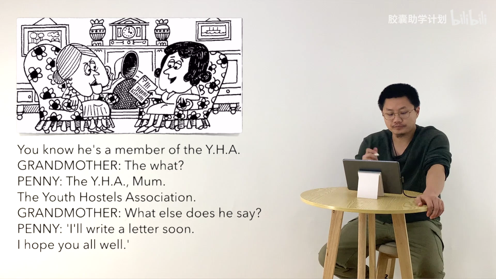

文字识别：胶囊助学计划 / 30E / 川 / You know he's a member of the Y.H.A. / GRANDMOTHER: The what? / PENNY: The Y.H.A., Mum. / The Youth Hostels Association. / GRANDMOTHER: What else does he say? / PENNY: 'I'll write a letter soon. / I hope you all well.'

## 00:03:00–00:03:30

号，引号，对吧？这是他读的，他说的原话。I'll write a letter soon. 我很快就会再写一封信的。I hope you are all well. 我希望你们都还挺好的。那正常来说，这个老奶奶又是听不见了，对吧？啊，为了这个语法需求，她又听不见了。说What？什么玩意儿？Speak up, Penny. 你看，speak叫说话，up up往上说啊，就大声点啊。Speak up，

### 画面 00:03:14

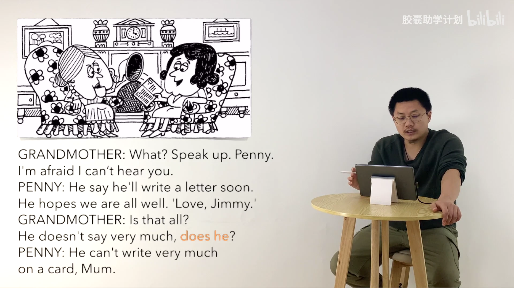

文字识别：胶囊助学计划b出出 / m / 30E / GRANDMOTHER: What? Speak up. Penny. / I'm afraid I can't hear you. / PENNY: He say he'll write a letter soon. / He hopes we are all well. 'Love, Jimmy." / GRANDMOTHER: Is that all? / He doesn't say very much, does he? / PENNY: He can't write very much / on a card, Mum.

### 画面 00:03:26

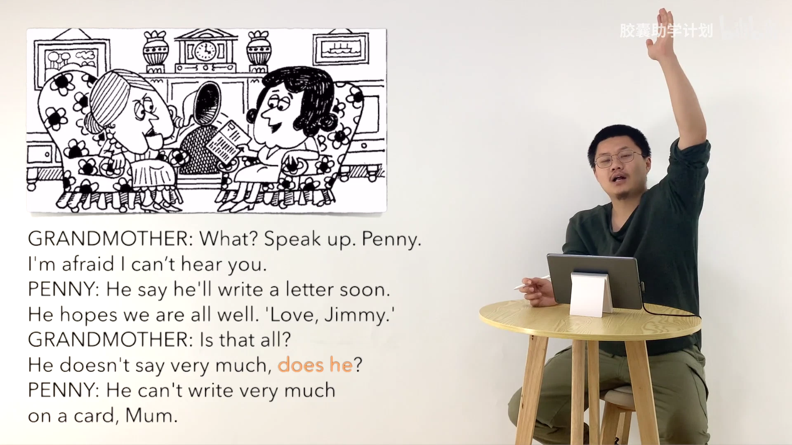

文字识别：囊助学计划 / mm / 30E / GRANDMOTHER: What? Speak up. Penny. / I'm afraid I can't hear you. / PENNY: He say he'll write a letter soon. / He hopes we are all well. 'Love, Jimmy. / GRANDMOTHER: Is that all? / He doesn't say very much, does he? / PENNY: He can't write very much / on a card, Mum.

## 00:03:30–00:04:00

各位新学会了一个小的短语叫 speak up. I'm afraid 我恐怕呀. I can't hear you. 看 that 是不是已经省略了，是吧？我恐怕我听不见你. He says. 哎，同理，这儿应该是 says 啊。他说 He'll write a letter soon. 说他很快就会写一封信了. He hopes. 注意，你看 as 对吧？We are all well. 我们都还不错. Love Jimmy. 啊，这个是

### 画面 00:03:30

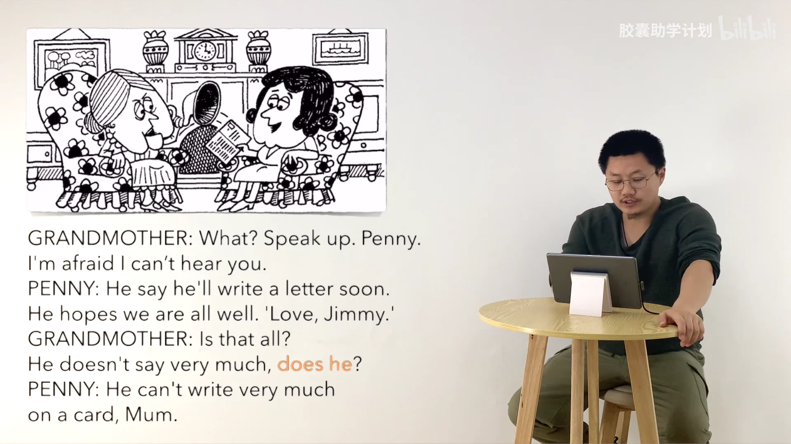

文字识别：胶囊助学计划 / m / 30E / GRANDMOTHER: What? Speak up. Penny. / I'm afraid I can't hear you. / PENNY: He say he'll write a letter soon. / He hopes we are all well. 'Love, Jimmy." / GRANDMOTHER: Is that all? / He doesn't say very much, does he? / PENNY: He can't write very much / on a card, Mum.

### 画面 00:03:36

文字识别：胶囊助学计划b出b出 / m / 308 / 川 / GRANDMOTHER: What? Speak up. Penny. / I'm afraid | can't hear you. / PENNY: He say he'll write a letter soon. / He hopes we are all well. 'Love, Jimmy." / GRANDMOTHER: Is that all? / He doesn't say very much, does he? / PENNY: He can't write very much / on a card, Mum.

## 00:04:00–00:04:30

呃，你去写信，尤其是比较亲密的人的时候，英文当中你会写Love某某某，对吧？就是爱你的某某某，对吧？OK, grandmother说，Is that all?说这就是全部了吗？哎，我们原来学过这句话的肯定句叫That's all，是吧？就这就我要的全部了，对吧？He doesn't say very much.我们不看后边Does he就看到这儿，他没有说很多。Does he翻

### 画面 00:04:02

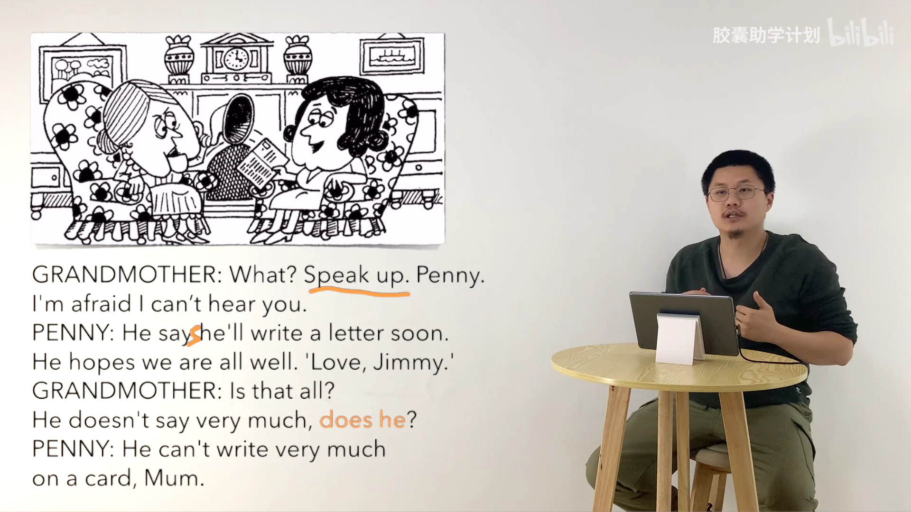

文字识别：胶囊助学计划b出b出 / mm / 30E / 川 / GRANDMOTHER: What? Speak up. Penny. / I'm afraid I can't hear you. / PENNY: He sayhe'll write a letter soon. / He hopes we are all well. 'Love, Jimmy." / GRANDMOTHER: Is that all? / He doesn't say very much, does he? / PENNY: He can't write very much / on a card, Mum.

### 画面 00:04:10

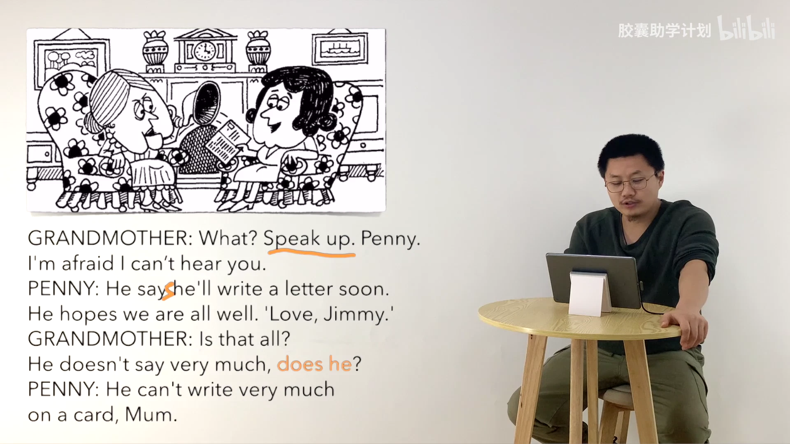

文字识别：胶囊助学计划bilb出 / m / 30E / 川 / GRANDMOTHER: What? Speak up. Penny. / I'm afraid I can't hear you. / PENNY: He sayhe'll write a letter soon. / He hopes we are all well. 'Love, Jimmy." / GRANDMOTHER: Is that all? / He doesn't say very much, does he? / PENNY: He can't write very much / on a card, Mum.

### 画面 00:04:16

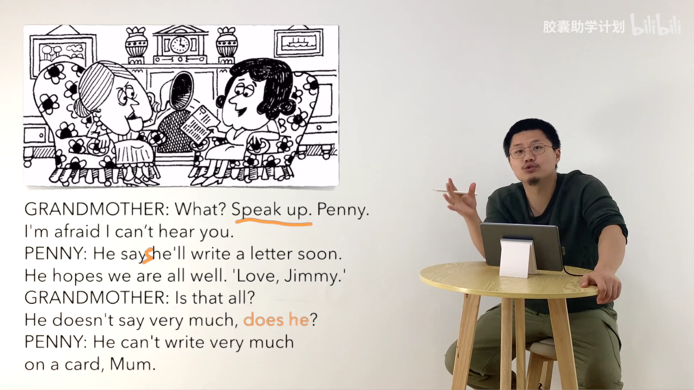

文字识别：胶囊助学计划 / b出出 / m / 30E / GRANDMOTHER: What? Speak up. Penny. / I'm afraid I can't hear you. / PENNY: He sayhe'll write a letter soon. / He hopes we are all well. 'Love, Jimmy." / GRANDMOTHER: Is that all? / He doesn't say very much, does he? / PENNY: He can't write very much / on a card, Mum.

### 画面 00:04:19

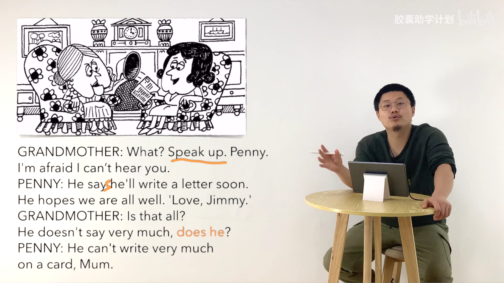

文字识别：胶囊助学计划 / m / 30E / GRANDMOTHER: What? Speak up. Penny. / I'm afraid I can't hear you. / PENNY: He sayhe'll write a letter soon. / He hopes we are all well. 'Love, Jimmy." / GRANDMOTHER: Is that all? / He doesn't say very much, does he? / PENNY: He can't write very much / on a card, Mum.

### 画面 00:04:22

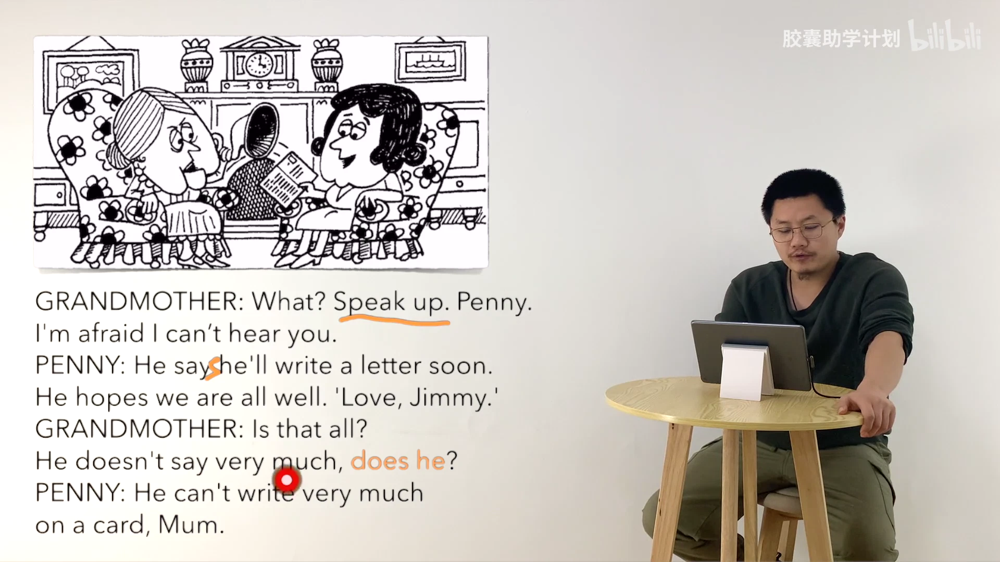

文字识别：胶囊助学计划 / mm / 30E / GRANDMOTHER: What? Speak up. Penny. / I'm afraid I can't hear you. / PENNY: He sayhe'll write a letter soon. / He hopes we are all well. 'Love, Jimmy." / GRANDMOTHER: Is that all? / He doesn't say very much, does he? / PENNY: He can't write very much / on a card, Mum.

## 00:04:30–00:05:00

译成叫对吧？这个就是我们开篇问大家的那个东西，叫反义疑问句。马上我们看完文章，立刻进行一个讲解。好，Penny 说 he can't write very much on a card，他没有办法写很多 very much 许多是吧？Thank you very much，非常很感谢是吧？他没办法写很多 on a card，在一张卡片上。Mom，哎，我们猜测是对的。哎，老奶

### 画面 00:04:31

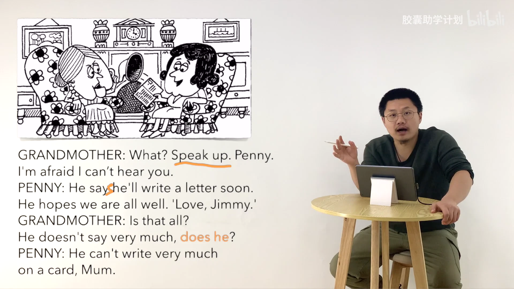

文字识别：胶囊助学计划 / m / 30E / GRANDMOTHER: What? Speak up. Penny. / I'm afraid I can't hear you. / PENNY: He sayhe'll write a letter soon. / He hopes we are all well. 'Love, Jimmy." / GRANDMOTHER: Is that all? / He doesn't say very much, does he? / PENNY: He can't write very much / on a card, Mum.

### 画面 00:04:41

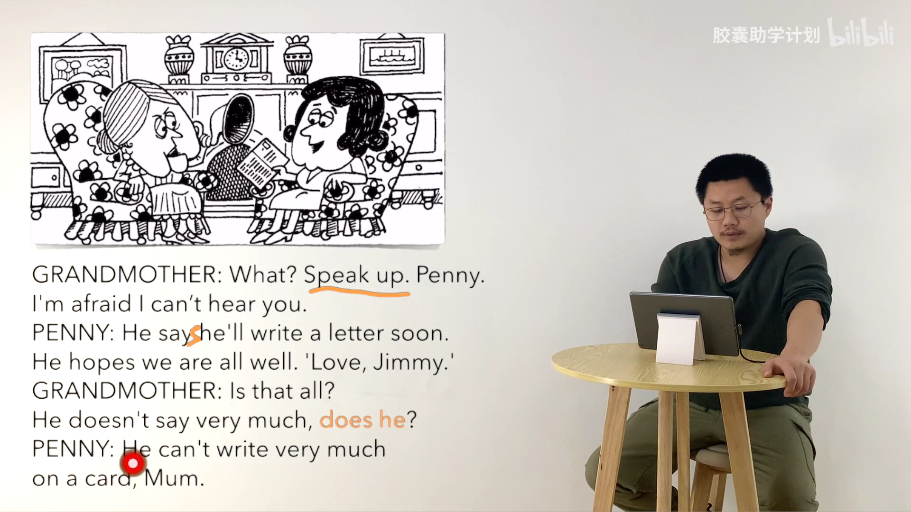

文字识别：bibl / 胶囊助学计划 / m / 30E / GRANDMOTHER: What? Speak up. Penny. / I'm afraid I can't hear you. / PENNY: He sayhe'll write a letter soon. / He hopes we are all well. 'Love, Jimmy." / GRANDMOTHER: Is that all? / He doesn't say very much, does he? / PENNY: He can't write very much / on a cara, Mum.

### 画面 00:04:50

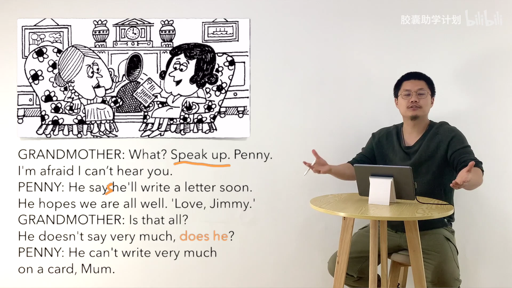

文字识别：胶囊助学计划 / mm / 30E / GRANDMOTHER: What? Speak up. Penny. / I'm afraid I can't hear you. / PENNY: He sayhe'll write a letter soon. / He hopes we are all well. 'Love, Jimmy." / GRANDMOTHER: Is that all? / He doesn't say very much, does he? / PENNY: He can't write very much / on a card, Mum.

### 画面 00:04:54

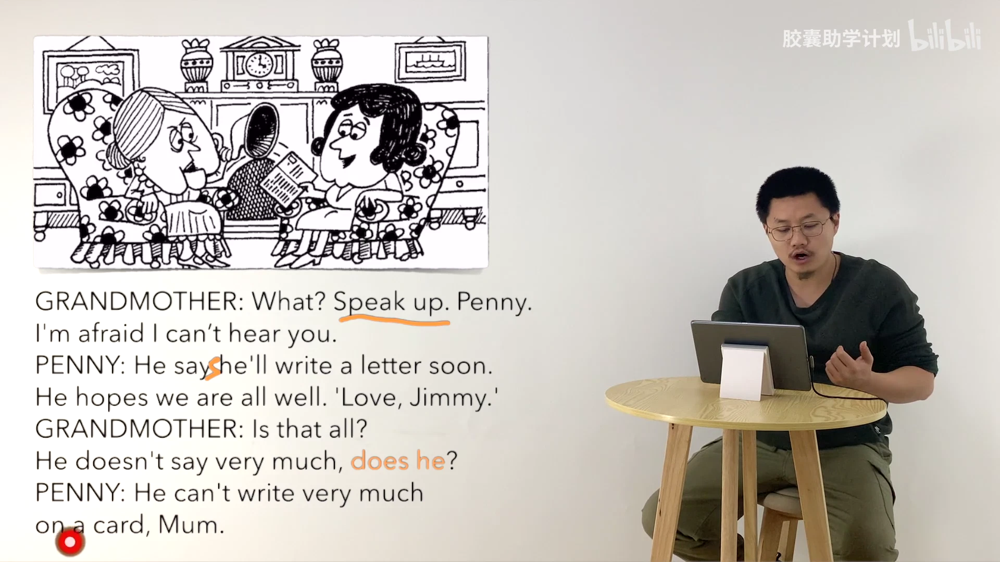

文字识别：胶囊助学计划bilb出 / mm / 308 / GRANDMOTHER: What? Speak up. Penny. / I'm afraid I can't hear you. / PENNY: He sayhe'll write a letter soon. / He hopes we are all well. 'Love, Jimmy." / GRANDMOTHER: Is that all? / He doesn't say very much, does he? / PENNY: He can't write very much / on a card, Mum.

## 00:05:00–00:05:30

奶，这是她的女儿，然后写信的是这个她女儿的儿子。OK，一个。那接下来我们一起看一下反义疑问句。首先原文说的是He doesn't say very much, does he？我先给大家一个规则，叫前肯后否，前否后肯。什么意思呢？就是如果前面这句话是个否定，那这就是个肯定；如果前面这是个肯

### 画面 00:05:06

文字识别：胶囊助学计划blb出 / 反意疑问句

### 画面 00:05:09

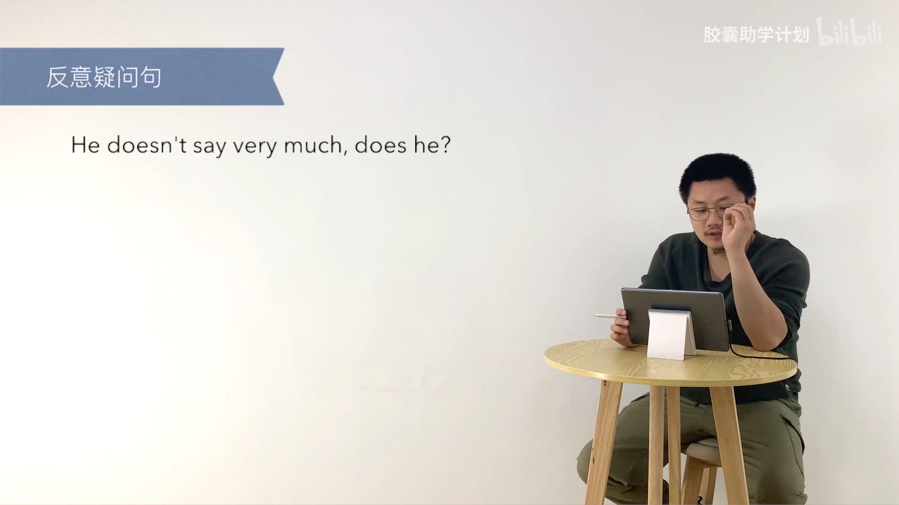

文字识别：胶囊助学计划 / 反意疑问句 / He doesn't say very much, does he?

### 画面 00:05:11

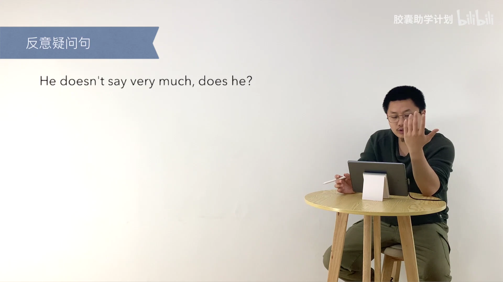

文字识别：bilbil / 胶囊助学计划 / 反意疑问句 / He doesn't say very much, does he?

### 画面 00:05:19

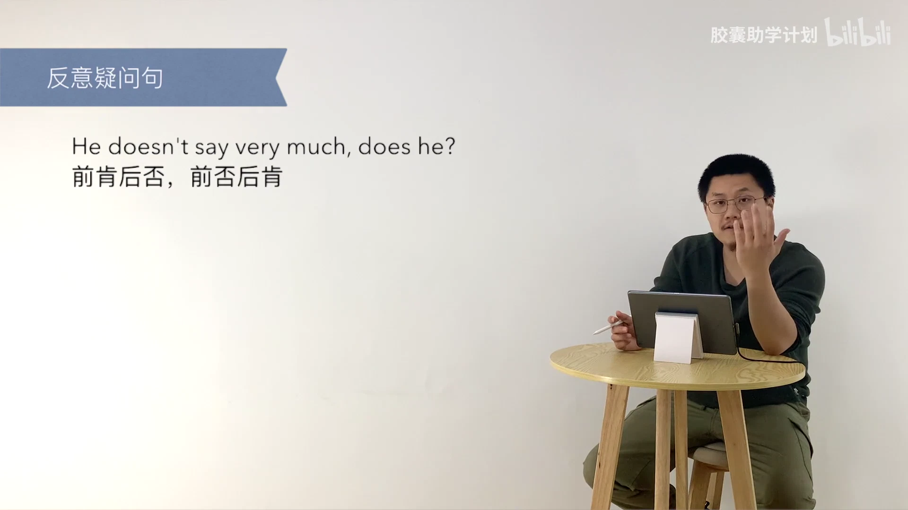

文字识别：胶囊助学计划bil出 / 反意疑问句 / He doesn't say very much, does he? / 前肯后否，前否后肯

### 画面 00:05:22

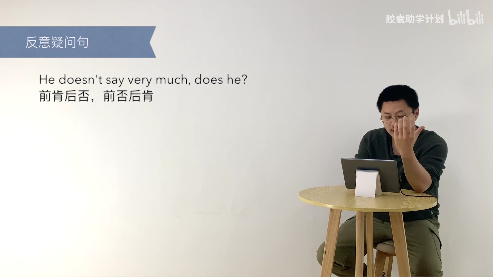

文字识别：bilbil / 胶囊助学计划 / 反意疑问句 / He doesn't say very much, does he? / 前肯后否，前否后肯

### 画面 00:05:24

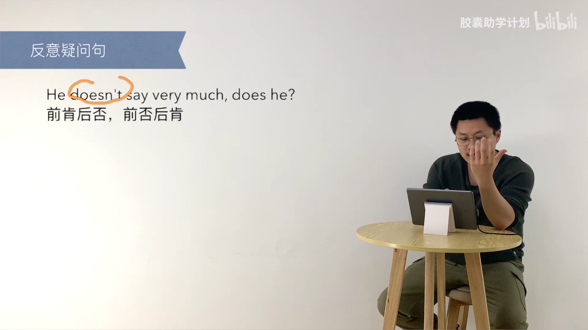

文字识别：bilibili / 胶囊助学计划 / 反意疑问句 / doesn't say very much, does he? / He / 前肯后否，前否后肯

### 画面 00:05:26

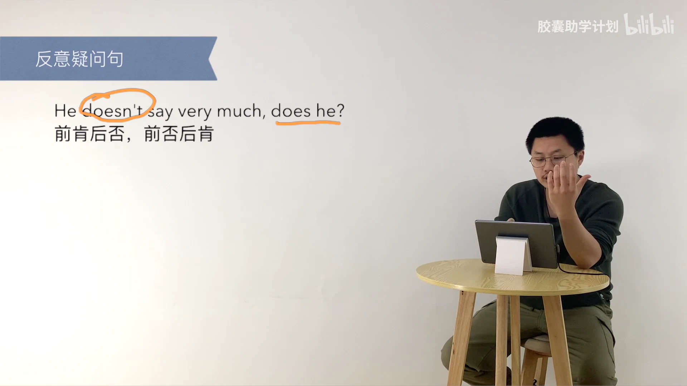

文字识别：biibili / 胶囊助学计划 / 反意疑问句 / doesn't say very much, does he? / He / 前肯后否，前否后肯

## 00:05:30–00:06:00

定，后边就是个否定，总之反着来就行了。其次，前后的人称时态你要保持一致，什么意思呢？您看前面是 doesn't say very much，首先判断时态一般现在时，所以后边这两个单词它不能是 did he， can he， is he，都是不行的，那就时态不一样了，对吧？好，其次，呃，人称还要保持

### 画面 00:05:31

文字识别：blibili / 胶囊助学计划 / 反意疑问句 / doesn't say very much, does he? / He / 前肯后否，前否后肯

### 画面 00:05:33

文字识别：胶囊助学计划 / 反意疑问句 / He / doesn't say very much, does he? / 前肯后否，前否后肯

### 画面 00:05:37

文字识别：胶囊助学计划 / 反意疑问句 / doesn't say very much, does he? / He / 前肯后否，前否后肯 / 前后人称时态应保持一致

### 画面 00:05:41

文字识别：bibili / 胶囊助学计划 / 反意疑问句 / He / doesn't say very much, does he? / 前肯后否，前否后肯 / 前后人称时态应保持一致

### 画面 00:05:44

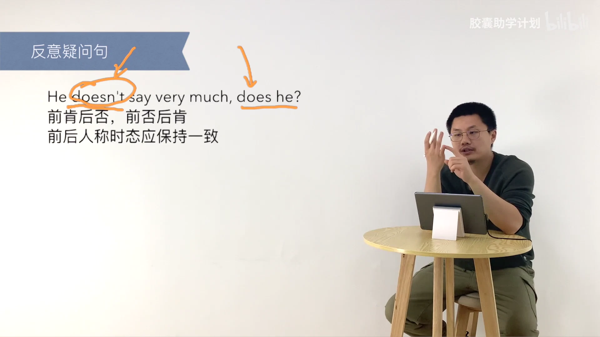

文字识别：胶囊助学计划 / 反意疑问句 / He / doesn't say very much, does he? / 前肯后否，前否后肯 / 前后人称时态应保持一致

### 画面 00:05:47

文字识别：bitbli / 胶囊助学计划 / 反意疑问句 / He / doesn't say very much (does he / 前肯后否，前否后肯 / 前后人称时态应保持一致

### 画面 00:05:50

文字识别：胶囊助学计划 / 反意疑问句 / He / doesn't say very much (does he / 前肯后否，前否后肯 / 前后人称时态应保持一致

### 画面 00:05:54

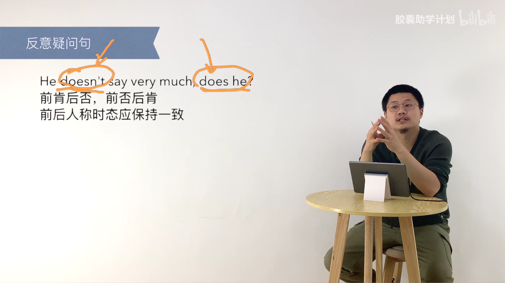

文字识别：胶囊助学计划 / 反意疑问句 / He / doesn't say very much (does he / 前肯后否，前否后肯 / 前后人称时态应保持一致

### 画面 00:05:59

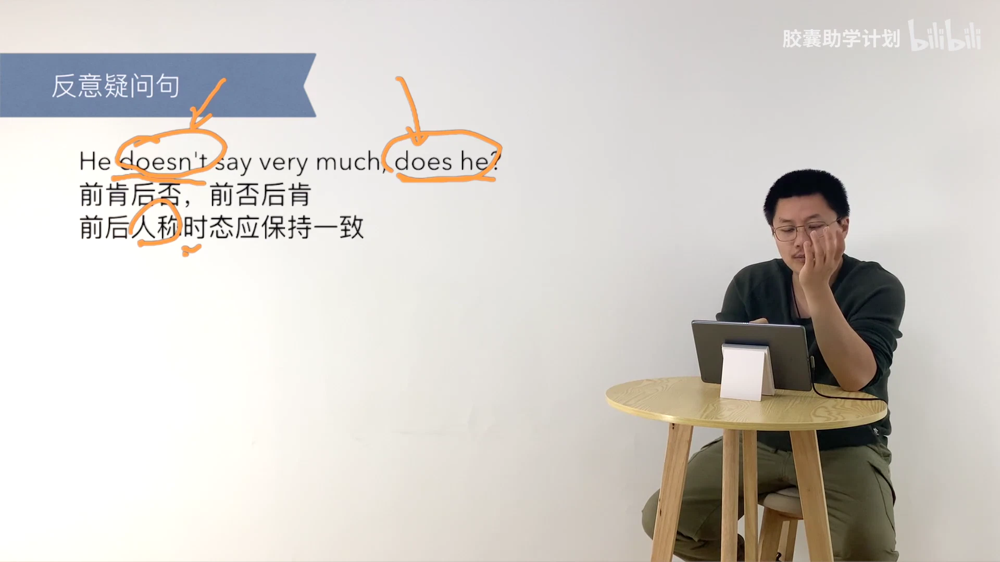

文字识别：Bilibii / 胶囊助学计划 / 反意疑问句 / He / doesn't say very much does he / 前肯后否，前否后肯 / 前后人称时态应保持一致

## 00:06:00–00:06:30

一致。前面是 he doesn't，所以这儿必须得是 he，你不能说 do he，对吧？肯定是 does he，也不能说成 does she，啊，因为前面是 he，所以要人称时态保持一致。这么说呢，各位还是比较虚。我们拿一个又一个的例子带着各位去走一遍，您很快就可以熟悉了。比如说，陈述客观事实，Lil is in Tokyo。你看我后边的叫 isn't he？我们先

### 画面 00:06:11

文字识别：bilibili / 胶囊助学计划 / 反意疑问句 / Hedoesn't say very much does he / 前肯后否，前否后肯 / 前后人称时态应保持一致

### 画面 00:06:16

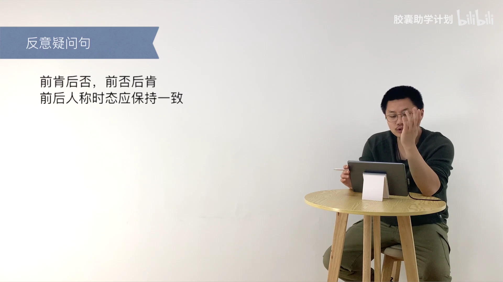

文字识别：bilbii / 胶囊助学计划 / 反意疑问句 / 前肯后否，前否后肯 / 前后人称时态应保持一致

### 画面 00:06:21

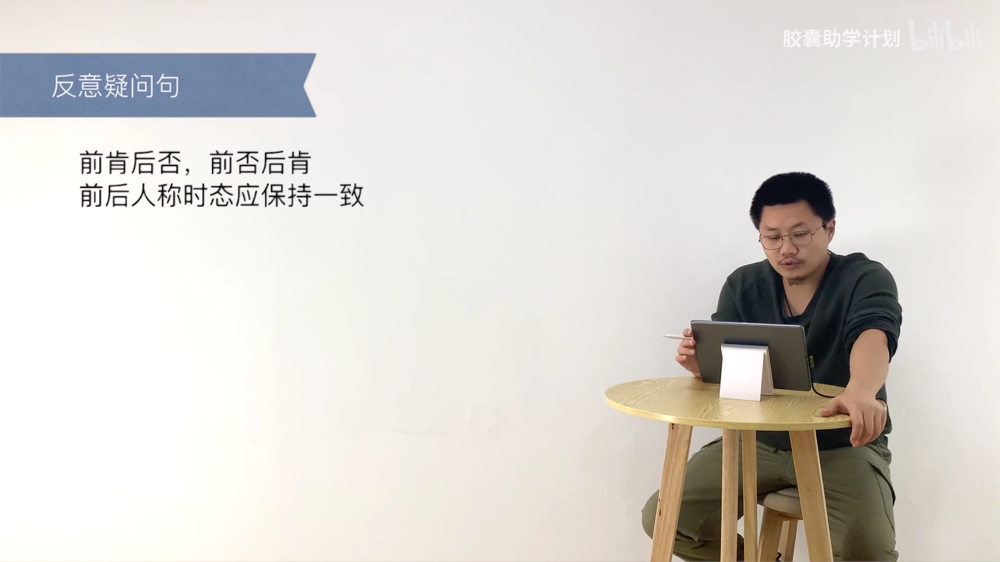

文字识别：胶囊助学计划 / 反意疑问句 / 前肯后否，前否后肯 / 前后人称时态应保持一致

## 00:06:30–00:07:00

判断前面是肯定句，后面我现在是否定句，这是没有问题的，对吧？其次，人称时态保持一致，Lil he, Lil he, 对吧？OK，然后呢，这是 isn't he? 人称保持一致，时态保持一致，你不能用 wasn't he? 好理解吧？再然后下一个，Lil goes to school on foot. 每天走路去上学，前肯后否，

### 画面 00:06:32

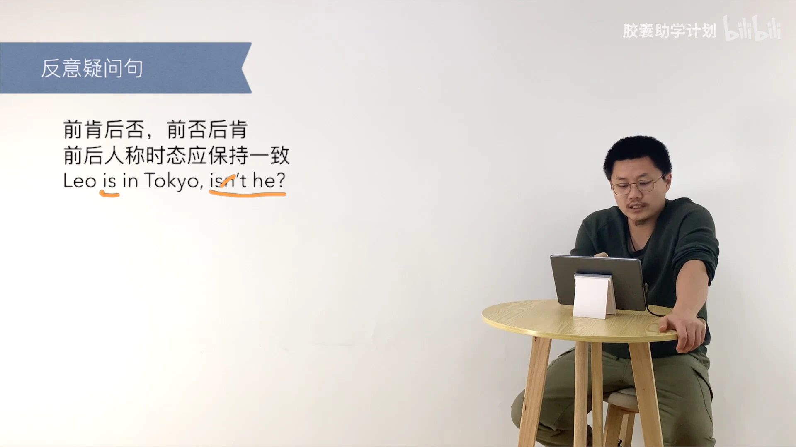

文字识别：胶囊助学计划 / 反意疑问句 / 前肯后否，前否后肯 / 前后人称时态应保持一致 / Leo is in Tokyo, isn't he?

### 画面 00:06:42

文字识别：bibli / 胶囊助学计划 / 反意疑问句 / 前肯后否，前否后肯 / 前后人称时态应保持一致 / Leo is in Tokyo, isn't he?

## 00:07:00–00:07:30

人称时态保持一致。人称 he he，时态一般现在时用的是 doesn't he？看到了哈。OK，再来一个，比如说 Sam saw me last night。你看 saw，时态想保持一致 saw，那就肯定是 did，对吧？那至于这是 did 还是 didn't 呢？取决于这个地方是肯定还是否定。前面肯定，后边否否定。总之

### 画面 00:07:09

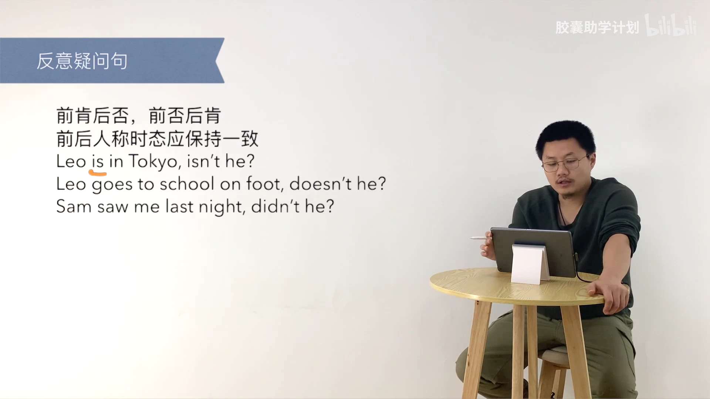

文字识别：胶囊助学计划 / 反意疑问句 / 前肯后否，前否后肯 / 前后人称时态应保持一致 / Leo is in Tokyo, isn't he? / Leo goes to school on foot, doesn't he? / Sam saw me last night, didn't he?

### 画面 00:07:16

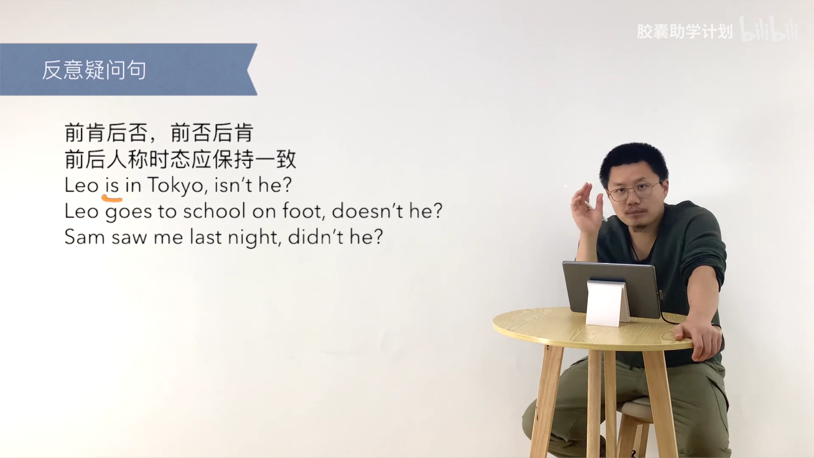

文字识别：胶囊助学计划 / 反意疑问句 / 前肯后否，前否后肯 / 前后人称时态应保持一致 / Leo is in Tokyo, isn't he? / Leo goes to school on foot, doesn't he? / Sam saw me last night, didn't he?

### 画面 00:07:20

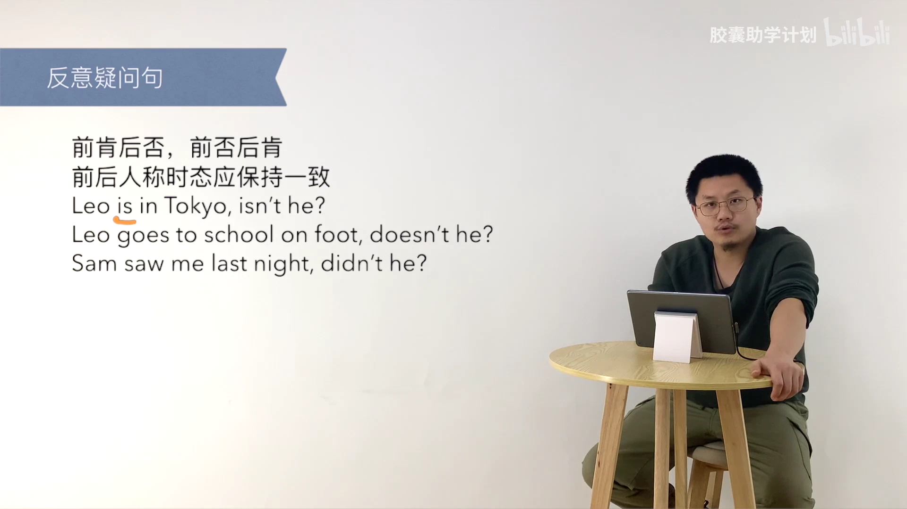

文字识别：胶囊助学计划 / 山 / 反意疑问句 / 前肯后否，前否后肯 / 前后人称时态应保持一致 / Leo is in Tokyo, isn't he? / Leo goes to school on foot, doesn't he? / Sam saw me last night, didn't he?

## 00:07:30–00:08:00

反着来就好了。人称保持一致，Sam是男的，所以是he。于是didn't he，叫做对吧？他昨天看见我了，对吧？OK，didn't he就翻译成汉语两个字儿就可以了，对吧？Isn't he，对吧？Doesn't he，对吧？再来，can't can't swim，说猫没有办法游泳。Can it？前否后肯，人称保持

### 画面 00:07:50

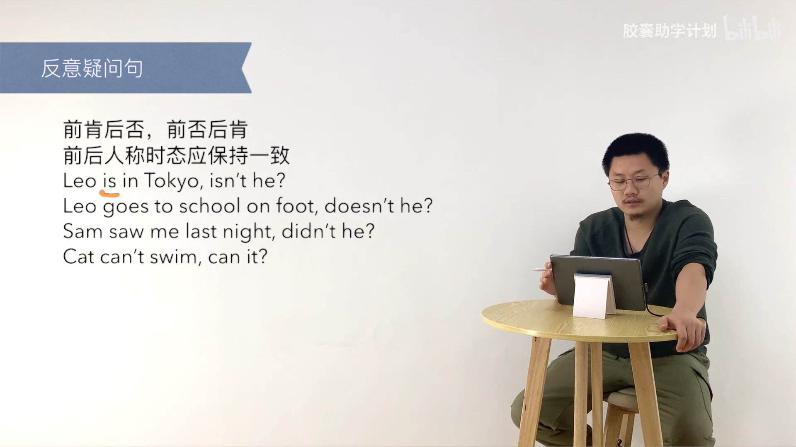

文字识别：胶囊助学计划 / 反意疑问句 / 前肯后否，前否后肯 / 前后人称时态应保持一致 / Leo is in Tokyo, isn't he? / Leo goes to school on foot, doesn't he? / Sam saw me last night, didn't he? / Cat can't swim, can it?

## 00:08:00–00:08:30

一致，时态当然这儿就不是时态，这是情态动词保持一致。您不能说前面用 can swim，后边用 must it，这就不对了，还得用 can，对吧？所以是 can it？玩一个，再来。You have finished your work， haven't you？说你已经完成了你的工作，对吧？Have 加 finished，现在完成时，后边也得是现在完成时的，哎，

### 画面 00:08:11

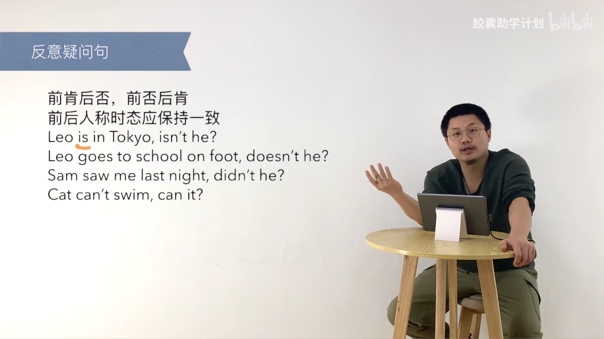

文字识别：胶囊助学计划 / 反意疑问句 / 前肯后否，前否后肯 / 前后人称时态应保持一致 / Leo is in Tokyo, isn't he? / Leo goes to school on foot, doesn't he? / Sam saw me last night, didn't he? / Cat can't swim, can it?

### 画面 00:08:15

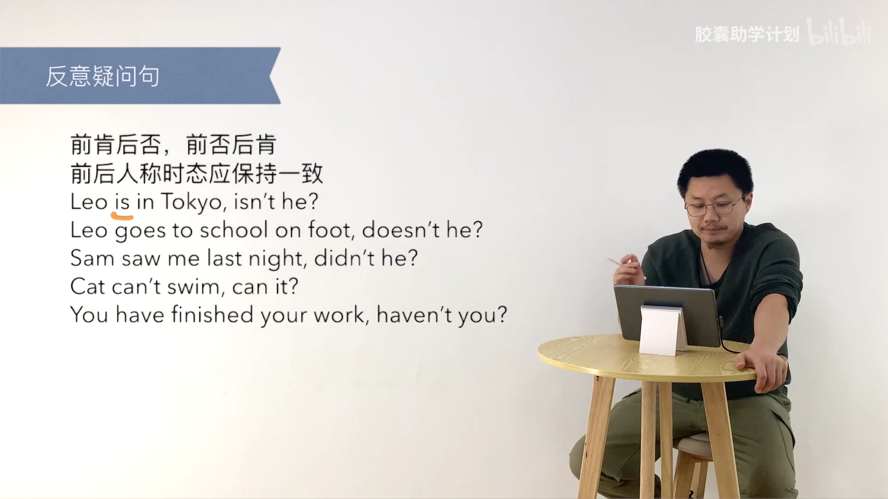

文字识别：胶囊助学计划 / 反意疑问句 / 前肯后否，前否后肯 / 前后人称时态应保持一致 / Leo is in Tokyo, isn't he? / Leo goes to school on foot, doesn't he? / Sam saw me last night, didn't he? / Cat can't swim, can it? / You have finished your work, haven't you?

## 00:08:30–00:09:00

has对吧？前面肯定，后边否定，人称保持一致，haven't you对吧？那这个地方再来说，Leo hasn't had his lunch.他没有吃他的午饭，对吧？这个对吧？怎么说呢？人称保持一致，前否后肯，时态保持一致，has has he? Okay.这个地方呢，我给大家提一个小点，就是其实中国人的思路，你不管什么时态，我就用两个字

### 画面 00:08:45

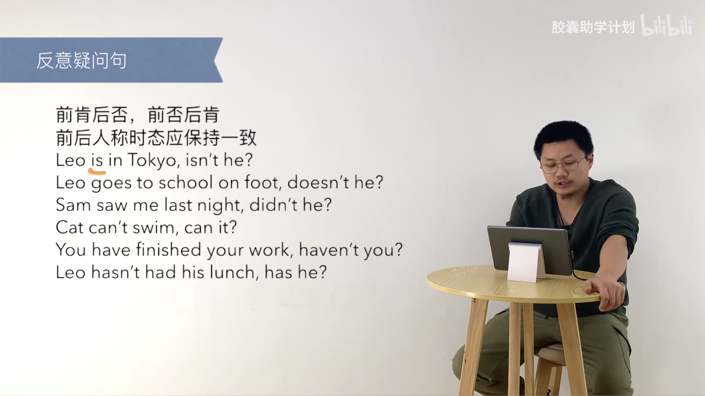

文字识别：胶囊助学计划bilb出 / 反意疑问句 / 前肯后否，前否后肯 / 前后人称时态应保持一致 / Leo is in Tokyo, isn't he? / Leo goes to school on foot, doesn't he? / Sam saw me last night, didn't he? / Cat can't swim, can it? / You have finished your work, haven't you? / Leo hasn't had his lunch, has he?

### 画面 00:08:53

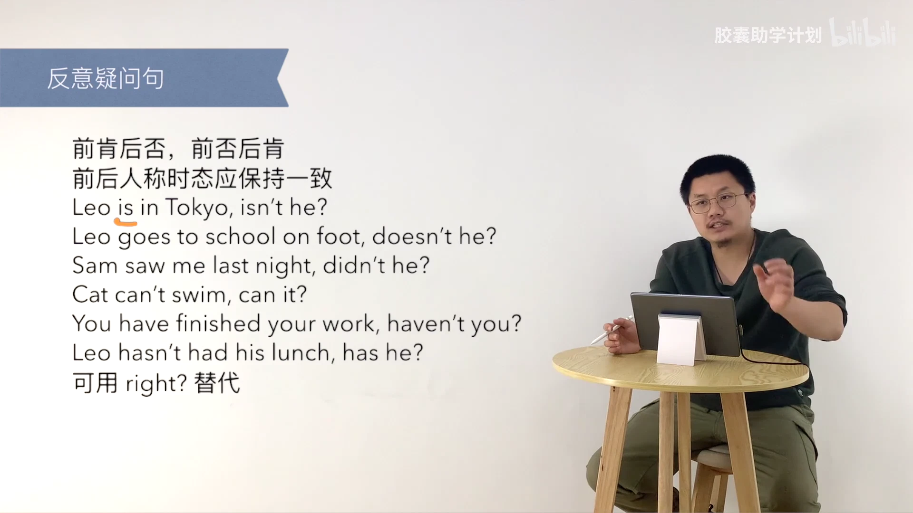

文字识别：胶囊助学计划 / 反意疑问句 / 前肯后否，前否后肯 / 前后人称时态应保持一致 / Leo is in Tokyo, isn't he? / Leo goes to school on foot, doesn't he? / Sam saw me last night, didn't he? / Cat can't swim, can it? / You have finished your work, haven't you? / Leo hasn't had his lunch, has he? / 可用right?替代

### 画面 00:08:56

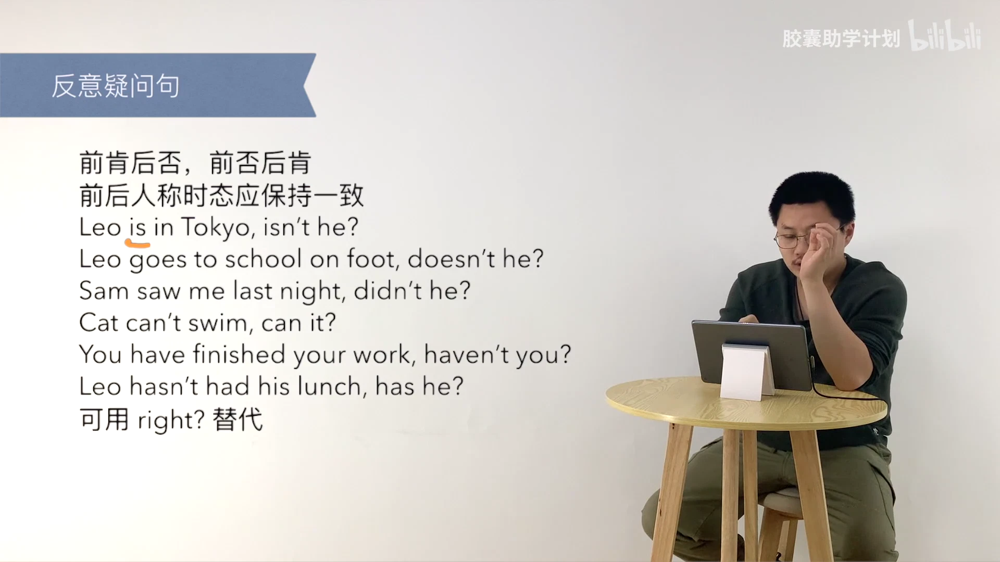

文字识别：胶囊助学计划bii出 / 反意疑问句 / 前肯后否，前否后肯 / 前后人称时态应保持一致 / Leo is in Tokyo, isn't he? / Leo goes to school on foot, doesn't he? / Sam saw me last night, didn't he? / Cat can't swim, can it? / You have finished your work, haven't you? / Leo hasn't had his lunch, has he? / 可用right?替代

### 画面 00:08:58

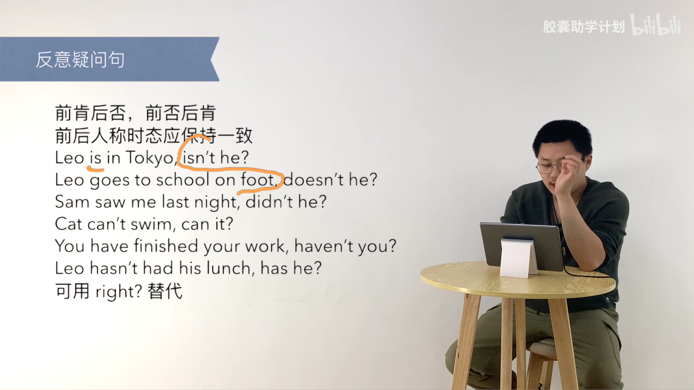

文字识别：胶囊助学计划bi出 / 反意疑问句 / 前肯后否，前否后肯 / 前后人称时态应保持一致 / Leo is in Tokyo,isn't he? / Leo goes to school on foot, doesn't he? / Sam saw me last night, didn't he? / Cat can't swim, can it? / You have finished your work, haven't you? / Leo hasn't had his lunch, has he? / 可用right?替代

## 00:09:00–00:09:30

儿叫对吧，是很舒服的，对吧？OK，而英文它可以用各种各样的变化来，就像我这个黄圈里啊框出来的，可以用各种各样的人称时态变化，各种各样的单词，isn't， doesn't， didn't， can， haven't， has，这还没完呢，对吧？还有 must 等等，这就比较麻烦了。对于各位来说，比较容易的一个方式就是 right 就可以了。哈，说 Lile is in Tokyo， right？对吧？

### 画面 00:09:00

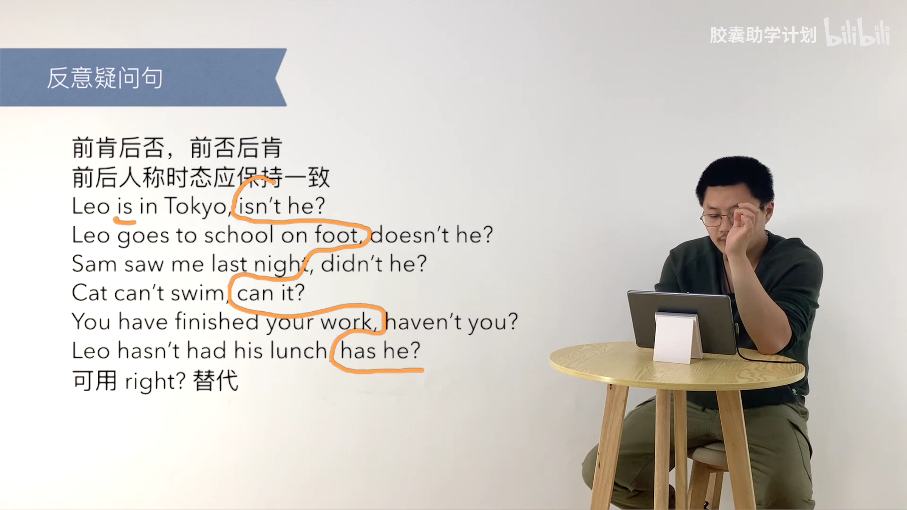

文字识别：胶囊助学计划bilb出 / 反意疑问句 / 前肯后否，前否后肯 / 前后人称时态应保持一致 / Leo is in Tokyo,isn't he? / Leo goes to school on foot,doesn't he? / Sam saw me last nigh, didn't he? / Cat can't swimcan it? / You have finished your work, haven't you? / Leo hasn't had his lunchhas he? / 可用right?替代

### 画面 00:09:02

文字识别：Bilbil / 胶囊助学计划 / 反意疑问句 / 前肯后否，前否后肯 / 前后人称时态应保持一致 / Leo is in Tokyo,isn't he? / Leo goes to school on foot,doesn't he? / Sam saw me last nigh, didn't he? / Cat can't swim / can it? / You have finished your work, haven't you? / Leo hasn't had his lunchhas he? / 可用right?替代

### 画面 00:09:06

文字识别：刘bilbil / 胶囊助学计划 / 反意疑问句 / 前肯后否，前否后肯 / 前后人称时态应保持　致 / Leo is in Tokyo,isn't he? / Leo goes to school on foot,doesn't he? / Sam saw me last nigh, didn't he? / Cat can't swim / can it? / You have finished your work, haven't you? / Leo hasn't had his lunchhas he? / 可用right?替代

### 画面 00:09:11

文字识别：胶囊助学计划 / 反意疑问句 / 前肯后否，前否后肯 / 前后人称时态应保持　致 / 工X / Leo is in Tokyo,isn't he? / Leo goes to school on foot,doesn't he? / Sam saw me last nigh, didn't he? / Cat can't swim, / can it? / You have finished your work, haven't you? / Leo hasn't had his lunchhas he? / 可用right?替代

### 画面 00:09:17

文字识别：Jbilbili / 胶囊助学计划 / 反意疑问句 / 前肯后否，前否后肯 / 前后人称时态应保持一致 / 工X / Leo is in Tokyo,isn't he? / Leo goes to school on foot,doesn't he? / Sam saw me last nigh, didn't he? / Cat can't swim/ / can it? / You have finished your work, haven't you? / Leo hasn't had his lunchhas he? / 可用right?替代

### 画面 00:09:20

文字识别：biibili / 胶囊助学计划 / 反意疑问句 / 前肯后否，前否后肯 / 前后人称时态应保持一致 / 工X / Leo is in Tokyo,isn't he? / Leo goes to school on foot,doesn't he? / Sam saw me last nigh, didn't he? / Cat can't swim, / Can it? / You have finished your work, haven't you? / Leo hasn't had his lunchhas he? / 可用right?替代

### 画面 00:09:25

文字识别：Jbibili / 胶囊助学计划 / 反意疑问句 / 前肯后否，前否后肯 / 前后人称时态应保持一致 / 工X / Leo is in Tokyo,isn't he? / Leo goes to school on foot,doesn't he? / Sam saw me last nigh, didn't he? / Cat can't swim, / Can it? / You have f /  finished your workhaven't you? / Leo hasn't had his lunchhas he? / 可用right?替代

## 00:09:30–00:10:00

Right不就是对吗？那Right就是对吗？OK，好，那这就比较简单了啊。OK，接下来我们做一些口语听力练习。我问您答来了。What does grandmother want Penny to read to him? Jimmy's car. Next one. Where is Jimmy? He's in Scotland. Next one. Has Jimmy been

### 画面 00:09:30

文字识别：胶囊助学计划 / 反意疑问句 / 前肯后否，前否后肯 / 前后人称时态应保持一致 / 工X / Leo is in Tokyo,isn't he? / Leo goes to school on foot,doesn't he? / Sam saw me last nigh, didn't he? / Cat can't swim, / can it? / You have finished your work, haven't you? / Leo hasn't had his lunchhas he? / 可用right?替代

### 画面 00:09:36

文字识别：bilbl / 胶囊助学计划 / Comprehension

### 画面 00:09:41

文字识别：胶囊助学计划 / Comprehension / 1 T: What does Grandmother want Penny to / read to her?

### 画面 00:09:47

文字识别：胶囊助学计划blb出 / Comprehension / 1 T: What does Grandmother want Penny to / read to her?

### 画面 00:09:58

文字识别：胶囊助学计划bib出 / Comprehension / 3 T: Has Jimmy been in Scotland for a long time?

## 00:10:00–00:10:30

in Scotland for a long time? You看典型八十九课持续到现在啊，从过去持续到现在。No, he hasn't. Next one. Where does he say he's staying? At a youth hostel. Next one. Does he say he'll write a letter soon? Yes, he does. Next one. What

### 画面 00:10:16

文字识别：bilbli / 胶囊助学计划 / Comprehension / 4 T: Where does he say he's staying? / S: At a Youth Hostel.

### 画面 00:10:19

文字识别：胶囊助学计划bilb出 / Comprehension / 5 T: Does he say he'll write a letter soon?

### 画面 00:10:21

文字识别：胶囊助学计划 / Comprehension / 5 T: Does he say he'll write a letter soon?

### 画面 00:10:28

文字识别：胶囊助学计划bilb出 / Comprehension / 6 T: What else does he say?

## 00:10:30–00:11:00

else does he say? He says he hopes they are all well. Next one, why does grandmother ask Penny to speak up? Because she can't hear very well. Continuing, how much can Jimmy write on a card? Not very much.他能写多少？写不太多，对吧？下一道题，我给

### 画面 00:10:43

文字识别：胶囊助学计划 b出b出 / Comprehension / 7 T: Why does Grandmother ask Penny to / speak up? / S: Because she can't hear very well.

### 画面 00:10:48

文字识别：胶囊助学计划bilb出 / Comprehension

### 画面 00:10:59

文字识别：biltbili / 胶囊助学计划 / Asking questions / 1 T: Ask me if Jimmy has just arrived in Scotland.

## 00:11:00–00:11:30

肯定句，您变一般疑问句；我给特殊疑问词，您变特殊疑问句。来了，Ask me if Jimmy has just arrived in Scotland. 现在完成时，has提前，Has Jimmy just arrived in Scotland? Where? Where has Jimmy just arrived? Next one, Ask me if he's staying

### 画面 00:11:01

文字识别：胶囊助学计划 / Asking questions / 1 T: Ask me if Jimmy has just arrived in Scotland.

### 画面 00:11:05

文字识别：bilbl / 胶囊助学计划 / Asking questions / 1 T: Ask me if Jimmy has just arrived in Scotland.

### 画面 00:11:19

文字识别：bilibili / 胶囊助学计划 / Asking questions / 1 T: Ask me if Jimmy has just arrived in Scotland. / S: Has Jimmy just arrived in Scotland? / T: Where …..? / S: Where has Jimmy just arrived?

### 画面 00:11:24

文字识别：胶囊助学计划bii / Asking questions

## 00:11:30–00:12:00

at a youth hostel. Is he staying at a youth hostel? Where? Where is he staying? Next one. Ask me if he says he will write a letter soon. Does he say he will write a letter soon? What else? What else does he say? 注意 what else 就是直接对宾语从句提问

### 画面 00:11:38

文字识别：Bilbili / 胶囊助学计划 / Asking questions / 2 T: Ask me if he's staying at a Youth Hostel. / S: Is he staying at a Youth Hostel? / T: Where ….? / S: Where is he staying?

### 画面 00:11:42

文字识别：胶囊助学计划bilb出 / Asking questions

### 画面 00:11:53

文字识别：bilbi / 胶囊助学计划 / Asking questions / 3 T: Ask me if he says he'll write a letter soon. / S: Does he say he'll write a letter soon? / T: What else ...?

### 画面 00:11:59

文字识别：bilbli / 胶囊助学计划 / Asking questions / 3 T: Ask me if he says he'll write a letter soon. / S: Does he say he'l write a letter soon? / T: What else ...? / S: What else does he say?

## 00:12:00–00:12:30

了，对吧？Okay, next one. Ask me if grandmother can hear him. Can grandmother hear him? Why can't?直接把can去掉。Why can't grandmother hear him? There you go. Next one. Ask me if he hopes we are all well.你看，理论上来说，这可以提does，可以提are，对吧？但并不是，因为后边是宾语从句，我们

### 画面 00:12:02

文字识别：胶囊助学计划blb出 / Asking questions

### 画面 00:12:13

文字识别：bilibili / 胶囊助学计划 / Asking questions / 4 T: Ask me if Grandmother can hear her. / S: Can Grandmother hear her? / T: Why can't ..? / S: Why can't Grandmother hear her?

### 画面 00:12:17

文字识别：胶囊助学计划 bl出 / Asking questions

### 画面 00:12:24

文字识别：胶囊助学计划 / Asking questions / 5 T: Asks me if he hopes we are all well.

## 00:12:30–00:13:00

要看 hopes 谓语，对吧？所以 does 提前，Does he hope we're all well？ What What does he hope？他希望什么呢？希望我们身体都棒棒。OK， There you go. Recap 本课，首先我们看了原文当中直接疑问句啊，直接英语如何变成间接英语？其次呢，我们学了一个比较小的新的知识点，叫反义疑问句。基本上各位掌握两个原

### 画面 00:12:32

文字识别：Bib / 胶囊助学计划 / Asking questions / 5 T: Asks me if he hopeswe are all well.

### 画面 00:12:42

文字识别：bilbili / 胶囊助学计划 / Asking questions / 5 T: Asks me if he hopeswe are all well. / S: Does he hope we are l well? / T: What .? / S: What does he hope?

### 画面 00:12:44

文字识别：Bilbili / 胶囊助学计划 / Recap / Patterns / 直接引语变间接引语 / 反意疑问句 / Grammar / Words / Expression

### 画面 00:12:49

文字识别：Bilbili / 胶囊助学计划 / Recap / Patterns / 直接引语变间接引语 / 反意疑问句 / Grammar / Words / Expression

### 画面 00:12:57

文字识别：Bifbili / 胶囊助学计划 / Recap / Patterns / 直接引语变间接引语 / 反意疑问句 / Grammar / Words / Expression

### 画面 00:12:59

文字识别：胶囊助学计划 / Recap / Patterns / 直接引语变间接引语 / & / 反意疑问句 / Grammar / Words / Expression

## 00:13:00–00:13:30

则就好了，前肯后否，前否后肯，对吧？OK，然后呢，这是第一个原则，第二个原则呢就是时态人称保持一致就可以了。OK，并不是特别的难。家庭作业，绿皮书一百零一课各位写，我临时给大家布置一个，就是您去红皮书初级当中找一下反义疑问句，您看能不能找到？好吧？OK，再然后呢，文章要跟读至熟读成诵。好，给自己讲解一遍今天的核心知识点，尤其是反义疑问

### 画面 00:13:07

文字识别：胶囊助学计划 / Recap / Patterns / 直接引语变间接引语 / & / 反意疑问句 / Grammar / Words / Expression

### 画面 00:13:09

文字识别：胶囊助学计划b出b出 / 绿皮书第101课的写作练习

### 画面 00:13:13

文字识别：胶囊助学计划 / 绿皮书第101课的写作练习

### 画面 00:13:25

文字识别：胶囊助学计划b出b出 / 绿皮书第101课的写作练习 / 文章跟读至熟读成诵 / 3.请给自己讲解一遍今天的 / 核心知识点

## 00:13:30–00:14:00

句。那如果大家喜欢我们的课程呢，欢迎大家关注、订阅、一键三连、分享给那些需要的朋友。最后，我们再来看一句名人名言：Life's like a movie, write your own endings. Keep believing, keep pretending. See you next time.

### 画面 00:13:30

文字识别：胶囊助学计划bib出

### 画面 00:13:37

文字识别：bilbili / 胶囊助学计划 / Life's like a movie, write your own ending. / Keep believing, keep pretending. /  Jim Henson

### 画面 00:13:48

文字识别：u bilbili / 胶囊助学计划 / Life's like a movie, write your own ending. / Keep believing, keep pretending. / Jim Henson

### 画面 00:13:50

文字识别：CAPSULEACADEMY / 胶囊助学计划 / 小红书 / Lectur / OE

### 画面 00:13:52

文字识别：CAPSULEACADEMY / 胶囊助学计划 / 小红书 / Ph / 8 / OE

### 画面 00:13:55

文字识别：CAPSULEACADEMY / 胶囊助学计划 / 小红书 / Editor / □ / Berlin / OE

### 画面 00:13:58

文字识别：CAPSULEACADEMY / 胶囊助学计划 / 『 / 小红书 / Leo & Berlin

## 00:14:00–00:14:02

### 画面 00:14:00

文字识别：bilibili / 胶囊助学计划

### 画面 00:14:01

文字识别：bilibili / 胶囊助学计划

