# 103 文章

快速机器解析：语音为单模型转写，未进行独立交叉校对或人工复核；画面每秒采样并按变化选帧，短时文字和标记可能遗漏。截图时间约有 1 秒误差。图片有损压缩；遇到疑点请按时间查看 Google Drive 原视频。

## 00:00:00–00:00:30

Hello everyone, welcome to Capsule Academy. This is Leo. Today we're going to learn New Concept English Book One, Lesson One Hundred and Three, Story. 那老习惯进入正式课程之前，我们看一个小的单词，就是如何使用 could 这个单词。啊，带着这个问题，Hope you gonna enjoy. 那我们直接进入文章啊，两个人啊，我们看一下他们的这个场景，这个地方叫 examination

### 画面 00:00:00

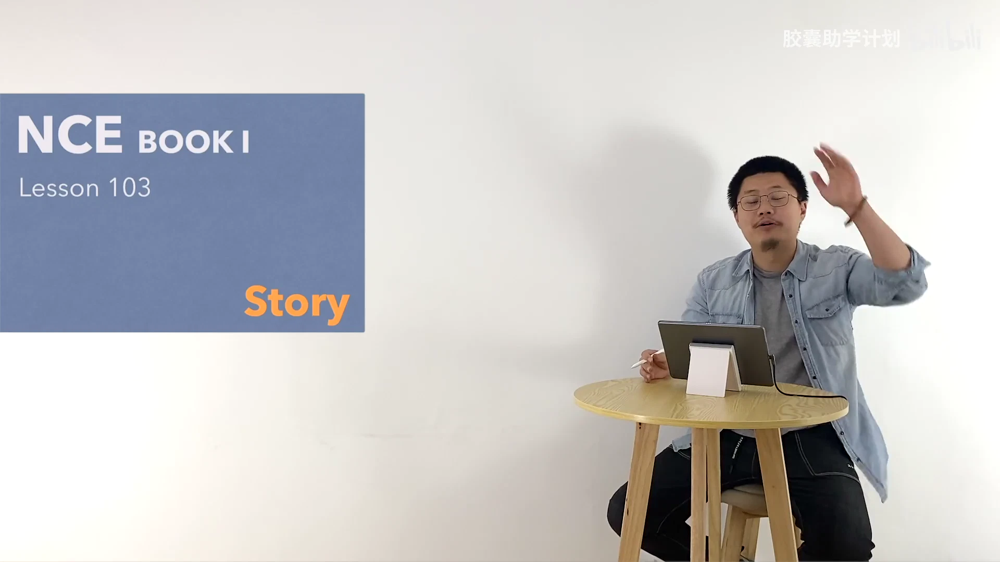

文字识别：NCE / BOOKI / Lesson 103 / Story

### 画面 00:00:02

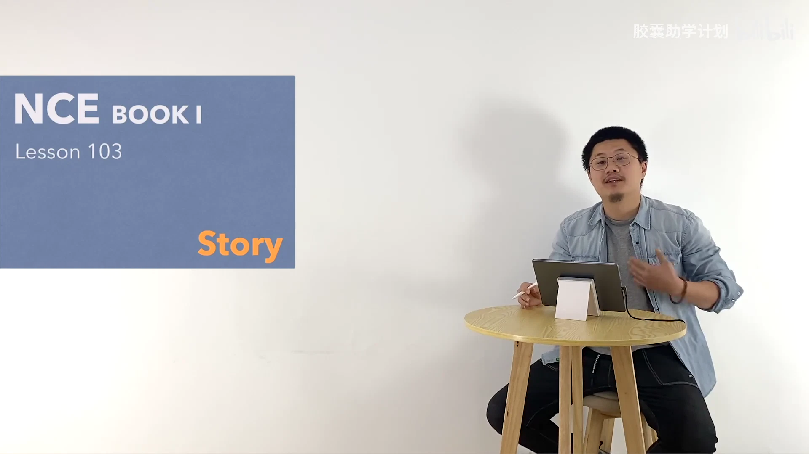

文字识别：NCE / BOOKI / Lesson 103 / Story

### 画面 00:00:10

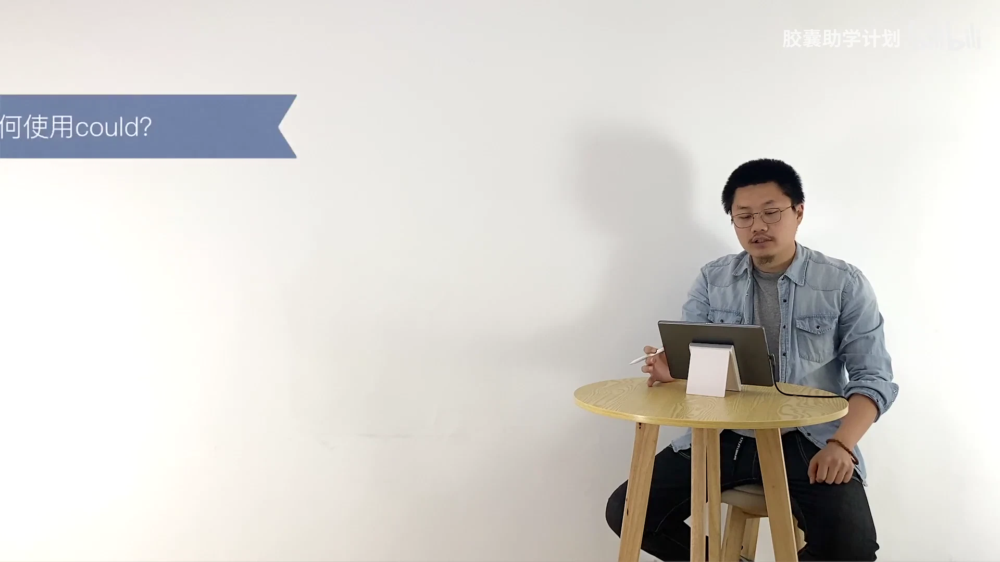

文字识别：胶囊助学计 / 何使用could?

### 画面 00:00:12

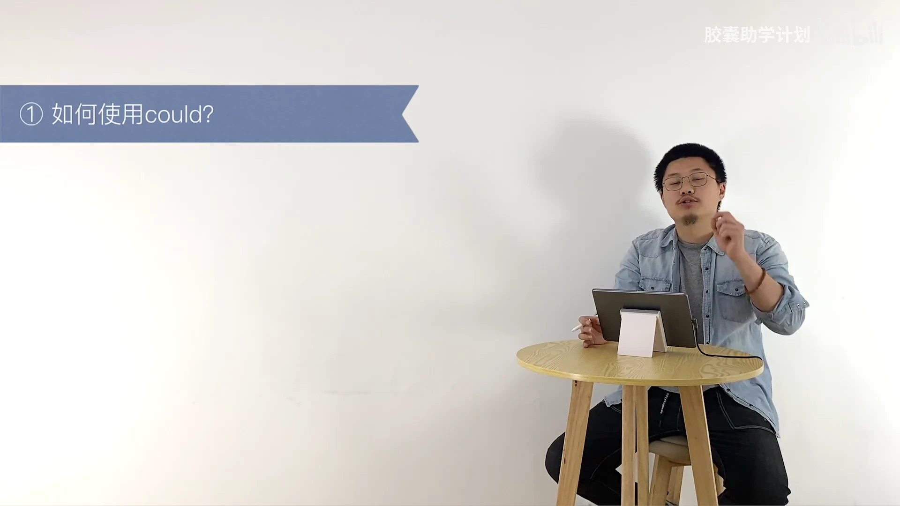

文字识别：胶囊助学计 / ①如何使用could?

### 画面 00:00:18

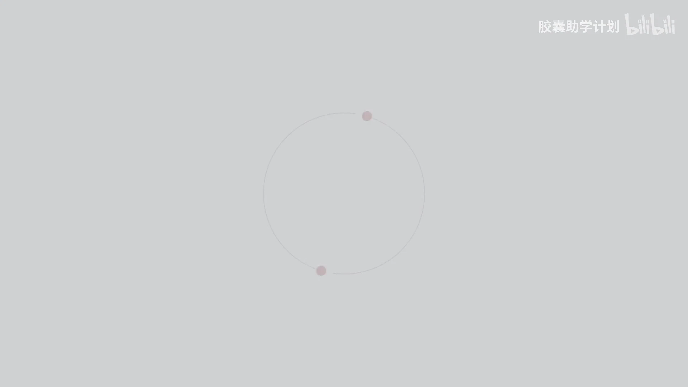

文字识别：胶囊助学计划bill / •

### 画面 00:00:21

文字识别：胶囊助学计划 / 胶囊助学计划

### 画面 00:00:23

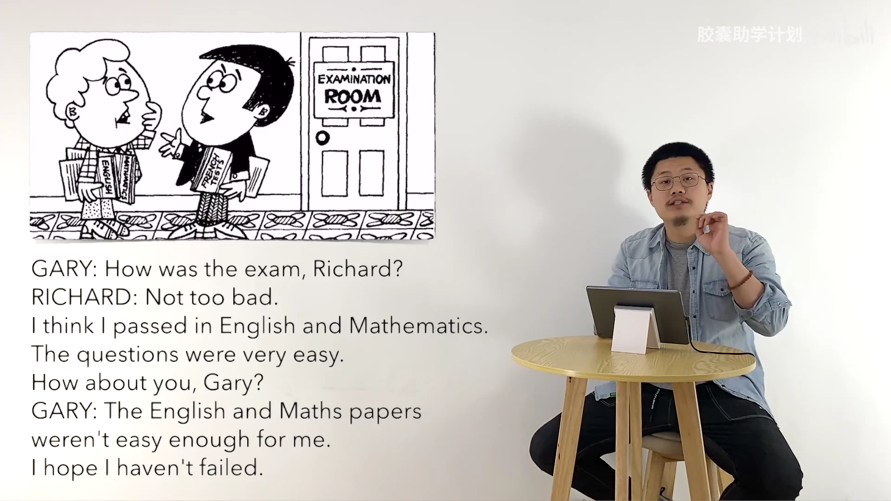

文字识别：EXAMINATON / ROOM / GARY: How was the exam, Richard? / RICHARD: Not too bad. / I think I passed in English and Mathematics. / The questions were very easy. / How about you, Gary? / GARY: The English and Maths papers / weren't easy enough for me. / I hope I haven't failed.

## 00:00:30–00:01:00

room，啊，叫做考试的那个房间啊，考场。两个人站在考场外说话。Gary说，How was the exam, Richard？说，哎，刚才考的怎么样？为什么我翻译成刚才？因为有一个关键单词是was，对吧？哎，How was the exam？Not too bad。好，我们先把not删掉，too bad就太糟糕了。Not too bad就是不是太糟糕。

### 画面 00:00:53

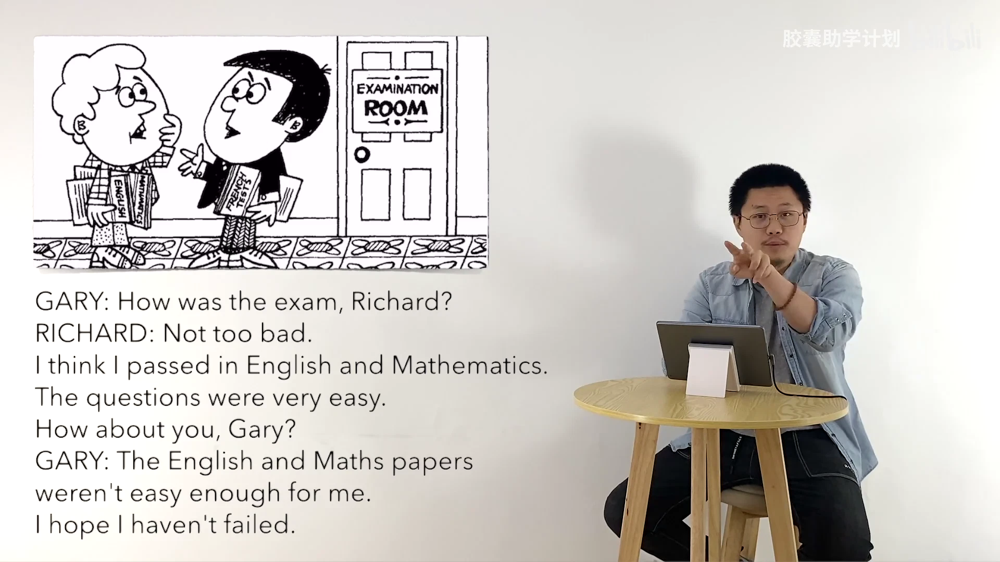

文字识别：胶囊助学 / EXAMINATON / ROOM / GARY: How was the exam, Richard? / RICHARD: Not too bad. / I think I passed in English and Mathematics. / The questions were very easy. / How about you, Gary? / GARY: The English and Maths papers / weren't easy enough for me. / I hope I haven't failed.

## 00:01:00–00:01:30

你想这个回答意味着考的也不太好，是吧？Okay, I think我认为啊，I passed in English and mathematics。我认为我通过了英文和数学。The questions were very easy。说刚才这些问题啊，还是挺简单的。How about you, Gary? How about you?完全等同于What about you?就你呢？啊，Gary说，The

### 画面 00:01:23

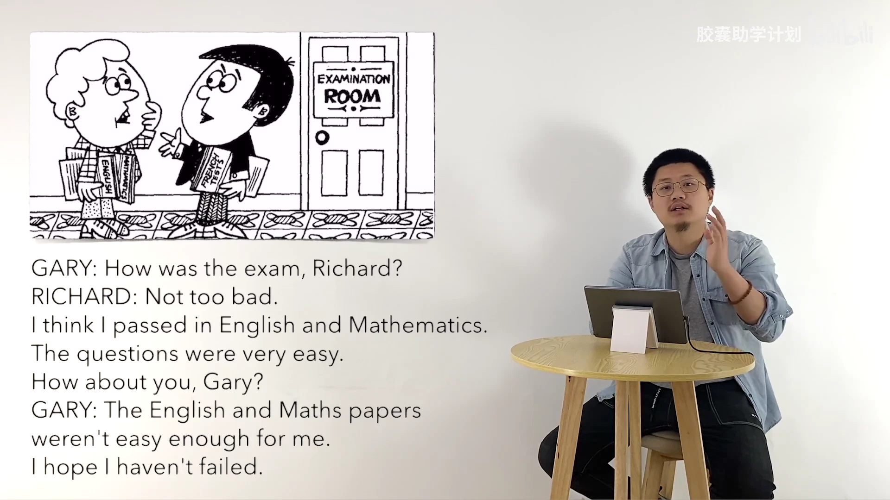

文字识别：胶囊助学 / EXAMINATION / ROOM / GARY: How was the exam, Richard? / RICHARD: Not too bad. / I think I passed in English and Mathematics. / The questions were very easy. / How about you, Gary? / GARY: The English and Maths papers / weren't easy enough for me. / I hope I haven't failed.

## 00:01:30–00:02:00

English and math papers，英文和数学的paper啊，就是考试考卷，won't easy enough for me，不是足够的简单对于我来说，不是足够的简单。I hope I haven't failed，说我希望啊，宾语从句我没有失败，也就是没有不通过，没有挂科。Continuing，I think，我认为，I failed the French paper，

### 画面 00:01:53

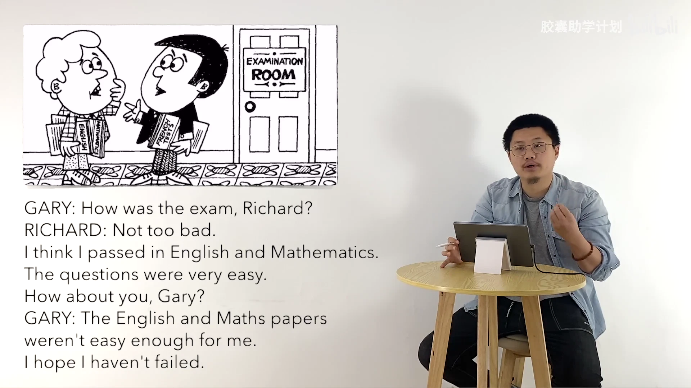

文字识别：胶囊助 / EXAMINATION / ROOM / GARY: How was the exam, Richard? / RICHARD: Not too bad. / I think I passed in English and Mathematics. / The questions were very easy. / How about you, Gary? / GARY: The English and Maths papers / weren't easy enough for me. / I hope I haven't failed.

### 画面 00:01:55

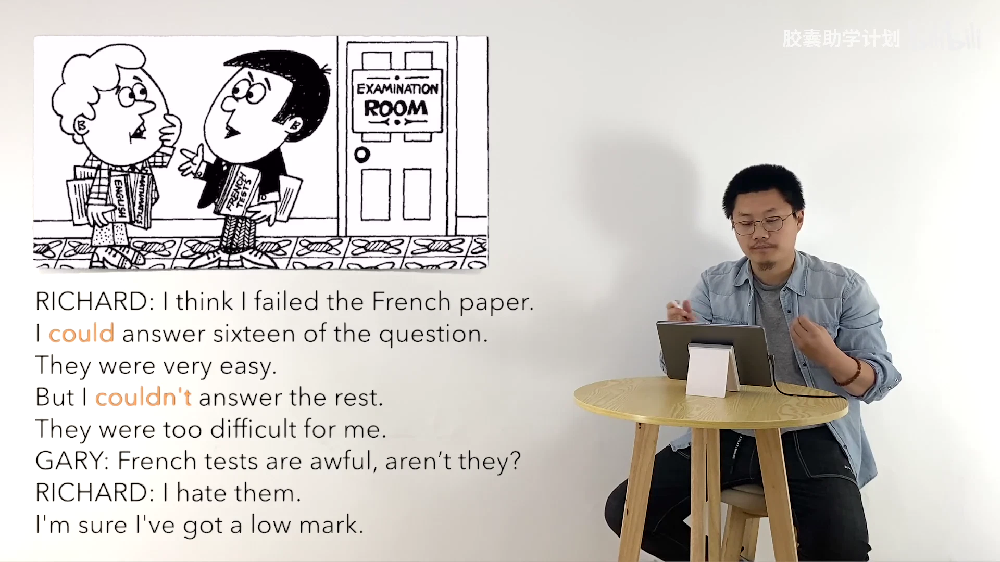

文字识别：胶囊助学 / EXAMINATION / ROOM / RICHARD: I think I failed the French paper. / I could answer sixteen of the question. / They were very easy. / But I couldn't answer the rest. / They were too difficult for me. / GARY: French tests are awful, aren't they? / RICHARD: I hate them. / I'm sure l've got a low mark.

## 00:02:00–00:02:30

宾语从句，我认为啊，我失败了法语的这个考试啊，就是我挂科了啊，我没有通过。I could, 哎，出现了关键词 could。首先告诉各位一个词儿，can跟could在大部分情况下几乎可以混着用，也就是说could可以用在现在，也呃，它比can还多一个可以用在过去。更多的细节

### 画面 00:02:15

文字识别：胶囊助学 / Can / EXAMINATION / ROOM / RICHARD: I think I failed the French paper. / I could answer sixteen of the question. / They were very easy. / But I couldn't answer the rest. / They were too difficult for me. / GARY: French tests are awful, aren't they? / RICHARD: I hate them. / I'm sure l've got a low mark.

## 00:02:30–00:03:00

我不在这里去讲了，只告诉各位它的用法跟 can 几乎是一样。比如说否定就是 can 是后边加 not，对吧？ Could 也是后边加 not。一般疑问句呢是 can 提前，could 也是提前。在这儿告诉各位了。那更多更详细的讲解，各位可以直接去翻看我们语法单项的那个专栏，当中有非常详细的讲解 can 与 could 的各种啊区别和异同。 OK，那各位现在知道它翻译成能就行了。说

### 画面 00:02:45

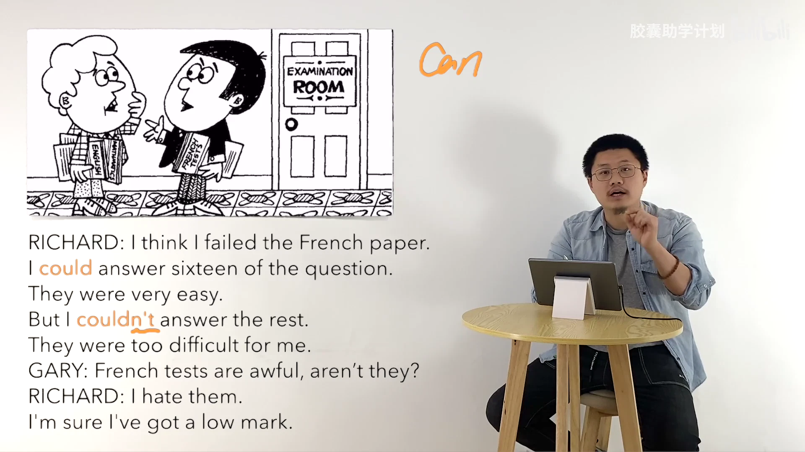

文字识别：胶囊助 / Can / EXAMINATON / ROOM / Sm / RICHARD: I think I failed the French paper. / I could answer sixteen of the question. / They were very easy. / But I couldn't answer the rest. / They were too difficult for me. / GARY: French tests are awful, aren't they? / RICHARD: I hate them. / I'm sure l've got a low mark.

## 00:03:00–00:03:30

我能 answer 回答 sixteen of the questions. Okay, 叫十六个问题，我能回答十六个。They were very easy. 说他们很简单，但但是呢，I couldn't couldn't 就是 can 后边加 not，对吧？就是不能。我没有办法 answer the rest. 我没有办法回答剩余的那个部分。They were too difficult for me. 你看 too difficult 就是过于的难了，太难

### 画面 00:03:15

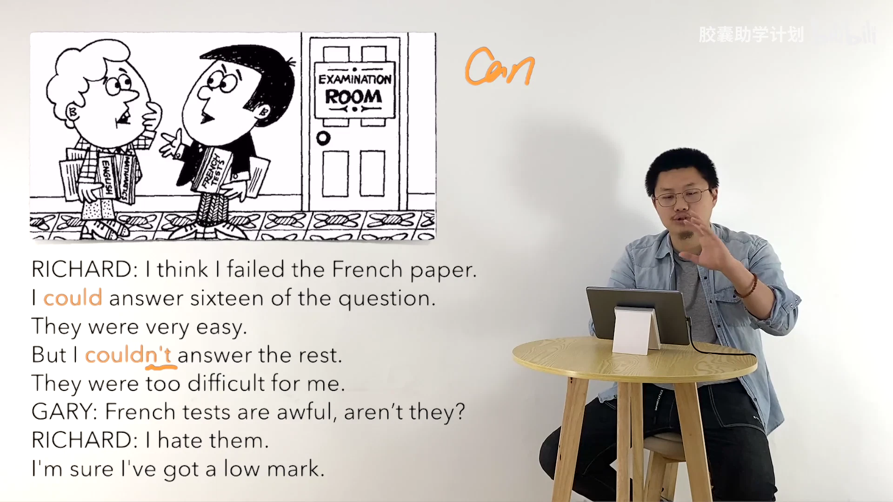

文字识别：胶囊助学 / Can / EXAMINATION / ROOM / RICHARD: I think I failed the French paper. / I could answer sixteen of the question. / They were very easy. / But I couldn't answer the rest. / They were too difficult for me. / GARY: French tests are awful, aren't they? / RICHARD: I hate them. / I'm sure l've got a low mark.

## 00:03:30–00:04:00

了。对于我来说，French tests are awful. Gary说说说法语考试啊，太难受了，awful啊，很糟糕。这个考试特别糟糕。我们说人就是人也很可以用awful去形容，对吧？He's awful.他这个人太糟糕了。Aren't they? Aren't they?我们之前学过了反义疑问句，就等于哎，首先我们回顾一下吧，前肯后否，前否后肯，对吧？时态人称保持一致。对于各位来

### 画面 00:03:45

文字识别：胶囊助 / Can / EXAMINATION / ROOM / Sm / RICHARD: I think I failed the French paper. / I could answer sixteen of the question. / They were very easy. / But I couldn't answer the rest. / They were too difficult for me. / GARY: French tests are awful, aren't they? / RICHARD: I hate them. / I'm sure l've got a low mark.

## 00:04:00–00:04:30

说， aren't they？直接用一个单词就可以替代谁呢？ Right. Okay. 对吧？ I hate them. I 我痛恨他们。 I'm sure. 我很确定。 I've got a lower. 这我们在讲单词的时候提到了 have got。 说我得到了一个很低的分数，不过还好啊，没有说挂科可能。 Gary 说， Oh, cheer up. 他说，哎，得了啊，高兴点吧，对吧？ 说 Perhaps， 也许啊， we didn't do too

### 画面 00:04:15

文字识别：胶囊助 / Can / EXAMINATION / ROOM / RICHARD: I think I failed the French paper. / I could answer sixteen of the question. / They were very easy. / But I couldn't answer the rest. / They were too difficult for me. / GARY: French tests are awful, aren't they? / RICHARD: I hate them. / I'm sure l've got a low mark.

### 画面 00:04:17

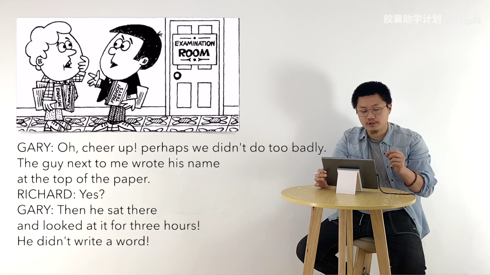

文字识别：EXAMINATION / ROOM / GARY: Oh, cheer up! perhaps we didn't do too badly. / The guy next to me wrote his name / at the top of the paper. / RICHARD: Yes? / GARY: Then he sat there / and looked at it for three hours! / He didn't write a word!

## 00:04:30–00:05:00

badly.好，we didn't do我们没有做的怎么样呢？Too badly叫太差。我们没有做的太差。我们做的可能还行。看他继续讲。The guy next to me.好，在我身边。注意啊，你看the guy next to me怎么翻译呢？Next to me叫在我旁边的guy叫那个家伙，那哥们儿是吧？但是他翻译过来翻译成汉语的时候说的是我身边的那个哥们儿。你能

### 画面 00:04:47

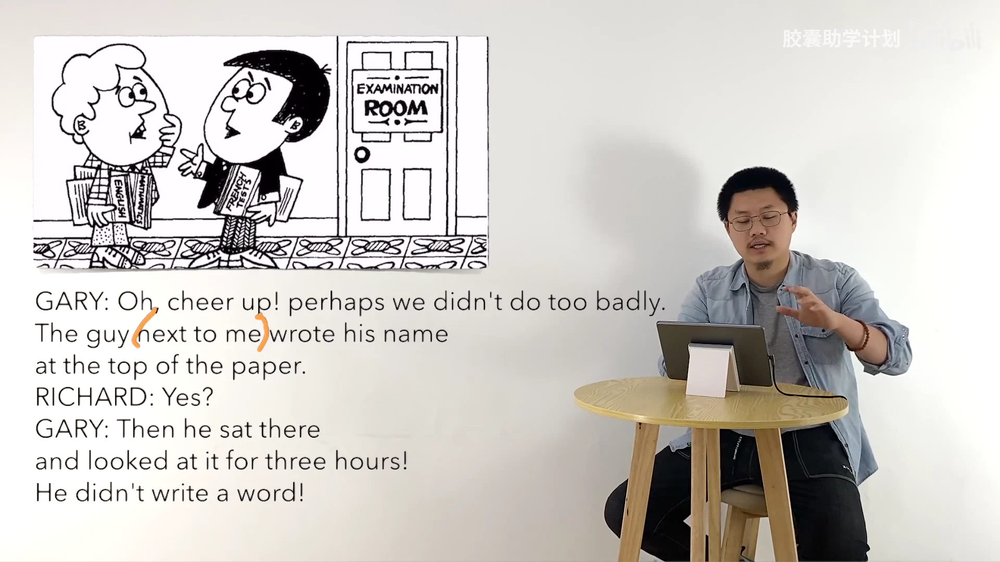

文字识别：胶囊助学 / EXAMINATION / ROOM / GARY: Oh, cheer up! perhaps we didn't do too badly. / The guy hext to mewrote his name / at the top of the paper. / RICHARD: Yes? / GARY: Then he sat there / and looked at it for three hours! / He didn't write a word!

### 画面 00:04:49

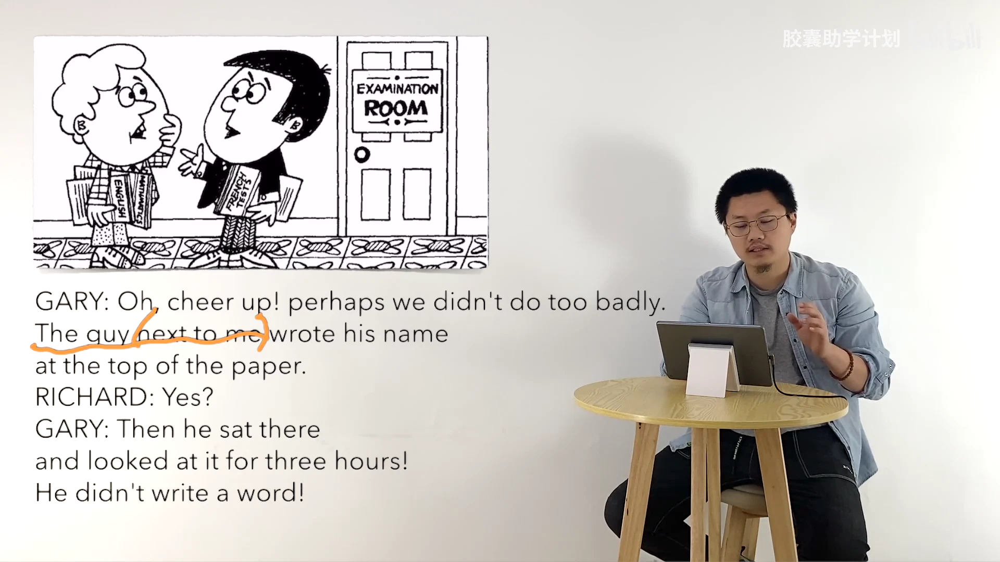

文字识别：胶囊助学 / EXAMINATION / ROOM / GARY: Oh, cheer up! perhaps we didn't do too badly. / The quy next to mewrote his name / at the top of the paper. / RICHARD: Yes? / GARY: Then he sat there / and looked at it for three hours! / He didn't write a word!

## 00:05:00–00:05:30

看到，其实 next to me 是放到前面去的。这个我们要想把它讲透了，可能要直到新概念二册二十九课二啊二十八课二十九课三十课这三课学完，您会对这个知识点特别的清楚。我们在这儿呢，现在对于各位来说能读懂就可以了啊。我们往下去学，慢慢再解决这个疑惑。我旁边的那个哥们儿啊， wrote his name，写下了他的名字 at

### 画面 00:05:03

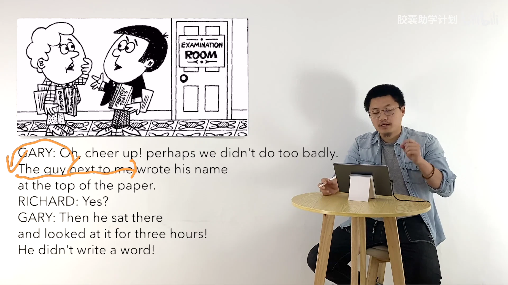

文字识别：胶囊助学 / 学计划 / EXAMINATON / ROOM / ARY: Ob, cheer up! perhaps we didn't do too badly. / The guy pext to mewrote his name / at the top of the paper. / RICHARD: Yes? / GARY: Then he sat there / and looked at it for three hours! / He didn't write a word!

## 00:05:30–00:06:00

the top of the paper，说在这个考卷的开头，对吧？最前面 top嘛，对吧？哎，yes。说然后呢？啊，then然后 he sat there，他就坐在那里，and looked at it。这地方有一个小的连读 at it，啊，看着它 for three hours，看了三个小时。He didn't write a word，他连一个字儿都没有写，那肯定就是挂了，对

### 画面 00:05:33

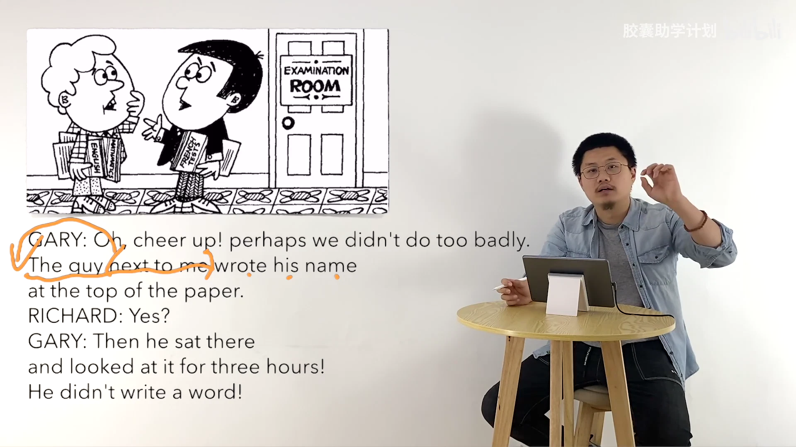

文字识别：胶囊 / EXAMINATION / ROOM / ARY: Ob, cheer up! perhaps we didn't do too badly. / The guy next to me wrote his name / at the top of the paper. / RICHARD: Yes? / GARY: Then he sat there / and looked at it for three hours! / He didn't write a word!

## 00:06:00–00:06:30

吧？OK，直接是一个大的F fail。OK，那接下来呢，我们做一些口语听力训练。我问您答，对吧？可以在文章当中找答案。来了，第一题。Did Richard and Richard and Gary sit for an examination? Yes, they did. Answer. Does Richard think he passed in English

### 画面 00:06:03

文字识别：胶囊助学计划 / Comprehension

### 画面 00:06:14

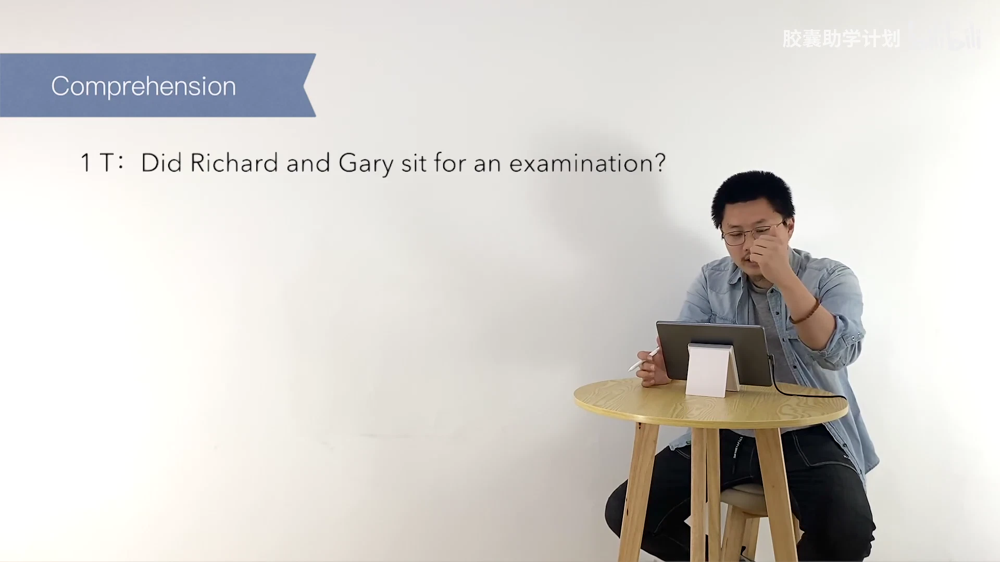

文字识别：胶囊助学计划 / Comprehension / 1 T: Did Richard and Gary sit for an examination?

### 画面 00:06:25

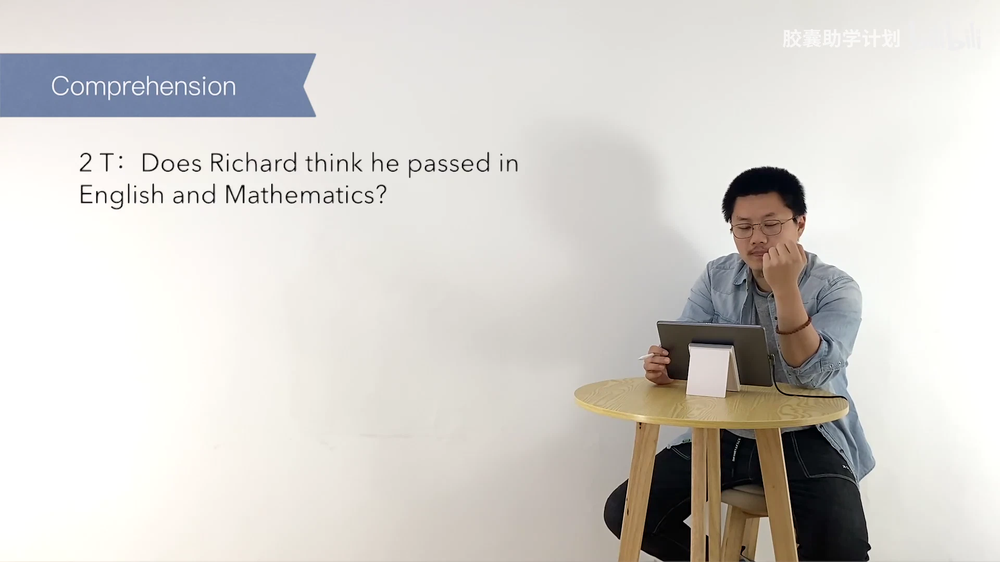

文字识别：胶囊助学计划 / Comprehension / 2 T: Does Richard think he passed in / English and Mathematics?

## 00:06:30–00:07:00

and mathematics. Yes, he does. Continue. What does Richard think about the questions? He thinks they were very easy. Next one. How about Gary? Gary thinks the English and math papers weren't easy enough for him. Next one. Does Richard think he passed the French test?

### 画面 00:06:35

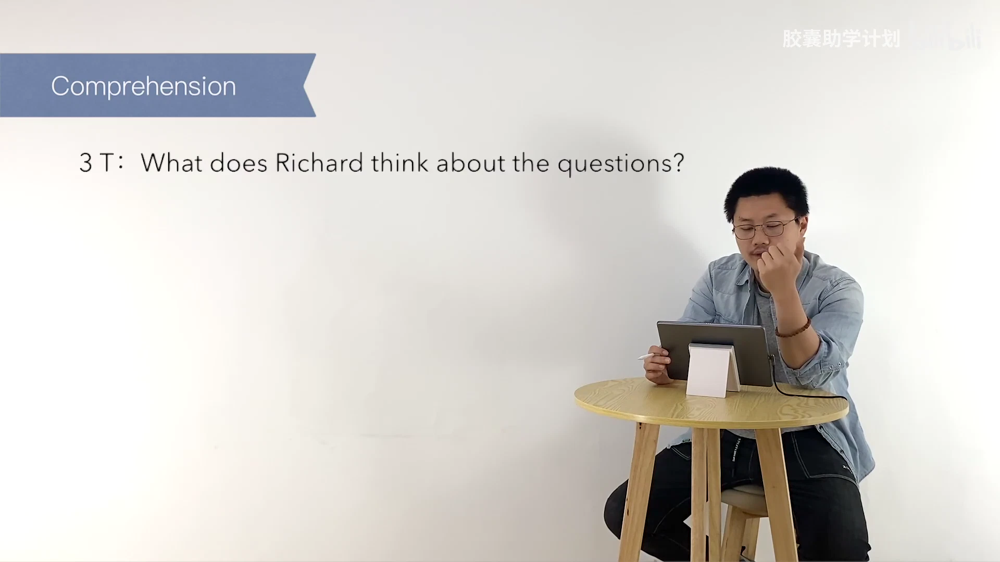

文字识别：胶囊助学计划 / Comprehension / 3 T: What does Richard think about the questions?

### 画面 00:06:46

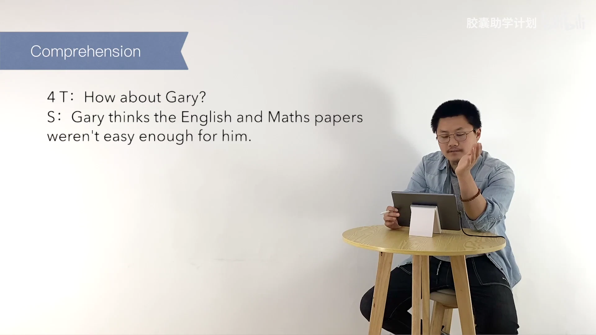

文字识别：胶囊助学计划 / Comprehension / 4T: How about Gary? / S: Gary thinks the English and Maths papers / weren't easy enough for him.

### 画面 00:06:54

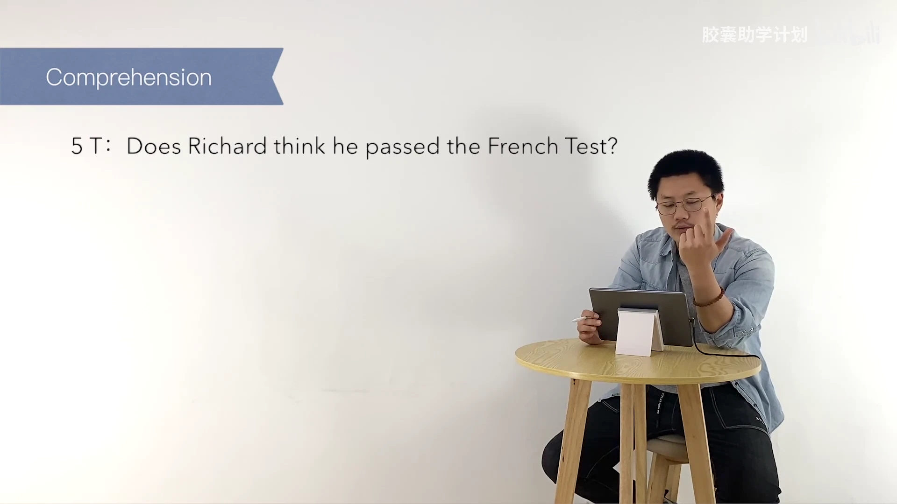

文字识别：胶囊助学计划 / Comprehension / 5 T: Does Richard think he passed the French Test?

## 00:07:00–00:07:30

No, he doesn't. Next one. How many of the questions could Richard answer? Sixteen. Next one. What about the rest of the questions? They were too difficult for Richard. Do they like French tests? No, they don't. Next one. How did the guy next to Gary do the exam?

### 画面 00:07:14

文字识别：胶囊助学计划 / Comprehension / 7 T: What about the rest of the questions? / S: They were too difficult for Richard.

### 画面 00:07:19

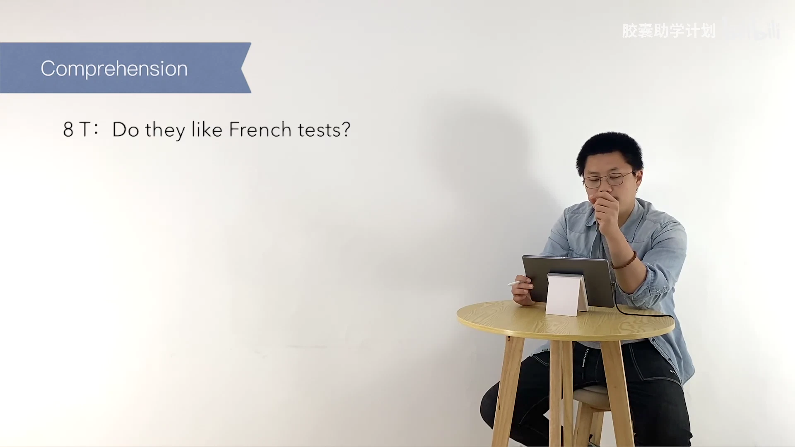

文字识别：胶囊助学计划 / Comprehension / 8 T: Do they like French tests?

## 00:07:30–00:08:00

very badly. Next one, did he write much? Ah, he写的多吗? No, he didn't. He didn't write a single word. He连一个字儿都没写. Okay,接下来呢? Asking questions.我给肯定句，你们变一般疑问句；我给特殊疑问词，你们变特殊疑问句。来了，Ask me if Richard thinks he passed. Does Richard think

### 画面 00:07:37

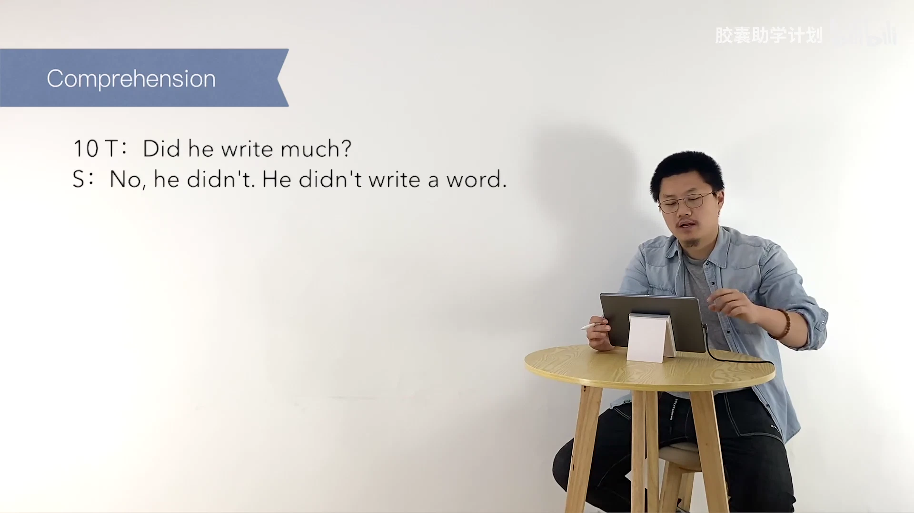

文字识别：胶囊助学计划 / Comprehension / 10 T: Did he write much? / S: No, he didn't. He didn't write a word.

### 画面 00:07:43

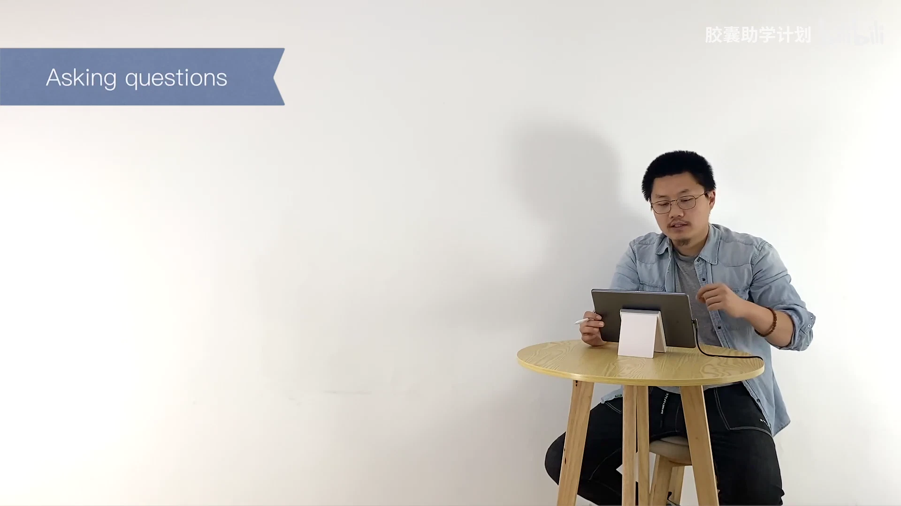

文字识别：胶囊助学计划 / Asking questions

### 画面 00:07:57

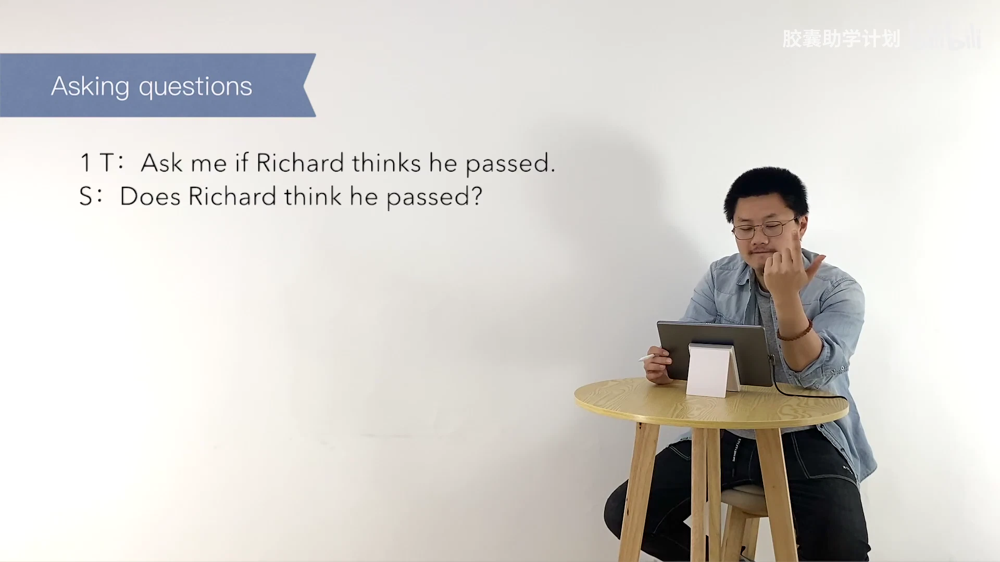

文字识别：胶囊助学计划 / Asking questions / 1 T: Ask me if Richard thinks he passed. / S: Does Richard think he passed?

## 00:08:00–00:08:30

he passed? Why? Why does Richard think he passed? Next one, ask me if the questions were easy. Were the questions easy? How? How were the questions? Next one, ask me if he could answer all the questions.你看could刚才我说了跟can的用法保持一

### 画面 00:08:16

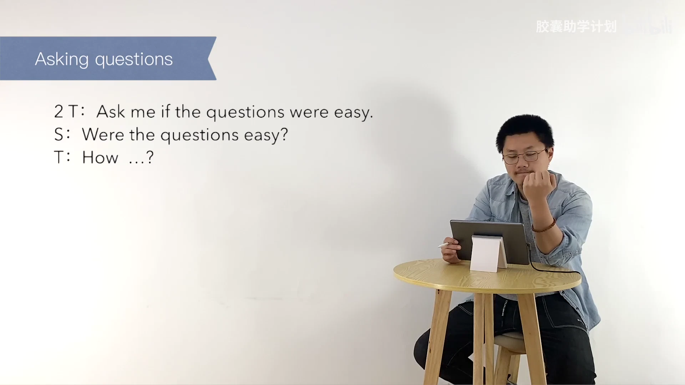

文字识别：胶囊助学计划 / Asking questions / 2 T: Ask me if the questions were easy. / S: Were the questions easy? / T: How ...?

### 画面 00:08:28

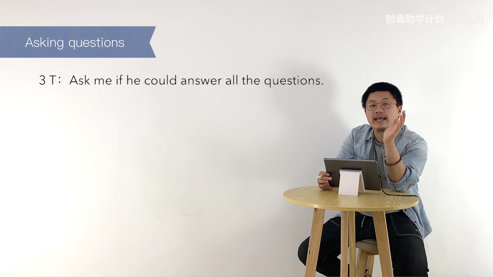

文字识别：胶囊助学计划 / Asking questions / 3 T: Ask me if he could answer all the questions.

## 00:08:30–00:09:00

致，can 你会，could 立刻就会了，对吧？那一般疑问句 could 提前，Could he answer all the questions? Why couldn't? Why couldn't he answer all the questions? The rest uh was too difficult for him，对吧？Next one， Ask me if Richard hates French tests. Does Richard hate French tests? Why?

### 画面 00:08:40

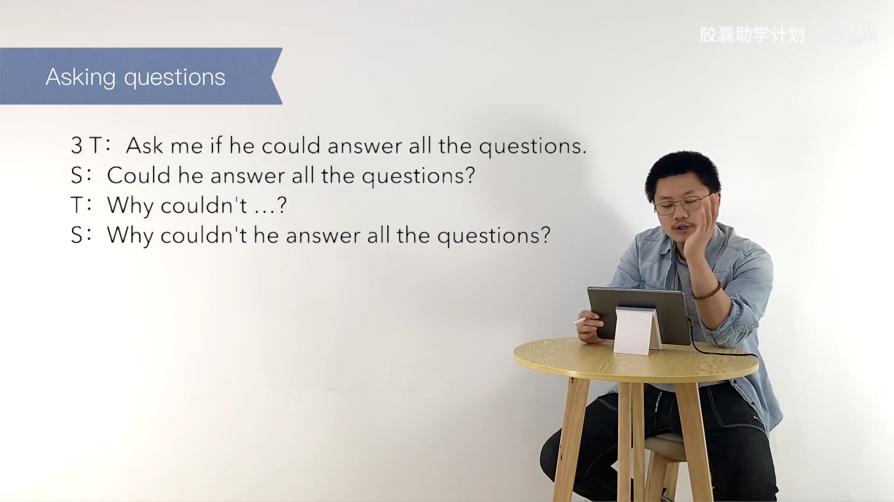

文字识别：胶囊助学计划 / Asking questions / 3 T: Ask me if he could answer all the questions. / S: Could he answer all the questions? / T: Why couldn't ...? / S: Why couldn't he answer all the questions?

### 画面 00:08:47

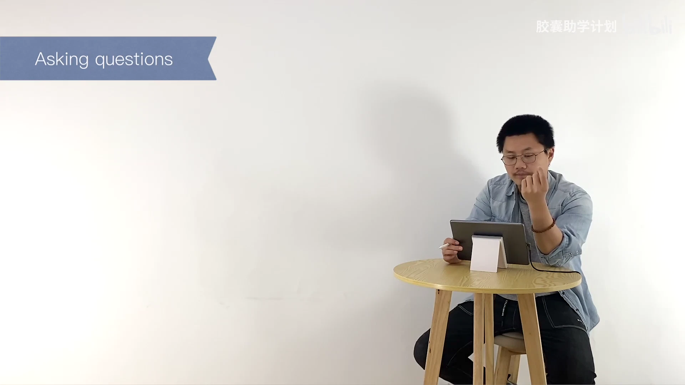

文字识别：胶囊助学计划 / Asking questions

### 画面 00:08:54

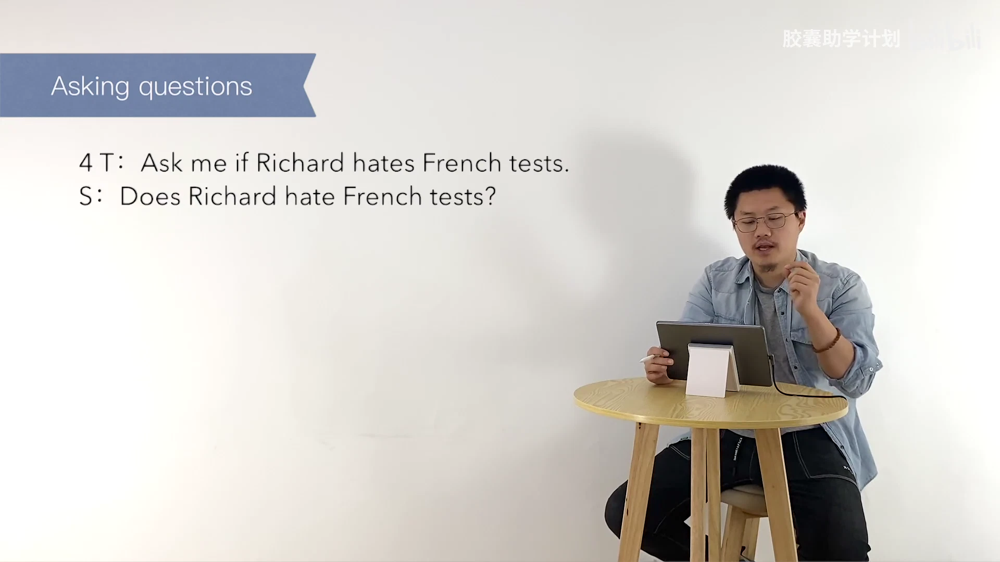

文字识别：胶囊助学计划 / Asking questions / 4 T: Ask me if Richard hates French tests. / S: Does Richard hate French tests?

## 00:09:00–00:09:30

does Richard hate French tests? Next one, ask me if he wrote his name at the top of the paper. Did he write his name at the top of the paper? Where? Where did he write his name?他把他的名字写在哪儿了？Okay,那答案就是 at the top of the paper,对吧？Very good.那recap本课啊，除了我们在单词部

### 画面 00:09:06

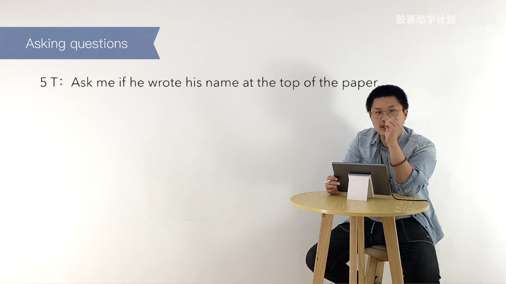

文字识别：胶囊助学 / Asking questions / 5 T: Ask me if he wrote his name at the top of the paper.

### 画面 00:09:19

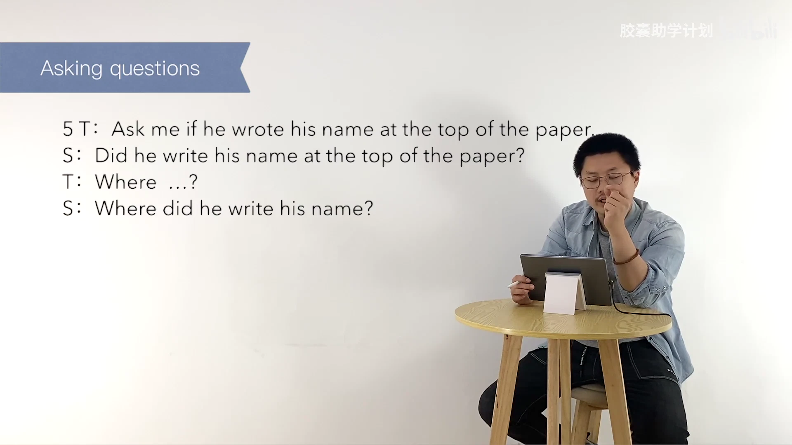

文字识别：胶囊助学计划 / Asking questions / 5 T: Ask me if he wrote his name at the top of the paper. / S: Did he write his name at the top of the paper? / T: Where …..? / S: Where did he write his name?

### 画面 00:09:26

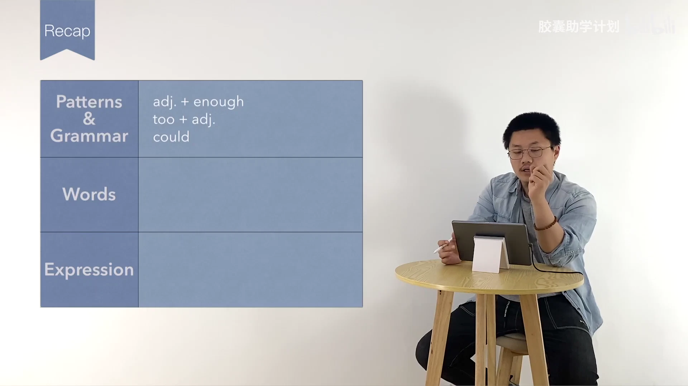

文字识别：胶囊助学计划 / Recap / Patterns / adj. / + enough / too + adj. / Grammar / could / Words / Expression

## 00:09:30–00:10:00

分就讲过的形容词加 enough 和 to 加形容词，我们在文章当中都印证过了。然后呢，又出现了一个小的单词叫做 could 啊，这个我们在语法单项当中各位可以看到更多详细的呃讲解。然后在下一课的偶数课练习当中，我们也会练到 could 这个单词。 OK，家庭作业呢，绿皮书一百零三课文章跟读至熟读成诵，给自己讲解一遍今天的核心知识点。

### 画面 00:09:51

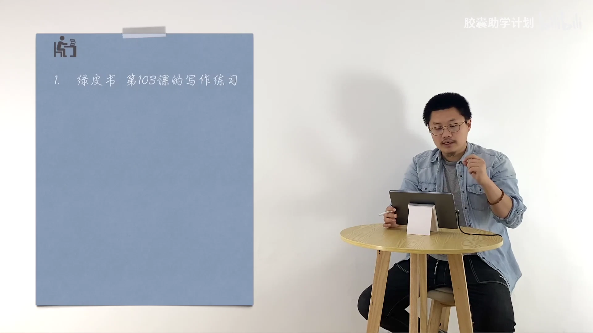

文字识别：胶囊助学计划 / 绿皮书第103课的写作练习

## 00:10:00–00:10:30

一啊，那如果大家喜欢我们的课程啊，欢迎大家关注、订阅、一键三连、分享给那些需要的朋友，来帮助我们快速成长。最后，我们来看一句名人名言。No bird soars too high if he soars with his own wings. See you next time.

### 画面 00:10:00

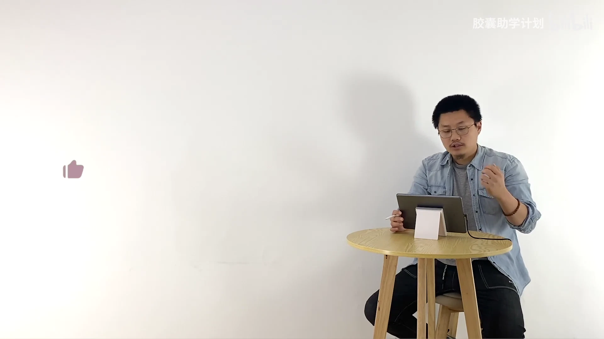

文字识别：胶囊助学计

### 画面 00:10:09

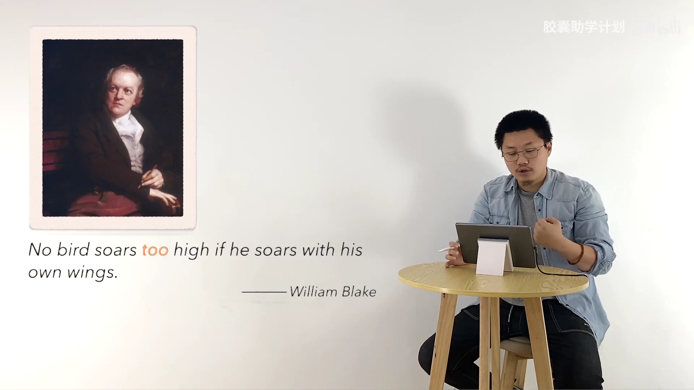

文字识别：校囊 / No bird soars too high if he soars with his / own wings. / - William Blake

### 画面 00:10:20

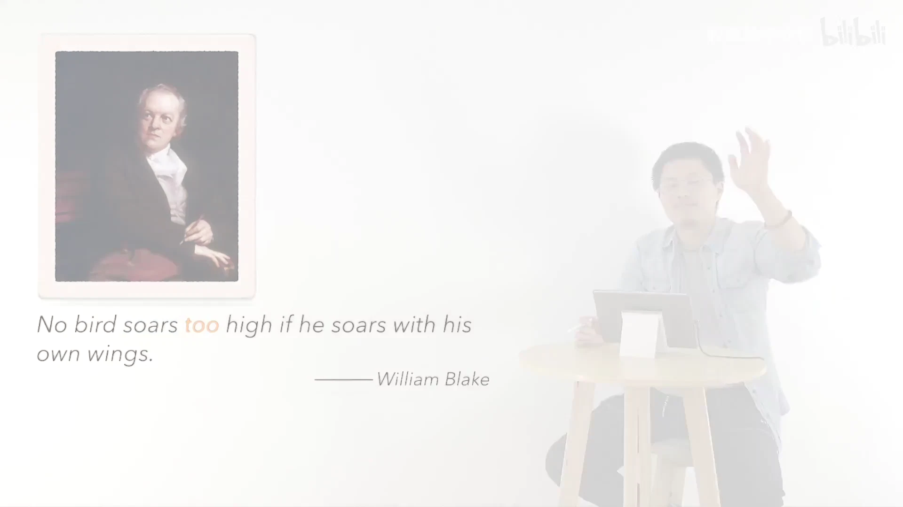

文字识别：No bird soars too high if he soars with his / own wings. /  William Blake

### 画面 00:10:22

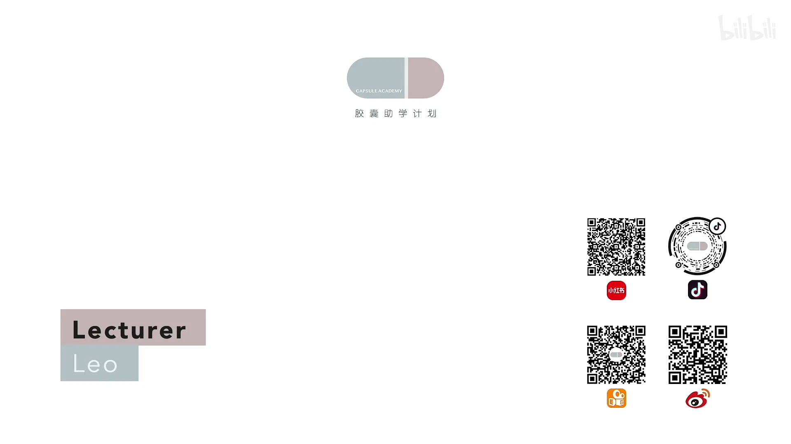

文字识别：CAPSULEACADEMY / 胶囊助学计划 / 小红书 / Lecturer / Leo / OE

### 画面 00:10:25

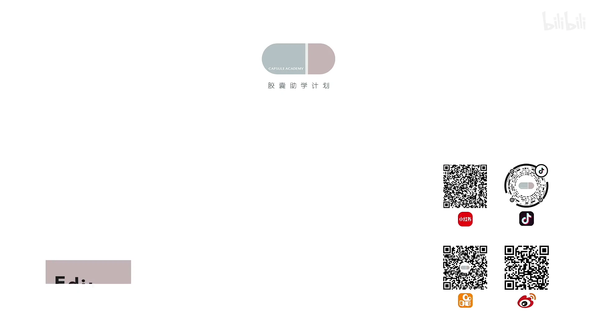

文字识别：CAPSULEACADEMY / 胶囊助学计划 / 小红书 / □ / 口 / OE

### 画面 00:10:28

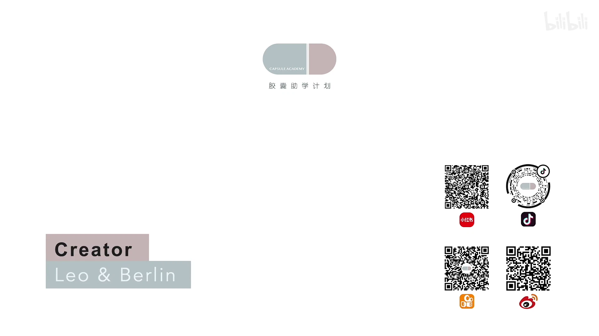

文字识别：CAPSULEACADEMY / 胶囊助学计划 / 小红书 / Creator / Leo & Berlin / 0E / 0

## 00:10:30–00:10:32

### 画面 00:10:30

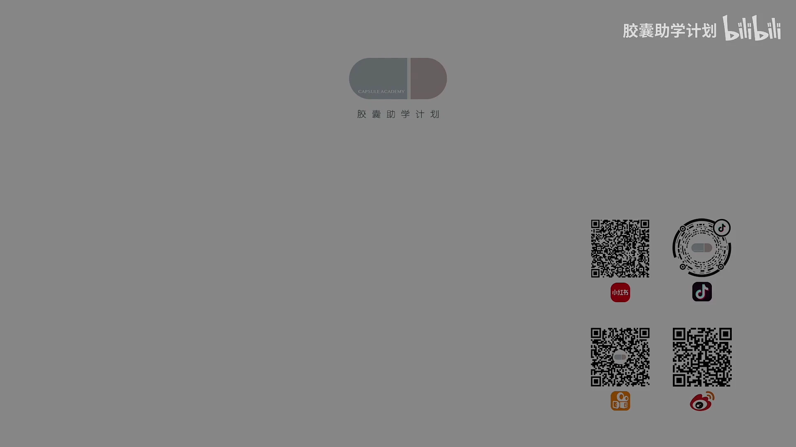

文字识别：bilibili / 胶囊助学计划 / CAPSULEACADEMY / 胶囊助学计划 / 小红书 / 口 / OE

### 画面 00:10:32

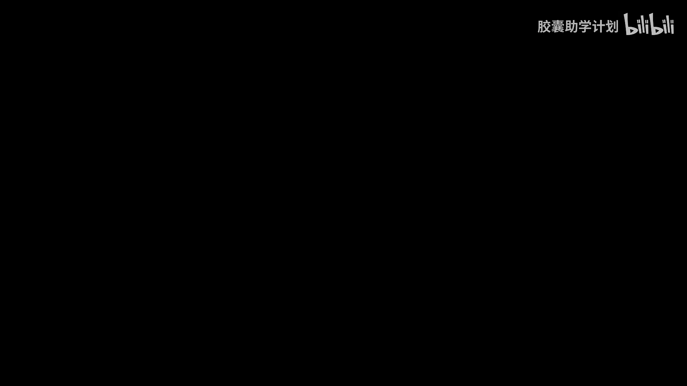

文字识别：bilibili / 胶囊助学计划

