# 104 单词 练习

快速机器解析：语音为单模型转写，未进行独立交叉校对或人工复核；画面每秒采样并按变化选帧，短时文字和标记可能遗漏。截图时间约有 1 秒误差。图片有损压缩；遇到疑点请按时间查看 Google Drive 原视频。

## 00:00:00–00:00:30

Hello everyone, welcome to Capsule Academy. This is Leo. Today we're going to learn New Concept English Book One Lesson One Hundred and Four Practices and Words. 那老习惯进入正式课程之前，我们先看两个问题。第一，如何表达过于怎么怎么样而不能如何？第二呢？那表达的如何表达足够怎么怎么样而可以去做某件事情？那带着这两个问题，Hope you gonna enjoy it. 好，

### 画面 00:00:00

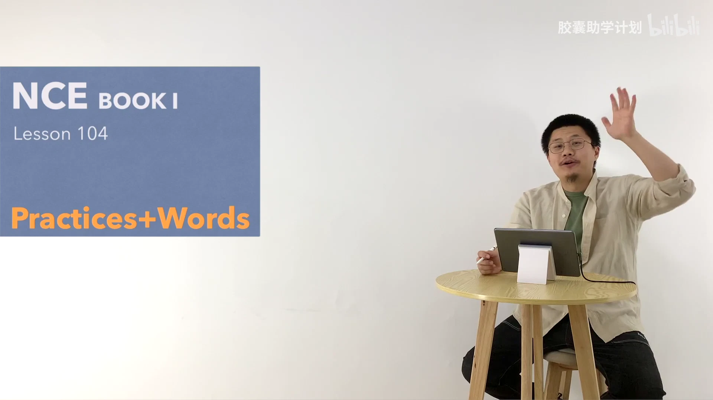

文字识别：胶囊助学计划 / NCE / BOOKI / Lesson 104 / Practices+Words

### 画面 00:00:02

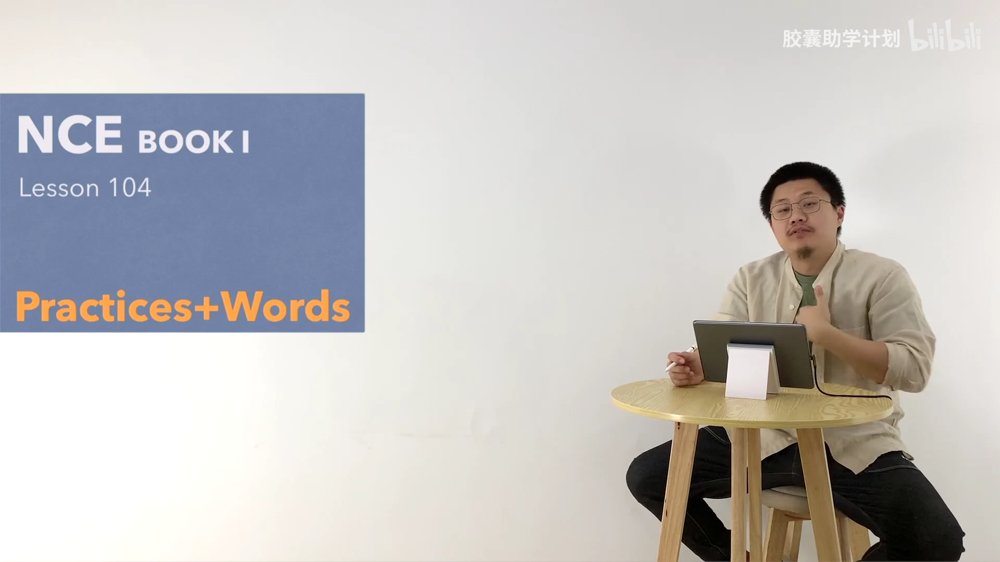

文字识别：胶囊助学计划 / NCE / BOOKI / Lesson 104 / Practices+Words

### 画面 00:00:10

文字识别：Jbiibili / 胶囊助学计划

### 画面 00:00:12

文字识别：Bilbili / 胶囊助学计划 / ①如何表达“过于. / 而不能”？

### 画面 00:00:18

文字识别：bibili / 胶囊助学计划 / ①如何表达“过于. / 而不能”？ / 如何表达“足够 / .而可以”?

### 画面 00:00:27

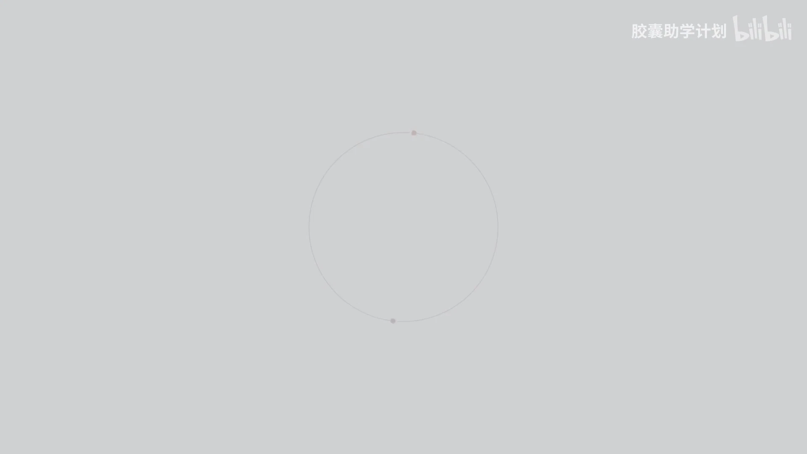

文字识别：胶囊助学计划bll

## 00:00:30–00:01:00

好，那我们先看 too 加形容词啊，这个实际上我们早在讲本课单词一百零三课单词的时候就提到了，在文章当中也见过了，对吧？那 too 加形容词的意思叫做过于或者太怎么怎么样而不好，它是一个否定的，对吧？它不像我们汉语当中，我们汉语的太这个字既可以接不好，也可以接好啊，太漂亮、太美了，对吧？这是好的，说太贵了啊，太丑了等等，

### 画面 00:00:30

文字识别：胶囊助学计划 / 胶囊助学计划

### 画面 00:00:32

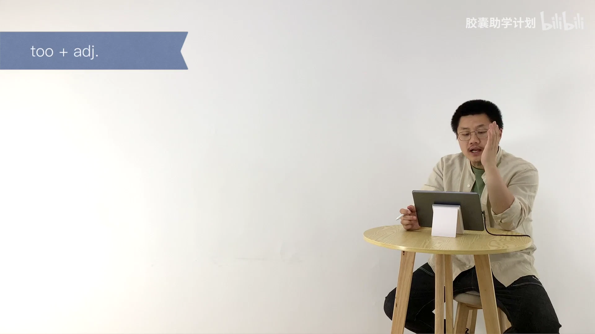

文字识别：Bitbli / 胶囊助学计划 / too + adj. / 2

## 00:01:00–00:01:30

那可能这个是不好的，对吧？那 to 加形容词，我们后面再给它多加上几个小东西。第一个叫做 for somebody，叫做对于某人来说太怎么怎么样了。那后边再加一个叫 to do something，它的意思呢叫做去做某件事情太怎么怎么样了。对于某人来说去做某件事情，其实他想表达的就是我们在最开始问的那个问题，叫做过于怎么怎么样了，对于某人来说而没有办

### 画面 00:01:02

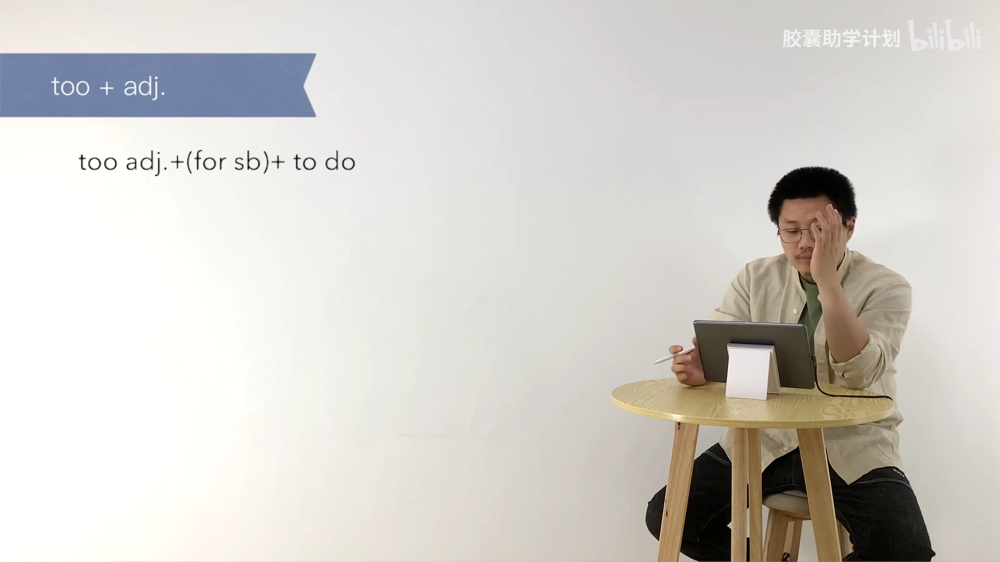

文字识别：胶囊助学计划bilb出 / too + adj. / too adj.+(for sb)+ to do

### 画面 00:01:13

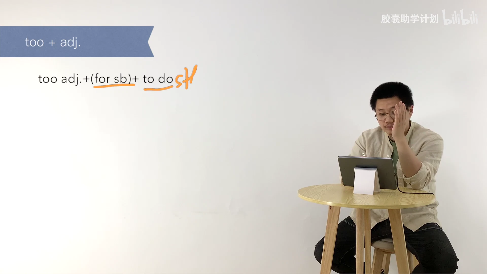

文字识别：胶囊助学计划b出出 / too + adj.

### 画面 00:01:28

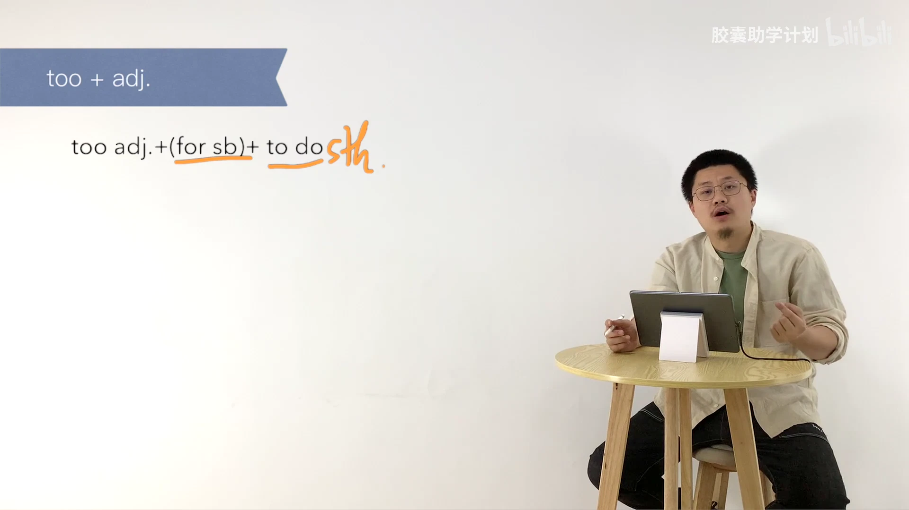

文字识别：胶囊助学计划 / too + adj. / too adj +(for sb)+ to dos / esth

## 00:01:30–00:02:00

法去做这件事情。注意，而不是可以去做啊。比如说，我们看一个例句，叫做 "is too big for me to wear"。 OK，说这个东西啊太大了，对于我来说去穿，其实它的意思就是太大了，对于我没法穿。 OK，它是一个否定的呃表达啊。 OK，那我们再看一下形容词加 enough，形容词加 enough 呢？这个地方各位

### 画面 00:01:37

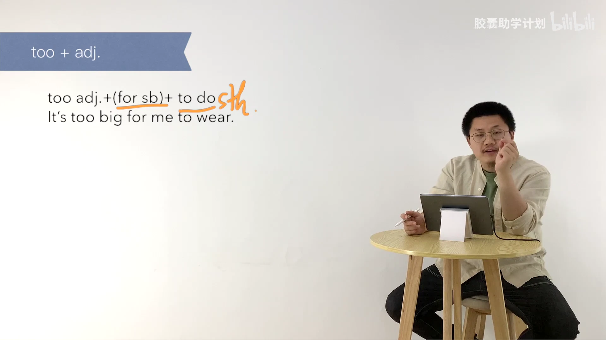

文字识别：胶囊助学计划 / too + adj. / esth / too adj +(for sb)+ to do / It's too big for me to wear.

### 画面 00:01:41

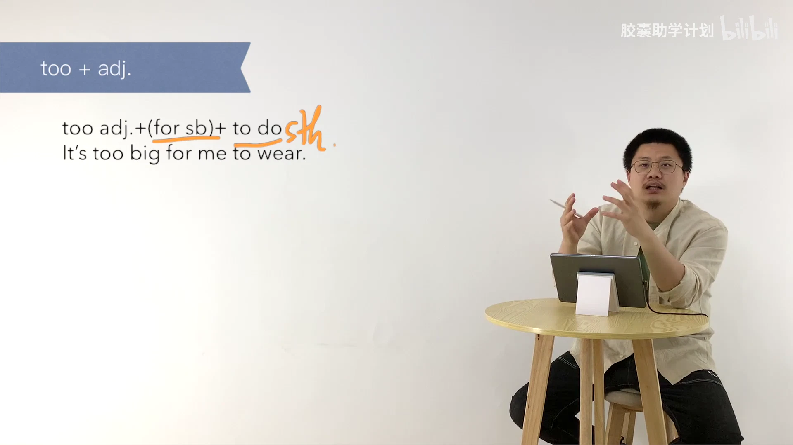

文字识别：胶囊助学计划 / too + adj. / too adj.+(for sb)+ to do / sth / It's too big for me to wear.

### 画面 00:01:53

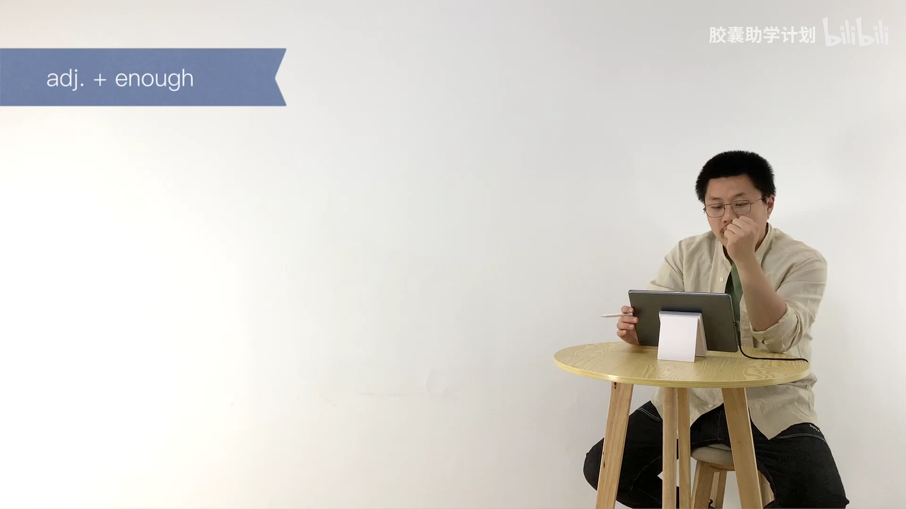

文字识别：Bilbil / 胶囊助学计划 / adj. + enough

## 00:02:00–00:02:30

要注意的事情是，你看我们之前首先还是在一百零三课单词和文章的时候，那两个视频我们都见过它了。它跟我们汉语是不太一样的。我们汉语叫足够好，而英文叫做好足够地，对吧？它是反过来说的。所以呢，那对于各位来说，各位这是第一个点要注意。比如说足够大叫 big enough，而不是 enough big，对吧？这个点要注意啊。其次呢，那形容词加 enough 之后啊，叫做足够怎么怎么样了？

### 画面 00:02:23

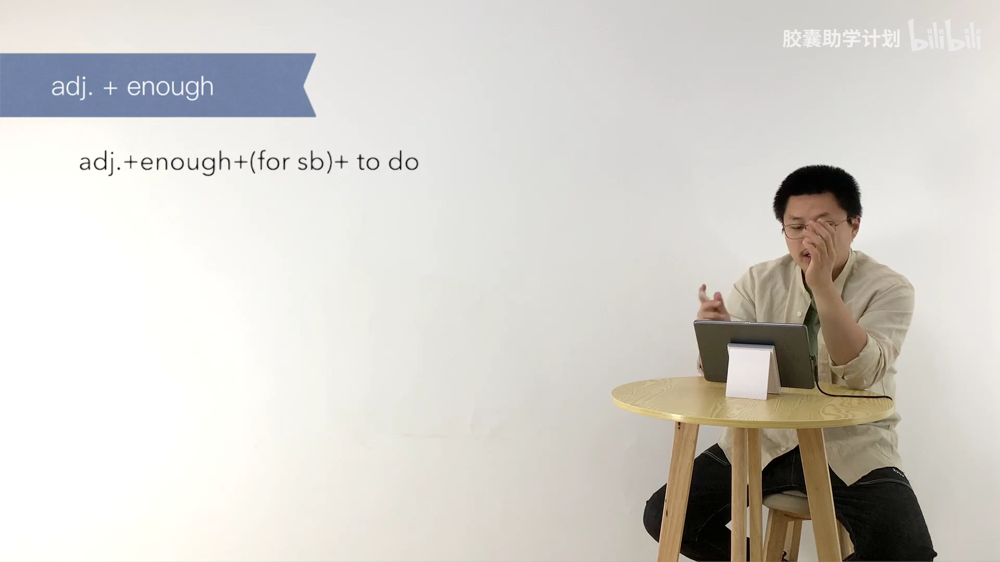

文字识别：Blibil / 胶囊助学计划 / adj. + enough / adj.+enough+(for sb)+ to do

## 00:02:30–00:03:00

big enough，然后呢叫 for somebody，跟刚才是一样的 to do something。那这个地方它就是一个肯定的表达了，叫做对于某人来说足够的怎么怎么样可以去做某件事情，它不是一个否定的表达。这个点各位要注意一下啊。比如说我们造一句话说 is big enough for me to wear。啊，说这个东西啊足够的大，对于我来说去穿啊就是够大啊，它不是太小，它够大了，我去

### 画面 00:02:32

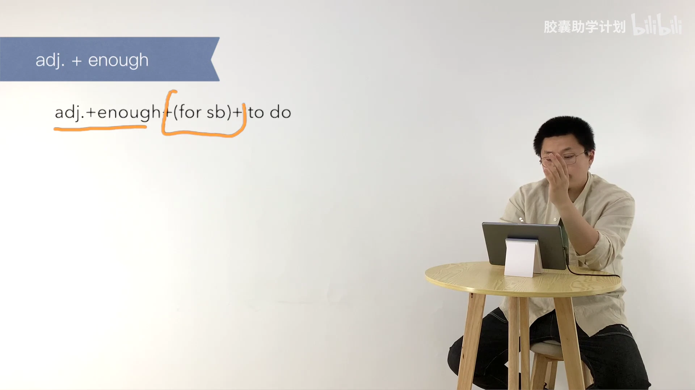

文字识别：bilibl / 胶囊助学计划 / adj. + enough / adj.+enough(for sb)+to do

### 画面 00:02:35

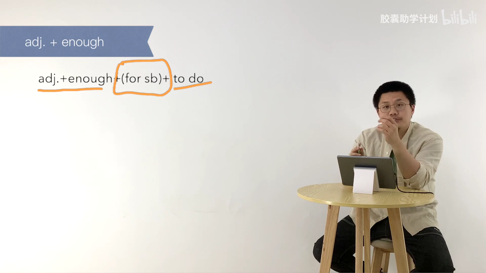

文字识别：bibili / 胶囊助学计划 / adj. + enough / adj.+enough(for sb)+to do

### 画面 00:02:48

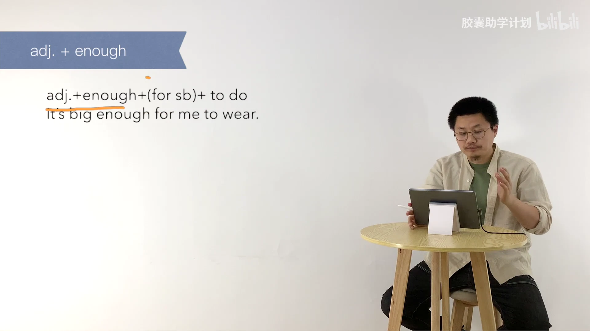

文字识别：bilbl / 胶囊助学计划 / adj. + enough / adj.+enough+(for / sb)+ to do / it s big enough for me to wear.

## 00:03:00–00:03:30

穿。OK。那这两个公式是接下来我们去，不管是练习也好啊，不管是单词的练习也好，还是单纯的口语听力练习也好，都会用到的公式啊。各位最好把刚才这两个公式呢记在您的笔记本当中。接下来我们用这两个公式去做练习。好，首先我们说便宜的这个单词，跟我一起读一下，叫做cheap。OK。那后面就是贵的，叫做expensive，expensive。OK。Very good。那接下来我们尝

### 画面 00:03:02

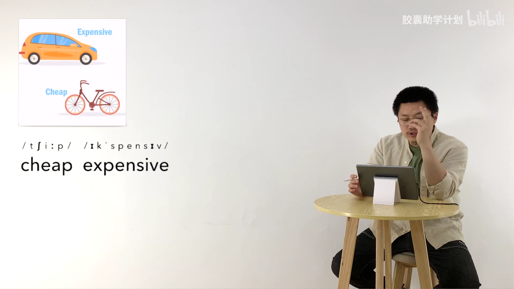

文字识别：bilibi / 胶囊助学计划 / Expensive / Cheap / /t∫i:p/ /ik'spensiv/ / cheap / expensive

## 00:03:30–00:04:00

试去造句，比如说This car is too expensive for me to buy.过于的贵了，to加形容词，for somebody to do something，而没法去做某件事情。这个车太贵了，对于我来说去买。Okay,再来，比如说The bicycle is cheap enough.哎，足够的便宜for me，对于我来说to buy去买，对吧？足够的便宜，我买得起。Okay,

### 画面 00:03:32

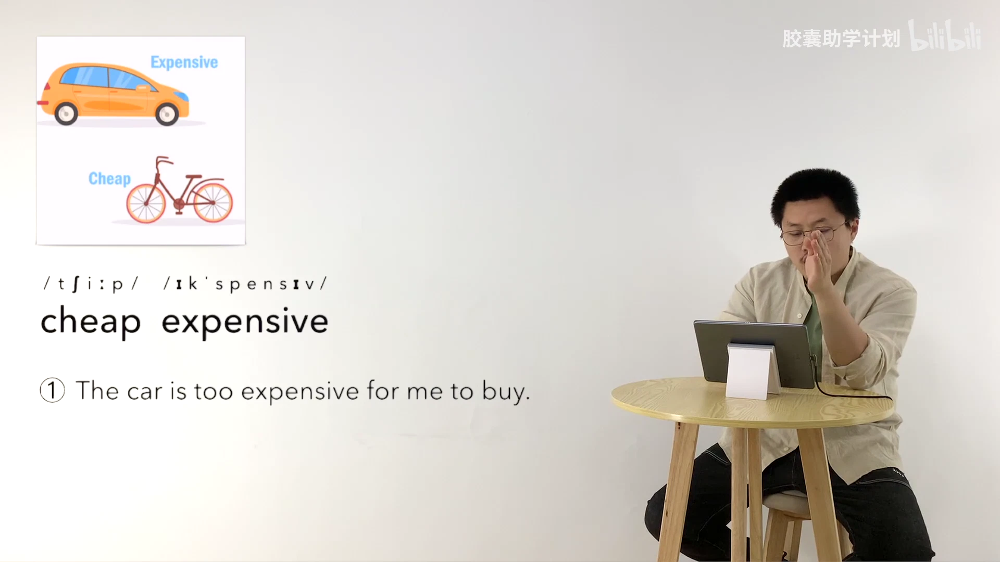

文字识别：胶囊助学计划 / Expensive / Cheap / /t∫i:p/ /ik'spensiv/ / cheap expensive / ① The car is too expensive for me to buy.

### 画面 00:03:35

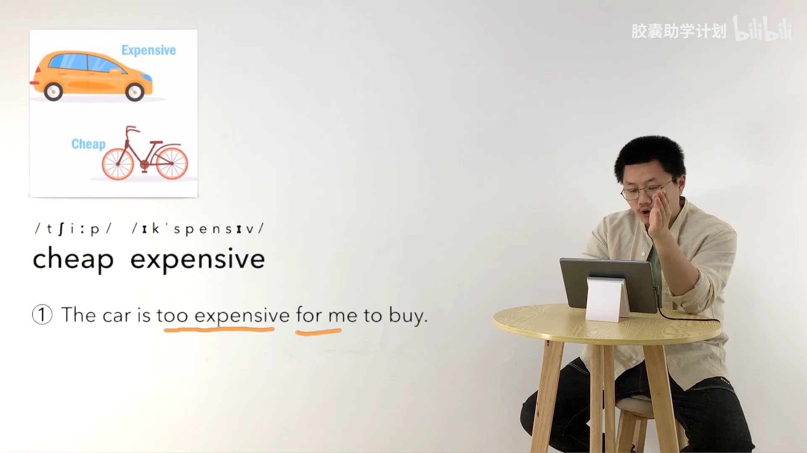

文字识别：胶囊助学计划 / Expensive / Cheap / /t∫i:p/ /ik'spensiv/ / cheap / expensive / D The car is too expensive for me to buy.

### 画面 00:03:52

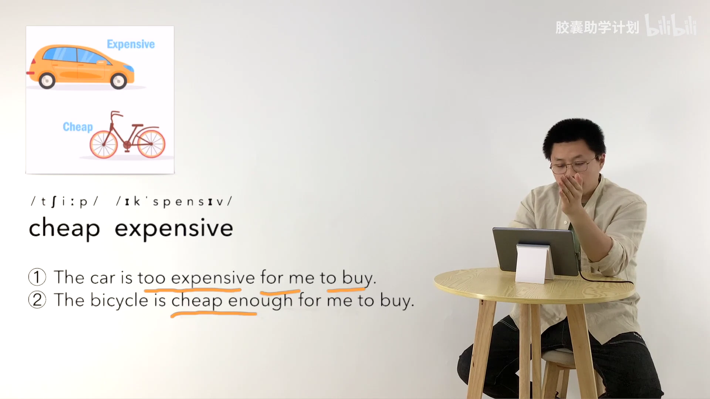

文字识别：胶囊助学计划 / Expensive / Cheap / /t∫i:p/ / /k'spensIv/ / cheap / expensive / The car is too expensive for me to buy. / The bicycle is cheap enough for me to buy.

### 画面 00:03:56

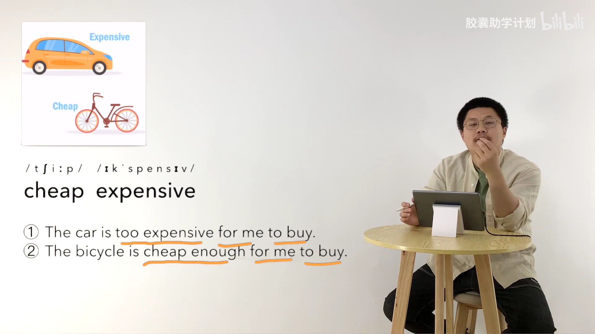

文字识别：胶囊助学计划 / Expensive / Cheap / /t∫i:p/ /ik'spensiv/ / cheap / expensive / The car is too expensive for me to buy. / The bicycle is cheap enough for me to buy.

## 00:04:00–00:04:30

OK，Very good。接下来下面两个单词还是可以理解为是反义词，对吧？聪明的叫做 clever，而笨的、愚蠢的叫做 stupid。OK，Very good。那我们比如说造句子，说 He is too stupid to pass the exam。说他太笨了，完全没有办法通过考试。您看这里的 for somebody 就被我们省略掉了，为什么呢？哎，很简单，因为你主语已经是 he 了，就不

### 画面 00:04:00

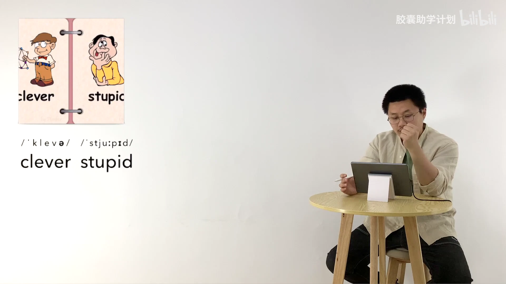

文字识别：bilBil / 胶囊助学计划 / :lever / stupic / /'kleva/ / /'stju:prd/ / clever / stupid

### 画面 00:04:19

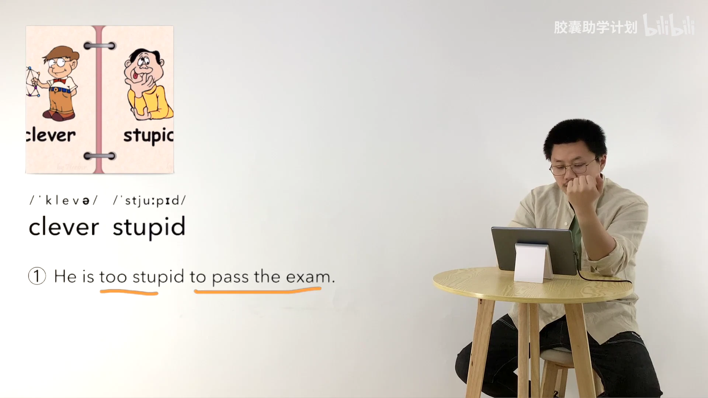

文字识别：Biltbil / 胶囊助学计划 / :lever / stupic / /kleva/ / /'stju:pid/ / clever / stupid / He is too stupid to pass the exam.

## 00:04:30–00:05:00

在后边加一个 for him 了，这个语义就重复了，对吧？那如果我们想说他足够聪明呢，叫做 he is clever enough。注意这个词汇的前后顺序 to pass the exam。同理 for him 被我们省略掉，没有必要出现了，对吧？哎，聪明和愚蠢。再接下来，新鲜和这个馊了，对吧？哎，发霉了。来，新鲜的我们之前学过，我们一起读 fresh。那馊了这个单词，各位要注

### 画面 00:04:35

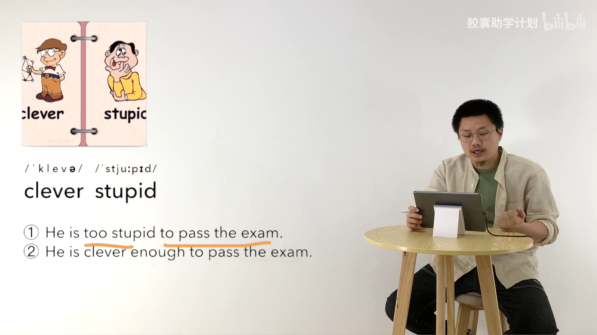

文字识别：Bilbil / 胶囊助学计划 / :lever / stupic / /kleva/ / /'stju:pId/ / clever / stupid / He is too stupid to pass the exam. / Heis / clever enough to pass the exam.

### 画面 00:04:48

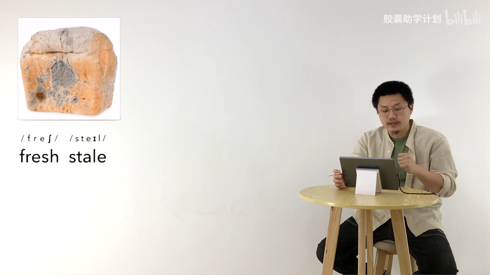

文字识别：胶囊助学计划blb山 / /fre∫/ /sterl/ / fresh stale

## 00:05:00–00:05:30

意，小仙儿，你要把它浊化，叫做stale, stale. OK, very good.接下来我们造句子，说The bread is fresh enough to eat.说这个面包啊，足够的新鲜，可以去吃。说它太馊了，没法吃，怎么办呢？叫做The bread is too stale to make a sandwich.说它太不新鲜了，太馊了，以至于就没有办法再去做一个三明治

### 画面 00:05:00

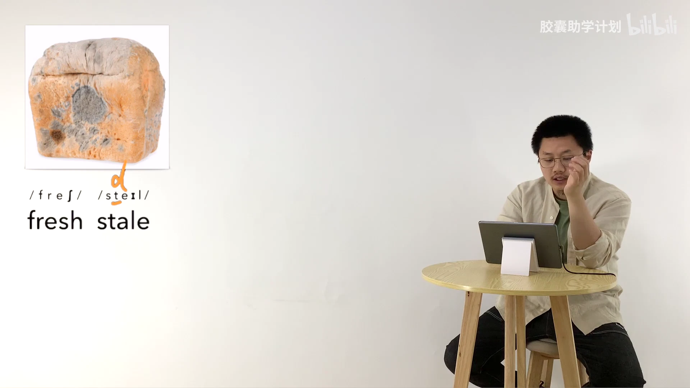

文字识别：胶囊助学计划blb出 / /fre∫/ /sterl/ / fresh stale

### 画面 00:05:17

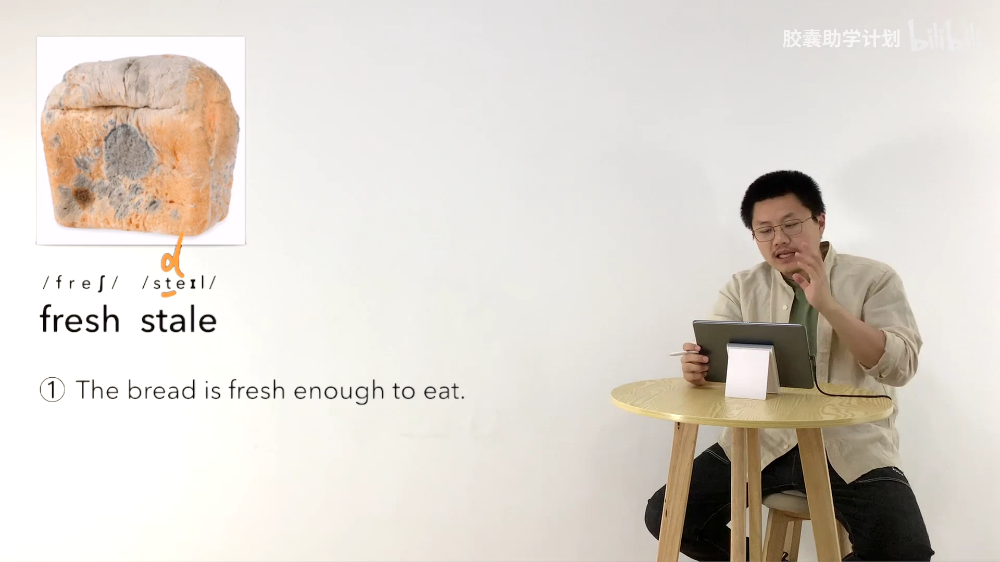

文字识别：胶囊助学计划 / /fre∫/ /sterl/ / fresh stale / ① The bread is fresh enough to eat.

### 画面 00:05:21

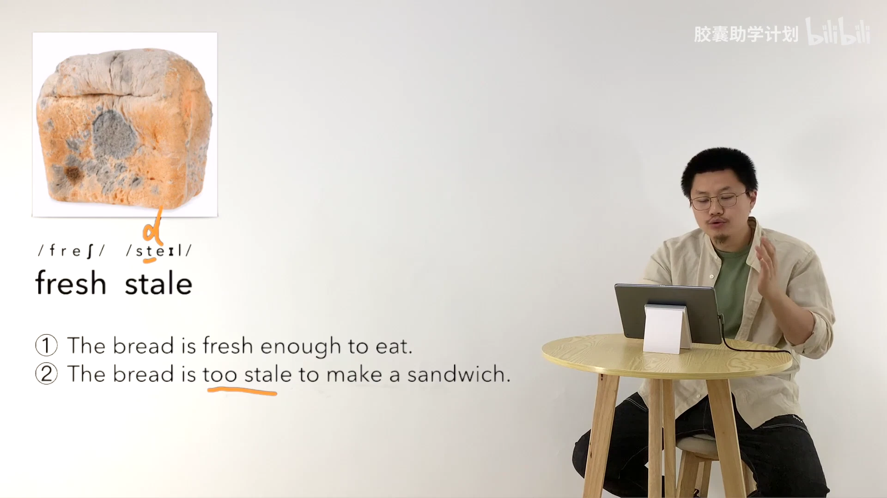

文字识别：胶囊助学计划 / /fre∫/ /sterl/ / fresh stale / The bread is fresh enough to eat. / The bread is too stale to make a sandwich.

### 画面 00:05:23

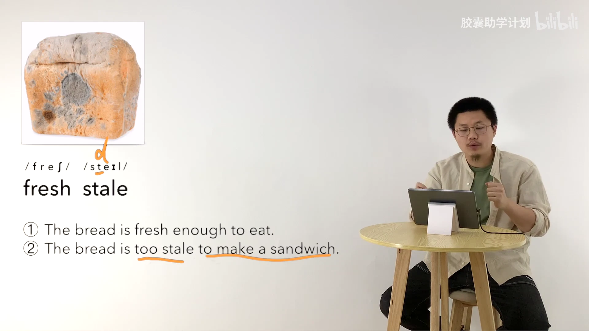

文字识别：胶囊助学计划 / /fre∫/ /sterl/ / fresh stale / The bread is fresh enough to eat. / The bread is too stale to make a sandwich.

### 画面 00:05:29

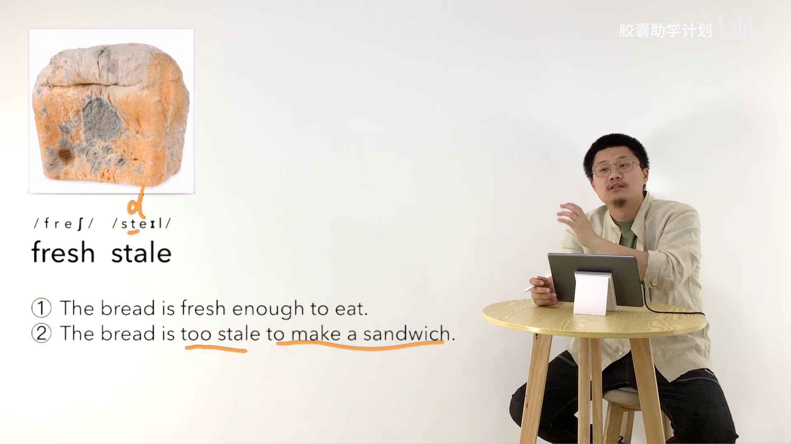

文字识别：胶囊助学计划 / /fre∫/ /sterl/ / fresh stale /  The bread is fresh enough to eat. / The bread is too stale to make a sandwich.

## 00:05:30–00:06:00

了，对吧？比如说你太饿了，现在家里只有一个三明啊，只有这么一小片吐司或者面包，然后它长了一点点发霉的地方啊，你可能啊虽然这样不好，但你可能可以把这块发霉的揪掉，然后去吃，那它就不叫 too stale to make a sandwich。比如说哎，像我们图这样已经全是了，对吧？你基本上已经没有办法再去用它了，那叫做 too stale to make a sandwich。而一个接下来，那声音特别

### 画面 00:05:33

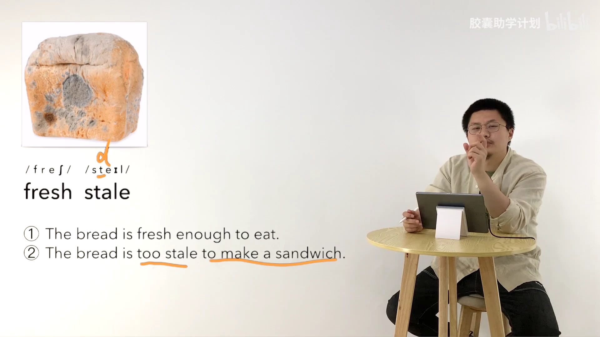

文字识别：胶囊助学计划 / /fre∫/ /steil/ / fresh stale / The bread is fresh enough to eat. / The bread is too stale to make a sandwich.

### 画面 00:05:41

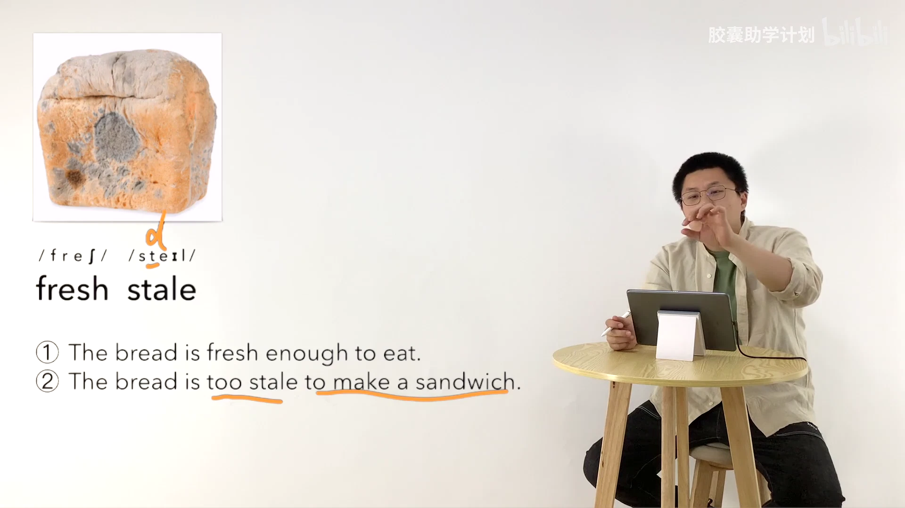

文字识别：胶囊助学计划 / /fre∫/ /sterl/ / fresh stale / The bread is fresh enough to eat. / The bread is too stale to make a sandwich.

### 画面 00:05:44

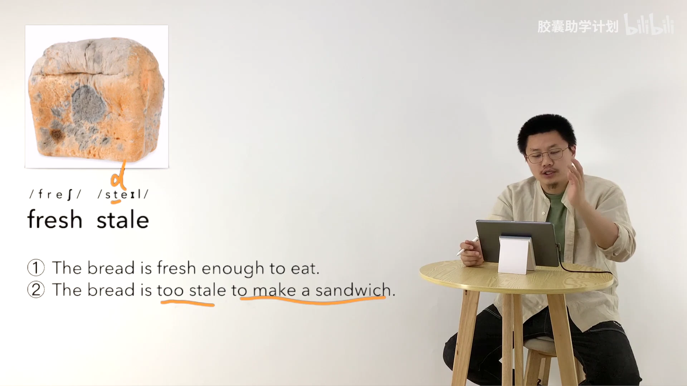

文字识别：胶囊助学计划 / /fre∫/ /sterl/ / fresh stale / The bread is fresh enough to eat. / The bread is too stale to make a sandwich.

### 画面 00:05:49

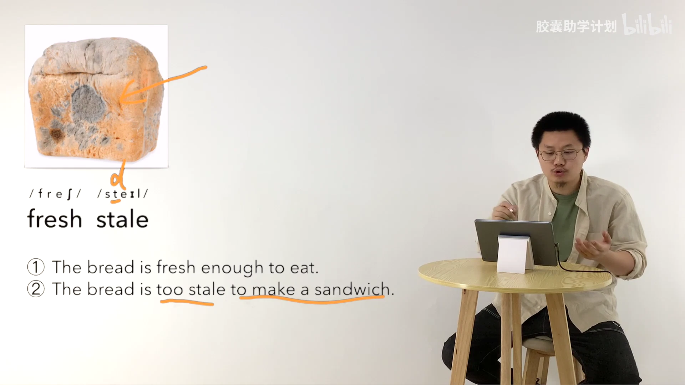

文字识别：胶囊助学计划 / /fre∫/ /sterl/ / fresh stale /  The bread is fresh enough to eat. / The bread is too stale to make a sandwich.

### 画面 00:05:57

文字识别：胶囊助学计划bilb业 / /laud/ / loud low

## 00:06:00–00:06:30

别大，我们管它叫做 loud。那声音小呢，就叫做 low。啊，所以各位目前可以知道 low。之前我们还学过 low mark，对不对？低分。那高分叫 high mark，对吧？所以 low 有低的意思。那它可以表示低分贝啊，多加一个字儿，贝，对吧？你比如说， the music is loud enough for me to hear. Okay, very good.那其实我们现在给的都是肯定句。您如果想多

### 画面 00:06:23

文字识别：bilibili / 胶囊助学计划 / /laud/ / loud low /  The music is loud enough for me to hear.

## 00:06:30–00:07:00

做一点口语听力练习，您暂个停，您把它变个一般疑问句、否定句和特殊疑问句，您就赚到了，对吧？OK，再来说，The music is too low for me to hear。说太，对于我来说呀，这个声音太小了，以至于我根本就听不到。OK，Very good，再来，High low。刚才我们说的是 loud 和 low，声音分贝的大小。现在呢，我们指的是物理意义上这个高度的高低

### 画面 00:06:48

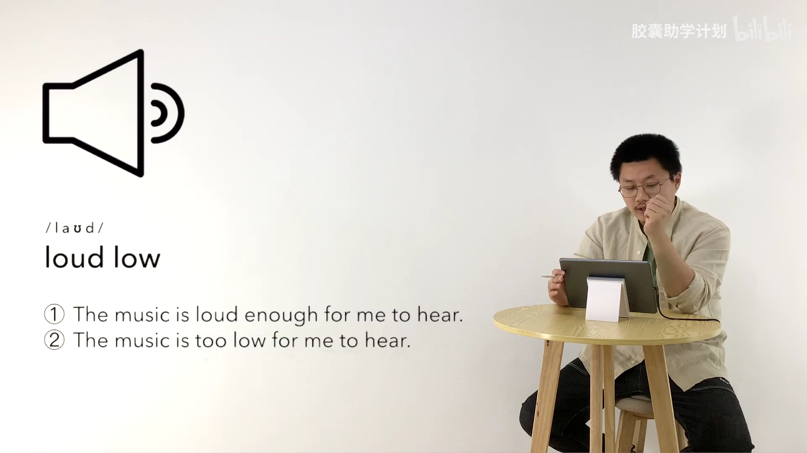

文字识别：胶囊助学计划 / /laud/ / loud low /  The music is loud enough for me to hear. /  The music is too low for me to hear. / 2

### 画面 00:06:50

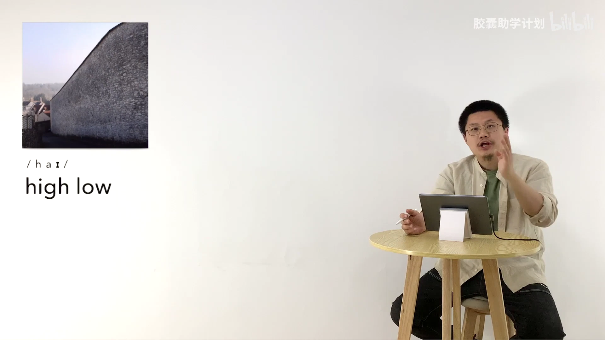

文字识别：胶囊助学计划 / /hai/ / high low

## 00:07:00–00:07:30

啊，高 high，低 low。造句子，来，The wall is too high for him to climb.啊，太高了，对于他来说没有办法去爬啊。虽然后边没有 not，但是它是暗含在这个结构当中的啊，叫过于怎么怎么样，对于某人来说而没有办法去做某件事情。好，下一个句子，The wall is low enough for me to climb. Low

### 画面 00:07:06

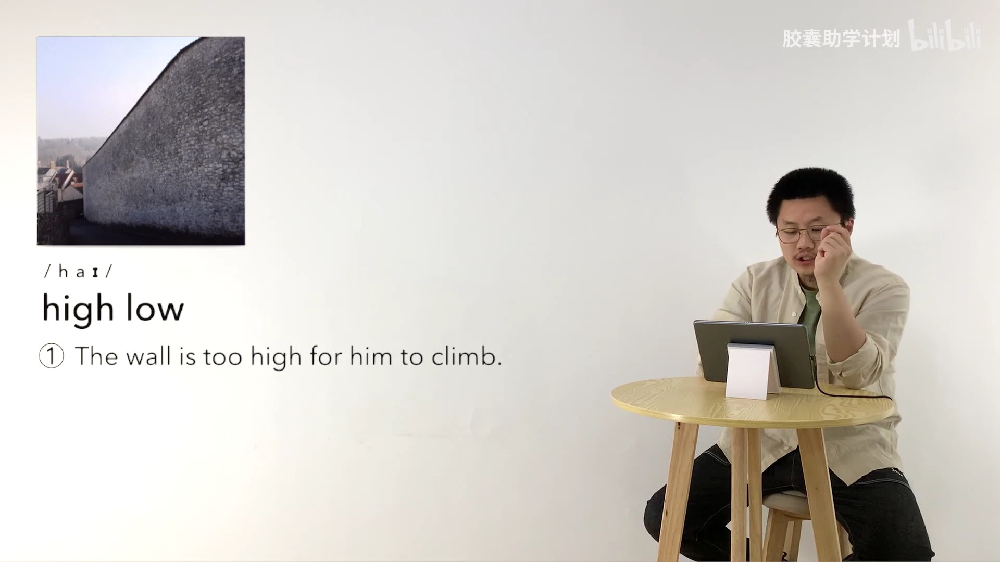

文字识别：胶囊助学计划 / /hai/ / high low / ① The wall is too high for him to climb.

## 00:07:30–00:08:00

enough for somebody to do something,哎，足够的低对于我来说，我爬得过去。Very good.再接下来，跟我读一下这两个单词。第一个 hard, hard叫硬啊。那后面的这个 soft 就指的是柔软的。好，我们拿它造句子。That apple is too hard to eat.太硬了，没法吃。哎，这就是汉语对吧？翻译成汉语叫太硬，没法吃。Very good.再来。That pear is

### 画面 00:07:31

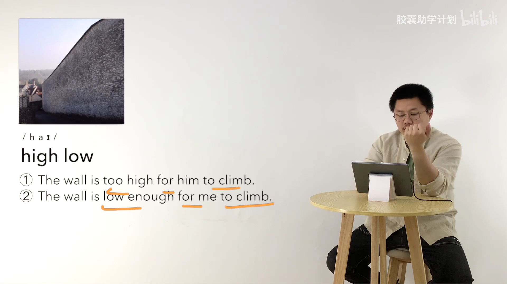

文字识别：胶囊助学计划 / 出 / /hai/ / high low / The wall is too high for him to climb. / The wall is lów enougn for me to climb.

### 画面 00:07:36

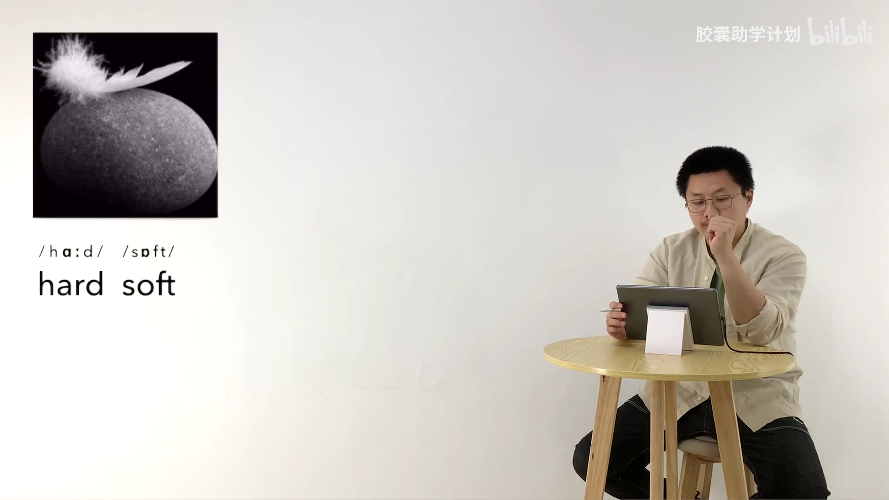

文字识别：胶囊助学计划blbl / /ha:d/ /spft/ / hard soft

### 画面 00:07:56

文字识别：胶囊助学计划 / /ha:d/ /spft/ / hard soft /  That apple is too hard to eat. / That pear is soft enough for her to eat.

## 00:08:00–00:08:30

soft enough for her to eat. That可能指的是老人，对吧？说这个梨足够的软，哎，软和，吃起来牙口很舒服。Okay, there you go.再来，sweet甜，sour哎指的是酸啊，酸甜。Okay，比如说the dish is too sweet for me to eat.啊，你看这句话翻译成汉语就是这菜太甜了，我不想吃，对不对？There you go.

### 画面 00:08:01

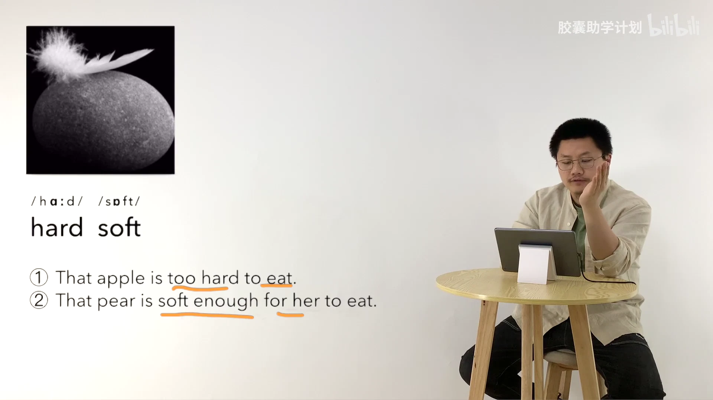

文字识别：胶囊助学计划 / /ha:d/ /spft/ / hard soft / That apple is too hard to eat. / That pear is soft enough for her to eat.

### 画面 00:08:10

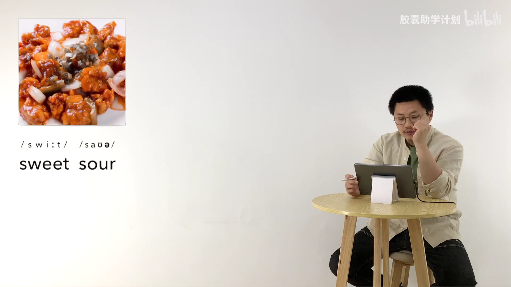

文字识别：胶囊助学计划 / 出 / /swi:t//saua/ / sweet sour

### 画面 00:08:14

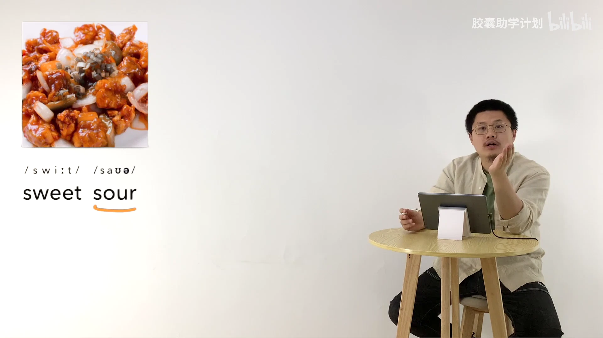

文字识别：胶囊助学计划 / /swi:t//saua/ / sweet sour

### 画面 00:08:24

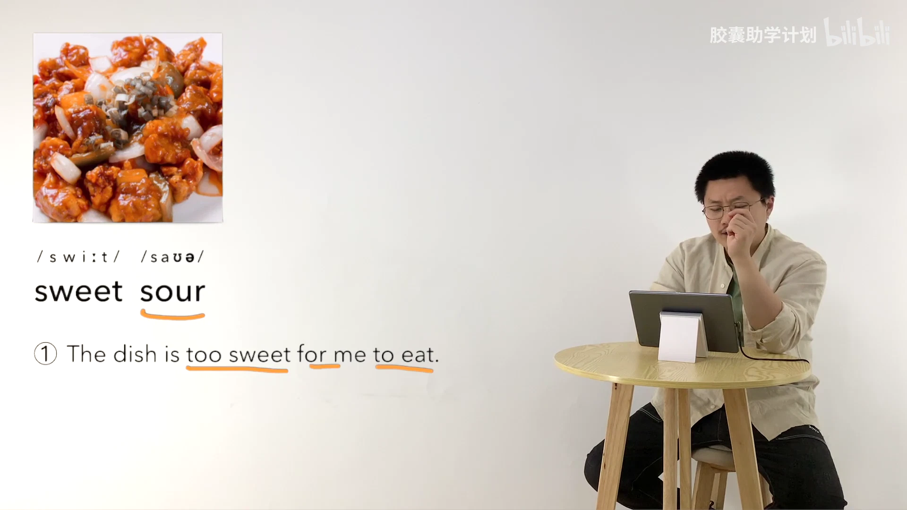

文字识别：胶囊助学计划bibl / /swi:t/ /saua/ / sweet sour / ① The dish is too sweet for me to eat.

### 画面 00:08:26

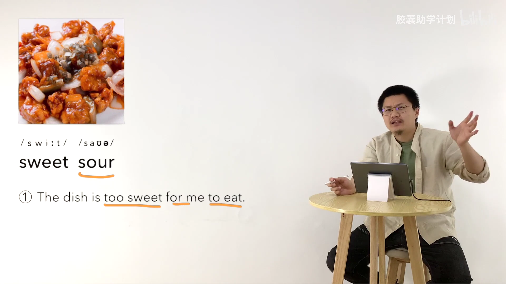

文字识别：胶囊助学计划 / /swi:t/ /saua/ / sweet sour / ① The dish is too sweet for me to eat.

## 00:08:30–00:09:00

好，那再来说，The dish is too sour for me to eat.太酸了，我不想吃。Very good.接下来呢，我们看一个小的电影片段，当中出现了叫做He's big enough to fly.叫做他足够的大了，可以去飞了。那我们看一下这句话上下文的场景，具体指的是什么？注意力集中来了。That's nice and ripe.

### 画面 00:08:30

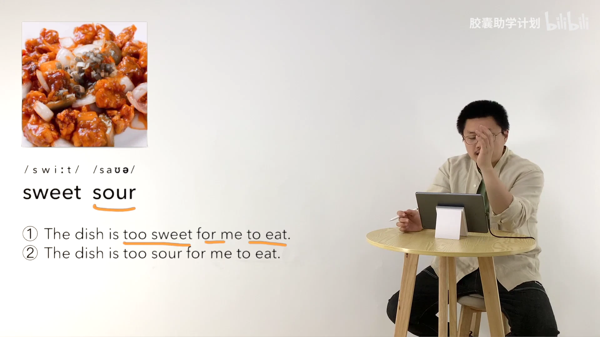

文字识别：胶囊助学计划 / /swi:t / /saua/ / sweet sour /  The dish is too sweet for me to eat. /  The dish is too sour for me to eat.

### 画面 00:08:37

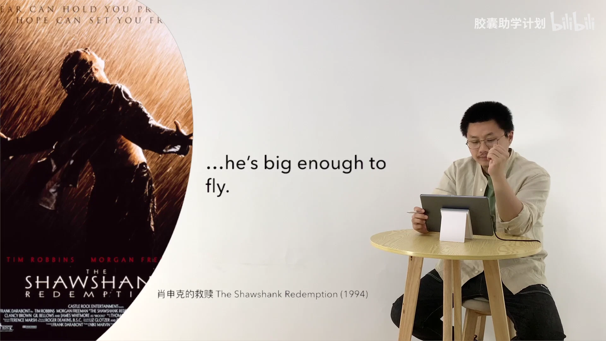

文字识别：CKNHOLDYOU PR / Bilbil / CAN SETYOUFR / 胶囊助学计划 / ..he's big enough to / fly. / HE / SHAWSHAI / REDE M PTI / 肖申克的救赎The Shawshank Redemption (1994) / NMENT, / FRANK DARABONT / TIMROBBINS / MORGANFREEMAN"TH / AWSHANKRED / CLANCY BROWN CILBELLOWS AND JAMES WHTMOREASTOOK / TERENCE MARSH / ROGERDEAKINS,B.S.C. / UZQOTZER / LOSK. / NIKIMARVN

### 画面 00:08:39

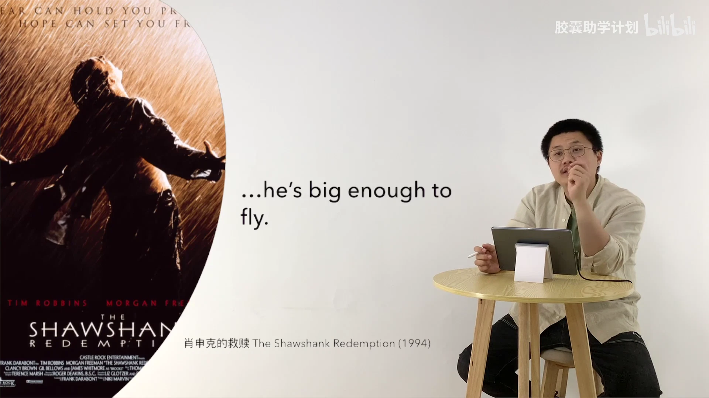

文字识别：CANHOLD YOU PR / 胶囊助学计划blbl / CAN SETYOUFR / …he's big enough to / fly. / HE / SHAWSHAT / REDEM PTI / 肖申克的救赎The Shawshank Redemption(1994) / CASTLERO / NMENT, / TIMROEBINSMORGANFREEMAN"TH / AWSHANKRED / CLANCY BROWN CALBELLOWS AO JAMES WHTMOREASTOOK / TERENCE MARSH2 / ROGERDEAKINS,B.S.C / UZGOTZER / LOSK. / CNIK MARVIN

### 画面 00:08:42

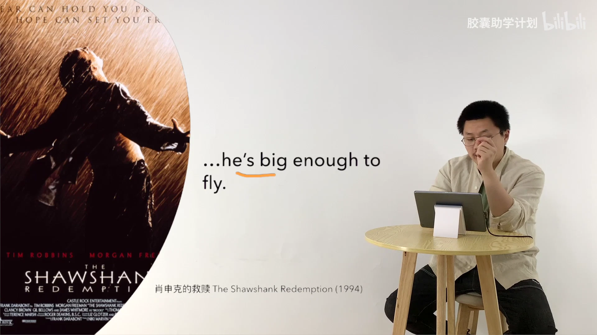

文字识别：CANHOLDYOUPR / Biltbili / CAN SETYOUFR / 胶囊助学计划 / ..he's big enough to / fly. / H / E / SHAWSHAD / R ED E M PTI / 肖申克的救赎 The Shawshank Redemption(1994) / CASTLEROOK / MENT. / BONT / TIMROBBINSMORGANFREEMAN"TH / AIWSHANKRED / CLANCY BROWN CIL BELLOWSNO JAMES WHTMOREASTOOS / TERENCE MARSH / ROGERDEAKINS,B.S.C.LZGLOTZER / AOSK. / FRANK DARABONT / ENIKMARVD

### 画面 00:08:44

文字识别：CANHOLDYOUPK / Bibl / CAN SETYOU FR / 胶囊助学计划 / .…..he's big enough to / fly. / H / E / SHAWSHAI / REDE M PTI / 肖申克的救赎The Shawshank Redemption (1994) / CASTLEROO / NMENT, / TIMROBBINS MORGANFREEMAN"TH / AWSHANKRED / CLANCY BROWN CIL BELLOWS AD JAMES WHTMOREASTOOS / TERENCE MARSH2 / ROGERDEAKINS,B.S.C. / UZGOTZER / AOSK. / FRANKDARABONT / NIKIMARVN

### 画面 00:08:47

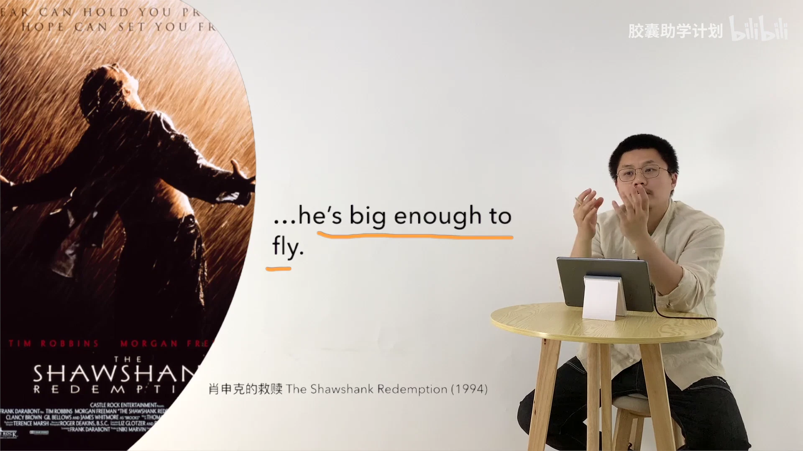

文字识别：CKNHOLD YOU PR / Biltbli / CAN SETYOUFR / 胶囊助学计划 / .…..he's big enough to / fly. / HE / SHAWSHAN / R EDE M PTI / 肖申克的救赎The Shawshank Redemption(1994) / CASTLEROCK / MENT / RANKDAR / TIMROBBINSMORGANFREEMAN"THE / AWSHANKRED / CLANCY BROWN GILBELLOWS AO JAMES WHTMOREASTOOK / TERENCE MARSH2 / ROGERDEAKINS,B.S.C. / UZQOTZER / LOSK. / FRANKDARABONT / ENIKIMARVIN

### 画面 00:08:51

文字识别：CKNHOLD YOU PR / Bilbil / CANSETYOUFR / 胶囊助学计划 / …..he's big enough to / fly. / HE / SHAWSHAD / RED E M PTI / 肖申克的救赎The Shawshank Redemption (1994) / CASTLEROO / FRANK DARABONT / TIMROBBINSMORGANFREEMAN"TH / AWSHANKRED / CLANCY BROWN CIL BELLOWS AO JAMES WHTMOREASTOO / TERENCE MARSH / ROGERDEAKINS,B.S.C. / UZGLOTZER / MOSK. / FRANKDARABONT / NIKMARVIN

### 画面 00:08:55

文字识别：Bilibili / 胶囊助学计划

### 画面 00:08:57

文字识别：Bilibili / 胶囊助学计划 / 又肥又嫩 / That's nice and ripe.

### 画面 00:08:59

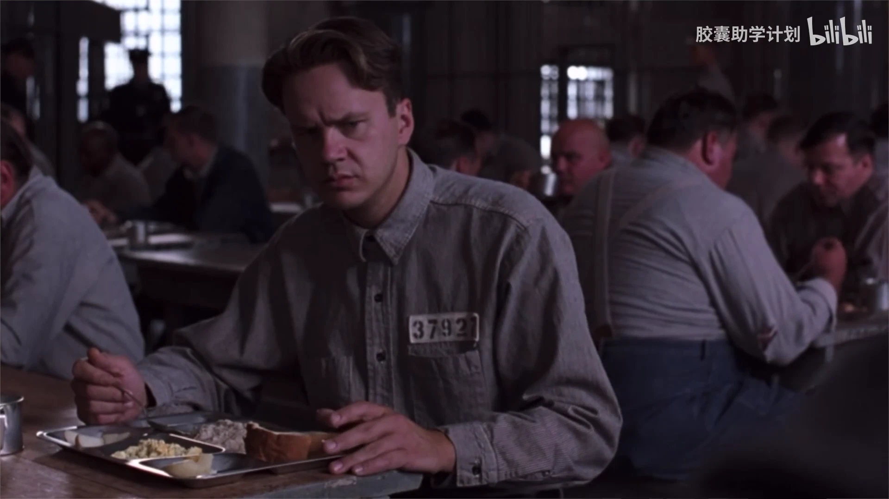

文字识别：Bilbili / 胶囊助学计划 / 37927

## 00:09:00–00:09:30

Jake says thank you. Fell out of his nest over by the plate shop. I'm gonna look after him until he's big enough to fly.好，你看他说的是，我们刚才 look after him until he's big enough to fly。啊，我要照顾到他足够的大可以去飞的时候，对

### 画面 00:09:01

文字识别：Bilbili / 胶囊助学计划

### 画面 00:09:03

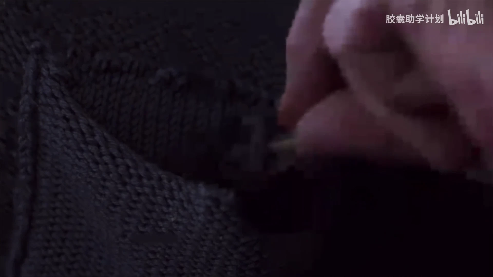

文字识别：bilibili / 胶囊助学计划

### 画面 00:09:05

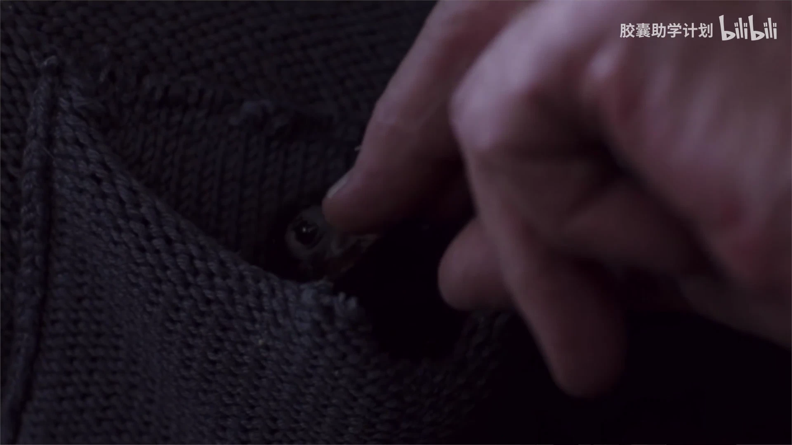

文字识别：bilibili / 胶囊助学计划

### 画面 00:09:07

文字识别：Biltbili / 胶囊助学计划 / m

### 画面 00:09:09

文字识别：Bilbili / 胶囊助学计划 / 刷

### 画面 00:09:11

文字识别：Bilibili / 胶囊助学计划 / 小杰说谢谢你 / dake says thankyou.

### 画面 00:09:13

文字识别：bilibili / 胶囊助学计划 / 他从巢中掉到地上 / Fell out of his.hest over by the plate shop.

### 画面 00:09:15

文字识别：bilibili / 胶囊助学计划 / 他从巢中掉到地上 / Fellout of his nest over by the plate shop.

### 画面 00:09:17

文字识别：bilibli / 胶囊助学计划 / 我要养到他会飞 / I'm going to look aiter him until he's big enough to fly.

### 画面 00:09:19

文字识别：bilbili / 胶囊助学计划 / 3792] / 我要养到他会飞 / I'm going to look after him until he's big enough to fly.

### 画面 00:09:21

文字识别：CKNHOLDYOU PR / CAN SETYOUFK / 胶囊助学计划 / …he's big enough to / fly. / H / E / SHAWSHAN / REDEMPTI / 肖申克的救赎The Shawshank Redemption(1994) / CASTLERO / NMENT, / RANK DARABONT / TIMROBBNSMORGANFREEMAN"THE / AWSHANKRED / CLANCY BROWN CL BELLOWS ADJAMES WHTMORE ASTOOG" / THOI / TERENCEMARSH / ROGERDEAKNSB.S.C.LZGLOTZER / MOSK. / FRANKDARABONT' / NIKMARVN

### 画面 00:09:23

文字识别：CKNHOLDYOUPR / CANSETYOUFR / 胶囊助学计划 / ..he's big enough to / fly. / HE / SHAWSHAN / R E D E M PTI / 肖申克的救赎The Shawshank Redemption(1994) / CASTLEROOK / NMENT, / BONT / TIMRO88 / MORGANFREEMAN"THE / AWSHANKREI / CLANCY BROWN CILBELLOWS AO JAMES WHTMORE ASTOOEG / TERENCEMARSH / ROGERDEAKINS,B.S.C. / UZQLOTZER / ROEK. / FRANKDARABONT / NIKMARVN

### 画面 00:09:25

文字识别：CKNHOLDYOU PR / CAN SETYOUFR / 胶囊助学计划 / ..he's big enough to / fly. / H / E / SHAWSHAT / REDE M PTI / 肖申克的救赎 The Shawshank Redemption(1994) / CASTLEROCK / MENT / TIMROOBINS MORGANFREEMAN"TH / AWSHANKRED / CLANCY BROWN CIL BELOWS ANDJAMES WHTMORE ASTOOKS / TERENCE MARSH2 / ROGERDEAKINS,B.S.C. / UZGLOTZER / AOSK. / FRANKDARABONT / NKI MARVIN

## 00:09:30–00:10:00

吧？用的就是我们今天学的这个句型。Very good.那接下来呢，我们做一些口语听力的训练啊。我们先看一下我们练的是什么啊？先跟我读。Could he answer all the questions? Could提前一百零三课咱们刚学过，在文章中的时候，对吧？跟can是类似的。那他能回答所有的问题吗？Yes, he could.也是他能。They were easy enough for him to answer.对他来说足够简单，

### 画面 00:09:30

文字识别：CKNHOLDYOUPR / CANSETYOUFR / 胶囊助学计划 / …he's big enough to / fly. / HE / SHAWSHAD / REDEMPTI / 肖申克的救赎The Shawshank Redemption(1994) / FRANK DARABONT / TIMROBBINSMORGANFREEMAN"THE / HAIWSHANKRED / CLANCY BROWN GIL BELLOWS ND JAMES WHTMOREAS TOOS / TERENCE MARSH / ROGERDEAKINS,B.S.C.LZGLOTZER / AOSK / FRANKDARABONT / ENIKIMARVIN

### 画面 00:09:33

文字识别：Bilbil / 胶囊助学计划 / askansy / ques / ask / questions conn / investigation / challenge / von-qaa / answersask / ing aapraze questions / zareply / fusion / puzzle / poll / reply / qsa ask what / answers / inte / usion / rogatic / ANSWERS / usion / investigation a que / jueryques / enge answ / challenge g&a challeno / query confusie / ons investigation  / interroga / pu / problem / IS / answer all the questions

### 画面 00:09:53

文字识别：胶囊助学计划 / areply / askansy / fusion / puzzle / ask / questions conf / poll / Investigation / answers / inte / challenge / answers ask / on / usion / rogatic / q&a / ANSWERS / pily aon ! / interrogation query investir / on ask Inter / usion / investigation&a que / jueryques / enge answ / challenge q&a challeng / query confusie / ons Investigation / Interroga / problem / pu / answer all the questions / Could he answer all the questions? / 1 / Yes, he could. / They were easy enough for him to answer.

### 画面 00:09:57

文字识别：Bilbl / 胶囊助学计划 / jā reply / askansy / ques / fusion / puzzle / ask / poll / questions confn / Investigation / answers / inte / challenge / answers ask / on / usion / rogatic / qsa / reply / ANSWERS / interrogation query investi / on ask Inter / usion / investigation / &a que / jueryques / ange answ / challenge g&a challeng / query confusie / ons Investigation / interrog / problem / answer all the questions / Could he answer all the questions? / 1 / Yes, he could. / They were easy enough for him to answer.

## 00:10:00–00:10:30

可以回答。那下一组，Could he answer all the questions? 没有变化，但否定回答。No, he couldn't. 张开嘴跟我读啊，说 They were too difficult for him to answer. 太难了，对于他来说答不出来。Too 加形容词 for somebody to do something，非常的舒服，对吧？剩下的全是一样，各位张开嘴跟我大声朗读就好了。来了，Could they

### 画面 00:10:01

文字识别：Bilbili / 胶囊助学计划 / problem questi / Investigation w / challenge / ask ansy / a reply / ing q / tusion / puzzle questions / poll / reply / answers / inter / rogatio / ANSWERS / q / Interrogation query investi on ask inten / usion / "investigation / &a que / nge answ / challenge g&a challen / query confusid / iryreply / problem / Interroga / problem / pur / answer all the questions

### 画面 00:10:13

文字识别：Bilbili / 胶囊助学计划 / ask ansy / ask / questions / Investigation / cont / challenge / answers / ask / ta reply / ing q / dfusion / puzzle / questions / poll / qěea ask whate / reply / answers / inte / rogatio / ANSWERS / siy / tigation int / interrogation query investie / on ask inter / q / ueryques / nge answ / usion / challenge g&a challene / ons investigation ir / investigation / query confusid / ryreply / a que / problem / Interrog / problem / pu / S / answer all the questions / ① Could he answer all the questions? / 2 / No, he couldn't. / They were too difficult for him to answer.

### 画面 00:10:18

文字识别：胶囊助学计划 / ta reply / askansy / ing qì / fusion / puzzle / ask / questions / poll / questions / Investigation / qēea ask whate / answers / reply / conn / inte / challenge / answers / ongsa / usion / rogatio / ask / ANSWERS / q / piy / tigation / Interrogation query investie / on ask inter / ueryques / nge answ / usion / challenge q&a challene / ons investigation / investigation / query confusio / iryreply / &a que / problem / Interrog / problem / answer all the questions / ① Could he answer all the questions? / No, he couldn't. / They were too difficult for him to answer.

### 画面 00:10:27

文字识别：胶囊助学计划bi出 / 2 / hear the stereo

## 00:10:30–00:11:00

hear the stereo? Yes, they could. It was loud enough for them to hear. Next one, could they hear the stereo? No, they couldn't. It was too low for them to hear. Continue. Could she eat the orange? Yes, she could. It was sweet enough

### 画面 00:10:34

文字识别：bilbl / 胶囊助学计划 / hear the stereo / ① Could they hear the stereo? / ② Yes, they could. / ③ It was loud enough for them to hear. / 3

### 画面 00:10:40

文字识别：胶囊助学计划b出出 / hear the stereo / ① Could they hear the stereo?

### 画面 00:10:51

文字识别：胶囊助学计划bl出 / eat the orange / ① Could she eat the orange?

## 00:11:00–00:11:30

for her to eat. Continue. Could she eat the orange? No, she couldn't. It was too sore for her to eat. Next one. Could he buy the car? Yes, he could. It was cheap enough for him to buy. Next one. Could he buy the car? No, he couldn't.

### 画面 00:11:00

文字识别：bilbl / 胶囊助学计划 / eat the orange / ① Could she eat the orange? / ② Yes, she could. /  It was sweet enough for her to eat.

### 画面 00:11:03

文字识别：胶囊助学计划bil出 / eat the orange

### 画面 00:11:14

文字识别：胶囊助学计划bii出 / buy the car / ① Could he buy the car?

### 画面 00:11:25

文字识别：胶囊助学计划bl出 / buy the car / ① Could he buy the car?

## 00:11:30–00:12:00

It was too expensive for him to buy. Next one, could he climb the wall? Yes, he could. It was low enough for him to climb. Next one, could he climb the wall? No, he couldn't. It was too high for him to climb. Okay, recap. That lesson, ah,

### 画面 00:11:32

文字识别：Bilbli / 胶囊助学计划 / buy the car / ① Could he buy the car? / ② No, he couldn't. /  It was too expensive for him to buy.

### 画面 00:11:35

文字识别： Bilfbili / 胶囊助学计划 / climb the wall / ① Could he climb the wall?

### 画面 00:11:56

文字识别：Blibili / 胶囊助学计划 / Recap / Patterns / too / adj.+(for / sb)+ to do / adj.+enough+(for / sb)+ to do / Grammar / could / Words / Expression

## 00:12:00–00:12:30

们首先练习了 could 啊，这个是我们之前就学过的，对吧？再然后呢，两个非常重要的句型结构，各位记下来。接下来我们可能学新的形容词的时候还会用得到，对吧？ OK，那家庭作业绿皮书一百零四课，各位可以完成了，给自己讲解一遍今天的核心知识点。如果大家喜欢我们的课程呢，欢迎大家关注、订阅、一键三连，分享给那些需要的朋友。

### 画面 00:12:07

文字识别：biltbili / 胶囊助学计划 / Recap / Patterns / too / adj.+(for / sb)+ to do / adj.+enough+(for / sb)+ to do / Grammar / could / Words / Expression

### 画面 00:12:15

文字识别：胶囊助学计划bilb出

### 画面 00:12:23

文字识别：胶囊助学计划bl出

## 00:12:30–00:12:56

最后，我们再来看一句 Albert Einstein 是吧？Einstein 说的名人名言是：If you can't explain it simply, you don't understand it well enough. See you next time.

### 画面 00:12:30

文字识别：bilbli / 胶囊助学计划 / If you can't explain it simply, you don't / understand it well enough. / -Albert Einstein

### 画面 00:12:43

文字识别：胶囊助学计划 / If you can't explain it simply, you don't / understand it well enough. / -Albert Einstein

### 画面 00:12:45

文字识别：CAPSULEACADEMY / 胶囊助学计划 / 『 / 小红书 / Lecturer / Leo / OE

### 画面 00:12:48

文字识别：CAPSULEACADEMY / 胶囊助学计划 / 『 / 小红书 / Berlin / OE

### 画面 00:12:51

文字识别：CAPSULEACADEMY / 胶囊助学计划 / 『 / 小红书 / Creator / Leo & Berlin / OE

### 画面 00:12:53

文字识别：胶囊助学计划 / CAPSULEACADEMY / 胶囊助学计划 / 小红书 / OE

### 画面 00:12:55

文字识别：bilibili / 胶囊助学计划

