# 105 文章

快速机器解析：语音为单模型转写，未进行独立交叉校对或人工复核；画面每秒采样并按变化选帧，短时文字和标记可能遗漏。截图时间约有 1 秒误差。图片有损压缩；遇到疑点请按时间查看 Google Drive 原视频。

## 00:00:00–00:00:30

Hello everyone, welcome to Capsule Academy. This is Leo. Today we are going to learn New Concept English Book One, Lesson One Hundred and Five, Story. Hope you gonna enjoy it.好，那我们直接看文章啊。首先我们看一下这个人物的身份啊。坐在桌子里面的这个叫 the boss，就是老板。老板说说 Where is Sandra Ball？说 Sandra 这个人在哪儿呢？Ball 啊，他可能是问他的这个 office assistant。

### 画面 00:00:00

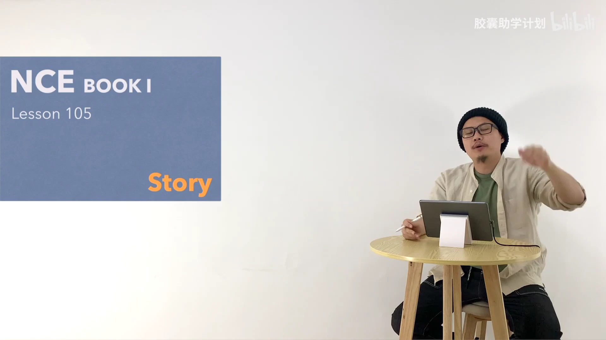

文字识别：胶囊助学计划 / NCE / BOOKI / Lesson 105 / Story

### 画面 00:00:09

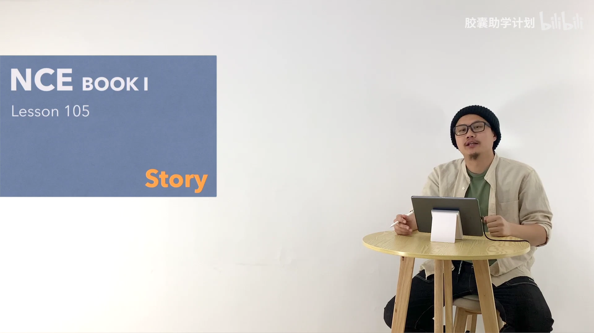

文字识别：胶囊助学计划 / NCE / BOOKI / Lesson 105 / Story

### 画面 00:00:11

文字识别：胶囊助学计划bilbl

### 画面 00:00:14

文字识别：胶囊助学计划

### 画面 00:00:16

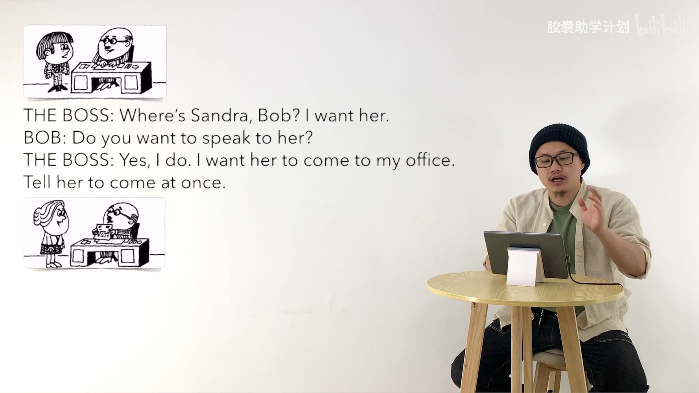

文字识别：胶囊助学计划 / THE BOSS: Where's Sandra, Bob? I want her. / BOB: Do you want to speak to her? / THE BOSS: Yes, I do.I want her to come to my office. / Tell her to come at once.

## 00:00:30–00:01:00

OK, I want her. 我需要她。再来, boss, 那回答说, Do you want to speak to her? 说你想和他说话吗？你看, want to do something, 对，想去做某件事情，对吧？Want to do something? The boss说, Yes, I do. 啊，是的，我是这个样子。I want her to come to my office. 说我呀需要她来我的办公室一下。Continue, 说,

### 画面 00:00:46

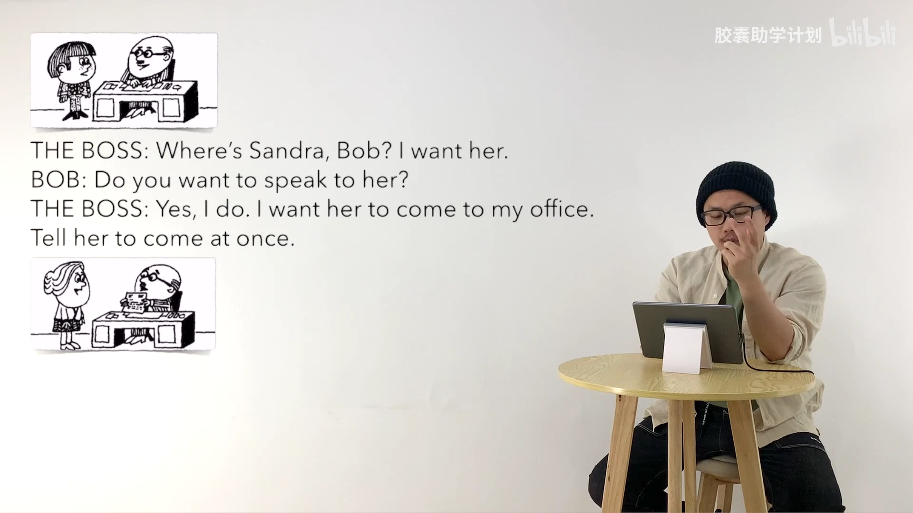

文字识别：胶囊助学计划 / THE BOSS: Where's Sandra, Bob? I want her. / BOB: Do you want to speak to her? / THE BOSS: Yes, I do.I want her to come to my office. / Tell her to come at once.

## 00:01:00–00:01:30

tell her to come at once.你看，tell somebody to do something，告诉他来啊，跟我们汉语几乎一致，就是多了个to，对吧？那at once呢，就是立刻马上啊，立刻告诉他来。continue，Sandra来了，换了人了。Did you want to see me？说你之前是说想看见我一下，说您是想见我一下，对吧？Did之前提的嘛。Oh yes，Sandra啊，是的，Sandra。Boss问了他一个问题，叫How

### 画面 00:01:14

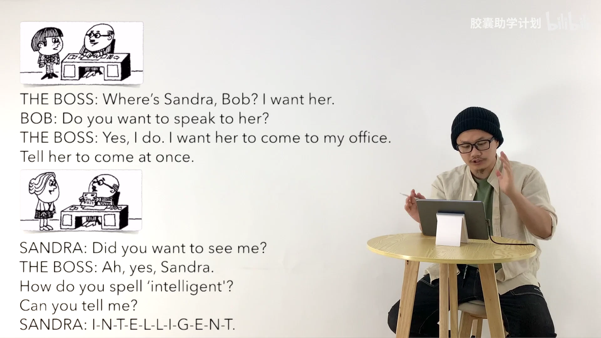

文字识别：胶囊助学计划 / THE BOSS: Where's Sandra, Bob? I want her. / BOB: Do you want to speak to her? / THE BOSS: Yes, I do.I want her to come to my office. / Tell her to come at once. / SANDRA: Did you want to see me? / THE BOSS: Ah, yes, Sandra. / How do you spell 'intelligent'? / Can you tell me? / SANDRA: I-N-T-E-L-L-I-G-E-N-T.

## 00:01:30–00:02:00

do you spell intelligent? 你如何拼 intelligent 这个单词？哎， How do you spell? Bla bla bla. 哎，这个是我们在单词部分讲过非常重要的一个小的句型。各位，真正实际上口语应用的时候用得到。再来，Can you tell me? 你能告诉我一下吗？ Sandra 就说了，说 intelligent 没什么太多可讲的。 The boss 老板说， That's right.

### 画面 00:01:34

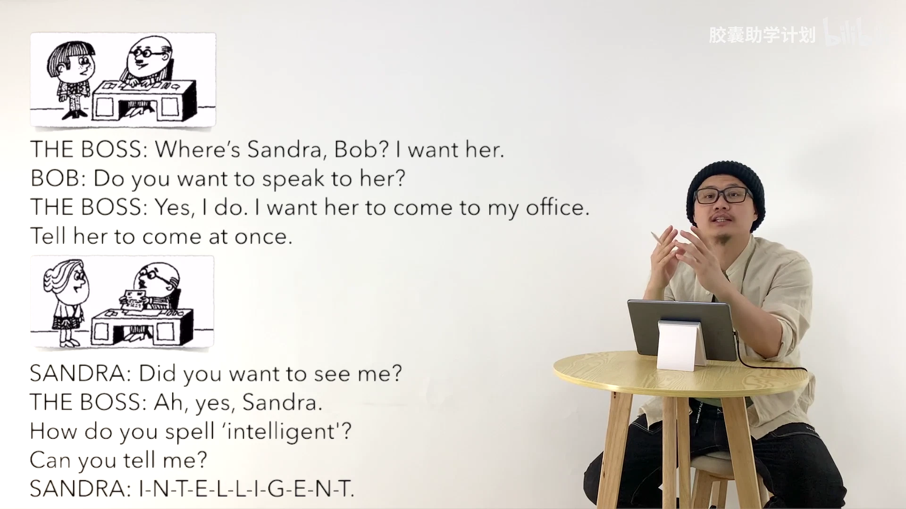

文字识别：胶囊助学计划 / THE BOSS: Where's Sandra, Bob? I want her. / BOB: Do you want to speak to her? / THE BOSS: Yes, I do.I want her to come to my office. / Tell her to come at once. / SANDRA: Did you want to see me? / THE BOSS: Ah, yes, Sandra. / How do you spell 'intelligent'? / Can you tell me? / SANDRA: I-N-T-E-L-L-I-G-E-N-T.

### 画面 00:01:51

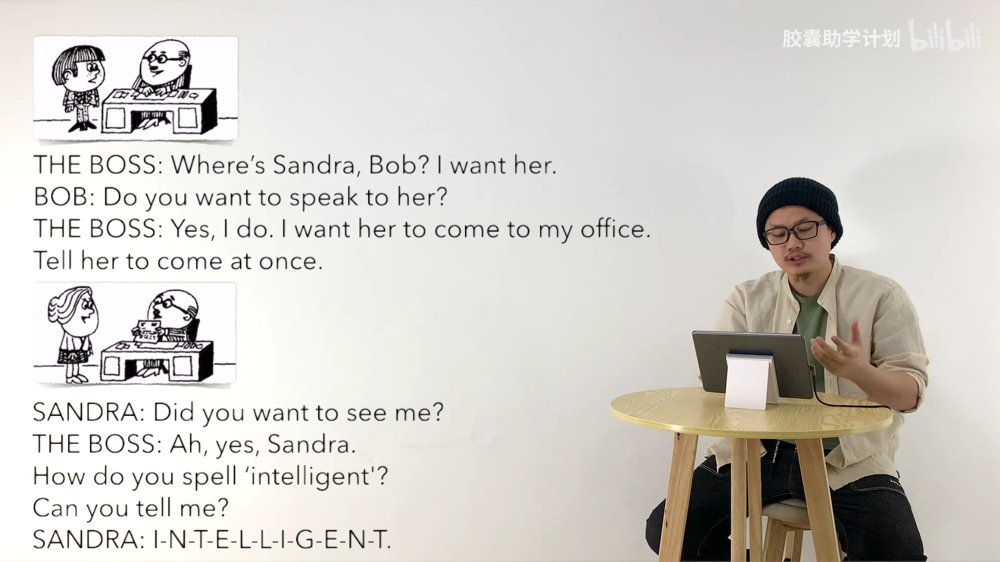

文字识别：胶囊助学计划 / THE BOSS: Where's Sandra, Bob? I want her. / BOB: Do you want to speak to her? / THE BOSS: Yes, I do.I want her to come to my office. / Tell her to come at once. / SANDRA: Did you want to see me? / THE BOSS: Ah, yes, Sandra. / How do you spell 'intelligent'? / Can you tell me? / SANDRA: I-N-T-E-L-L-I-G-E-N-T.

### 画面 00:01:56

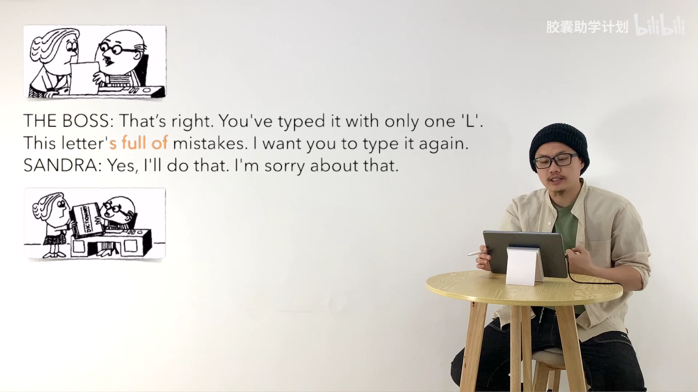

文字识别：胶囊助学计划 / THE BOSS: That's right. You've typed it with only one 'L'. / This letter's full of mistakes. I want you to type it again. / SANDRA: Yes, I'll do that. I'm sorry about that.

## 00:02:00–00:02:30

对呀，You type it with only one L. 说是没问题，但是但是呢，你之前打这个单词啊，只和只有一个，仅仅只有一个 L 这个字母，对吧？说 These letters full of mistakes. Okay, 注意一个小点，这个撇 S 是 is 这个单词，所以 is full of 它实际上是一个，我们可以

### 画面 00:02:06

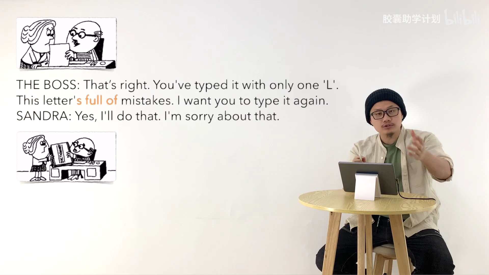

文字识别：胶囊助学计划 / THE BOSS: That's right. You've typed it with only one 'L'. / This letter's full of mistakes. I want you to type it again. / SANDRA: Yes, I'll do that. I'm sorry about that.

### 画面 00:02:17

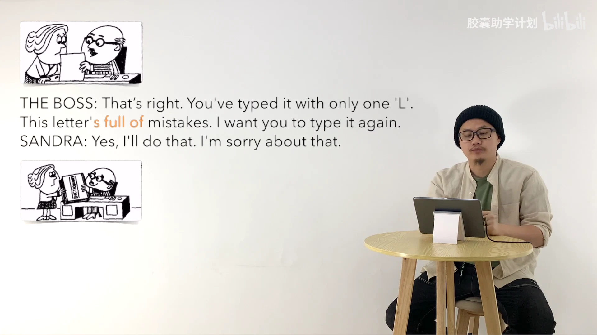

文字识别：胶囊助学计划 / THE BOSS: That's right. You've typed it with only one 'L'. / This letter's full of mistakes. I want you to type it again. / SANDRA: Yes, I'll do that. I'm sorry about that.

## 00:02:30–00:03:00

以理解为是习惯用法，对吧？叫做 be full of，叫做充满了。这封信充满了错误。OK，说 I want you to type it again。你看啊，这个其实我们并没有讲到在单词部分，我们讲的是 want to do something，但是这个是 want you to do something，对吧？它其实跟 tell you to do something 是不是几乎是完全一样的？只不过把 tell 换成了 want，

### 画面 00:02:32

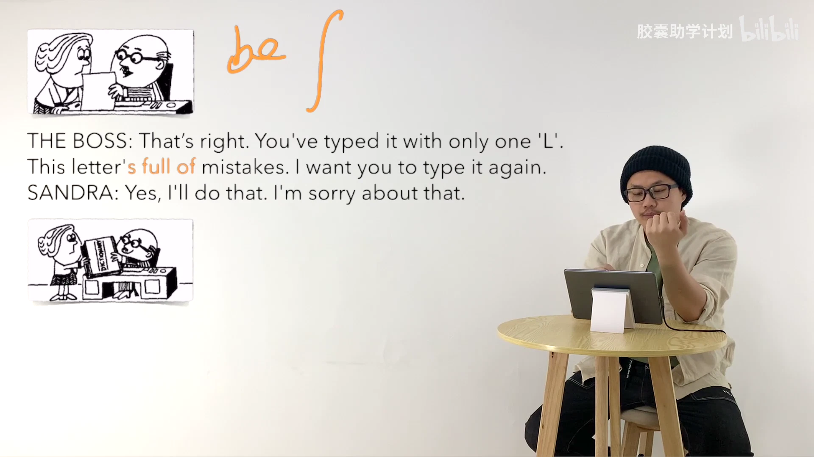

文字识别：bo / 胶囊助学计划 / THE BOSS: That's right. You've typed it with only one 'L'. / This letter's full of mistakes. I want you to type it again. / SANDRA: Yes, I'll do that. I'm sorry about that.

### 画面 00:02:34

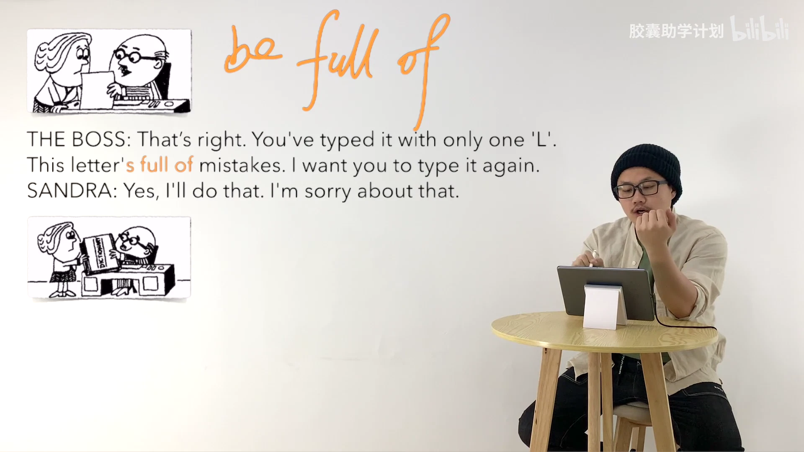

文字识别：bo / 胶囊助学计划 / THE BOSS: That's right. You've typed it with only one 'L'. / This letter's full of mistakes.I want you to type it again. / SANDRA: Yes, I'll do that. I'm sorry about that.

### 画面 00:02:37

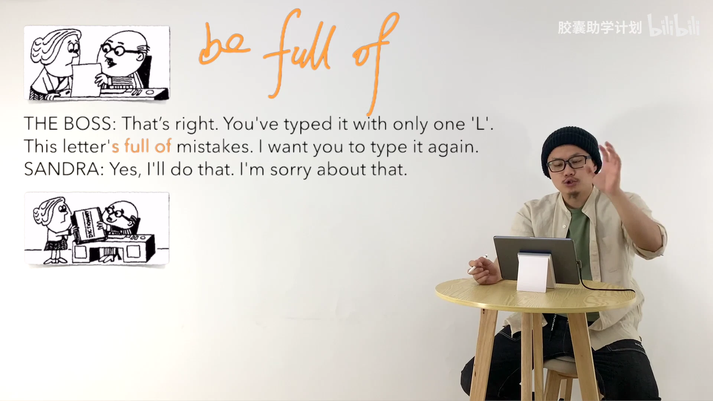

文字识别：bo / 胶囊助学计划 / THE BOSS: That's right. You've typed it with only one 'L'. / This letter's full of mistakes. I want you to type it again. / SANDRA: Yes, I'll do that. I'm sorry about that.

### 画面 00:02:45

文字识别：bo / 胶囊助学计划 / THE BOSS: That's right. You've typed it with only one 'L'. / This letter's full of mistakes.I want you to type it again. / SANDRA: Yes, I'll do that. I'm sorry about that.

## 00:03:00–00:03:30

对吧？所以在这儿，他其实就是想让某人去做某件事情。我们一百零六课就练这个句型啊。今现在先不多说。三柱说，Yes，I'll do that. 好的，我会去做的。I'm sorry about that. 关于这件事情，我很抱歉。Boss继续说，And here's a little present for you. 说这儿有一个小礼物送给你。三柱说，What is it？啊啊，这挺好。你看我犯错还给我个礼物。说你想给我什么呀？

### 画面 00:03:09

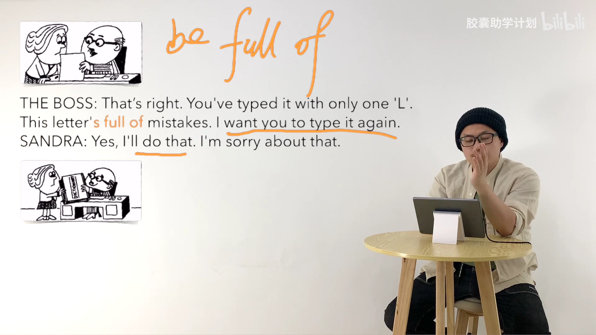

文字识别：bo / 胶囊助学计划 / 出业 / THE BOSS: That's right. You've typed it with only one 'L'. / This letter's full of mistakes.I want you to type it again. / SANDRA: Yes, I'll do that. I'm sorry about that.

### 画面 00:03:13

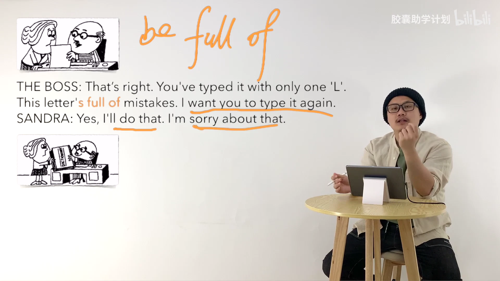

文字识别：bo / 胶囊助学计划 / 出 / THE BOSS: That's right. You've typed it with only one 'L'. / This letter's full of mistakes.I want you to type it again. / SANDRA: Yes, I'll do that. I'm sorry about that.

### 画面 00:03:16

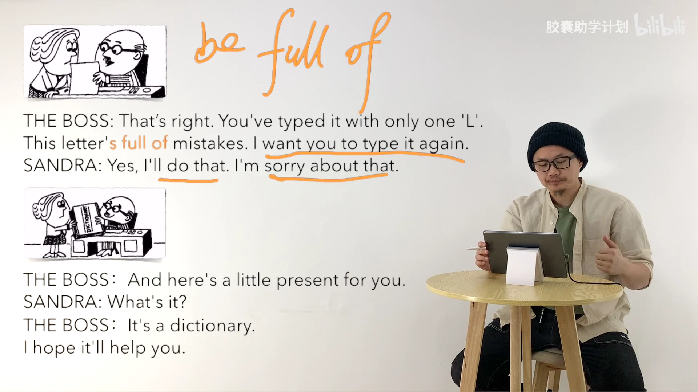

文字识别：bo / 胶囊助学计划 / THE BOSS: That's right. You've typed it with only one 'L'. / This letter's full of mistakes. I want you to type it again. / SANDRA: Yes, I'll do that. I'm sorry about that. / THE BOsS: And here's a little present for you. / SANDRA: What's it? / THE BOSS: It's a dictionary. / I hope it'll help you.

### 画面 00:03:29

文字识别：bo / 胶囊助学计划 / THE BOSS: That's right. You've typed it with only one 'L'. / This letter's full of mistakes. I want you to type it again. / SANDRA: Yes, I'll do that. I'm sorry about that. / THE BOsS: And here's a little present for you. / SANDRA: What's it? / THE BOSS: It's a dictionary. / I hope it'll help you.

## 00:03:30–00:04:00

The boss说，It's a dictionary.啊，我送你本字典。I hope it will help you.我希望它能帮到你。你看后边，It will help you.典型的宾语从句。I hope，然后再加一句宾语从句，对吧？OK，非常的舒服。那文章讲完了之后呢？接下来我们做一些口语听力训练啊啊，老习惯，我问您答，尽量不看板书，对吧？哎，您听完了，在文章当中找到答案，口语回答

### 画面 00:03:35

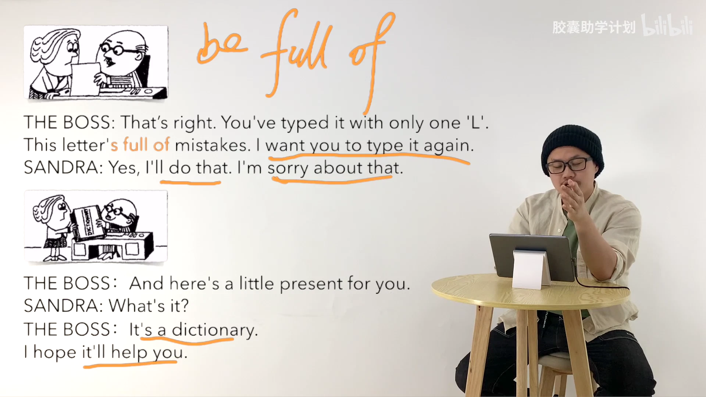

文字识别：bo / 胶囊助学计划 / THE BOSS: That's right. You've typed it with only one 'L'. / This letter's full of mistakes. I want you to type it again. / SANDRA: Yes, I'll do that. I'm sorry about that. / THE BOsS: And here's a little present for you. / SANDRA: What's it? / THE BOSS: It's a dictionary. / I hope it'll help you.

### 画面 00:03:48

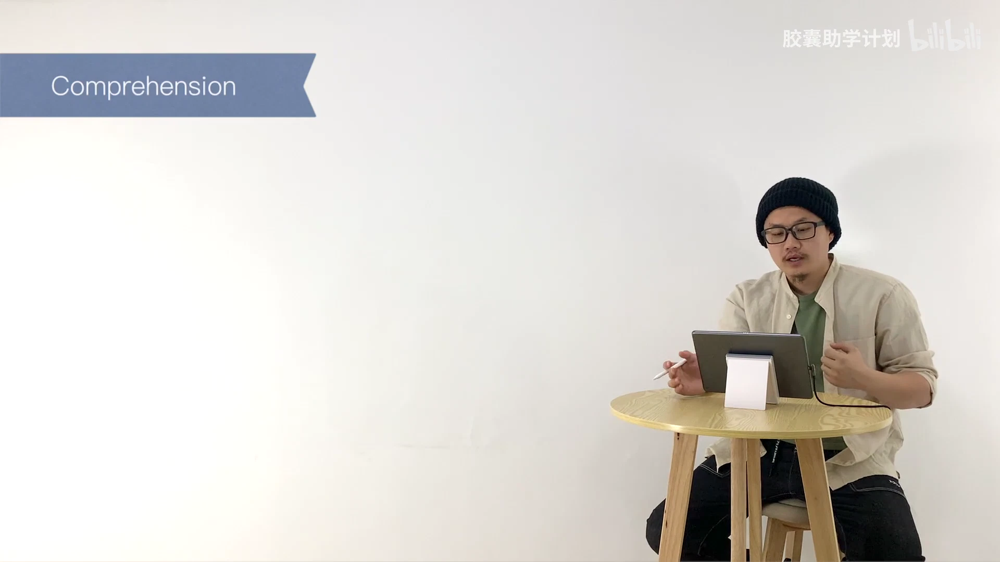

文字识别：胶囊助学计划 / Comprehension

## 00:04:00–00:04:30

我来，迪迪. Bob is the office assistant, isn't he? Answer: Yes, he is. Next one: Who wants to speak to Sandra? The boss does. Next one: What must Bob do? He must tell Sandra to come to the boss's office.

### 画面 00:04:04

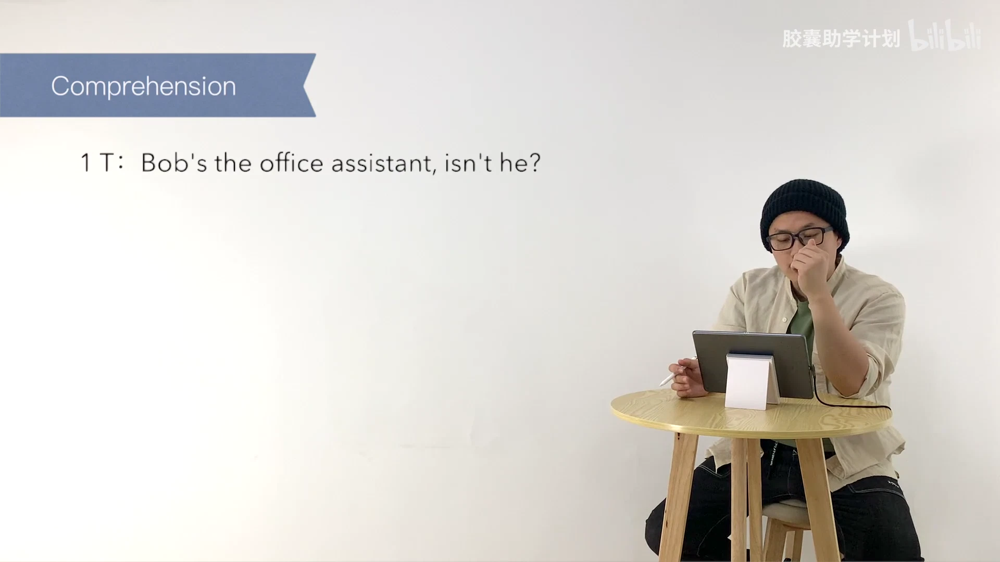

文字识别：胶囊助学计划 / Comprehension / 1 T: Bob's the office assistant, isn't he?

### 画面 00:04:16

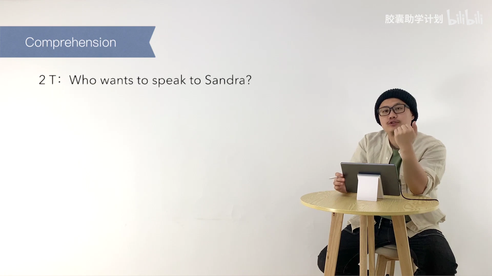

文字识别：bilbil / 胶囊助学计划 / Comprehension / 2 T: Who wants to speak to Sandra?

### 画面 00:04:25

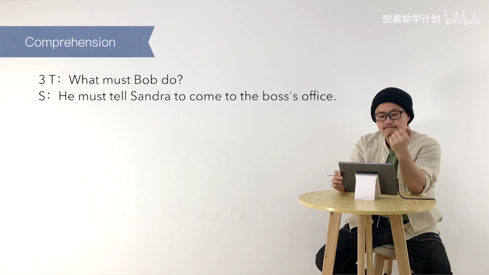

文字识别：胶囊助学计划 / Comprehension / 3 T: What must Bob do? / S: He must tell Sandra to come to the boss's office.

## 00:04:30–00:05:00

Next one, does the boss want Sandra to come at once? Yes, he does. Continue. What does the boss ask Sandra? He asks her how she spells intelligent. Next one, how do you spell intelligent? That很简单就是让你背一遍单词 I N T L L I G E

### 画面 00:04:32

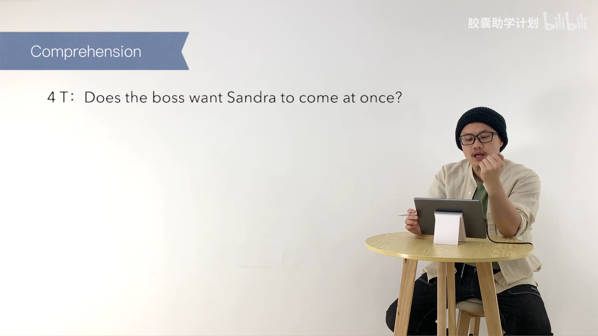

文字识别：Bilbl / 胶囊助学计划 / Comprehension / 4 T: Does the boss want Sandra to come at once?

### 画面 00:04:46

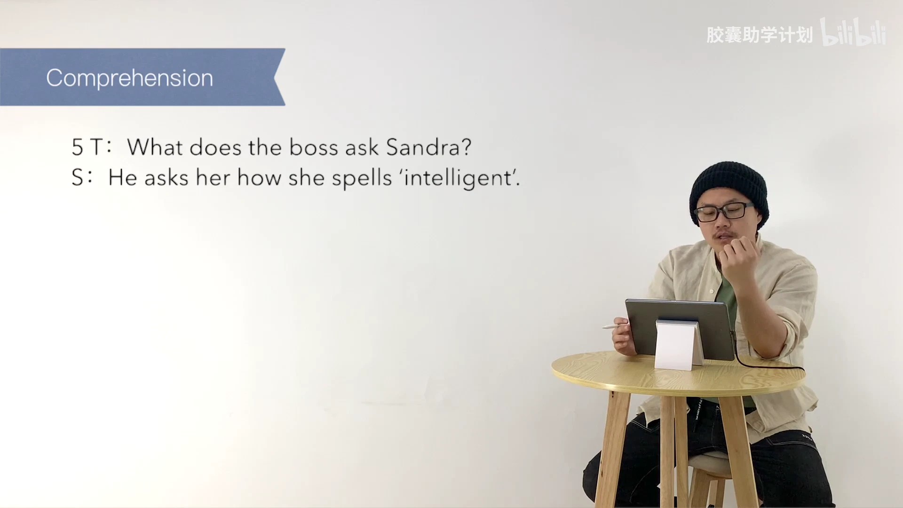

文字识别：胶囊助学计划 / Comprehension / 5 T: What does the boss ask Sandra? / S: He asks her how she spells 'intelligent'.

### 画面 00:04:53

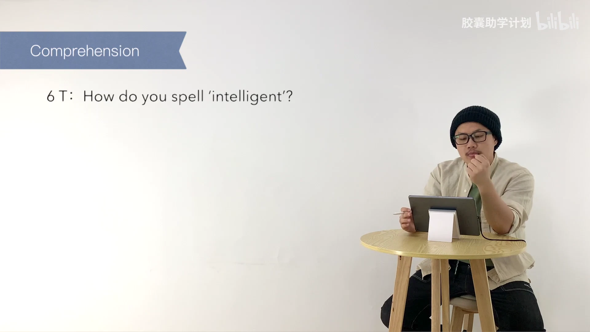

文字识别：Bilibili / 胶囊助学计划 / Comprehension / 6 T: How do you spell'intelligent'?

## 00:05:00–00:05:30

n t. Okay. Next one. How did Sandra type it? With only one L. Next one. What does the boss want Sandra to do? He wants her to type the letter again. Next one. What does he give Sandra? A little present. A dictionary.都可以啊. Next one. Ask

### 画面 00:05:15

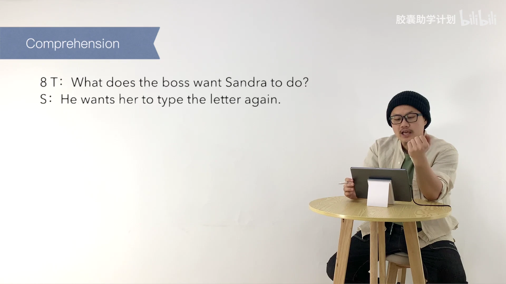

文字识别：胶囊助学计划 / Comprehension / 8 T: What does the boss want Sandra to do? / S: He wants her to type the letter again.

### 画面 00:05:24

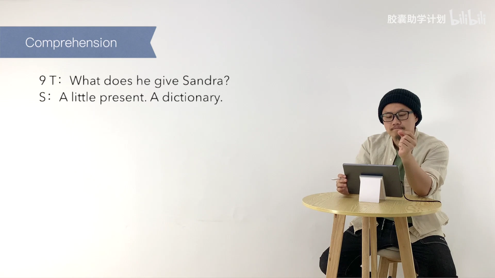

文字识别：胶囊助学计划 / Comprehension / 9 T: What does he give Sandra? / S: A little present. A dictionary.

### 画面 00:05:28

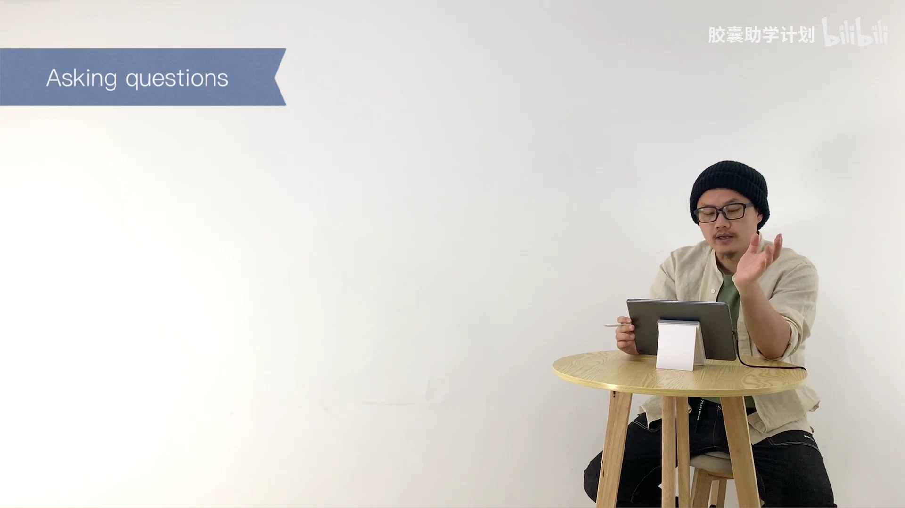

文字识别：Bitbili / 胶囊助学计划 / Asking questions

## 00:05:30–00:06:00

me if. 啊, asking questions. 我给肯定句，您变一般疑问句；我给特殊疑问词，您变特殊疑问句。来了。 Ask me if the boss wants to speak to Sandra. Does the boss want to speak to Sandra? Who? Who does the boss want to speak to? 当然，您也可以对 the boss 提问，不用变一般疑问句了。答案就是 Who wants to speak to Sandra? Okay, 下一

### 画面 00:05:31

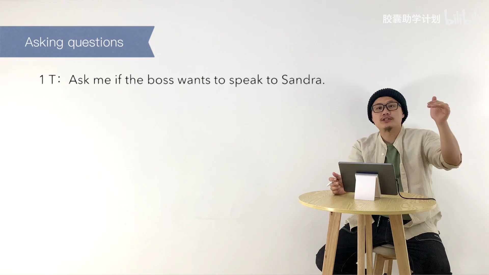

文字识别：胶囊助学计划 / Asking questions / 1 T: Ask me if the boss wants to speak to Sandra.

### 画面 00:05:43

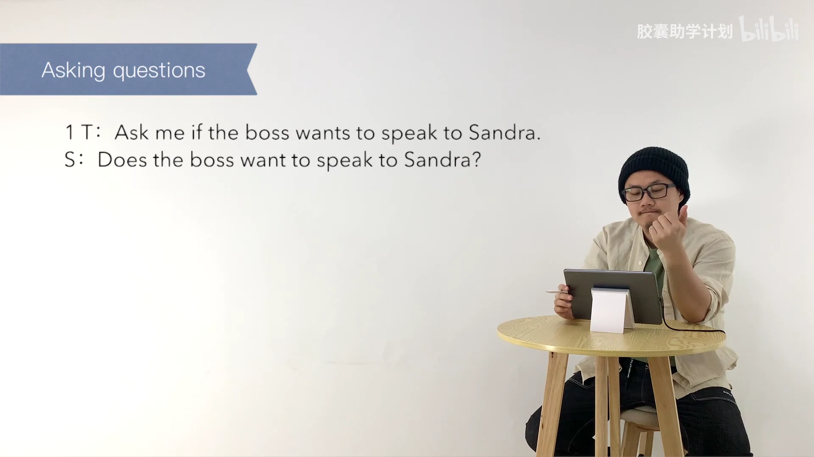

文字识别：胶囊助学计划 / Asking questions / 1 T: Ask me if the boss wants to speak to Sandra. / S: Does the boss want to speak to Sandra?

### 画面 00:05:51

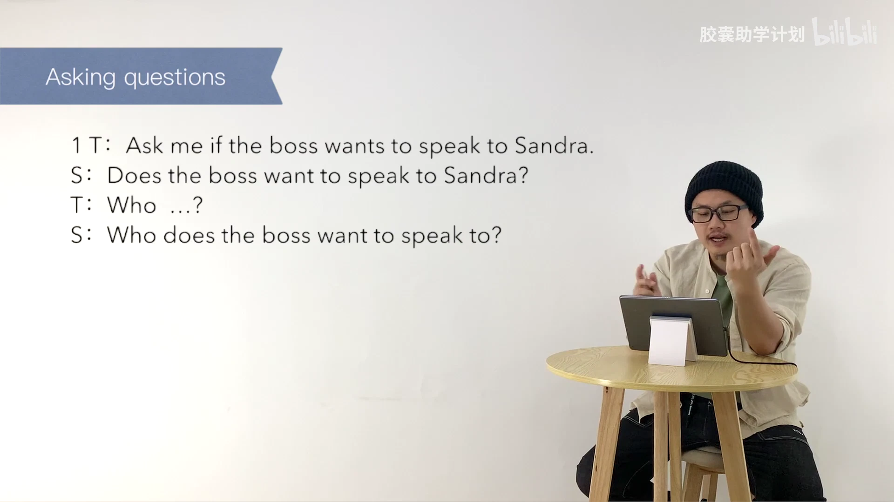

文字识别：胶囊助学计划 / Asking questions / 1 T: Ask me if the boss wants to speak to Sandra. / S: Does the boss want to speak to Sandra? / T： Who ….? / S: Who does the boss want to speak to?

### 画面 00:05:54

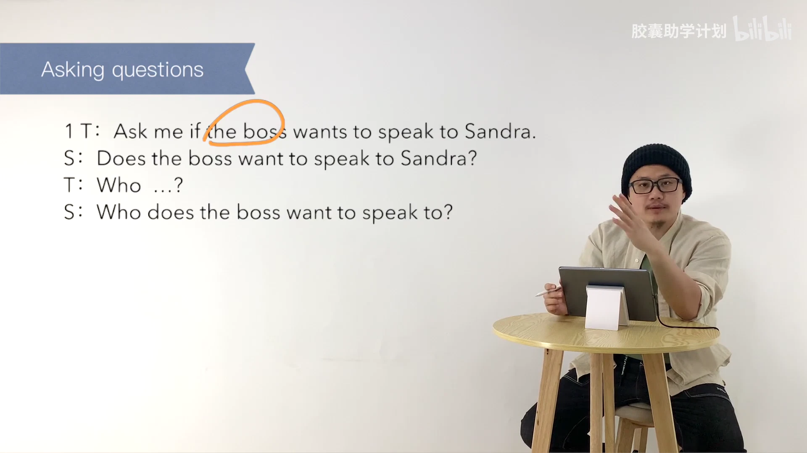

文字识别：胶囊助学计划 / Asking questions / 1 T: Ask me if he boss wants to speak to Sandra. / S: Does the boss want to speak to Sandra? / T： Who …..? / S: Who does the boss want to speak to?

### 画面 00:05:59

文字识别：Bilbil / 胶囊助学计划 / Asking questions / 2 T: Ask me if you spell'intelligent' with one L.

## 00:06:00–00:06:30

one. Ask me if you spell intelligent with one L. Do you spell intelligent with one L? How? How do you spell intelligent? Next one. Ask me if Sandra typed it with one L. Did Sandra type it with one L? How? How did

### 画面 00:06:12

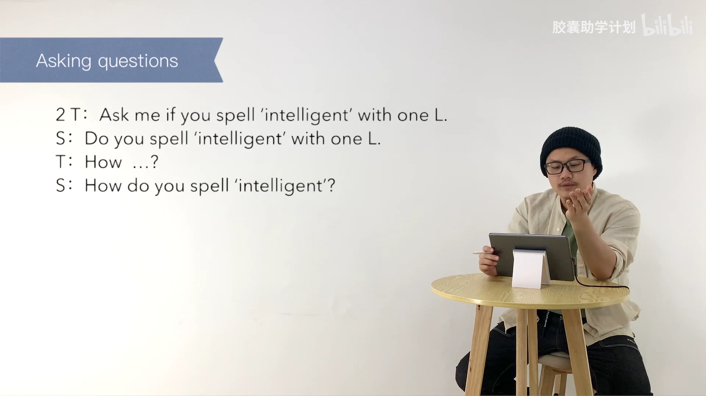

文字识别：Bilbl / 胶囊助学计划 / Asking questions / 2 T: Ask me if you spell'intelligent' with one L. / S: Do you spell'intelligent' with one L. / T: How ..? / S: How do you spell 'intelligent'?

### 画面 00:06:16

文字识别：Bilbili / 胶囊助学计划 / Asking questions / 3 T: Ask me if Sandra typed it with one L.

## 00:06:30–00:07:00

Sandra type it? Next one, ask me if the boss gave Sandra a dictionary. Did the boss give Sandra a dictionary? What, what did the boss give Sandra? Next one, ask me if it will help her.一般疑问句Will it help her?

### 画面 00:06:34

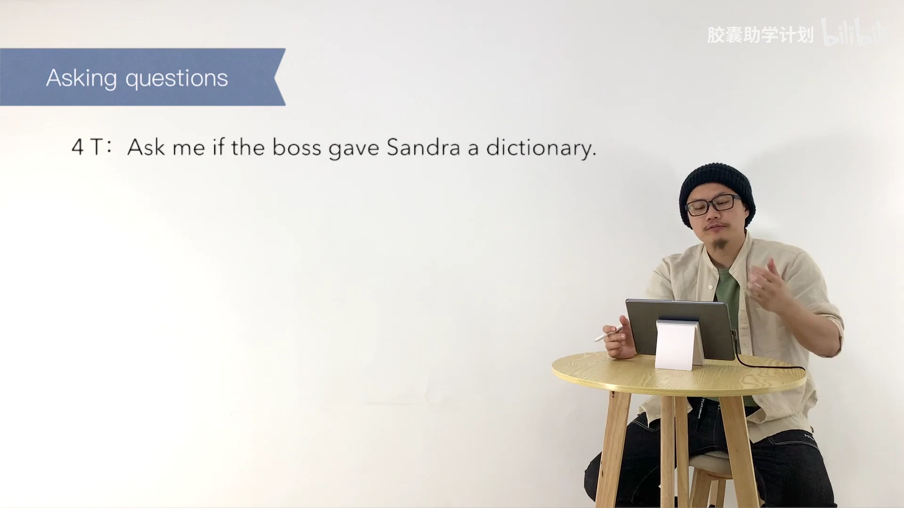

文字识别：胶囊助学计划 / Asking questions / 4 T: Ask me if the boss gave Sandra a dictionary.

### 画面 00:06:40

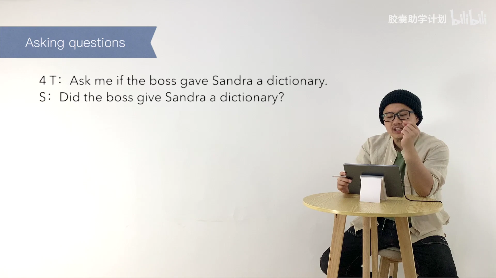

文字识别：Bilbil / 胶囊助学计划 / Asking questions / 4 T: Ask me if the boss gave Sandra a dictionary. / S: Did the boss give Sandra a dictionary?

### 画面 00:06:51

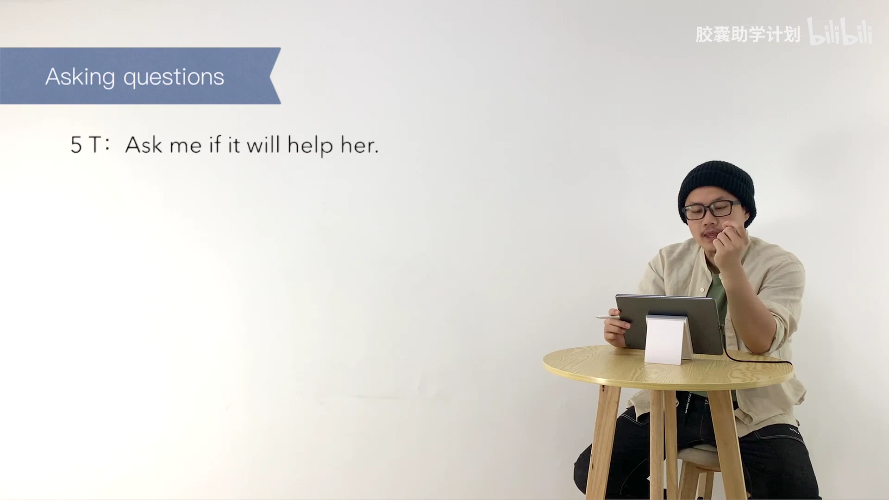

文字识别：bilibil / 胶囊助学计划 / Asking questions / 5 T: Ask me if it will help her.

## 00:07:00–00:07:30

How? How will it help her? Okay, very good.那Recap，本课我们复习了一下啊，单词部分提到的那两个关键句型，对吧？OK，那家庭作业呢？绿皮书一百零五课，各位可以写了文章跟读至熟读成诵，给自己讲解一遍今天的核心知识点。那如果大家喜欢我们的课程，欢迎大家关注、订阅、一键三连，分享给那些需要的朋友，来帮助我们快速成长。那最后呢，我们

### 画面 00:07:04

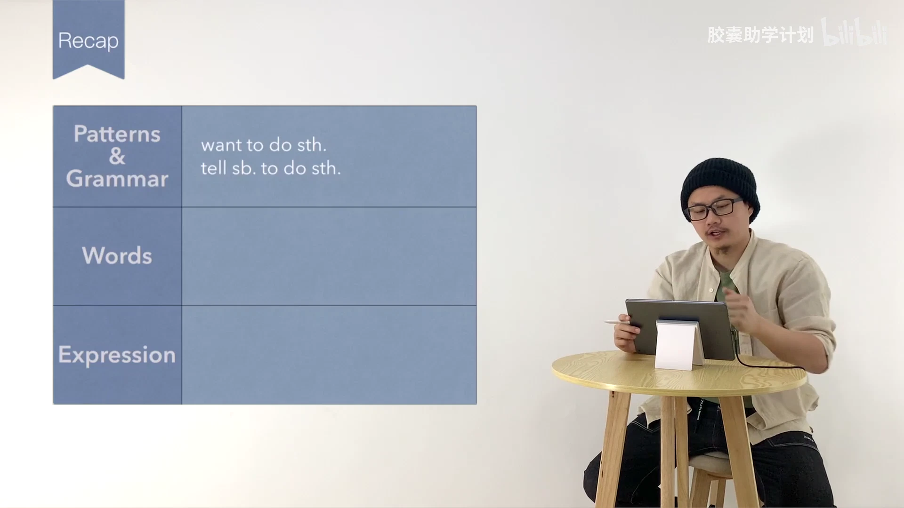

文字识别：胶囊助学计划 / Recap / Patterns / want to do sth. / tell sb. to do sth. / Grammar / Words / Expression

### 画面 00:07:12

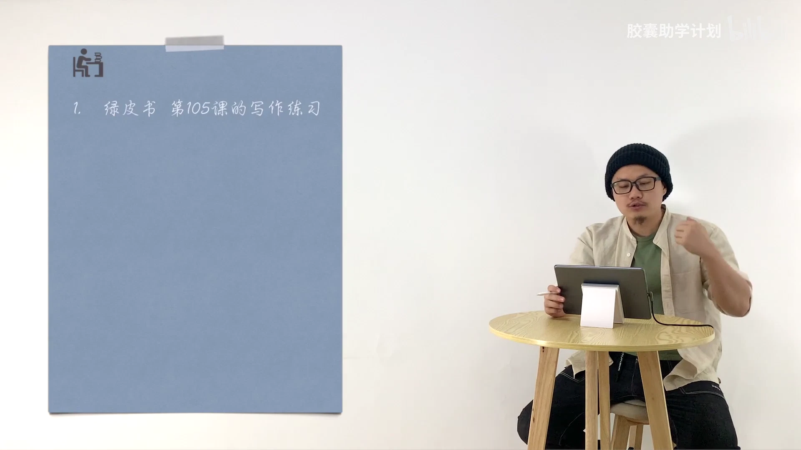

文字识别：胶囊助学计划 / 绿皮书第105课的写作练习

### 画面 00:07:21

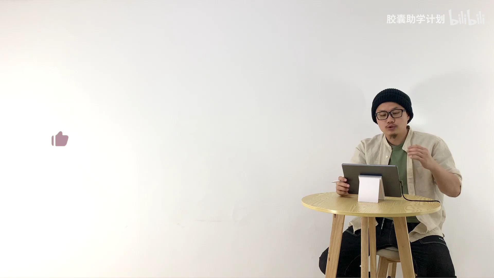

文字识别：胶囊助学计划 / bilL

### 画面 00:07:29

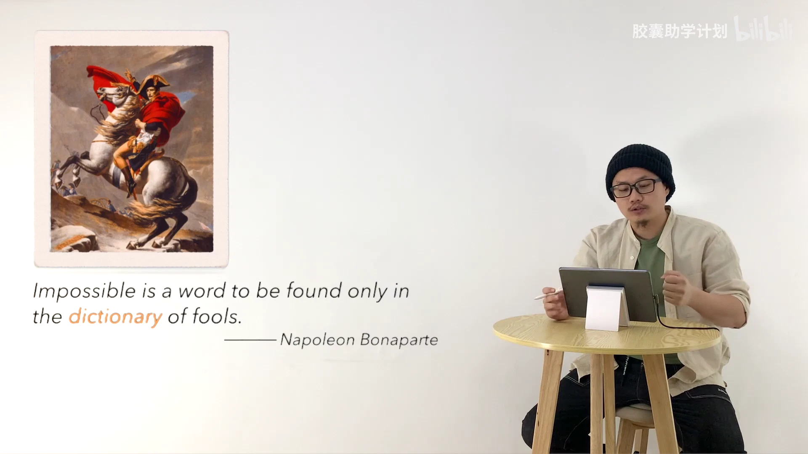

文字识别：胶囊助学计划 / Impossible is a word to be found only in / the dictionary of fools. / Napoleon Bonaparte

## 00:07:30–00:07:54

再来看一句名人名言。Impossible is a word to be found only in the dictionary of fools. See you next time.

### 画面 00:07:35

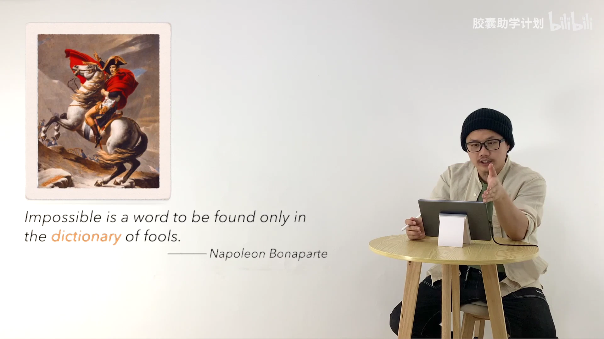

文字识别：胶囊助学计划blb出 / Impossible is a word to be found only in / the dictionary of fools. / -Napoleon Bonaparte

### 画面 00:07:42

### 画面 00:07:44

文字识别：CAPSULEACADEMY / 胶囊助学计划 / 小红书 / Lecturer / □ / Leo / OE

### 画面 00:07:46

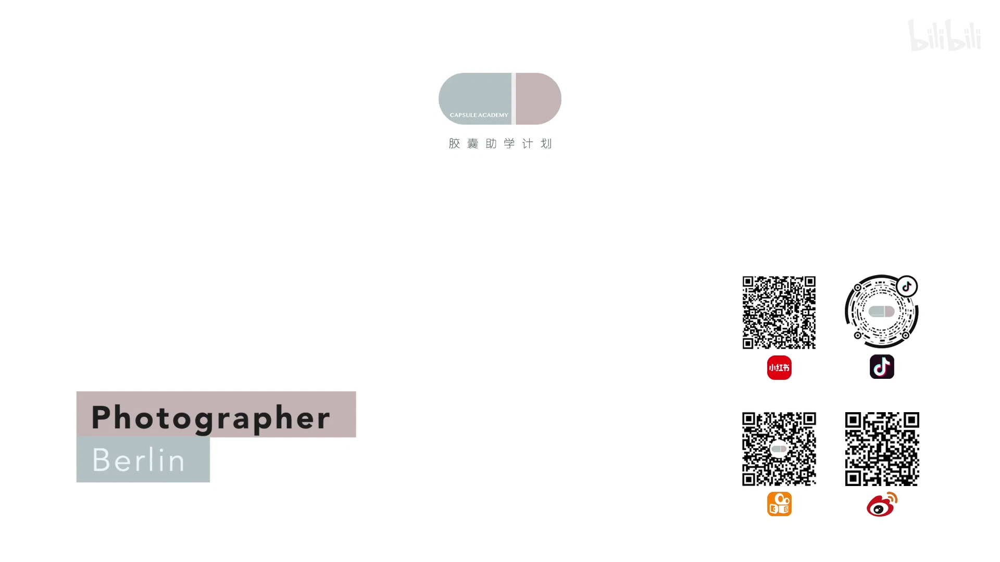

文字识别：CAPSULEACADEMY / 胶囊助学计划 / 『 / 小红书 / Photographer / Berlin / OE

### 画面 00:07:48

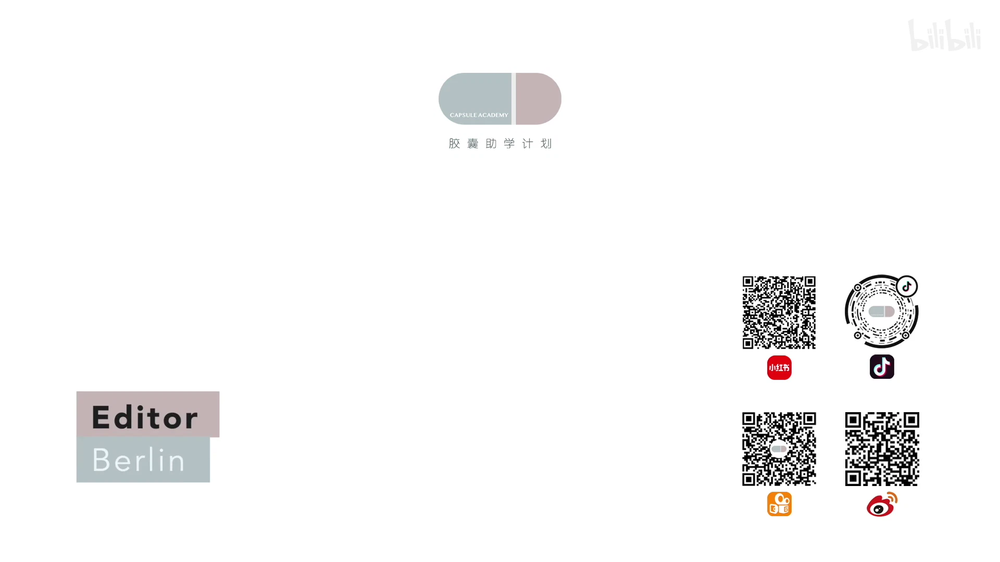

文字识别：CAPSULEACADEMY / 胶囊助学计划 / 『 / 小红书 / Editor / Berlin / OE

### 画面 00:07:51

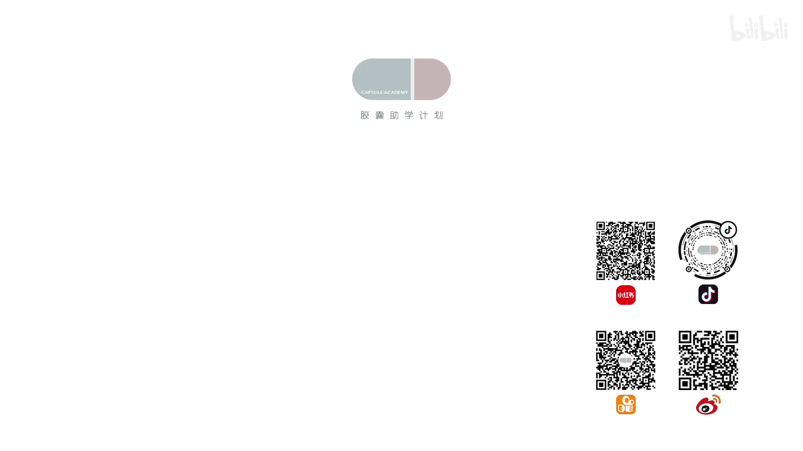

文字识别：CAPSULEACADEMY / 胶囊助学计划 / 『 / 小红书

### 画面 00:07:53

文字识别：bilibili / 胶囊助学计划

