# 107 单词 语法

快速机器解析：语音为单模型转写，未进行独立交叉校对或人工复核；画面每秒采样并按变化选帧，短时文字和标记可能遗漏。截图时间约有 1 秒误差。图片有损压缩；遇到疑点请按时间查看 Google Drive 原视频。

## 00:00:00–00:00:30

Hello everyone, welcome to Capsule Academy. This is Leo. Today we're going to learn New Concept English Book One, Lesson One Hundred and Seven, Grammar and Words. 那老习惯进入正式课程之前呢，我们看几个小的问题。那首先，形容词比较级、最高级它的构成长成什么样子？那接下来立刻要问到的就是如何去使用形容词的比较级和最高级。最后呢，我们再来看一个习惯表达，如何去表达随

### 画面 00:00:00

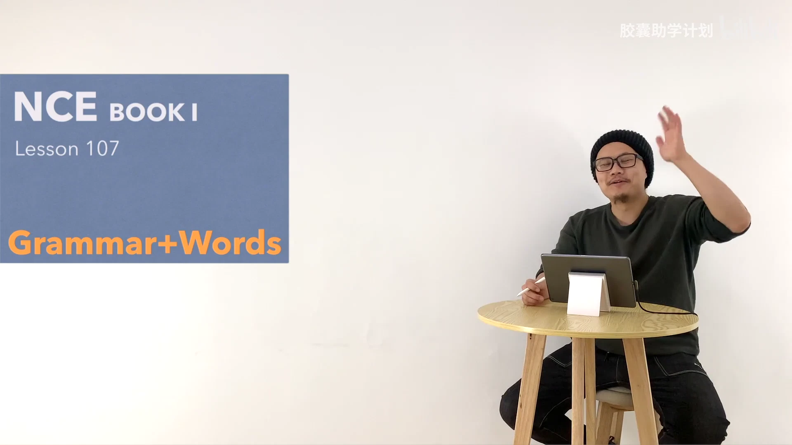

文字识别：胶囊助学计划 / NCE / BOOKI / Lesson 107 / Grammar+Words

### 画面 00:00:03

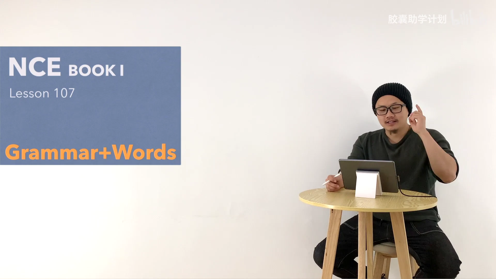

文字识别：胶囊助学计划 / NCE / BOOKI / Lesson 107 / Grammar+Words

### 画面 00:00:11

文字识别：2

### 画面 00:00:13

文字识别：adj.比较级&最高级构成? / 2

### 画面 00:00:18

文字识别：胶囊助学计划 / ① adj.比较级&最高级构成? / 2

### 画面 00:00:20

文字识别：胶囊助学计划 / ①adj.比较级&最高级构成? / 如何使用adj.比较级&最高级? / 2

### 画面 00:00:26

文字识别：①adj.比较级&最高级构成？ / 如何使用adj.比较级&最高级? / 如何表达“随你便”? / 2

## 00:00:30–00:01:00

你便啊，或随便你啊都行。OK，那带着这三个问题后皮边呢，enjoy。那我们先看本课非常关键的一个语法，从一百零七课一直到一百一十二课，我们都是在尝试去学习形容词的比较级和最高级，只不过是不同的一个模式，对吧？然后呢，我们在新概念二册的第一个单元也会继续带

### 画面 00:00:31

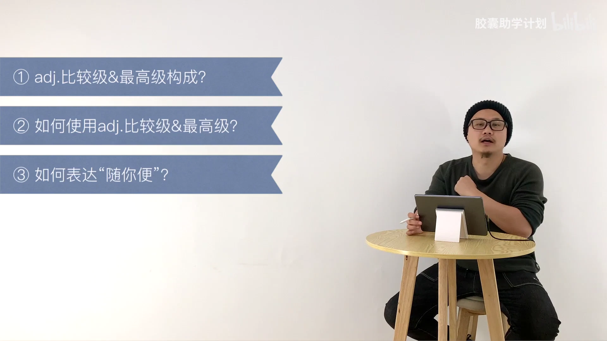

文字识别：胶囊助学计划 / adj.比较级&最高级构成? / 如何使用adj.比较级&最高级? / 如何表达“随你便”? / 2

### 画面 00:00:36

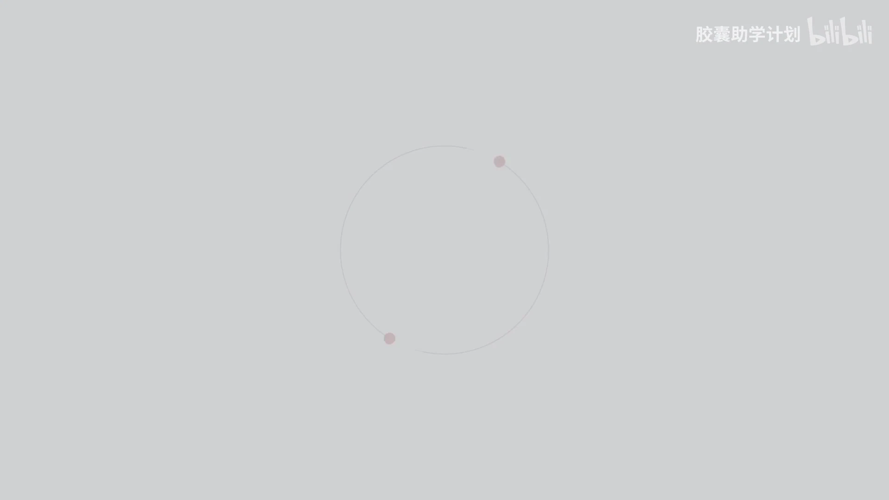

文字识别：胶囊助学计划b出l / •

### 画面 00:00:40

### 画面 00:00:42

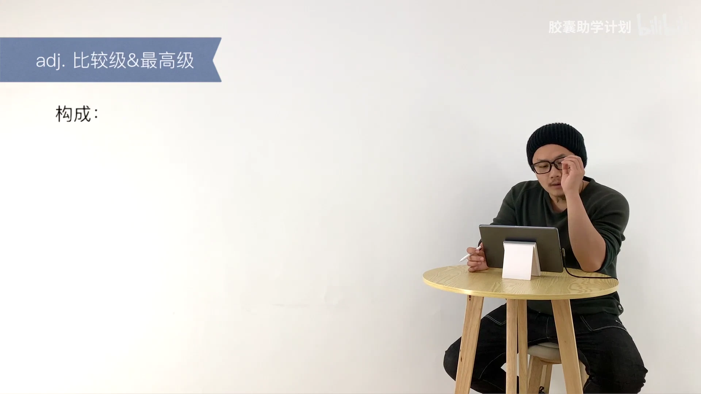

文字识别：胶囊助学计划 / adj.比较级&最高级 / 构成：

### 画面 00:00:51

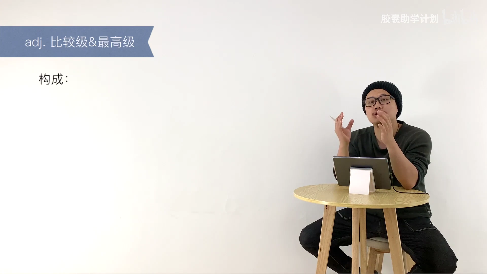

文字识别：胶囊助学计划 / adj.比较级&最高级 / 构成：

### 画面 00:00:53

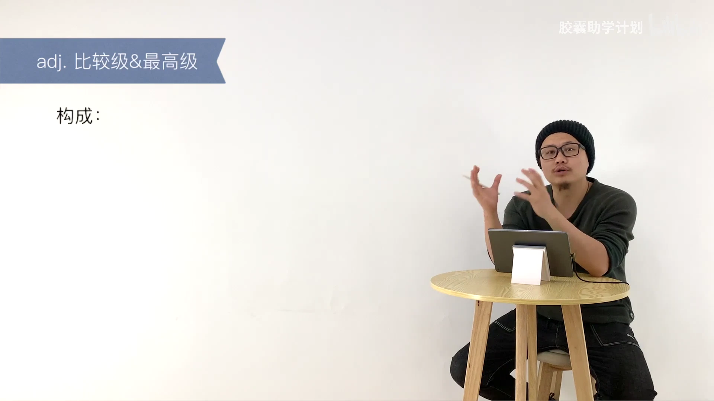

文字识别：胶囊助学计划 / adj.比较级&最高级 / 构成：

## 00:01:00–00:01:30

大家去复习这个语法。那我们先从它的名字上尝试去理解，什么叫形容词的比较级，什么叫最高级，对吧？它这是一个学术术语，简单来说就是好、更好、最好啊。好就是形容词，对吧？那比它更好呢？我们汉语叫更好，对吧？用更这个字加上一个字去表示形容词的比较级，用最这个字去表示形容词的最高级。而英文呢？哎，各位，目前为止我们学了这么多，对吧？什么？

### 画面 00:01:23

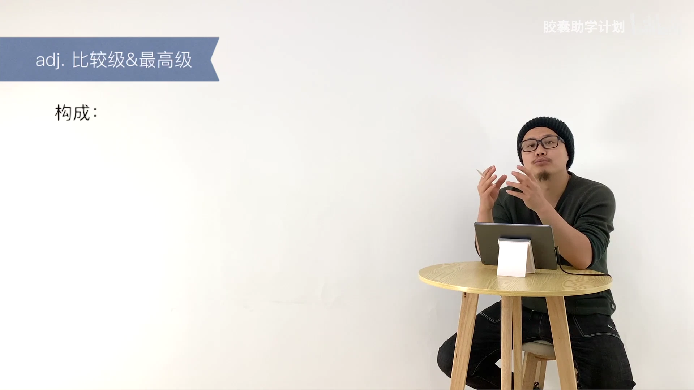

文字识别：胶囊助学计划 / adj.比较级&最高级 / 构成： / 2

## 00:01:30–00:02:00

比如说动词的各种词尾变化，名词的各种词尾变化啊，我们甚至还学了一点点形容词、副词，是吧？副词的这个词尾 l v 啊 l y 结尾这个呃字母变化。今天呢，我们就一起来看一下形容词字母也有变化，是吧？当然不是很难啊。我们先看第一个，比如说如果你是单音节形容词，你直接加 e r e s t，这是一个最大范围最广泛的一个规则。那我们就要解决几个问题啊。第一，什么是形容词，我就不

### 画面 00:01:48

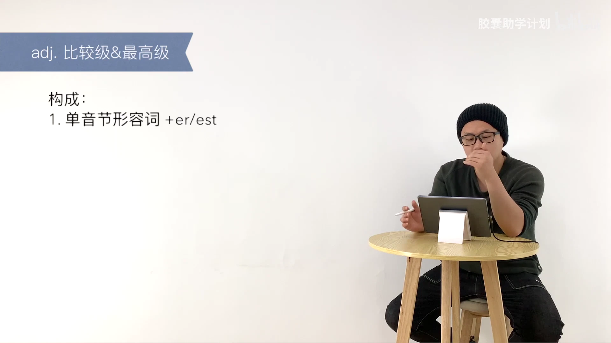

文字识别：adj.比较级&最高级 / 构成： / 1.单音节形容词+er/est / 2

### 画面 00:01:51

文字识别：adj.比较级&最高级 / 构成： / 1.单音节形容词+er/est / 2

### 画面 00:01:53

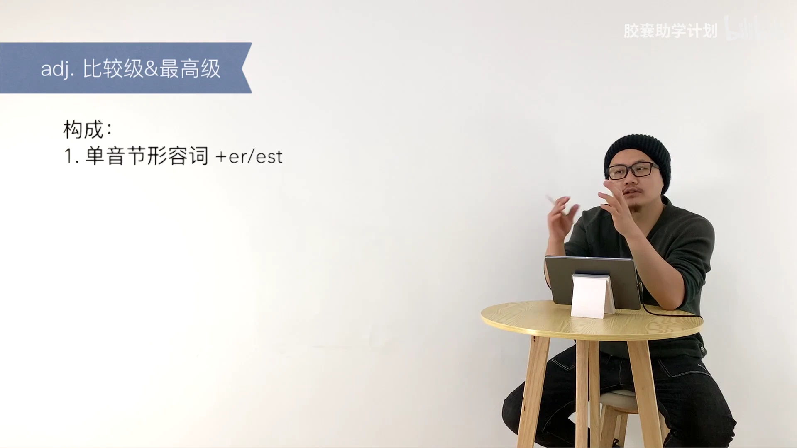

文字识别：胶囊助学计划 / adj.比较级&最高级 / 构成： / 1.单音节形容词+er/est / 2

## 00:02:00–00:02:30

解释了。那什么叫单音节？这个就要涉及到各位有没有认真去看我们的音标课程，对吧？我们音标课程，尤其是在音标的，你看我们第一个音标课程是元音音标，第二是辅音音标，第三个就是去讲了一下什么叫音节。最简单来说，就是这个单词有几个元音音标，就有几个音节。那单音节形容词、单音节单词，顾名思义，就是这个单词

### 画面 00:02:01

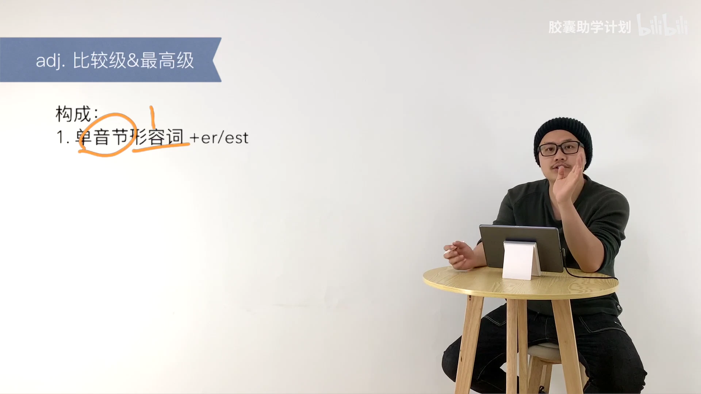

文字识别：胶囊助学计划 / adj.比较级&最高级 / 构成： / 1.单音节形容词+er/est / 2

### 画面 00:02:03

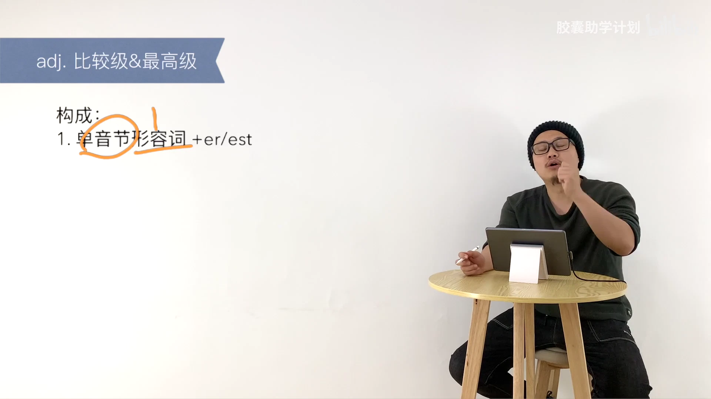

文字识别：胶囊助学计划 / adj.比较级&最高级 / 构成： / 1.单音节形容词+er/est

## 00:02:30–00:03:00

当中只有一个元音音标，OK好，比如说我们举例子叫small啊，这个单词叫小。那如果你想说更小呢，很简单，我们直接在词尾加上一个e r啊，叫做smaller，OK。那如果说最小呢，就是在它的词尾加上三个字母叫e s t，所以我们管它叫smalllest，叫做最小的small，smaller，smalllest，OK very good。那我们再举一个例子，比如说new叫新，那更

### 画面 00:02:33

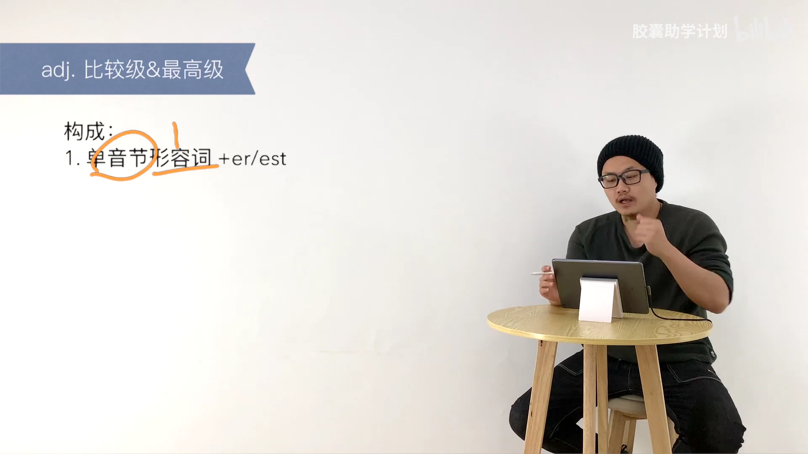

文字识别：胶囊助学计划 / adj.比较级&最高级 / 构成： / 1.单音节形容词+er/est

### 画面 00:02:36

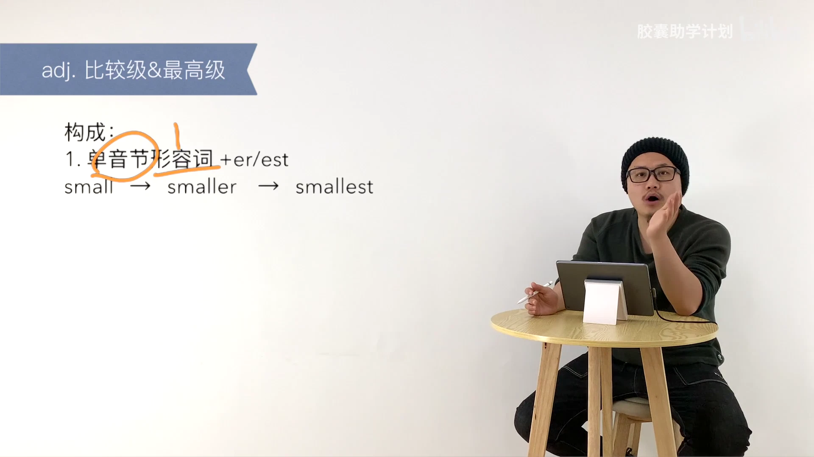

文字识别：胶囊助学计划 / adj.比较级&最高级 / 构成： / 1.单音节形容词+er/est / small→ smaller → smallest

### 画面 00:02:41

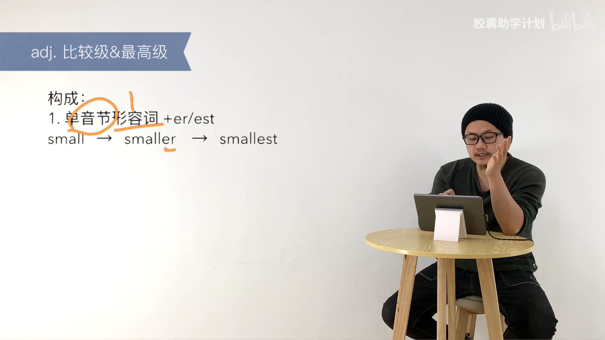

文字识别：胶囊助学计划 / adj.比较级&最高级 / 构成： / 1.单音节形容词+er/est / smaller / → smallest / small / 2

### 画面 00:02:49

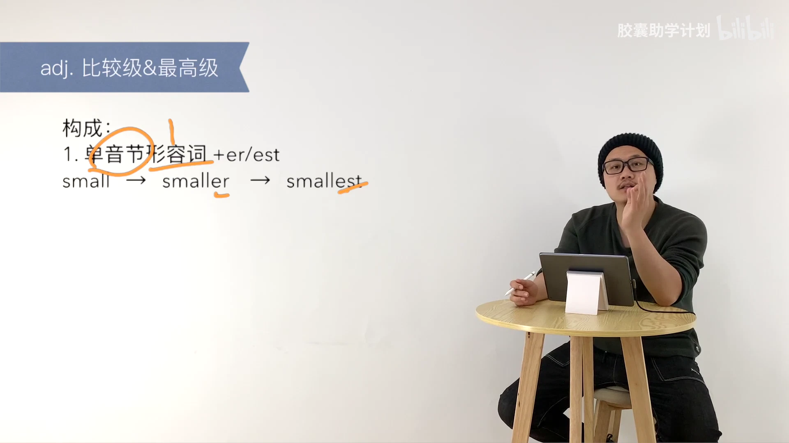

文字识别：胶囊助学计划 / adj.比较级&最高级 / 构成： / 1.单音节形容词+er/est / smaller / → smallest / smallJ / 2

## 00:03:00–00:03:30

新呢叫做 newer，最新呢叫做 newest。 OK，那后边直接加 e r e s t，那剩下 old 是一个道理，直接加 e r 再加 e s t。 OK，那在这儿我想先提前说一句，各位我们在新概念一册开篇那个视频当中就讲到了，您需要在上课之前准备一个字典，对吧？这不管是您学新一学新二，包括我们的人在纽约的课程都需要做的事情。这个字典或词典当中呢，

### 画面 00:03:04

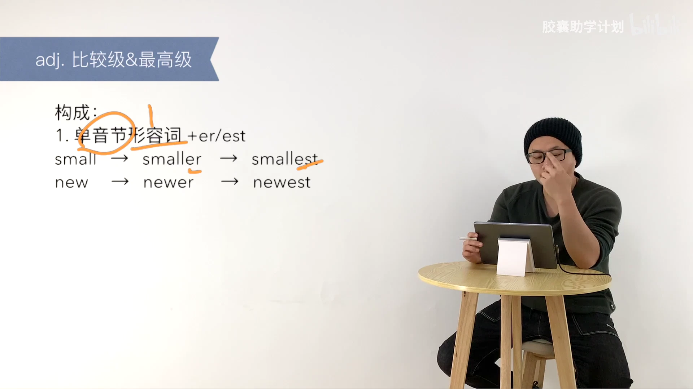

文字识别：胶囊助学计划 / adj.比较级&最高级 / 构成： / 1.单音节形容词+er/est / small→ / smaller / → / smallest / new / newer / newest / 2

### 画面 00:03:11

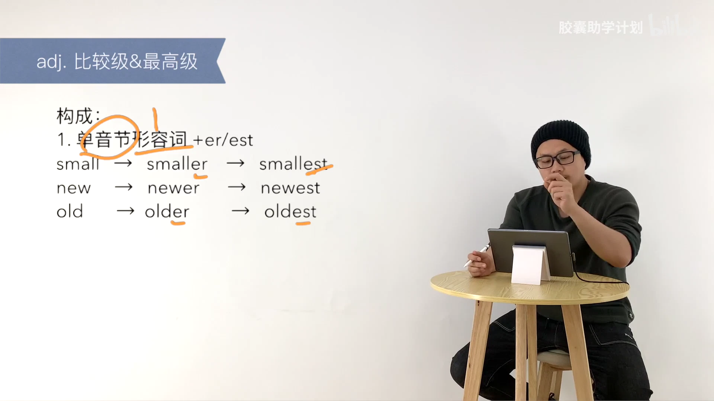

文字识别：胶囊助学计划 / adj.比较级&最高级 / 构成： / 1.单音节形容词+er/est / smaller / smallest / small→ / new / newer / newest / old / → older / oldest / 2

### 画面 00:03:17

文字识别：胶囊助学计划 / adj.比较级&最高级 / 构成： / 1.单音节形容词+er/est / small→ / smaller / → / smallest / new / newer / newest / old / → older / oldest / 2

### 画面 00:03:24

文字识别：胶囊助学计划 / adj.比较级&最高级 / 构成： / 1.单音节形容词+er/est / smaller / smallest / small→ / new / newer / newest / old / → older / oldest

## 00:03:30–00:04:00

如果您去查 old，呃形容词，那它理论上来说应该给您标下来说它的形容词长什么样，哎啊它的这个比较级长什么样，它的最高级的拼写长成什么样子啊？您可以不妨现在暂停视频，拿自己的这个手机词典去看一下有没有这个功能，对吧？比如说您就查一下 small 后边它有没有给你标下来比较级 smaller 最高级 smallest。OK，那第二个，它也是像我们之前学动词

### 画面 00:03:30

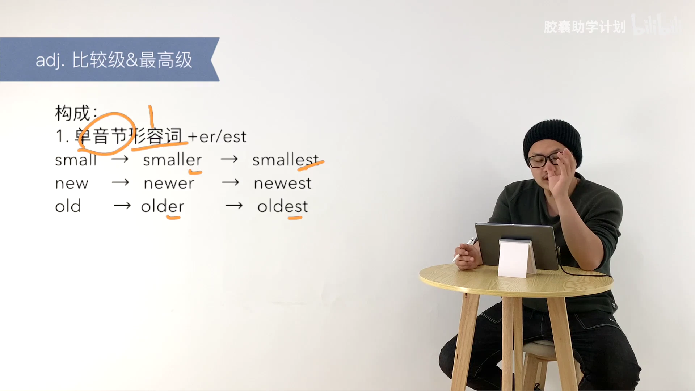

文字识别：胶囊助学计划 / adj.比较级&最高级 / 构成： / 1.单音节形容词+er/est / small→ / smaller / → / smallest / new / newer / newest / old / → older / oldest

### 画面 00:03:53

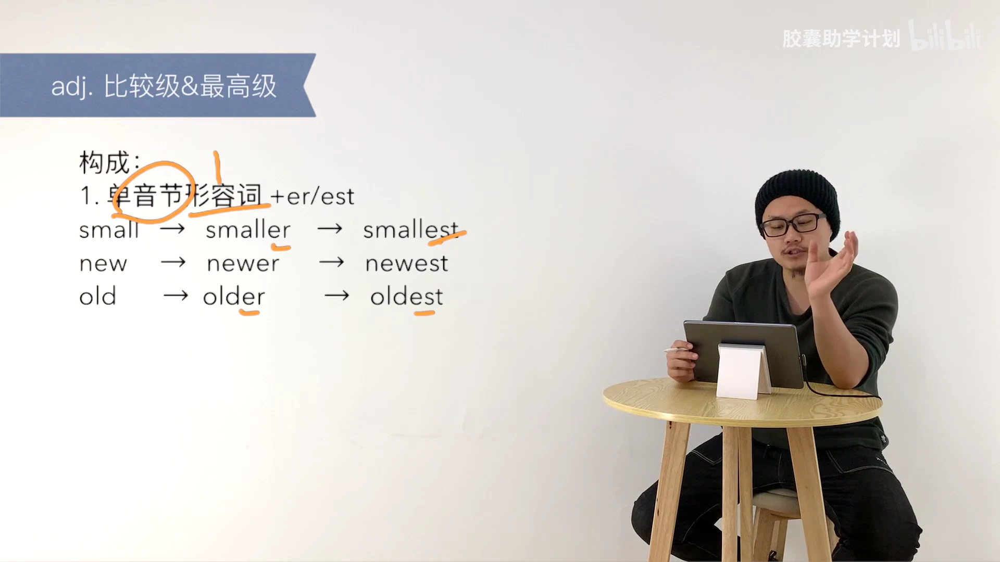

文字识别：胶囊助学计划 / adj.比较级&最高级 / 构成： / 1.单音节形容词+er/est / small→ / smaller / → / smallest / new / newer / newest / old / → older / oldest

### 画面 00:03:56

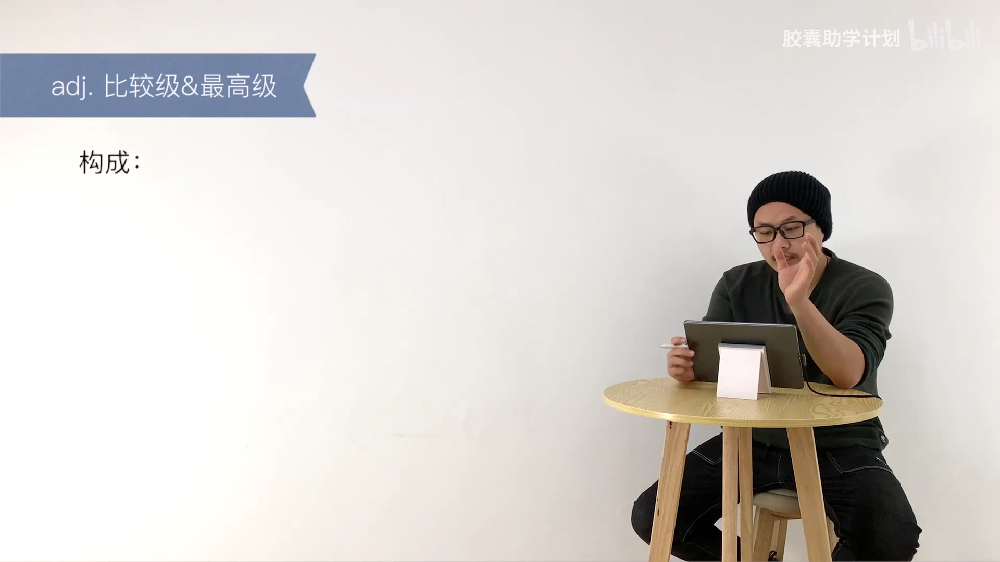

文字识别：胶囊助学计划 / adj.比较级&最高级 / 构成：

### 画面 00:03:58

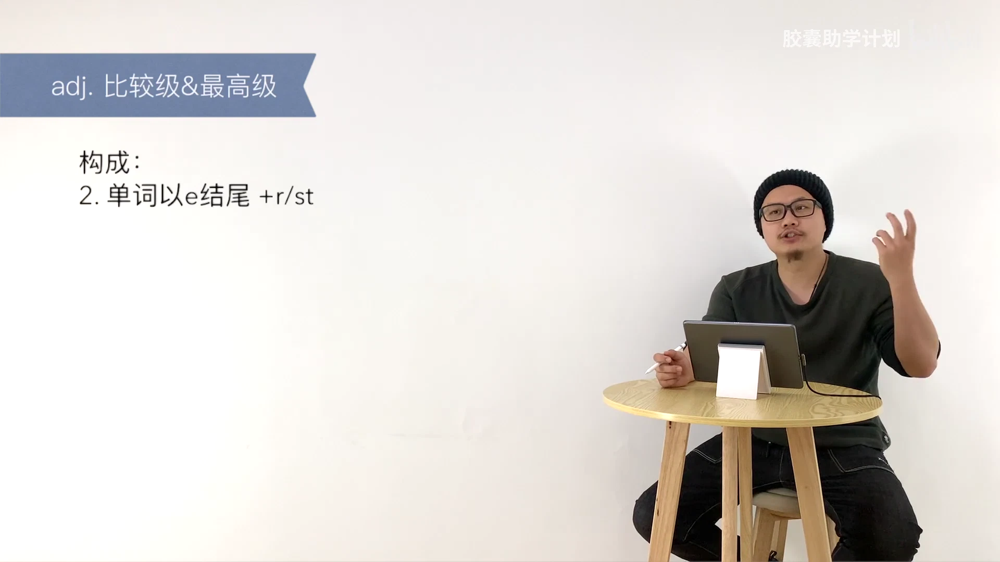

文字识别：胶囊助学计划 / adj.比较级&最高级 / 构成： / 2.单词以e结尾+r/st

## 00:04:00–00:04:30

名词的变化，名词复数变化，对吧？动词的各种形式变化一样，它也有一些规则。比如说单词如果是以e结尾的，一般我们直接加r或st，其实还是e r e s t，对吧？比如说large是以e结尾的，哎，为了方便起见，直接您加个r就行了，不用再加个e e r，是吧？所以它叫larger，更大，largest叫做最大的，玩一个。接下来比如说nice啊，人非常的好啊，nicer更好，nicest

### 画面 00:04:07

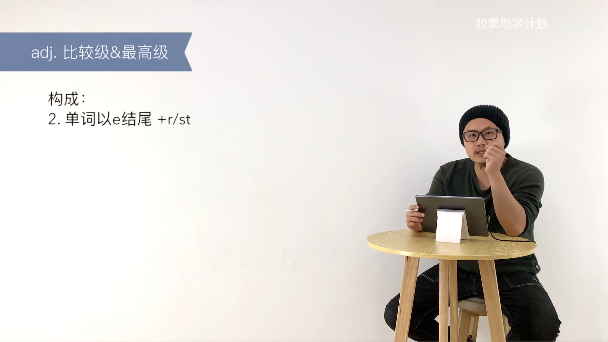

文字识别：adj. 比较级&最高级 / 构成： / 2.单词以e结尾+r/st / 2

### 画面 00:04:09

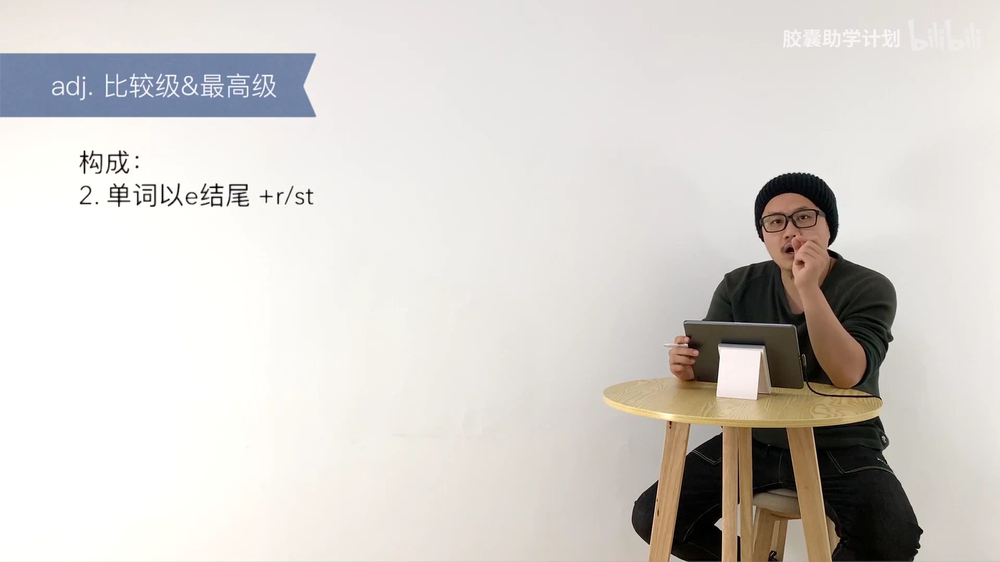

文字识别：胶囊助学计划 / adj.比较级&最高级 / 构成： / 2.单词以e结尾+r/st

### 画面 00:04:18

文字识别：胶囊助学计划 / adj. 比较级&最高级 / 构成： / 2.单词以e结尾+r/st / large / → larger → largest / 2

## 00:04:30–00:05:00

叫做最好的，还是直接加了r和st。再往下，第三个，如果是辅音字母加y结尾的，我们就把y变成i，再加er,est。比如说啊，我们在这儿其实是这样的，它这个规则不完全如此。但是呢，我们要学到一百一十一课的时候才能完全确定啊。所以我们现在先不着急，我们先按这个规则去看。比如说辅音字母t加y结尾，对吧？然后呢，我们

### 画面 00:04:34

文字识别：胶囊助学计划 / adj.比较级&最高级 / 构成：

### 画面 00:04:36

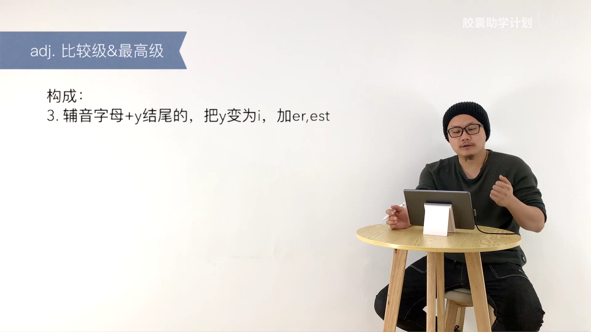

文字识别：胶囊助学计划 / adj.比较级&最高级 / 构成： / 3.辅音字母+y结尾的，把y变为i，加er,est

### 画面 00:04:39

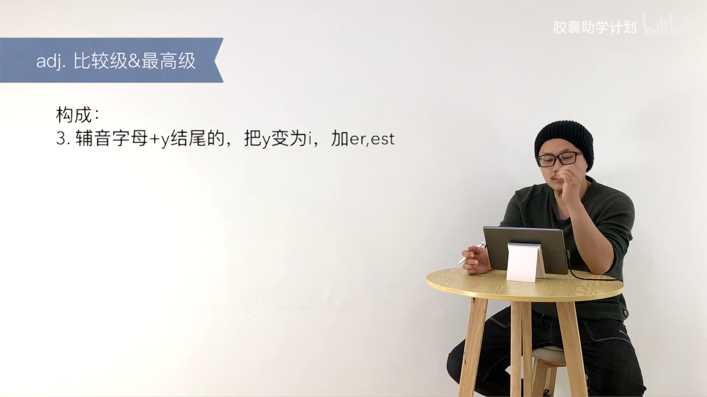

文字识别：胶囊助学计划 / adj.比较级&最高级 / 构成： / 3.辅音字母+y结尾的，把y变为i，加er,est

### 画面 00:04:47

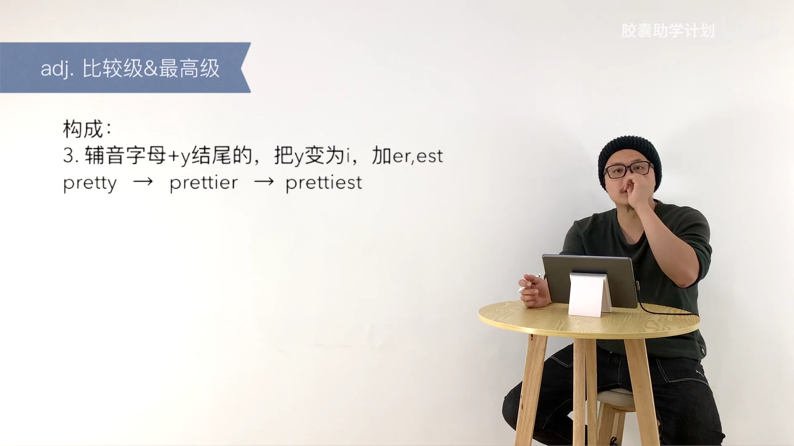

文字识别：胶囊助学计划 / adj.比较级&最高级 / 构成： / 3.辅音字母+y结尾的，把y变为i，加er,est / pretty → prettier → prettiest

### 画面 00:04:56

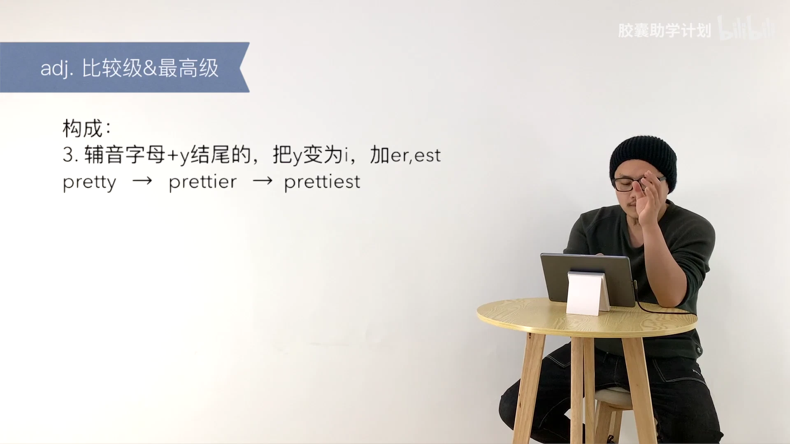

文字识别：胶囊助学计划 / adj.比较级&最高级 / 构成： / 3.辅音字母+y结尾的，把y变为i，加er,est / pretty → prettier → prettiest

## 00:05:00–00:05:30

变y为i加e r prettier和最美丽的叫 prettiest对吧？玩一个，我们再来一个，比如说 easy啊简单，那s加y结尾变y为i加e r变y为i加e s t含义不变，叫做 easiest。 OK，好，再往下来 heavy变y为i加e r变y为i加e s t。 OK，玩一个，那不多说了。下一个说我们如果是辅元辅字母，那

### 画面 00:05:04

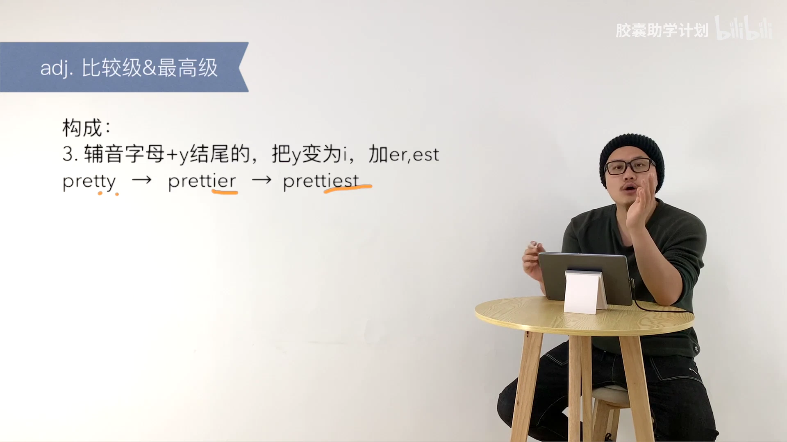

文字识别：胶囊助学计划 / adj.比较级&最高级 / 构成： / 3.辅音字母+y结尾的，把y变为i，加er,est / pretty → prettier → prettiest

### 画面 00:05:16

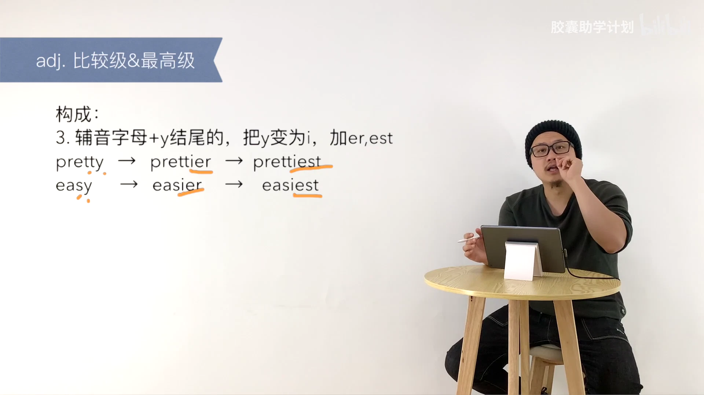

文字识别：胶囊助学计划 / adj.比较级&最高级 / 构成： / 3.辅音字母+y结尾的，把y变为i，加er,est / pretty → / prettier →prettiest / easy / easier / easiest

### 画面 00:05:21

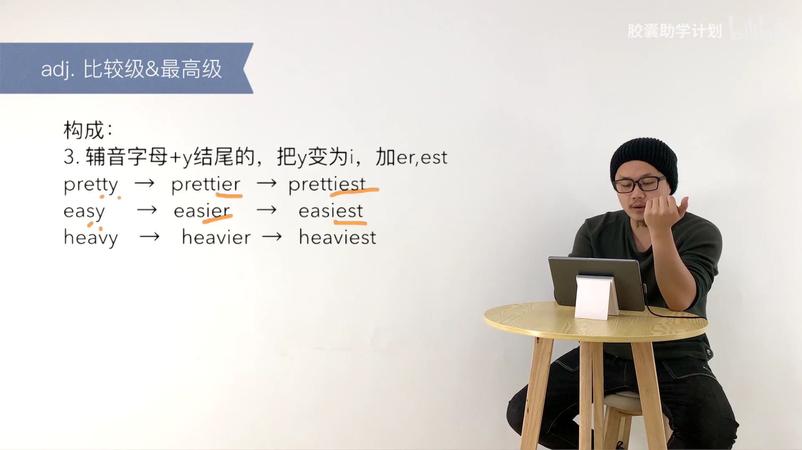

文字识别：胶囊助学计划 / adj.比较级&最高级 / 构成： / 3.辅音字母+y结尾的，把y变为i，加er,est / pretty  / prettier →prettiest / easy / easier / easiest / heavy / heavier → heaviest

### 画面 00:05:25

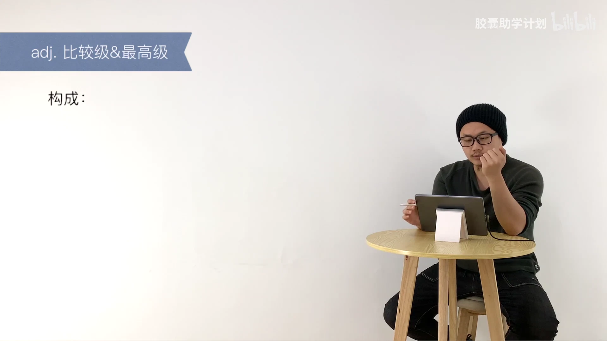

文字识别：胶囊助学计划 / adj.比较级&最高级 / 构成：

## 00:05:30–00:06:00

你双写末尾的那个辅音字母，然后加 e r e s t。我们举个例子，比如说 big，你双写，然后加 e r，双写加 e s t，是不是有点像我们之前学过的动词的某些变化的时候是要双写的？比如说 sit 变成 sitting 也是要双写的，对吧？然后当时我提到了一个规则，如果各位还记得的话，就是说当这个规则，呃，您去了解它的麻烦程度已经超过了它

### 画面 00:05:34

文字识别：胶囊助学计划 / adj.比较级&最高级 / 构成： / 4.辅+元+辅，双写末尾辅音字母，加er,est / big / → / bigger → biggest

### 画面 00:05:43

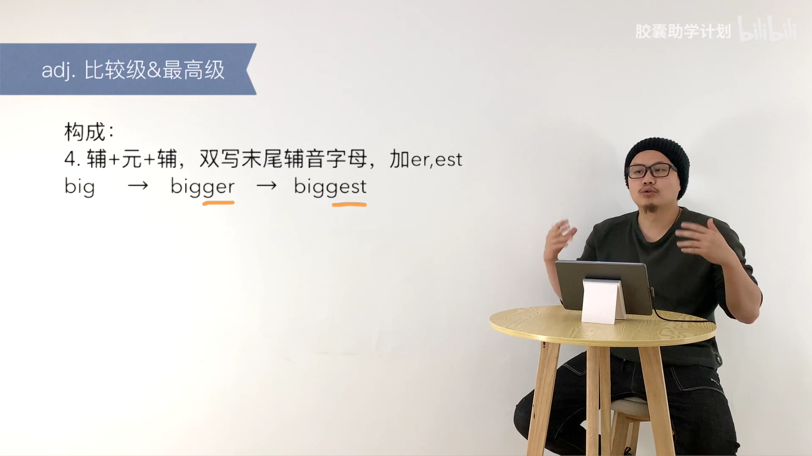

文字识别：胶囊助学计划 / adj.比较级&最高级 / 构成： / 4.辅+元+辅，双写末尾辅音字母，加er,est / big / → / bigger / biggest

### 画面 00:05:46

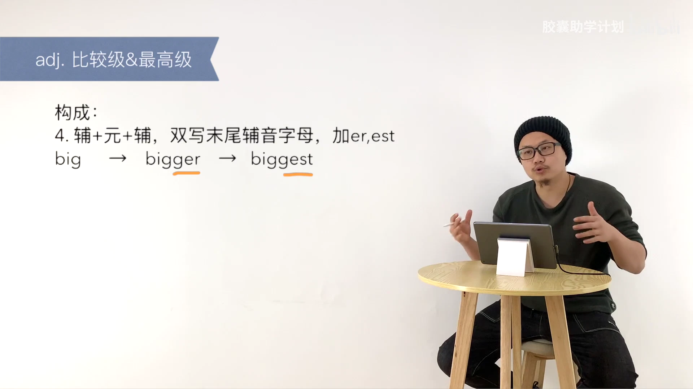

文字识别：adj.比较级&最高级 / 构成： / 4.辅+元+辅，双写末尾辅音字母，加er,est / big / → / bigger / biggest

## 00:06:00–00:06:30

的实际应用程度的时候，那您不妨其实忽略这个规则，不要那么教条，对吧？我们尝试忽略这个规则，但是呢，更重视它每一个具体的案例就好了。比如说，在这个规则下，就是这个辅元辅双写字母，这个其实不是那么重要。对于各位来说，您把这几个单词记下来，其实反而更重要，对吧？Bigger, biggest，再来，hot啊，或hot, hot都可以，两个发音都OK，都没没有问题啊。那你可以说hotter或者hottest，very

### 画面 00:06:12

文字识别：胶囊助学计划 / adj.比较级&最高级 / 构成： / 4.辅+元+辅，双写末尾辅音字母，加er,est / big / → / bigger / biggest / 2

### 画面 00:06:14

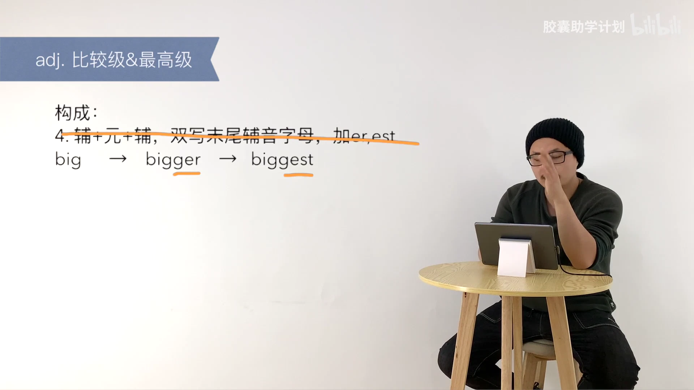

文字识别：胶囊助学计划 / adj. / 比较级&最高级 / 构成： / 双写去层铺音字母。 / hnor est / big / bigger / biggest / → / →

### 画面 00:06:16

文字识别：胶囊助学计划 / adj.比较级&最高级 / 构成： / 4.辅+元+辅，双写末尾辅音字母，加er,est / big / → / bigger / biggest

### 画面 00:06:20

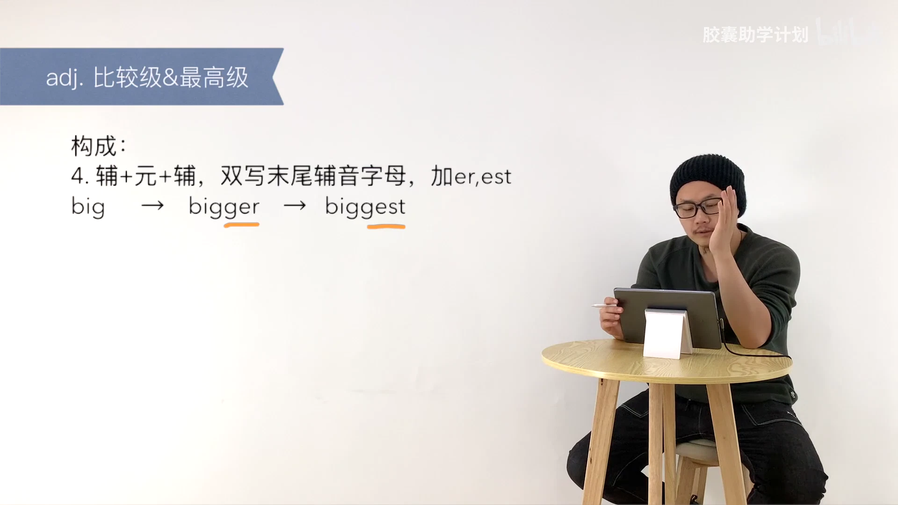

文字识别：胶囊助学计划 / adj.比较级&最高级 / 构成： / 4.辅+元+辅，双写末尾辅音字母，加er,est / big / → / bigger / biggest

### 画面 00:06:24

文字识别：胶囊助学计划 / adj.比较级&最高级 / 构成： / 4.辅+元+辅，双写末尾辅音字母，加er,est / big / → / bigger / r → biggest / hot / → / hotter → hottest

## 00:06:30–00:07:00

very good.比如说, fat, fatter, fattest, very good.啊，不多说了。我们刚才说了它的一些构成，呃，不管它不管是直接二直接加二s t还是变y v i加还是双写加，反正整体上来说，对于各位目前能记住的，只要您记住一条信息，我认为就够了。就是如果一个形容词它后边加了个e r或e s t，它很可能是这

### 画面 00:06:31

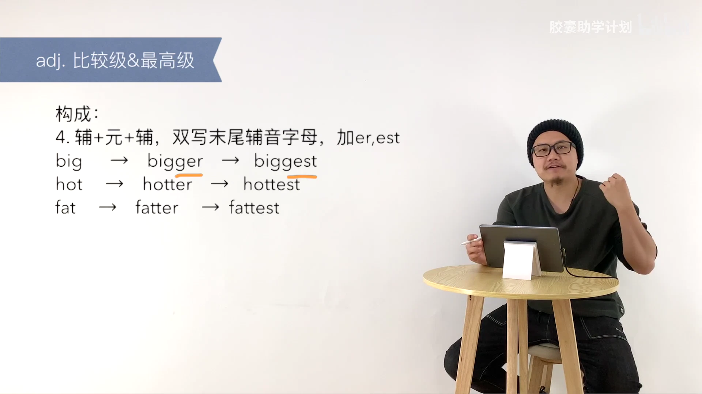

文字识别：胶囊助学计划 / adj.比较级&最高级 / 构成： / 4.辅+元+辅，双写末尾辅音字母，加er,est / big / → / bigger → biggest / hot / → / hotter → hottest / fat / → fatter / → fattest

### 画面 00:06:34

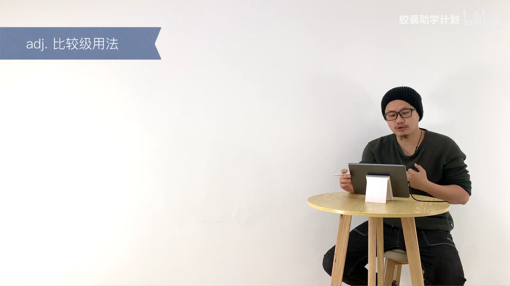

文字识别：胶囊助学计划 / adj.比较级用法

## 00:07:00–00:07:30

个形容词的比较级最高级，表示更或最。您只要把这一个点记下来就行了。剩下那些规则是我们要慢慢学的过程当中一点一点把它去内化掉的，对吧？OK，那接下来呢，我们说一下形容词比较级，分别讲一下啊比较级和最高级的用法。我们先提比较级，来，我们先给大家一个公式啊，这是老习惯，主语加be。那be对于各位目前来说就是五个单词，应该

### 画面 00:07:04

文字识别：胶囊助学计划 / adj.比较级用法

### 画面 00:07:09

文字识别：胶囊助学计划 / adj.比较级用法 / 2

### 画面 00:07:11

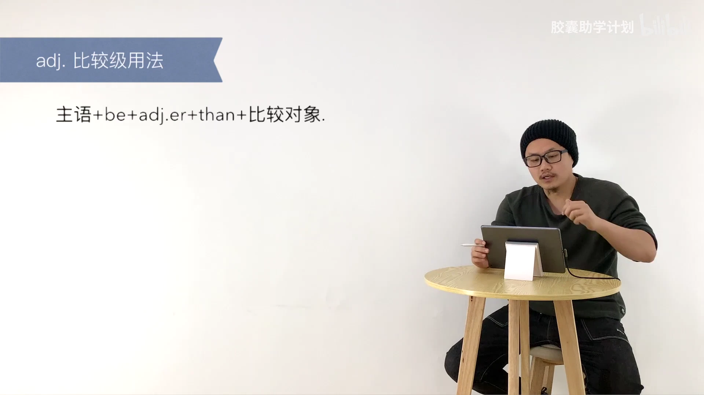

文字识别：胶囊助学计划 / adj.比较级用法 / 主语+be+adj.er+than+比较对象.

### 画面 00:07:21

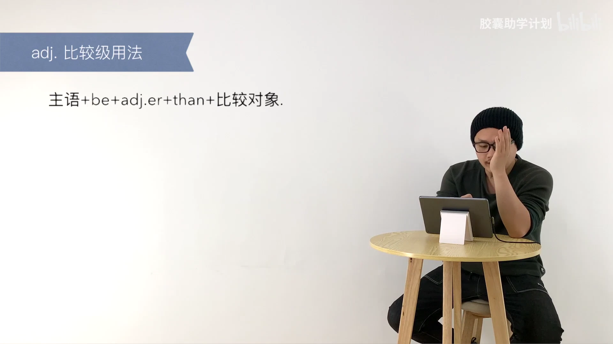

文字识别：胶囊助学计划 / adj.比较级用法 / 主语+be+adj.er+than+比较对象.

### 画面 00:07:27

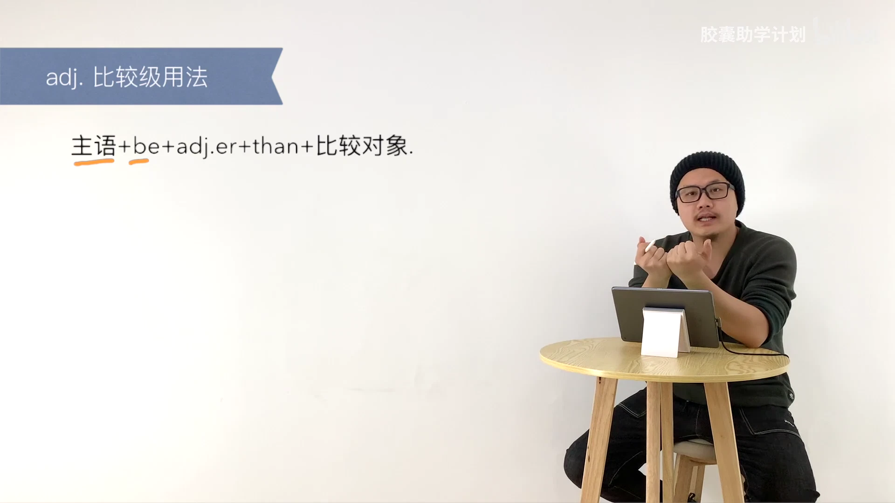

文字识别：胶囊助学计划 / adj.比较级用法 / 主语+be+adj.er+than+比较对象.

## 00:07:30–00:08:00

am is are was were，对吧？这取决于你想说的是现在还是过去。再然后呢，形容词一二是想提醒各位，这个地方指的是更怎么怎么样。比如说他更老，那叫做 he is older，对吧？好，than than的这个单词在这儿，您就可以把它尝试翻译成叫比，比谁呢？比较对象，比如说比我父亲叫 than my father。

### 画面 00:07:36

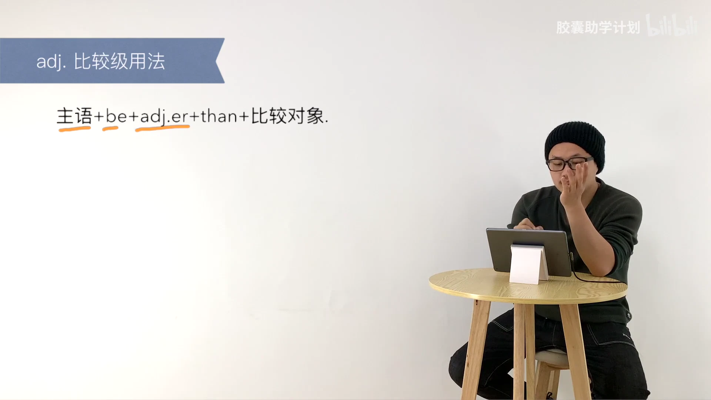

文字识别：胶囊助学计划 / adj.比较级用法 / 主语+be+adj.er+than+比较对象.

### 画面 00:07:38

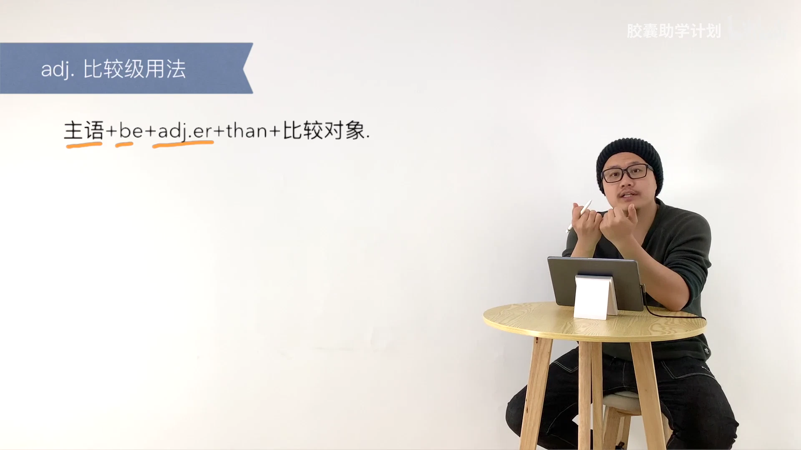

文字识别：胶囊助学计划 / adj.比较级用法 / 主语+be+adj.er+than+比较对象.

### 画面 00:07:42

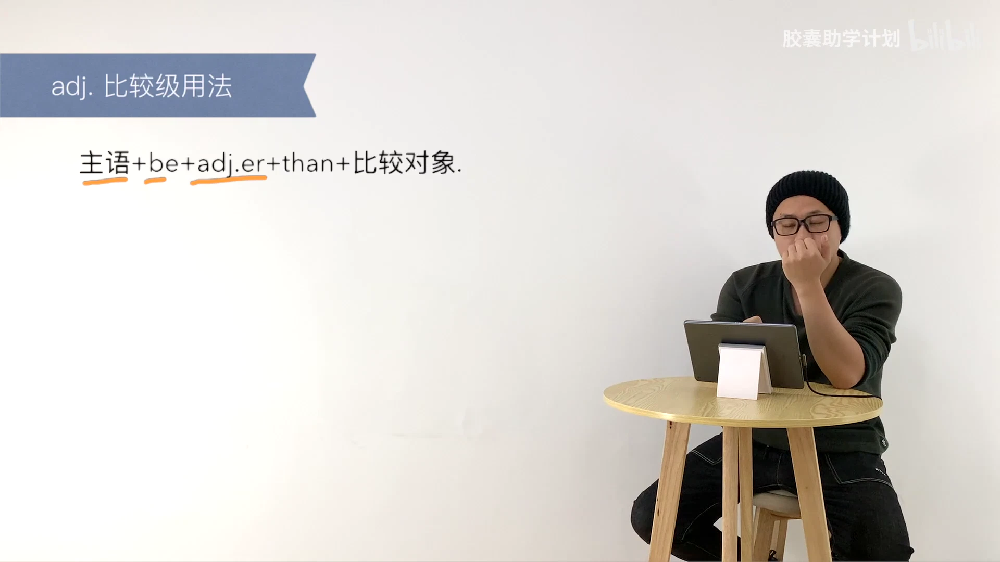

文字识别：胶囊助学计划 / adj.比较级用法 / 主语+be+adj.er+than+比较对象. / 2

### 画面 00:07:50

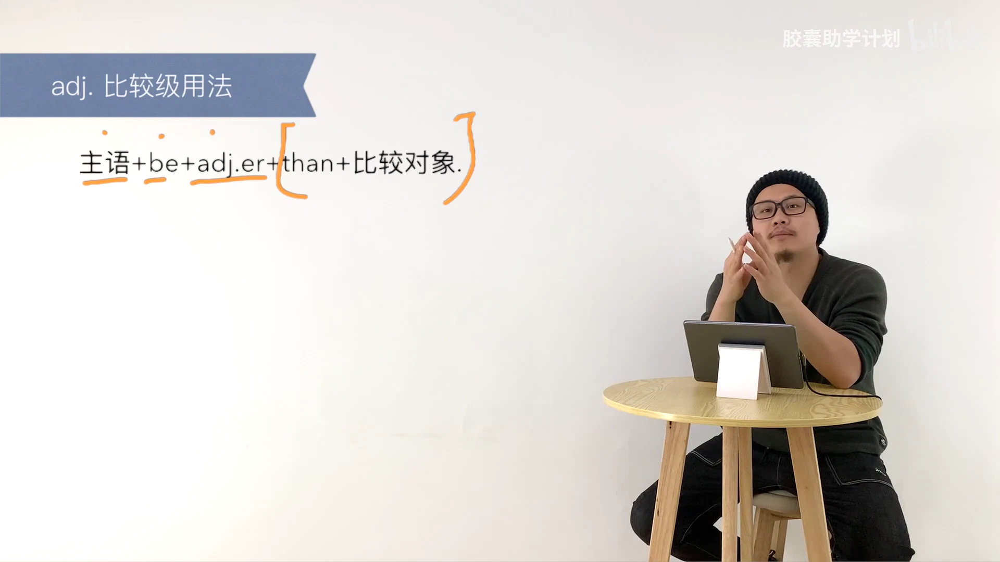

文字识别：胶囊助学计划 / adj.比较级用法 / 主语+be+adj.er+than+比较对象.

## 00:08:00–00:08:30

Okay,那我们先给大家一个句子啊，我们拿这个句子尝试去套一下，看这个公式满不满足。That man is主语，am is b我们选择了is形容词e r叫that man is older.好，比的是谁呢？比的是than this woman. Okay,其实各位仔细去想，我们不看这个括号中间的内容，than this woman这三个单词我

### 画面 00:08:02

文字识别：胶囊助学计划 / adj.比较级用法 / 主语+be+adj.er+than+比较对象. / That man is older than this woman. / 2

### 画面 00:08:05

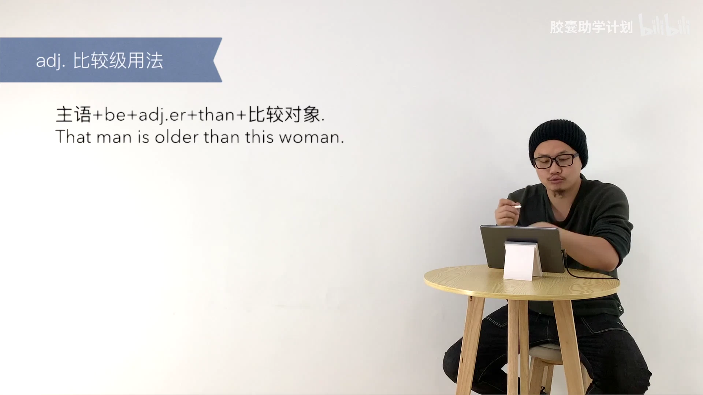

文字识别：胶囊助学计划 / adj.比较级用法 / 主语+be+adj.er+than+比较对象. / That man is older than this woman. / S

### 画面 00:08:10

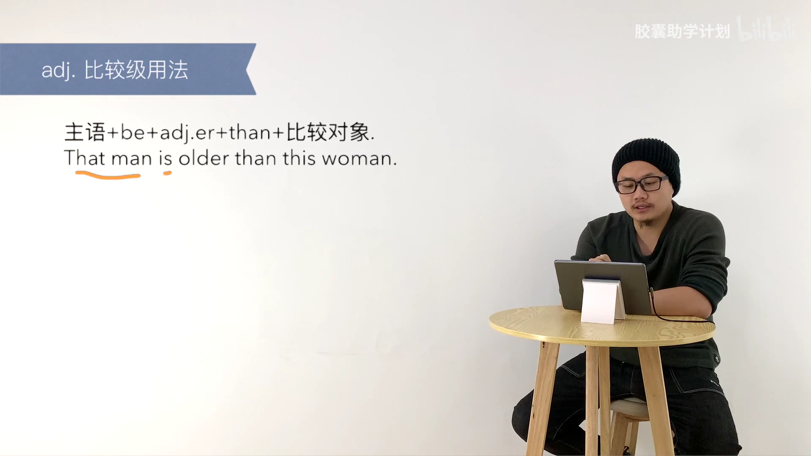

文字识别：胶囊助学计划 / adj.比较级用法 / 主语+be+adj.er+than+比较对象. / That man is older than this woman. / 2

### 画面 00:08:20

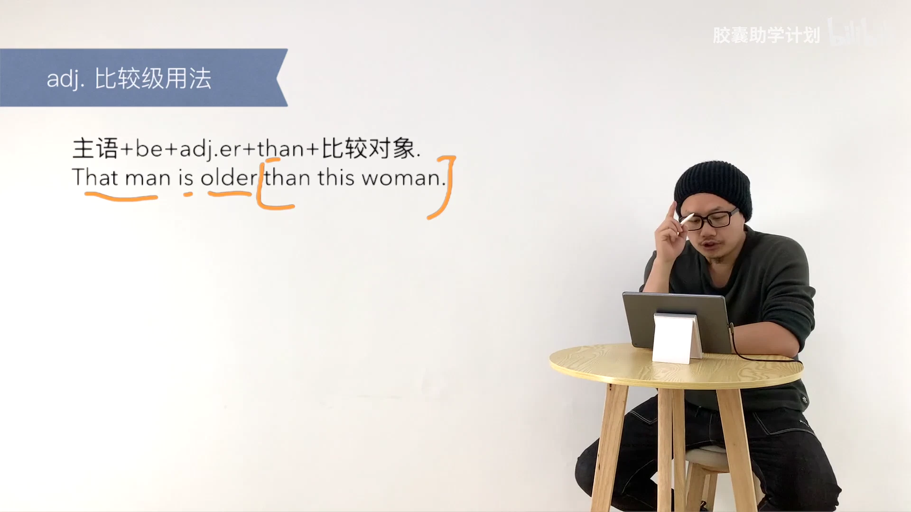

文字识别：胶囊助学计划 / adj.比较级用法 / 主语+be+adj.er+than+比较对象. / That man is olderthan this woman.

### 画面 00:08:24

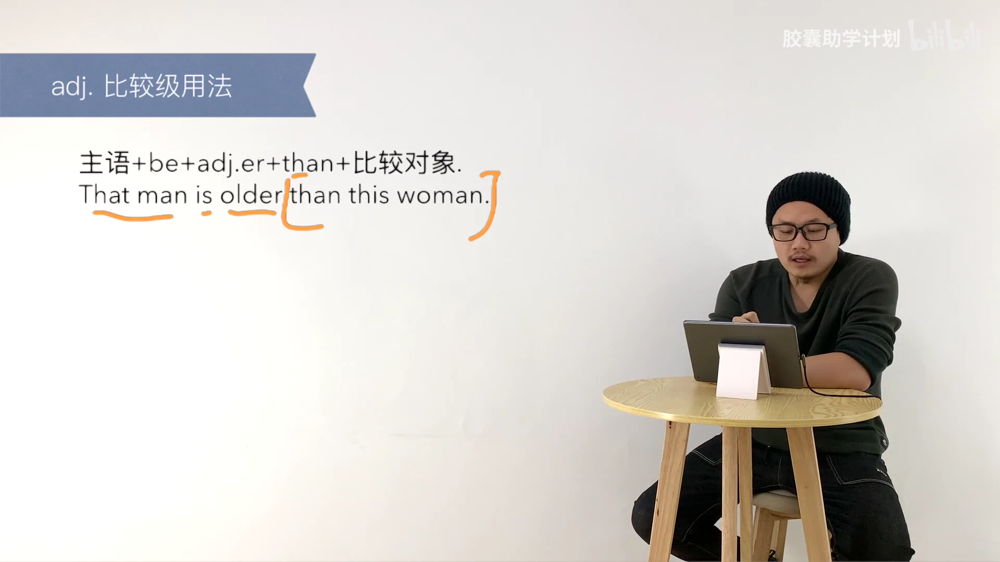

文字识别：胶囊助学计划 / adj.比较级用法 / 主语+be+adj.er+than+比较对象. / That man is olderthan this woman.

### 画面 00:08:27

文字识别：胶囊助学计划 / adj.比较级用法 / 主语+be+adj.er+than+比较对象. / That man is olderthan this woman. / 2

## 00:08:30–00:09:00

们先给它去掉，我们只看 that man is older。从句型上来说，新概念二册前二十课我们就已经学过了。That man is old。我们当年学的是这个，对吧？现在无非就是告诉各位说那个句型还是可以的，只不过您把 old 现在加一个 e 二，叫做 older，叫他更老。那可能总是有一个比较对象的，所以后边多加了一个叫 than 加比较对象。那我们接下来尝试造一些句子看一下啊，比如说

### 画面 00:08:32

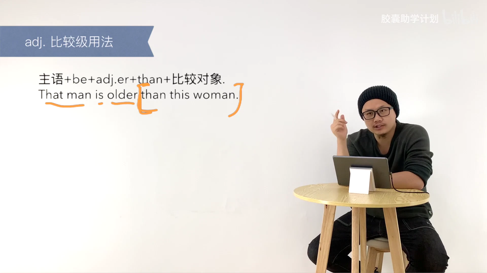

文字识别：胶囊助学计划 / adj.比较级用法 / 主语+be+adj.er+than+比较对象. / That man is olderthan this woman.

### 画面 00:08:54

文字识别：胶囊助学计划 / adj. / 比较级用法 / 主语+be+adj.er+than+比较对象. / That man is olderthan this / woman.

### 画面 00:08:57

文字识别：胶囊助学计划 / 主语+be+adj.er+than+比较对象.

## 00:09:00–00:09:30

Yao Ming and Jet Li, 李连杰，对吧？两个人，我们说 Yao is taller than Jet Li. 你看，完美的满足这个公式，对吧？不是说必须只能满足这个公式。我们目前先学习最常见啊，最这个普通中规中矩的，我们先把这个学会。那我们反过来也可以说 Jet Li is shorter than Yao，没问题。好，下一个

### 画面 00:09:07

文字识别：胶囊助学计划 / 主语+be+adj.er+than+比较对象. / ① Yao is taller than Jet Li.

### 画面 00:09:09

文字识别：胶囊助学计划 / 主语+be+adj.er+than+比较对象. / ① Yao is taller than Jet Li.

### 画面 00:09:27

文字识别：胶囊助学计划 / 主语+be+adj.er+than+比较对象. / ① Yao is taller than Jet Li. / Jet Li is shorter than Yao.

### 画面 00:09:29

文字识别：胶囊助学计划 / 主语+be+adj.er+than+比较对象. / ① The left dog is smaller than the right dog.

## 00:09:30–00:10:00

说 the left dog 左边这个狗 is is smaller than the right dog 左边的狗比右边的狗要小。那反过来就是右面的狗比左面的狗大，是吧？叫 the right dog is bigger than the left one. OK，完一个 continue。你看这个鞋就是 new old 是吧？那我们就用一个，比如说 the left shoes are newer

### 画面 00:09:34

文字识别：胶囊助学计划 / 主语+be+adj.er+than+比较对象. / D The left dog is smaller than the right dog. / 1

### 画面 00:09:37

文字识别：胶囊助学计划 / 主语+be+adj.er+than+比较对象. /  The left dog is smaller than the right dog.

### 画面 00:09:40

文字识别：主语+be+adj.er+than+比较对象. /  The left dog is smaller than the right dog.

### 画面 00:09:49

文字识别：胶囊助学计划 / 主语+be+adjer+than+比较对象. / The left dog is smaller than the right dog. / The right dog is bigger than the left dog.

### 画面 00:09:51

文字识别：胶囊助学计划 / 主语+be+adj.er+than+比较对象.

### 画面 00:09:57

文字识别：胶囊助学计划 / 主语+be+adj.er+than+比较对象. / D The left shoes are newer than the right shoes.

## 00:10:00–00:10:30

than the right shoes. Than加比较对象。我相信各位这个公式您应该会了，对吧？不是那么的难。进入文章呢，我们在下一个视频当中依旧可以见得到。好了，接下来我们看一个小的电影片段。这个电影片段当中就出现了这样一句话，叫做This place is smaller than the old living room.说这个地方啊更小，比

### 画面 00:10:02

文字识别：胶囊助学计划 / 主语+be+adj.er+than+比较对象. / han the right shoes. / The left shoes are newer

### 画面 00:10:05

文字识别：胶囊助学计划 / 主语+be+adj.er+than+比较对象 / han the right shoes. / The left shoes are newer

### 画面 00:10:13

文字识别：DWARD NORTON / 胶囊助学计划 / EDWARD FURLONG / - / ERICAN HIST / SOMELEGACIES MUSTEND / This place is smaller / than the old living room. / - / "EDWARD NORTON GIVES A BLISTERING, / 美国X档案 American History X(1998) / BRILLIANT PERFORMANCE" / PeterTrarers,ROLLING STONE / "TWOTHUMBSUP" / SISIELEBERT

### 画面 00:10:15

文字识别：DWARD NORTON / 胶囊助学计划 / EDWARD FURLONG / ERICAN HIST / SOMELEGACIES / MUSTEND / This place is smaller / than the old living room. / "EDWARD NORTON GIVESA BLISTERING. / 美国X档案 American History X(1998) / BRILLIANTPERFORMANCE" / Peter Travors,BOtLNe STONE / "TWOTHUMBS UP" / SISWELEBERT

### 画面 00:10:19

文字识别：DWARD NORTON / 胶囊助学计划 / EDWARD FURLONG / ERICAN HIST / SOMELEGACIES / MUSTEND / This place is smaller / than the old living room. / EDWARD NORTON GIVESA BLISTERING. / 美国X档案 American History X(1998) / BRILLIANTPERFORMANCE" / Peter Travers,BOLLNG STONE / "TWOTHUMBS UP" / SISWELEBERT

### 画面 00:10:26

文字识别：DWARD NORTON / 胶囊助学计划 / EDWARD FURLONG / ERICAN HIST / SOMELEGACIES / MUSTEND / This place is smaller / than the old living room. / EDWARD NORTON GIVESA BLISTERING. / 美国X档案 American History X(1998) / BRILLIANTPERFORMANCE" / PeterTraOts,BOLLINGSTONE / "TWOTHUMBS UP" / SISIELEBERT

### 画面 00:10:29

文字识别：DWARD NORTON / 胶囊助学计划 / EDWARD FURLONG / ERICAN HIST / SOMELEGACIES / MUSTEND / This place is smaller / than the old living room. / EDWARD NORTON GIVESA BLISTERING. / 美国X档案 American History X (1998) / BRILLIANTPERFORMANCE" / Poter TraVers,BOLLENG STONE / "TWOTHUMBS UP" / SISWELEBERT

## 00:10:30–00:11:00

的比较对象是我们原来的那个旧的那个 living room 客厅，对吧？比我们原来的客厅要小。那注意力集中，我们听一下这句话。 It's place smaller than old living room. How you doing? How's school? It's good. That's good. Okay, so this place is smaller than the old living room. Okay, 它最后的这几个单词读的不是特别清楚啊，各位不妨多听几遍啊。你关键点把前面能听出

### 画面 00:10:31

文字识别：DWARD NORTON / 胶囊助学计划 / EDWARD FURLONG / ERICAN HIST / SOME LEGACIES / MUSTEND / This place is smaller / thanthe old living room. / "EDWARD NORTON GIVESA BLISTERING. / 美国X档案 American History X(1998) / BRILLIANTPERFORMANCE" / Petet Travers,BOLLENG STONE / "TWOTHUMBS UP." / SISIELEBERT

### 画面 00:10:37

文字识别：DWARD NORTON / 胶囊助学计划 / EDWARD FURLONG / ERICAN HIST / SOME LEGACIES / MUST END / This place is smaller / thanthe old living room. / "EDWARD NORTON GIVESA BLISTERING. / 美国X档案 American History X (1998) / BRILLIANTPERFORMANCE" / Peter TraVors,BOLLINGSTONE / "TWOTHUMBS UP." / SISIEEBERT

### 画面 00:10:41

文字识别：bilibili / 胶囊助学计划 / 对 / Yeah right.

### 画面 00:10:43

文字识别：Bilibili / 胶囊助学计划

### 画面 00:10:45

文字识别：bilibili / 胶囊助学计划 / 客厅比以前小了 / This place is smaller than the old living room.

### 画面 00:10:47

文字识别：bilbili / 胶囊助学计划 / -学校还好吗？-还好 / -How you doing? How's school? -It's good. It's good.

### 画面 00:10:49

文字识别：DWARD NORTON / 胶囊助学计划 / EDWARD FURLONG / ERICAN HIST / SOMELEGACIES / MUSTEND / This place is smaller / than the old living room. / 0 / "EDWARDN / NORTON GIVESA BLISTERING, / 美国X档案 American History X(1998) / BRILLANTPERFORMANCE" / PeterTraers,BOLLINGSTONE / "TWOTHUMBS UP" / SISIELEBERT

### 画面 00:10:51

文字识别：DWARD NORTON / 胶囊助学计划 / EDWARD FURLONG / - / ERICAN HIST / SOMELEGACIES / MUSTEND / This place is smaller / than the old living room. / "EDWARD NORTON GIVES A BLISTERING. / 美国X档案 American History X(1998) / BRILLIANTPERFORMANCE" / Peter Travers,ROLLNe STONE / "TWO THUMBSUP" / SISIELEBERT

### 画面 00:10:53

文字识别：DWARD NORTON / 胶囊助学计划 / EDWARD FURLONG / - / ERICAN HIST / SOMELEGACIES MUSTEND / This place is smaller / than the old living room. / - / "EDWARD NORTON GIVESA BLISTERING. / 美国X档案 American History X(1998) / BRILLIANTPERFORMANCE" / PeterTraWers,ROLLING STONE / "TWOTHUMBS UP" / SISILEBERY

### 画面 00:10:55

文字识别：DWARD NORTON / 胶囊助学计划 / EDWARD FURLONG / ERICAN HIST / SOMELEGACIES / MUST END / This place is smaller / than the old living room. / "EDWARD NORTON GIVESA BLISTERING. / 美国X档案 American History X(1998) / BRILLIANTPERFORMANCE" / PeterTraVers, BOLLING STONE / TWOTHUMBSUP." / SISIELEBERT

### 画面 00:10:58

文字识别：DWARD NORTON / 胶囊助学计划 / EDWARD FURLONG / ERICAN HIST / SOMELEGACIES / MUST END / This place is smaller / than the old living room. / "EDWARD NORTON GIVESA BLISTERING. / 美国X档案 American History X(1998) / BRILLIANTPERFORMANCE" / Peter Travers,BOLLINGSTONE / "TWOTHUMBS UP." / SISIELEBERT

## 00:11:00–00:11:30

来就可以了. This place is smaller than. Okay, another one.好，接下来形容词最高级的用法，刚才我们讲了比较级的一个公式，那接下来再给大家一个最高级的公式呗。您看，其实也并不是特别难。我们看一下，主语加be老习惯。The哎，这个跟刚才不一样，多加了一个the。一会儿我再讲为什么多加了这个the啊。然后呢，有一个形容词最高级。那形容词是配合名词的嘛，后边又来了个名词。当然了，也

### 画面 00:11:02

文字识别：DWARD NORTON / 胶囊助学计划 / EDWARD FURLONG / - / ERICAN HIST / SOME LEGACIES / MUSTEND / This place is smaller / than the old living room. / "EDWARD NORTON GIVESA BLISTERING. / 美国X档案 American History X(1998) / BRILLIANTPERFORMANCE" / Poter TraYOrs,BOLLINe STONE / "TWOTHUMBS UP" / SISILEBERT

### 画面 00:11:04

文字识别：胶囊助学计划 / adj.最高级用法

### 画面 00:11:07

文字识别：胶囊助学计划 / adj.最高级用法

### 画面 00:11:17

文字识别：胶囊助学计划 / adj.最高级用法 / 主语+be+the+adj.est +n.+范围

### 画面 00:11:20

文字识别：胶囊助学计划 / adj.最高级用法 / 主语+be+ / the / adj.est +n.+范围

### 画面 00:11:23

文字识别：胶囊助学计划 / adj.最高级用法 / 主语+be+the+adj.est +n.+范围

## 00:11:30–00:12:00

如果您主语跟后边的名词是重复的，比如说他是班里最高的，你不用说人了，是吧？OK，好，所以这个名词理论上是可以括弧啊，括号我们可以把它删除的，然后再加一个范围。你看，因为他是最怎么怎么样的人，所以你可能一般要给个范围，比如说是我们家最勤劳的，对吧？是我们小区个儿最高的啊，还是全北京赚的最多的，对吧？还是说全中国怎么怎么最怎么怎么样？一

### 画面 00:11:46

文字识别：胶囊助学 / 学计划 / adj.最高级用法 / 主语+be+the+adj.est / 范围 / +n/

## 00:12:00–00:12:30

般可能要给一个范围，OK。那我们这个地方为什么要一个the呢？因为它你想一下，如果你是最高级，往往是不是就可以理解为是一个特质了，对吧？你可以从这个角度尝试去理解。当然，这个这么理解方式不一定是完全对的，可能是歪打正着了。其实，在我看来，这种语法结构最合适的理解就叫做人们约定俗成，就这样，OK，而不用去

### 画面 00:12:01

文字识别：胶囊助学计划 / adj.最高级用法 / 主语+be+the+adj.est / +n/ / 范围

### 画面 00:12:06

文字识别：胶囊助学计划 / adj.最高级用法 / 主语+be+the+adj.est / 范围 / +n/

### 画面 00:12:09

文字识别：胶囊助学计划 / adj.最高级用法 / 主语+be+ / +the+adj.est / 范围 / +n

## 00:12:30–00:13:00

找任何的别的一些理由，OK，好，那比如说我们造一个句子啊，比如说 My father，好，我们先看一下符不符合公式，My father is the coolest guy in the world，完美的满足，My father 主语 is be the 就是 the coolest 形容词最高级 guy 名词范围叫 in the world，OK，我父亲是全世界最酷的

### 画面 00:12:33

文字识别：胶囊助学计划 / FATHER / INTHE WORLD / 主语+be+the+adjest.+n.+范围

### 画面 00:12:38

文字识别：胶囊助学计划 / FATHER / INTHEWORLD / 主语+be+the+adjest.+n.+范围 / ① My father is the coolest guy in the world.

### 画面 00:12:42

文字识别：胶囊助学计划 / FATHER / INTHE WORLD / 主语+be+the+adjest.+n.+范围 / My father is the coolest guy in the world.

### 画面 00:12:44

文字识别：胶囊助学计划 / FATHER / INTHE WORLD / 主语+be+the+adiest.+n.+范围 / 个 / My father is the coolest guy in the world.

### 画面 00:12:46

文字识别：胶囊助学计划 / FATHER / INTHE WORLD / 主语+be+the+adiest.+n.+范围 / 个 /  My father is the coolest guy in the world.

### 画面 00:12:48

文字识别：胶囊助学计划 / FATHER / INTHE WORLD / 主语+be+the+adjest.+n.+范围 / 个 / My father is the coolest guy in the world.

### 画面 00:12:58

文字识别：胶囊助学计划 / FATHER / INTHE WORLD / 主语+be+the+adiest.+n.+范围 / T / 个 / My father is the coolest guy in the world.

## 00:13:00–00:13:30

人啊！这是小小朋友可能对父亲的一个夸赞。那再来后呢？那我可以说，My mom is the kindest person, person in the world.啊，我母亲是全世界最善良的人。OK，这儿一个好。主语 is the最高级，完美满足。我们再来一个，比如说，Angelina Jolie is the hottest woman in Hollywood.好，Angelina Jolie

### 画面 00:13:03

文字识别：胶囊助学计划 / 主语+be+the+adjest.+n.+范围

### 画面 00:13:06

文字识别：胶囊助学计划 / 主语+be+the+adjest.+n.+范围 / ① My mom is the kindest person in the world.

### 画面 00:13:16

文字识别：胶囊助学计划 / 主语+be+the+adjest. +n.+范围 / ① My mom is the kindest person in the world.

### 画面 00:13:21

文字识别：胶囊助学计划 / 主语+be+the+adjest.+n.+范围 / - / D My mom is the kindest person in the world. / 1

### 画面 00:13:23

文字识别：胶囊助学计划 / 主语+be+the+adjest.+n.+范围 / ① Angelina Jolie is the hottest woman in Hollywood

### 画面 00:13:25

文字识别：胶囊助学计划 / 主语+be+the+adjest.+n.+范围 / ① Angelina Jolie is the hottest woman in Hollywood.

## 00:13:30–00:14:00

is the hottest woman in Hollywood, is吧? 完美的满足对于各位来说不是非常的难, OK? 好, 接下来呢, 我们看它的第二个用法。第二个用法跟第一个用法某种程度上几乎是一模一样的。您看, 主语加be加的加形容词最高级加名词, 只不过后面本来我们说是叫范围, 比如说 in Hollywood在好莱坞, in

### 画面 00:13:30

文字识别：胶囊助学计划 / 主语+be+the+adjest.+n.+范围 / ① Angelina Jolie is the hottest woman in Hollywood.

### 画面 00:13:34

文字识别：胶囊助学计划 / 主语+be+the+adjest.+n.+范围 / 个 / ① Angelina Jolie is the hottest woman in Hollywood

### 画面 00:13:36

文字识别：胶囊助学计划 / 主语+be+the+adjest.+n.+范围 / 个 / ① Angelina Jolie is the hottest woman in Hollywood

### 画面 00:13:41

文字识别：胶囊助学计划 / adj.最高级用法

### 画面 00:13:44

文字识别：胶囊助学计划 / adj.最高级用法 / 2

### 画面 00:13:50

文字识别：胶囊助学计划 / adj.最高级用法 / 主语+be+the+adj.est+n.+l've ever met/seen

### 画面 00:13:54

文字识别：胶囊助学计划 / adj.最高级用法 / 主语+be+the+adj.est+n.+l've ever met/seen

### 画面 00:13:57

文字识别：胶囊助学计划 / adj.最高级用法 / 主语+be+the+adj.est+n.+l've ever met/seen

## 00:14:00–00:14:30

the world,叫全世界, in my class,叫在我的班上,对吧?这些叫范围。我们现在把它变成了另外一句话,叫I've ever met or I've ever seen.好,你注意啊,我简单讲一下这句话。你看,撇ve这个是一个典型的have的缩写,对吧?那have后边又加了met和seen。如果您八十三课到八十九课学的还不错,你应该是有印象,这两个单词是我们动词的过去

### 画面 00:14:07

文字识别：胶囊助学计划 / adj.最高级用法 / 主语+be+the+adj.est+n.+l've ever met/seen

### 画面 00:14:09

文字识别：胶囊助学计划 / adj.最高级用法 / 主语+be+the+adj.est+n.+l've ever met/seen

### 画面 00:14:11

文字识别：adj.最高级用法 / 主语+be+the+adj.est+n.+l've ever met/seen

### 画面 00:14:14

文字识别：胶囊助学计划 / adj.最高级用法 / 主语+be+the+adj.est+n.+l've ever met/seen

### 画面 00:14:19

文字识别：胶囊助学计划 / adj.最高级用法 / 主语+be+the+adj.est+n.+l've ever met/seen

### 画面 00:14:24

文字识别：胶囊助学计划 / adj.最高级用法 / 主语+be+the+adj.est+n.+l've ever met/seen

## 00:14:30–00:15:00

分词，对吧？那 have 加 done 放到一起，现在完成时叫我所遇到过的，我所看见过的。当然，您也可以说 I have ever known 我所知道过的。那这句话就变成了谁是最怎么样的一个东西或者人？我所看过的、了解过的、遇见过的。那我们尝试造一句话嘛，来，不是特别难，

### 画面 00:14:41

文字识别：胶囊助学计划 / kn / adj.最高级用法 / 主语+be+the+adj.est+n.+l've ever met/seen

### 画面 00:14:44

文字识别：胶囊助学计划 / Known / adj.最高级用法 / 主语+be+the+adj.est+n.+l've ever met/seen

### 画面 00:14:47

文字识别：胶囊助学计划 / Known / adj.最高级用法 / 主语+be+the+adj.est+n.+l've ever met/seen

### 画面 00:14:49

文字识别：胶囊助学计划 / nown / adj.最高级用法 / 主语be+the+adj.est+n.+ / +l've / ever met/seen

### 画面 00:14:51

文字识别：胶囊助学计划 / nown / adj.最高级用法 / 主语/be+che+adj.est+n.+ / +l've / ever met/seen

### 画面 00:14:53

文字识别：胶囊助学计划 / nown / adj. / 最高级用法 / 主语betche+adj.est+n.+ / +l've / ever met/seen

### 画面 00:14:55

文字识别：胶囊助学计划 / nown / adj.最高级用法 / 主语betche+adj.est+n.+ / +l've / ever met/seen

### 画面 00:14:58

文字识别：胶囊助学计划 / adj.最高级用法 / now / 主语+be+the+adj.est+n.+l'vee / ever met/seen / This is the / craziest thing / ve ever done.

## 00:15:00–00:15:30

我们一点一点往里带啊。主语 this be is the 不变，对吧？最高级这个 the 是不变的。然后 craziest，好 crazy，吧？You are crazy，啊，说你疯了吧？啊，这太疯狂了。Craziest 变 y v i 加 e s t，叫最疯狂的 thing，叫做事情。I have ever done，你看后边的这个 that thing 不是固定的，您也可以换成任何

### 画面 00:15:00

文字识别：胶囊助学计划 / adj.最高级用法 / 主语+be+the+adj.est+n.+l've / ever met/seen / This is the / craziest thing I've ever done.

### 画面 00:15:03

文字识别：胶囊助学计划 / adj.最高级用法 / 主语+be+the+adj.est+n.+l've ever met/seen / This is the craziest thing I've ever done.

### 画面 00:15:23

文字识别：胶囊助学计划 / adj.最高级用法 / 主语+be+the+adj.est+n / +l've ever met/seen / This is the craziest thing / I've ever done.

### 画面 00:15:26

文字识别：adj.最高级用法 / 主语+be+the+adj.est+n / +l've / ever met/seen / This is the craziest thing / I've ever / done.

## 00:15:30–00:16:00

一个合适的动词。在这儿，我用的动词叫做做过的，所以这句话变成了叫做这是最疯狂的事情我所做过的。我们调整成一个比较舒服的汉语语序，叫做这是我做过最疯狂的一件事情。OK，完美的符合了这个呃公式，并且我在这儿再多提一句，其实您想一下，I have ever met，I have ever seen，I have ever known，但它其实就是一个范

### 画面 00:15:48

文字识别：胶囊助学计划 / adj.最高级用法 / 主语+be+the+adj.est+n / +l'vee / ever met/seen / This is the craziest thing / I've everc / done. / •

### 画面 00:15:52

文字识别：胶囊助学计划 / adj.最高级用法 / 主语+be+the+adj.est+n / +l've / ever met/seen / This is the craziest thing / I've everc / done. / •

## 00:16:00–00:16:30

围。我所看过的是不是一个范围？我看过的就是一个范围了，对吧？OK，接下来呢，我们尝试用这个公式去造句。比如说，This is the cutest baby. 说这个是最可爱的小宝宝。I have ever seen. 你可能是看着你们家孩子有感而发，对吧？说这是我见过最可爱的小宝宝了。Seen，看见过的。再来说Charles Chaplin啊，卓

### 画面 00:16:06

文字识别：胶囊助学计划 / 主语+be+the+adj.est+n. / +l've ever met/seen

### 画面 00:16:18

文字识别：胶囊助学计划 / 主语+be+the+adj.est+n. / +l've ever met/seen / This is the cutest baby I've ever seen.

### 画面 00:16:20

文字识别：主语+be+the+adj.est+n. / +l've ever met/seen / This is the cutest baby I've ever seen.

### 画面 00:16:26

文字识别：主语+be+the+adj.est+n. / +l've ever met/seen

### 画面 00:16:29

文字识别：胶囊助学计划 / 主语+be+the+adj.est+n. / +l've ever met/seen / ① Charles Chaplin is the funniest guy / I've ever seen.

## 00:16:30–00:17:00

别林is the funniest guy I have ever seen.这是我看过最有意思的人了。当然了，因人而异了，对吧？啊，还有一个人应该叫Kitty基顿，是吧？应该没有记错的话，也是他那个时代很有名的默片的一个呃喜剧演员啊。但是明显不如他名气那么大，但也很有趣。OK，好，你看完美的还是符合了这个公式。我们再来一个啊，说Mother Teresa啊，特蕾莎

### 画面 00:16:34

文字识别：主语+be+the+adj.est+n. / +l've ever met/seen / ① Charles Chaplin is the funniest guy / I've ever seen.

### 画面 00:16:43

文字识别：胶囊助学计划 / 主语+be+the+adj.est+n. / +l've ever met/seen / Charles Chaplir / is the funniest guy / I've ever seen.

### 画面 00:16:45

文字识别：胶囊助学计划 / 主语+be+the+adj.est+n. / +l've ever met/seen / Charles Chaplir / is the funniest guy / I've ever seen.

### 画面 00:16:56

文字识别：胶囊助学计划 / 主语+be+the+adj.est+n. / +l've ever met/seen /  Mother Teresa is the kindest woman / I've ever known.

## 00:17:00–00:17:30

修女，啊，你注意这个地方的mother，她其实有点像一个圣人的表达了，啊，father，你看father不是有教父的意思嘛？对，它并不是指的我们真正的母亲，啊，就生理意义上的母亲。可你可以理解为某种程度上指的是精神意义上的母亲，是吧？在基督教当中，啊，他说Mother Teresa,特蕾莎修女，诺贝尔和平奖获得者，is the kindest woman,是最善良的女人I have ever

### 画面 00:17:05

文字识别：主语+be+the+adj.est+n. / +l've ever met/seen / Mother Teresa / is the kindest woman / I've ever known.

### 画面 00:17:20

文字识别：胶囊助学计划 / 主语+be+the+adj.est+n. / +l've ever met/seen / Mother Teresa / is the kindest woman / I've ever known.

### 画面 00:17:26

文字识别：胶囊助学计划 / 主语+be+the+adj.est+n. / +l've ever met/seen / Mother Teresa / is the kindest woman / I've ever known.

## 00:17:30–00:18:00

known我所知道的known叫做了解知道的OK，这儿一个。接下来呢，讲完了刚才这些语法，我们在接下来的练习和文章当中都会依旧进啊依旧用得到。那我们还是要简单过一下本课的单词，并不是很难啊。跟我一起读一下，第一个叫Madam Madam啊，你看我们看港剧港片啊，经常有那个Yes sir啊，或者说Yes Madam，对吧？哎，女士，

### 画面 00:17:32

文字识别：主语+be+the+adj.est+n. / +l've ever met/seen / Mother Teresa / is the kindest woman / I've ever known.

### 画面 00:17:37

文字识别：胶囊助学计划 / /'mædam/ / madam

### 画面 00:17:46

文字识别：/'mædam/ / madam

### 画面 00:17:50

文字识别：胶囊助学计划 / /'mædam/ / madam

### 画面 00:17:56

文字识别：胶囊助学计划 / /'mæ dam/ / madam

### 画面 00:17:59

文字识别：胶囊助学计划 / /'mædam/ / madam

## 00:18:00–00:18:30

比如说 Madam，Can I help you？哎，女士，我我能帮助你吗？呃，实际上，比如说，你像我在国外的时候，我会比如说遇到一些我认为可能是中老年女士的时候，我用 Madam 的可能性，个人感觉会稍微多一点点啊。见到女呃相相对来说年轻一点，可能用 Miss 会好一点点啊。OK，来，接下来又

### 画面 00:18:02

文字识别：/'mædam/ / madam / ① Madam, can I help you?

### 画面 00:18:22

文字识别：胶囊助学计划 / /'mædam/ / madam / ① Madam, can I help you?

### 画面 00:18:24

文字识别：14 / 胶囊助学计划 / / 'mæd am/ / Vl / madam / ① Madam, can I help you?

### 画面 00:18:26

文字识别：Miss / 胶囊助学计划 / /'mæd am/ / madam / ① Madam, can I help you? / /

### 画面 00:18:28

文字识别：胶囊助学计划 / /sma:t/ /'priti/ / smart pretty adj. as well

## 00:18:30–00:19:00

是两个单词，第一个叫 smart，第二个叫 pretty。那 smart 叫做漂亮的，其实我们之前也学过啊，我记得在十三课 smart hat 对吧？ smart dress 也学过，流行的、时髦的、漂亮的。那 pretty 也是漂亮的。那后面还有注意啊，这也是一个单词，它是两个单词组合成了一个词组，叫 as well。我们不用从字面意思去了解，就是 too 的意思，叫做也。 OK，

### 画面 00:18:31

文字识别：胶囊助学计划 / /sma:t/ /priti/ / smart / t pretty adj. as well

### 画面 00:18:35

文字识别：胶囊助学计划 / /sma:t/ /'priti/ / smart / pretty adj. as well

### 画面 00:18:45

文字识别：胶囊助学计划 / /sma:t/ / /'priti/ / smart / pretty adj. as well

### 画面 00:18:51

文字识别：胶囊助学计划 / /smait/ / /'priti/ / smart / pretty adj. / as well

### 画面 00:18:57

文字识别：too / 胶囊助学计划 / /sma:t/ / /'priti/ / pretty adj. / smart / as well

## 00:19:00–00:19:30

好。比如说我们造句说 is a very smart dress。这个 smart 可以完全变成 pretty，说 is a very pretty dress，都是可以的。您不用去过分的去分析说 smart 跟 pretty 之间有什么区别。类似于现在如果有一个外国人，我都不用是外国人，任何一个人非要让你去解释说漂亮的、美丽的之间有多大的区别，你可能就要硬解释了，

### 画面 00:19:02

文字识别：to.7 / /sma:t/ / /'priti/ / smart / pretty adj. / as well / ① It's a very smart dress.

### 画面 00:19:05

文字识别：to7 / 胶囊助学计划 / / sma:t/ / /priti/ / pretty adj. / smart / as well / ① It's a very smart dress.

### 画面 00:19:11

文字识别：to7 / 胶囊助学计划 / /sma:t/ / /'priti/ / pretty adj. / smart / as well / ① It's a very smart dress.

## 00:19:30–00:20:00

是吧？啊，它挺漂亮的，它挺美的，是吧？OK，啊，不用过分的区别，我只需要告诉各位一件事情，就是我个人感受，pretty出现的频率可能比smart出现的频率要高很多。OK，好，比如说再来说，Yes, and that woman is very pretty too.啊，或者pretty as well，相同的含义叫做也。玩一个，接下来下一个单词要suit。我们之前学过它的名

### 画面 00:19:34

文字识别：to7 / 胶囊助学计划 / /sma:t/ / /'priti/ / pretty adj. / smart / as well / ① It's a very smart dress.

### 画面 00:19:46

文字识别：too.7 / 胶囊助学计划 / /sma:t/ / /'priti/ / smart / pretty adj. / as well / ① It's a very smart dress. / Yes, and that woman is very / pretty, too/as well.

### 画面 00:19:55

文字识别：胶囊助学计划 / /suit/ / suit v.

## 00:20:00–00:20:30

which means a set of clothes. Today we learn its verb, called "suit" someone. For example, we say it suits you. Hey, you try on a piece of clothing, and then your partner, boyfriend, girlfriend, or husband and wife say it suits you. Hey, don't say this dress is suitable for you. It suits you. Now I will simply change it into a general question, Does it suit me? Hey, is it suitable for me? Is it suitable for me?

### 画面 00:20:00

文字识别：胶囊助学计划 / /suit/ / n. / suit v.

### 画面 00:20:02

文字识别：胶囊助学计划 / /suit/ / n. / suit v.

### 画面 00:20:16

文字识别：/suit/ / n. / suit v. / ① It suits you.

### 画面 00:20:25

文字识别：胶囊助学计划 / /suit/ / n. / suit v. / ① It suits you. / ② Does it suit me?

## 00:20:30–00:21:00

it suit me? 我穿着合适吗？OK，说你穿着不合适，It doesn't suit you. OK, very good. 我们最后再多讲一个小的表达，叫做 Suit yourself. 哎，它就翻译成叫做随你便或者随便你啊，你怎么舒服怎么来都行，叫 Suit yourself. OK, very good. 那 Recap，我们看

### 画面 00:20:30

文字识别：/suit/ / n. / suit v. / ① It suits you. / Does it suit me? / 2

### 画面 00:20:33

文字识别：/suit/ / n. / suit v. / ① It suits you. / ② Does it suit me? / ③ It doesn't suit you.

### 画面 00:20:39

文字识别：/suit/ / n. / suit v. / ① It suits you. / Does it suit me? / 2 / It doesn't suit you. / 3 / Suit yourself.

### 画面 00:20:41

文字识别：胶囊助学计划 / /suit/ / n. / suit v. / ① It suits you. / 2 / Does it suit me? / It doesn't suit you. / 3 / Suit yourself.

### 画面 00:20:43

文字识别：胶囊助学计划 / /suit/ / n. / suit v. / ① It suits you. / Does it suit me? / 2 / It doesn't suit you. / Suit yourself.

### 画面 00:20:55

文字识别：胶囊助学计划 / /suit/ / n. / suit v. / ① It suits you. / 2 / Does it suit me? / It doesn't suit you. / 3 / Suit yourself.

### 画面 00:20:57

文字识别：胶囊助学计划 / /suit/ / suit v. / ① It suits you. / ② Does it suit me? / ③ It doesn't suit you. / ④Suit yourself.

### 画面 00:20:59

文字识别：胶囊助学计划 / Recap / 1.adj.er/ adj.est / Patterns / 2. / 主语+be+adj.er+than+比较对象. / 8 / 3. / 主语+be+the+adj.est +n.+范围 / Grammar / 4.主语+be+the+adj.est+n. / +l've / ever met/seen/known / Words / Expression

## 00:21:00–00:21:30

一下本课的这些呃语法，还真的不是特别少，对吧？第一个关键点就是形容词比较级最高级。今天讲完那些规则，您不需要都记住，您只需要记住一个点，就是一个单词后边加 e r e s t 形容词，对吧？它就是很可能是比较级和最高级，这个点各位拿住就可以了。接下来呢，有这么三个公式，这三个公式呢，您今天下课看着公式尝试，

### 画面 00:21:07

文字识别：胶囊助学计划 / Recap / ✔. / adj.er/a / adj.est / Patterns / 2. / 主语+be+adj.er+than+比较对象. / 3. / 主语+be+the+adj.est +n.+范围 / Grammar / 4.主语+be+the+adj.est+n. / +l've / ever met/seen/known / Words / Expression

### 画面 00:21:10

文字识别：胶囊助学计划 / Recap / 1.adj.er/a / adj.est / Patterns / 2. / 主语+be+adj.er+than+比较对象. / & / 3. / 主语+be+the+adj.est +n.+范围 / Grammar / 4.主语+be+the+adj. / .est+n. / +l've / ever met/seen/known / Words / Expression

## 00:21:30–00:22:00

家庭作业当中，我们临时加一个啊，每个公式造三到五句话，试着去用一下就可以了。进入文章，包括进入偶数课练习，我们依旧会用得到，好吧？好，那看一下家庭作业，单词造句啊，那再多一个刚才我说的那个，对吧？这课单词像 as well 就不太好造句，也没有必要啊，非要去造句。那 smart pretty 你你学会了，可能也没有什么太多造句的必要性，是吧？所以我们把它临时改

### 画面 00:21:40

文字识别：胶囊助学计划 / Recap / .adj.er/a / adj.est / Patterns / 2. / 主语+be+adj.er+than+比较对象. / 3. / 主语+be+the+adj.est +n.+范围 / Grammar / 4.主语+be+the+adj.est+n. / +l've / ever met/seen/known / Words / Expression

### 画面 00:21:43

文字识别：胶囊助学计划 / 单词造句3

### 画面 00:21:49

文字识别：胶囊助学计划 / 单词造句3

## 00:22:00–00:22:30

一下。您把刚才我说的那个三个公式比较级和最高级那三个公式，每个造三到五个，行吧？OK，造到您能懂就行。其次呢，您初级红皮书去查一下形容词比较级和最高级，啊，红皮书我们讲过怎么去用了，在开篇的视频当中。然后呢，给自己讲解一遍今天的核心知识点。今天这个您真是特别适合仔仔细细给自己讲一遍的啊！拿着笔，拿着纸，一边想一边

### 画面 00:22:10

文字识别：胶囊助学计划 / 单词造句3 / 初级红皮书查找形容词比 / 较级&最高级

## 00:22:30–00:23:00

写。Very good. 如果大家喜欢我们的课程，欢迎大家关注、订阅、一键三连，分享给那些需要的朋友，来帮助我们快速成长。那我们最后再看一句名人名言。It's pretty scary to know how quickly time flies. See you next time.

### 画面 00:22:30

文字识别：胶囊助学计划

### 画面 00:22:32

文字识别：胶囊助学计划

### 画面 00:22:40

文字识别：Los Any / mes / It's pretty scary to know how quickly time / flies. / -James Wan

### 画面 00:22:49

### 画面 00:22:51

文字识别：CAPSULEACADEMY / 胶囊助学计划 / 『 / 小红书 / Lecturer / Leo / OE

### 画面 00:22:54

文字识别：CAPSULEACADEMY / 胶囊助学计划 / 『 / 小红书 / Editor / OE

### 画面 00:22:57

文字识别：CAPSULEACADEMY / 胶囊助学计划 / 『 / 小红书 / Creator / Leo & Berlin / OE

### 画面 00:22:59

文字识别：bilibili / 胶囊助学计划 / 胶囊助学计划 / 小红书 / 控 / 品 / OE

## 00:23:00–00:23:01

### 画面 00:23:01

文字识别：bilibili / 胶囊助学计划

