# 107 文章

快速机器解析：语音为单模型转写，未进行独立交叉校对或人工复核；画面每秒采样并按变化选帧，短时文字和标记可能遗漏。截图时间约有 1 秒误差。图片有损压缩；遇到疑点请按时间查看 Google Drive 原视频。

## 00:00:00–00:00:30

Hello everyone, welcome to Capsule Academy. This is Leo. Today we're going to learn New Concept English Book One, Lesson One Hundred and Seven, Story. That old habit. Before entering the formal review, we will look at a question called how to use would plus like. Okay, that with this question, hope you guys enjoy it. Good. Okay. Good

### 画面 00:00:00

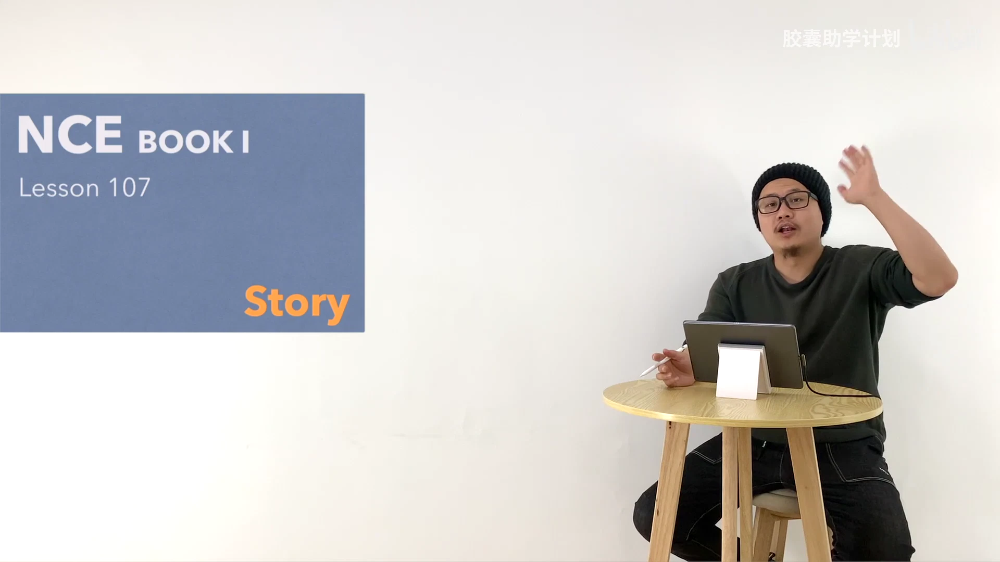

文字识别：NCE / BOOKI / Lesson 107 / Story / 2

### 画面 00:00:02

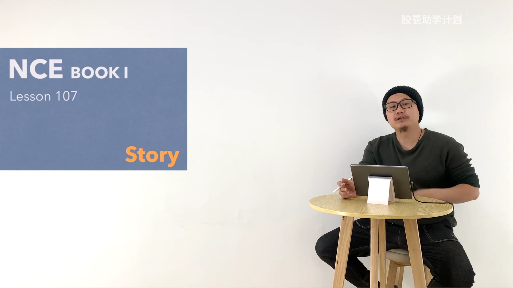

文字识别：NCE / BOOKI / Lesson 107 / Story

### 画面 00:00:07

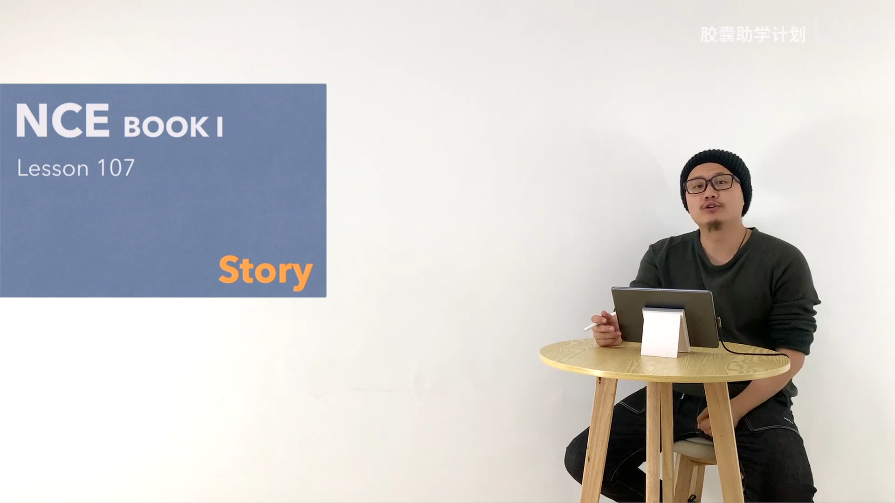

文字识别：NCE / BOOKI / Lesson 107 / Story

### 画面 00:00:09

文字识别：胶囊助学计划

### 画面 00:00:11

文字识别：胶囊助学计划 / ①如何使用would like？

### 画面 00:00:18

文字识别：胶囊助学计划 bilbl

### 画面 00:00:22

文字识别：胶囊助学计划

### 画面 00:00:24

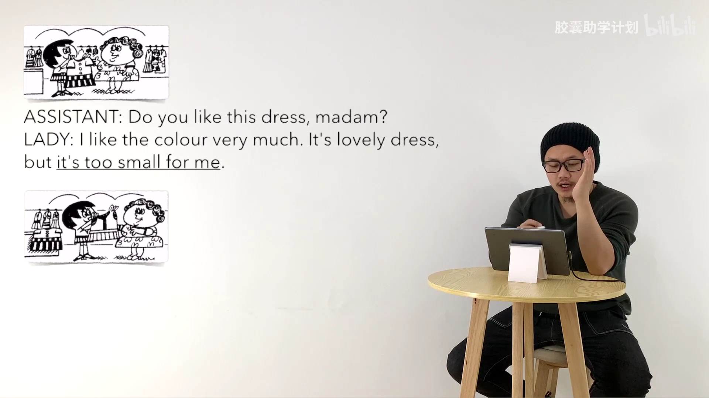

文字识别：胶囊助学计划 / ASSISTANT: Do you like this dress, madam? / LADY: I like the colour very much. It's lovely dress, / but it's too small for me.

## 00:00:30–00:01:00

啊，来买东西的。Assistant说，Do you like this dress, madam？你喜欢这个裙子吗，女士？很久之前学过的句型，I like the color very much.我非常喜欢这个颜色。Is a lovely dress？你看这个lovely，完全就可以把它换一些单词。你说，Is a smart dress？Is a beautiful dress？Is a pretty dress？都可以。你几乎可以理解为他们就是同义词啊。呃，很可爱，很漂亮。

### 画面 00:00:49

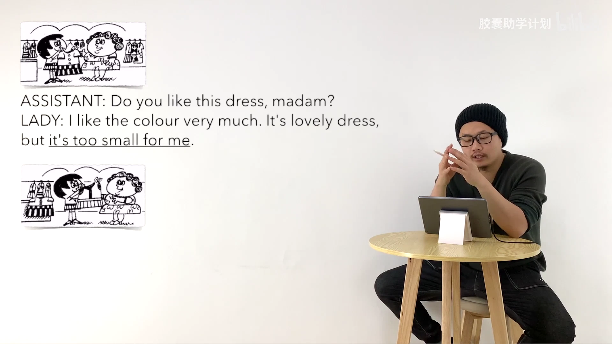

文字识别：胶囊助学计划 / ASSISTANT: Do you like this dress, madam? / LADY: I like the colour very much. Ilt's lovely dress, / but it's too small for me.

### 画面 00:00:51

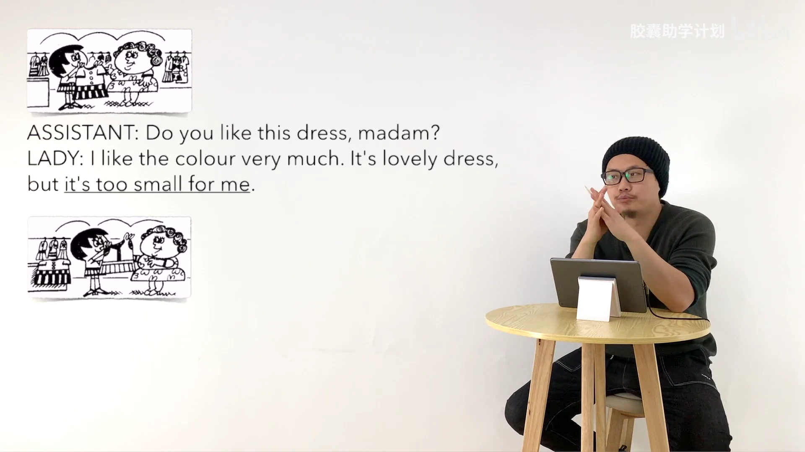

文字识别：ASSISTANT: Do you like this dress, madam? / LADY: I like the colour very much. It's lovely dress, / but it's too small for me.

### 画面 00:00:59

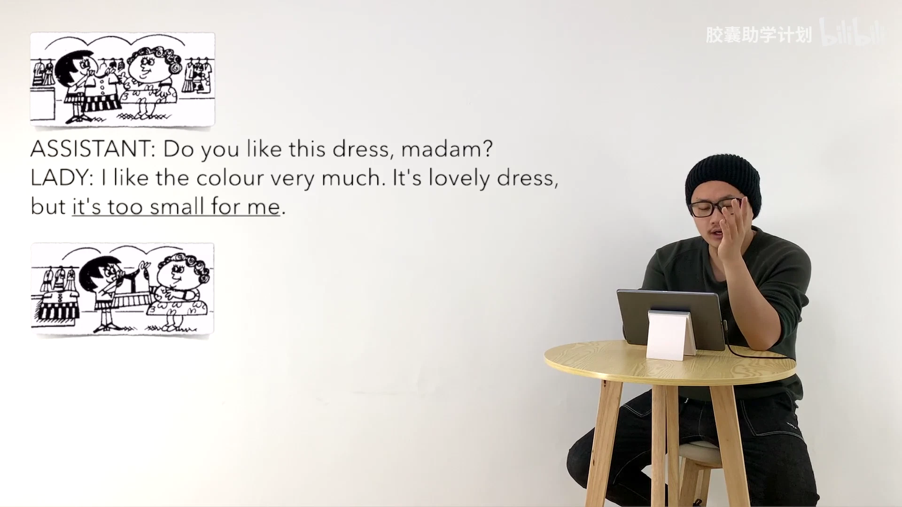

文字识别：胶囊助学计划 / ASSISTANT: Do you like this dress, madam? / LADY: I like the colour very much. Ilt's lovely dress, / but it's too small for me.

## 00:01:00–00:01:30

but it's too small for me.你看后边再加一个to wear，是不是就是我们刚刚学过的to呃enough那课，对吧？一百零四课啊，我们学的那个呃句子结构啊，太小了对于我来说，而没法去穿，too small for me. OK.再来，Assistant说，What about this one?那这一个呢？It's a lovely dress. It's very smart.啊，哎，It's very lovely, smart, beautiful,是吧？包括今天学的

### 画面 00:01:18

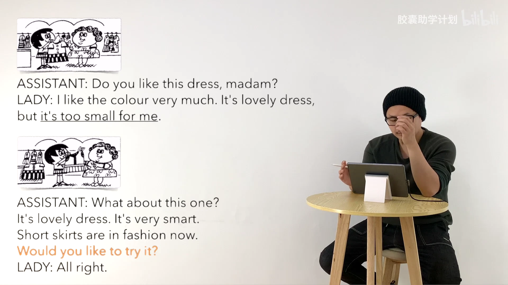

文字识别：胶囊助学计划 / 0 / ASSISTANT: Do you like this dress, madam? / LADY: I like the colour very much. It's lovely dress, / but it's too small for me. / ASSISTANT: What about this one? / It's lovely dress. It's very smart. / Short skirts are in fashion now. / Would you like to try it? / LADY: AIll right.

### 画面 00:01:28

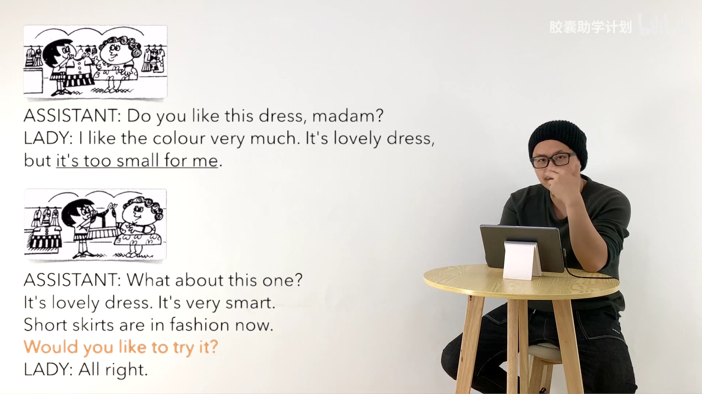

文字识别：胶囊助学计划 / ASSISTANT: Do you like this dress, madam? / LADY: I like the colour very much. It's lovely dress, / but it's too small for me. / ASSISTANT: What about this one? / It's lovely dress. It's very smart. / Short skirts are in fashion now. / Would you like to try it? / LADY: All right.

## 00:01:30–00:02:00

### 画面 00:01:31

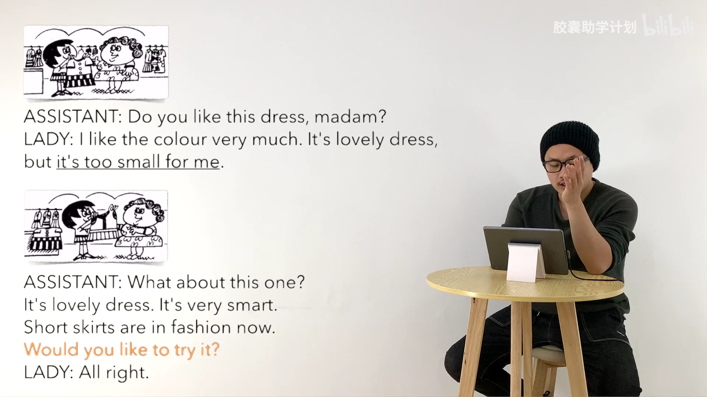

文字识别：胶囊助学计划 / 0 / ASSISTANT: Do you like this dress, madam? / LADY: I like the colour very much. It's lovely dress, / but it's too small for me. / ASSISTANT: What about this one? / It's lovely dress. It's very smart. / Short skirts are in fashion now. / Would you like to try it? / LADY: AIll right.

### 画面 00:01:46

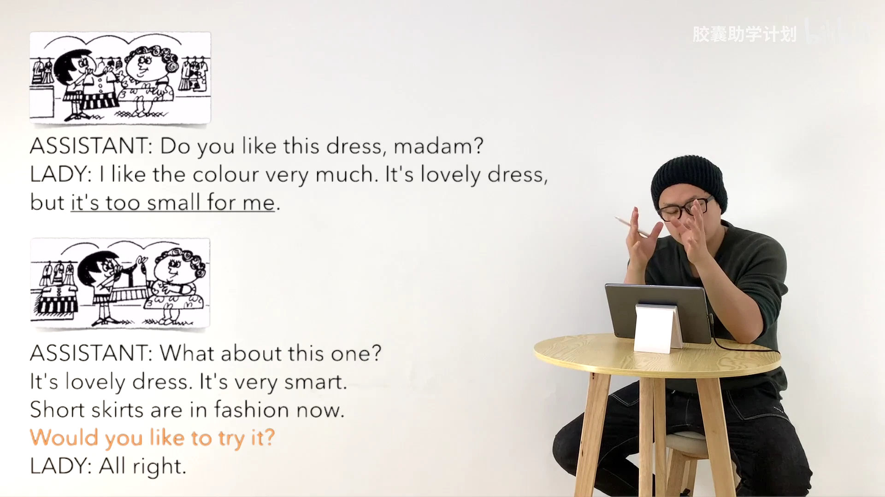

文字识别：胶囊助学计划 / ASSISTANT: Do you like this dress, madam? / LADY: I like the colour very much. It's lovely dress, / but it's too small for me. / ASSISTANT: What about this one? / It's lovely dress. It's very smart. / Short skirts are in fashion now. / Would you like to try it? / LADY: All right.

## 00:02:00–00:02:30

来会稍微的让人舒服那么一点点，就更加委婉一点。OK，叫你愿意试一下它吗？Would you like to try it?马上我们就讲啊。Lady说，All right，没问题。好，那我们先看一下。Would like, would like至少有两个用法，我们在这儿都简单提一下。Would like其实你可以理解为它是want这个单词的，嗯，某种委婉的说

### 画面 00:02:12

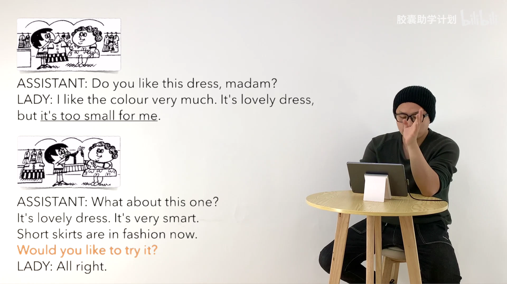

文字识别：胶囊助学计划 / 0 / ASSISTANT: Do you like this dress, madam? / LADY: I like the colour very much. It's lovely dress, / but it's too small for me. / ASSISTANT: What about this one? / It's lovely dress. It's very smart. / Short skirts are in fashion now. / Would you like to try it? / LADY: AIll right.

### 画面 00:02:14

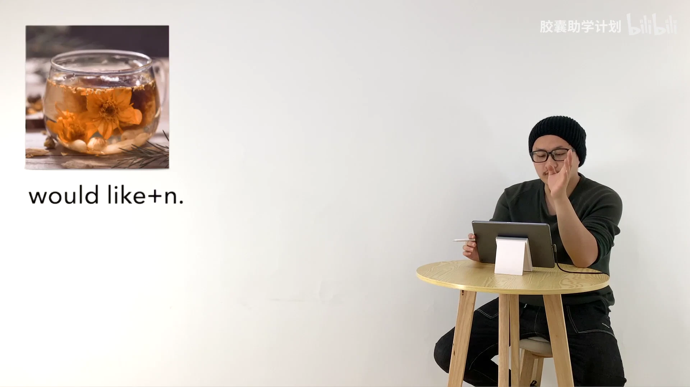

文字识别：胶囊助学计划 / would like+n.

### 画面 00:02:29

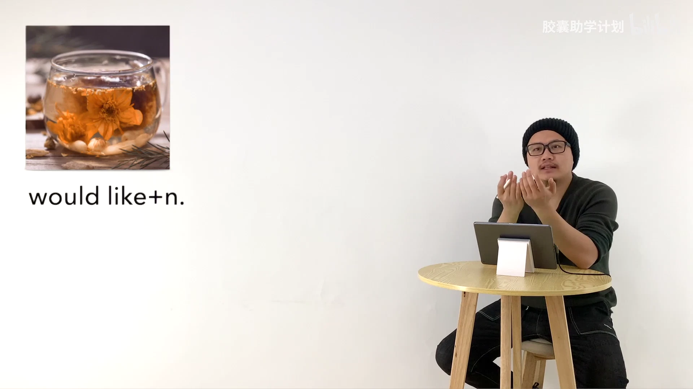

文字识别：胶囊助学计划 / would like+n.

## 00:02:30–00:03:00

法就 want something，比如说 I want some tea，我想要一些茶。你也可以说 I would like some tea。你不要分开去翻译，不要先翻译 would，再翻译成 like，不是这么翻译，是 would like 放在一起表示愿意。OK，好，那它有一个缩写 would 可以缩写成撇 d，叫 I'd like，啊 I'd like something。变一般疑问句呢，注意它有它自己特殊的变法，就是把 would 提前，所

### 画面 00:02:36

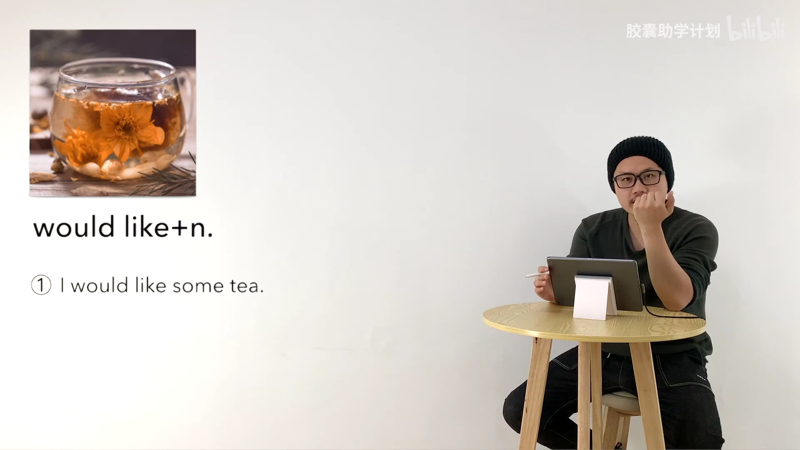

文字识别：胶囊助学计划 / would like+n. / ①I would like some tea.

### 画面 00:02:40

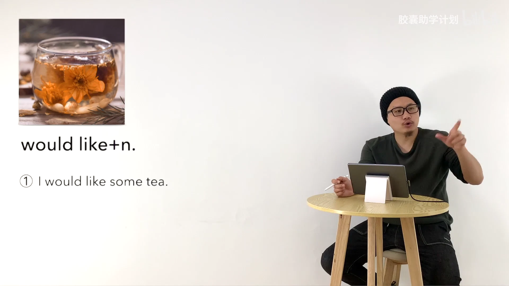

文字识别：胶囊助学计划 / would like+n. / ①I would like some tea.

### 画面 00:02:47

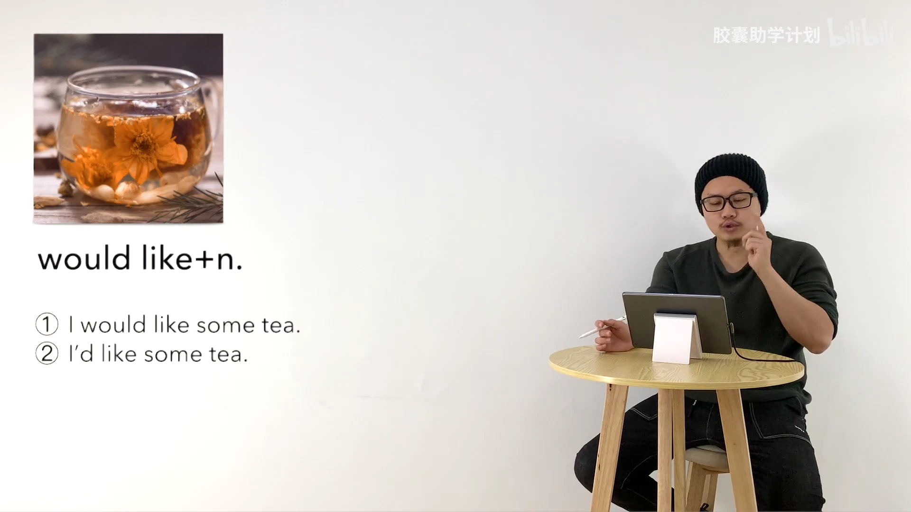

文字识别：胶囊助学计划 / would like+n. / ①I would like some tea. / ②I'd like some tea. / 2

### 画面 00:02:58

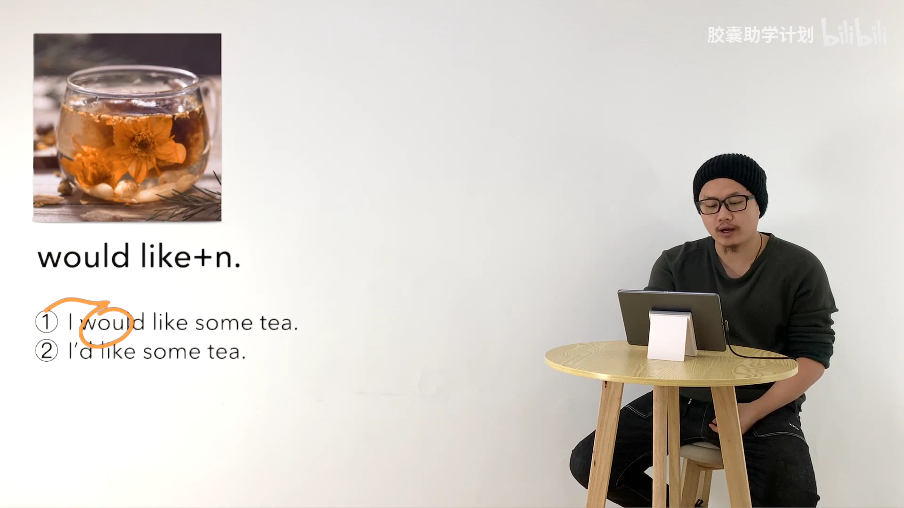

文字识别：胶囊助学计划 / would like+n. / ①I woud like some tea. / ② I'a like some tea.

## 00:03:00–00:03:30

以它变成叫 would you like something？它跟 do you want something 几乎含义是一致的。对于各位来说，您随便去用啊。OK，那 would like 刚才是直接加 something。那如果后边想加动词呢，就是 would like to do something，叫做愿意去做某件事情。比如说 I would like to help him，我愿意帮他。同理可以缩写叫 I'd like to help him，我愿意帮

### 画面 00:03:02

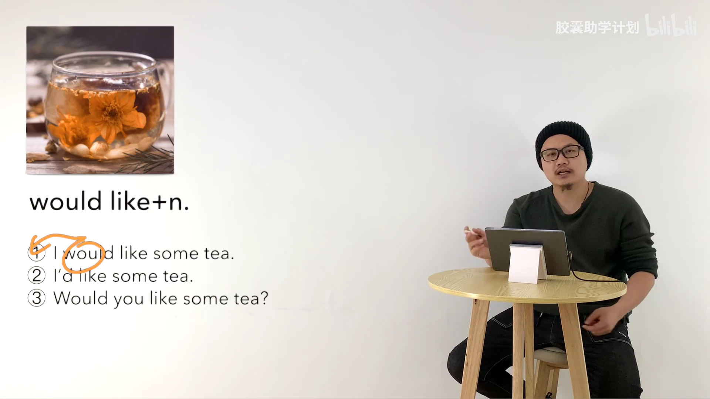

文字识别：胶囊助学计划 / would like+n. / woud like some tea. /  I'a like some tea. / 2 / Would you like some tea?

### 画面 00:03:04

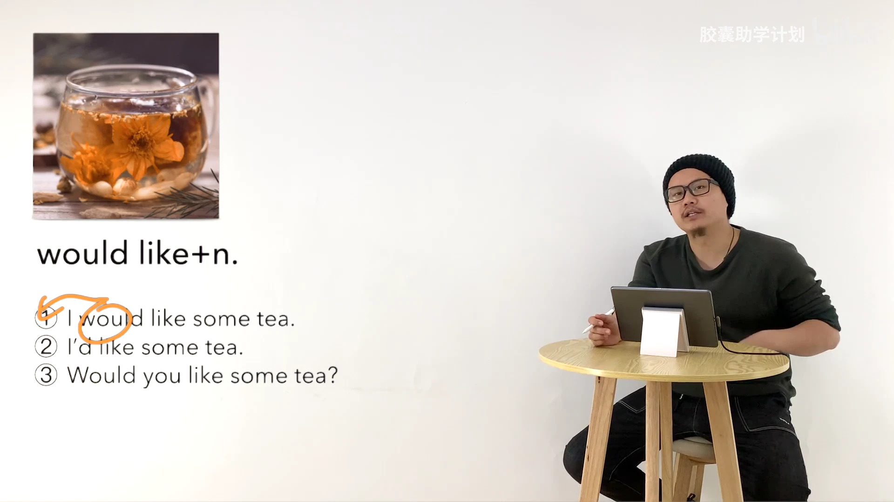

文字识别：would like+n. / woud like some tea. /  I'a like some tea. / 2 / Would you like some tea?

### 画面 00:03:10

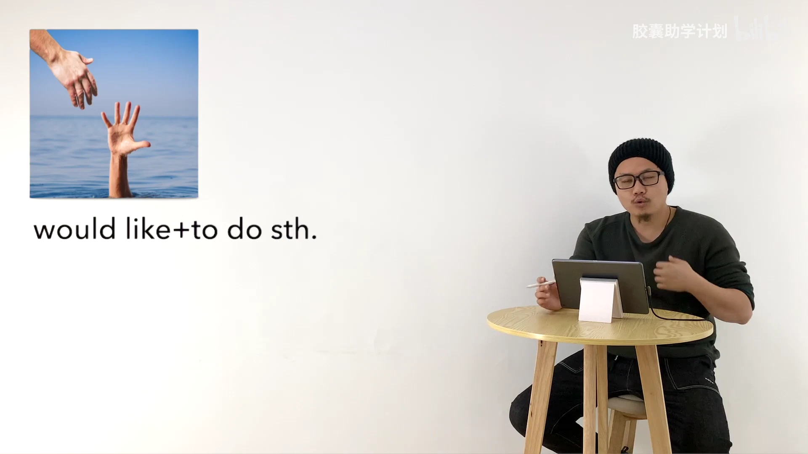

文字识别：胶囊助学计划 / W / would like+to do sth.

### 画面 00:03:15

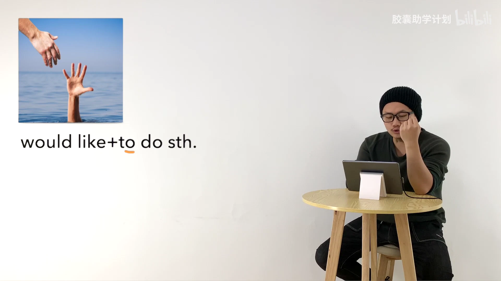

文字识别：胶囊助学计划 / would like+to do sth.

### 画面 00:03:24

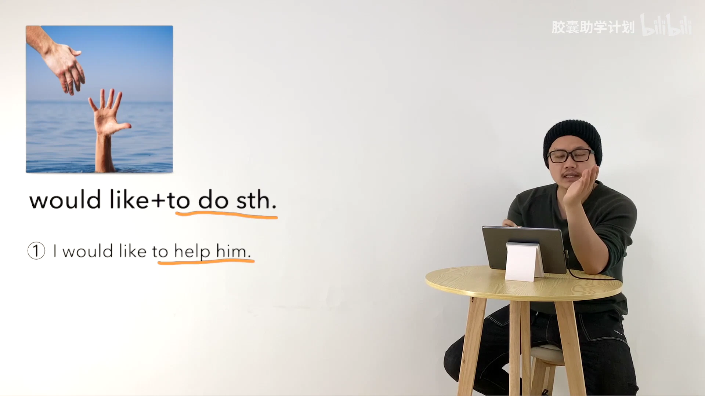

文字识别：胶囊助学计划 / would like+to do sth. / ①I would like to help him.

## 00:03:30–00:04:00

他。同理可以变一般啊，一般疑问句 would 提前，叫 Would you like to help him? 你愿意帮他一下吗？OK, very good. 啊，这不是非常的难。接下来呢，我们看一个小的电影片段，当中连续出现了两次 would like，只不过第一次可能您听不太清，是吧？声音稍微有一点点小，但第二次是非常清楚的，叫我愿意，我想要一些什么东西。注意力集中，来了。 I would like a drink.

### 画面 00:03:39

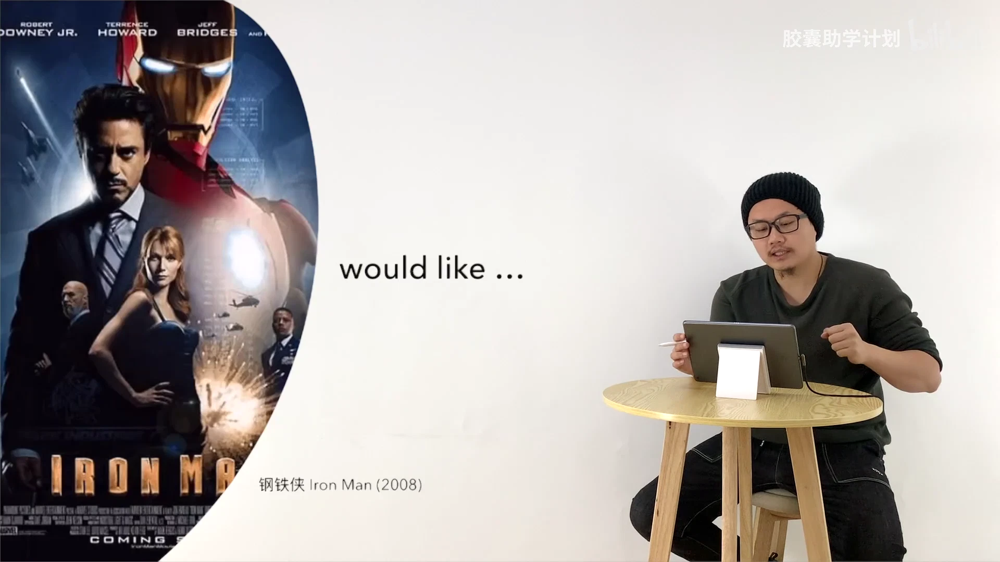

文字识别：POWNEYJR. / ROUERT / HOWARD / TERREN / CE / BRIDGES / JEFF / ANO / 胶囊助学计划 / would like . / IRONMP / 钢铁侠Iron Man (2008) / COMING

### 画面 00:03:42

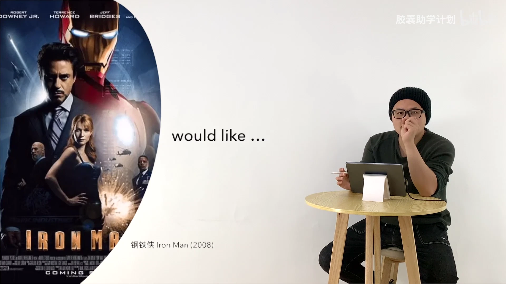

文字识别：POWNEYJR. / ROOERT / HOWARD / TERREN / CE / BRIDGES / JEFF / ANO / 胶囊助学计划 / would like . / IRONMP / 钢铁侠 Iron Man (2008) / COMING

### 画面 00:03:52

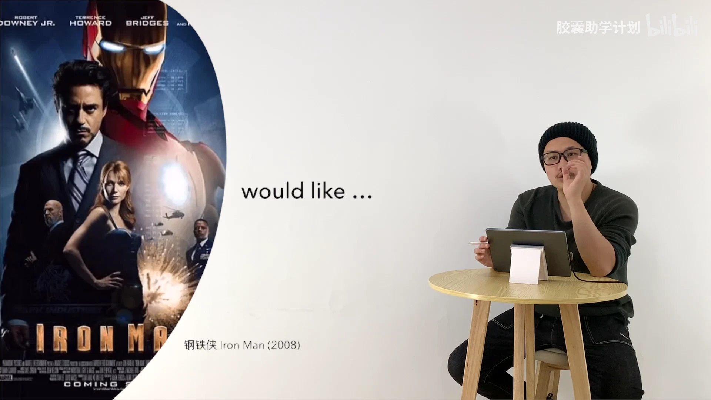

文字识别：POWNEYJR. / ROUERT / HOWARD / TERRENCE / BRIDGES / UEFF / A540 / 胶囊助学计划 / would like ... / IRONMP / 钢铁侠 Iron Man (2008) / COMING

### 画面 00:03:57

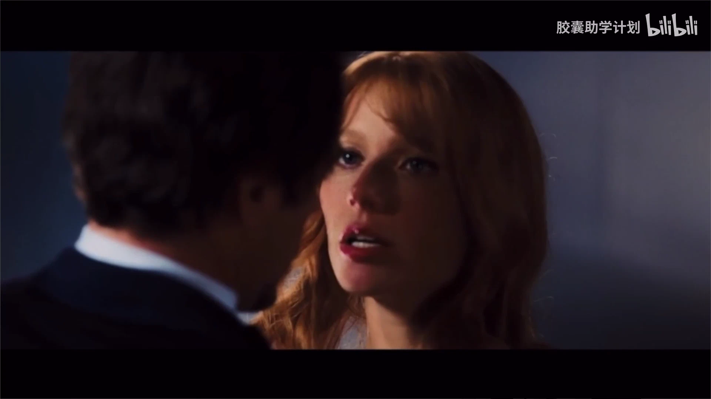

文字识别：Bilibili / 胶囊助学计划

### 画面 00:03:59

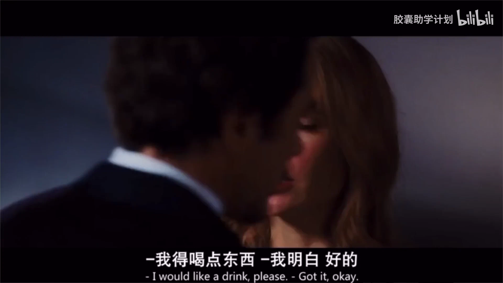

文字识别：bilibli / 胶囊助学计划 / -我得喝点东西-我明白 好的 / -I would like a drink, please. - Got it, okay.

## 00:04:00–00:04:30

I would like a a vodka martini, please. Very dry with olives, a lot of olives, like at least three olives. I would like a vodka martini. Okay,好，不多说了啊。我愿意，我想要啊。Want几乎一样。我们回到文章。Lady说，I'm afraid我恐怕this green dress is too small for me as well也太小了，对于我来说as

### 画面 00:04:01

文字识别：bilibili / 胶囊助学计划

### 画面 00:04:03

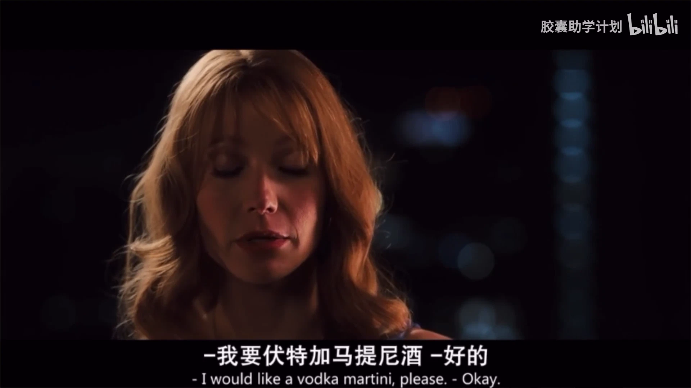

文字识别：bilibli / 胶囊助学计划 / -我要伏特加马提尼酒-好的 / - I would like a vodka martini, please. - Okay.

### 画面 00:04:05

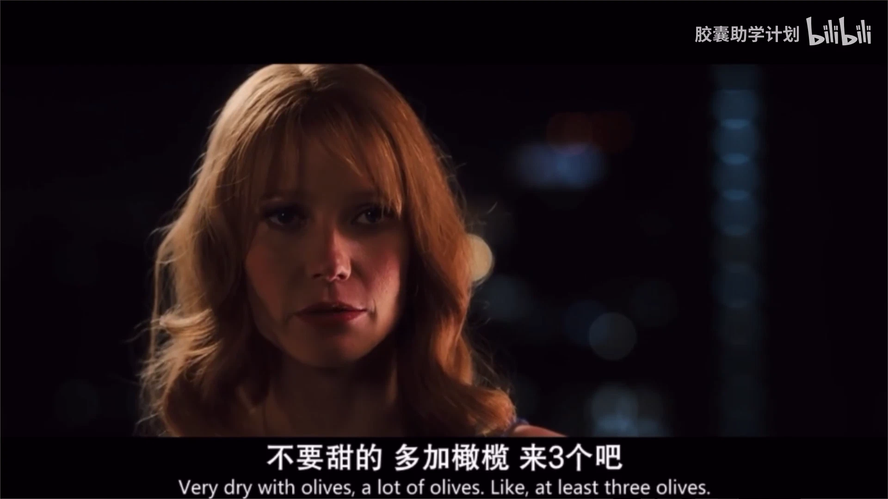

文字识别：bilibli / 胶囊助学计划 / 不要甜的 多加橄榄 来3个吧 / Very dry with olives, a lot of olives. Like, at least three olives.

### 画面 00:04:07

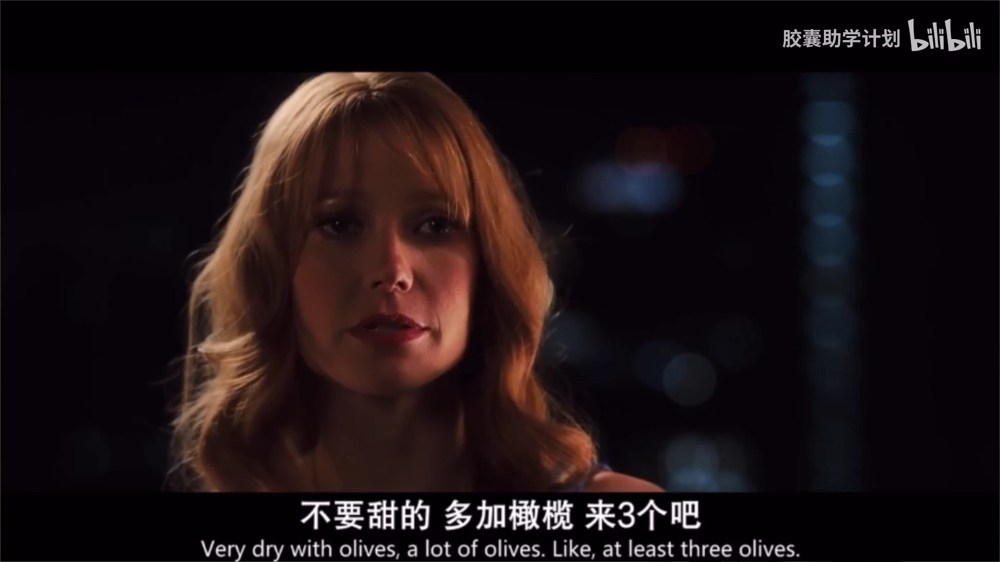

文字识别：bilibli / 胶囊助学计划 / 不要甜的 多加橄榄 来3个吧 / Very dry with olives, a lot of olives. Like, at least three olives.

### 画面 00:04:09

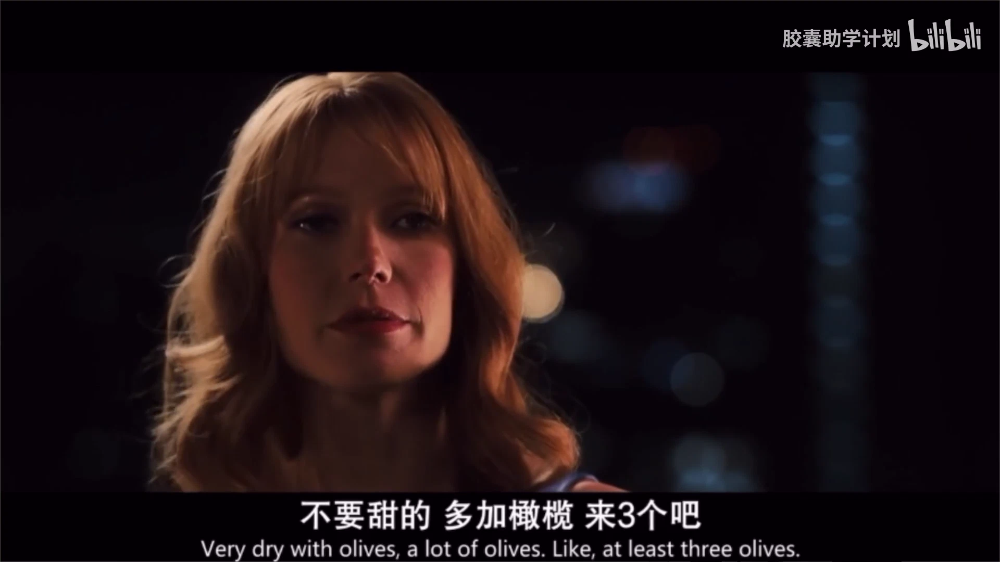

文字识别：bilibli / 胶囊助学计划 / 不要甜的 多加橄榄 来3个吧 / Very dry with olives, a lot of olives. Like, at least three olives.

### 画面 00:04:11

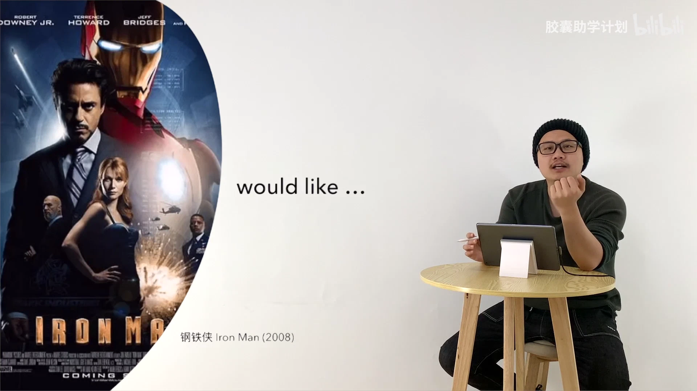

文字识别：POWNEY JR. / ROUERT / HOWARD / TERREN / CG / BRIDGES / CFF / AHD / 胶囊助学计划 / would like . / IRONMA / 钢铁侠 Iron Man (2008) / COMING

### 画面 00:04:17

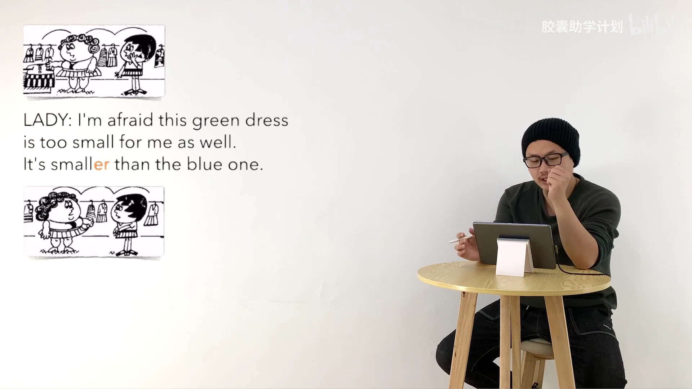

文字识别：胶囊助学计划 / LADY: I'm afraid this green dress / is too small for me as well. / It's smaller than the blue one.

### 画面 00:04:24

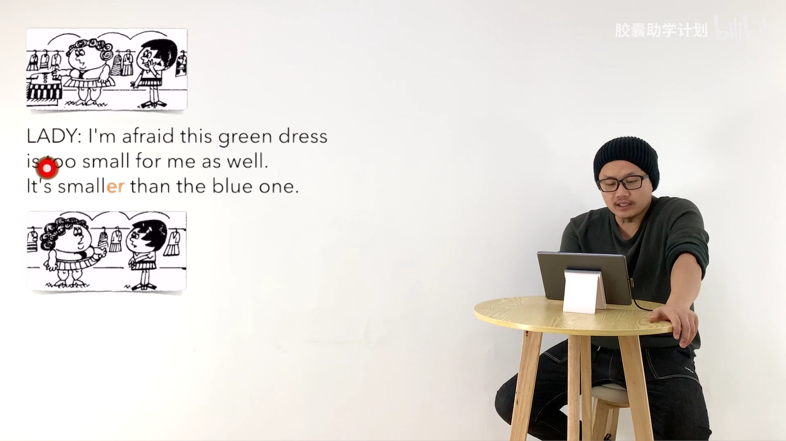

文字识别：胶囊助学计划 / LADY: I'm afraid this green dress / oo small for me as well. / It's smaller than the blue one.

## 00:04:30–00:05:00

well就是too叫也对吧？也太小了。It's smaller than the blue one. 更小，跟谁比呢？跟the blue one，跟蓝色的这个比。注意smaller后边加了一个也，对吧？啊，更小。I don't like the color either.哎，either either两个发音都可以，它叫否定的也，对不对？放在否定句当中，放在句尾表示也，就类似于too跟as

### 画面 00:04:45

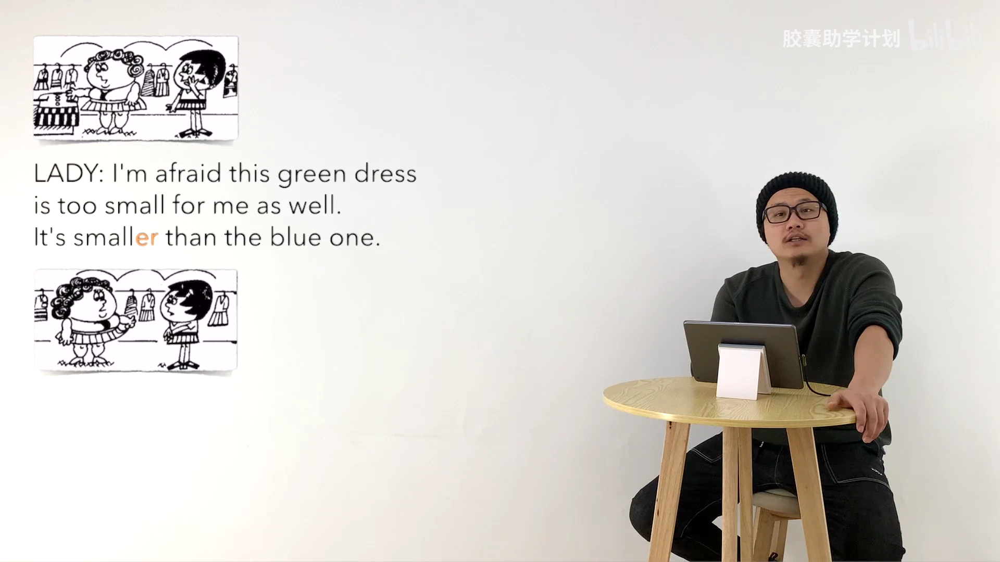

文字识别：胶囊助学计划 / LADY: I'm afraid this green dress / is too small for me as well. / It's smaller than the blue one.

### 画面 00:04:48

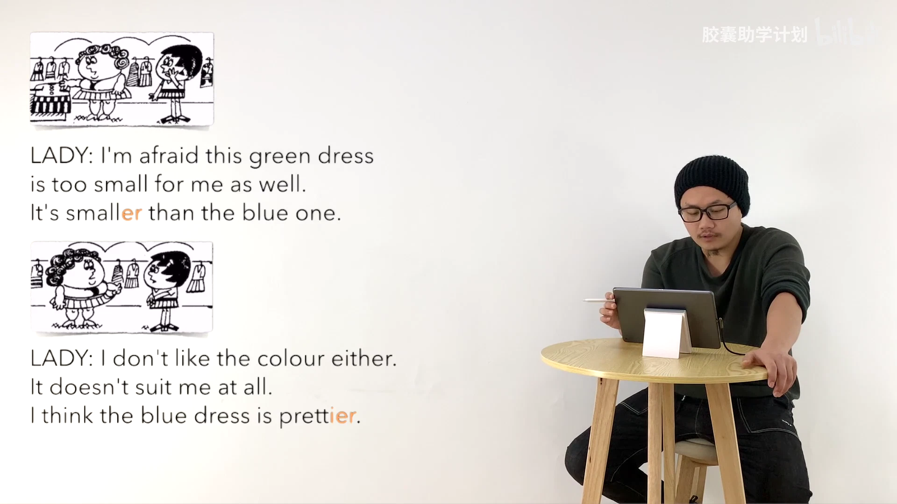

文字识别：胶囊助学计划 / LADY: I'm afraid this green dress / is too small for me as well. / It's smaller than the blue one. / LADY: I don't like the colour either. / It doesn't suit me at all. / I think the blue dress is prettier.

## 00:05:00–00:05:30

well 的否定，对吧？哎，我也不喜欢这个颜色，It doesn't suit me at all。好，注意啊，It doesn't suit me 叫做它不适合我。那 at all 加上前面这个 not，叫 not at all， not at all 叫做一点也不啊，叫它一点也不适合我。这儿一个，I think 后边一个典型的宾语从句，The blue dress is prettier，

### 画面 00:05:10

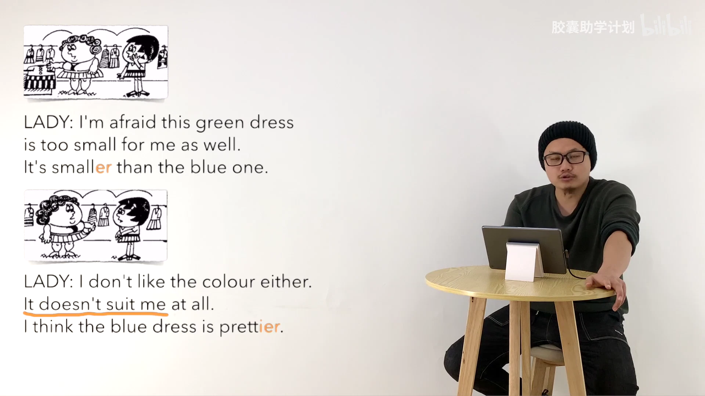

文字识别：胶囊助学计划 / LADY: I'm afraid this green dress / is too small for me as well. / It's smaller than the blue one. / LADY: I don't like the colour either. / It doesn't suit me at all. / I think the blue dress is prettier.

### 画面 00:05:16

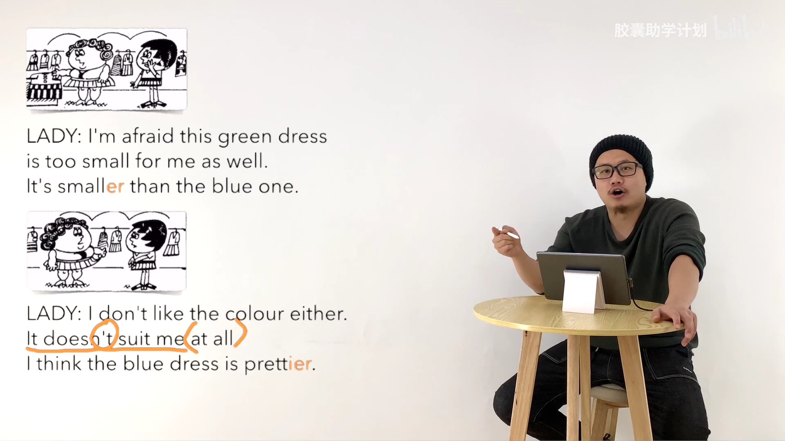

文字识别：胶囊助学计划 / LADY: I'm afraid this green dress / is too small for me as well. / It's smaller than the blue one. / LADY: I don't like the colour either. / It doesb't suit me at all / I think the blue dress is prettier.

### 画面 00:05:25

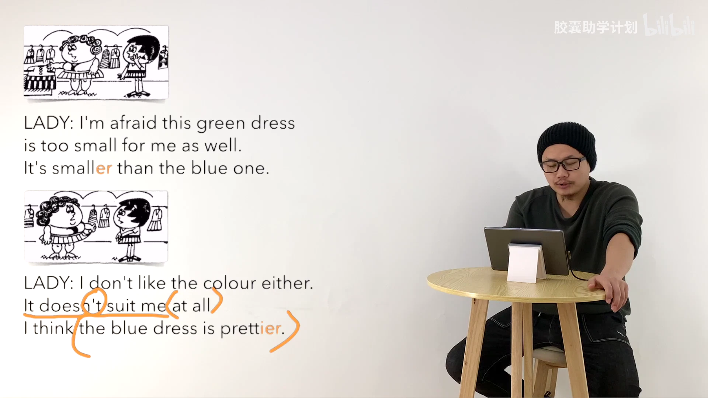

文字识别：胶囊助学计划 / LADY: I'm afraid this green dress / is too small for me as well. / It's smaller than the blue one. / LADY: I don't like the colour either. / It doesb't suit me at all / I think/the blue dress is prettier.

## 00:05:30–00:06:00

叫更加的美丽。你看 prettier变y为i加er叫更漂亮。Lily说啊，Could you show me show somebody something？对吧？哎，展示给某人。说你愿意展示给我另一个蓝色的这个裙子吗？你看，并且是could提前。我们之前就有讲过，could是可以放在现在去用的，对吧？跟can类似啊。I want a

### 画面 00:05:30

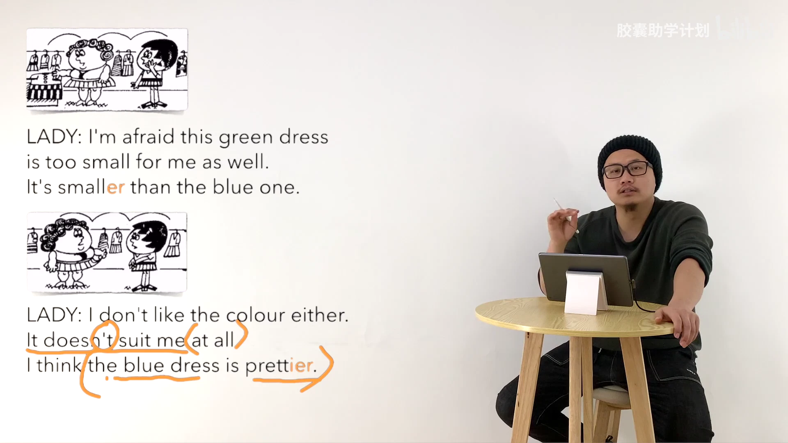

文字识别：胶囊助学计划 / LADY: I'm afraid this green dress / is too small for me as well. / It's smaller than the blue one. / LADY: I don't like the colour either. / It doeso't suit me at all / I think/the blue dress is prettier.

### 画面 00:05:35

文字识别：胶囊助学计划 / LADY: Could you show me another blue dress? / I want a dress like that one, / but it must be my size.

### 画面 00:05:42

文字识别：胶囊助学计划 / LADY: Could you show me another blue dress? / I want a dress like that one, / but it must be my size.

### 画面 00:05:45

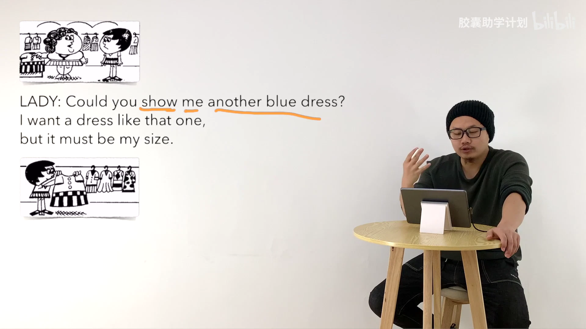

文字识别：胶囊助学计划 / 8 / LADY: Could you show me another blue dress? / I want a dress like that one, / but it must be my size.

### 画面 00:05:51

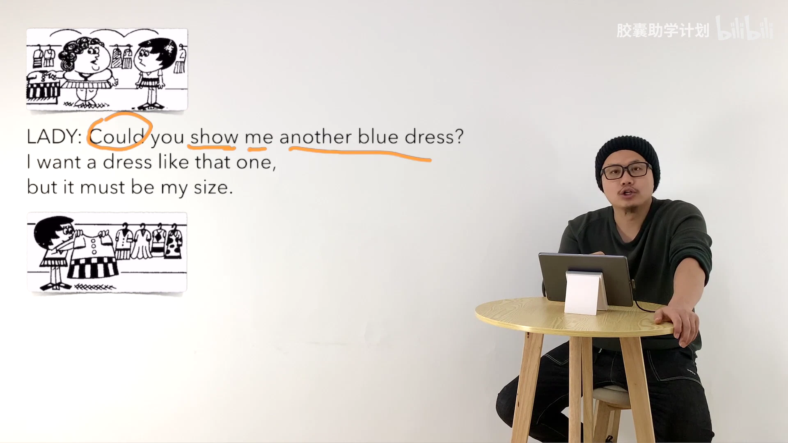

文字识别：胶囊助学计划 / 8 / LADY: / Couldyou show me another blue dress? / I want a dress like that one, / but it must be my size.

### 画面 00:05:53

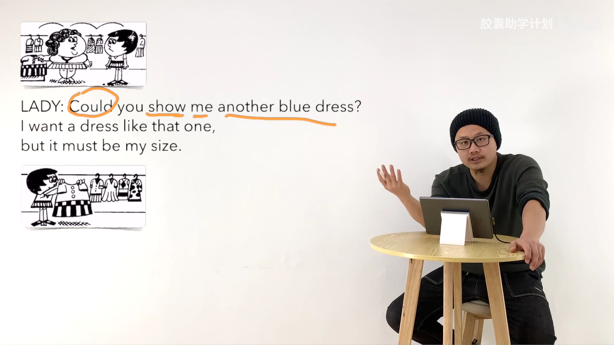

文字识别：胶囊助学计划 / 8 / LADY: / Could you show me another blue dress? / I want a dress like that one, / but it must be my size.

## 00:06:00–00:06:30

dress like that one. 注意这个 like 是一个小的介词，当然这个词性对于各位其实不太重要。您只需要知道这儿的 like 不是喜欢的意思，叫像，是吧？我们之前也学过啊，说我想要一个裙子像那个一样的。但是呢， it must be my size. 啊，我们再看一下这个插画师啊，给他们两个人安排的体型，是吧？就是这个这个女人呢，稍微有一点点的

### 画面 00:06:00

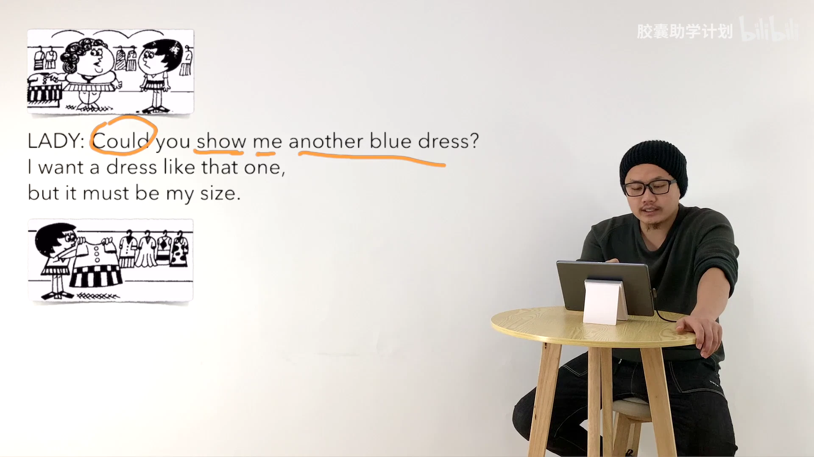

文字识别：胶囊助学计划 / LADY: / Could you show me another blue dress? / I want a dress like that one, / but it must be my size.

### 画面 00:06:03

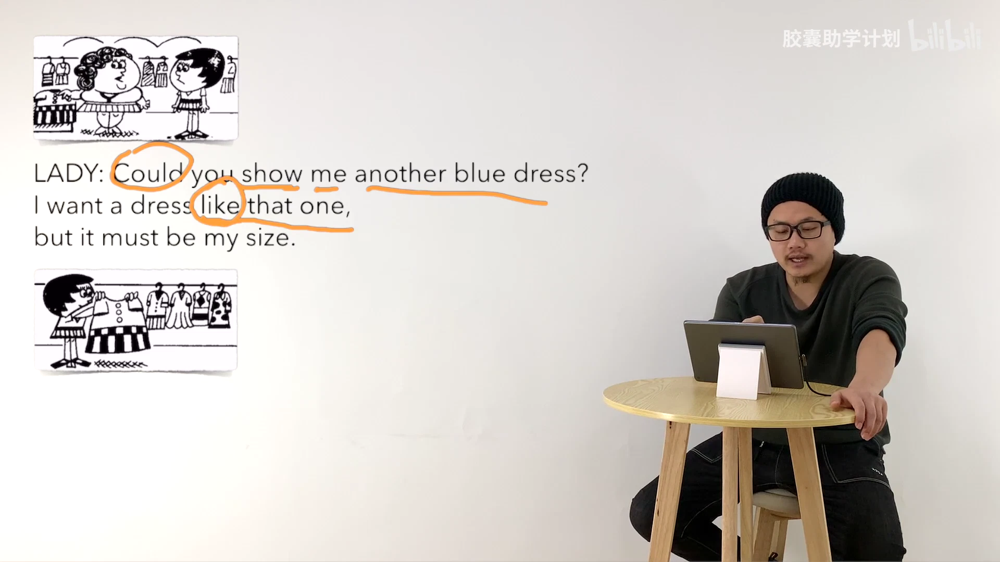

文字识别：胶囊助学计划 / 8 / Could you show me another blue dress? / LADY: / I want a dress like that one, / but it must be my size.

### 画面 00:06:06

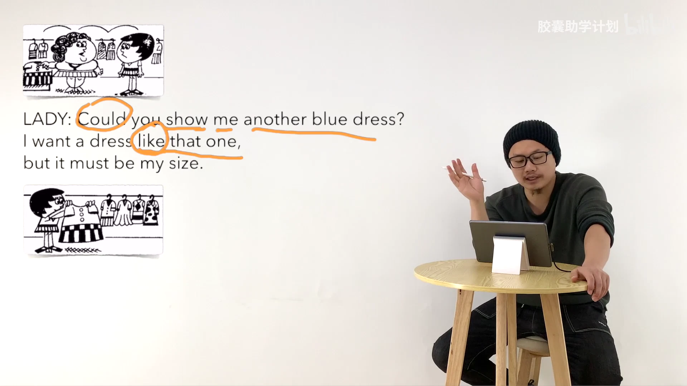

文字识别：胶囊助学计划 / LADY: / Could you show me another blue dress? / I want a dress like that one, / but it must be my size.

### 画面 00:06:17

文字识别：胶囊助学计划 / LADY: / Could you show me another blue dress? / I want a dress like that one, / but it must be mys / size.

### 画面 00:06:20

文字识别：胶囊助学计划 / LADY: / Could you show me another blue dress? / I want a dress like that one, / butit must be my s / size.

### 画面 00:06:24

文字识别：胶囊助学计划 / Could you show me another blue dress? / LADY: / I want a dress like that one, / butit must be my s / size.

### 画面 00:06:28

文字识别：胶囊助学计划 / Could you show me another blue dress? / LADY: / I want a dress like that one, / butit must be my size. / 座

## 00:06:30–00:07:00

壮和胖，是吧？可能不是特别容易找到，所以他说 it must be 必须是我的尺码 size，对吧？Assistant 说 I'm afraid 我恐怕 I haven't got 七十九课学的嘛，说没有，对吧？A larger dress 一个更大的裙子了，然后呢，他说 This is the 是最 largest dress in the shop。哎，主语 be the

### 画面 00:06:31

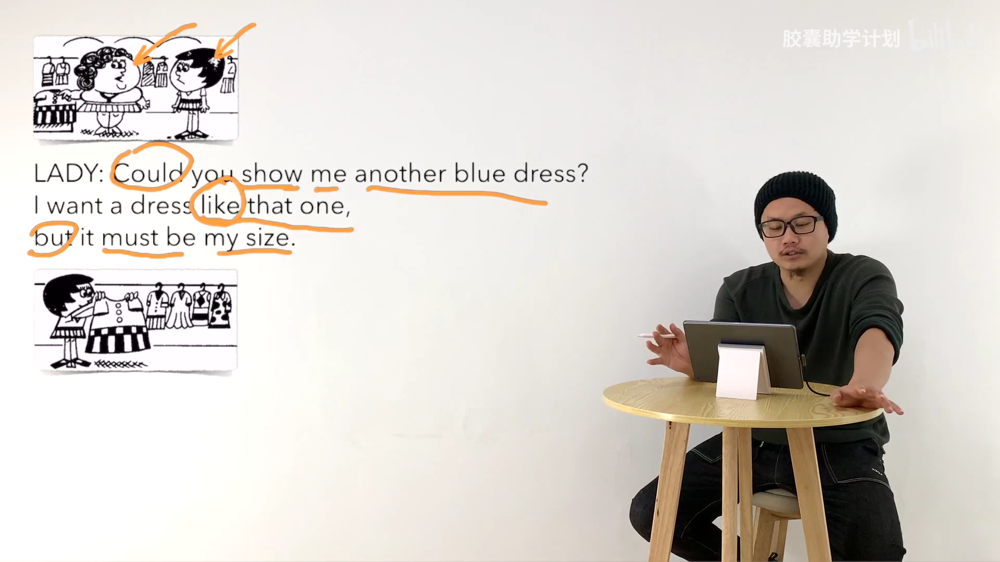

文字识别：胶囊助学计划 / LADY: / Could you show me another blue dress? / I want a dress like that one, / but it must be my size.

### 画面 00:06:35

文字识别：胶囊助学计划 / LADY: / Could you show me another blue dress? / I want a dress like that one, / butit must be my s / size. / 座

### 画面 00:06:38

文字识别：胶囊助学计划 / LADY: / Could you show me another blue dress? / I want a dress like that one, / but it must be my size. / ASSISTANT: I'm afraid I haven't got a larger dress. / This is the largest dress in the shop.

### 画面 00:06:43

文字识别：胶囊助学计划 / LADY: / Could you show me another blue dress? / I want a dress like that one, / bufit must be my size. / ASSISTANT: I'm afraid I haven't got a larger dress. / This is the largest dress in the shop.

### 画面 00:06:48

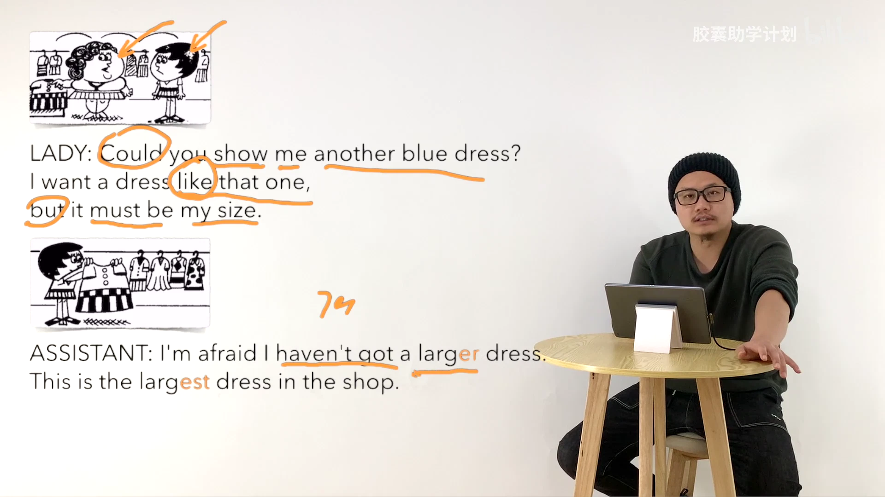

文字识别：胶囊助学计划 / LADY: / Could you show me another blue dress? / I want a dress like that one, / but it must be my size. / 74 / ASSISTANT: I'm afraid I haven't got a larger dress. / This is the largest dress in the shop.

### 画面 00:06:52

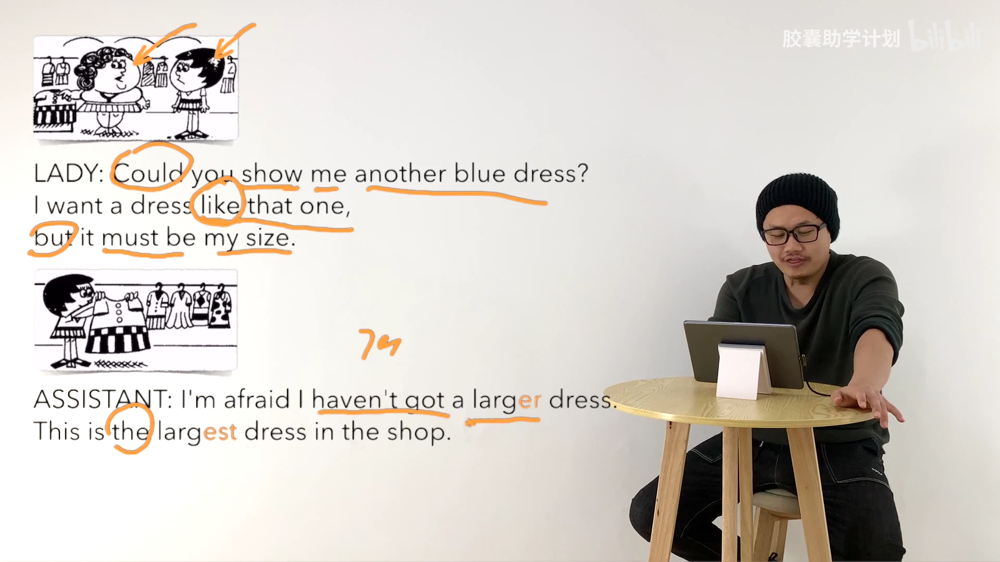

文字识别：胶囊助学计划 / LADY: / Could you show me another blue dress? / I want a dress like that one, / butit must be my size. / 74 / ASSISTANT: I'm afraid I haven't got a larger dress. / This is the / e largest dress in the shop.

### 画面 00:06:56

文字识别：胶囊助学计划 / LADY: / Could you show me another blue dress? / I want a dress like that one, / bufit must be my size. / 74 / ASSISTANT: I'm afraid I haven't got a larger dress. / This isthe / largest dress in the shop.

## 00:07:00–00:07:30

形容词最高级名词又加了一个范围叫 in the shop 完美了，对不对？ Okay, very good. 接下来我们做一些口语听力练习。我问，你答。第一题。Does the lady like the blue dress? Yes, she does. Next one. Does she say the blue dress is lovely? Yes, she does. Next

### 画面 00:07:02

文字识别：胶囊助学计划 / LADY: / Couldyou show me another blue dress? / I want a dress like that one, / butit must be my size. / 74 / ASSISTANT: I'm afraid I haven't got a larger dress. / This isthe / largest dress / in the shop.

### 画面 00:07:05

文字识别：胶囊助学计划 / LADY: / Could you show me another blue dress? / I want a dress like that one, / bufit must be my size. / 74 / ASSISTANT: I'm afraid I haven't got a larger dress. / This is the / largest dress in the shop. / D

### 画面 00:07:07

文字识别：LADY: Could you show me another blue dress? / I want a dress like that one, / but it must be my size. / ASSISTANT: I'm afraid I haven't got a larger dress. / This is the largest dress in the shop.

### 画面 00:07:09

文字识别：Comprehension

### 画面 00:07:13

文字识别：胶囊助学计划 / Comprehension / 1 T: Does the lady like the blue dress?

### 画面 00:07:18

文字识别：胶囊助学计划 / Comprehension / 1 T: Does the lady like the blue dress?

## 00:07:30–00:08:00

Next one. So why doesn't she want it? Is too small for her. Next one. Does she try the green dress as well? Yes, she does. Next one. What's the matter with the green dress? Is too small for her, and the color doesn't suit her. Ah, or she doesn't like the color very much. 对啊，都可以. Next one.

### 画面 00:07:48

文字识别：胶囊助学计划 / Comprehension / 5 T: What's the matter with the green dress?

## 00:08:00–00:08:30

Which dress is smaller, the blue one or the green one? The blue one. Okay, very good. Does the lady think the blue dress is prettier than the green one? Yes, she does. Next one. Does the green dress suit the lady? No, it doesn't. Next one.

### 画面 00:08:02

文字识别：胶囊助学计划 / Comprehension / 6 T: Which dress is smaller, the blue one or / the green one?

### 画面 00:08:09

文字识别：胶囊助学计划 / Comprehension / 7 T: Does the lady think the blue dress is / prettier than the green one?

### 画面 00:08:20

文字识别：胶囊助学计划 / Comprehension / 8 T: Does the green dress suit the lady?

## 00:08:30–00:09:00

what does the lady ask the assistant to show her? Another blue dress, 对吧？呃，他这是说的就是 a blue dress in a larger size，也是对的。Next one, why can't the assistant get the lady a blue dress of her size? Because the blue dress is the largest one in the shop. Here we go.接下来呢， asking questions，老

### 画面 00:08:35

文字识别：胶囊助学计划 / Comprehension / 9 T: What does the lady ask the assistant to / show her? / S: A blue dress in a larger size.

### 画面 00:08:44

文字识别：胶囊助学计划 / Comprehension / 10 T: Why can't the assistant get the lady a / blue dress of her size?

### 画面 00:08:57

文字识别：胶囊助学计划 / Asking questions

### 画面 00:08:59

文字识别：胶囊助学计划 / Asking questions / 1 T: Ask me if she likes this dress.

## 00:09:00–00:09:30

habit. Affirmative sentence, general疑问句, special疑问句来了. Ask me if she likes this dress. 你看 likes does 提前对吧? Does she like this dress? What What does she like? Next one. Ask me if short skirts are in fashion now. Are short skirts in fashion now? Which Which skirts are in fashion now? 好，这儿提一个小

### 画面 00:09:04

文字识别：胶囊助学计划 / Asking questions / 1 T: Ask me if she likes this dress.

### 画面 00:09:13

文字识别：胶囊助学计划 / Asking questions / 1 T: Ask me if she likes this dress. / S: Does she like this dress? / T: What ..? / S: What does she like?

### 画面 00:09:16

文字识别：胶囊助学计划 / Asking questions / 2 T: Ask me if short skirts are in fashion now.

### 画面 00:09:25

文字识别：胶囊助学计划 / Asking questions / 2 T: Ask me if short skirts are in fashion now. / S: Are short skirts in fashion now? / T: Which ...? / S: Which skirts are in fashion now?

## 00:09:30–00:10:00

点，which往往可以对形容词提问，哪些，哪个，对吧？你说你要哪些苹果？我要绿色的那些，红色的那些，对吧？所以它往往可以对起到形容词作用的这些单词去提问。OK，再来，Ask me if she likes the color. Does she like the color? Why doesn't? Why doesn't she like the color? Next one,

### 画面 00:09:32

文字识别：胶囊助学计划 / Asking questions / 2 T: Ask me if short skirts are in fashion now. / S: Are short skirts in fashion now? / T: Which ...? / S: Which skirts are in fashion now?

### 画面 00:09:34

文字识别：胶囊助学计划 / Asking questions / 2 T: Ask me if short skirts are in fashion now. / S: Are short skirts in fashion now? / T: Which ..? / S: Which skirts are in fashion now?

### 画面 00:09:40

文字识别：胶囊助学计划 / Asking questions / 2 T: Ask me if short skirts are in fashion now. / S: Are short skirts in fashion now? / T: Which ..? / S: Which skirts are in fashion now?

### 画面 00:09:44

文字识别：胶囊助学计划 / Asking questions

### 画面 00:09:54

文字识别：胶囊助学计划 / Asking questions / 3 T: Ask me if she likes the colour. / S: Does she like the colour? / T: Why doesn't ..? / S: Why doesn't she like the colour?

### 画面 00:09:58

文字识别：胶囊助学计划 / Asking questions

## 00:10:00–00:10:30

ask me if it suits her. Does it suit her? Why doesn't? Why doesn't it suit her? Very good. Next one, ask me if she's got a larger dress. 你看，注意这个地方的 has 是 has 对吧？所以 has 提前 has she got a larger dress? Why hasn't? Why hasn't she got

### 画面 00:10:19

文字识别：胶囊助学计划 / Asking questions / 5 T: Ask me if she's got a larger dress.

### 画面 00:10:22

文字识别：胶囊助学计划 / Asking questions / 5 T: Ask me if she's got a larger dress. / S: Has she got a larger dress?

## 00:10:30–00:11:00

a larger dress? There you go.好，recap形容词比较级最高级。我们又学到了 would like something 和 would like to do something 变一般疑问句均是把 would 提前。这个地方注意一下。那将作业呢？绿皮书一百零七课文章跟读至熟读成诵。红皮书各位尝试去查找一下 would like 这个小的关键语法点。最后给自己讲解一遍核心知识点。OK。

### 画面 00:10:32

文字识别：胶囊助学计划 / Recap / Patterns / adj.er / adj.est / Grammar / Words / would like sth. / Expression / would like to do sth.

### 画面 00:10:34

文字识别：Recap / 胶囊助学计划 / Patterns / adj.er / adj.est / Grammar / Words / would like sth. / Expression / would like to do sth.

### 画面 00:10:38

文字识别：胶囊助学计划 / Recap / Patterns / adj.er / adj.est / Grammar / Words / would like sth. / Expression / would like to do sth.

### 画面 00:10:44

文字识别：胶囊助学计划 / D

### 画面 00:10:50

文字识别：胶囊助学计划 / 绿皮书第107课的写作练习 / 文章跟读至熟读成诵 / 3.初级红皮书查找would liee

### 画面 00:10:52

文字识别：胶囊助学计划 / 绿皮书第107课的写作练习 / 文章跟读至熟读成诵 / 3.初级红皮书查找wauld liee

### 画面 00:10:59

文字识别：胶囊助学计划

## 00:11:00–00:11:28

那如果大家喜欢我们的课程，欢迎大家关注、订阅、一键三连，分享给那些需要的朋友啊，来帮助我们快速成长。最后，我们再来看一句名人名言：The higher the voice, the smaller intellect. OK, see you next time.

### 画面 00:11:07

文字识别：胶囊助学计划 / The higher the voice the smaller the / intellect. / Ernest Newman

### 画面 00:11:16

文字识别：The higher the voice the smaller the / intellect. / Ernest Newman

### 画面 00:11:18

文字识别：CAPSULEACADEMY / 胶囊助学计划 / 小红书 / Lecturer / Leo / OE

### 画面 00:11:21

文字识别：CAPSULEACADEMY / 胶囊助学计划 / 小红书 / Fdi-

### 画面 00:11:24

文字识别：CAPSULEACADEMY / 胶囊助学计划 / 小红书 / Creator / Leo & Berlin

### 画面 00:11:26

文字识别：bilibili / 胶囊助学计划 / CAPSULEACADEMY / 胶囊助学计划 / 小红书 / OE

### 画面 00:11:28

文字识别：bilibili / 胶囊助学计划

