# 108 练习

快速机器解析：语音为单模型转写，未进行独立交叉校对或人工复核；画面每秒采样并按变化选帧，短时文字和标记可能遗漏。截图时间约有 1 秒误差。图片有损压缩；遇到疑点请按时间查看 Google Drive 原视频。

## 00:00:00–00:00:30

Hello everyone, welcome to Capsule Academy. This is Leo. Today we're going to learn New Concept English Book One Lesson One Hundred and Eight Practices. Hope you gonna enjoy.好，那我们本课的事情就是尝试去练这些形容词比较级、最高级以及那些句型，对吧？您大开张开嘴，大声跟我练就可以了。OK，那第一个来，This policeman is tall,

### 画面 00:00:00

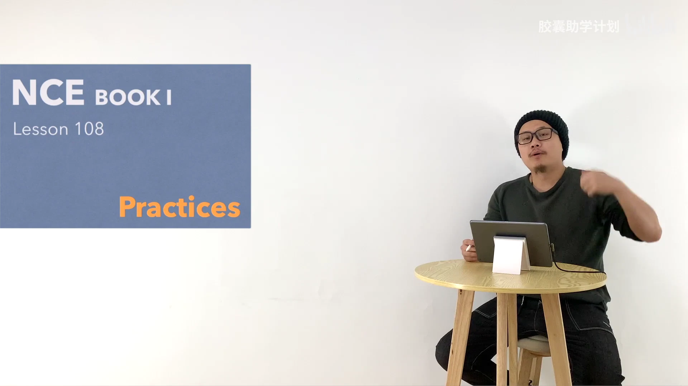

文字识别：NCE / BOOKI / Lesson 108 / Practices

### 画面 00:00:10

文字识别：胶囊助学计划bilb出 / •

### 画面 00:00:14

文字识别：胶囊助学计划

### 画面 00:00:16

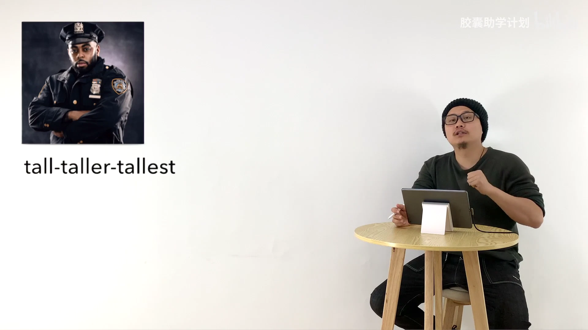

文字识别：胶囊助学计划 / tall-taller-tallest

## 00:00:30–00:01:00

but that one is taller. He is the tallest policeman I have ever seen. Very good.你看，这就用到了我们之前在单词语法那个视频当中讲过的形容词最高级的那个关键句型公式，对吧？OK，接下来呢，我们直接用一个小的电影片段给大家做一个听力练习。文章当中啊，这个视频当中出现的这个句子叫做“

### 画面 00:00:32

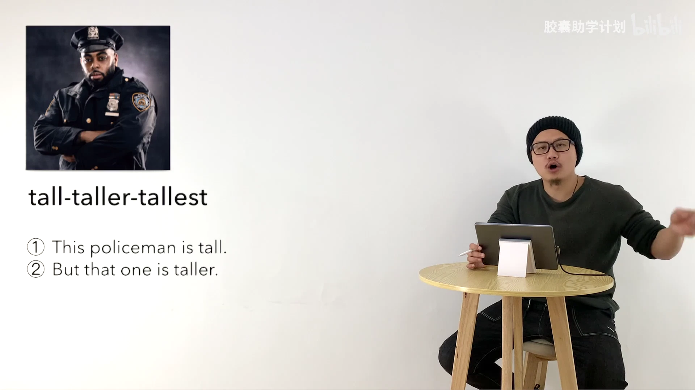

文字识别：胶囊助学计划 / tall-taller-tallest / This policeman is tall. / But that one is taller.

### 画面 00:00:40

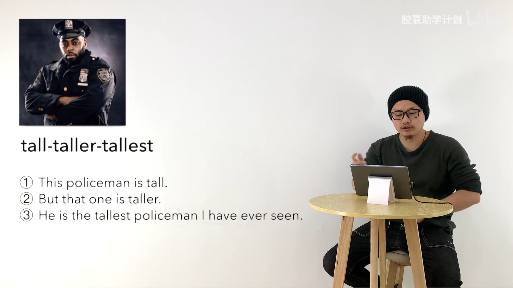

文字识别：胶囊助学计划 / tall-taller-tallest / This policeman is tall. / But that one is taller. / He is the tallest policeman I have ever seen.

### 画面 00:00:44

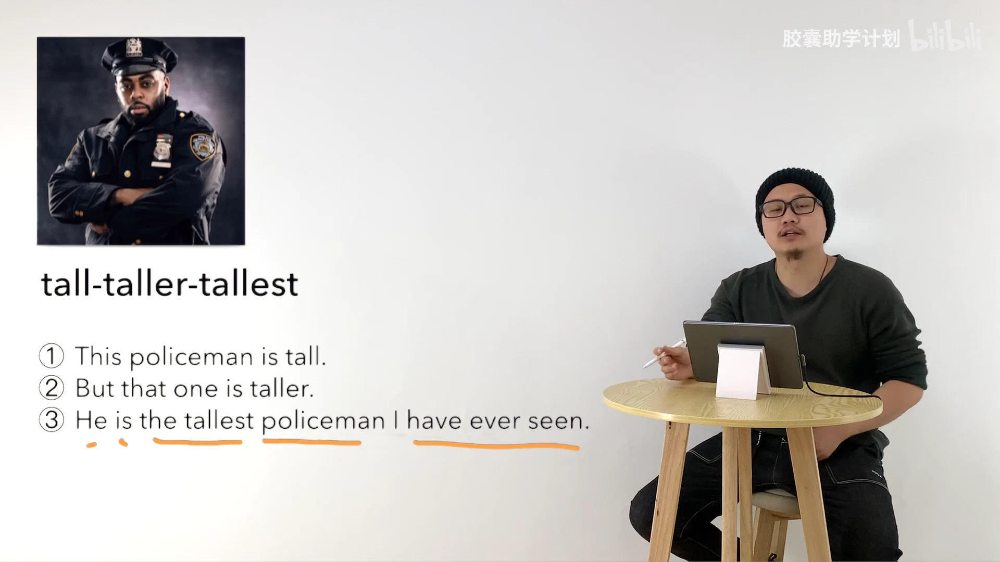

文字识别：胶囊助学计划 / tall-taller-tallest / This policeman is tall. / But that one is taller. / He is the tallest policeman I have ever seen.

### 画面 00:00:46

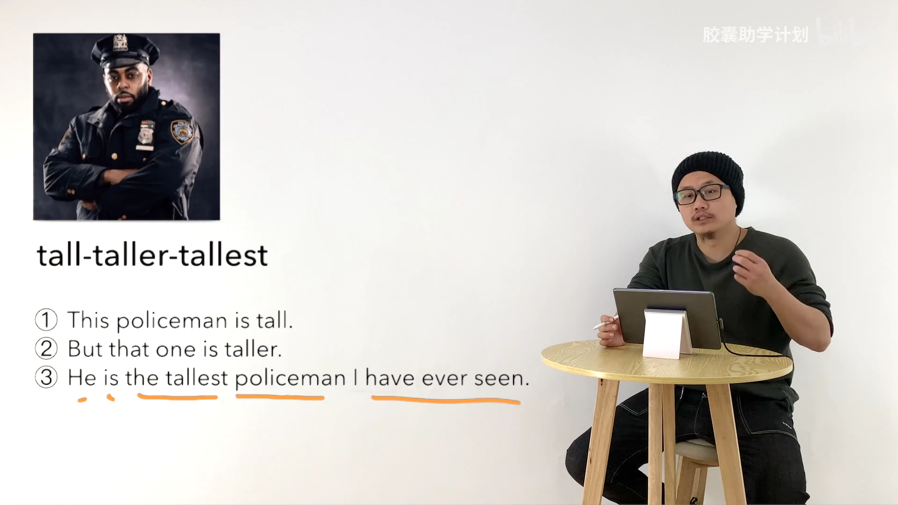

文字识别：胶囊助学计划 / tall-taller-tallest / This policeman is tall. / But that one is taller. / He is the tallest policeman I have ever seen.

### 画面 00:00:50

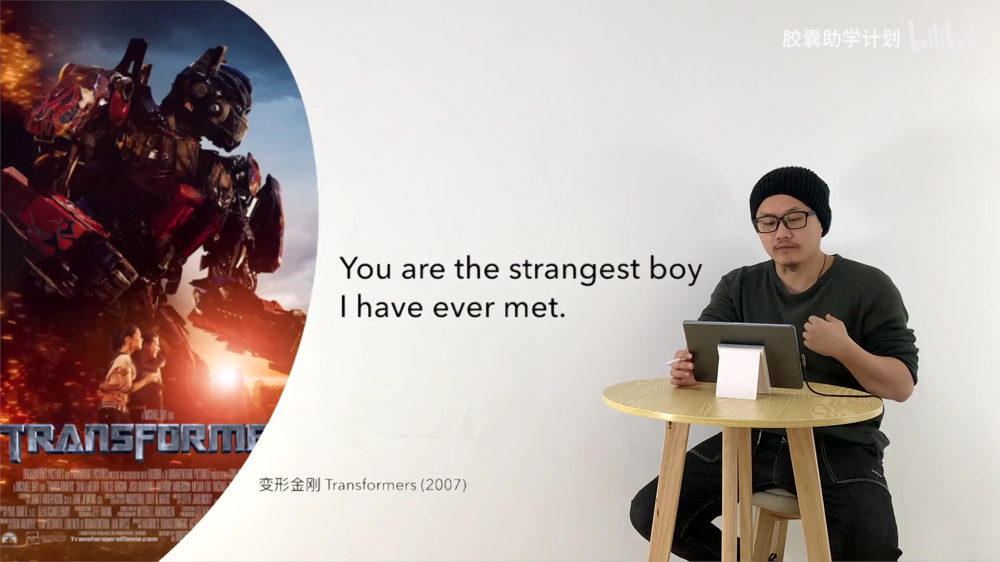

文字识别：胶囊助学计划 / You are the strangest boy / I have ever met. / TRANSFORM / 变形金刚 Transformers (2007)

### 画面 00:00:52

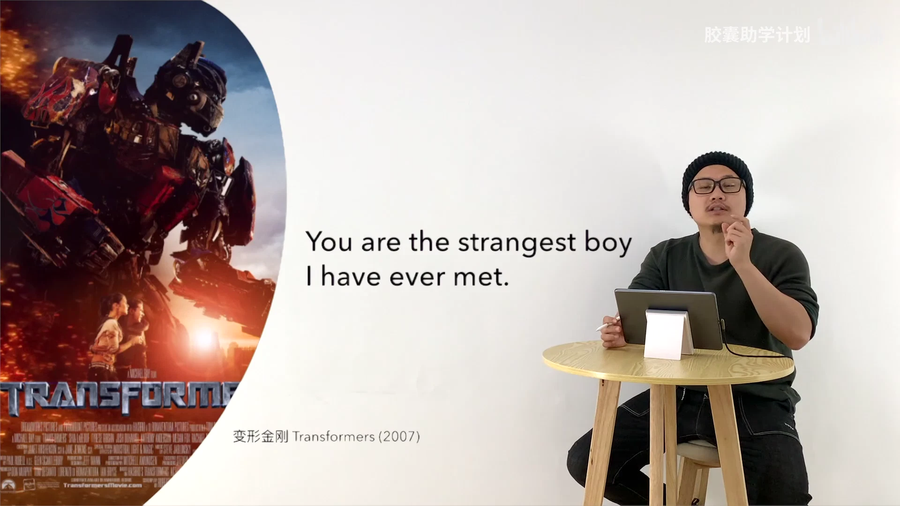

文字识别：You are the strangest boy / I have ever met. / TRANSFORM / 变形金刚Transformers (2007)

### 画面 00:00:55

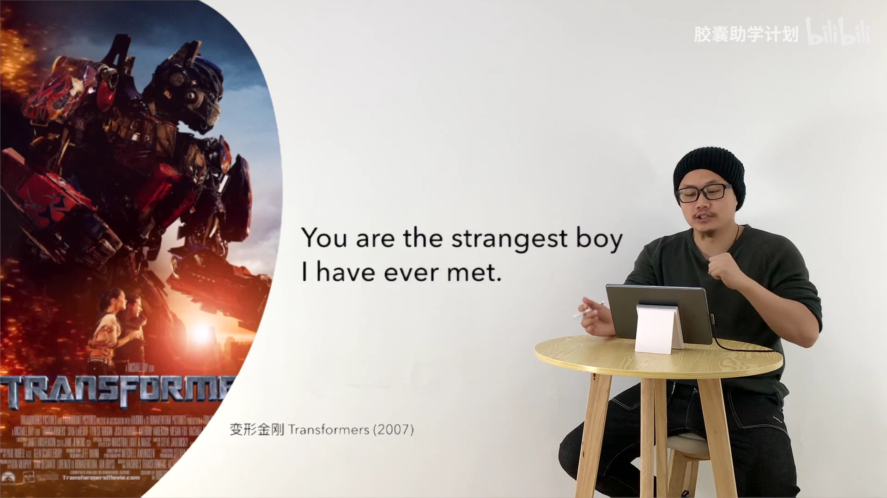

文字识别：胶囊助学计划 / You are the strangest boy / I have ever met. / TRANSFORM / 变形金刚 Transformers (2007)

## 00:01:00–00:01:30

You are the strangest boy I have ever met. 我遇到过最奇怪的一个男孩来了. I think I want something. What? Because the other one was talking about my eBay page. You were the strangest boy I have ever met. Can you talk? XM Satellite Radio, Digital Cable Broadcasting System. So you you talk to the radio? You're wonderful.

### 画面 00:01:01

文字识别：胶囊助学计划 / You are the strangest boy / I have ever met. / TRANSFORM / 变形金刚 Transformers (2007)

### 画面 00:01:03

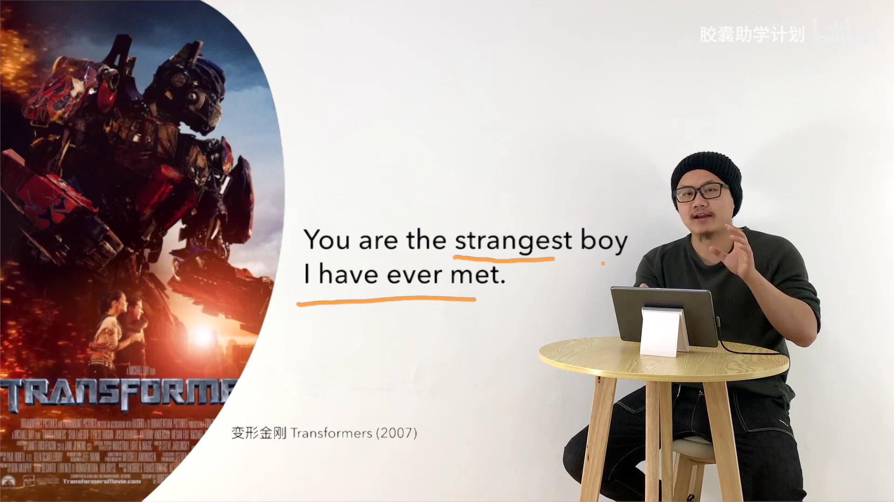

文字识别：胶囊助学计划 / You are the strangest boy / I have ever met. / TRANSFORM / 变形金刚 Transformers (2007)

### 画面 00:01:05

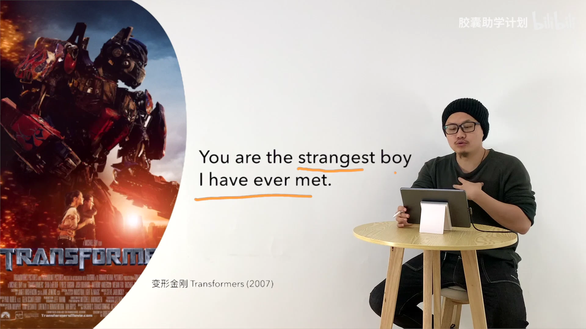

文字识别：胶囊助学计划 / You are the strangest boy / I have ever met. / TRANSFORM / 变形金刚 Transformers (2007)

### 画面 00:01:09

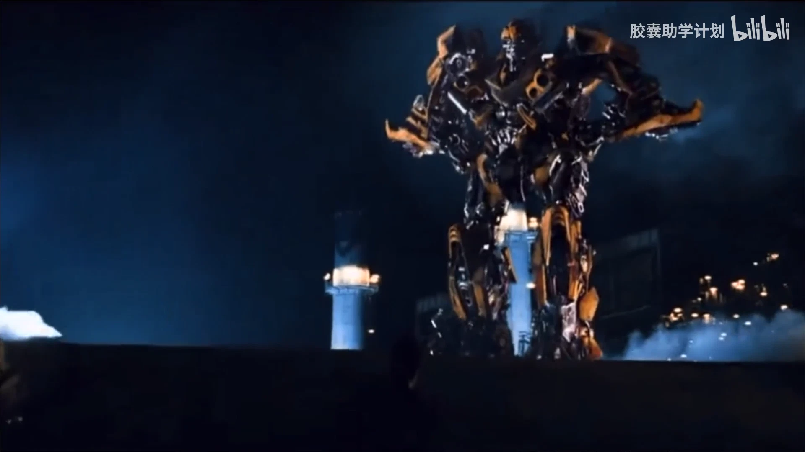

文字识别：Bilibili / 胶囊助学计划

### 画面 00:01:11

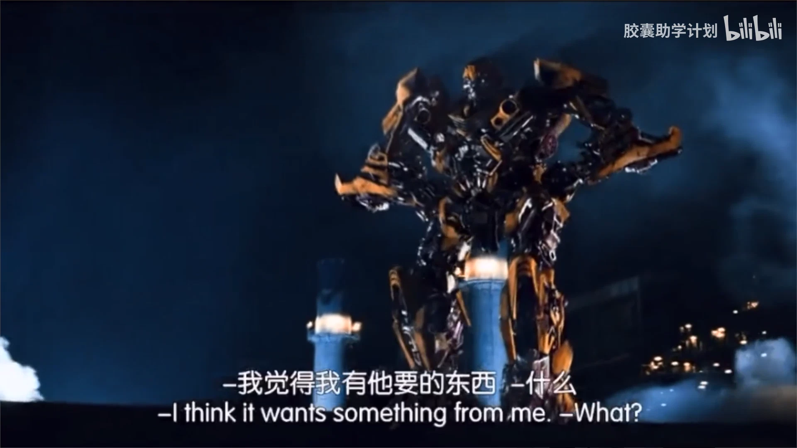

文字识别：bilbili / 胶囊助学计划 / 一我觉得我有他要的东西一什么 / —I think it wants something from me. -What?

### 画面 00:01:13

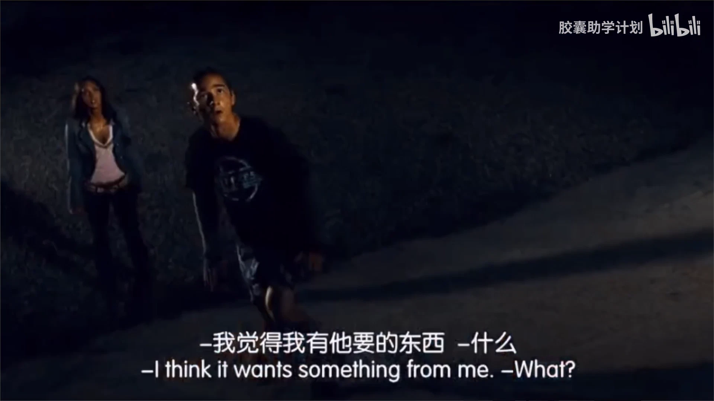

文字识别：bilibli / 胶囊助学计划 / -我觉得我有他要的东西-什么 / —I think it wants something from me. —What?

### 画面 00:01:15

文字识别：bilbli / 胶囊助学计划 / 00 / 好吧因为另一个提过我的易趣店铺 / Well,'cause the other one was talking about my eBay page.

### 画面 00:01:17

文字识别：bilbili / 胶囊助学计划 / 你是我见过的最最神经的疯子 / You are the strangest boy I have ever met.

### 画面 00:01:19

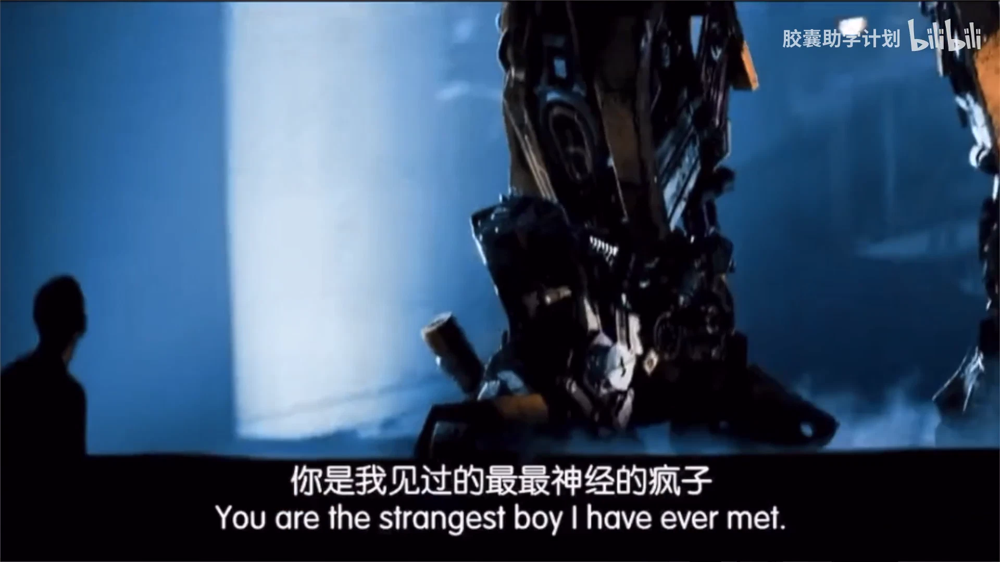

文字识别：bilbili / 胶囊助字计划 / 你是我见过的最最神经的疯子 / You are the strangest boy I have ever met.

### 画面 00:01:21

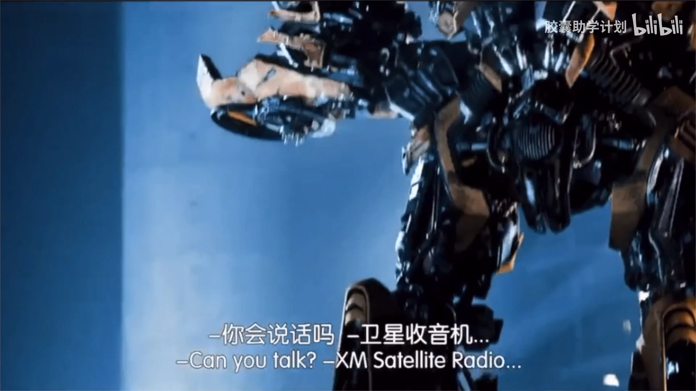

文字识别：Bilibili / 胶囊助学计划 / 一你会说话吗 / -卫星收音机. / —Can you talk? -XM Satellite Radio..

### 画面 00:01:23

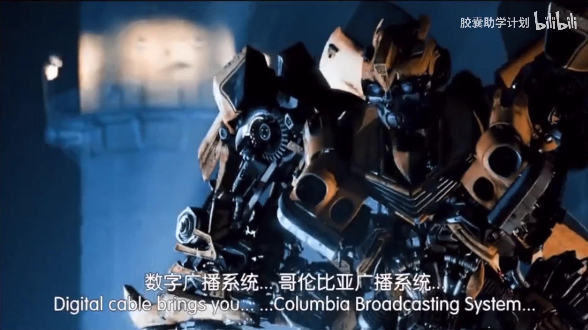

文字识别：bilbili / 胶囊助学计划 / 数字广播系统.哥伦比亚厂播系统. / Digital cable brings youColumbia Broadcasting System.

### 画面 00:01:25

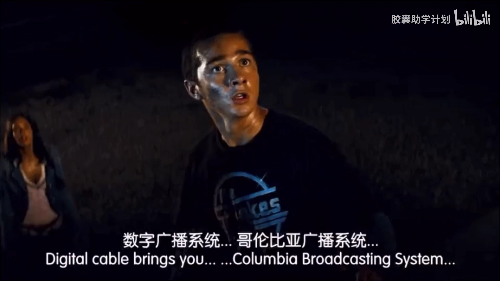

文字识别：bilibli / 胶囊助学计划 / 数字广播系统.哥伦比亚广播系统. / Digital cable brings you.....Columbia Broadcasting System.

### 画面 00:01:27

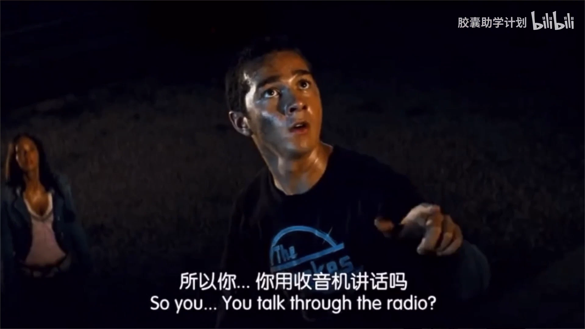

文字识别：bilibili / 胶囊助学计划 / 所以你..你用收音机讲话吗 / So you.. You talk through the radio?

### 画面 00:01:29

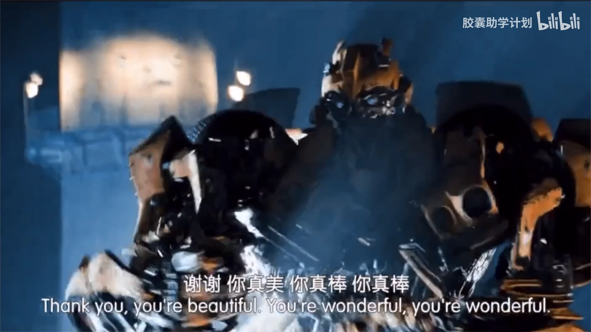

文字识别：bilbli / 胶囊助学计划 / 谢谢你真美你真棒你真棒 / Thank you, you're beautiful. You're wonderful, you're wonderful.

## 00:01:30–00:02:00

那注意一个小点啊，这个字幕把它这个strangest翻译成了疯狂。其实strangest本身的意思指的是奇怪，所以这句话的意思是你是我见过最奇怪的男孩了。Okay, here we go.接下来完全一样，我们进行一些口语练习。我读，您张开嘴，大声跟我朗读就可以了啊。来了，This woman is short, but that one

### 画面 00:01:31

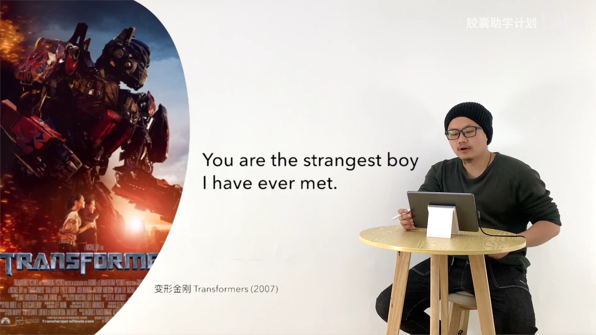

文字识别：You are the strangest boy / I have ever met. / TRANSFORM / 变形金刚 Transformers (2007)

### 画面 00:01:33

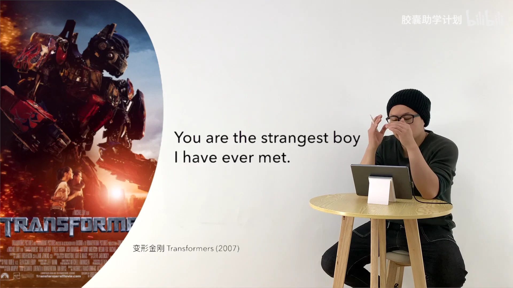

文字识别：胶囊助学计划 / You are the strangest boy / I have ever met. / TRANSFORM / 变形金刚 Transformers (2007)

### 画面 00:01:35

文字识别：胶囊助学计划 / You are the strangest boy / I have ever met. / TRANSFORM / 变形金刚 Transformers (2007)

### 画面 00:01:40

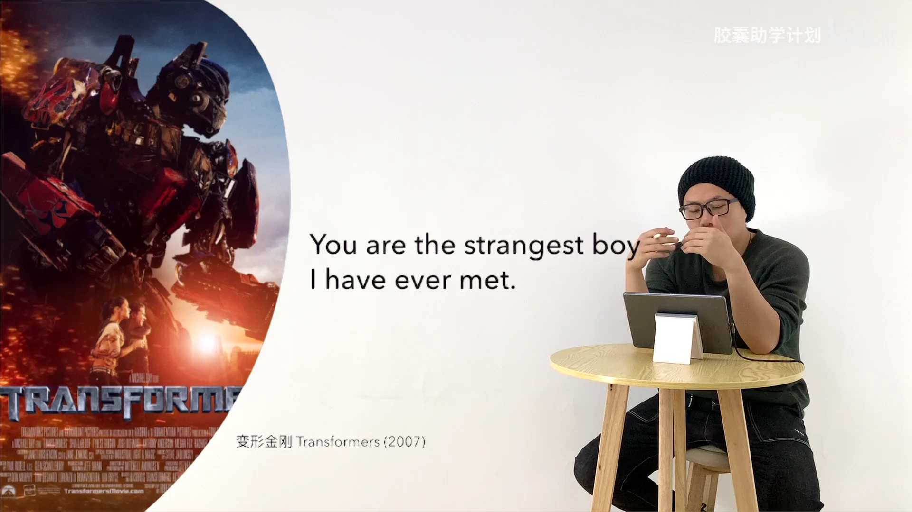

文字识别：You are the strangest boy / I have ever met. / TRAnSFORM / 变形金刚 Transformers (2007)

### 画面 00:01:44

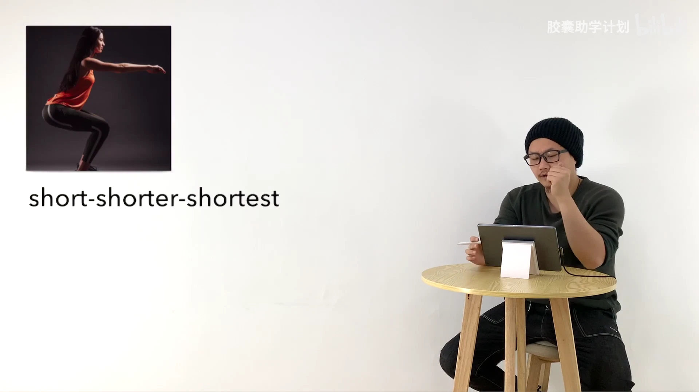

文字识别：胶囊助学计划 / short-shorter-shortest

### 画面 00:01:48

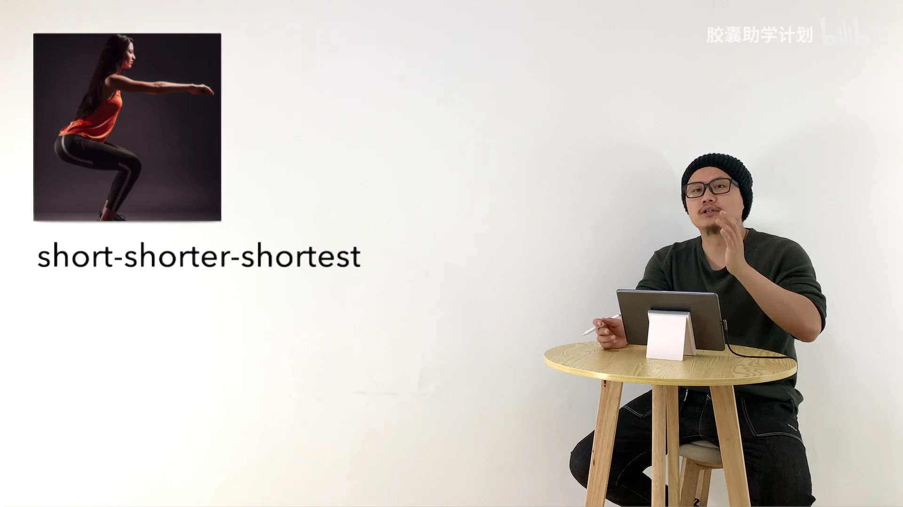

文字识别：胶囊助学计划 / short-shorter-shortest

### 画面 00:01:59

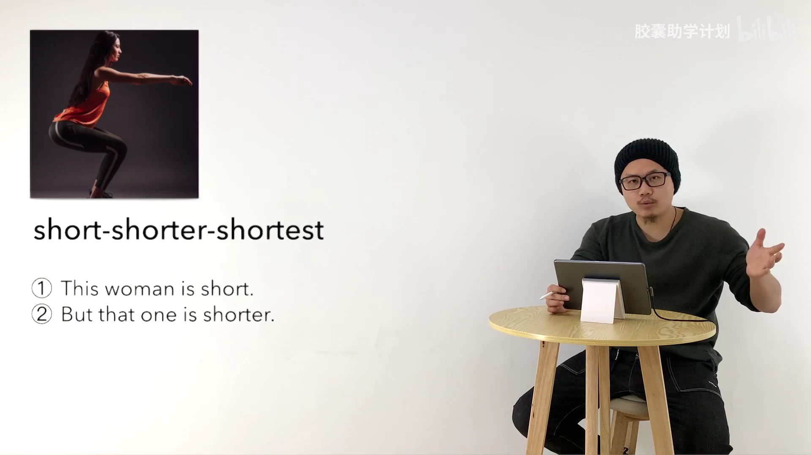

文字识别：胶囊助学计划 / short-shorter-shortest / This woman is short. /  But that one is shorter.

## 00:02:00–00:02:30

is shorter. She is the shortest woman I have ever seen. Next one, these cars are cheap, but those cars are cheaper. They are the cheapest cars I have ever seen. Next one, this knife is sharp, but that one is sharper. It is the sharpest

### 画面 00:02:08

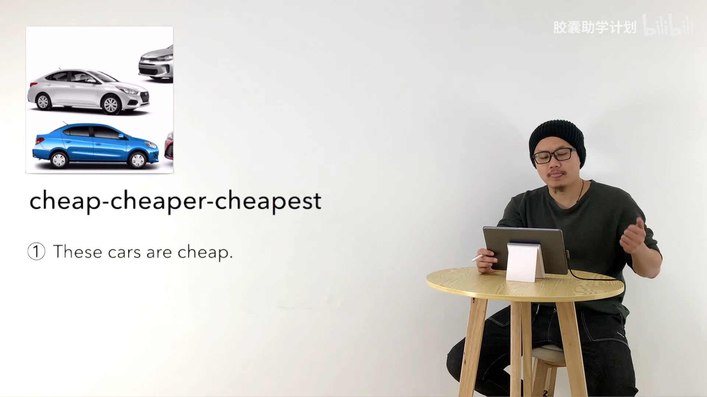

文字识别：胶囊助学计划 / cheap-cheaper-cheapest /  These cars are cheap.

### 画面 00:02:20

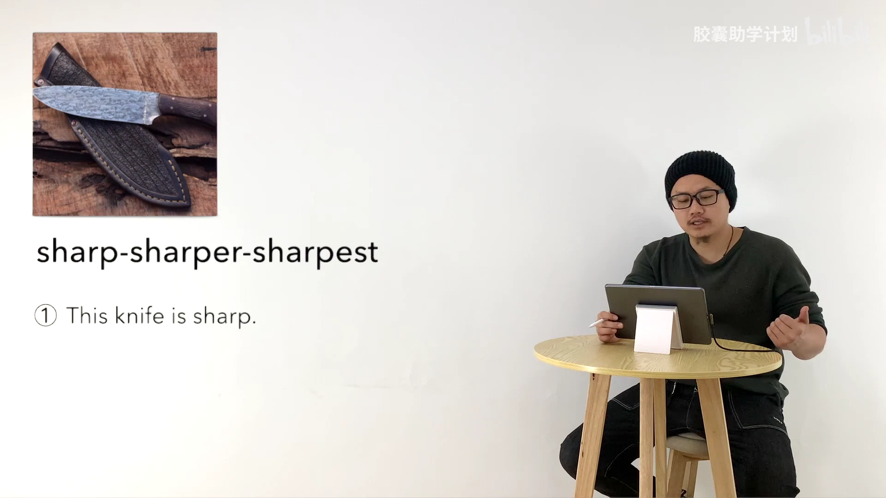

文字识别：胶囊助学计划 / sharp-sharper-sharpest /  This knife is sharp.

## 00:02:30–00:03:00

knife I have ever seen. Continue. This girl is pretty, but that one is prettier. She is the prettiest girl I have ever seen. Next one. These office assistants are lazy, but those office assistants are lazier. 变为 V I 加 E R. They are the laziest office

### 画面 00:02:33

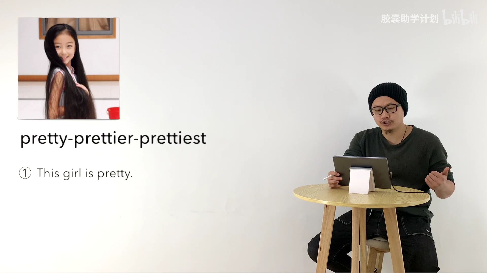

文字识别：胶囊助学计划 / pretty-prettier-prettiest / This girl is pretty.

### 画面 00:02:39

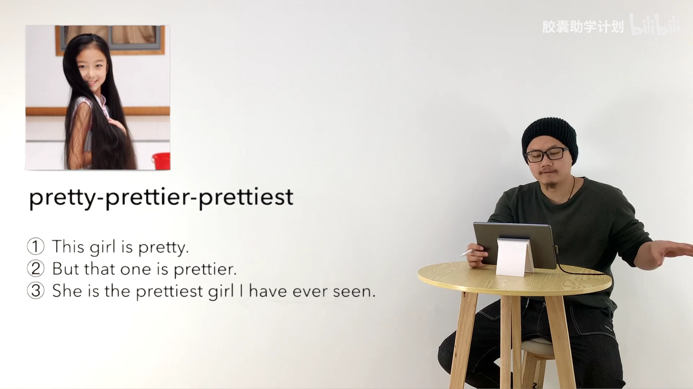

文字识别：胶囊助学计划 / pretty-prettier-prettiest / This girl is pretty. / But that one is prettier. / She is the prettiest girl I have ever seen.

### 画面 00:02:45

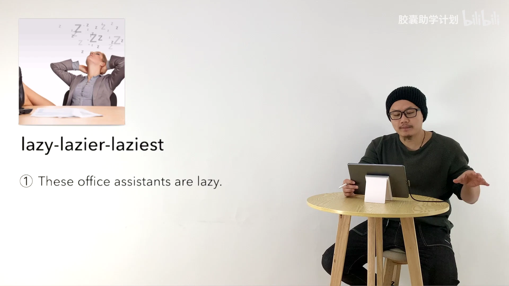

文字识别：胶囊助学计划 / lazy-lazier-laziest / ① These office assistants are lazy.

### 画面 00:02:56

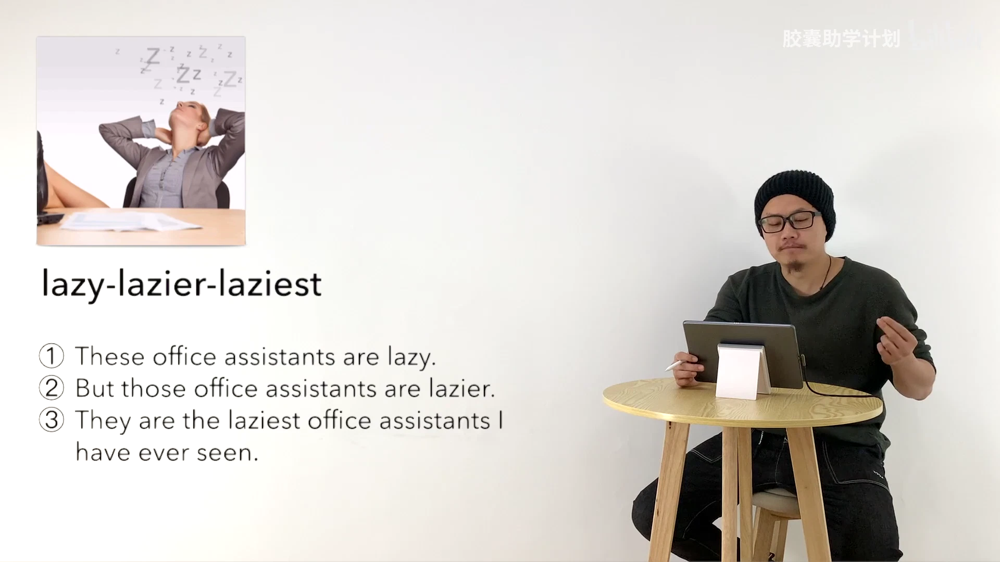

文字识别：Zz / lazy-lazier-laziest /  These office assistants are lazy. / 1 /  But those office assistants are lazier. / 2 / They are the laziest office assistants I / have ever seen.

## 00:03:00–00:03:30

assistants I have ever seen.张开嘴跟我读. Next one. This church is big, but that one is bigger. It is the biggest church I have ever seen. Next one. This test is easy, but that one is easier. It is the easiest test I have ever seen.

### 画面 00:03:04

文字识别：胶囊助学计划 / big-bigger-biggest

### 画面 00:03:11

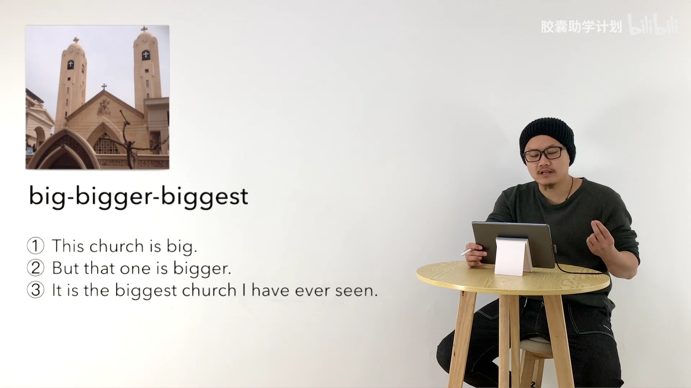

文字识别：胶囊助学计划 / big-bigger-biggest / This church is big. / But that one is bigger. /  It is the biggest church I have ever seen.

### 画面 00:03:17

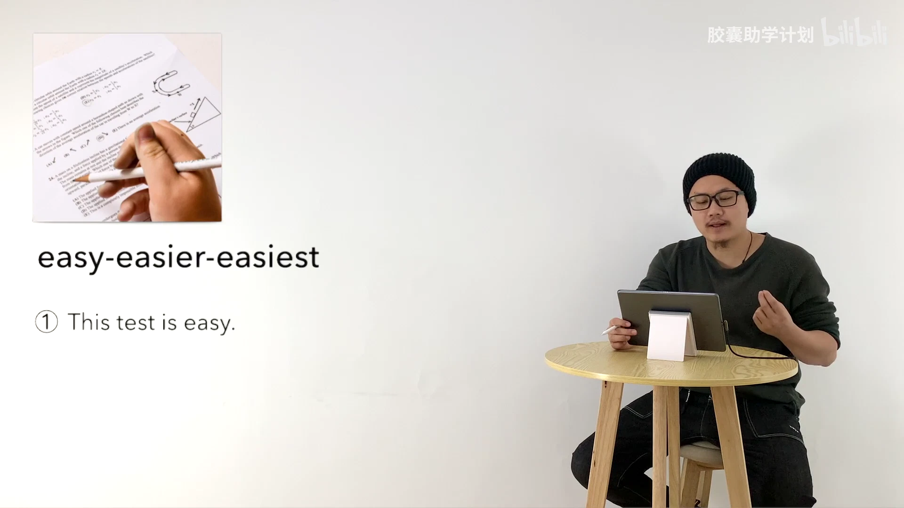

文字识别：胶囊助学计划 / easy-easier-easiest / This test is easy. / 1

## 00:03:30–00:04:00

Okay, next one. This knife is blunt, but that one is blunter. It is the bluntest knife I have ever seen. Okay, thin,瘦啊. This boy is thin, but that one is thinner. He is the thinnest boy I have ever seen. Okay, recap.除了我们复习了单

### 画面 00:03:30

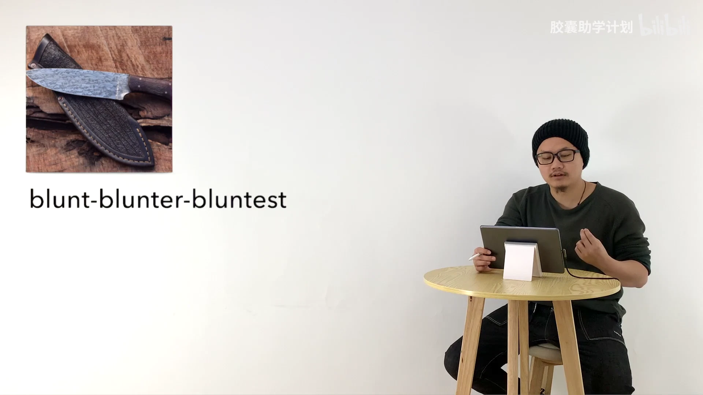

文字识别：胶囊助学计划 / blunt-blunter-bluntest

### 画面 00:03:36

文字识别：胶囊助学计划 / blunt-blunter-bluntest / This knife is blunt. /  But that one is blunter. / 2 /  It is the bluntest knife I have ever seen.

### 画面 00:03:41

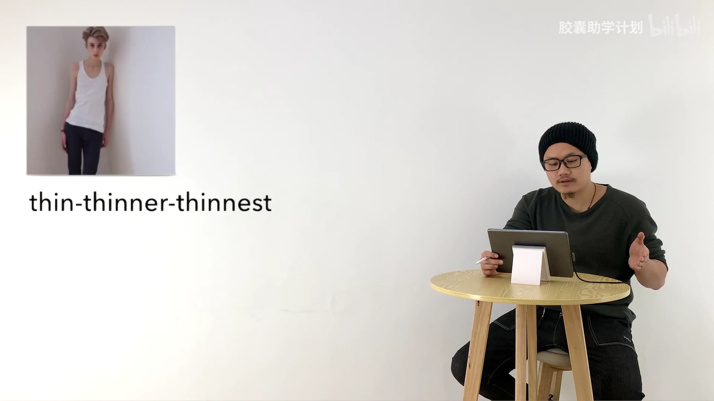

文字识别：胶囊助学计划 / thin-thinner-thinnest

### 画面 00:03:50

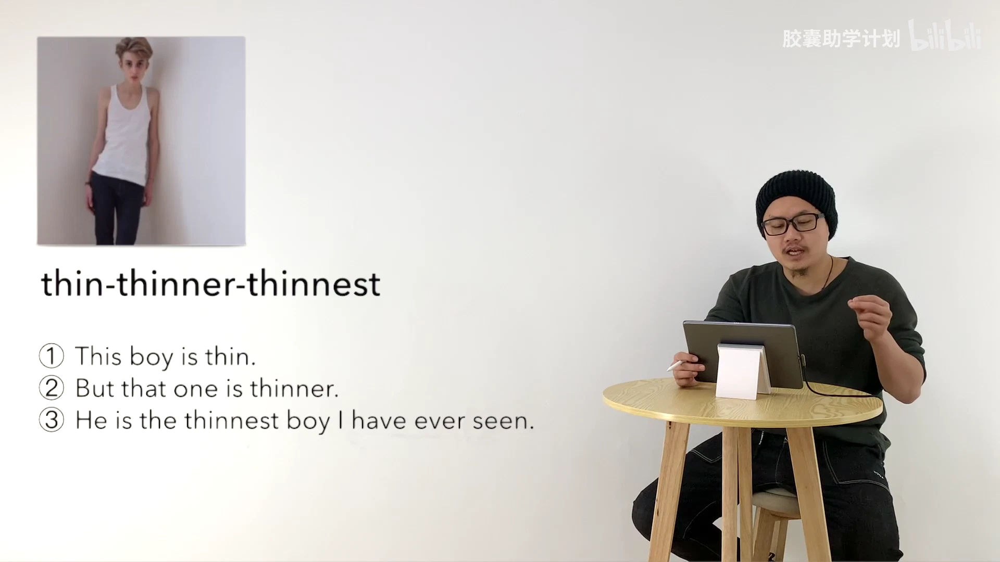

文字识别：胶囊助学计划 / thin-thinner-thinnest / This boy is thin. / But that one is thinner. / He is the thinnest boy I have ever seen.

### 画面 00:03:55

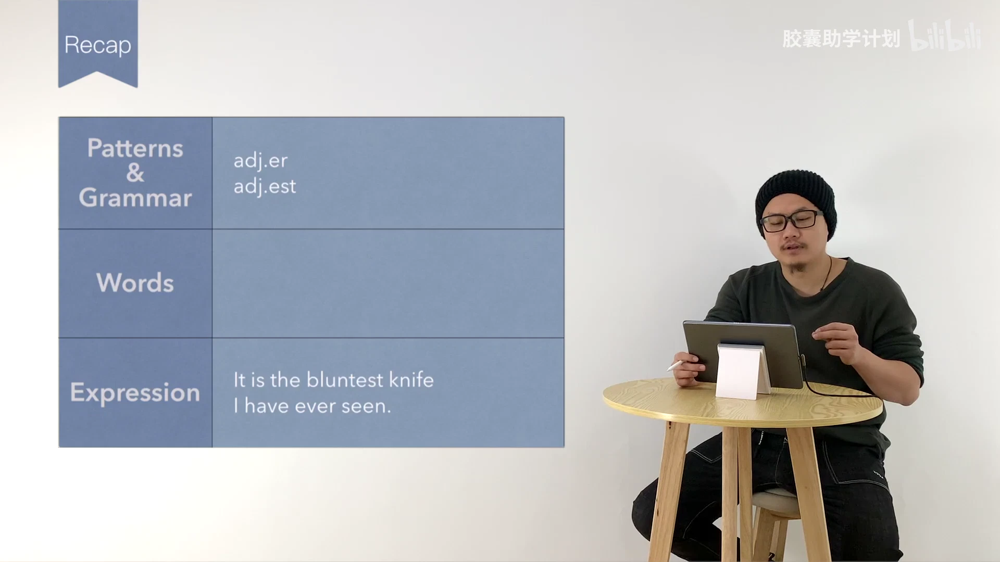

文字识别：胶囊助学计划 / Recap / Patterns / adj.er / adj.est / Grammar / Words / It is the bluntest knife / Expression / I have ever seen.

### 画面 00:03:58

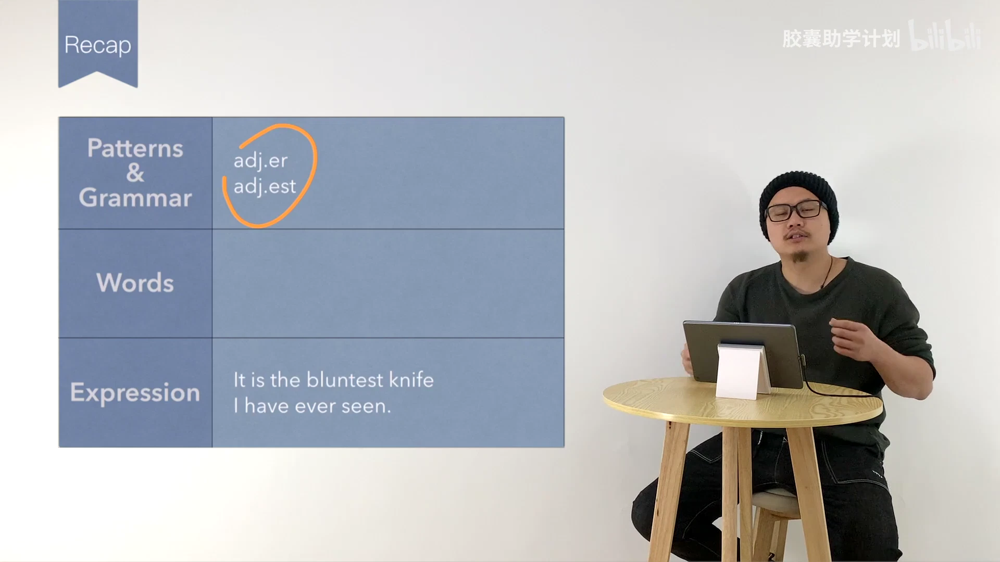

文字识别：胶囊助学计划 / Recap / Patterns / adj.er / & / adj.est / Grammar / Words / It is the bluntest knife / Expression / I have ever seen.

## 00:04:00–00:04:30

词的拼写，对吧？形容词比较级最高级，然后呢，还有一个就是这个句型啊，我直接拿了一个具体的例子放到这个地方了，提醒各位，这是我们实际上呃单词语法那个视频当中给大家留的家庭作业，对吧？写三到五句话啊，家庭作业呢，本课的绿皮书一百零八课，各位可以写了，给自己讲解一遍今天的核心知识点，那尝试去把我们这个听力啊，这个视频当中出现的这个

### 画面 00:04:04

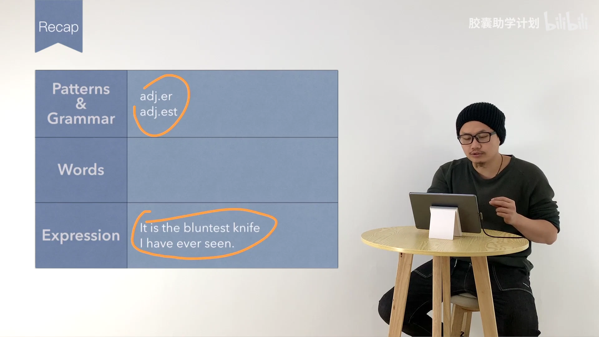

文字识别：胶囊助学计划 / Recap / Patterns / adj.er / & / adj.est / Grammar / Words / It is thel / bluntest knife / Expression / Ihave / ever seen.

### 画面 00:04:17

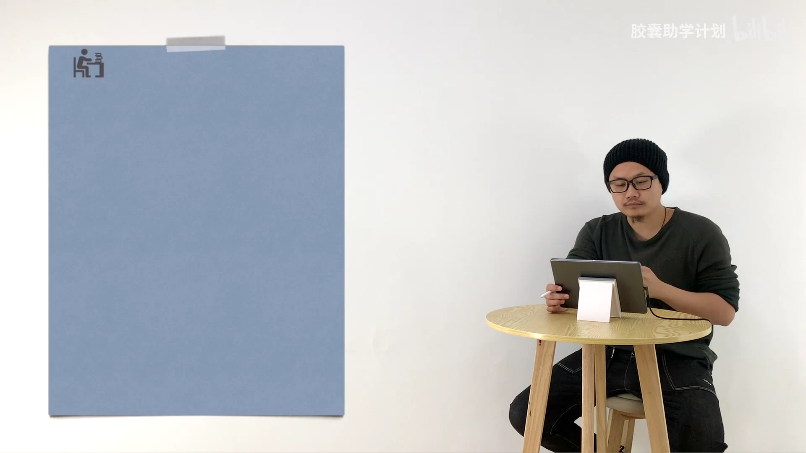

文字识别：胶囊助学计划

## 00:04:30–00:05:00

关键的剧情，您试着能不能把它通过反复听、反复读，能给它听出来啊？这个成就感是非常大的。如果您能直接听出来电影当中的这个片段，好吧。那如果大家喜欢我们的课程呢，欢迎大家关注、订阅、一键三连，分享给那些需要的朋友，来帮助我们快速成长。那最后我们再来看一句名人名言：Everyone is just nicer to prettier people. See next time.

### 画面 00:04:40

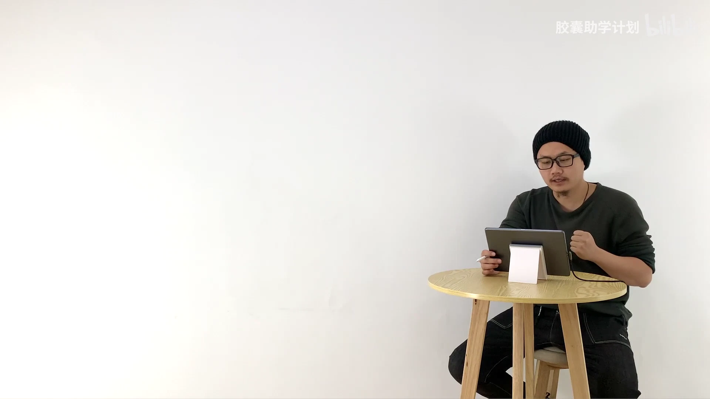

文字识别：胶囊助学计划 / 专

### 画面 00:04:49

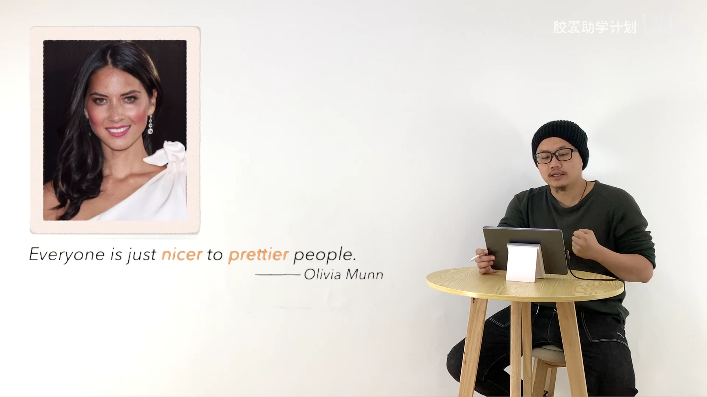

文字识别：胶囊助学计划 / Everyone is just nicer to prettier people. / Olivia Munn

### 画面 00:04:58

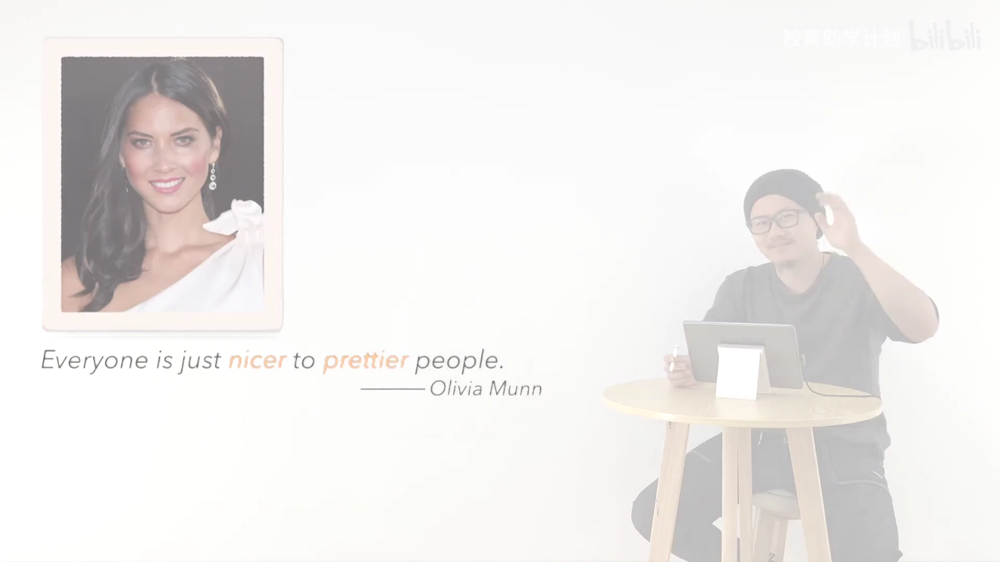

文字识别：Everyone is just nicer to prettier people. / Olivia Munn

## 00:05:00–00:05:11

### 画面 00:05:00

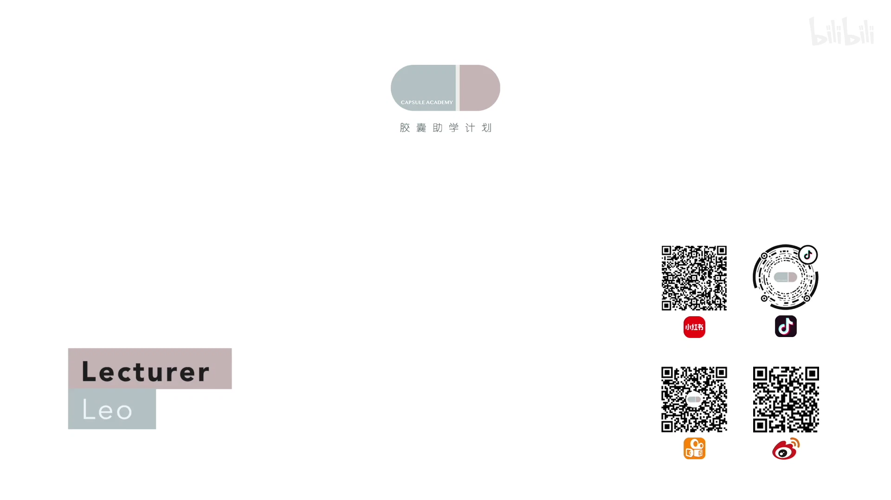

文字识别：CAPSULEACADEMY / 胶囊助学计划 / 『 / 小红书 / Lecturer / □ / Leo / OE

### 画面 00:05:03

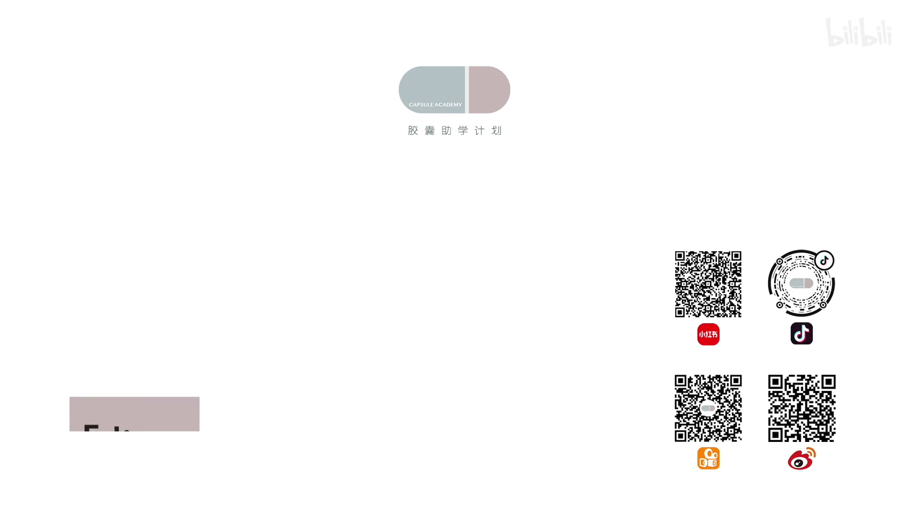

文字识别：CAPSULEACADEMY / 胶囊助学计划 / 『 / 小红书 / OE

### 画面 00:05:06

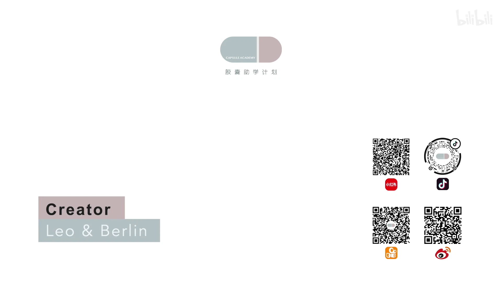

文字识别：CAPSULEACADEMY / 胶囊助学计划 / 『 / 小红书 / Creator / Leo & Berlin / OE

### 画面 00:05:08

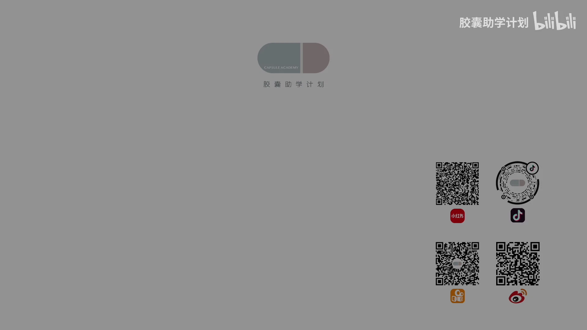

文字识别：bilbili / 胶囊助学计划 / CAPSULEACADEMY / 胶囊助学计划 / 小红书 / OE

### 画面 00:05:10

文字识别：bilibili / 胶囊助学计划

