# 109 文章

快速机器解析：语音为单模型转写，未进行独立交叉校对或人工复核；画面每秒采样并按变化选帧，短时文字和标记可能遗漏。截图时间约有 1 秒误差。图片有损压缩；遇到疑点请按时间查看 Google Drive 原视频。

## 00:00:00–00:00:30

Hello everyone, welcome to Capsule Academy. This is Leo. Today we're going to learn New Concept English Book One Lesson One Hundred and Nine Story. 那老习惯，进入正式课程之前，我们看一个问题，很简单，如何表示做咖啡啊，或者煮咖啡、沏咖啡，都是这个表达。那带着这个问题，Hope you gonna enjoy it. 那我们直接看文章。两个人，第一个人说啊，Shall I

### 画面 00:00:00

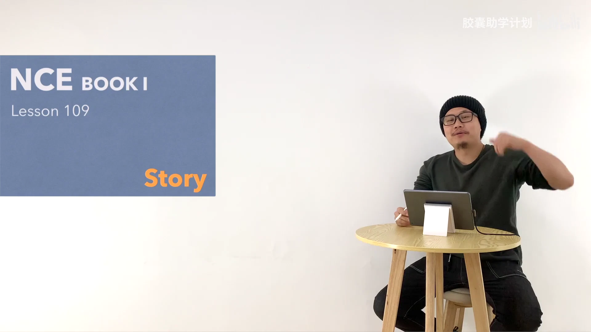

文字识别：NCE / BOOKI / Lesson 109 / Story

### 画面 00:00:02

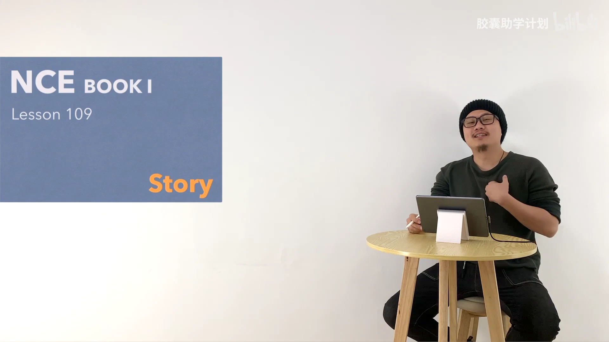

文字识别：胶囊助学计划 / NCE / BOOKI / Lesson 109 / Story

### 画面 00:00:09

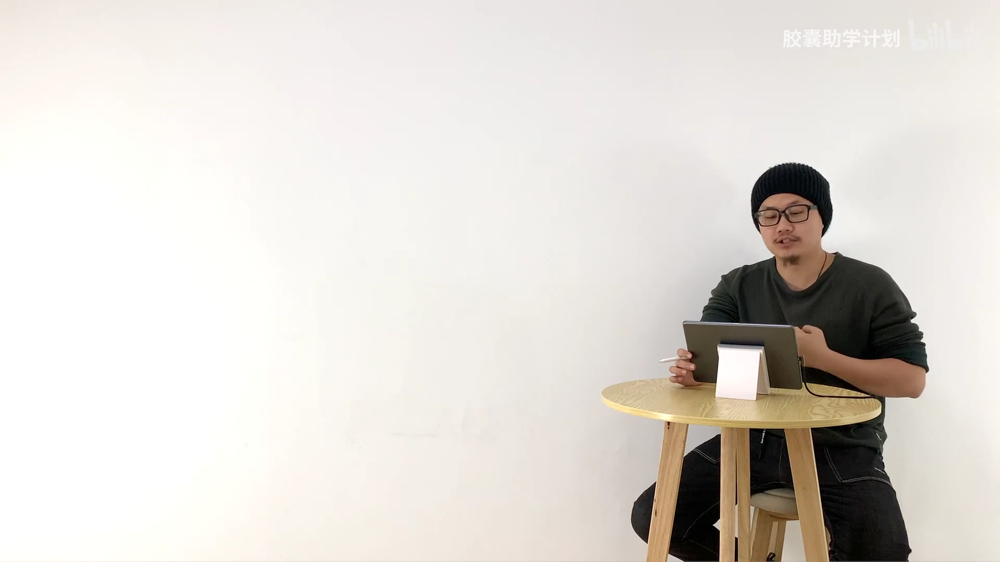

文字识别：胶囊助学计划

### 画面 00:00:11

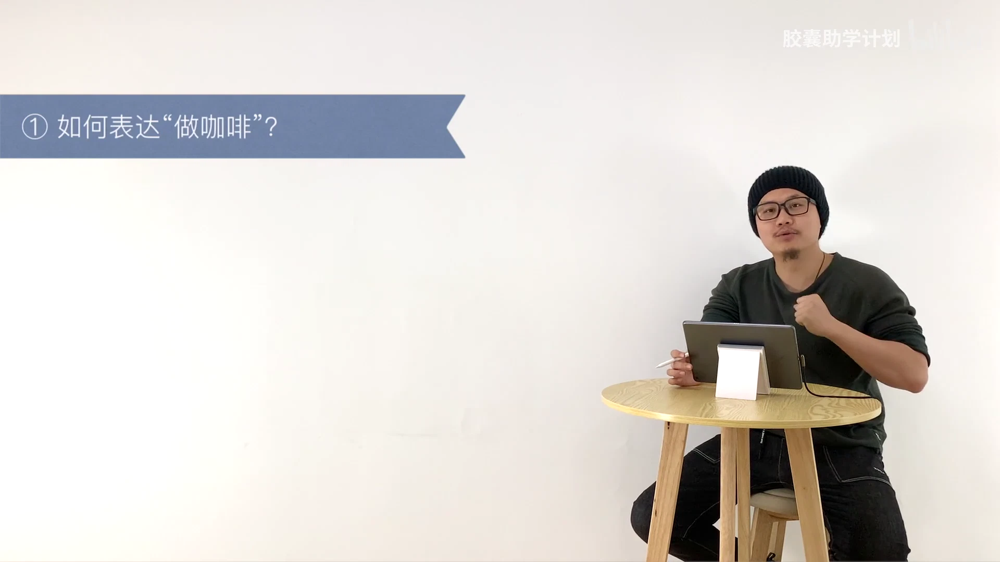

文字识别：胶囊助学计划 / ①如何表达“做咖啡”？

### 画面 00:00:15

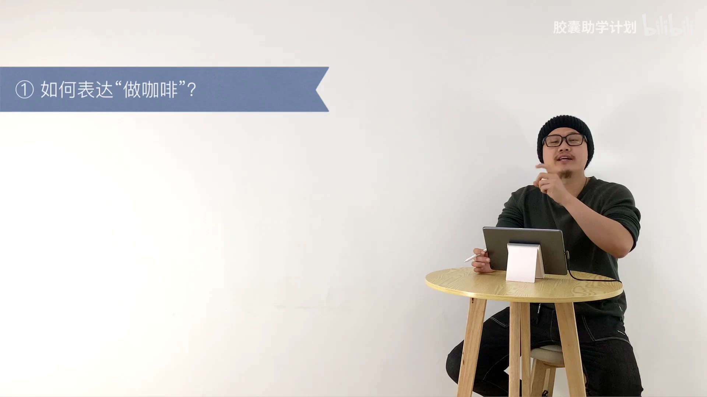

文字识别：胶囊助学计划 / ①如何表达“做咖啡”？

### 画面 00:00:20

文字识别：胶囊助学计划bil / •

### 画面 00:00:24

文字识别：胶囊助学计划

### 画面 00:00:26

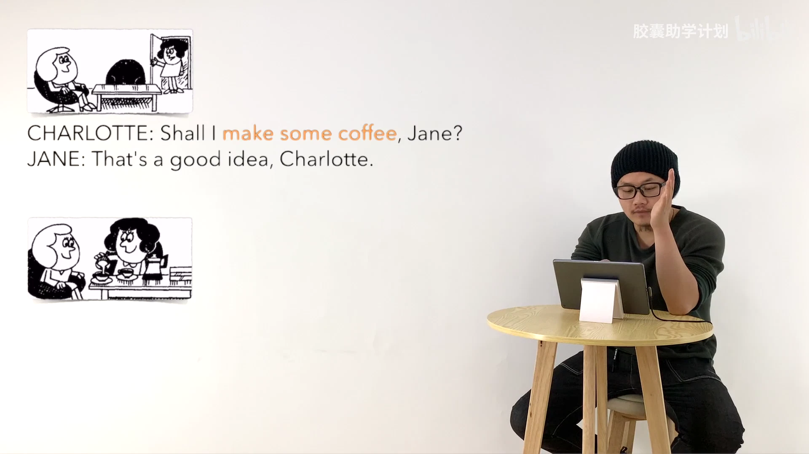

文字识别：胶囊助学计划 / CHARLOTTE: ShallI make some coffee, Jane? / JANE: That's a good idea, Charlotte.

## 00:00:30–00:01:00

make some coffee, Jane?哎，make some coffee.您猜到了，沏咖啡、煮咖啡、做咖啡，对吧？哎，要不要我来弄点咖啡呢？That's a good idea, Charlotte.说这是一个非常好的主意啊。It's ready.好了，Do you want any milk?你想不想要来点牛奶呢？Just a little, please.好，迅速回顾一下。首先，a little含义叫做少

### 画面 00:00:45

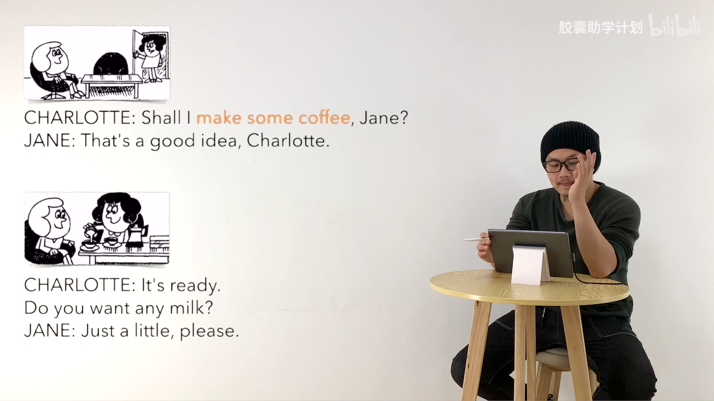

文字识别：胶囊助学计划 / CHARLOTTE: Shall I make some coffee, Jane? / JANE: That's a good idea, Charlotte. / CHARLOTTE: It's ready. / Do you want any milk? / JANE: Just a little, please.

### 画面 00:00:51

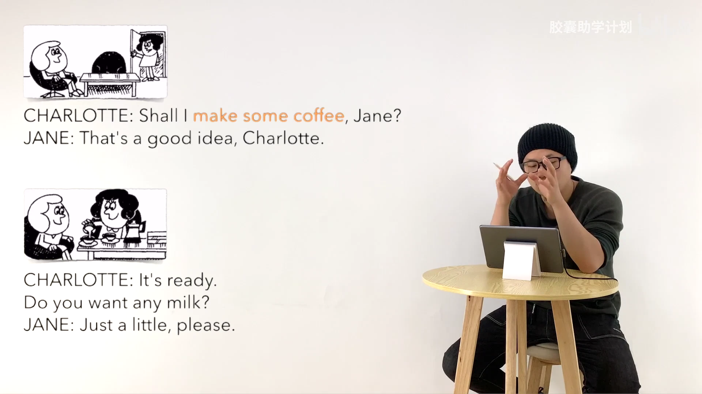

文字识别：CHARLOTTE: Shall I make some coffee, Jane? / JANE: That's a good idea, Charlotte. / CHARLOTTE: It's ready. / Do you want any milk? / JANE: Just a little, please.

### 画面 00:00:53

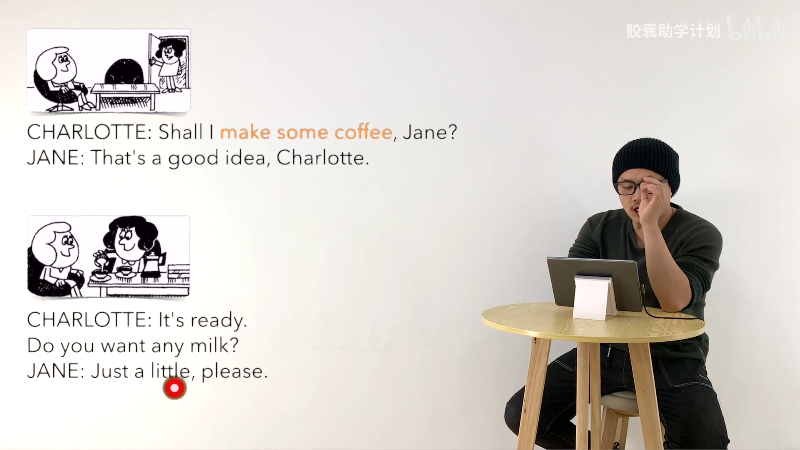

文字识别：胶囊助学计划 / CHARLOTTE: Shall I make some coffee, Jane? / JANE: That's a good idea, Charlotte. / CHARLOTTE: It's ready. / Do you want any milk? / JANE: Just a little, please.

## 00:01:00–00:01:30

一点，对吧？其次，它是肯定含义，放在这儿很舒服。你要不要要？但是来一点。第三呢，它加可数不可数，它加的是不可数，milk不可数，just a little milk，milk被省略掉了，对吧？非常舒服。再来，Sheldon说，What about some sugar？那要不要来点糖呢？这个地方我们提到过，我们说some和any在二十五课的时候我们讲，那肯定句你就用some，否定句一般疑问句你就用any，

### 画面 00:01:03

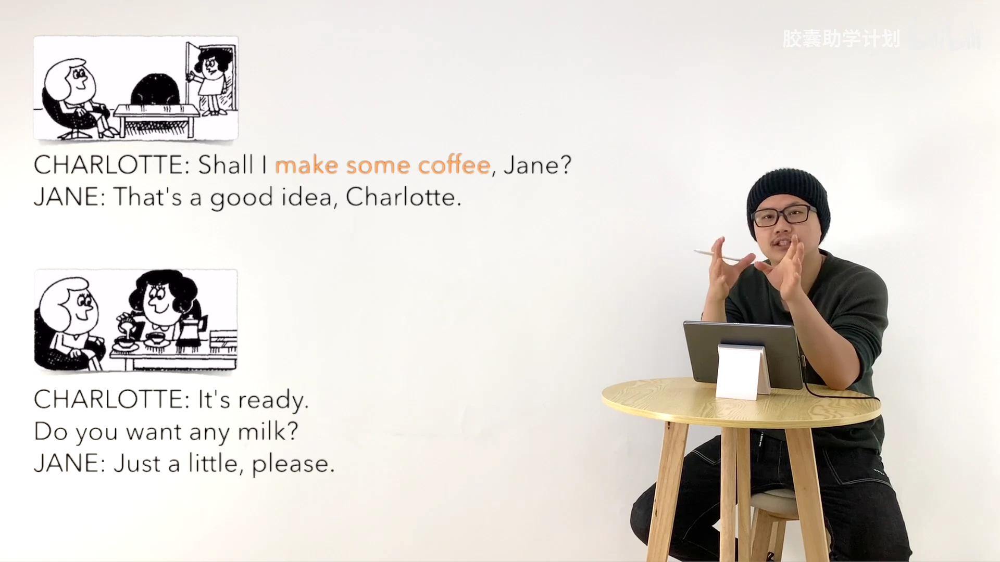

文字识别：CHARLOTTE: Shall I make some coffee, Jane? / JANE: That's a good idea, Charlotte. / CHARLOTTE: It's ready. / Do you want any milk? / JANE: Just a little, please.

### 画面 00:01:15

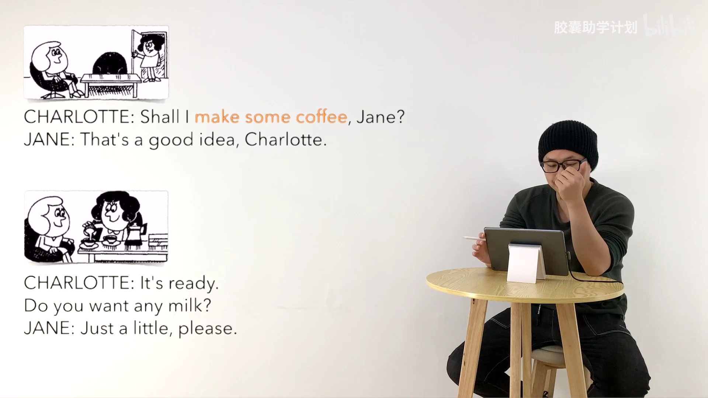

文字识别：胶囊助学计划 / CHARLOTTE: Shall I make some coffee, Jane? / JANE: That's a good idea, Charlotte. / CHARLOTTE: It's ready. / Do you want any milk? / JANE: Just a little, please.

### 画面 00:01:17

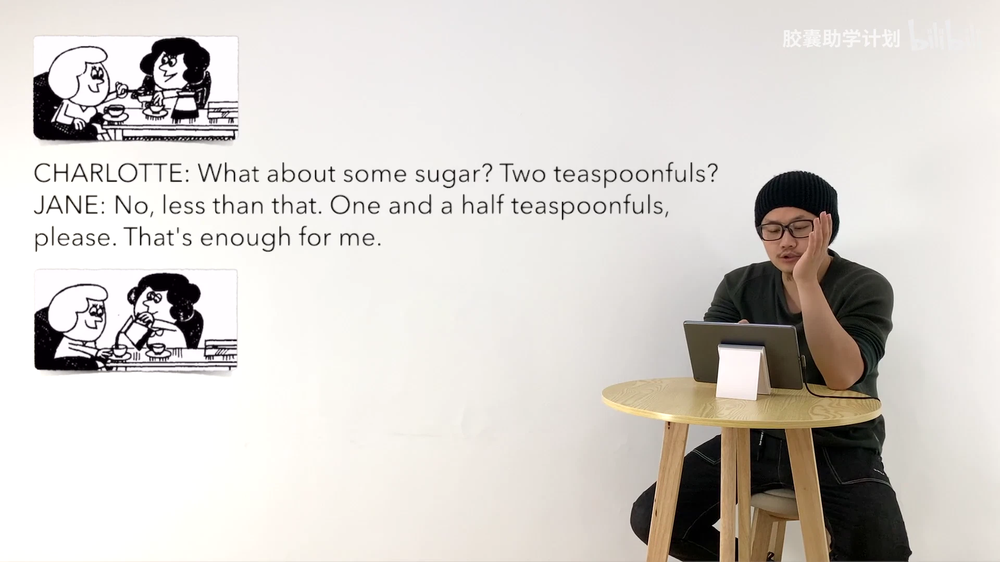

文字识别：胶囊助学计划 / CHARLOTTE: What about some sugar? Two teaspoonfuls? / JANE: No, less than that. One and a half teaspoonfuls, / please. That's enough for me. / 2

### 画面 00:01:25

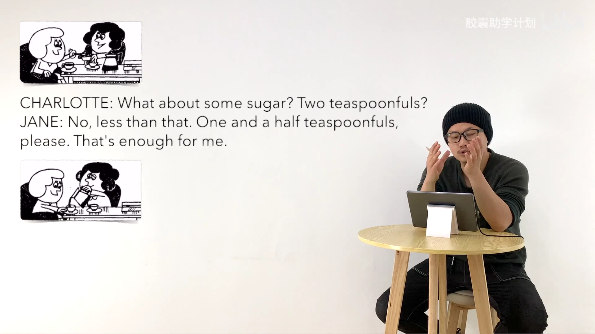

文字识别：CHARLOTTE: What about some sugar? Two teaspoonfuls? / JANE: No, less than that. One and a half teaspoonfuls, / please. That's enough for me.

## 00:01:30–00:02:00

但是并不绝对如此，对吧？他们反过来也是可以的。比如说疑问句当中，你也可以用 some。 What about some sugar? 这个 some 完全没有任何问题。那那它是什么意思呢？就是我特别想让你要，我不是在跟你客套啊，直接就用 some 就可以了啊。而且它其实语言习惯也是 what about some sugar 啊？我很少听到 what about any sugar 这样的用法。 OK，或者我可以理解为我几乎没听见过啊。再来了，

### 画面 00:01:55

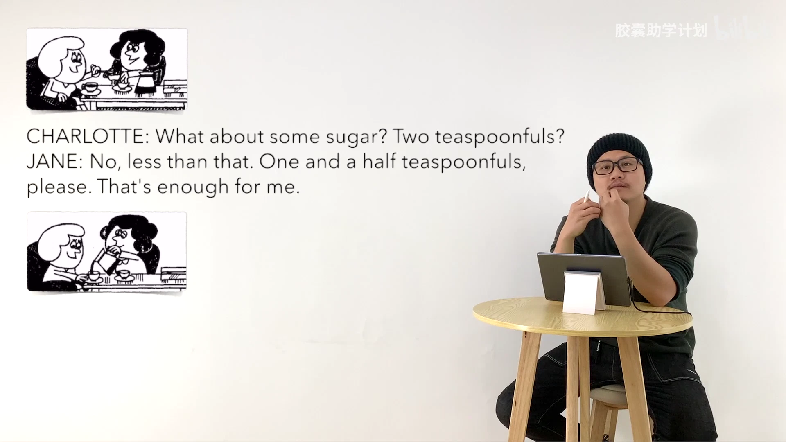

文字识别：胶囊助学计划 / CHARLOTTE: What about some sugar? Two teaspoonfuls? / JANE: No, less than that. One and a half teaspoonfuls, / please. That's enough for me.

## 00:02:00–00:02:30

说 two teaspoons, 两勺。 No, less than that. 好，这就要回顾一个单词，叫做 less。它是谁的什么，对吧？是 little 的比较级，叫做更少 than that。我说要不要来点糖？两勺？你说不，比那个还要少。其实它这个地方补全了，就是 less than two teaspoons. 啊，我要糖少

### 画面 00:02:11

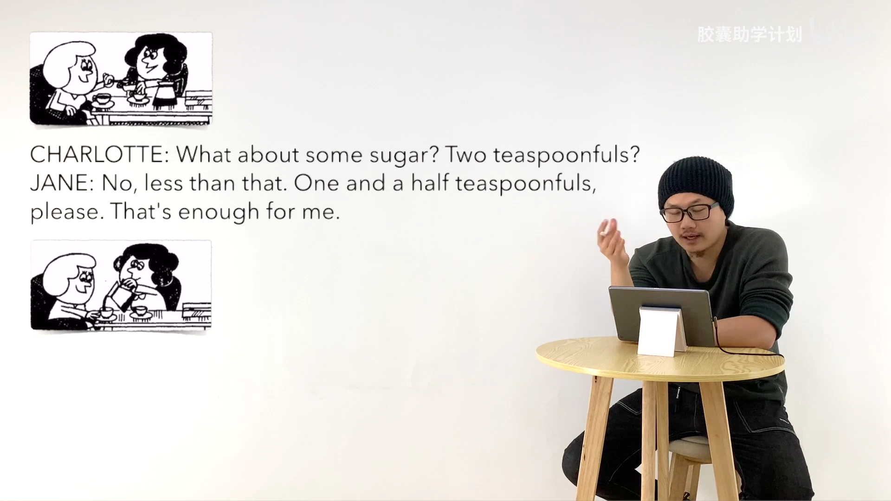

文字识别：CHARLOTTE: What about some sugar? Two teaspoonfuls? / JANE: No, less than that. One and a half teaspoonfuls, / please. That's enough for me. / 2

## 00:02:30–00:03:00

于两勺的糖。Okay, less叫更少。One and a half teaspoons. One一a half叫一半儿，对吧？一勺半啊，teaspoonfuls一勺半。Please, that's enough for me.对于我来说足够了。That was very nice.好，这儿我提一句，这个was其实提醒了各位一个点，提醒了什么点呢？就是在上面这句话和底

### 画面 00:02:35

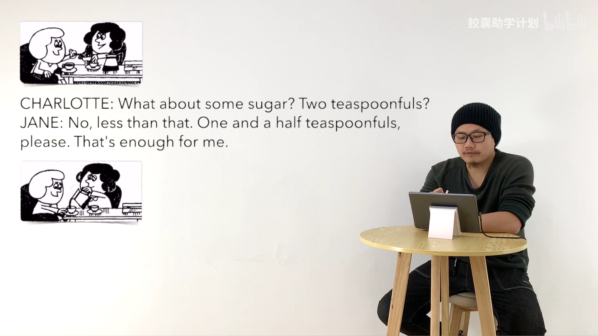

文字识别：胶囊助学计划 / CHARLOTTE: What about some sugar? Two teaspoonfuls? / JANE: No, less than that. One and a half teaspoonfuls, / please. That's enough for me. / 2

### 画面 00:02:40

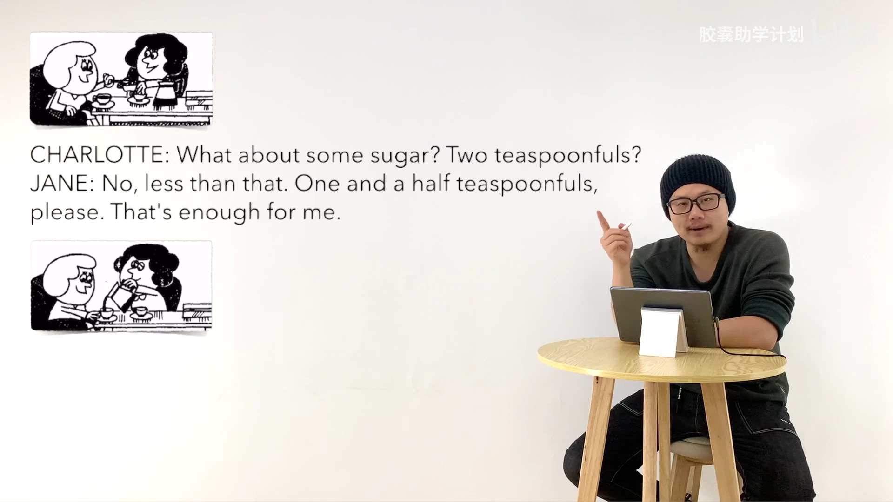

文字识别：CHARLOTTE: What about some sugar? Two teaspoonfuls? / JANE: No, less than that. One and a half teaspoonfuls, / please. That's enough for me. / 2

### 画面 00:02:43

文字识别：胶囊助学计划 / CHARLOTTE: What about some sugar? Two teaspoonfuls? / JANE: No, less than that. One and a half teaspoonfuls, / please. That's enough for me.

### 画面 00:02:47

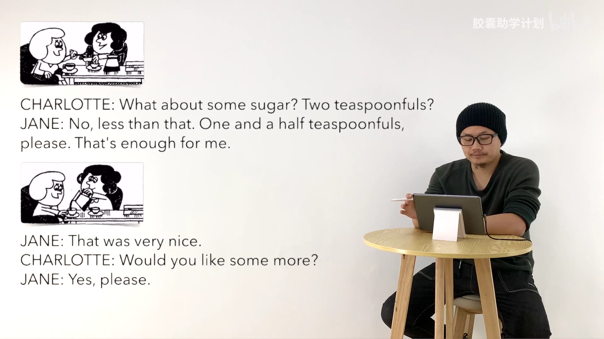

文字识别：胶囊助学计划 / CHARLOTTE: What about some sugar? Two teaspoonfuls? / JANE: No, less than that. One and a half teaspoonfuls, / please. That's enough for me. / JANE: That was very nice. / CHARLOTTE: Would you like some more? / JANE: Yes, please. / 2

## 00:03:00–00:03:30

下这句话之间其实是有一个小的时间间隔的，并且发生了一件事情。发生了什么呢？就是他把这个茶至少喝了一口，品了一下啊，这个咖啡，然后他才说，哎，这个还真的挺好。为什么？因为他有一个关键单词用的是 was，啊，说刚才这口茶真不错啊。我们汉语不这样聊，对吧？啊，这个咖啡是吧？但是时态 was 提醒了你这个点。再来，

### 画面 00:03:10

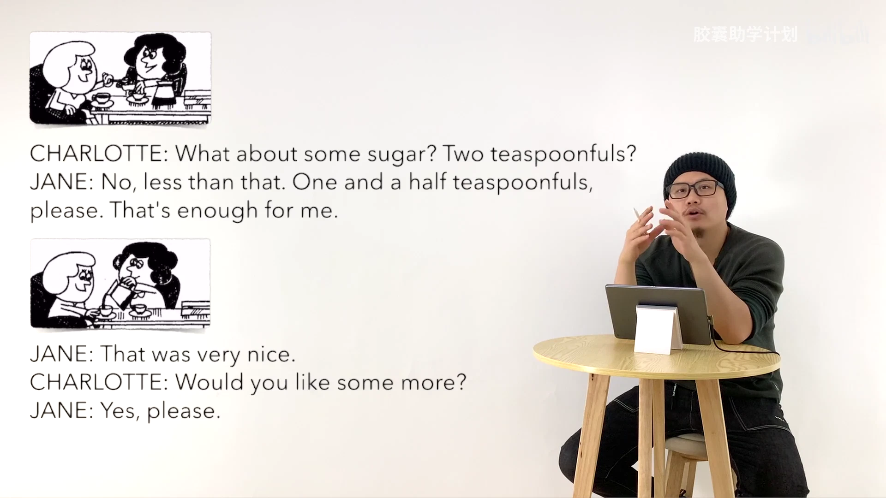

文字识别：CHARLOTTE: What about some sugar? Two teaspoonfuls? / JANE: No, less than that. One and a half teaspoonfuls, / please. That's enough for me. / JANE: That was very nice. / CHARLOTTE: Would you like some more? / JANE: Yes, please.

### 画面 00:03:16

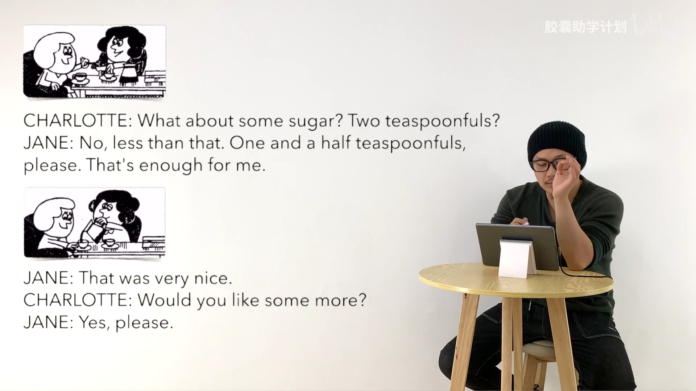

文字识别：胶囊助学计划 / CHARLOTTE: What about some sugar? Two teaspoonfuls? / JANE: No, less than that. One and a half teaspoonfuls, / please. That's enough for me. / JANE: That was very nice. / CHARLOTTE: Would you like some more? / JANE: Yes, please. / 2

### 画面 00:03:24

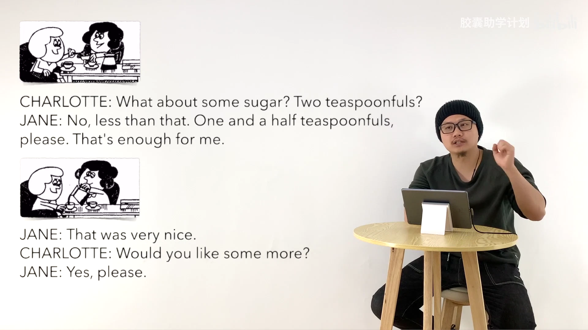

文字识别：CHARLOTTE: What about some sugar? Two teaspoonfuls? / JANE: No, less than that. One and a half teaspoonfuls, / please. That's enough for me. / JANE: That was very nice. / CHARLOTTE: Would you like some more? / JANE: Yes, please.

## 00:03:30–00:04:00

Would you like some more?哎，Would you like some more coffee?对吧？要不要更多的咖啡呢？Yes, please.是的，你看，Would you like something?这是我们刚刚学过的啊。I'd like a cigarette too.撇地，Would would like something?愿意想要某件事情。一百零七课我们刚刚学过。我想要一些，想要一根烟啊。May I have one?我能来一根吗？Of course,当然能了。I think

### 画面 00:03:32

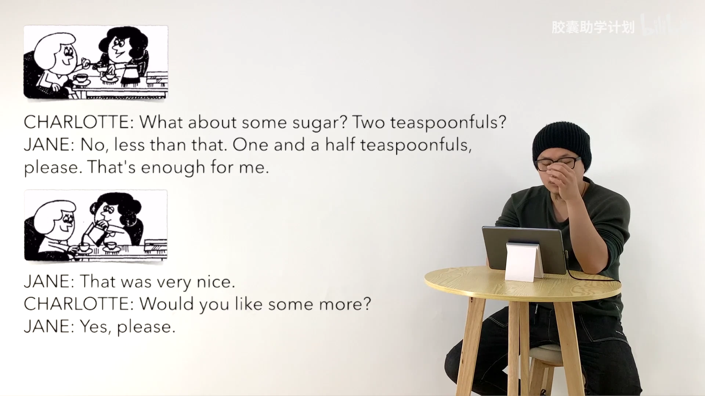

文字识别：胶囊助学计划 / CHARLOTTE: What about some sugar? Two teaspoonfuls? / JANE: No, less than that. One and a half teaspoonfuls, / please. That's enough for me. / JANE: That was very nice. / CHARLOTTE: Would you like some more? / JANE: Yes, please.

### 画面 00:03:42

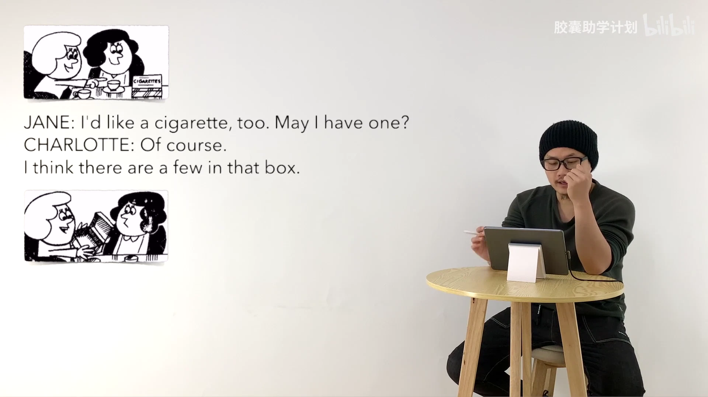

文字识别：胶囊助学计划 / 网 / CIGARETTES / JANE: I'd like a cigarette, too. May I have one? / CHARLOTTE: Of course. / I think there are a few in that box.

## 00:04:00–00:04:30

看后边。宾语从句。There are a few in that box.好，看到a few了。回顾几个事情。第一，嗯，它的含义是少。第二，它后边加可数不可数呢？可数。你看cigarette是吧？A cigarette. There are a few cigarettes，对吧？可数。第三，它是肯定否定呢？它是肯定。我说我要来根烟，我能抽一根吗？说没问题。你看那里还有呢，还有一点不多了，

### 画面 00:04:09

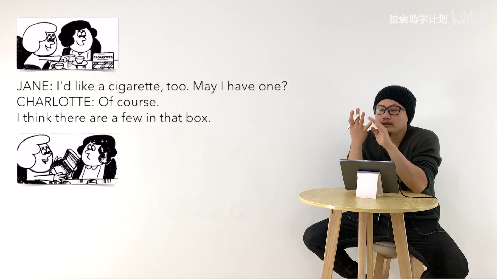

文字识别：胶囊助学计划 / CIGARETTES / JANE: I'd like a cigarette, too. May I have one? / CHARLOTTE: Of course. / I think there are a few in that box.

### 画面 00:04:12

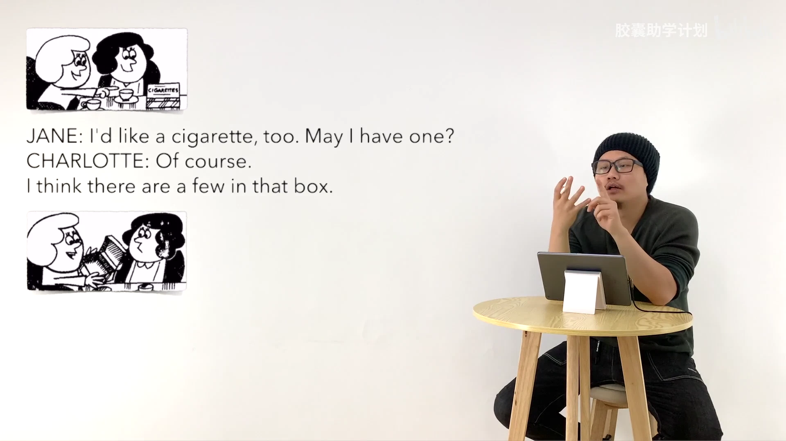

文字识别：网 / CIGARETTEs / JANE: I'd like a cigarette, too. May I have one? / CHARLOTTE: Of course. / I think there are a few in that box.

### 画面 00:04:17

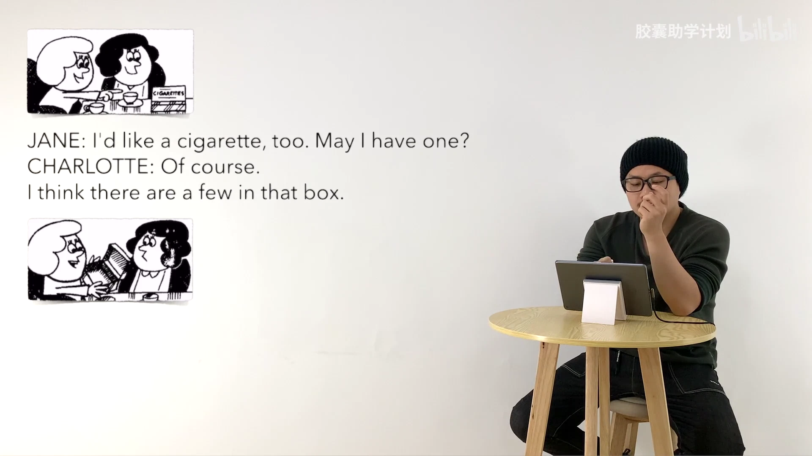

文字识别：胶囊助学计划 / 网 / CIGARETTES / JANE: I'd like a cigarette, too. May I have one? / CHARLOTTE: Of course. / I think there are a few in that box.

### 画面 00:04:19

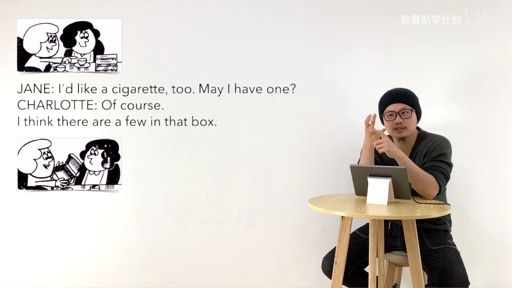

文字识别：胶囊助学计划 / 网 / CIGARETTES / JANE: I'd like a cigarette, too. May I have one? / CHARLOTTE: Of course. / I think there are a few in that box.

## 00:04:30–00:05:00

了，还有还有几根儿，你能抽，肯定还有，对不对？好，再来。I'm afraid it's empty. 我恐怕呀，空了。Sherry说，哎，what a pity啊，好遗憾，没有了。It doesn't matter. 一个小的习惯性表达叫没关系啊，没关系。Have a biscuit instead. 说那吃个饼干替代吧，对吧？喝下午茶就饼

### 画面 00:04:34

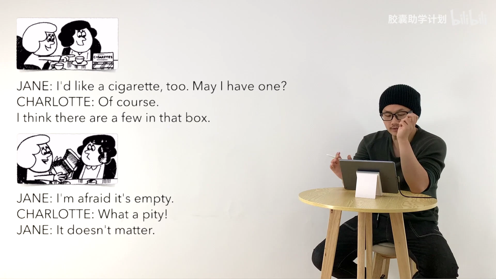

文字识别：胶囊助学计划 / CIGARETTES / JANE: I'd like a cigarette, too. May I have one? / CHARLOTTE: Of course. / I think there are a few in that box. / JANE: I'm afraid it's empty. / CHARLOTTE: What a pity! / JANE: It doesn't matter.

### 画面 00:04:46

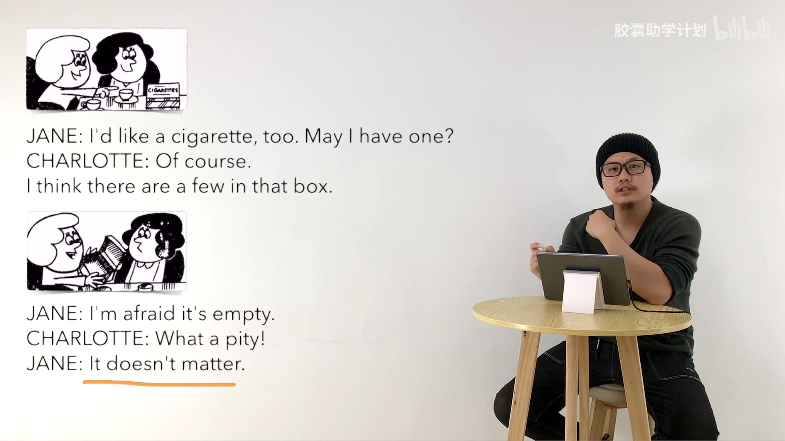

文字识别：胶囊助学计划 / CIGARETTES / JANE: I'd like a cigarette, too. May I have one? / CHARLOTTE: Of course. / I think there are a few in that box. / JANE: I'm afraid it's empty. / CHARLOTTE: What a pity! / JANE: It doesn't matter.

### 画面 00:04:48

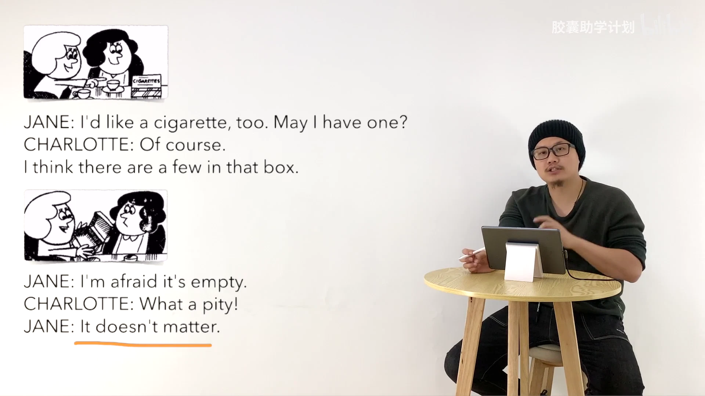

文字识别：胶囊助学计划 / CIGARETTES / JANE: I'd like a cigarette, too. May I have one? / CHARLOTTE: Of course. / I think there are a few in that box. / JANE: I'm afraid it's empty. / CHARLOTTE: What a pity! / JANE: It doesn't matter.

### 画面 00:04:52

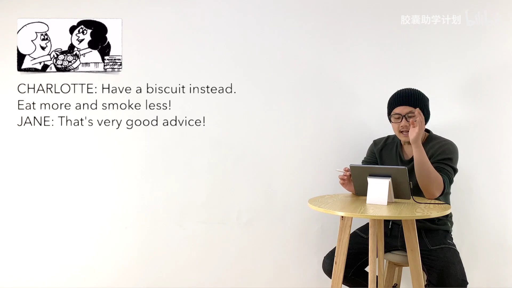

文字识别：胶囊助学计划 / CHARLOTTE: Have a biscuit instead. / Eat more and smoke less! / JANE: That's very good advice!

### 画面 00:04:54

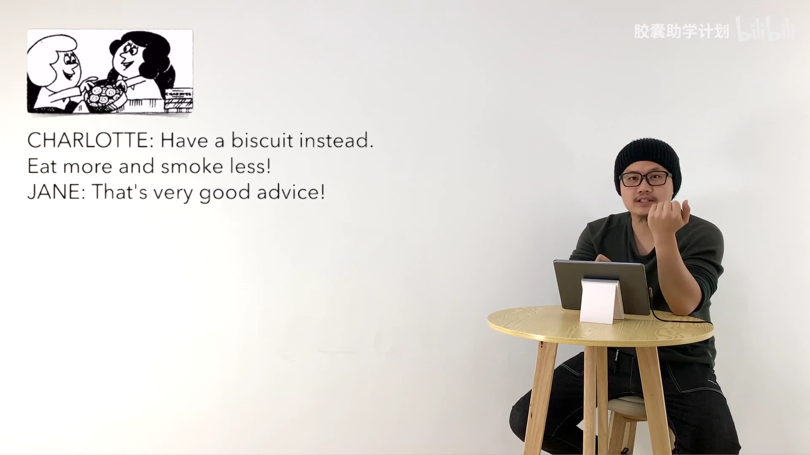

文字识别：胶囊助学计划 / CHARLOTTE: Have a biscuit instead. / Eat more and smoke less! / JANE: That's very good advice!

## 00:05:00–00:05:30

干，这是英式这个下午茶一个特点。Eat more and smoke less. Eat more,吃的更多；smoke less,抽的更少，对吧？Less叫更少嘛。That's very good advice.这是非常好的建议。那文章我们到这儿就讲完了。接下来做一些口语听力练习。我问，你答。Is Charlotte going to make coffee or tea?

### 画面 00:05:00

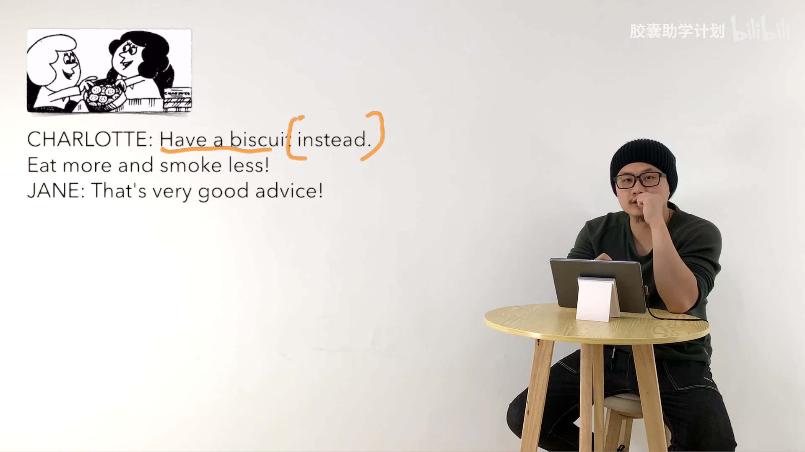

文字识别：胶囊助学计划 / CHARLOTTE: Have a biscuil instead. / Eat more and smoke less! / JANE: That's very good advice!

### 画面 00:05:04

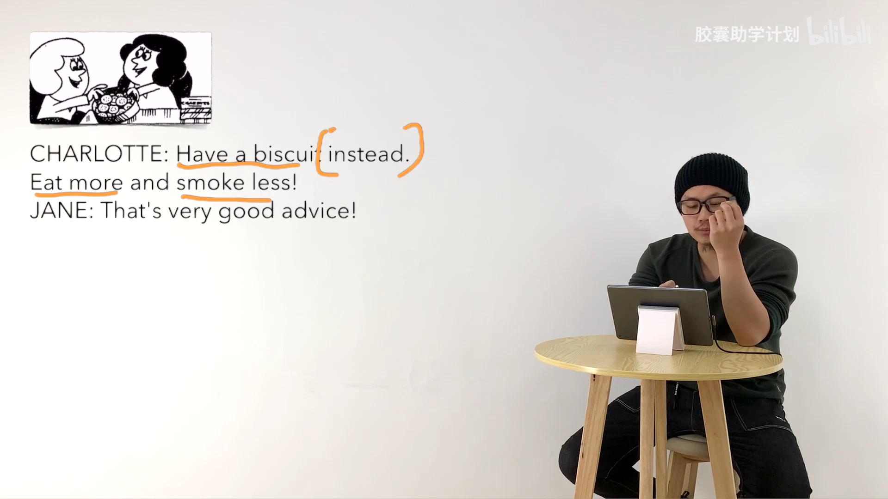

文字识别：胶囊助学计划 / CHARLOTTE: Have a biscui instead. / Eat more and smoke less! / JANE: That's very good advice!

### 画面 00:05:09

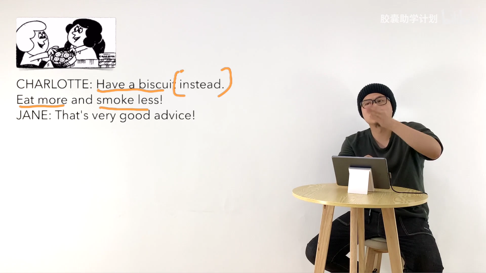

文字识别：胶囊助学计划 / CHARLOTTE: Have a biscui instead. / Eat more and smoke less! / JANE: That's very good advice!

### 画面 00:05:13

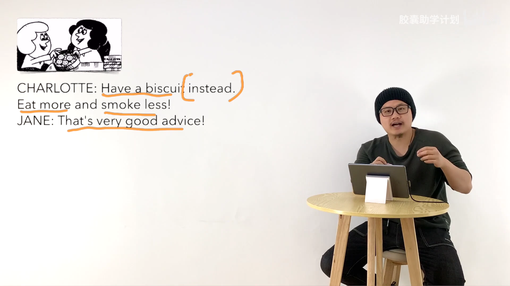

文字识别：CHARLOTTE: Have a biscui instead. / Eat more and smoke less! / JANE: That's very good advice!

### 画面 00:05:15

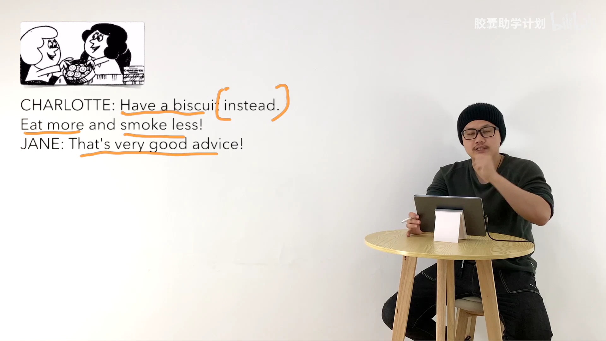

文字识别：胶囊助学计划 / CHARLOTTE: Have a biscui instead. / Eat more and smoke less! / JANE: That's very good advice!

### 画面 00:05:18

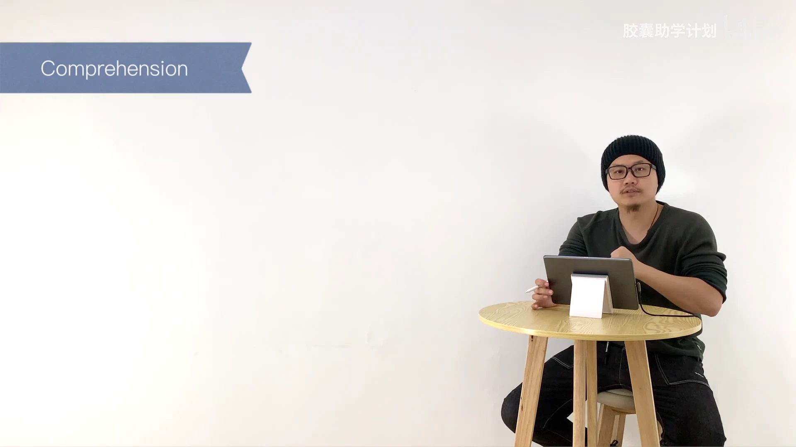

文字识别：胶囊助学计划 / Comprehension

### 画面 00:05:23

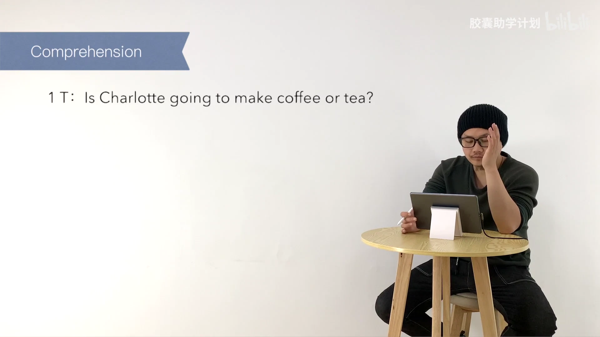

文字识别：胶囊助学计划 / Comprehension / 1 T: Is Charlotte going to make coffee or tea?

## 00:05:30–00:06:00

Coffee. Next one. What does Jan think about that? Is a good idea. Next one. How much milk does Jan want? Just a little. Next one. Does Jan want any sugar? Yes, she does. Next one. How much sugar does she want? One and a

### 画面 00:05:32

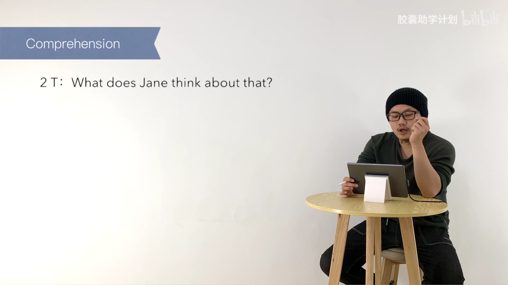

文字识别：胶囊助学计划 / Comprehension / 2 T: What does Jane think about that?

### 画面 00:05:57

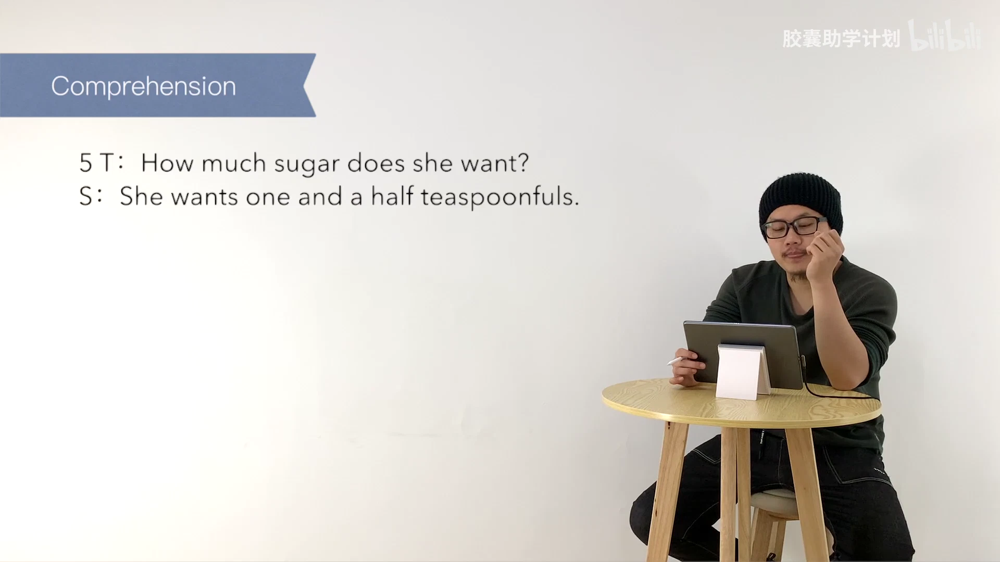

文字识别：胶囊助学计划 / Comprehension / 5 T: How much sugar does she want? / S: She wants one and a half teaspoonfuls.

## 00:06:00–00:06:30

half teaspoons. Next one, would Jane like some more coffee? Yes, she would. Next one, what else would Jane like? She'd like a cigarette too. Next one, where does Jane look for cigarettes? In the box. Next one, are there any cigarettes?

### 画面 00:06:03

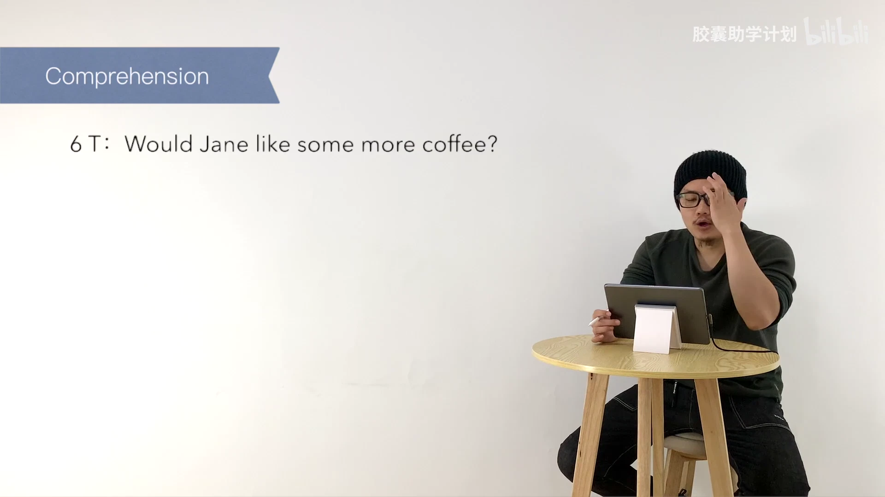

文字识别：胶囊助学计划 / Comprehension / 6 T: Would Jane like some more coffee?

### 画面 00:06:07

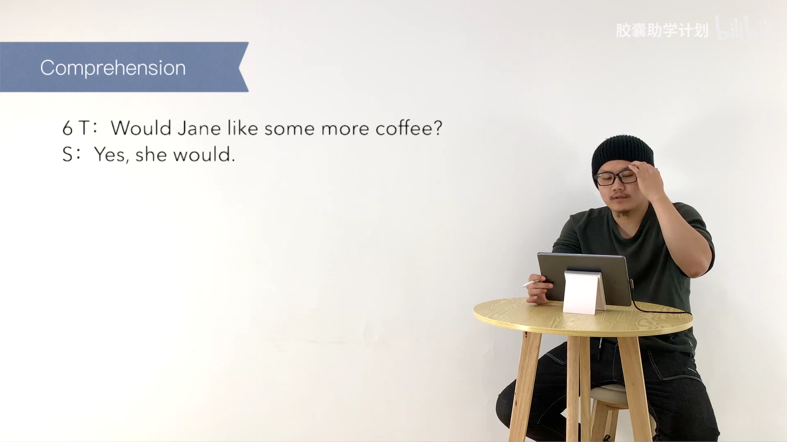

文字识别：胶囊助学计划 / Comprehension / 6 T: Would Jane like some more coffee? / S: Yes, she would.

### 画面 00:06:10

文字识别：胶囊助学计划 / Comprehension / 7 T: What else would Jane like? / 空

## 00:06:30–00:07:00

No, there aren't. The box is empty. Next one, what's Charlotte's advice? Eat more and smoke less. Very good. Asking questions,肯定句，一般疑问句，特殊疑问句。第一题，Ask me if Jane wants any milk in her coffee. Does Jane want any milk in

### 画面 00:06:40

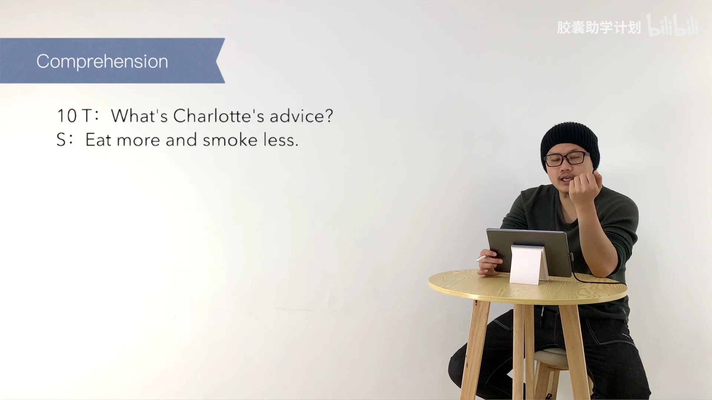

文字识别：胶囊助学计划 / Comprehension / 10T: What's Charlotte's advice? / S: Eat more and smoke less.

### 画面 00:06:43

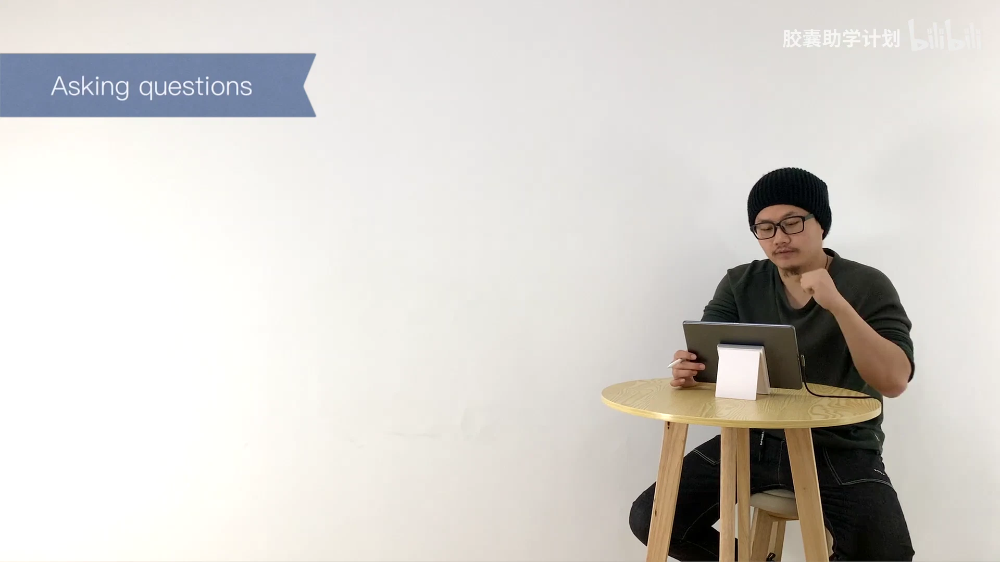

文字识别：胶囊助学计划 / Asking questions

### 画面 00:06:45

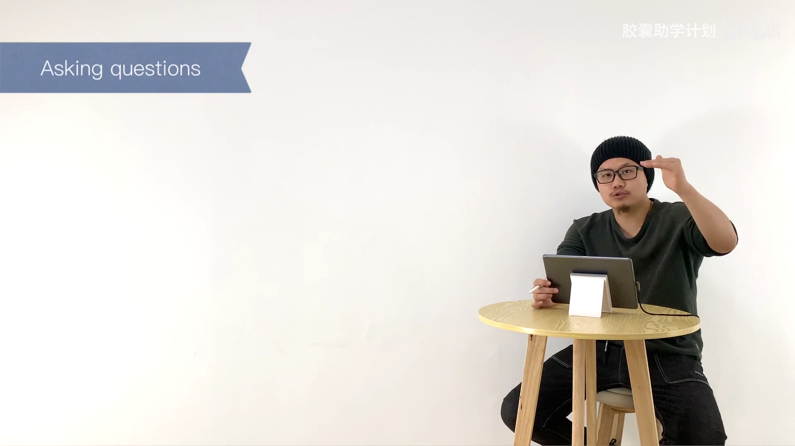

文字识别：Asking questions

### 画面 00:06:48

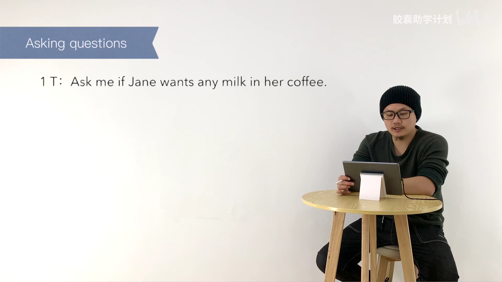

文字识别：胶囊助学计划 / Asking questions / 1 T: Ask me if Jane wants any milk in her coffee.

## 00:07:00–00:07:30

her coffee? How much? How much milk does Jane want in her coffee? Next one. Ask me if she wants two teaspoonfuls of sugar. Does提前? Does she want two teaspoonfuls of sugar? How many?那你看，各位要在这儿就去想了。How many是对谁提问？How much是对谁提问？对吧？那

### 画面 00:07:04

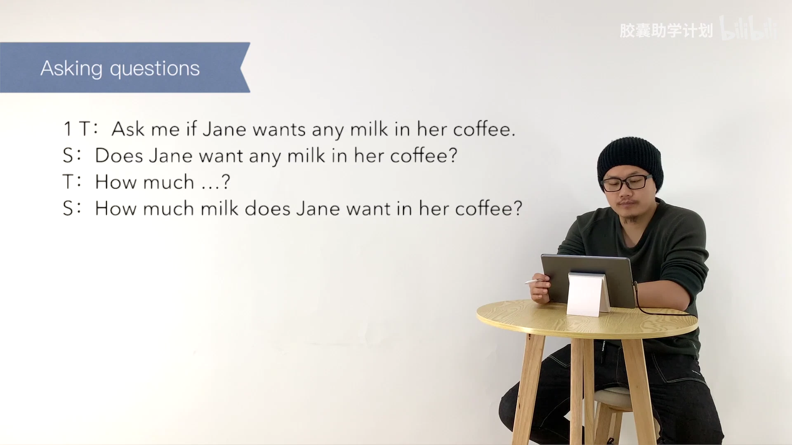

文字识别：胶囊助学计划 / Asking questions / 1 T: Ask me if Jane wants any milk in her coffee. / S: Does Jane want any milk in her coffee? / T: How much ...? / S: How much milk does Jane want in her coffee?

### 画面 00:07:11

文字识别：胶囊助学计划 / Asking questions / 2 T: Ask me if she wants two teaspoonfuls of sugar.

### 画面 00:07:18

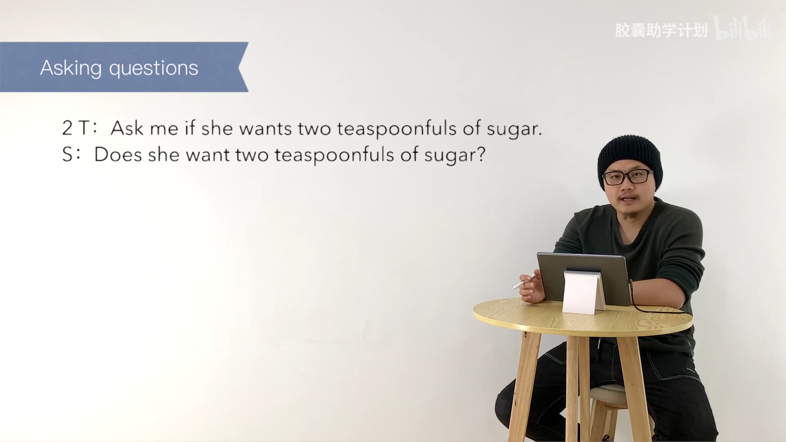

文字识别：胶囊助学计划 / Asking questions / 2 T: Ask me if she wants two teaspoonfuls of sugar. / S: Does she want two teaspoonfuls of sugar?

### 画面 00:07:24

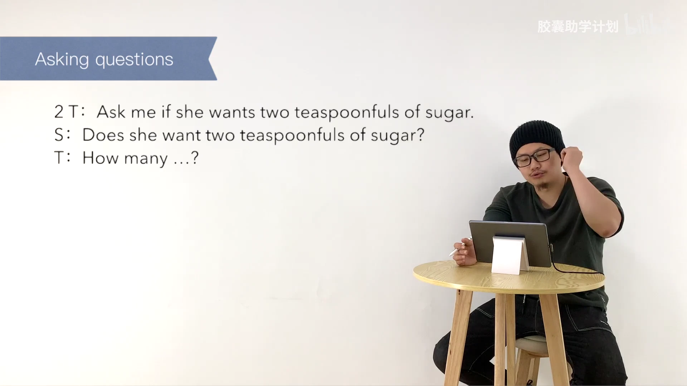

文字识别：胶囊助学计划 / Asking questions / 2 T: Ask me if she wants two teaspoonfuls of sugar. / S: Does she want two teaspoonfuls of sugar? / T: How many ….?

## 00:07:30–00:08:00

how many 一定是对数字提问，所以是 how many teaspoons of sugar does she want？所以这问的是她想要多少勺糖，对吧？Next one, ask me if she would like some more.一般疑问句，Would she like some more？Why？Why would she like some more？Next one, ask me if there are any

### 画面 00:07:33

文字识别：胶囊助学计划 / Asking questions / 2 T: Ask me if she wants two teaspoonfuls of sugar. / S: Does she want two teaspoonfuls of sugar? / T: How many …..? / S: How many teaspoonfuls of sugar does she want?

### 画面 00:07:35

文字识别：胶囊助学计划 / Asking questions / 2 T: Ask me if she wants two teaspoonfuls of sugar. / S: Does she want two teaspoonfuls of sugar? / T: How many …..? / S: How many teaspoonfuls of sugar does she want?

### 画面 00:07:40

文字识别：胶囊助学计划 / Asking questions / 2 T: Ask me if she wants two teaspoonfuls of sugar. / S: Does she want two teaspoonfuls of sugar? / T: How many …..? / S: How many teaspoonfuls of sugar / does she want?

### 画面 00:07:42

文字识别：胶囊助学计划 / Asking questions / 3 T: Ask me if she would like some more.

### 画面 00:07:51

文字识别：胶囊助学计划 / Asking questions / 3 T: Ask me if she would like some more. / S: Would she like some more? / T:Why..? / S: Why would she like some more?

### 画面 00:07:55

文字识别：胶囊助学计划 / Asking questions

## 00:08:00–00:08:30

cigarettes in that box.一般疑问句 Are there any cigarettes in that box? How many? How many cigarettes are there in that box? Next one. Ask me if she will have a biscuit instead. Will she have a biscuit instead? What? What will she have instead?

### 画面 00:08:07

文字识别：胶囊助学计划 / Asking questions / 4 T: Ask me if there are any cigarettes in that box. / S: Are there any cigarettes in that box? / T: How many ….?

### 画面 00:08:14

文字识别：胶囊助学计划 / Asking questions / 5 T: Ask me if she will have a biscuit instead.

### 画面 00:08:26

文字识别：胶囊助学计划 / Asking questions / 5 T: Ask me if she will have a biscuit instead. / S: Will she have a biscuit instead? / T: What ...? / S: What will she have instead?

## 00:08:30–00:09:00

Very good. Recap.文章当中，哎，我又在这四个单词专门给大家停顿，尝试去回顾复习了一下，对吧？如果您哎还没有去红皮初级红皮书当中去查，您一定要赶紧去查一下。我们又多学了一个小的习惯表达，叫做make some coffee，对吧？家庭作业，绿皮书一百零九课文章熟读成诵，讲解一遍核

### 画面 00:08:31

文字识别：胶囊助学计划 / Recap / Patterns / Grammar / a little / little / Words / a few / few / Expression / make some coffe

### 画面 00:08:36

文字识别：胶囊助学计划 / Recap / Patterns / Grammar / a little / a / little / Words / a few / few / Expression / make some coffee

### 画面 00:08:39

文字识别：Recap / Patterns / Grammar / alittle / little / Words / afew / few / Expression / make some coff ee

### 画面 00:08:49

文字识别：胶囊助学计划 / Recap / Patterns / Grammar / alittle / little / Words / afew / few / Expression / make some coffee

### 画面 00:08:54

文字识别：胶囊助学计划 / 绿皮书第109课的写作练习

### 画面 00:08:57

文字识别：绿皮书第109课的写作练习 / 文章跟读至熟读成诵 / 3.请给自己讲解一遍今天的 / 核心知识点

## 00:09:00–00:09:30

心知识点。如果大家喜欢我们的课程呢，欢迎大家关注、订阅、一键三连、分享给那些需要的朋友。最后，我们来看一句名人名言：Many receive advice, only the wise profit from it. See you next time.

### 画面 00:09:00

文字识别：胶囊助学计划

### 画面 00:09:02

文字识别：胶囊助学计划

### 画面 00:09:08

文字识别：胶囊助学计划 / Many receive advice, only the wise profit / from it. / Harper Lee

### 画面 00:09:19

文字识别：CAPSULEACADEMY / 胶囊助学计划 / 小红书

### 画面 00:09:21

文字识别：CAPSULEACADEMY / 胶囊助学计划 / 小红书 / OE

### 画面 00:09:24

文字识别：CAPSULEACADEMY / 胶囊助学计划 / 『 / 小红书 / Editor / □ / Berlin

### 画面 00:09:26

文字识别：CAPSULEACADEMY / 胶囊助学计划 / 『 / 小红书 / Creator / Leo & Berlin

### 画面 00:09:28

文字识别：胶囊助学计划bll / CAPSULEACADEMY / 胶囊助学计划 / 小红书 / OE

## 00:09:30–00:09:31

### 画面 00:09:30

文字识别：bilibili / 胶囊助学计划

