# 111 单词 语法

快速机器解析：语音为单模型转写，未进行独立交叉校对或人工复核；画面每秒采样并按变化选帧，短时文字和标记可能遗漏。截图时间约有 1 秒误差。图片有损压缩；遇到疑点请按时间查看 Google Drive 原视频。

## 00:00:00–00:00:30

Hello everyone, welcome to Capsule Academy. This is Leo. Today we're going to learn New New Concept English Book One Lesson One Hundred and Eleven Grammar and Words.那老习惯，我们进入正式课程之前呢，看三个问题。第一，形容词我们又说到了比较级和最高级。在一百零七课我们学过了，后面加一、二和est。那今天我们看看它还有什么新的变法。第二呢，如何去使用as s这个表达啊？

### 画面 00:00:00

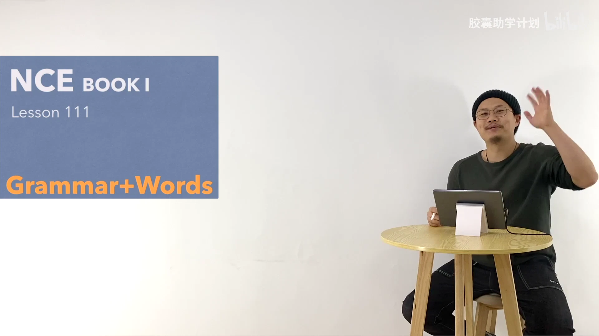

文字识别：胶囊助学计划 / NCE / BOOKI / Lesson 111 / Grammar+Words

### 画面 00:00:02

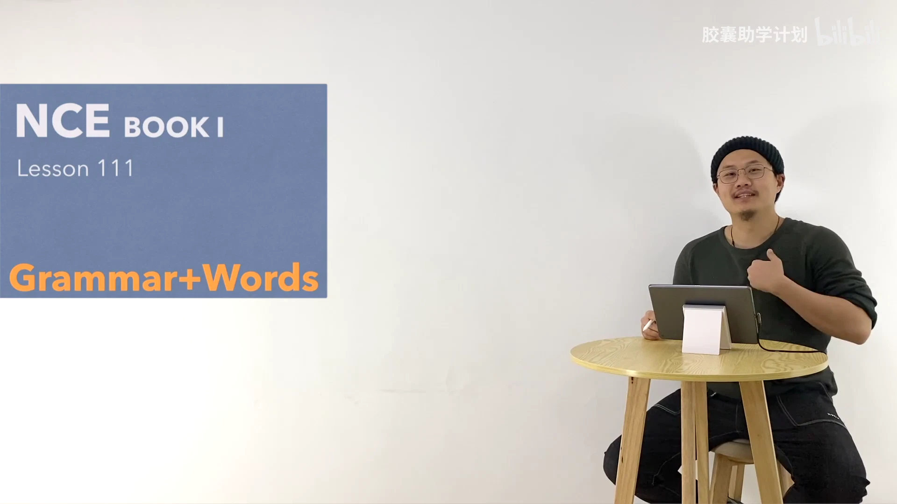

文字识别：胶囊助学计划 / NCE / BOOKI / Lesson 111 / Grammar+Words

### 画面 00:00:14

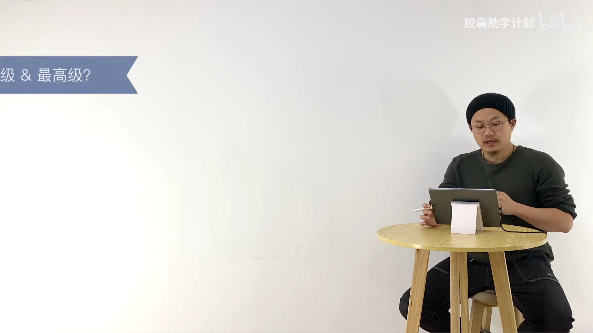

文字识别：胶囊助学计划 / 级&最高级？

### 画面 00:00:16

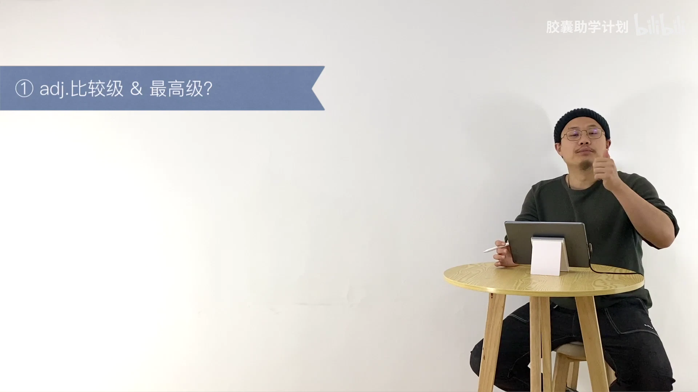

文字识别：胶囊助学计划 / ①adj.比较级＆最高级？

### 画面 00:00:26

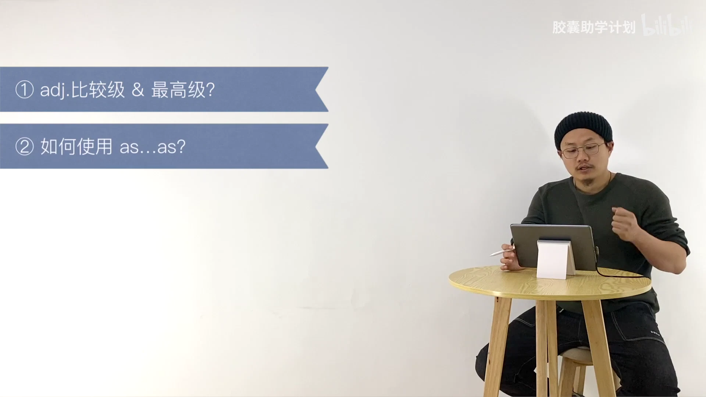

文字识别：胶囊助学计划 / ① adj.比较级 & 最高级？ / 如何使用 as...as?

## 00:00:30–00:01:00

is how to express in English to buy something on installment. With these three questions, hope you can enjoy it. Okay, let's start with the title. It's called more and most plus adjectives. More and most are two words we learned in Lesson 109 and 110, right? We call them many much comparative, more and most.

### 画面 00:00:31

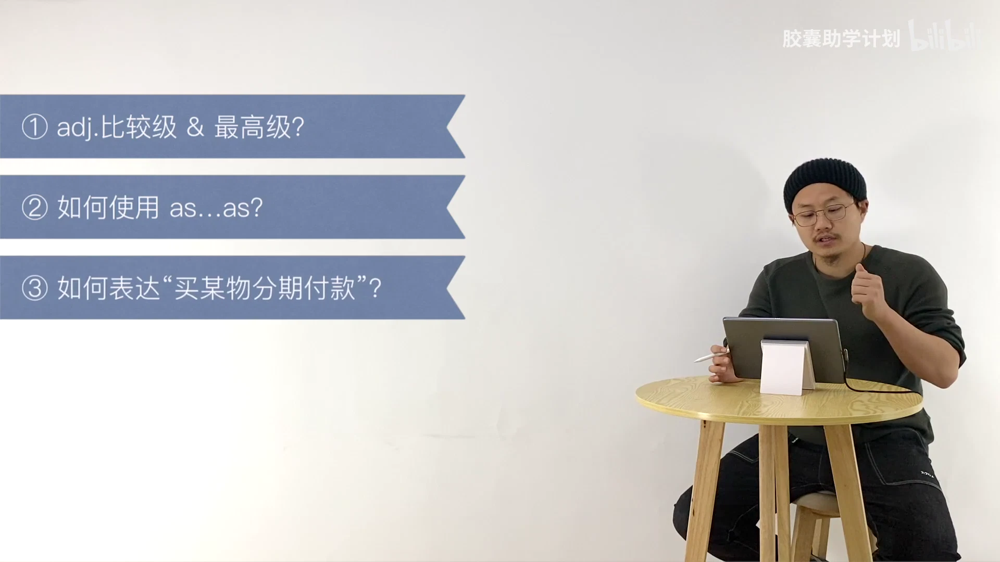

文字识别：胶囊助学计划 / ①adj.比较级&最高级？ / 如何使用as..as？ / 如何表达“买某物分期付款”?

### 画面 00:00:39

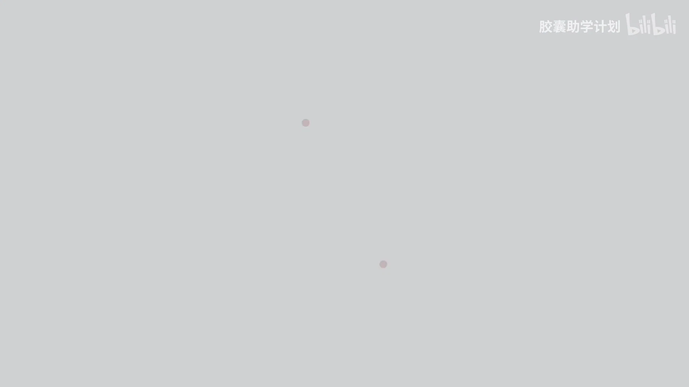

文字识别：胶囊助学计划bll / •

### 画面 00:00:43

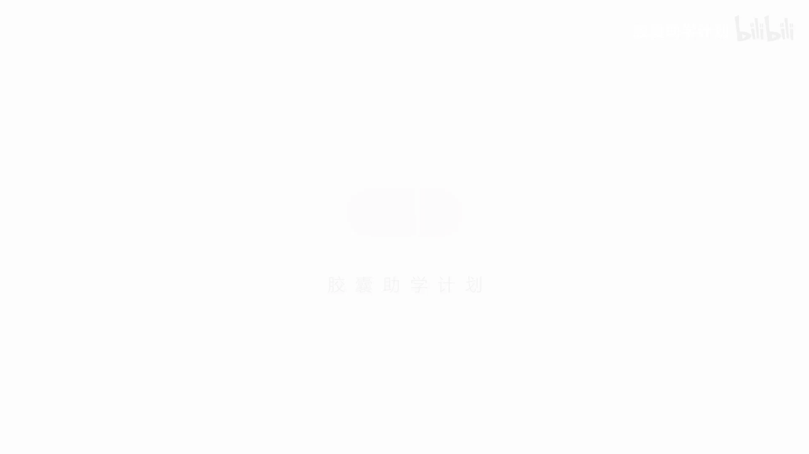

### 画面 00:00:45

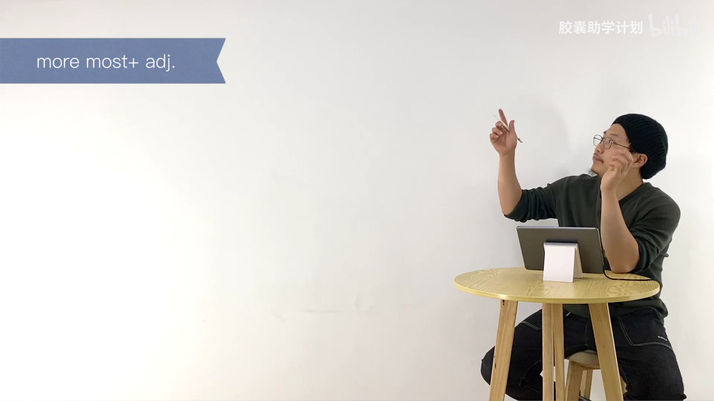

文字识别：胶囊助学计划 / more most+ adj.

## 00:01:00–00:01:30

的比较级，叫做更多啊。然后呢， most 叫做最多。那我们当时我印象当中，我在视频当中啊，就给大家说过，说它其实还有一个更本质的意思，叫做更和最，对吧？比如说，我们看一下这地方的规则，说多音节形容词前面加上 more 或者 most 表示更多的意思。那首先要解决一个问题，多音节。我们在一百零七课讲过，单音节

### 画面 00:01:08

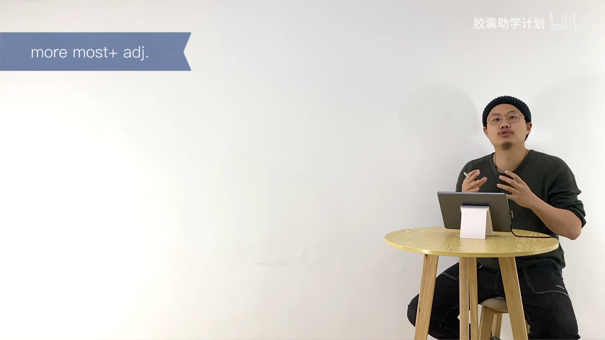

文字识别：胶囊助学计划 / more most+ adj.

### 画面 00:01:16

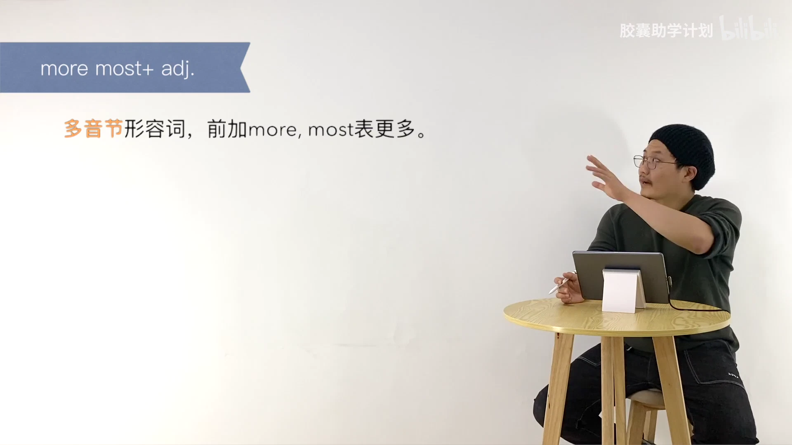

文字识别：胶囊助学计划 / more most+ adj. / 多音节形容词，前加more,most表更多。

## 00:01:30–00:02:00

节，叫做我们怎么判断一个单词当中有多少个音节呢？这个是您在学我们新概念课程这个系列课程之前就应该已经处理过了的一个问题，对吧？在我们的音标的那个视频当中有特别详细的讲解。那告诉大家的就是多音节的这个形容词啊，您需要去做的事情是判断一下它的音标当中有多少个元音音标，有多少元音音标就多少个音节，对吧？那多音节在这儿的判断就是

### 画面 00:01:32

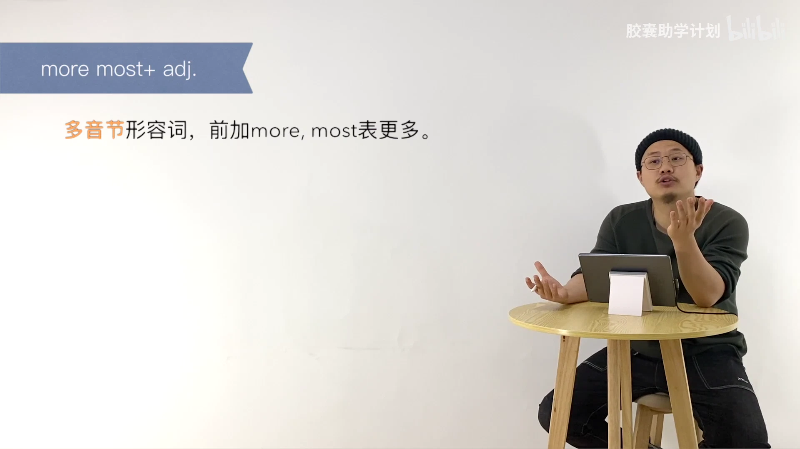

文字识别：胶囊助学计划 / more most+ adj. / 多音节形容词，前加more,most表更多。

### 画面 00:01:36

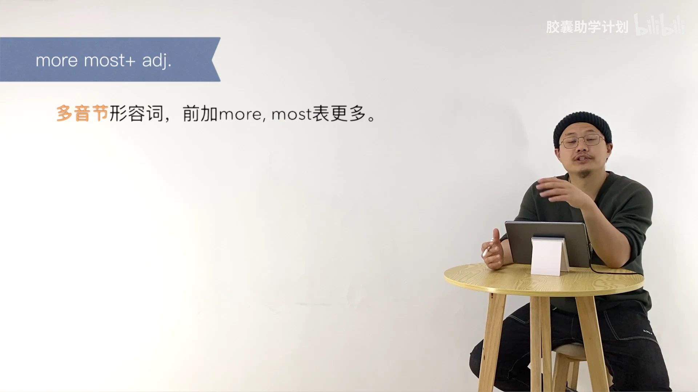

文字识别：胶囊助学计划 / more most+ adj. / 多音节形容词，前加more, most表更多。

## 00:02:00–00:02:30

大于等于二，我们就管它叫多音节形容词。比如说 beautiful，OK，三音节啊，它有三个元音音标，您不能只看字母啊，您要看元音音标。然后呢，那它就叫多音节形容词。那如果我想说更美呢，那叫做 more beautiful。那说最美呢也很简单，叫做 the most beautiful。您看我在 most 前面还是加了一个 the。如果您还记得一百零七课我讲过的那个

### 画面 00:02:06

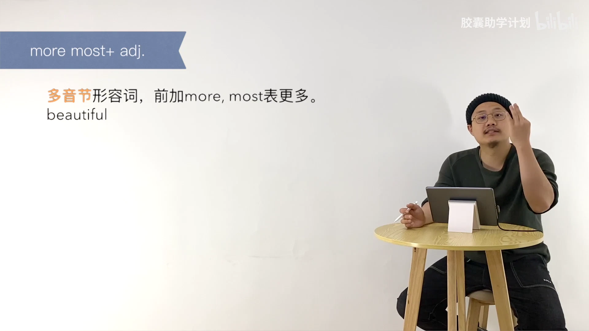

文字识别：胶囊助学计划 / more most+ adj. / 多音节形容词，前加more,most表更多。 / beautiful

## 00:02:30–00:03:00

呃形容词最高级的话，那在这儿你应该是有印象的对吧？那我们接下来造一些句子吧，试一下它的句型跟一百零七课没有本质上的区别。比如说，She is more beautiful than her mom啊，她比她妈妈还要漂亮，要更漂亮，对吧？您看，我们无非就是把当时形容词后边加一、二，现在变成了more，直接加形容词，对吧？OK，它有两个变法。再来一个，比如说，She is the most beautiful

### 画面 00:02:34

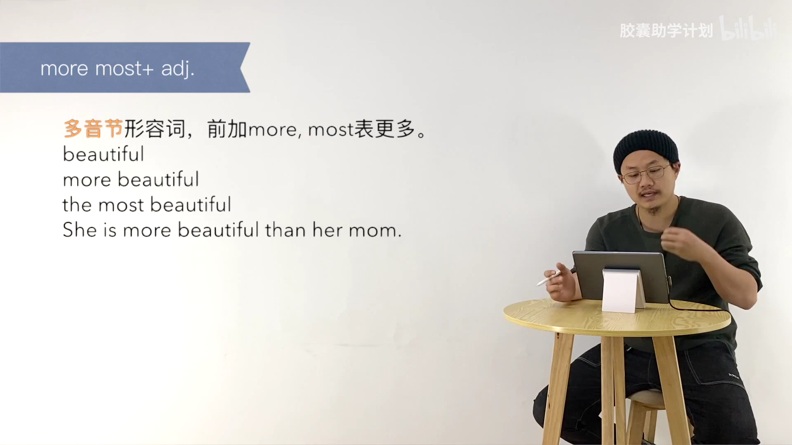

文字识别：胶囊助学计划 / more most+ adj. / 多音节形容词，前加more,most表更多。 / beautiful / more beautiful / the most beautiful / She is more beautiful than her mom.

### 画面 00:02:41

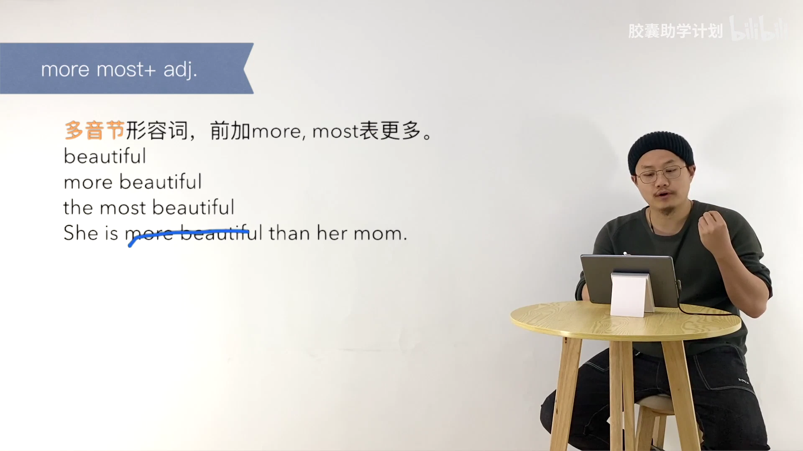

文字识别：胶囊助学计划 / more most+ adj. / 多音节形容词，前加more,most表更多。 / beautiful / more beautiful / the most beautiful / She is pere beautiful than her mom.

### 画面 00:02:44

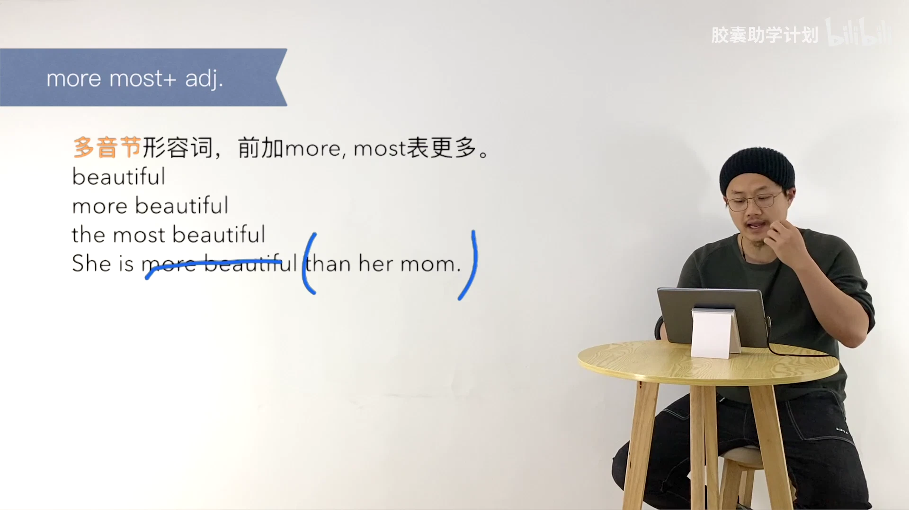

文字识别：胶囊助学计划 / more most+ adj. / 多音节形容词，前加more,most表更多。 / beautiful / more beautiful / the most beautiful / She is mere beautiful / Ithan her mom.

### 画面 00:02:46

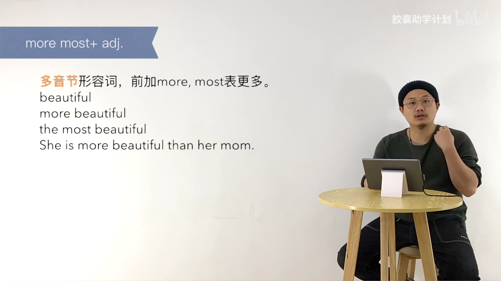

文字识别：胶囊助学计划 / more most+ adj. / 多音节形容词，前加more,most表更多。 / beautiful / more beautiful / the most beautiful / She is more beautiful than her mom.

### 画面 00:02:49

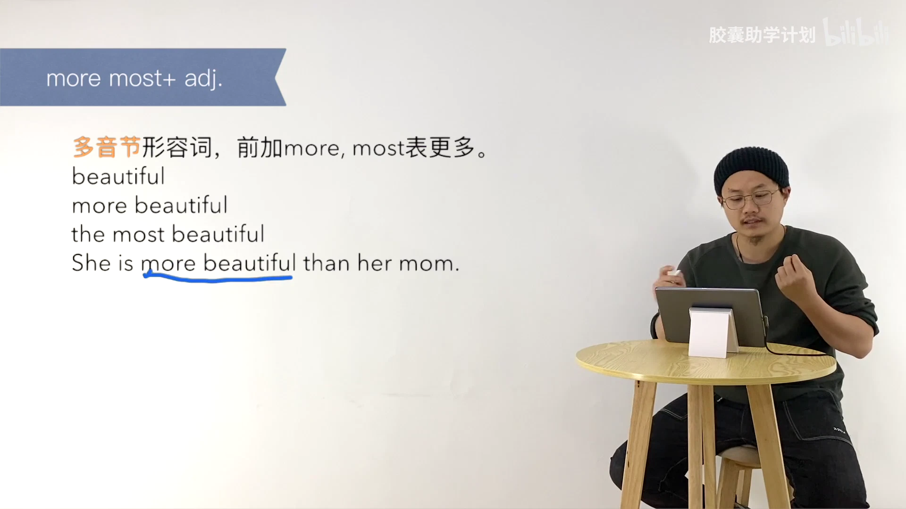

文字识别：胶囊助学计划 / more most+ adj. / 多音节形容词，前加more,most表更多。 / beautiful / more beautiful / the most beautiful / She is more beautiful than her mom.

## 00:03:00–00:03:30

woman in her family. Okay, very good. The most beautiful woman.哎，各位能看到这个地方，它其实在 most 前面加了一个 the，对不对？说她是最美丽的女人，在她的家族当中，这个句型跟一百零七课也没有任何区别，只是我们把形容词后边加 e s t 变成了前面加 the most，对吧？Okay，那接下来呢，我们尝试看一个小的电影片段，当中就出现了叫做 the

### 画面 00:03:03

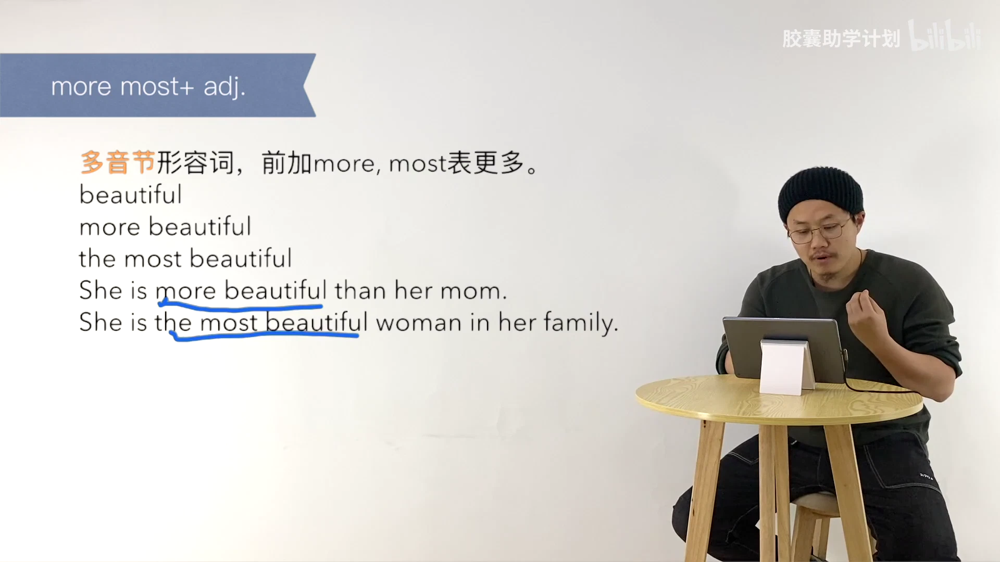

文字识别：胶囊助学计划 / more most+ adj. / 多音节形容词，前加more,most表更多。 / beautiful / more beautiful / the most beautiful / She is more beautiful than her mom. / She is the most beautiful woman in her family.

### 画面 00:03:23

文字识别：胶囊助学计划 / the most charming / and least clever / DE RICHARD CURTIS,ESCRITOR DE / CUATRO BODAS / YUN FUNERA / REALMENTE AMO / UN LUGAR LLAMADO NOTTING / Domhnall Gleeson / Rachel McAdams / Cuestión deTi / 时空恋旅人About Time(2013) / PROXIMAME

### 画面 00:03:25

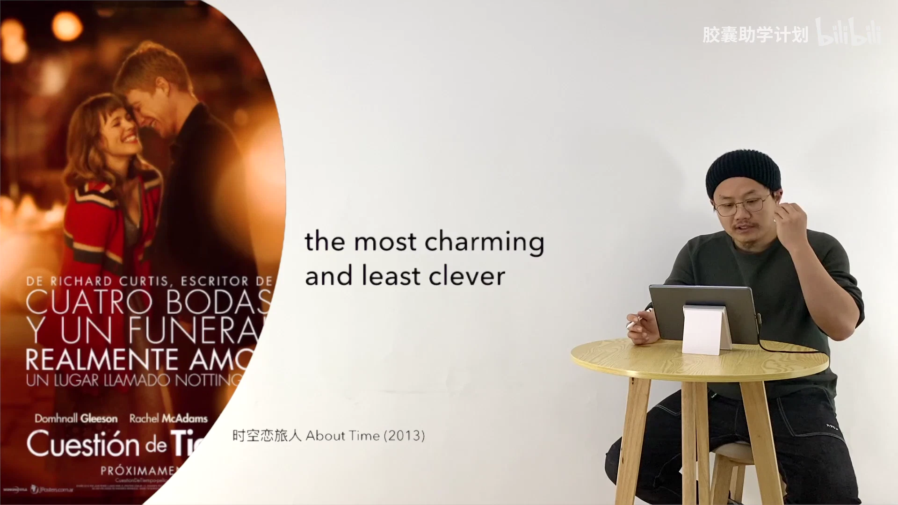

文字识别：胶囊助学计划 / the most charming / and least clever / DE RICHARD CURTIS,ESCRITOR DE / CUATRO BODAS / YUN FUNERA / REALMENTE AMO / UN LUGAR LLAMADO NOTTING / Domhnall Gleeson / Rachel McAdams / Cuestiónde / Ti / 时空恋旅人AboutTime(2013) / PROXIMAME

### 画面 00:03:29

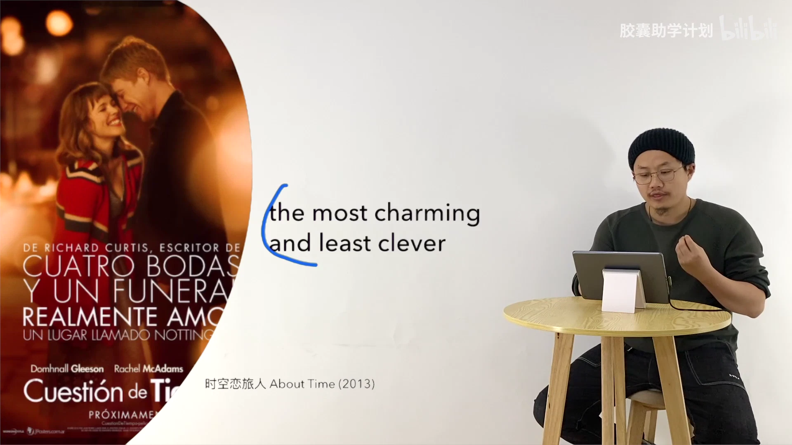

文字识别：胶囊助学计划 / the / most / charming / and least clever / DE RICHARD CURTIS,ESCRITOR DE / CUATRO BODAS / YUN FUNERA / REALMENTE AMO / UN LUGAR LLAMADO NOTTING / Domhnall Gleeson / Rachel McAdams / Cuestión de1 / Ti / 时空恋旅人 About Time(2013) / PROXIMAME

## 00:03:30–00:04:00

most charming and least clever. Okay,那 most charming叫做最怎么怎么样的 charming指的是有魅力的啊，说一个人很有魅力，不一定是漂亮，对吧？不一定是美丽，但是非常有魅力，很吸引人，那叫做 charming. Okay,那 least clever是马上我们就会学到的啊，我们拿这个视频承上启下一下. least叫做最不怎么怎么样，那 least clever就是最不聪明的. Okay,那我们一起看一下这个小的电影片段.

### 画面 00:03:31

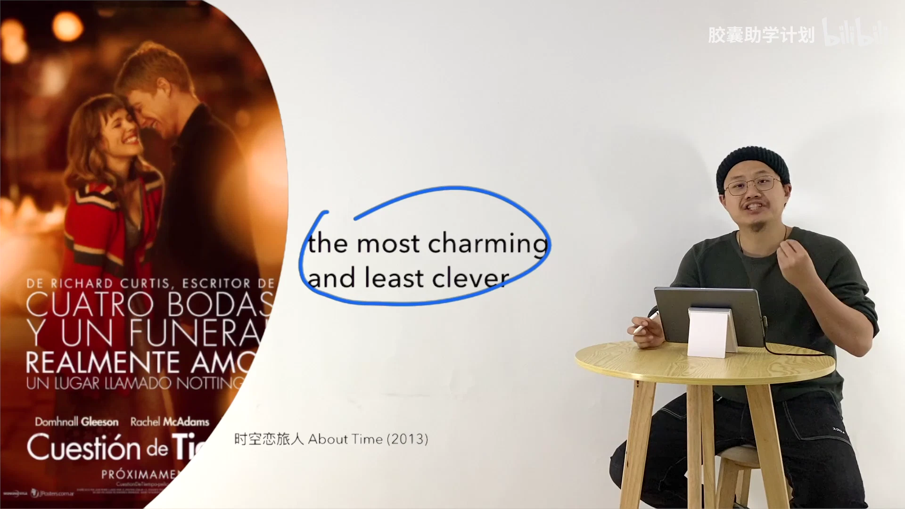

文字识别：胶囊助学计划 / the / most / charming / and least clever / DE RICHARD CURTIS,ESCRITOR DE / CUATRO BODAS / YUN FUNERA / REALMENTE AMO / UN LUGAR LLAMADO NOTTING / Domhnall Gleeson / Rachel McAdams / Cuestiónde / Ti / 时空恋旅人About Time(2013) / PROXIMAME

### 画面 00:03:35

文字识别：胶囊助学计划 / the / most / charming / and least clever / DE RICHARD CURTIS,ESCRITOR DE / CUATRO BODAS / YUN FUNERA / REALMENTE AMO / UN LUGAR LLAMADO NOTTING / Domhnall Gleeson / Rachel McAdams / Cuestiónde / Ti / 时空恋旅人About Time(2013) / PROXIMAME

### 画面 00:03:38

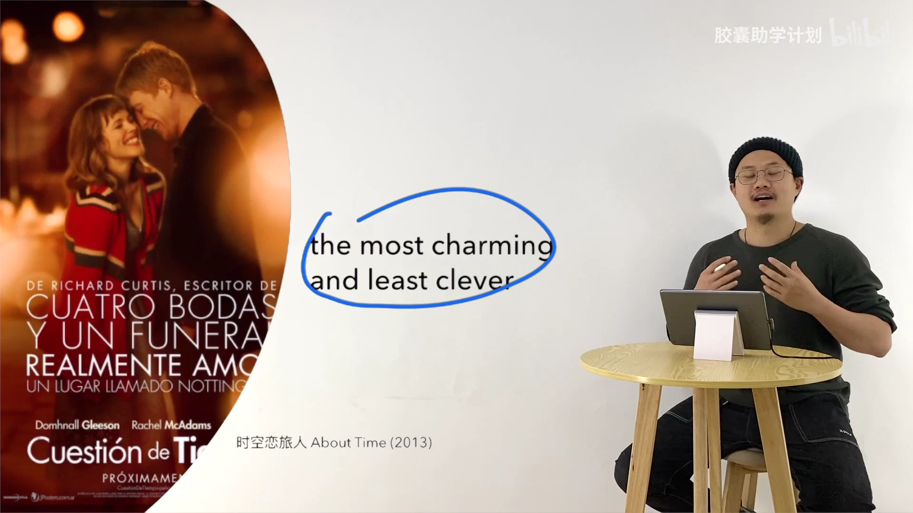

文字识别：胶囊助学计划 / the / most / charming / and least / clever / DE RICHARD CURTIS,ESCRITOR DE / CUATRO BODAS / YUN FUNERA / REALMENTE AMO / UN LUGAR LLAMADO NOTTING / Domhnall Gleeson / Rachel McAdams / Cuestión de1 / Ti / 时空恋旅人About Time(2013) / PROXIMAME

### 画面 00:03:40

文字识别：胶囊助学计划 / the / most / charming / and least / clever / DE RICHARD CURTIS, ESCRITOR DE / CUATRO BODAS / YUN FUNERA / REALMENTE AMO / UN LUGAR LLAMADO NOTTING / Domhnall Gleeson / Rachel McAdams / Cuestión de / Ti / 时空恋旅人About Time(2013) / PROXIMAME

### 画面 00:03:45

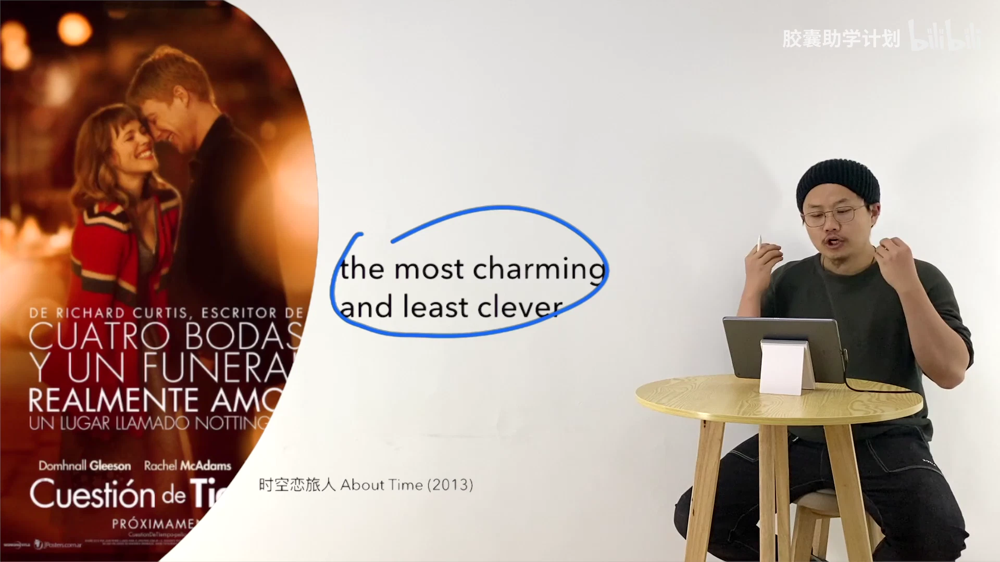

文字识别：胶囊助学计划 / the / most / charming / and least / clever / DE RICHARD CURTIS, ESCRITOR DE / CUATRO BODAS / YUN FUNERA / REALMENTE AMO / UN LUGAR LLAMADO NOTTING / Domhnall Gleeson / Rachel McAdams / Cuestiónde / Ti / 时空恋旅人About Time(2013) / PROXIMAME

### 画面 00:03:50

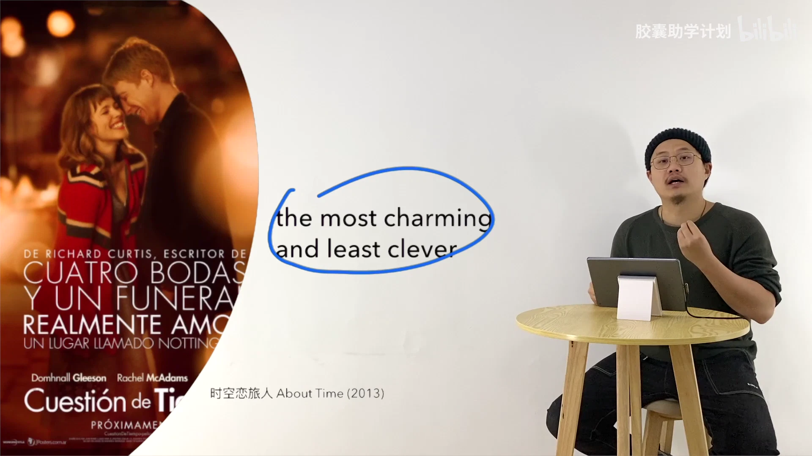

文字识别：胶囊助学计划 / the / most / charming / and least / clever / DE RICHARD CURTIS,ESCRITOR DE / CUATRO BODAS / YUN FUNERA / REALMENTE AMO / UN LUGAR LLAMADO NOTTING / Domhnall Gleeson / Rachel McAdams / Cuestión de / Ti / 时空恋旅人About Time(2013) / PROXIMAME

### 画面 00:03:55

文字识别：胶囊助学计划 / the / most / charming / and least clever / DE RICHARD CURTIS,ESCRITOR DE / CUATRO BODAS / YUN FUNERA / REALMENTE AMO / UNLUGAR LLAMADO NOTTING / Domhnall Gleeson / Rachel McAdams / Cuestiónde / Ti / 时空恋旅人About Time(2013) / PROXIMAME

## 00:04:00–00:04:30

tennis. Then there was Mum's brother, Uncle Desmond. Always impeccably dressed, he spent the days just, well, being Uncle Desmond. He was the most charming and least clever man you could ever meet. Okay,你看说He was the most charming and least clever man in my family,对吧？Okay,说最有魅力，但是呢又好像最不聪明的一个人。Very good.那接下来我们刚刚见到了，我们立刻就在

### 画面 00:04:00

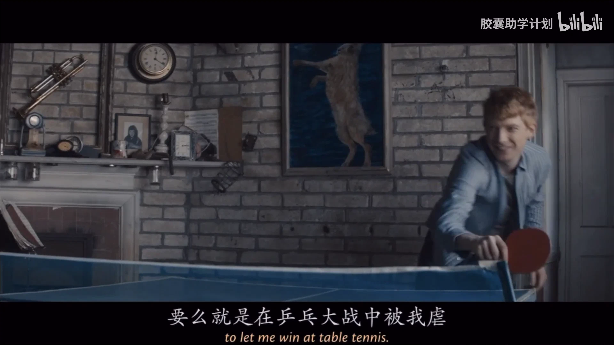

文字识别：bilbli / 胶囊助学计划 / 要么就是在乒乓大战中被我虐 / to let me win at table tennis.

### 画面 00:04:02

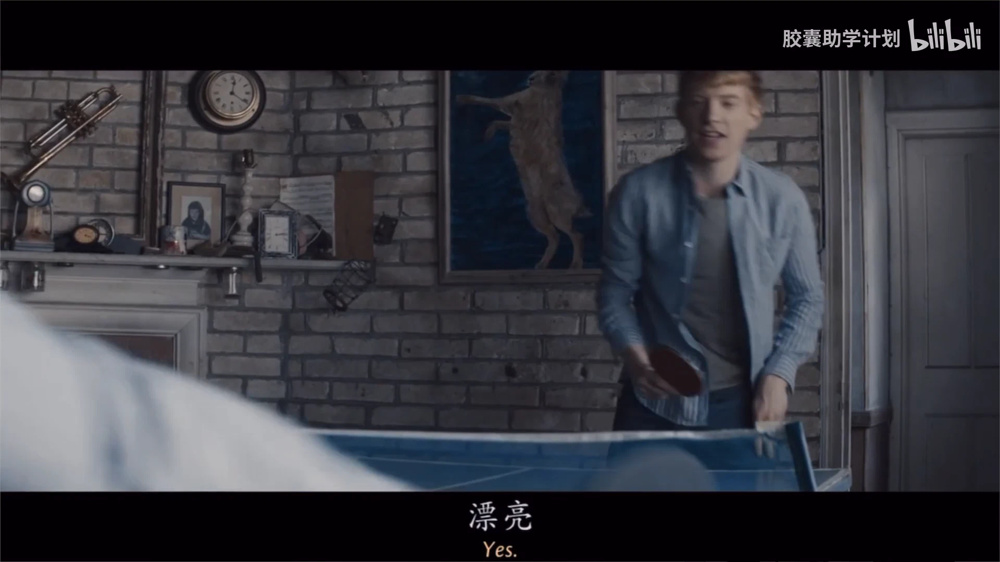

文字识别：Bilibili / 胶囊助学计划 / 漂亮 / Yes.

### 画面 00:04:04

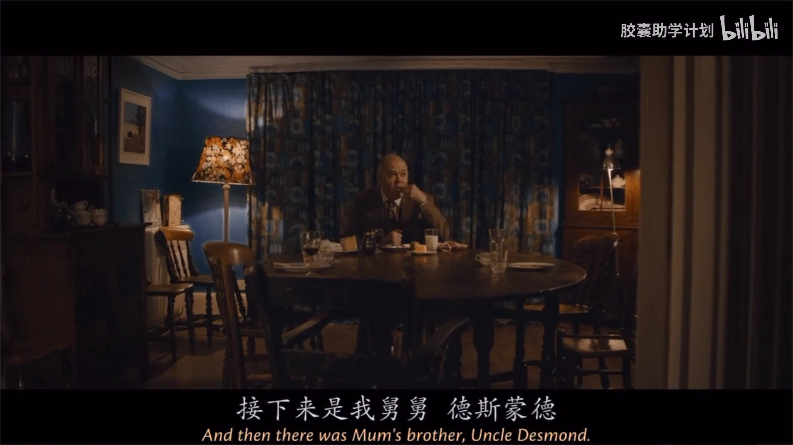

文字识别：bilibli / 胶囊助学计划 / 接下来是我舅舅德斯蒙德 / And then there was Mum's brother, Uncle Desmond.

### 画面 00:04:06

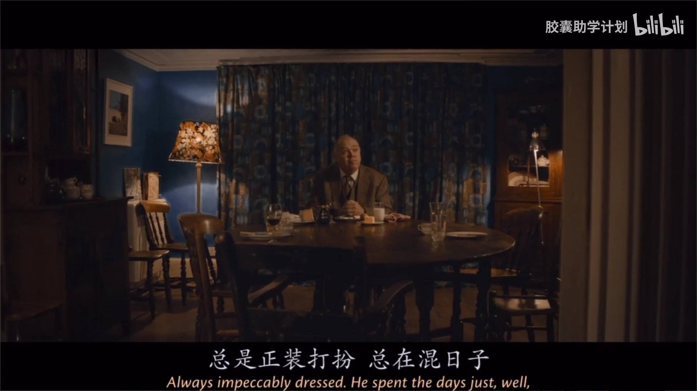

文字识别：bilibli / 胶囊助学计划 / 总是正装打扮总在混日子 / Always impeccably dressed. He spent the days just, well,

### 画面 00:04:08

文字识别：bilibli / 胶囊助学计划 / 总是正装打扮总在混日子 / Always impeccably dressed. He spent the days just, well,

### 画面 00:04:10

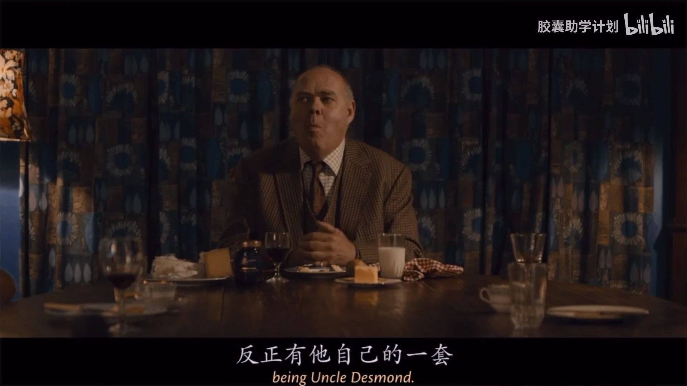

文字识别：Bilbli / 胶囊助学计划 / 反正有他自己的一套 / being Uncle Desmond.

### 画面 00:04:12

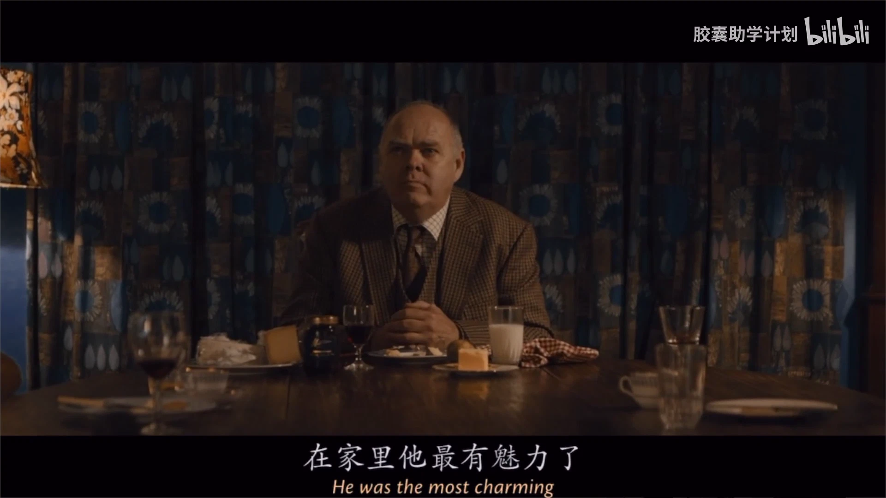

文字识别：bilbli / 胶囊助学计划 / 在家里他最有魅力了 / He was the most charming

### 画面 00:04:14

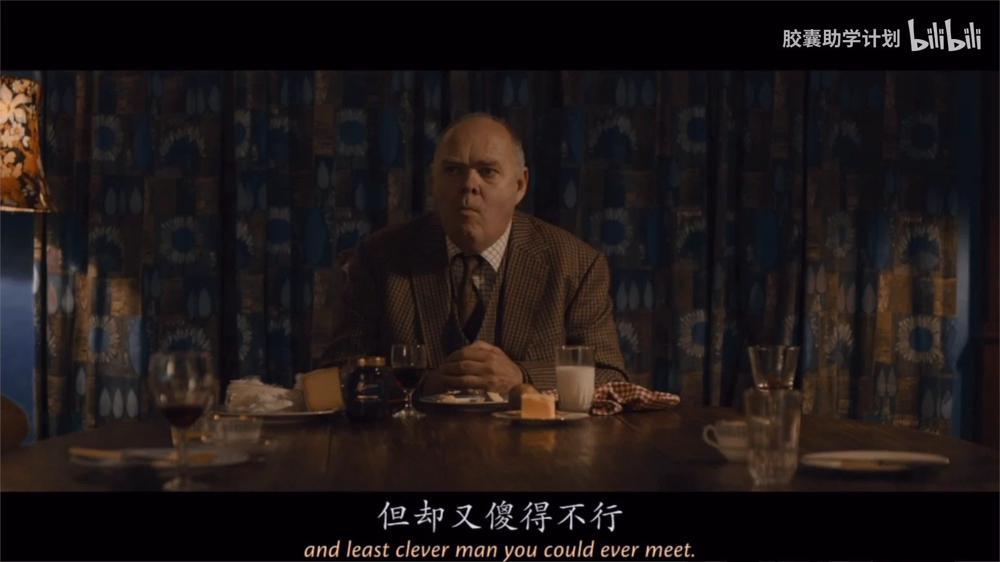

文字识别：bilbli / 胶囊助学计划 / 但却又傻得不行 / and least clever man you could ever meet.

### 画面 00:04:16

文字识别：胶囊助学计划 / the most charming / and least clever / DE RICHARD CURTIS,ESCRITOR DE / CUATRO BODAS / YUN FUNERA / REALMENTE AMO / UN LUGAR LLAMADO NOTTING / Domhnall Gleeson / Rachel McAdams / Cuestión de1 / Ti / 时空恋旅人About Time(2013) / PROXIMAME

### 画面 00:04:18

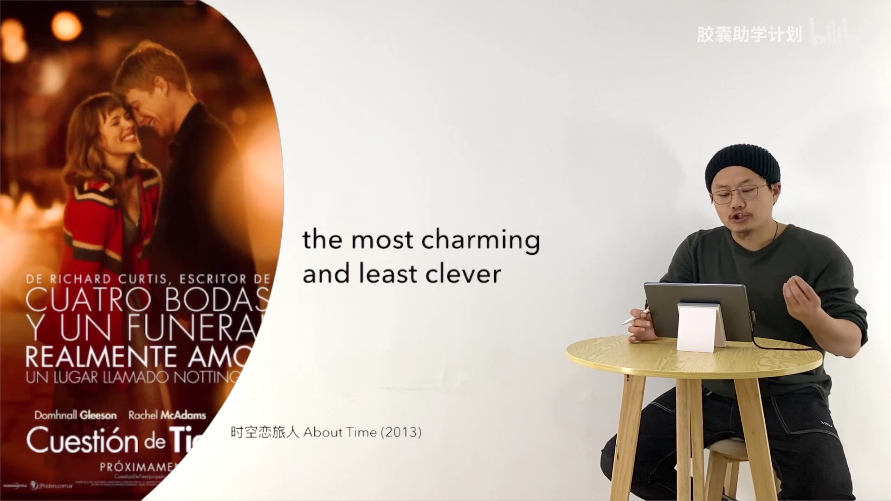

文字识别：胶囊助学计划 / the most charming / and least clever / DE RICHARD CURTIS,ESCRITOR DE / CUATRO BODAS / YUN FUNERA / REALMENTE AMO / UN LUGAR LLAMADO NOTTING / Domhnall Gleeson / Rachel McAdams / Cuestiónde / Ti / 时空恋旅人AboutTime(2013) / PROXIMAME

### 画面 00:04:20

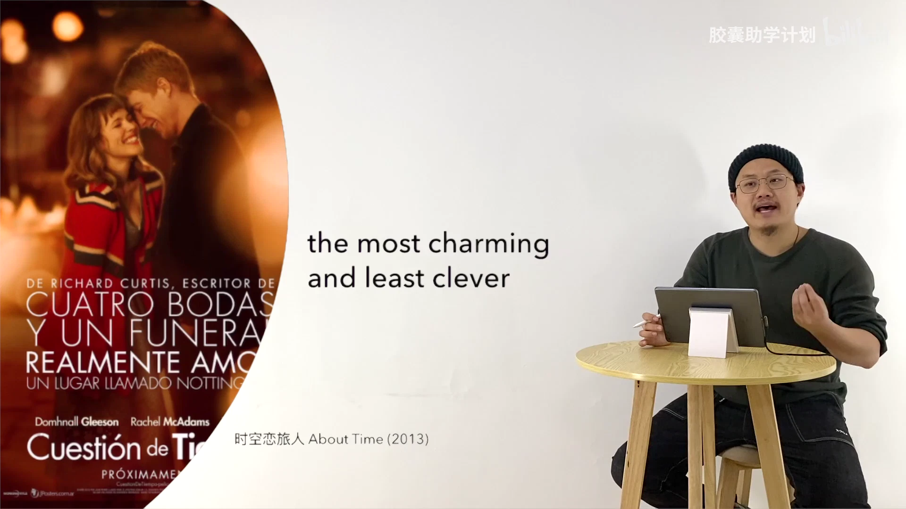

文字识别：胶囊助学计划 / the most  / charming / and least clever / DE RICHARD CURTIS,ESCRITOR DE / CUATRO BODAS / Y UN FUNERA / REALMENTE AMO / UN LUGAR LLAMADO NOTTING / Domhnall Gleeson / Rachel McAdams / Cuestión de / Ti / 时空恋旅人AboutTime(2013) / PROXIMAME

### 画面 00:04:25

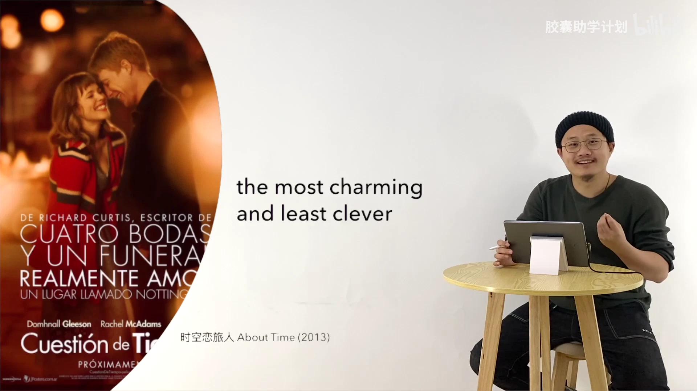

文字识别：胶囊助学计划 / the most charming / and least clever / DE RICHARD CURTIS,ESCRITOR DE / CUATRO BODAS / YUN FUNERA / REALMENTE AMO / UN LUGAR LLAMADO NOTTING / Domhnall Gleeson / Rachel McAdams / Cuestiónde / Ti / 时空恋旅人About Time(2013) / PRÓXIMAME

### 画面 00:04:27

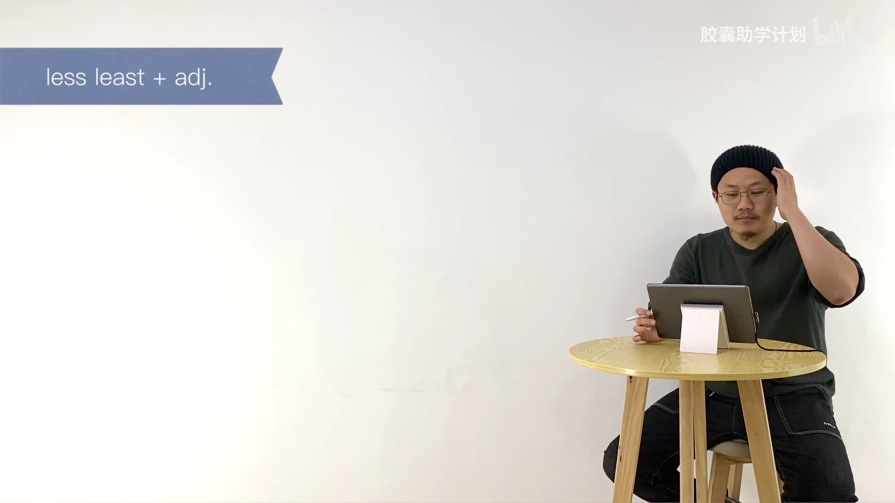

文字识别：胶囊助学计划 / less least + adj.

## 00:04:30–00:05:00

讲它，说叫做 less 和 least。刚才 more、 most 指的是更多，对吧？比如说您的 beautiful 度是三，那更多就是五啊，比如说最多就是十，对吧？那 less、 least 是什么呢？就是其实就是更少啊。所以我们先拿这儿，也是首先注意它是多音节形容词。多音节的定义叫再说一遍，音节数大于等于二。前面加 less 或 least 表示较少。我举个例子，比如说 beautiful

### 画面 00:04:31

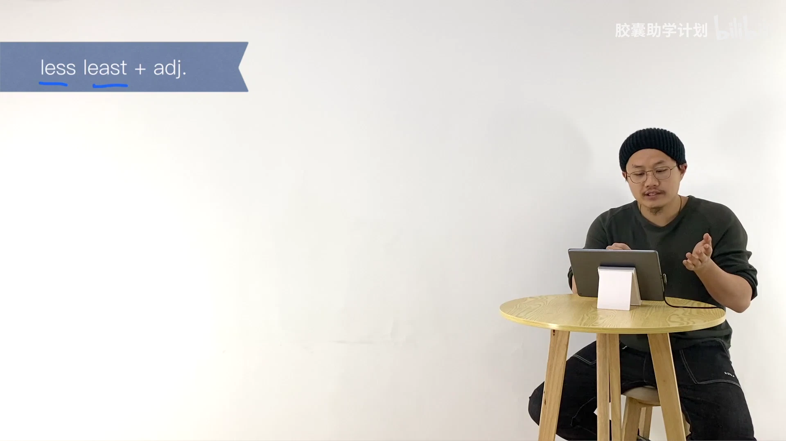

文字识别：胶囊助学计划 / less least + adj.

### 画面 00:04:52

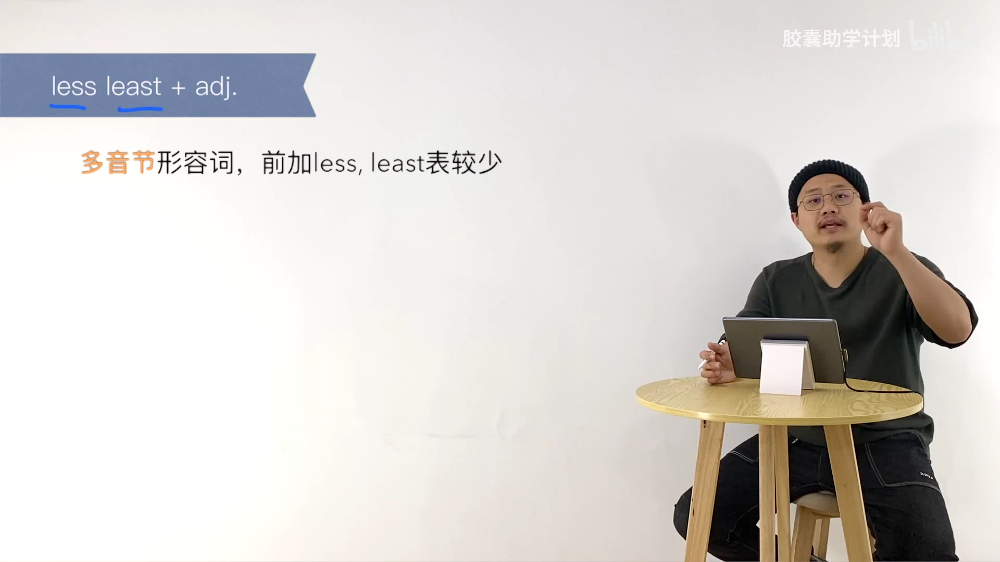

文字识别：胶囊助学计划 / less least + adj. / 多音节形容词，前加less,least表较少

## 00:05:00–00:05:30

啊，我们举个例子，一个姑娘很漂亮，我们给她假设打一个分儿，或者给一个小伙子漂亮，对吧？打个分儿叫七分儿。然后呢，说另外一个人叫 less beautiful，哎，他不一定是丑，各位想这个逻辑啊，不如她漂亮，不代表就是丑。这个世界上不是只有漂亮和丑的，对吧？还有很多介于中间的。说这个姑娘是 beautiful 七分，那另一个姑娘，比如说是五，啊，这个对吧？就是某些网站，各位想一下，早

### 画面 00:05:22

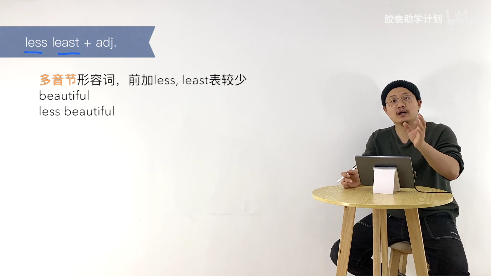

文字识别：胶囊助学计划 / less least + adj. / 多音节形容词，前加less,least表较少 / beautiful / less beautiful

## 00:05:30–00:06:00

年啊啊，对吧，是吧？脸书啊，这个网站早年那个电影不就是这样讲吗？给大家打个评分，是吧？那 least beautiful 就变成了，比如说五啊，然后呢， the least beautiful 那可能指的是，比如说这五个姑娘，她是相对来说最不漂亮的那个，但你不能说她叫丑，各位能理解哈？你要由现实情况去决定，比如说选美啊，冠亚季军，那季军我们在选美过程当中可能认为她就是 the least beautiful 在这三个

### 画面 00:05:52

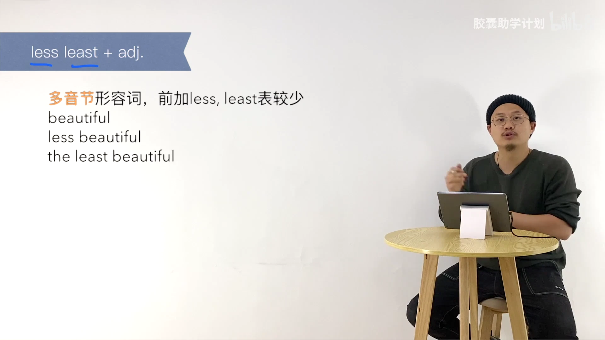

文字识别：胶囊助学计划 / less least + adj. / 多音节形容词，前加less,least表较少 / beautiful / less beautiful / the least beautiful

## 00:06:00–00:06:30

can you say the runner-up in the beauty pageant is ugly? I believe this is definitely not a conclusion, right? Then we are still, for example, expensive

### 画面 00:06:21

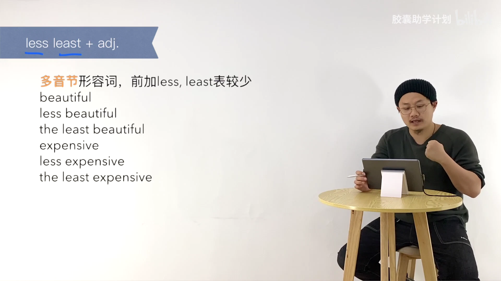

文字识别：胶囊助学计划 / less least + adj. / 多音节形容词，前加less,least表较少 / beautiful / less beautiful / the least beautiful / expensive / less expensive / the least expensive

## 00:06:30–00:07:00

叫做 the least expensive 啊，这是我们店里最不贵的那一双了，两千块钱。您要是实在买不了，那就算了。各位能理解这个逻辑哈？OK，它不代表就是便宜了，它只是要少一点点。OK，好，比如说我们尝试去拿三个电影，对吧？首先第一个，我个人很喜欢叫 Life of Pi，李安的一部电影。我们管他说 Life of Pi is interesting，我们就说这个电影很有趣。比如说十分，我们给它打九分啊。

### 画面 00:06:45

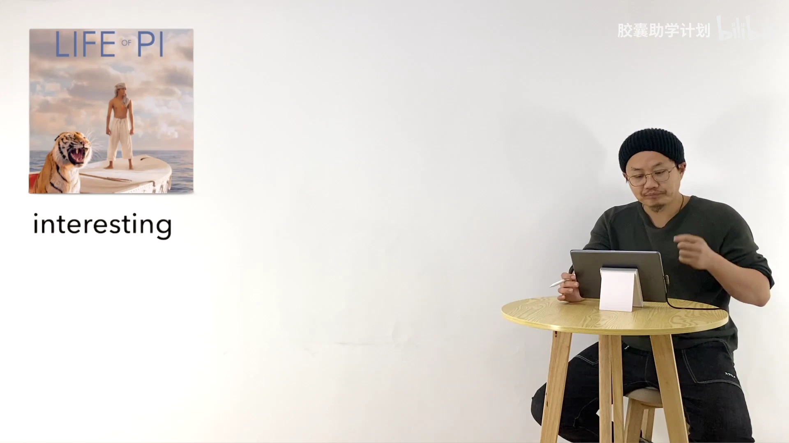

文字识别：胶囊助学计划 / LIFE*PI / interesting

## 00:07:00–00:07:30

然后下一部电影啊，我没记错的是《理智与情感》啊，说 this movie is less interesting。说这个电影在我看起来要无趣那么一点点，但不代表它无趣，就没那么有趣，对吧？比如说它是打个八分，对吧？也算不错了。那最后一个，比如说《卧虎藏龙》，我说 this movie is the least interesting movie of Li Wan of I've ever seen，啊，对吧？这是我看过李安所有电影当中可能最

### 画面 00:07:00

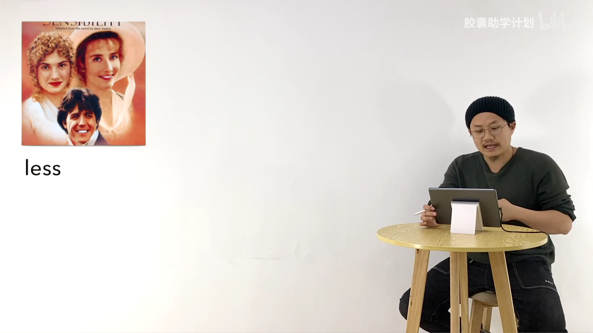

文字识别：胶囊助学计划 / DILII / Adapted from the novel by Jane / less

### 画面 00:07:03

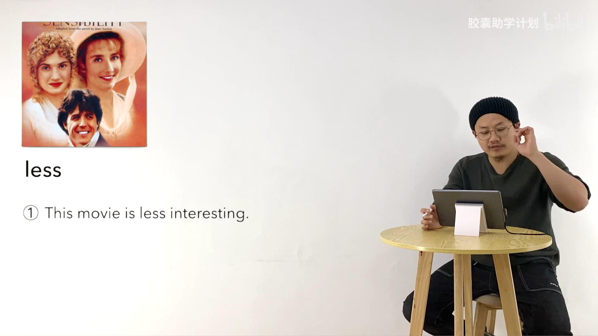

文字识别：胶囊助学计划 / DILII / Adapted from the novel by Jane Aute / less / This movie is less interesting.

### 画面 00:07:06

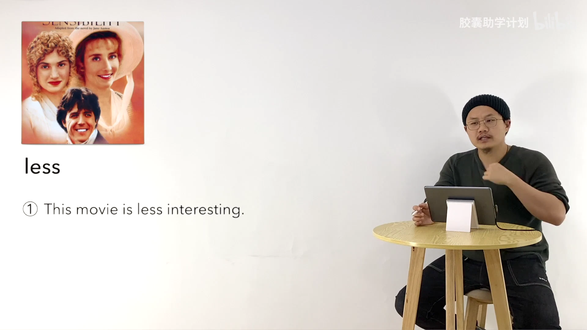

文字识别：胶囊助学计划 / OILII / Adapted from the novel by Jane / less / This movie is less interesting.

### 画面 00:07:10

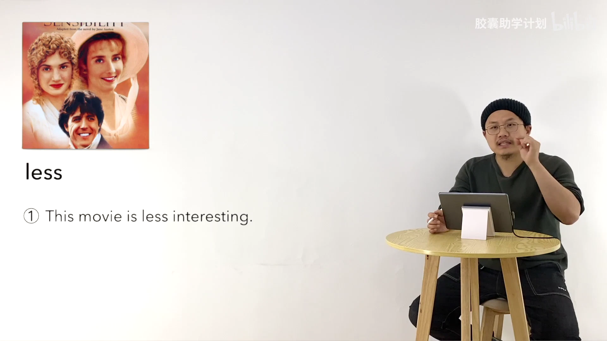

文字识别：胶囊助学计划 / JILII / Adapted from the novel by Jane Austen / less / This movie is less interesting.

### 画面 00:07:15

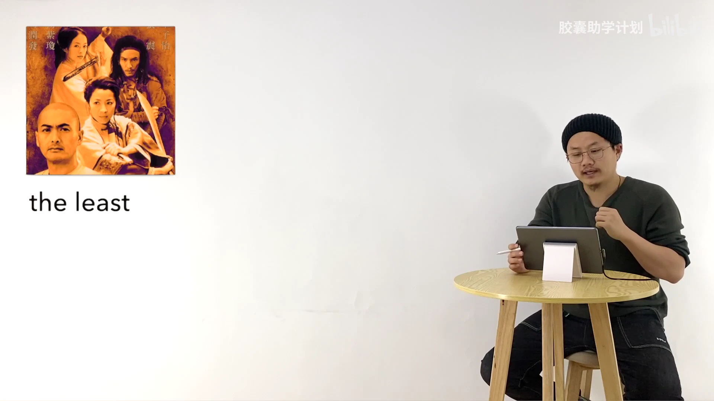

文字识别：胶囊助学计划 / 紫瓊 / the least

### 画面 00:07:18

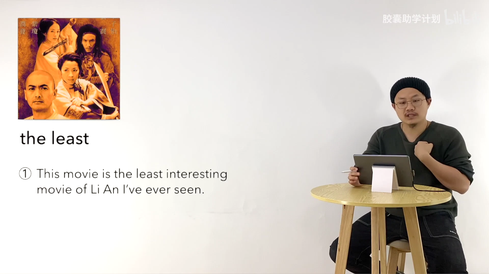

文字识别：胶囊助学计划 / 紫瓊 / the least / This movie is the least interesting / movie of Li An I've ever seen.

### 画面 00:07:20

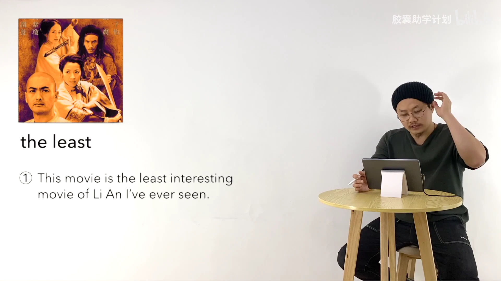

文字识别：胶囊助学计划 / 润發 / 紫 / the least / This movie is the least interesting / movie of Li An I've ever seen.

### 画面 00:07:28

文字识别：胶囊助学计划 / 调骏 / the least / This movie is the least interesting / movie of Li An I've ever seen.

## 00:07:30–00:08:00

让我觉得不是那么感兴趣，相对来说最不是最有意思的一个电影啊，或者说最没意思的一个电影。但是你要去想，你在这么去表达的时候，不一定就是指的是这个电影很烂，对吧？比如说我们说他所有的电影都在假设啊八分到九分之间，那这个电影我给打了七分，其实还是一个合格的分，对吧？但是对于李安的所有电影而言，他可能就是一个最无趣的，但是它依旧是七分。你客观上去评判

### 画面 00:07:38

文字识别：胶囊助学计划 / 调發 / 紫瓊 / the least / This movie is the least interesting / movie of Li An I've ever seen.

### 画面 00:07:43

文字识别：胶囊助学计划 / 潤發 / 紫迎 / the least / This movie is the least interesting / movie of Li An I've ever seen.

### 画面 00:07:53

文字识别：胶囊助学计划 / 润發 / the least / This movie is the least interesting / movie of Li An I've ever seen.

## 00:08:00–00:08:30

它，不能认为它是无趣，各位能理解了哈。OK，它依旧是 interesting，只不过是它所有电影当中的 least interesting movie。OK，玩一个，刚才讲过了四个单词 more， most， less， least，全是我们尝试加在形容词的前面去用的，对吧？表示更多、最多或者更少、最少。接下来我们再看一个，这个呢对于各位来说跟汉语稍有不同，叫做 as . . . . . .

### 画面 00:08:04

文字识别：胶囊助学计划 / 调發 / 紫隍 / the least / This movie is the least interesting / movie of Li An I've ever seen.

### 画面 00:08:09

文字识别：胶囊助学计划 / as...as

### 画面 00:08:13

文字识别：胶囊助学计划 / as...as

### 画面 00:08:25

文字识别：胶囊助学计划 / as...as

## 00:08:30–00:09:00

点点点 as。我们先看它是什么，我们先尝试熟悉结构，对吧？比如说 expensive，这不是一句话，我们只是放到这个地方。您现在能看到我们把 expensive 放在了 as as 的中间，看见了哈？比如说再来说 beautiful，哎， as beautiful as 还是给它放到了中间，没问题吧？OK，那它真是变成一个句子，长什么样呢？是这个样子，The blue car is as clean as the red car。

### 画面 00:08:39

文字识别：胶囊助学计划 / as...as / expensive → as / expensive / as

### 画面 00:08:51

文字识别：胶囊助学计划 / as...as / expensive → as / expensive / as / beautiful → as / beautiful as / The blue car is as clean as the red car.

### 画面 00:08:56

文字识别：胶囊助学计划 / as...as / expensive / → as / expensive / as / beautiful / →as / beautitul as / The blue car is as clean as the red car.

### 画面 00:08:59

文字识别：胶囊助学计划 / as...as / expensive / →as / expensive / as / beautiful / →as / beautitul as / The blue car is as / clean/as the red car.

## 00:09:00–00:09:30

看我一下，看一下我这个断句。我们先把第一个 as 去掉，说 the blue car is clean，叫做这辆蓝车是干净的。咱先不管 as。第二个 as 我们也先暂时把它去掉，后边就只有一辆叫红车。好像尝试现在在告诉你，第一个信息叫蓝车很干净，第二个信息告诉你还有一辆红车。那我们再把这两个 as as 给它加上，这句话

### 画面 00:09:05

文字识别：胶囊助学计划 / as...as / expensive / → / as / expensive / as / beautiful / → / as / beautitul as / The blue / caris / clean/as the red car.

### 画面 00:09:16

文字识别：胶囊助学计划 / as...as / expensive / → / as / expensive / as / beautiful / → / as / beautitul as / The / blue / caris / cleano / the red car.

### 画面 00:09:28

文字识别：胶囊助学计划 / as...as / expensive / e→ as / expensive / as / beautiful / →as / beautitul as / The blue car is as  / clean/as the red car.

## 00:09:30–00:10:00

您就好理解了。第一个as，你可以把它尝试去理解为叫做同样的啊，比如说the blue car is as clean。第一句话您就这么去理解，说这辆蓝车呀是同样的干净。第二个as呢，虽然长得一样，但它含义是不同的。您把它翻译成像，有点像like啊，like的介词用法叫做呃as the red car叫做像这一辆红

### 画面 00:09:58

文字识别：胶囊助学计划 / as...as / expensive → as / expensive / as / beautiful / →as / beautitul as / The blue car is as / clean/as the red car.

## 00:10:00–00:10:30

所以呢，我们尝试把它串起来，看您能不能猜出来它这个 as 对吧？ as as 是什么意思？说这辆红车是同样的干净，像这啊这辆蓝车是同样的干净，像这一辆红车，其实就是这辆蓝车和这辆红车是同样的干净，所以 as 形容词 as 表示的是他们同样的怎么怎么样。 OK，比如说我们再拿一些例子啊，就所以在这写了叫 A 和 B 在某些点上是

### 画面 00:10:28

文字识别：胶囊助学计划 / as...as / expensive / as / expensive / as / beautiful / → as / beautitul as / The / blue / car is as / clean/as the red car. / 和.相同

## 00:10:30–00:11:00

相同的，我们再拿更多的例子往里去带，各位好容易理解。比如说，我们汉语当中说“蠢如驴”，对吧？说“你蠢如驴”，你这个往往我们可以不加，或者“他蠢如驴”，对吧？那他和驴A和B两个东西，他们共同的特点是什么呢？叫做“蠢”啊。我们实际上是想说他有多蠢呢？他蠢的跟驴一样，对吧？说我们换另一个思路，就是他俩共同的特质是都

### 画面 00:10:30

文字识别：胶囊助学计划 / as...as / expensive → as expensive as / beautiful → as beautiful as / The blue car is as clean as the red car. / ..和..相同

### 画面 00:10:33

文字识别：胶囊助学计划 / as..as

### 画面 00:10:47

文字识别：胶囊助学计划 / as..as / ① He is as stupid as a donkey.

## 00:11:00–00:11:30

蠢，对不对？然后我们就尝试拆一下这句话啊，他是蠢的，那 as stupid 叫同样的蠢的。你看，我问你一个问题，我说他同样的蠢，你一定想问我一个问题，叫你这句话没说完，叫同什么一样的蠢？我就说像驴一样的蠢，能理解哈？所以这句话就变成了 he is as stupid as a donkey，是吧？他是同驴一样的蠢的。

### 画面 00:11:03

文字识别：胶囊助学计划 / as..as / ① He is as stupid as a donkey.

### 画面 00:11:19

文字识别：胶囊助学计划 / as..as / ①He is as stupid as a donkey.

## 00:11:30–00:12:00

Okay，我们再往下走。比如说，She is as beautiful as an angel.哎，这个是英文当中还挺常见，在基督教文化当中非常常见的一个表达，说她美的像天使一样。She is as beautiful as an angel. Okay，各位看，as as，对吧？您先把这儿加一个斜线，说She is as beautiful，她是同样的美了。那我就会问你，她同谁一样的美啊？她同天使一样的美，像天使一样，对吧？她美的像天使一样啊！不知道各位

### 画面 00:11:31

文字识别：胶囊助学计划 / as.as / ① She is as beautiful as an angel.

### 画面 00:11:47

文字识别：胶囊助学计划 / as..as / ① She is as beautiful as an angel.

## 00:12:00–00:12:30

这个到目前为止找没找到感觉啊？我们再来一个，He is as slow as a snail. Okay, so this is a snail. 我就不说它是什么了啊。说还是同理，说它是同样的缓慢，同样的慢啊！这人太肉了，肉的跟蜗牛一样，as a snail，它是同样的慢。你会问我一个问题，同谁一样的慢呢？As a snail，像蜗牛一样的慢。Okay，玩一个，

### 画面 00:12:01

文字识别：胶囊助学计划 / as..as

### 画面 00:12:07

文字识别：胶囊助学计划 / as..as / ① He is as slow as a snail.

### 画面 00:12:12

文字识别：胶囊助学计划 / as..as / ① He is as slowas a snail.

### 画面 00:12:18

文字识别：胶囊助学计划 / as..as / ① He is as slowas a snail.

### 画面 00:12:29

文字识别：胶囊助学计划 / as..as

## 00:12:30–00:13:00

再来一个。比如说，我们说pregnant woman啊，说怀孕的女人像什么一样美呢？像花一样的美。怀孕的女人，鲜花啊。然后它们的共同特征是什么呢？Beautiful.然后用as as连起来了。所以，我们尝试这样给它断一下句。怀孕的女人是同样的美，像谁呢？像一个朵花，是吧？美的像朵花，是吧？汉语也这样说，对吧？英文用

### 画面 00:12:34

文字识别：胶囊助学计划 / as.as / ① Pregnant womanis as beautiful as a / flower.

### 画面 00:12:36

文字识别：胶囊助学计划 / as..as / Pregnant womani / is as beautiful as a / flower.

### 画面 00:12:47

文字识别：胶囊助学计划 / as.as / ① Pregnant woman is as beautiful as a / flower.

### 画面 00:12:50

文字识别：胶囊助学计划 / as.as /  Pregnant woman is as beautifulas a / flower.

### 画面 00:12:52

文字识别：胶囊助学计划 / as.as /  Pregnant woman is as beautifulas a / flower.

### 画面 00:12:57

文字识别：胶囊助学计划 / as.as / Pregnant woman is as beautifulas a / flower.

## 00:13:00–00:13:30

as 形容词 as， OK。刚才我们讲的是 as as 的肯定，巧了，它肯定也有否定，它的否定很简单，前面加一个 not。我们尝试看一下，否定 as 形容词 as 前面加了一个 not，它其实想说的是 a 不如 b。比如说，我们举个例子，说 the blue car is not as clean as the red car。同理，跟刚才处理方式一样，我们先把前面 as 先去掉，说 the

### 画面 00:13:02

文字识别：胶囊助学计划 / not as...as

### 画面 00:13:06

文字识别：胶囊助学计划 / not as...as

### 画面 00:13:19

文字识别：胶囊助学计划 / not as...as / 否定: not as adj. as ….不如.….. / The blue car is not as clean as the red car.

### 画面 00:13:22

文字识别：胶囊助学计划 / not as...as / 否定: not as adj. as ….不如.…. / The blue car is not as clean as the red car.

### 画面 00:13:24

文字识别：胶囊助学计划 / not as...as / 否定: not as adj. as ….不如../ / The blue car is not as cleanas the red car.

### 画面 00:13:29

文字识别：胶囊助学计划 / not as...as / 否定: not as adj. as / .不如./ / The blue car is not / clean as the red car.

## 00:13:30–00:14:00

blue car is not clean。那这句话的意思很简单，叫做蓝车不干净。后边车后边提供了另一个信息，叫红车，对吧？那这两个 as 就非常的重要，不能删掉，删掉了你就不明白这句话什么意思了。第一个信息提供的叫做哎蓝车不干净，对吧？第二个信息提供的叫做红车，这不是一个句子，我们要把它变成一个句子，怎么变呢？蓝车不是同样

### 画面 00:13:34

文字识别：胶囊助学计划 / not as...as / 否定: not as adj. as / .不如 / The blue car is not / cleanas the red car.

### 画面 00:13:36

文字识别：胶囊助学计划 / not as...as / 否定: not as adj. as / .不如… / The blue car is not / cleanas the red car.

### 画面 00:13:40

文字识别：胶囊助学计划 / not as...as / 否定: not as adj. as ….不如../ / The blue car is not as cleanas the red car.

### 画面 00:13:59

文字识别：胶囊助学计划 / not as...as / 否定: not as adjの…不如… / The blue car is not as cleanas the red car.

## 00:14:00–00:14:30

的干净，像红车一样，蓝车不是同样的干净，像红车那样。A不如B，那叫做蓝车不如红车干净，对吧？OK，比如说我们再来啊，造句子。The woman is not as tall as the man。我们看这个图，我们先看前面说的woman is not as tall，不是同样的高，

### 画面 00:14:02

文字识别：胶囊助学计划 / not as...as / 否定: not as adja….不如…/ / The blue car is not as clean as the red car.

### 画面 00:14:09

文字识别：胶囊助学计划 / not as...as / 否定notas adja…不如./ / The blue ca is not as clean as the red car.

### 画面 00:14:11

文字识别：胶囊助学计划 / not as...as / 定not as adjas …不如… / 不 / The blue ca / Mis not as cleanas the red car.

### 画面 00:14:14

文字识别：胶囊助学计划 / not as...as(tall)

### 画面 00:14:26

文字识别：胶囊助学计划 / not as....as(tall) /  The woman is not as tall as the man.

## 00:14:30–00:15:00

像这个男人那么高，男人这么高，他没有他高，A不如B，对吧？A前面是A，后边是B，A不如B高。OK，好了，再来。比如说，the left dog is not as big as the right dog. A不如B，在哪个点上呢？在大这个点上，叫做左边的狗不是同样的大，不如右边的狗大。A不如

### 画面 00:14:30

文字识别：胶囊助学计划 / not as...as(tall) / The woman is not as tallas the man.

### 画面 00:14:36

文字识别：胶囊助学计划 / not as...as(tall) / fhe woman is not as tall/as the man.

### 画面 00:14:38

文字识别：胶囊助学计划 / not as..as(tall) / fhe womanis not as tallas the man.

### 画面 00:14:40

文字识别：胶囊助学计划 / not as..as(tall) / fhe woman is not as tallas the man.

### 画面 00:14:43

文字识别：胶囊助学计划 / not as...as(big) / D The left dog is not as big as the right dog.

### 画面 00:14:48

文字识别：胶囊助学计划 / not as....as (big) / The left dog is not as big as the right dog.

### 画面 00:14:50

文字识别：胶囊助学计划 / not as....as ( big) / The left dog is not as big as the/right dog.

### 画面 00:14:55

文字识别：胶囊助学计划 / not as...as (big) / The left dog ishot as /  big a theright dog.

### 画面 00:14:57

文字识别：胶囊助学计划 / not as...as (big) / The left dog ishot as /  big a theright dog.

### 画面 00:14:59

文字识别：胶囊助学计划 / not as.as(big) / The left dog isnot as / s big a theright dog.

## 00:15:00–00:15:30

好，再来一个，比如说，the left man，A左边这个男人不如B右边这个男人瘦，好理解吧？OK，再来，the left river啊，这张图我很喜欢，这是我们重庆是吧？这是重庆的这个长江和嘉陵江交接处是吧？然后呢，我们说left river左面不是同样的干净，像右面这条河对吧？那我们就用的是clean啊，它其实

### 画面 00:15:01

文字识别：胶囊助学计划 / not as...as(strong) / ① The left man is not as thin as the right man.

### 画面 00:15:03

文字识别：胶囊助学计划 / not as..as(strong) / he left mah is not as thin as the right man.

### 画面 00:15:05

文字识别：胶囊助学计划 / Aas(strong) / not as., / Zhe left mah is not as thin as the right man.

### 画面 00:15:07

文字识别：胶囊助学计划 / Aas(strong) / not as. / The left mah is no as thin as the right man,

### 画面 00:15:10

文字识别：胶囊助学计划 / Aas(strong) / not as. / The left man is no( as thin as the right man.

### 画面 00:15:12

文字识别：胶囊助学计划 / not as....as(clean) /  The left river is not as clean as the right river.

### 画面 00:15:14

文字识别：胶囊助学计划 / not as..as(clean) / The left river ls not as clean as the right river.

### 画面 00:15:16

文字识别：胶囊助学计划 / not as...as(clean) / The left river ls not as clean as the right river.

### 画面 00:15:25

文字识别：胶囊助学计划 / not as...as(clean) / The left rivers not as clean as the right river.

### 画面 00:15:27

文字识别：胶囊助学计划 / not as...as(clean) / The left river ls not as clean as the right river.

## 00:15:30–00:16:00

是浑浊，不一定是干净，对吧？那我们就说 a 不如 b 干净，a 左边的那条河，b 右面的那条河。 OK，玩一个。那本课的语法就是刚才我说这些，更多呢，我们进入文章和练习当中继续再去看。接下来我们先看一下本课的单词。第一个单词跟我一起读一下，叫做 model。 model。 OK， model，其实对于大家来说可能很容易理解，就是它是模特。我们汉语的模特直接是从 model

### 画面 00:15:32

文字识别：胶囊助学计划 / .as(clean) / not as. / The left river ls not as clean as the right river.

### 画面 00:15:34

文字识别：胶囊助学计划 / .as(clean) / not as. / The left river ls not as clean as the right river.

### 画面 00:15:39

文字识别：胶囊助学计划 / /'mpdal/ / model n.

### 画面 00:15:55

文字识别：胶囊助学计划 / /'mpdal/ / model n.

## 00:16:00–00:16:30

音译过来的，可以这样去理解啊。那 model 其实最本质的意思指的是模型啊，模型，比如说汽车模型啊，比如说 this is a car model，这是一个小孩玩的汽车模型。再来，比如说 my car model is bigger than yours，说我的汽车模型啊要比你的更大。一百零七课的核心句型，对吧？我们还是那句话，单词五个点，拼写、词性、发音、含义，

### 画面 00:16:13

文字识别：胶囊助学计划 / /'mpdal/ / model n. / D This is a car model. / 1 / ② My car model is bigger than yours.

### 画面 00:16:20

文字识别：胶囊助学计划 / /'mpdal/ / model n. / ① This is a car model. / ② My car model is bigger than yours.

## 00:16:30–00:17:00

这些都是对于各位来说最显而易见的，也是很多同学最关心的啊。比如说您问我单词该怎么背，对吧？我说的是这些四个东西固然重要，但最重要的其实是如何拿这个单词去造句。那造句，我们学了那么多句型和别的词性，就是用来造句的。比如说 My car model is bigger than yours，一百零七课的句型，对吧？再来，比如说 My son wants to buy want to do something，想去

### 画面 00:16:50

文字识别：胶囊助学计划 / /'mpdal/ / model n. / ① This is a car model. / ② My car model is bigger than yours.

### 画面 00:16:58

文字识别：胶囊助学计划 / /'mpdal/ / model n. / This is a car model. /  My car model is bigger than yours. /  My son wants to buy a car model.

## 00:17:00–00:17:30

做某件事情，想买一个汽车模型。再来，I think that this car model is too expensive. 太贵了。说我认为啊，说这个汽车模型太贵了。你看两个小点，一百零三克，不加形容词，九十九克。I think that 后边加了一个宾语从句，对吧？Very good，真是 model。再来下一个单词叫 afford，叫支付得起 afford。比如说 is

### 画面 00:17:06

文字识别：胶囊助学计划 / /'mpdal/ / model n. / This is a car model. / My car model is bigger than yours. / My son wants to buy a car model. / I think that this car model is too / expensive.

### 画面 00:17:13

文字识别：胶囊助学计划 / /'mpdal/ / model n. / This is a car model. /  My car model is bigger than yours. / My  / ' son wants to buy a car model. / I think that this car model is too / expensive.

### 画面 00:17:17

文字识别：胶囊助学计划 / /'mpdal/ / model n. / This is a car model. / My /  car model is bigger than yours. / My / son / wants to buy a car model. / I think / that this car model is too / expensive.

### 画面 00:17:19

文字识别：胶囊助学计划 / /'mpdal/ / model n. / This is a car model. / 1 / My / car model is / bigger than yours. / My / son wants / to / buy a car model. / I think / that this car model is too / expensive.

### 画面 00:17:23

文字识别：胶囊助学计划 / /a'fo:d/ / afford v.

## 00:17:30–00:18:00

too expensive. I can't afford it.单词我们又造句了。我们还造了两句话连到一起，说它太贵了，以至于我支付不起。另一个方式叫做it's cheap enough，足够的便宜，我们能支付得起。We can afford that.张嘴跟我读啊！所有这些句子，各位要养成习惯。我读完，您在视频那边，视频的对面对吧？大声张开嘴跟我去朗读。再来下一个单词deposit.

### 画面 00:17:37

文字识别：胶囊助学计划 / /a'fo:d / / afford v. / ① It's too expensive.I can't afford it.

### 画面 00:17:40

文字识别：胶囊助学计划 / /a'fo:d/ / afford v. / ① It's too expensive.I can't afford it. /  It's cheap enough. We can afford that.

### 画面 00:17:43

文字识别：胶囊助学计划 / /a'fo:d / / afford v. / ① It's too expensive.I can't afford it. /  It's cheap enough. We can afford that.

### 画面 00:17:45

文字识别：胶囊助学计划 / /a'fo:d / / afford v. / ① It's too expensive.I can't afford it. /  It's cheap enough. We can afford that.

### 画面 00:17:56

文字识别：胶囊助学计划 / /dI'ppzIt/ / deposit n.

## 00:18:00–00:18:30

deposit deposit. Okay, deposit, 预付定款，预付定金。比如说，文章当中有一句话叫 "You can pay a deposit of thirty pounds." 你可以支付三十英镑的预付款。Okay, 那我们把它就可以变一般疑问句。原文给的这句话不是我们自己造的，但我们把原文这句话拿过来，给它变一变四

### 画面 00:18:01

文字识别：胶囊助学计划 / /dI'ppzit/ / deposit n.

### 画面 00:18:16

文字识别：胶囊助学计划 / /dI'ppzit/ / deposit n. / ①[Story]: You can pay / e deposit of thirty / pounds.

### 画面 00:18:19

文字识别：胶囊助学计划 / /dI'ppzit/ / deposit n. / ①[Story]: You can pay / a deposit of thirty / pounds.7 / Can I pay a deposit of thirty pounds?

### 画面 00:18:24

文字识别：胶囊助学计划 / /dI'ppzit/ / deposit n. / ①[Story]: You can pay / a deposit of thirty / pounds.7 / Can I pay a deposit of thirty pounds?

## 00:18:30–00:19:00

句型转化，就是我们自己造的了。比如说，Can I pay a deposit of thirty pounds? 我能支付一个三十磅的预付定金吗？好，再来，比如说我们换个时态，我们把 can 这个情态动词给它去掉，我们给它换个一般过去时的时态，变成了 He paid a deposit of thirty pounds. 他已经支付了三十磅的预付定款，对吧？肯定句您造出来了一个，您说这句话是不是咱自己造的？肯定句

### 画面 00:18:44

文字识别：胶囊助学计划 / /dI'pozIt/ / deposit n. / ① [Story]: You can paye deposit of thirty / pounds.7 / Can I pay a deposit of thirty pounds? / He paid a deposit of thirty pounds.

### 画面 00:18:48

文字识别：胶囊助学计划 / /dr'ppzit/ / deposit n. / ① [Story]: You can pay / a deposit of thirty / pounds.7 / Can I pay a deposit of thirty pounds? / He paid a deposit of thirty pounds. / 3

### 画面 00:18:50

文字识别：胶囊助学计划 / /dI'ppzit/ / deposit n. / ① [Story]: You can pay / a deposit of thirty / pounds. / Can I pay a deposit of thirty pounds? / He paid a deposit of thirty pounds. / 3

## 00:19:00–00:19:30

造出来了，你又可以造一般疑问句，叫做 Did he pay a deposit of thirty pounds? 他支付了三十磅的预付定款了吗？ Very good. 你看原文给了一，如果您按照我教各位的这个方式，我们就很轻松的可以叫举一反三，对吧？这是我们在视频当中跟大家提到的造句是我们非常重要的一个单词行为。 OK，好，下一个单词叫

### 画面 00:19:01

文字识别：胶囊助学计划 / /dI'ppzit/ / deposit n. / ① [Story]: You can pay / a deposit of thirty / pounds.7 / Can I pay a deposit of thirty pounds? / He paid a deposit of thirty pounds. / 3 / Did he pay a deposit of thirty pounds?

### 画面 00:19:08

文字识别：胶囊助学计划 / /dr'ppzit/ / deposit n. / ① [Story]: You can pay / a deposit of thirty / pounds.7 / ② Can I pay a deposit of thirty pounds? / ③He paid a deposit of thirty pounds / Did he pay a deposit of thirty pounds?

### 画面 00:19:11

文字识别：胶囊助学计划 / /dr'ppzit/ / deposit n. / ① [Story]: You can pay / a deposit of thirty / pounds.7 / ② /  Can I pay a deposit of thirty pounds? / ③He paid a deposit of thirty pounds. / Did he pay a deposit of thirty pounds?

### 画面 00:19:13

文字识别：胶囊助学计划 / /dr'ppzit/ / deposit n. / ① [Story]: You can pay / e deposit of thirty / pounds. / ② / Can I pay a deposit o / of thirty pounds? / ③He /  paid a deposit of thirty pounds. / Did he pay a deposit of thirty pounds?

### 画面 00:19:18

文字识别：胶囊助学计划 / /dI'ppzit/ / deposit n. / ① [Story]: You can pay / a deposit of thirty / pounds. / Can I pay a deposit c / of thirty pounds? / ③He / paid a deposit of thirty pounds. / Did he pay a deposit of thirty pounds?

### 画面 00:19:21

文字识别：胶囊助学计划 / /dI'ppzit/ / deposit n. / ① [Story]: You can pay / e deposit of thirty / pounds. / Can I pay a deposit of thirty pounds? / ② / ③He paid a deposit of thirty pounds. / Did he pay a deposit of thirty pounds

### 画面 00:19:27

文字识别：胶囊助学计划 / /in'sta:lmant/ / instalment

## 00:19:30–00:20:00

installment。这地方注意着话，installment。玩一个，原文直接给了我们一个习惯用法，叫 buy something on installments，买某个东西分期付款。刚才说的是预付定金，现在是分期付款，对吧？好，比如说 he bought this car on installments。原文给我们的是一个习惯用法，我们摘抄出来的，我们要给它加上时态去造句。

### 画面 00:19:30

文字识别：胶囊助学计划 / /in'sta:lmant/ / instalment

### 画面 00:19:34

文字识别：胶囊助学计划 / /In'sta:lmant/ / instalment / ① buy sth. on instalments.

### 画面 00:19:39

文字识别：胶囊助学计划 / /In'sta:lmant/ / instalment / ① buy sth. on instalments.

### 画面 00:19:42

文字识别：胶囊助学计划 / /In'sta:lmant/ / instalment / ① buysth. on instalments.

### 画面 00:19:44

文字识别：胶囊助学计划 / /In'sta:lmant/ / instalment / ① buy sth.on instalments.

### 画面 00:19:50

文字识别：胶囊助学计划 / /in'sta:lmant/ / instalment / ① buysth.on instalments. / He bught this car on instalments.

### 画面 00:19:52

文字识别：胶囊助学计划 / /in'sta:lmant/ / instalment / ① buy sth. on instalments. / He bought this car on instalments.

### 画面 00:19:54

文字识别：胶囊助学计划 / /in'sta:lmant/ / instalment / ①buy sth. on instalments. / He bought this car on instalments.

### 画面 00:19:56

文字识别：胶囊助学计划 / /in'sta:lmant/ / instalment / ①buy sth. on instalments2 / He bought this car on instalments.

## 00:20:00–00:20:30

这实际上是我们新概念二册第一课就要学到的一个，对吧？所以从现在开始，哎，我们在新一块学完的时候，我就陆陆续续把这些思路分享给各位。He bought this car on instalments。肯定句出来了，我们造句的一个最大的杀手锏就是各种句型的转变，对吧？Why did一般疑问句？Why did he buy this car on instalments？他为什么要分期付款买这辆车？他明明能全款嘛，他为什么要分期付款买呢？

### 画面 00:20:00

文字识别：胶囊助学计划 / /In'sta:lmant/ / instalment / ①buy sth. on instalments2 / He bought this car on instalments.

### 画面 00:20:06

文字识别：胶囊助学计划 / /In'sta:lmant/ / instalment / ①buy sth. on instalments / He bought this car on instalments.

### 画面 00:20:19

文字识别：胶囊助学计划 / /in'sta:lmant/ / instalment / ①buy sth. on instalments / He bought this car on instalments. / Did he buy this car on instalments? / Why did he buy this car on / instalments?

## 00:20:30–00:21:00

玩一个，下一个单词跟我读，price price就是价签儿价格啊。OK，比如说 look at that price，你看看这个价格嘛，is too expensive，太贵了，we can't afford that。我们把刚刚学到的两个单词外加一个语法串到一起了。OK，玩一个，下一个单词百万富翁，跟我一起读一下，叫做 millionaire millionaire。OK，百万富

### 画面 00:20:31

文字识别：胶囊助学计划 / /prais/ / price

### 画面 00:20:34

文字识别：胶囊助学计划 / /prais/ / price

### 画面 00:20:39

文字识别：胶囊助学计划 / /prais/ / price / ① Look at that price, it's too / expensive. We can't afford that.

### 画面 00:20:46

文字识别：胶囊助学计划 / /prais/ / price / 6 / ① Look at that price, it's too / expensive. We can't afford that.

### 画面 00:20:48

文字识别：胶囊助学计划 / /prais/ / price / c / ① Look at thatprice, it's too / expensive. We can'tafforothat.

### 画面 00:20:50

文字识别：胶囊助学计划 / /prais/ / price / ① Look at thatprice, it's too / expensive. We can'tafforothat.

### 画面 00:20:52

文字识别：胶囊助学计划 / /milja'nea/ / millionaire

### 画面 00:20:57

文字识别：胶囊助学计划 / /milja'nea/ / millionaire

## 00:21:00–00:21:30

翁。其实这里面还藏着一个单词叫做million，叫做一百万啊，百万，一百万，one million，二百万，two million，对吧？Okay,比如说，I think that he wants to be a millionaire。我认为他想成为一个百万富翁啊。Okay，我也认为我想成为一个百万富是吧？叫做I want to be a millionaire。Okay, continue.说Do you want to be a millionaire?你想成一个百万富翁吗？以及

### 画面 00:21:00

文字识别：胶囊助学计划 / /milja'neal / millionaire

### 画面 00:21:03

文字识别：胶囊助学计划 / /miljａ'nea/ / millionaire

### 画面 00:21:16

文字识别：胶囊助学计划 / /milja'nea/ / millionaire / ① I think that he wants to be a / millionaire.

### 画面 00:21:28

文字识别：胶囊助学计划 / /milja'nea/ / millionaire / ① I think that he wants to be a / millionaire. / Do you want to be a millionaire? / This millionaire is richer than that one.

## 00:21:30–00:22:00

this millionaire is richer than that one. 你看一百零七课说这个百万富翁啊要比那个要怎么样？更富有，rich, richer. OK, one more. Recap. 本课的语法非常的重要。接下来我们会不停的见到。首先啊，more, most, less, least放在形容词前面。第二，as, as以及它的否定前面加上not。多学了一个

### 画面 00:21:38

文字识别：胶囊助学计划 / /mi l ja'nea / / millionaire / ① I think that he wants to be a / millionaire. / Do you want to be a millionaire? / This millionaire is richerfthan that one.

### 画面 00:21:42

文字识别：胶囊助学计划 / Recap / Patterns / more/the most + adj. / less/the / least+ adj. / Grammar / not as...as / Words / Expression / buy sth. on instalment

### 画面 00:21:51

文字识别：Recap / 胶囊助学计划 / Patterns / more/the most + adj. / less/the / least + adj. / Grammar / not as...as / Words / Expression / buy sth. on instalment

### 画面 00:21:59

文字识别：Recap / 胶囊助学计划 / Patterns / more/the most + adj. / less/the least + adj. / Grammar / not as...as / Words / Expression / buy sth. on instalment

## 00:22:00–00:22:30

expression buy something on installments，这些给大家简单的总结一下。进入接下来的文章，我们会继续见到这些。OK，家庭作业，单词造句老习惯，红皮书初级，各位试着拿索引或者目录去找一下 as 点点点 as 这个用法啊。当然，你也可以试着去找一下 more most 那些您可能已经在一百零七课找了啊，一百零九课找过了是吧？如果没找呢，也给自己找一下，给自己讲解一遍今天

### 画面 00:22:08

文字识别：胶囊助学计划

## 00:22:30–00:23:00

的这个核心语法点，特别的重要。我希望稍微花一点时间，您给自己讲一下，好吧？Okay.呃，那如果大家喜欢我们的课程呢，就欢迎大家关注、订阅、一键三连、分享给那些需要的朋友，来帮助我们快速成长啊！这是帮对我们一个非常大的帮助。最后，我们再来看一句名人名言，很有趣。I want a man who's kind and understanding. Is that too much to ask of a millionaire? Yeah, I think

### 画面 00:22:37

文字识别：胶囊助学计划

### 画面 00:22:48

文字识别：胶囊助学计划 / I want a man who's kind and understanding. Is that / too much to ask of a millionaire? / -Zsa Zsa Gabor

## 00:23:00–00:23:15

it's too much. Okay, see you next time.

### 画面 00:23:03

文字识别：CAPSULEACADEMY / 胶囊助学计划 / 小红书 / 证 / OE

### 画面 00:23:05

文字识别：CAPSULEACADEMY / 胶囊助学计划 / 『 / 小红书 / 品 / OE

### 画面 00:23:11

文字识别：CAPSULEACADEMY / 胶囊助学计划 / 『 / 小红书 / Creator / Leo & Berlin / OE

### 画面 00:23:13

文字识别：bilibili / 胶囊助学计划

### 画面 00:23:14

文字识别：bilibili / 胶囊助学计划

