# 111 文章

快速机器解析：语音为单模型转写，未进行独立交叉校对或人工复核；画面每秒采样并按变化选帧，短时文字和标记可能遗漏。截图时间约有 1 秒误差。图片有损压缩；遇到疑点请按时间查看 Google Drive 原视频。

## 00:00:00–00:00:30

Hello everyone, welcome to Capsule Academy. This is Leo. Today we're going to learn new concept English book one lesson one hundred and eleven story. Hope you guys enjoyed.那我们上来直接一起看文章啊，对吧？I like this television very much, very much. Thank you, very much,对吧？十分感谢，表达对 thank you 的一个，你可以理解为修饰吧，对吧？那 I like you very much. 我

### 画面 00:00:00

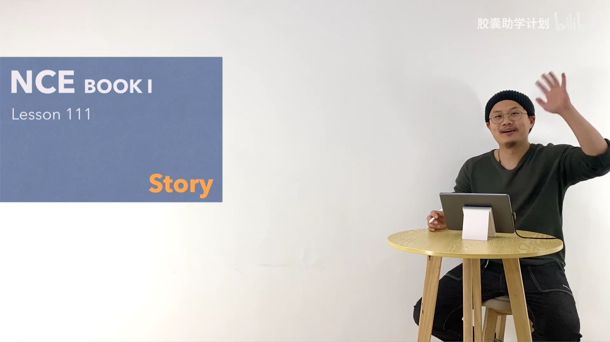

文字识别：胶囊助学计划 / NCE / BOOKI / Lesson 111 / Story

### 画面 00:00:02

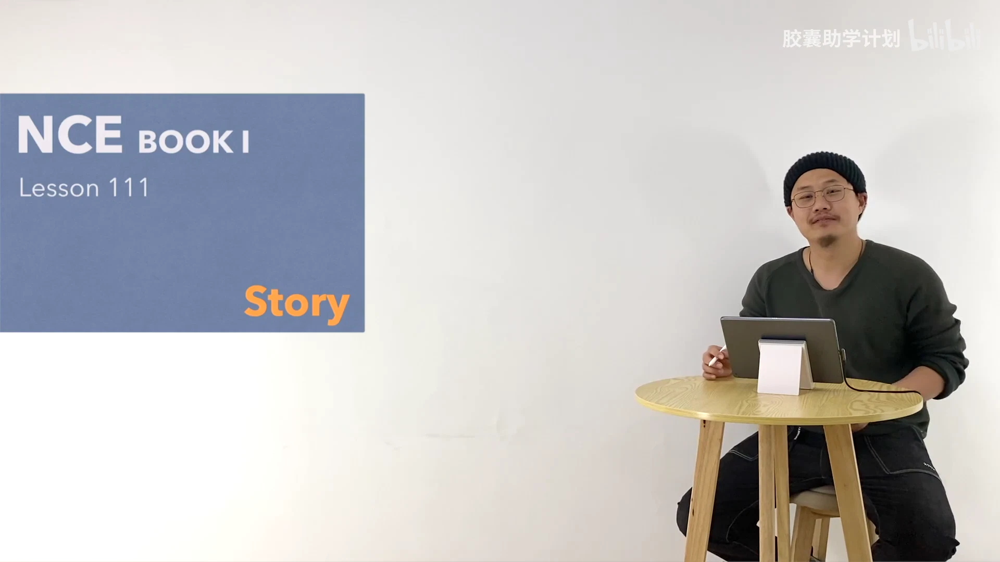

文字识别：胶囊助学计划 / NCE / BOOKI / Lesson 111 / Story

### 画面 00:00:11

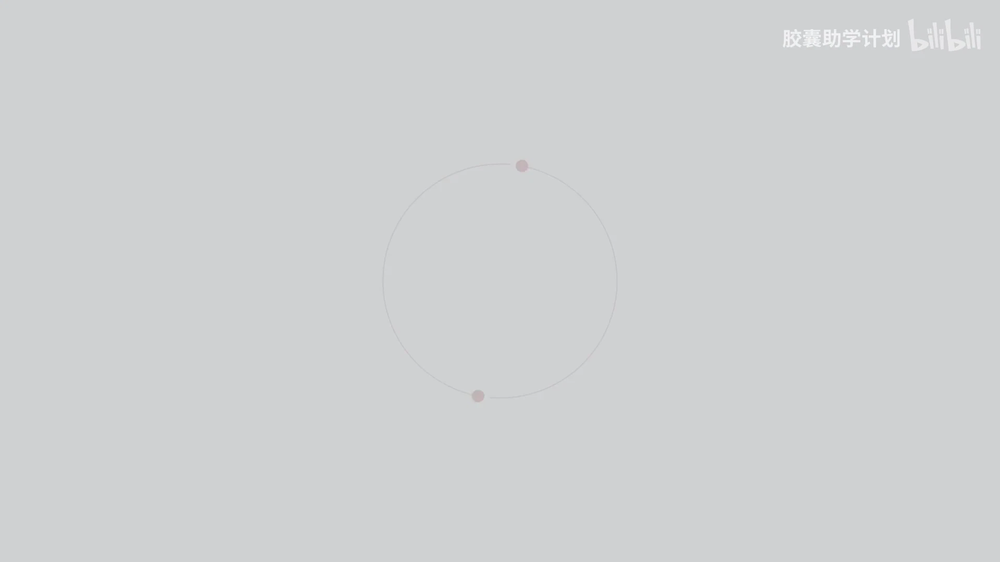

文字识别：胶囊助学计划bill / • / •

### 画面 00:00:14

文字识别：胶囊助学计划 / 胶囊助学计划

### 画面 00:00:16

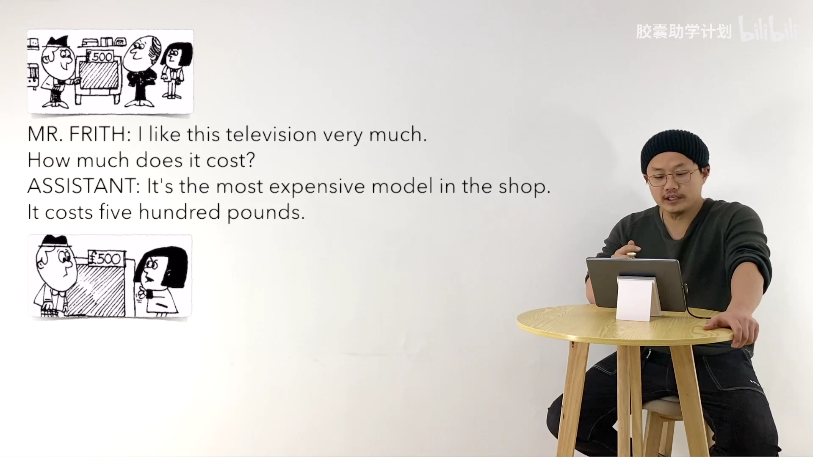

文字识别：胶囊助学计划 / 500 / MR. FRITH: Ilike this television very much. / How much does it cost? / ASSISTANT: It's the most expensive model in the shop. / It costs five hundred pounds. / 500

## 00:00:30–00:01:00

十分喜欢你. I like this television very much. 我十分喜欢这个电视. 啊, How much does it cost? 这个之前在卖房子，我记得是八十九那课，我给大家讲过. How much对钱提问，对吧？那它值多少钱？Is the most expensive model the most expensive? 是我们在语法单词的上一个视频当中刚刚讲过的一个语法点，对吧？OK，就是最贵的模型 in the shop 在这个商店

### 画面 00:00:46

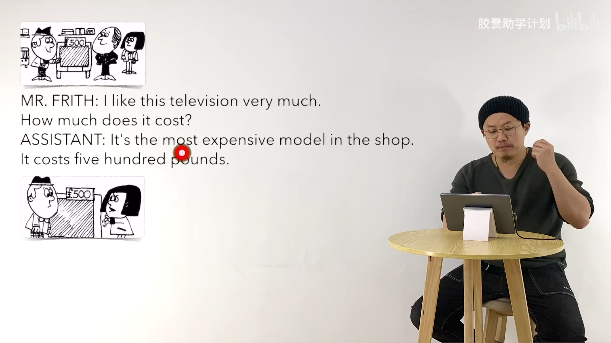

文字识别：胶囊助学计划 / 500 / 2 / MR. FRITH: I like this television very much. / How much does it cost? / ASSISTANT: It's the most expensive model in the shop. / It costs five hundred / Punds. / 500

## 00:01:00–00:01:30

当中, it costs five hundred pounds. 它值五百磅。您看这句话, it costs five hundred pounds. 我在这说一个额外的小点，为啥不背新概念是吧？就不用着急背，原因是你把这句话百分之百的精力如果都背下来了，对吧？这句话您背下，你只拿到了一，还有二三你没拿四，对吧？比如说, it doesn't cost five hundred pounds. 否定

### 画面 00:01:10

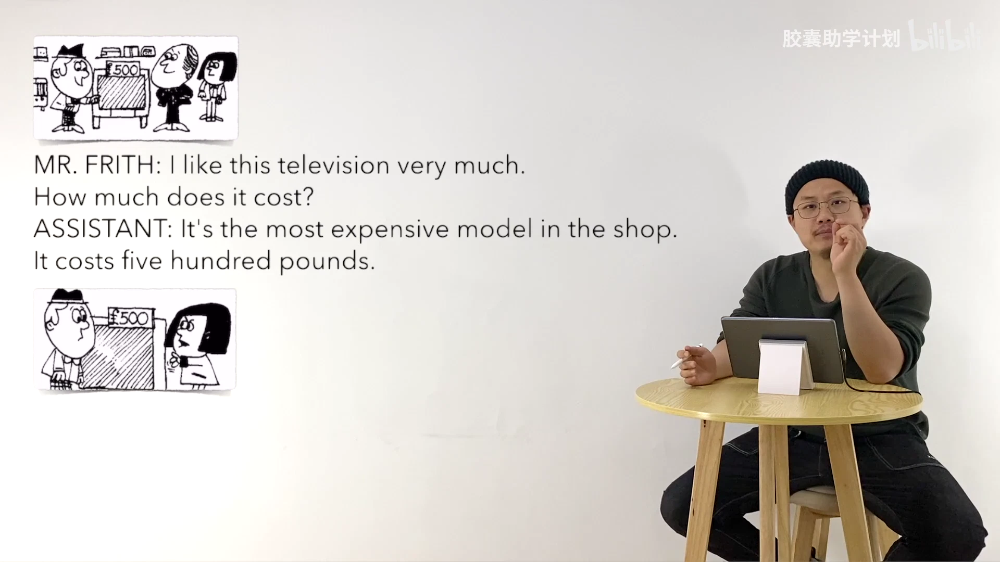

文字识别：胶囊助学计划 / 500 / 2 / MR. FRITH: I like this television very much. / How much does it cost? / ASSISTANT: It's the most expensive model in the shop. / It costs five hundred pounds. / 500

### 画面 00:01:13

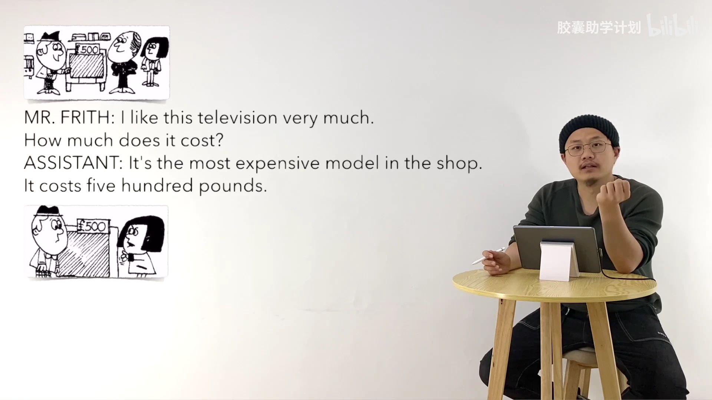

文字识别：胶囊助学计划 / 500 / MR. FRITH: I like this television very much. / How much does it cost? / ASSISTANT: It's the most expensive model in the shop. / It costs five hundred pounds. / £500

## 00:01:30–00:02:00

Negative sentence, general question sentence. Does it cost five hundred pounds? And how much does it cost? You see, these are all the hidden content behind this sentence, the deep content buried under the iceberg. Right? These things we have to rely on the four sentence conversion to get them. Okay, continue. Mr. Faith again said, "That's too expensive for us." That means this thing is too expensive for us. One hundred and three grammar. We can't afford all that money. We have no way to pay all that money. Continue.

### 画面 00:01:31

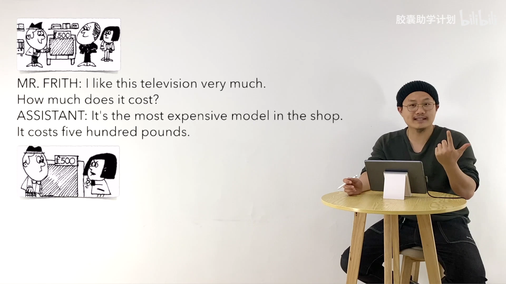

文字识别：胶囊助学计划 / 500 / MR. FRITH: I like this television very much. / How much does it cost? / ASSISTANT: It's the most expensive model in the shop. / It costs five hundred pounds. / £500

### 画面 00:01:45

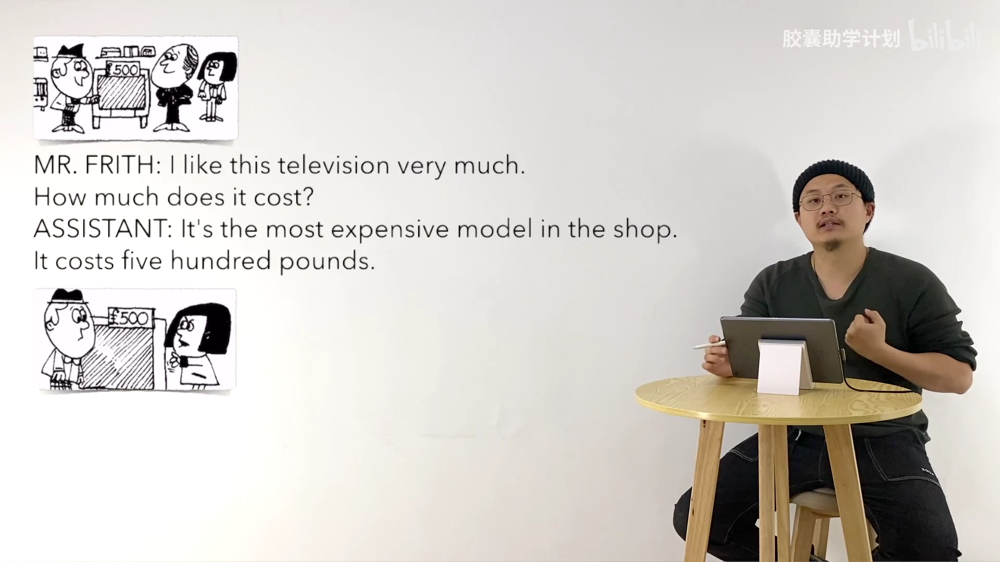

文字识别：胶囊助学计划 / 500 / 2 / MR. FRITH: I like this television very much. / How much does it cost? / ASSISTANT: It's the most expensive model in the shop. / It costs five hundred pounds. / 500

### 画面 00:01:47

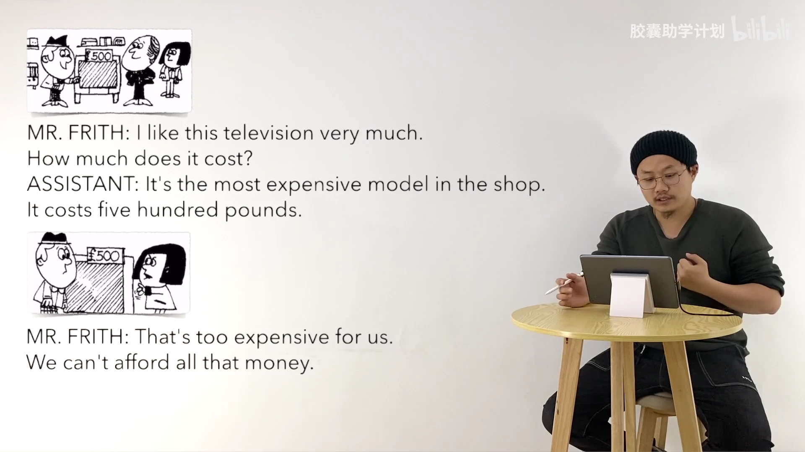

文字识别：胶囊助学计划 / 500 / MR. FRITH: I like this television very much. / How much does it cost? / ASSISTANT: It's the most expensive model in the shop. / It costs five hundred pounds. / Q / £500 / MR. FRITH: That's too expensive for us. / We can't afford all that money.

### 画面 00:01:59

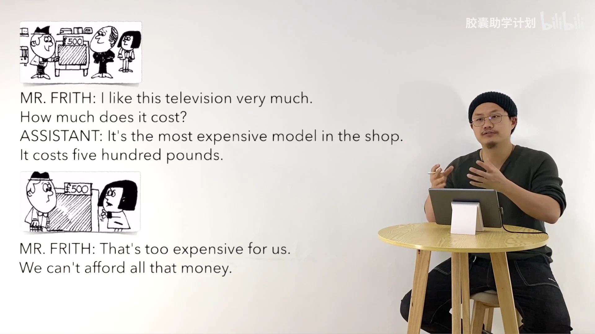

文字识别：胶囊助学计划 / 500 / MR. FRITH: I like this television very much. / How much does it cost? / ASSISTANT: It's the most expensive model in the shop. / It costs five hundred pounds. / Q / £500 / MR. FRITH: That's too expensive for us. / We can't afford all that money.

## 00:02:00–00:02:30

### 画面 00:02:01

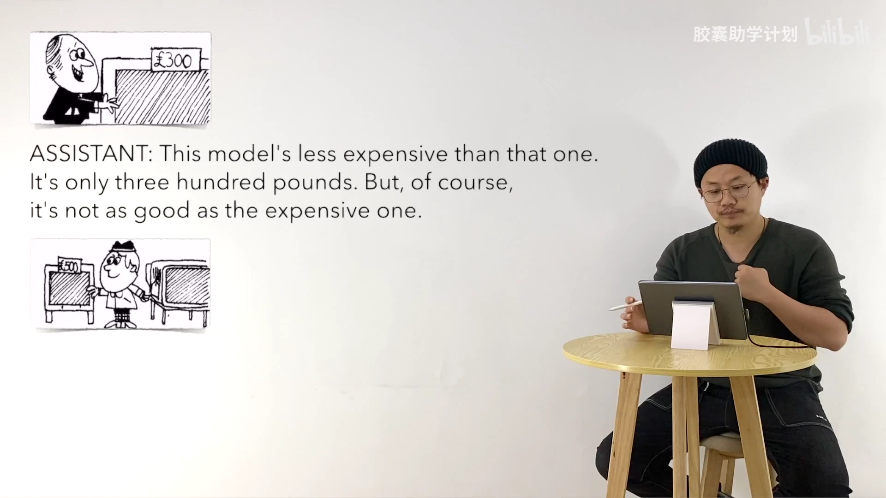

文字识别：胶囊助学计划 / £300 / ASSISTANT: This model's less expensive than that one. / It's only three hundred pounds. But, of course, / it's not as good as the expensive one.

## 00:02:30–00:03:00

货。Is not as good as expensive one. A不如B. A is就是三百磅的这个，expensive one就是五百磅的那个，就是三百磅的这个不如五百磅的那个好。Okay, not as as也是我们在上一个视频当中刚刚讲过的。Mr. Freeze说，I don't like this model.我不喜欢这个模型啊。I呃，the other models more expensive.说另一个模

### 画面 00:02:31

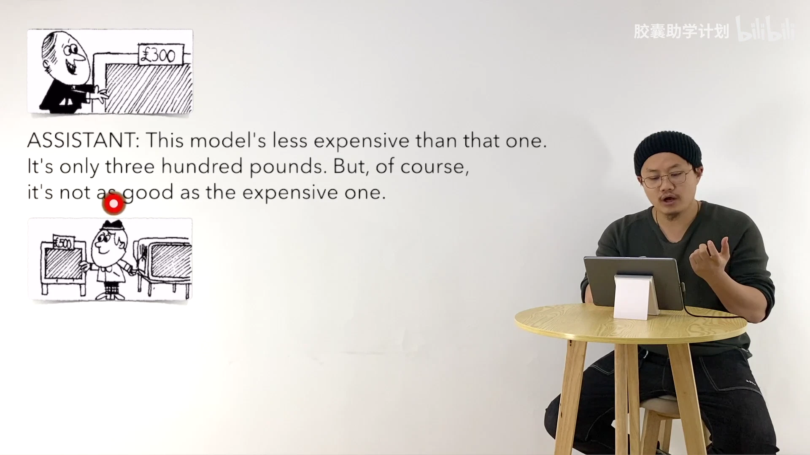

文字识别：胶囊助学计划 / £300 / ASSISTANT: This model's less expensive than that one. / It's only three hundred pounds. But, of course, / it's not a: good as the expensive one. / 500

### 画面 00:02:48

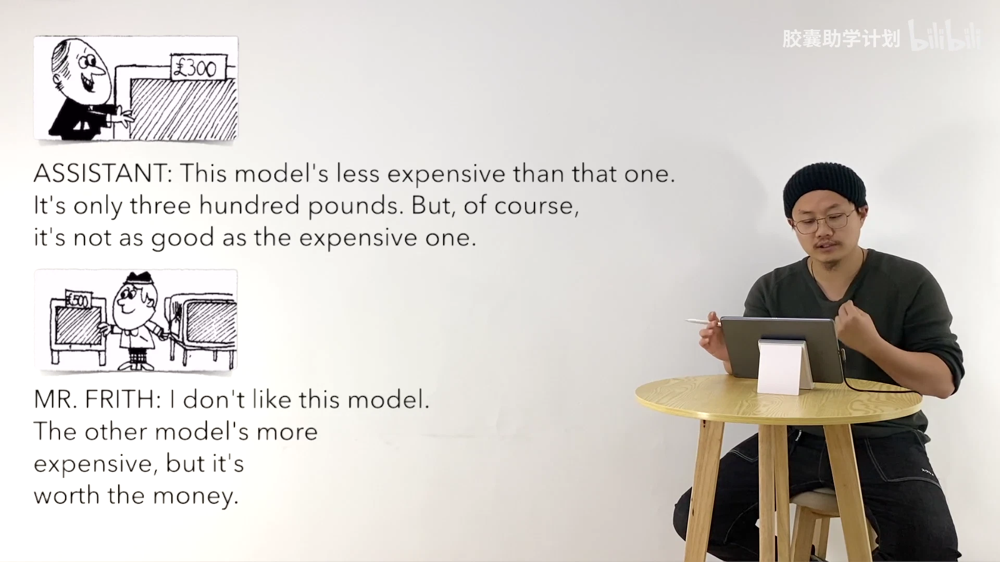

文字识别：胶囊助学计划 / £300 / ASSISTANT: This model's less expensive than that one. / It's only three hundred pounds. But, of course, / it's not as good as the expensive one. / 500 / MR. FRITH: I don't like this model. / The other model's more / expensive, but it's / worth the money.

### 画面 00:02:55

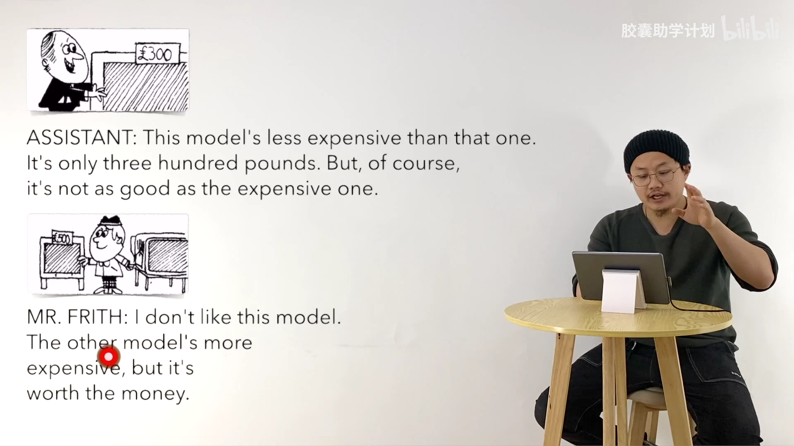

文字识别：胶囊助学计划 / £300 / ASSISTANT: This model's less expensive than that one. / It's only three hundred pounds. But, of course, / it's not as good as the expensive one. / 500 / MR. FRITH: I don't like this model. / The other model's more / expensive, but it's / worth the money.

## 00:03:00–00:03:30

型确实要更贵，但是呢，but is worth the money.但是它值这个钱，当然物有所值，对吧？多花二百是二百的钱了。Can we buy it on installments? Buy something on installments?哎，分期付款买。您就现在新学会了一个表达，叫buy something on installments. Of course, yeah.当然了，you can pay a deposit of thirty pounds.讲deposit的时候，我们用了这句话。

### 画面 00:03:05

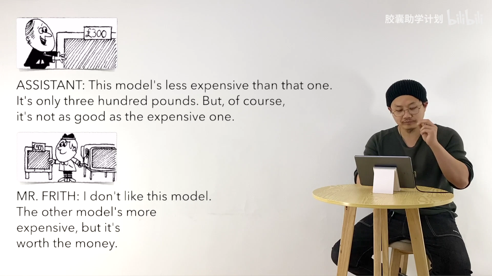

文字识别：胶囊助学计划 / £300 / ASSISTANT: This model's less expensive than that one. / It's only three hundred pounds. But, of course, / it's not as good as the expensive one. / 500 / MR. FRITH: I don't like this model. / The other model's more / expensive, but it's / worth the money.

### 画面 00:03:10

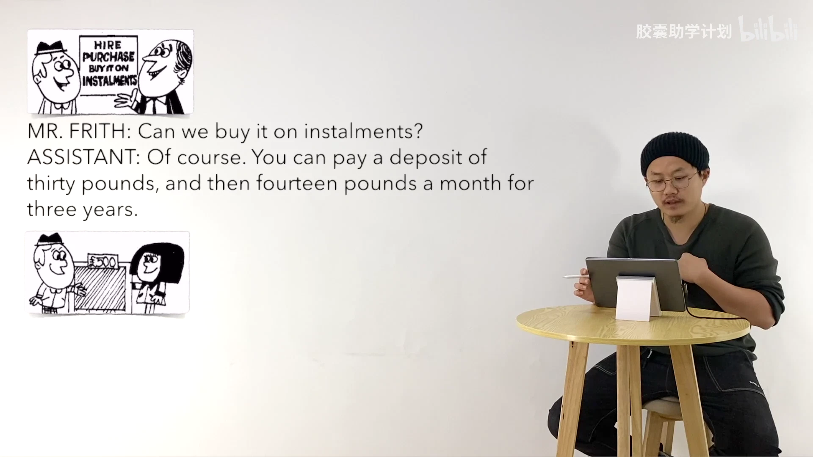

文字识别：胶囊助学计划 / HIRE / PURCHASE / BUYITON / INSTALMENTS / MR. FRITH: Can we buy it on instalments? / ASSISTANT: Of course. You can pay a deposit of / thirty pounds, and then fourteen pounds a month for / three years. / 500

### 画面 00:03:17

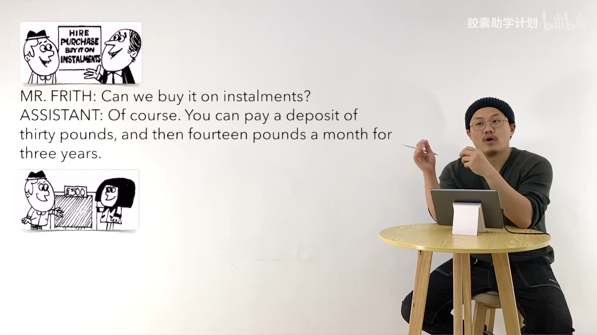

文字识别：胶囊助学计划 / HIRE / PURCHASE / BUYITON / INSTALMENTS / MR. FRITH: Can we buy it on instalments? / ASSISTANT: Of course. You can pay a deposit of / thirty pounds, and then fourteen pounds a month for / three years. / 500

## 00:03:30–00:04:00

你可以支付一个三十磅的定金，然后呢，就理解为首付吧。Then fourteen pounds a month,然后一个月十四磅 for three years，三年买个电视机，三年还完，是吧？清楚。Do you like it, dear？他问他妻子说，亲爱的，你喜欢吗？他老婆说，I certainly do，是吧？当然喜欢了。Certainly就类似，Of course I do，是吧？当然我喜欢了。But I don't like the price，但是我

### 画面 00:03:43

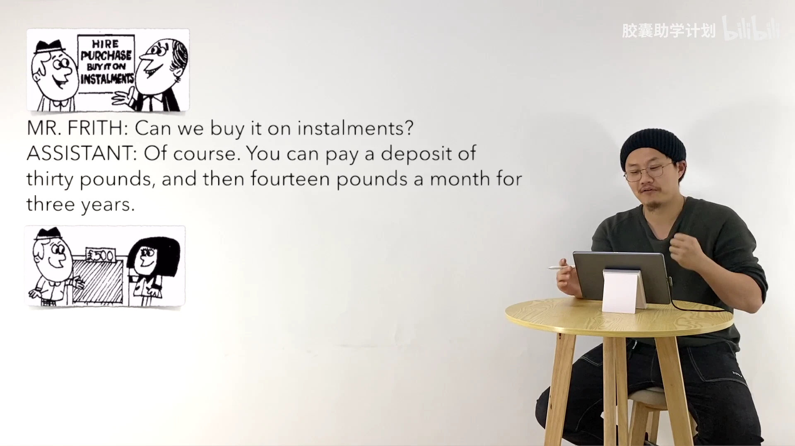

文字识别：胶囊助学计划 / HIRE / PURCHASE / BUYITON / INSTALMENTS / MR. FRITH: Can we buy it on instalments? / ASSISTANT: Of course. You can pay a deposit of / thirty pounds, and then fourteen pounds a month for / three years. / 500

### 画面 00:03:45

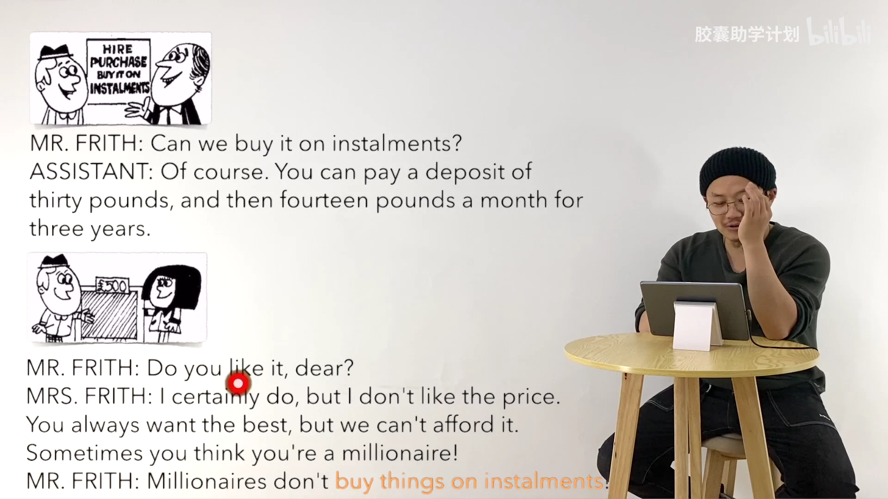

文字识别：胶囊助学计划 / HIRE / PURCHASE / BUYITON / INSTALMENTS / MR. FRITH: Can we buy it on instalments? / ASSISTANT: Of course. You can pay a deposit of / thirty pounds, and then fourteen pounds a month for / three years. / 500 / MR. FRITH: Do you like it, dear? / MRS. FRITH: I certaimy do, but I don't like the price. / You always want the best, but we can't afford it. / Sometimes you think you're a millionaire! / MR. FRITH: Millionaires don't buy things on instalments!

## 00:04:00–00:04:30

不喜欢这个价格. You always want the best.说你总是想要最好的那个. But we can't afford it.但是我们又没办法支付得起，是吧? Sometimes,有的时候呢, you think you are a millionaire.说有的时候啊，你总感觉你自己是个百万富翁一样，是吧？买什么东西都都都买最贵的. You always want the best,对吧？然后她老公呢回了一句话，我觉得就很英式的那种

### 画面 00:04:15

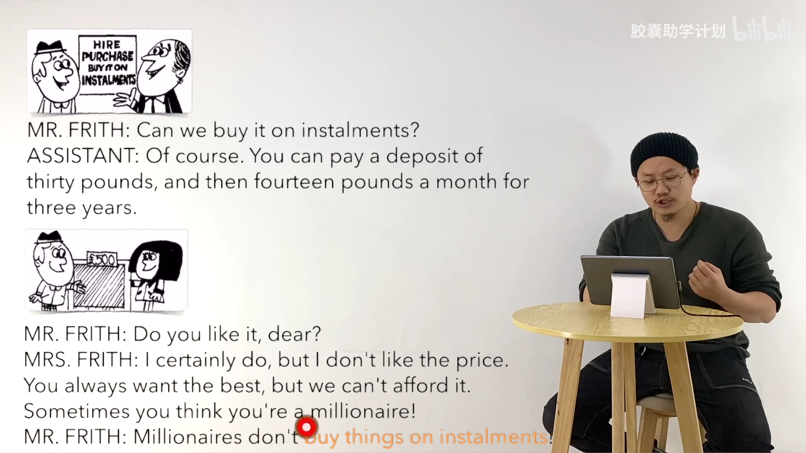

文字识别：胶囊助学计划 / HIRE / PURCHASE / BUYITON / INSTALMENTS / MR. FRITH: Can we buy it on instalments? / ASSISTANT: Of course. You can pay a deposit of / thirty pounds, and then fourteen pounds a month for / three years. / 500 / MR. FRITH: Do you like it, dear? / MRS. FRITH: I certainly do, but I don't like the price. / You always want the best, but we can't afford it. / Sometimes you think you're a millionaire! / MR. FRITH: Millionaires don't Ouy things on instalments!

### 画面 00:04:20

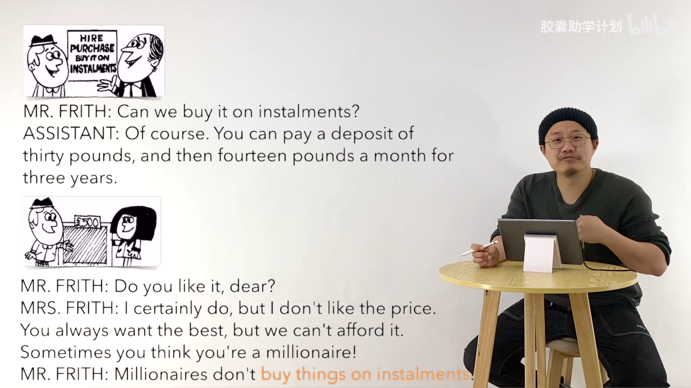

文字识别：胶囊助学计划 / HIRE / PURCHASE / BUYITON / INSTALMENTS / MR. FRITH: Can we buy it on instalments? / ASSISTANT: Of course. You can pay a deposit of / thirty pounds, and then fourteen pounds a month for / three years. / 500 / H / MR. FRITH: Do you like it, dear? / MRS. FRITH: I certainly do, but I don't like the price. / You always want the best, but we can't afford it. / Sometimes you think you're a millionaire! / MR. FRITH: Millionaires don't buy things on instalments!

### 画面 00:04:23

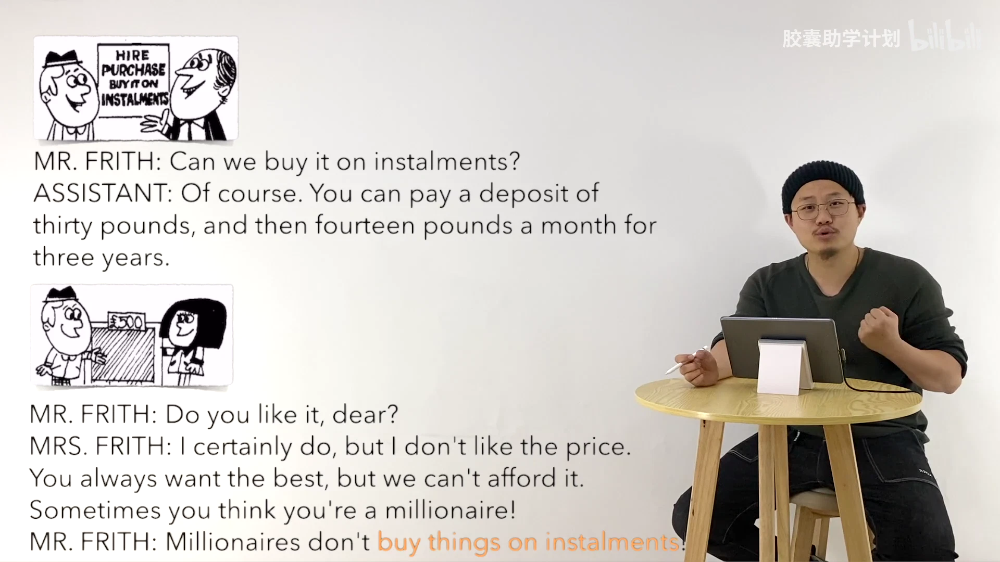

文字识别：胶囊助学计划 / HIRE / PURCHASE / BUYITON / INSTALMENTS / MR. FRITH: Can we buy it on instalments? / ASSISTANT: Of course. You can pay a deposit of / thirty pounds, and then fourteen pounds a month for / three years. / 500 / MR. FRITH: Do you like it, dear? / MRS. FRITH: I certainly do, but I don't like the price. / You always want the best, but we can't afford it. / Sometimes you think you're a millionaire! / MR. FRITH: Millionaires don't buy things on instalments!

## 00:04:30–00:05:00

幽默的感觉，就挺逗闷子的。她老公说说 millionaires don't buy things on installments。他说百万富翁啊不会买东西还分期付款。OK，玩一个。那文章说完了，我们接下来口语听力练习。老习惯啊，您尽量不要看着我这个问题，对吧？我们这是听力啊，然后您口语回答。您尽量可以看书，如果能不看书那最好。来了啊，第一题，

### 画面 00:04:43

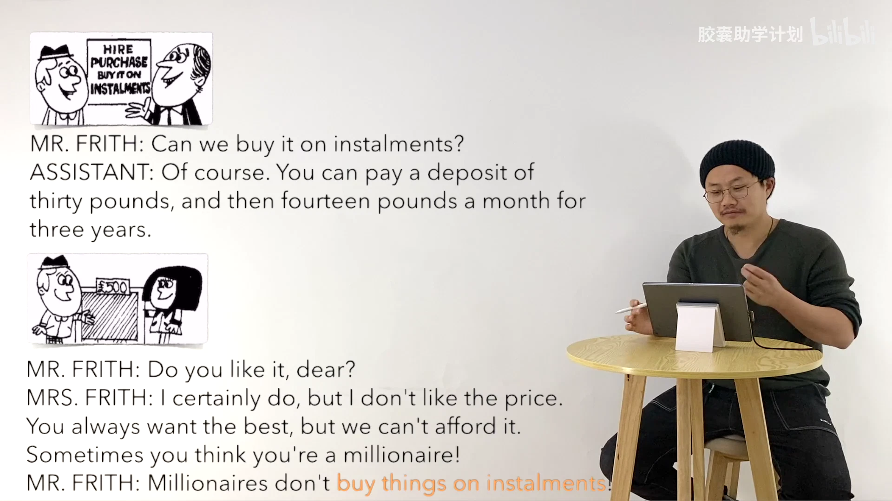

文字识别：胶囊助学计划 / HIRE / PURCHASE / BUYITON / INSTALMENTS / MR. FRITH: Can we buy it on instalments? / ASSISTANT: Of course. You can pay a deposit of / thirty pounds, and then fourteen pounds a month for / three years. / 500 / MR. FRITH: Do you like it, dear? / MRS. FRITH: I certainly do, but I don't like the price. / You always want the best, but we can't afford it. / Sometimes you think you're a millionaire! / MR. FRITH: Millionaires don't buy things on instalments!

### 画面 00:04:45

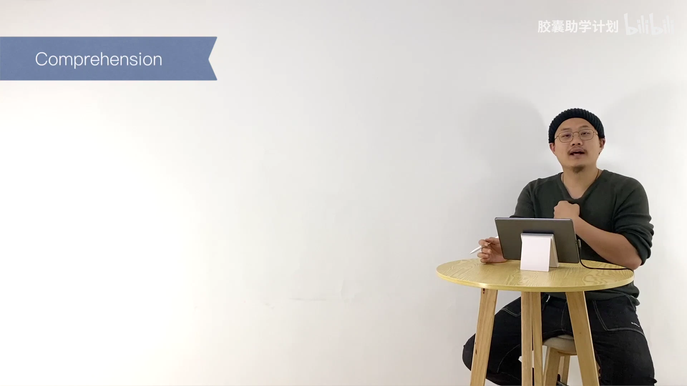

文字识别：胶囊助学计划 / Comprehension

### 画面 00:04:58

文字识别：胶囊助学计划 / Comprehension / 1 T: What does Mr. Frith think about the first television?

## 00:05:00–00:05:30

What does Mr. Freeth think about the first television? He likes it very much. Next one, is it one of the cheaper models? No, it isn't. Next one, is there a more expensive model in the shop? No, there isn't. Next one, what does Mrs. Freeth think about the price? Is

### 画面 00:05:02

文字识别：胶囊助学计划 / Comprehension / 1 T: What does Mr. Frith think about the first television?

### 画面 00:05:20

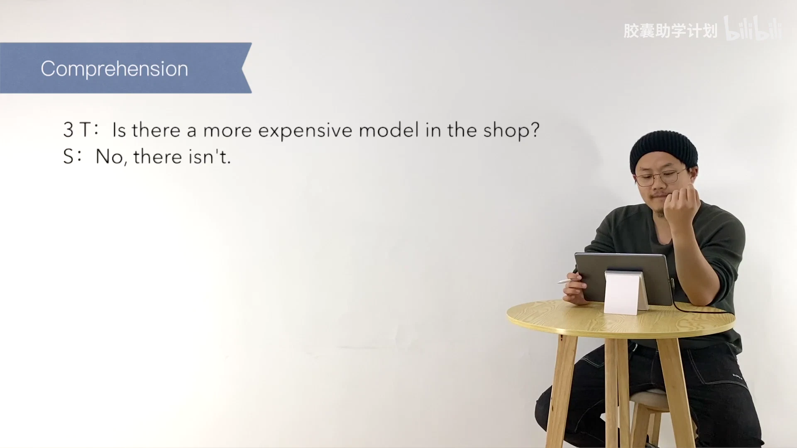

文字识别：胶囊助学计划 / Comprehension / 3 T: Is there a more expensive model in the shop? / S: No, there isn't.

### 画面 00:05:29

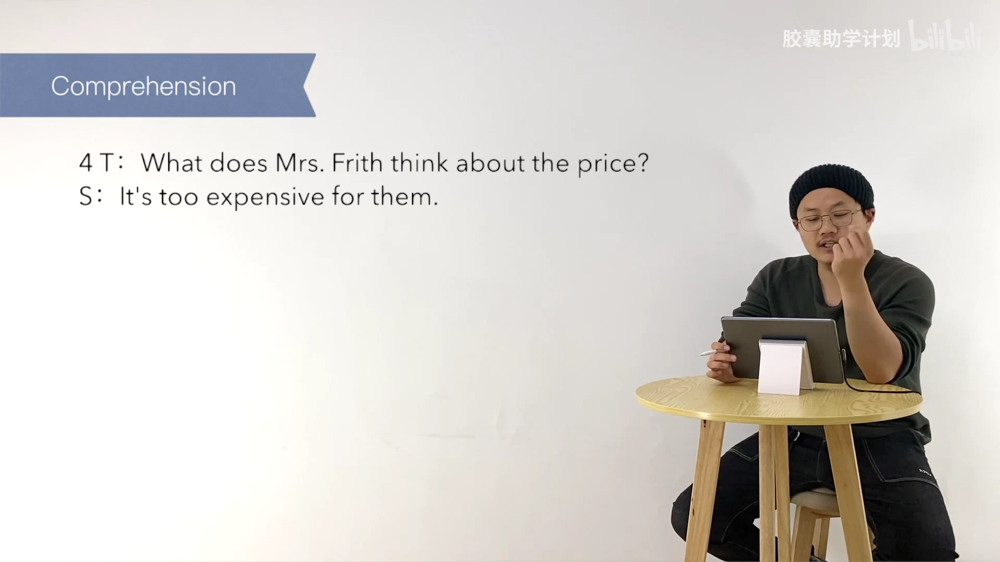

文字识别：胶囊助学计划 / Comprehension / 4T: What does Mrs. Frith think about the price? / S: It's too expensive for them.

## 00:05:30–00:06:00

too expensive for them. Next one, how much does the less expensive model cost? Three hundred pounds. Next one, is the less expensive model as good as the first one? No, it isn't. Of course, right. Next one, how can Mr. Phrase buy the model he wants or buy the first model? He can buy it on

### 画面 00:05:32

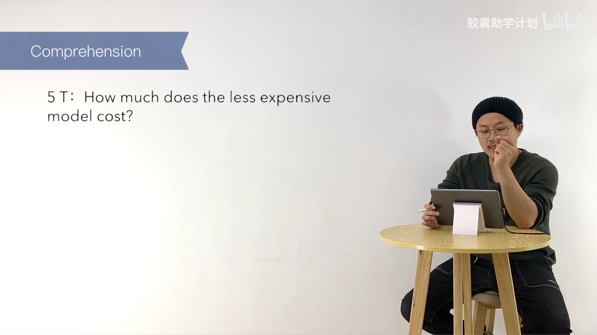

文字识别：胶囊助学计划 / Comprehension / 5 T: How much does the less expensive / model cost?

### 画面 00:05:58

文字识别：胶囊助学计划 / Comprehension / 7 T: How can Mr. Frith buy the model he wants? / S: He can buy it on instalments.

## 00:06:00–00:06:30

installments. Next one, will the television be more expensive on installments? Yes, it will. Next one, how much will it cost? 数学题了是吧? It will cost five hundred and thirty-four, is right. 应该是多付三十四吧. Next one, does Mrs. Fray think this is a good idea? Not really,或者是No, it isn't,对吧? Okay.

### 画面 00:06:01

文字识别：胶囊助学计划 / Comprehension / 8 T: Will the television be more expensive / on instalments?

### 画面 00:06:19

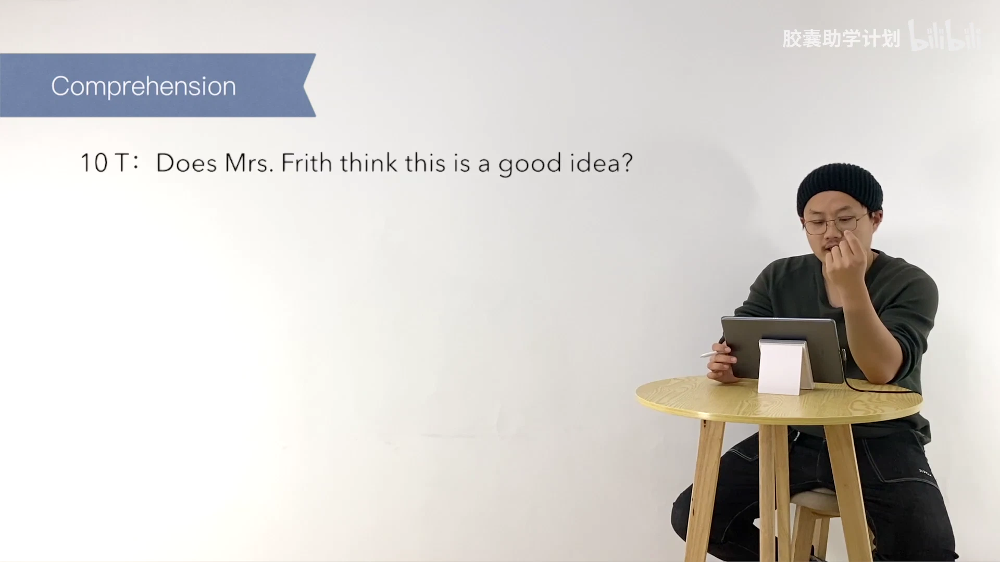

文字识别：胶囊助学计划 / Comprehension / 10 T: Does Mrs. Frith think this is a good idea?

## 00:06:30–00:07:00

Next one, asking questions. 我给肯定句演变一般疑问句，我给特疑问词演变特疑问句来了. It ask me if the television costs a lot. Does the television cost a lot? How much? 那就是对 a lot 提问，对吧? How much does the television cost? Next one. Ask me if is the most expensive model in the shop.

### 画面 00:06:30

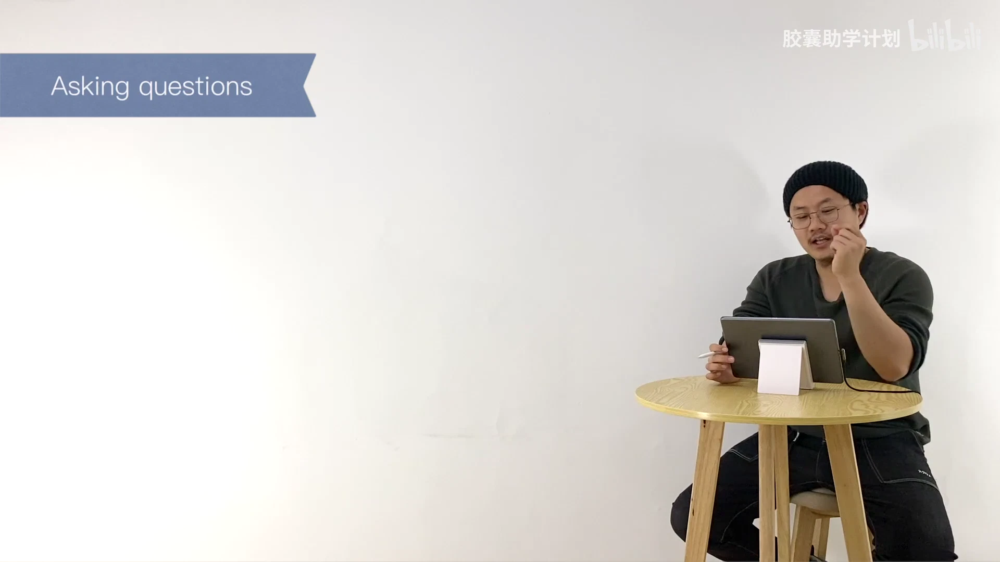

文字识别：胶囊助学计划 / Asking questions

### 画面 00:06:37

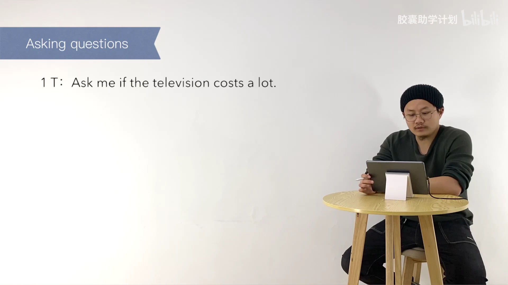

文字识别：胶囊助学计划 / Asking questions / 1 T: Ask me if the television costs a lot.

### 画面 00:06:49

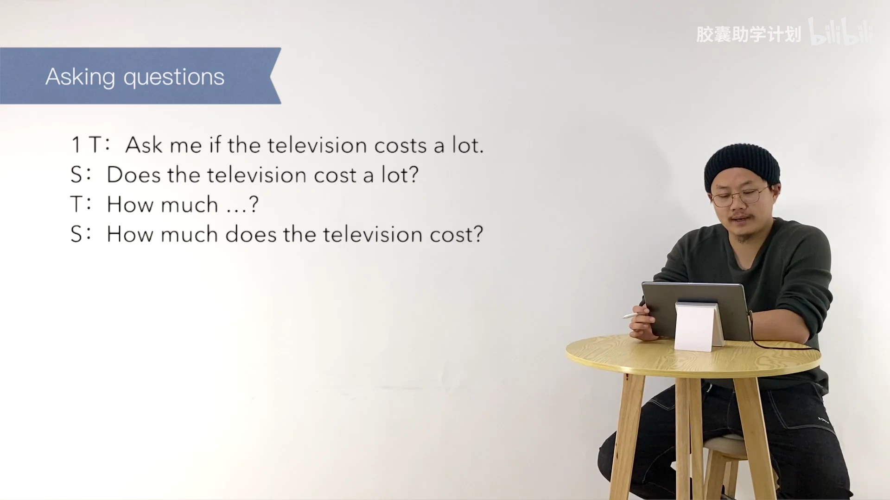

文字识别：胶囊助学计划 / Asking questions / 1 T: Ask me if the television costs a lot. / S: Does the television cost a lot? / T: How much ...? / S: How much does the television cost?

### 画面 00:06:53

文字识别：胶囊助学计划 / Asking questions / 2 T: Ask me if it's the most expensive model in the shop.

## 00:07:00–00:07:30

Is it the most expensive model in the shop? Which, which is the most expensive model in the shop? You see, this place of which it is actually asking the subject. It is asking the subject. It is asking the subject. It is asking the subject. It is asking the subject. It is asking the subject. It is asking the subject. It is asking the subject. It is asking the subject. It is asking the subject. It is asking the subject. It is asking the subject. It is asking the subject. It is asking the subject. It is asking the subject. It is asking the

### 画面 00:07:05

文字识别：胶囊助学计划 / Asking questions / 2 T: Ask me if it's the most expensive model in the shop. / S: Is it the most expensive model in the shop? / T: Which ...? / S: Which is the most expensive model in the shop?

### 画面 00:07:08

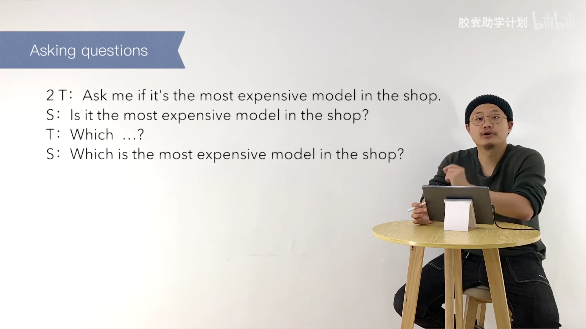

文字识别：胶囊助学计划 / Asking questions / 2 T: Ask me if it's the most expensive model in the shop. / S: Is it the most expensive model in the shop? / T: Which ...? / S: Which is the most expensive model in the shop?

### 画面 00:07:19

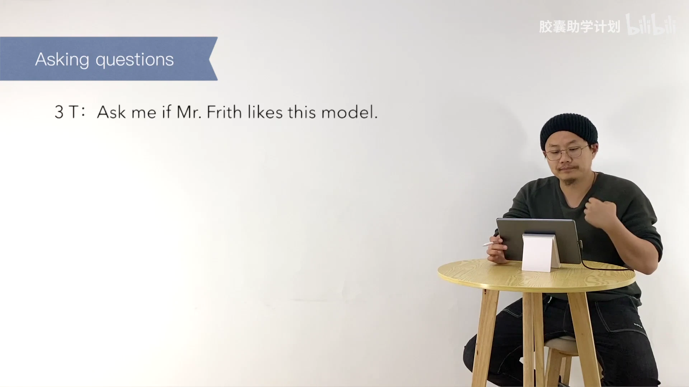

文字识别：胶囊助学计划 / Asking questions / 3 T: Ask me if Mr. Frith likes this model.

## 00:07:30–00:08:00

why doesn't miss the phrase like this model? That answer其实就是is not as good as the expensive one, right?不如那个贵的好嘛. Next one, ask me if he can pay thirty pounds as a deposit. Can he pay thirty pounds as a deposit? How much? How much can he pay as a deposit? Next one, ask me if

### 画面 00:07:30

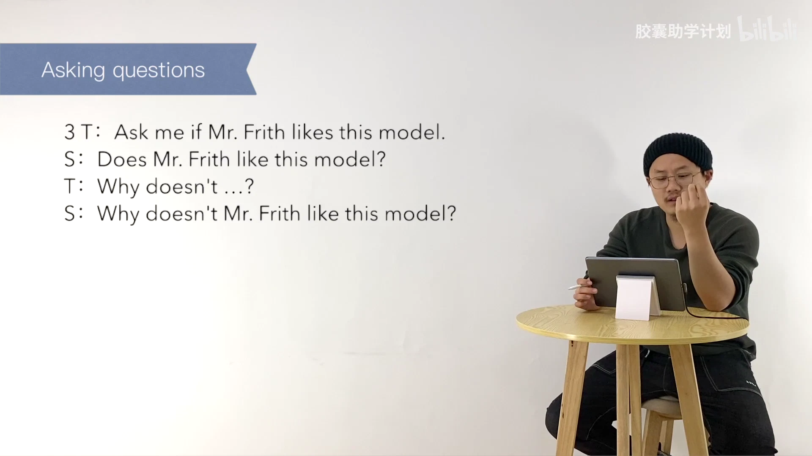

文字识别：胶囊助学计划 / Asking questions / 3 T: Ask me if Mr. Frith likes this model. / S: Does Mr. Frith like this model? / T: Why doesn't ...? / S: Why doesn't Mr. Frith like this model?

### 画面 00:07:39

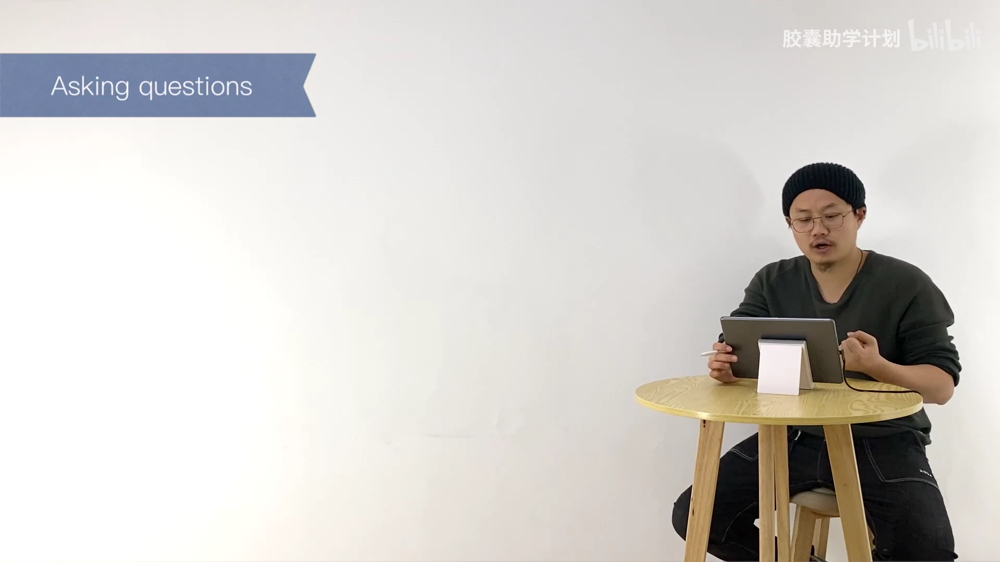

文字识别：胶囊助学计划 / Asking questions

### 画面 00:07:48

文字识别：胶囊助学计划 / Asking questions / 4 T: Ask me if he can pay thirty pounds as a deposit. / S: Can he pay thirty pounds as a deposit?

### 画面 00:07:57

文字识别：胶囊助学计划 / Asking questions / 5 T: Ask me if millionaires buy things on instalments.

## 00:08:00–00:08:30

millionaires buy things on installments. Do millionaires buy things on installments? How? How do millionaires buy things? They certainly don't buy things on installments, right? Okay, very good. Recap.文章当中并不是很难，出现了我们之前上一个视频刚刚讲过的语法啊，没有太多可说的了。家庭作业绿皮书幺幺幺，您可以写了。文章老习惯熟读成诵，讲

### 画面 00:08:09

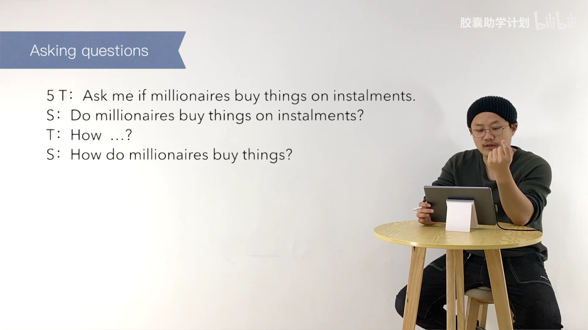

文字识别：胶囊助学计划 / Asking questions / 5 T: Ask me if millionaires buy things on instalments. / S: Do millionaires buy things on instalments? / T: How ...? / S: How do millionaires buy things?

### 画面 00:08:16

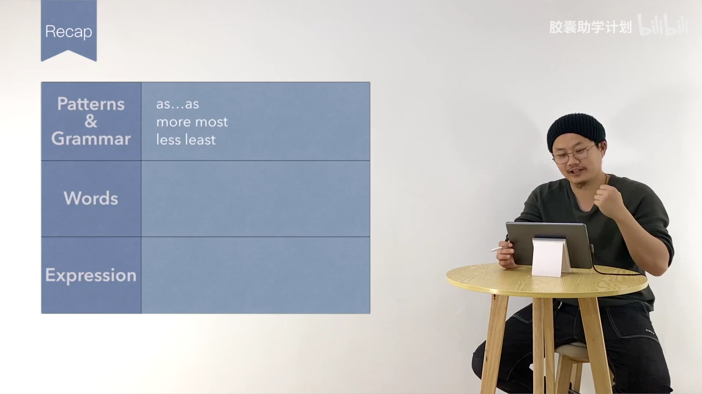

文字识别：Recap / 胶囊助学计划 / Patterns / as...as / more most / Grammar / less least / Words / Expression

### 画面 00:08:23

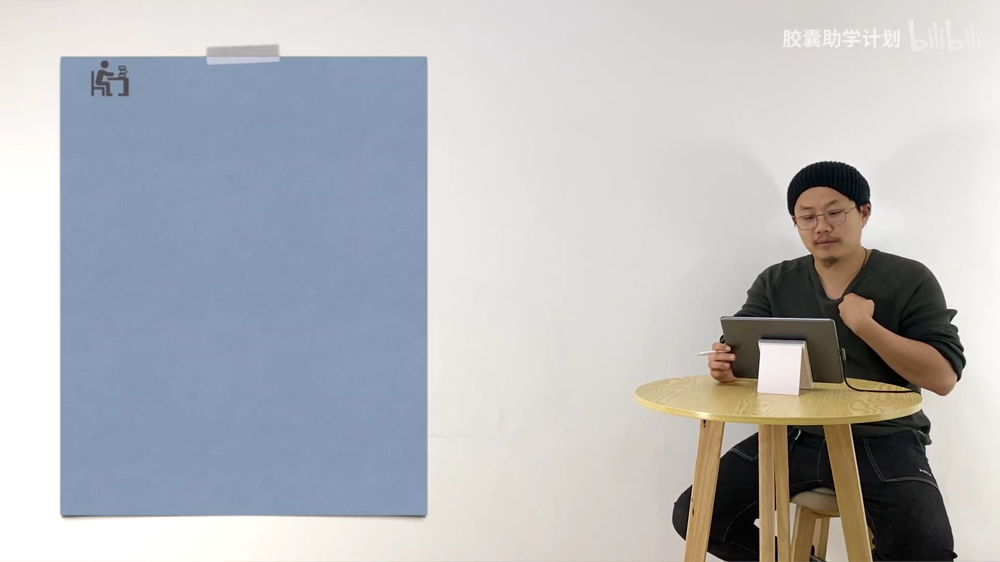

文字识别：胶囊助学计划

## 00:08:30–00:09:00

解一遍核心语法点。那如果大家喜欢我们的课程呢，欢迎大家关注、订阅、一键三连，分享给那些需要的朋友。OK，最后我们再来看一句很俏皮的名人名言。I want my children to have all the things I couldn't afford. Then I want to move in with them. OK, see you next time.

### 画面 00:08:32

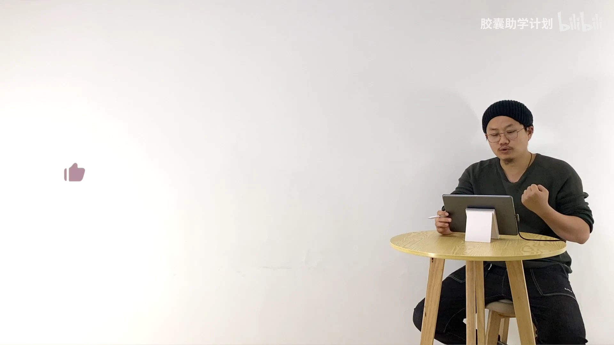

文字识别：胶囊助学计划

### 画面 00:08:38

文字识别：胶囊助学计划 / I want my children to have all the things I / couldn't afford. Then I want to move in / with them. / Phyllis Diller

### 画面 00:08:46

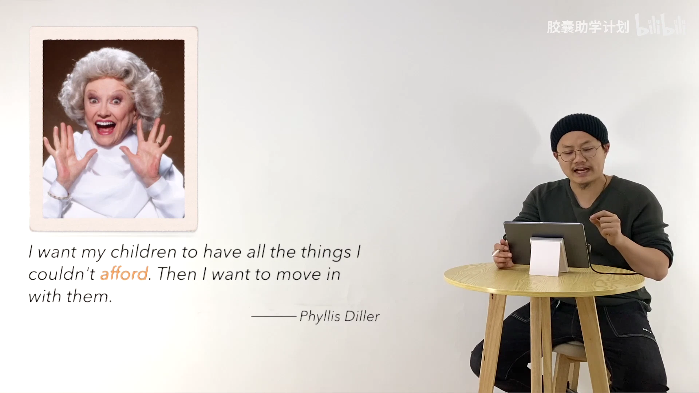

文字识别：胶囊助学计划 / I want my children to have all the things I / couldn't afford. Then I want to move in / with them. / Phyllis Diller

### 画面 00:08:53

### 画面 00:08:55

文字识别：CAPSULEACADEMY / 胶囊助学计划 / 『 / 小红书 / Lecturer / Leo / OE

### 画面 00:08:57

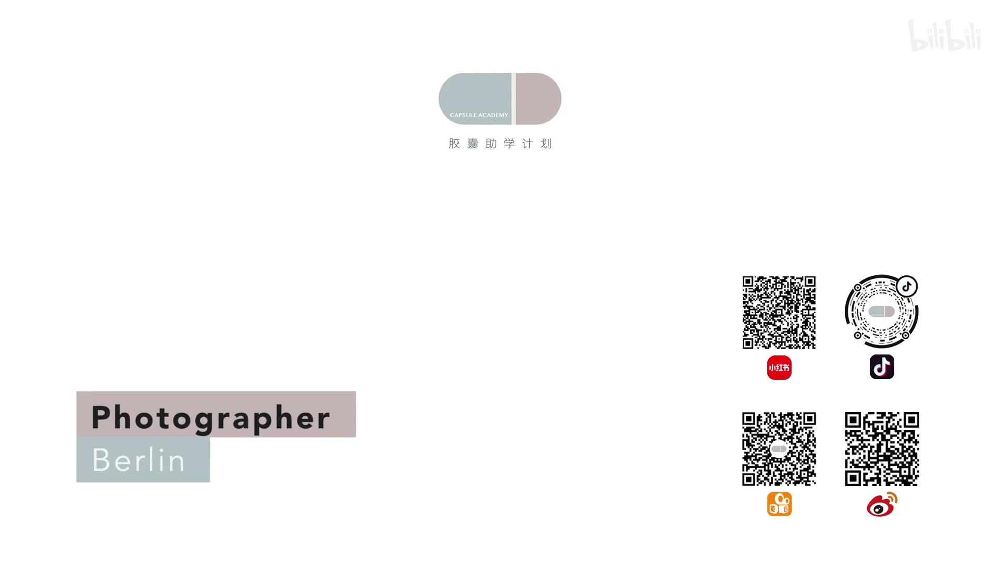

文字识别：CAPSULEACADEMY / 胶囊助学计划 / 『 / 小红书 / Photographer / Berlin / OE

## 00:09:00–00:09:05

### 画面 00:09:00

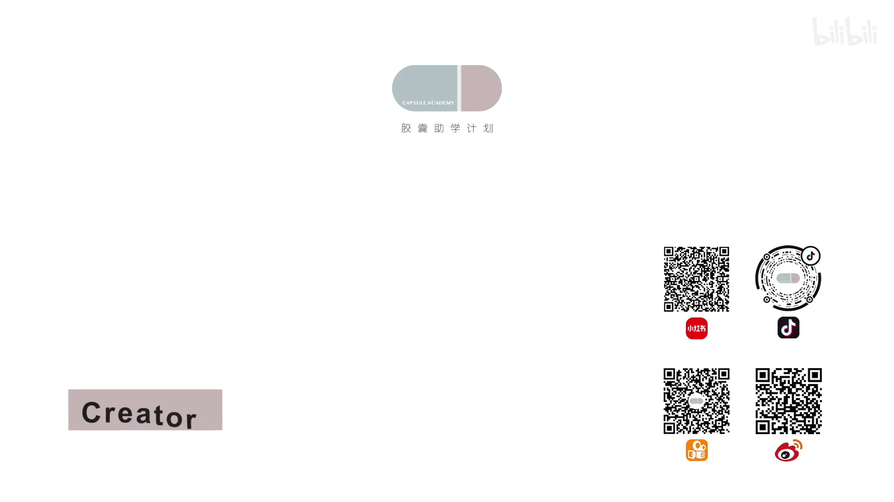

文字识别：CAPSULEACADEMY / 胶囊助学计划 / 『 / 小红书 / Creator / OE

### 画面 00:09:03

文字识别：bilibili / 胶囊助学计划

### 画面 00:09:05

文字识别：bilibili / 胶囊助学计划

