# 112 练习

快速机器解析：语音为单模型转写，未进行独立交叉校对或人工复核；画面每秒采样并按变化选帧，短时文字和标记可能遗漏。截图时间约有 1 秒误差。图片有损压缩；遇到疑点请按时间查看 Google Drive 原视频。

## 00:00:00–00:00:30

Hello everyone, welcome to Capsule Academy. This is Leo. Today we're going to learn new concept English book one lesson one hundred and twelve practices. Hope you gonna enjoy it.本课就是听力口语练习啊，然后各位张开嘴跟我大声朗读就可以了。来第一个，Is the red apple sweeter than the green one?哎，注意，您看，首先它是一般疑

### 画面 00:00:00

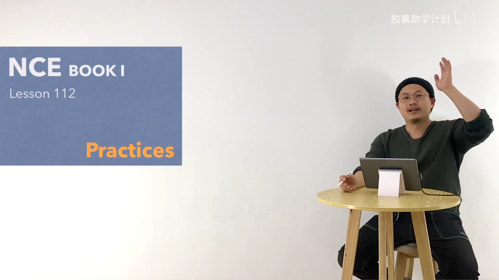

文字识别：BiH / 胶囊助学计划 / NCE / BOOKI / Lesson 112 / Practices

### 画面 00:00:09

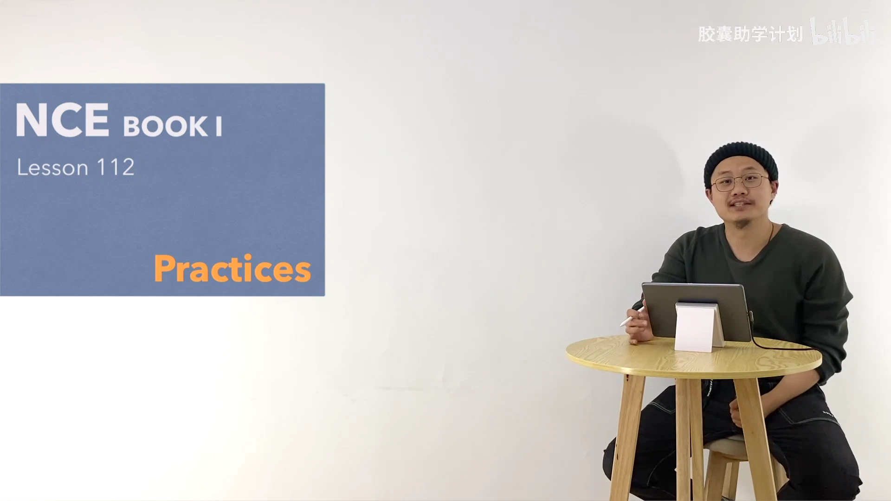

文字识别：biH / 胶囊助学计划 / NCE / BOOKI / Lesson 112 / Practices

### 画面 00:00:11

文字识别：胶囊助学计划bil / •

### 画面 00:00:15

### 画面 00:00:17

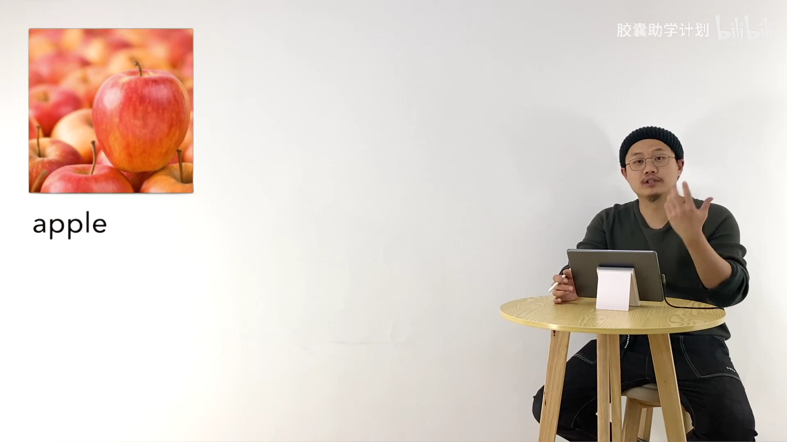

文字识别：胶囊助学计划 / apple

### 画面 00:00:20

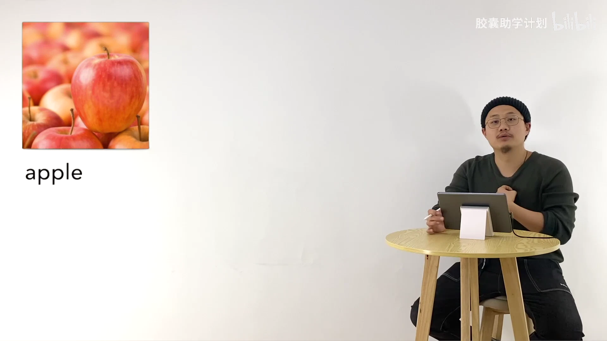

文字识别：胶囊助学计划 / 华 / apple

### 画面 00:00:23

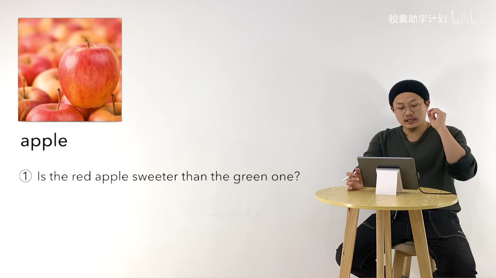

文字识别：胶囊助学计划b册 / apple / ① Is the red apple sweeter than the green one?

### 画面 00:00:27

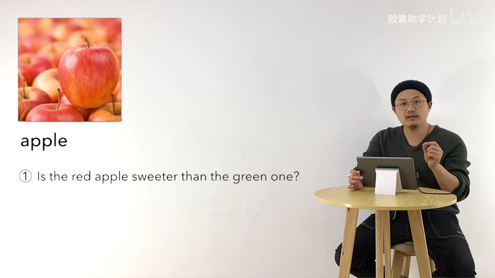

文字识别：胶囊助学计划Ll / apple / ① Is the red apple sweeter than the green one?

## 00:00:30–00:01:00

句，其次 sweater 是我们一百零七课学的，对吧？回答 No, it isn't. 不，它不是。The red apple is as sweet as the green one. 哎，红色的这个和碧色呃和绿色的这个是同样的甜。OK，接下来我们练的就是这两个点啊，一个是形容词后边加个一、二，当然也可能前面加 more 和 most。然后呢，as 点点点 as。OK，接下来不多说了，各位大声张开嘴跟我朗

### 画面 00:00:30

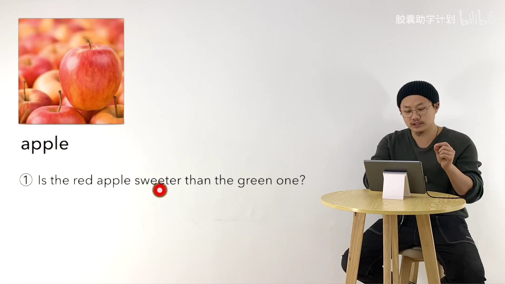

文字识别：胶囊助学计划册 / apple / ① Is the red apple sweeter than the green one?

### 画面 00:00:33

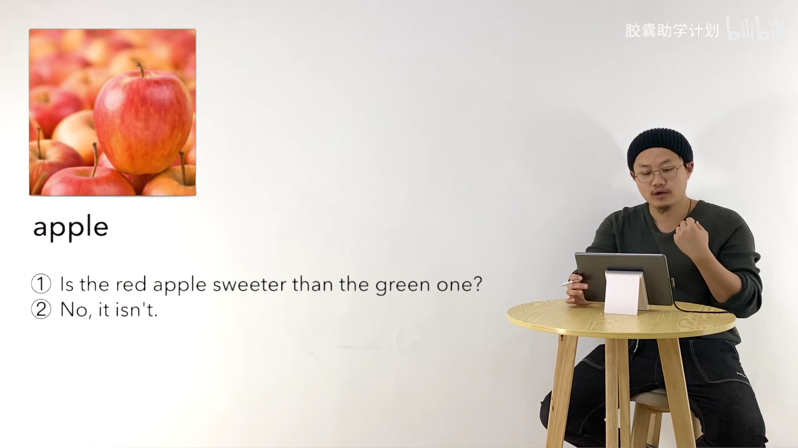

文字识别：胶囊助学计划 / apple / ① Is the red apple sweeter than the green one? / ② No, it isn't.

### 画面 00:00:36

文字识别：胶囊助学计划l / apple / ① Is the red apple sweeter than the green one? / ② No, it isn't. / 3 The red apple is as sweet as the green one. / 3

### 画面 00:00:39

文字识别：胶囊助学计划H / apple / ① Is the red apple sweeter than the green one? / ② No, it isn't. / 3 The red apple is as sweet as the green one.

### 画面 00:00:41

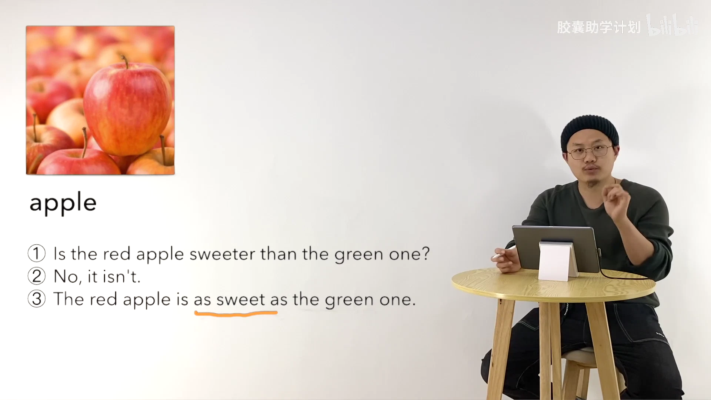

文字识别：胶囊助学计划册 / apple / ① Is the red apple sweeter than the green one? / ② No, it isn't. /  The red apple is as sweet as the green one.

### 画面 00:00:45

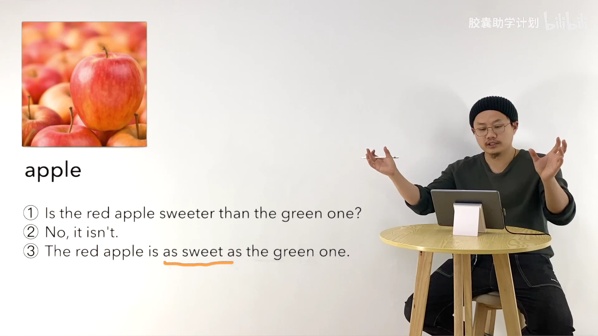

文字识别：胶囊助学计划册 / apple / ① Is the red apple sweeter than the green one? /  No, it isn't. / 2) / The red apple is as sweet as the green one.

### 画面 00:00:49

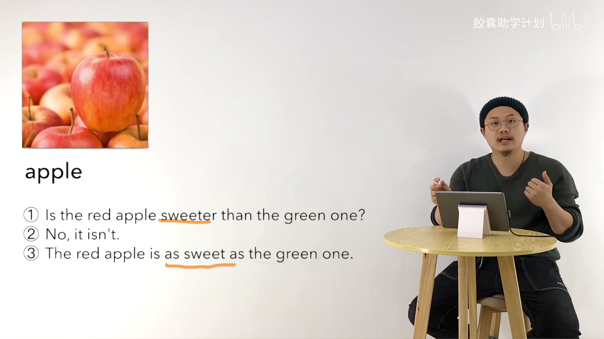

文字识别：胶囊助学计划H / apple / ① Is the red apple sweeter than the green one? / ② No, it isn't. / 3 The red apple is as sweet as the green one.

### 画面 00:00:51

文字识别：胶囊助学计划H / apple / ① Is the red apple sweeter than the green one? / ② No, it isn't. /  The red apple is as sweet as the green one.

### 画面 00:00:55

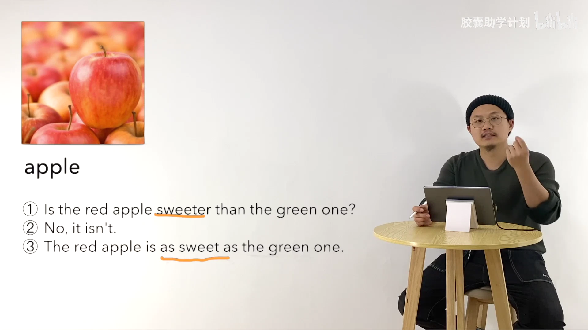

文字识别：胶囊助学计划州 / apple / ① Is the red apple sweeter than the green one? / ② No, it isn't. / 3 The red apple is as sweet as the green one.

### 画面 00:00:58

文字识别：胶囊助学计划册 / apple / ① Is the red apple sweeter than the green one? / ② No, it isn't. /  The red apple is as sweet as the green one.

## 00:01:00–00:01:30

读就可以了，好吧？来，next one, is the man shorter than the woman? No, he he he isn't. The man is as short as the woman.啊，他们同样的矮，对吧？Continue, is the television on the left more expensive than the television on the right? On the left在左面，on the right在右边。二十五课我们学的，您仔细想一想。

### 画面 00:01:01

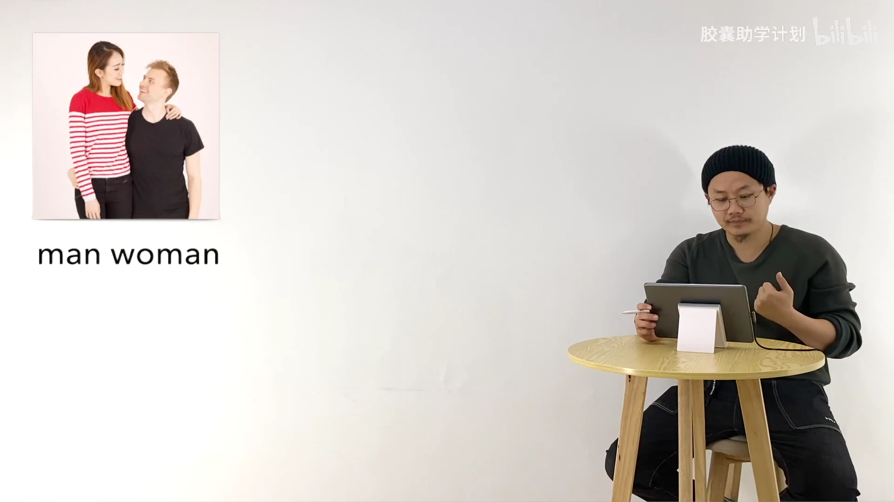

文字识别：胶囊助学计划 / man woman

### 画面 00:01:10

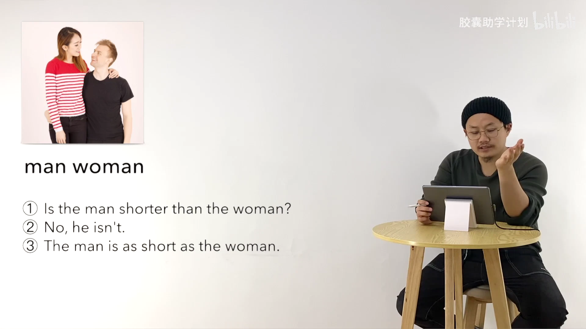

文字识别：胶囊助学计划H / man woman / ① Is the man shorter than the woman? / ② No, he isn't. /  The man is as short as the woman. / 3

### 画面 00:01:16

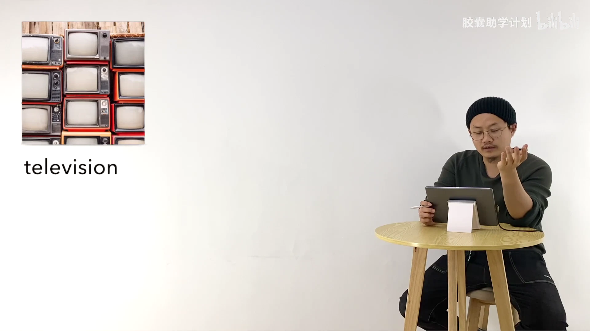

文字识别：胶囊助学计划 / television

## 00:01:30–00:02:00

No, it isn't. The television on the right is not as expensive as the television on the right. Okay. Next one. Is the red pencil blunter than the green one? No, it isn't blunt. 钝啊，那个刀钝了，铅笔钝了，对吧？The red pencil is as blunt as the green one. 哎，他们同样

### 画面 00:01:31

文字识别：LiH / 胶囊助学计划 / television / ① Is the television on the left more expensive / than the television on the right? / No, it isn't. / The television on the left is not as expensive / as the television on the right.

### 画面 00:01:36

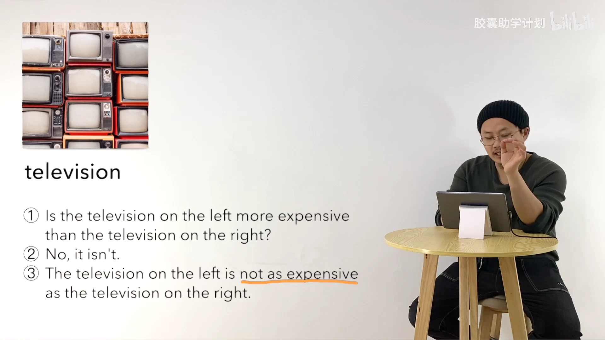

文字识别：胶囊助学计划 / television / ① Is the television on the left more expensive / than the television on the right? / No, it isn't. / The television on the left is not as expensive / as the television on the right.

### 画面 00:01:42

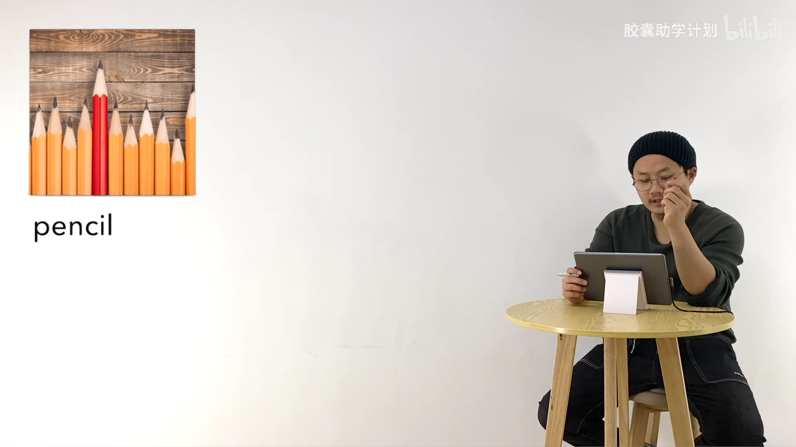

文字识别：胶囊助学计划bli / pencil

### 画面 00:01:51

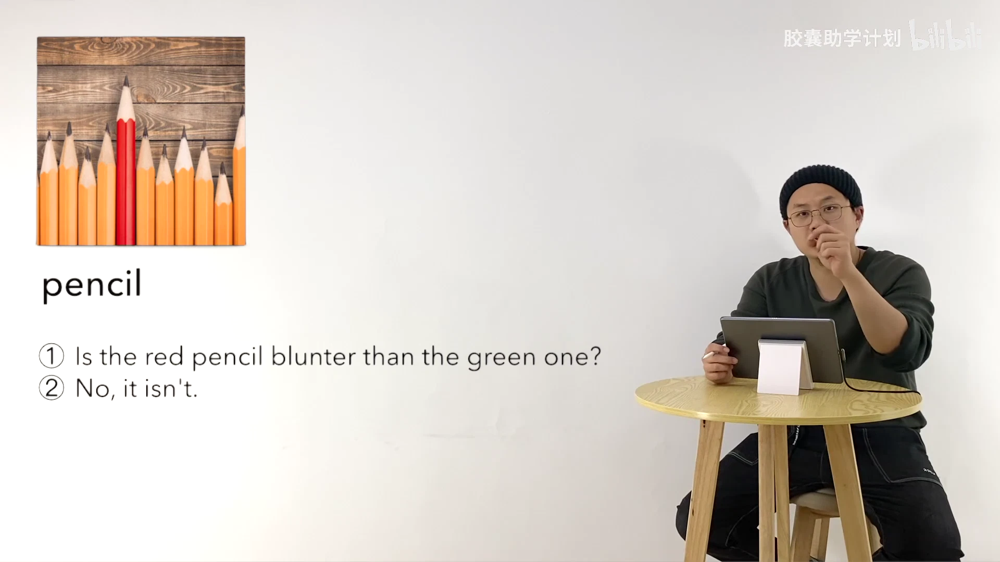

文字识别：胶囊助学计划レ册 / pencil / ① Is the red pencil blunter than the green one? / ② No, it isn't.

### 画面 00:01:59

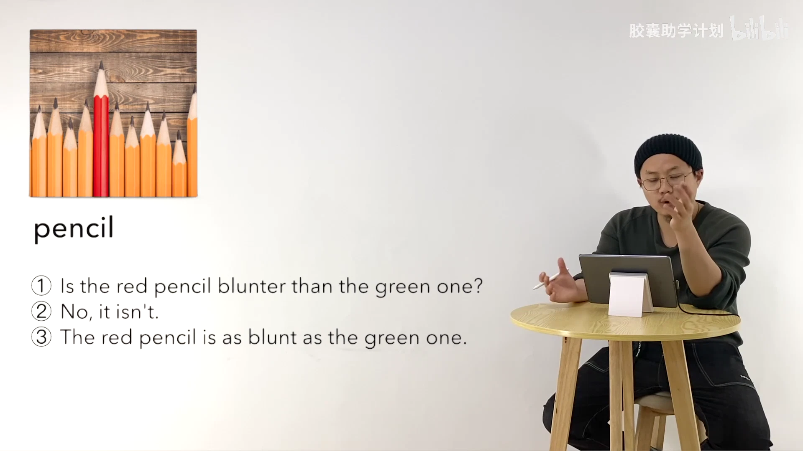

文字识别：胶囊助学计划l / pencil / ① Is the red pencil blunter than the green one? / ② No, it isn't. / 3 The red pencil is as blunt as the green one.

## 00:02:00–00:02:30

的不太好用，不锋利了，对吧？Next one, is the white handbag newer than the black one? No, it isn't. The white hand handbag is not as new as the black one.白色的这个不如黑色的那个新，对吧？Next one, is the policeman taller than the policewoman? No, he isn't. The

### 画面 00:02:03

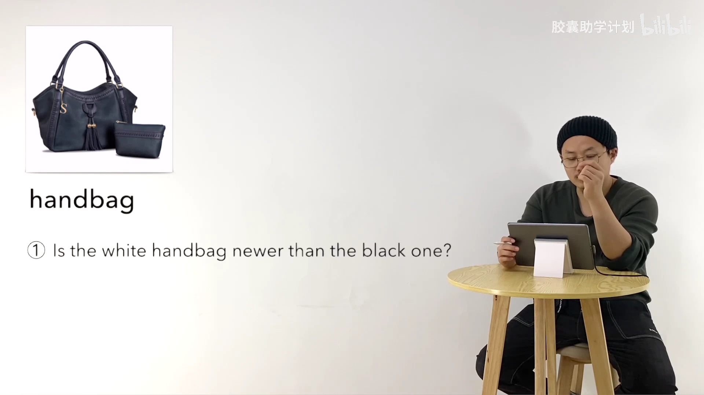

文字识别：胶囊助学计划l / handbag / ① Is the white handbag newer than the black one?

### 画面 00:02:21

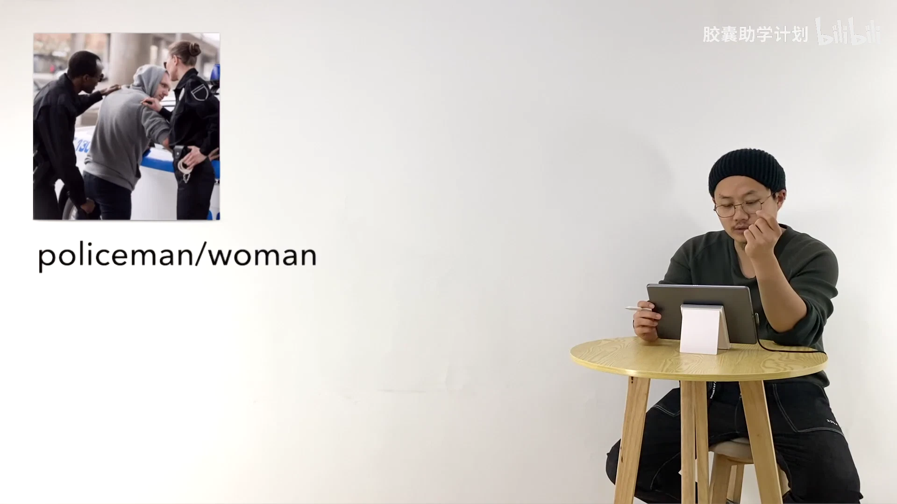

文字识别：胶囊助学计划b / policeman/woman

## 00:02:30–00:03:00

The policeman is not. It is as tall as the policewoman,同样高. Next one, is the woman on the left smarter than the woman on the right? Smarter, prettier. Okay,一个单词啊. No, she isn't. The woman on the left is not as smart as the woman on the right. Next one, is the

### 画面 00:02:30

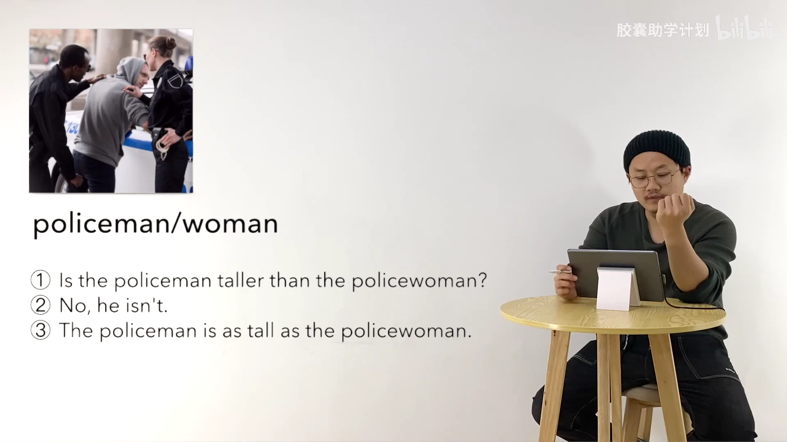

文字识别：胶囊助学计划H / 130 / policeman/woman / ① Is the policeman taller than the policewoman? / ② No, he isn't. / 3 The policeman is as tall as the policewoman. / 3

### 画面 00:02:38

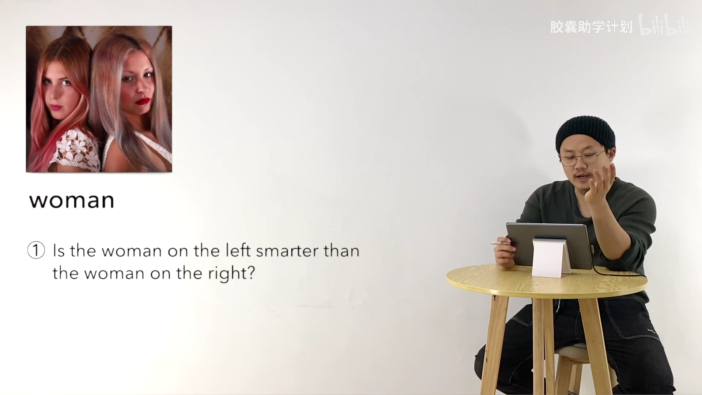

文字识别：胶囊助学计划H / woman / ① Is the woman on the left smarter than / the woman on the right?

### 画面 00:02:40

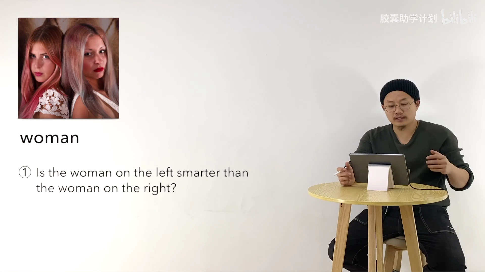

文字识别：胶囊助学计划Ll / woman / ① Is the woman on the left smarter than / the woman on the right?

### 画面 00:02:47

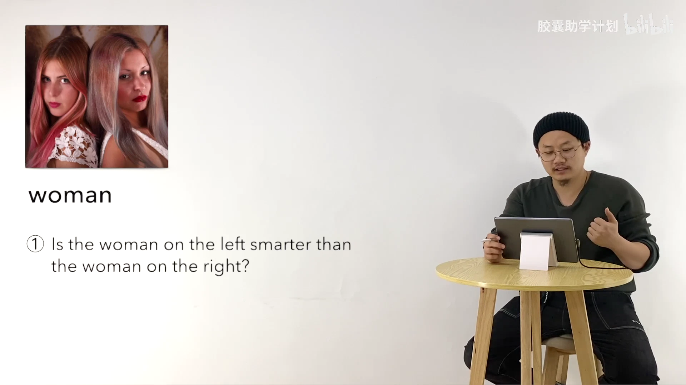

文字识别：胶囊助学计划bl / woman / ① Is the woman on the left smarter than / the woman on the right?

### 画面 00:02:50

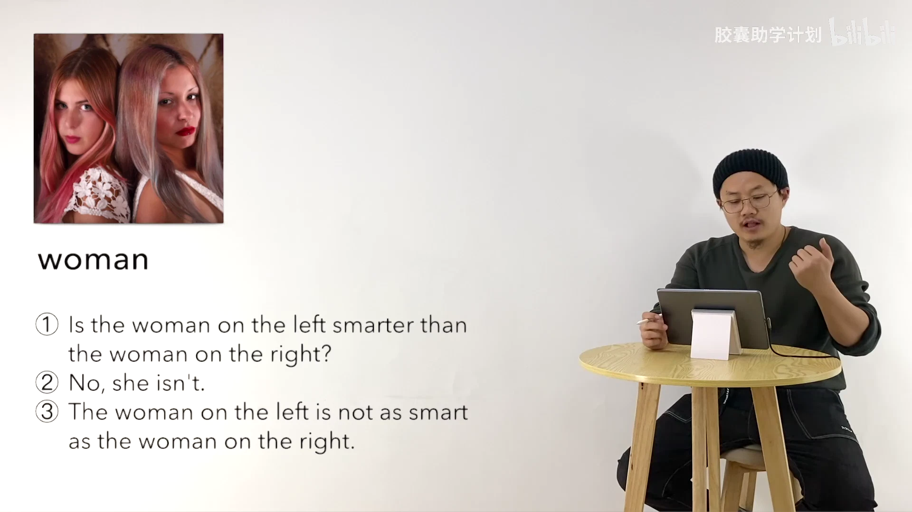

文字识别：胶囊助学计划M / woman / ① Is the woman on the left smarter than / the woman on the right? /  No, she isn't. /  The woman on the left is not as smart / as the woman on the right.

### 画面 00:02:55

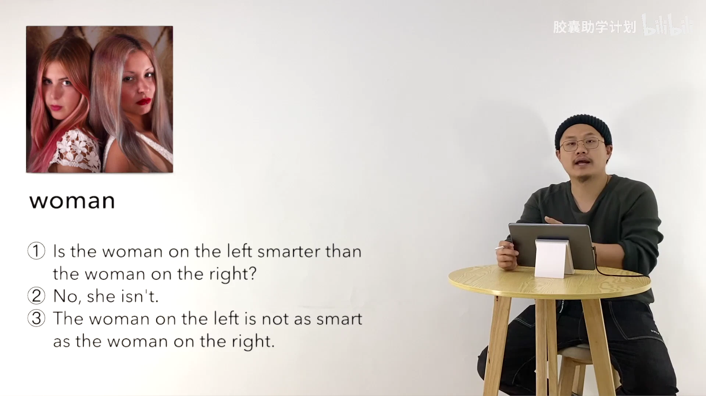

文字识别：胶囊助学计划H / woman / ① Is the woman on the left smarter than / the woman on the right? /  No, she isn't. / ) The woman on the left is not as smart / as the woman on the right.

### 画面 00:02:57

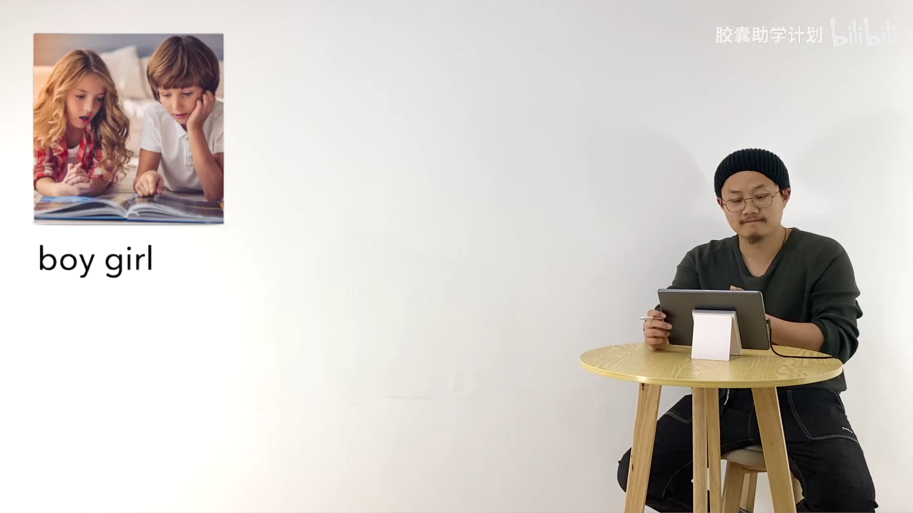

文字识别：胶囊助学计划Ll / boy girl

## 00:03:00–00:03:30

boy older than the girl? No, he isn't. The boy is as old as the girl. Next one, is the brown case lighter than the blue one? Light, heavy, heavy沉, light轻. No, it isn't. The brown case is not as light as the green blue one. Knife刀

### 画面 00:03:01

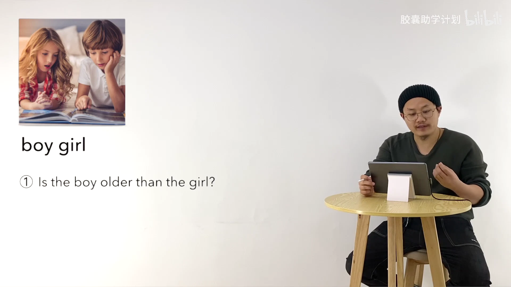

文字识别：胶囊助学计划Ll / boy girl / ① Is the boy older than the girl?

### 画面 00:03:10

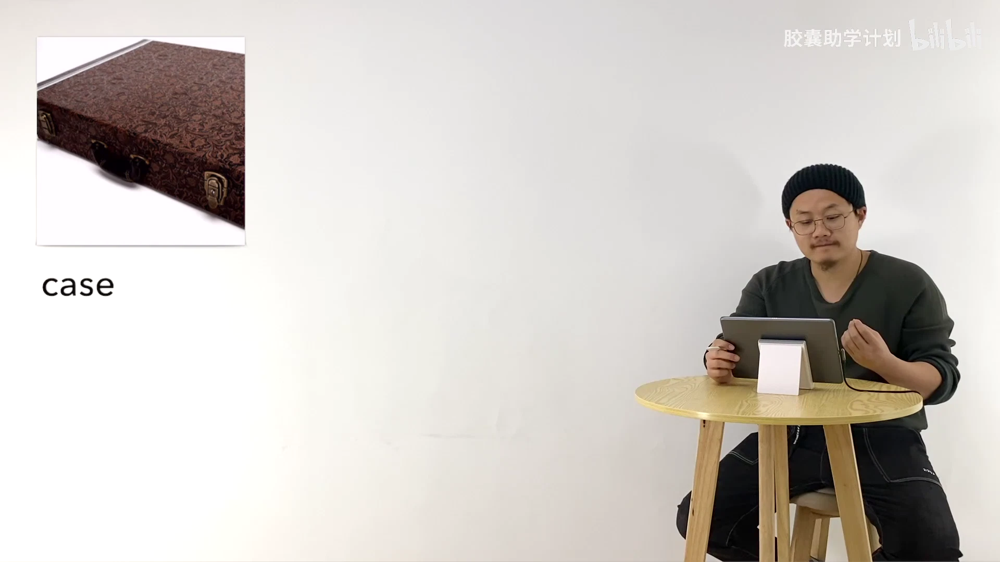

文字识别：胶囊助学计划i / case

### 画面 00:03:21

文字识别：胶囊助学计划lH / case / ① Is the brown case lighter than the blue one? / ② No, it isn't. / ) The brown case is not as light as the blue one.

### 画面 00:03:28

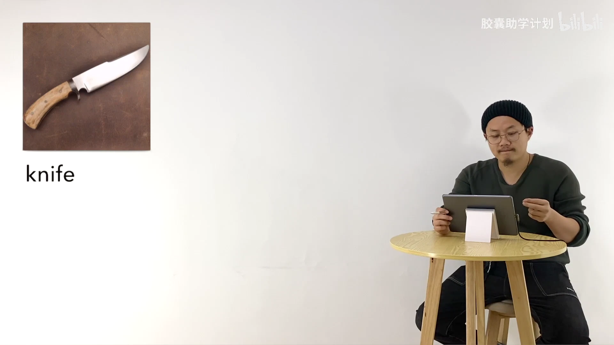

文字识别：胶囊助学计划LH / knife

## 00:03:30–00:04:00

啊, is the white knife sharper than the black one? Sharper,锋利. No, it isn't. The white knife is as sharp as the black one. Okay,那recap本课我们就主要练习了这两个东西，大声朗读出来，听力，口语练习。如果读一遍您效果不好，您不妨拉到视频前面，对吧？我们录屏课一个最好的事情就是您可以反复练，一遍不够来

### 画面 00:03:38

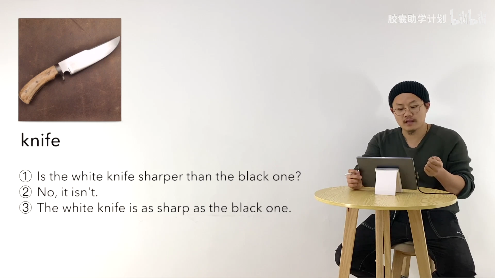

文字识别：胶囊助学计划H / knife / ① Is the white knife sharper than the black one? / ② No, it isn't. /  The white knife is as sharp as the black one.

### 画面 00:03:43

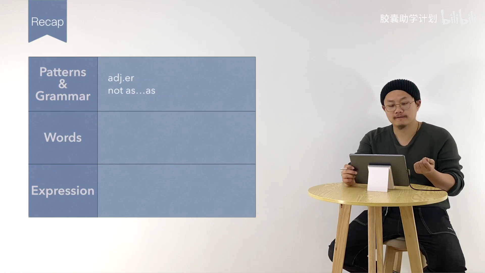

文字识别：胶囊助学计划 / biHL / Recap / Patterns / adj.er / & / not as...as / Grammar / Words / Expression

### 画面 00:03:46

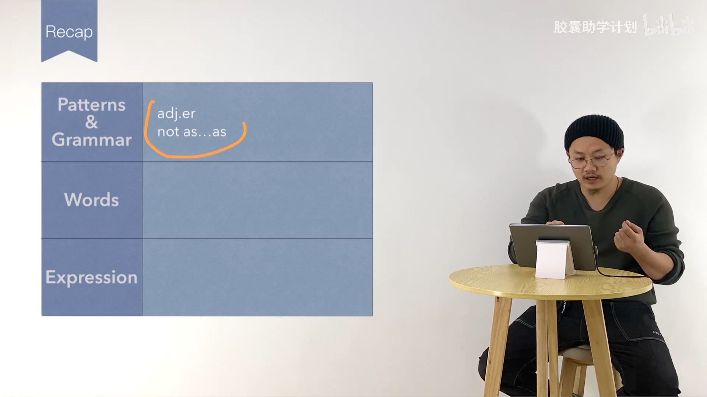

文字识别：Lilil / 胶囊助学计划 / Recap / Patterns / adj.er / not as...as / Grammar / Words / Expression

### 画面 00:03:48

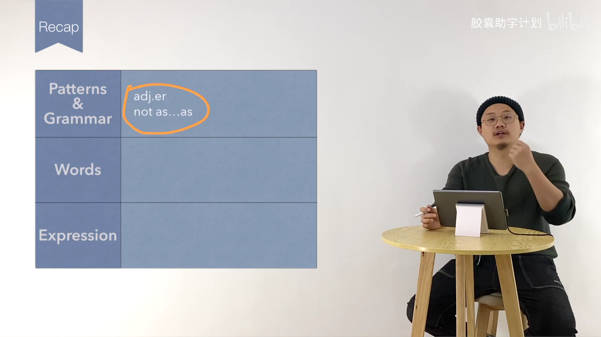

文字识别：胶囊助学计划 / Recap / Patterns / adj.er / & / not as...as / Grammar / Words / Expression

## 00:04:00–00:04:30

两遍啊，两遍不够来三遍，OK？好，呃，绿皮书一百一十二课作业各位可以写了。本视频的听力口语练习对吧？我们在这地方，各位如果一遍不够，您可以反复听几遍去做一个练习，然后呢给自己讲解一遍今天的核心知识点。呃，如果大家喜欢我们的课程，欢迎大家关注、订阅、一键三连、分享给那些需要的朋友。最后我们再来看一句名人名言：

### 画面 00:04:03

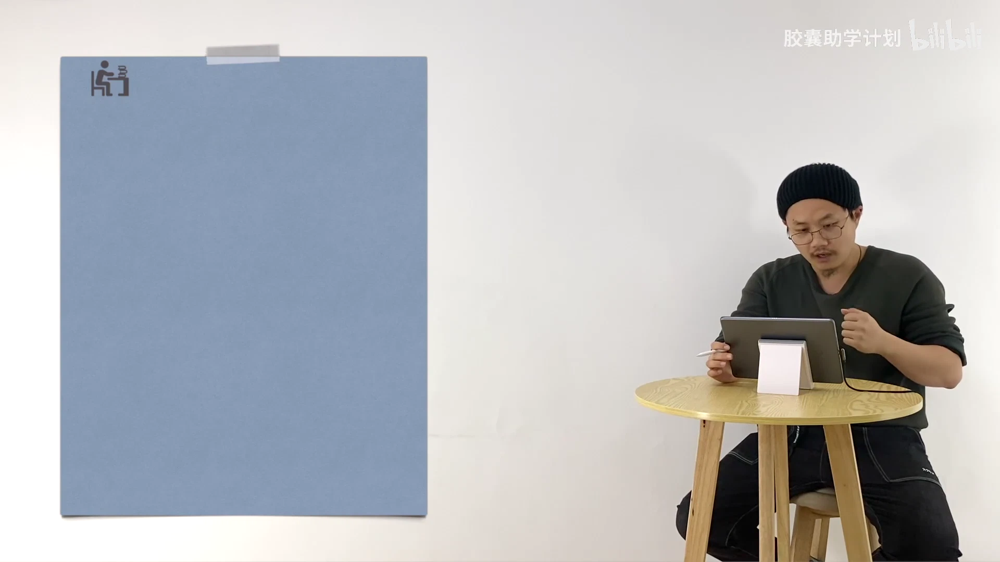

文字识别：胶囊助学计划

### 画面 00:04:19

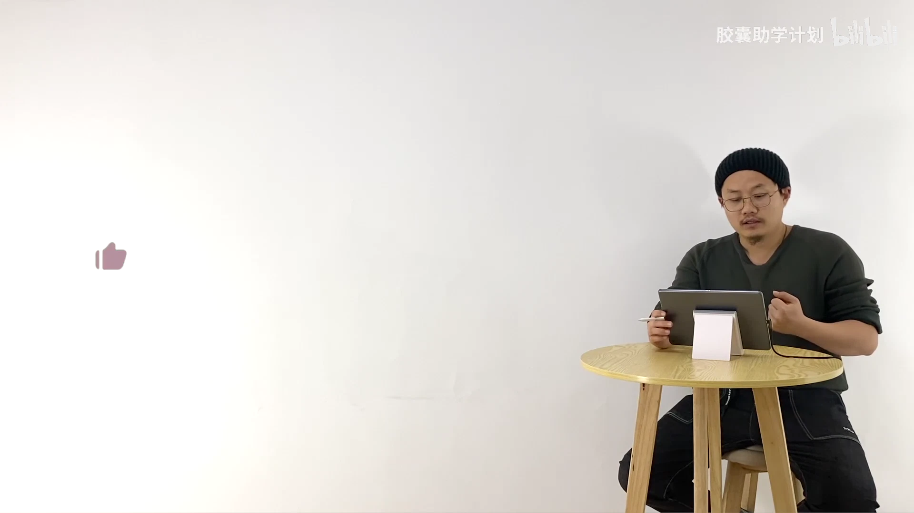

文字识别：胶囊助学计划H

### 画面 00:04:26

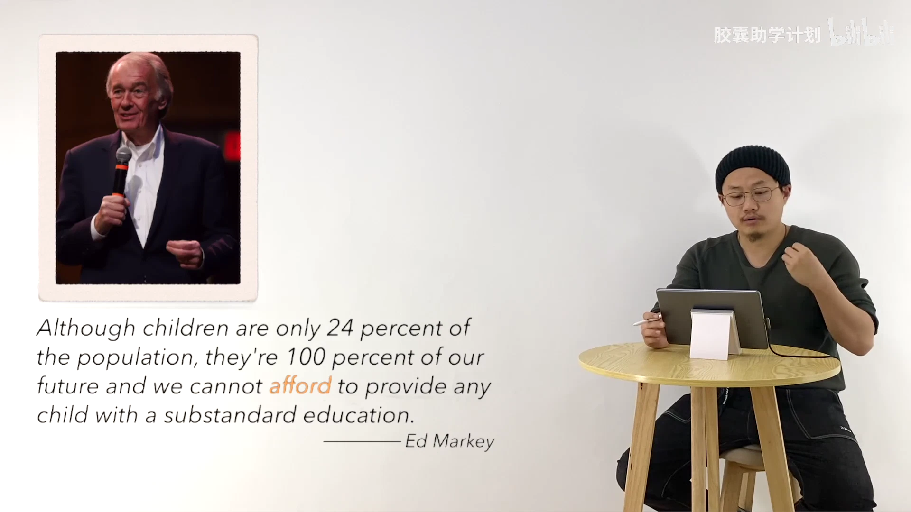

文字识别：胶囊助学计划册 / Although children are only 24 percent of / the population, they're 100 percent of our / future and we cannot afford to provide any / child with a substandard education. / Ed Markey

## 00:04:30–00:05:00

Although children are only twenty four percent of the population, they are one hundred percent of our future, and we cannot afford to pay any children, provide any child with a substandard education. Yeah, see you next time.

### 画面 00:04:50

### 画面 00:04:52

文字识别：CAPSULEACADEMY / 胶囊助学计划 / 小红书 / Lecturer / Leo / OE

### 画面 00:04:55

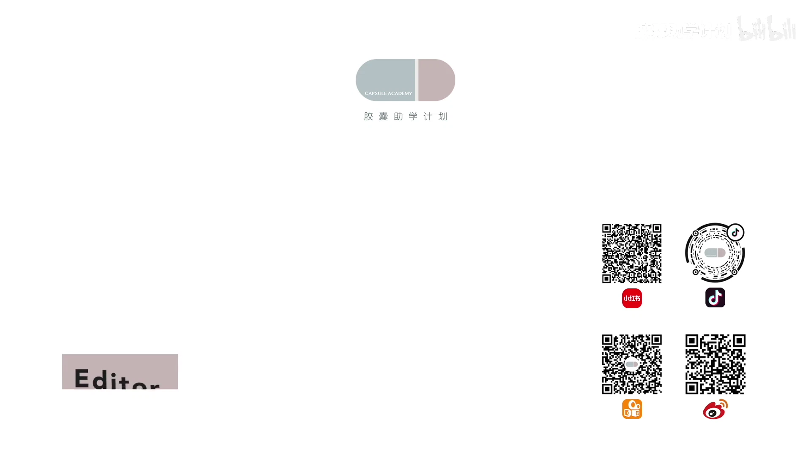

文字识别：CAPSULEACADEMY / 胶囊助学计划 / 小红书 / Editor / OE

### 画面 00:04:58

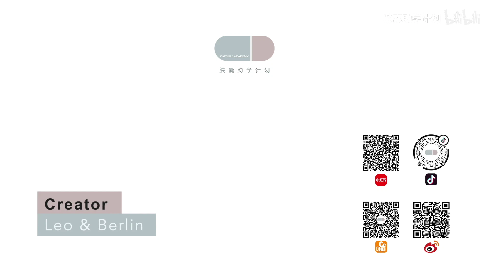

文字识别：CAPSULEACADEMY / 胶囊助学计划 / 小红书 / Creator / □ / Leo & Berlin

## 00:05:00–00:05:02

### 画面 00:05:00

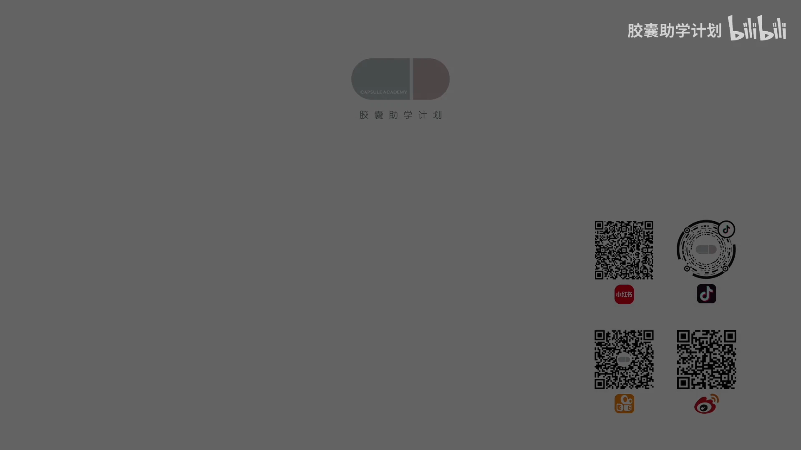

文字识别：bilibili / 胶囊助学计划 / 胶囊助学计划 / 小红书 / OE

### 画面 00:05:02

文字识别：bilibili / 胶囊助学计划

