# 113 单词 语法

快速机器解析：语音为单模型转写，未进行独立交叉校对或人工复核；画面每秒采样并按变化选帧，短时文字和标记可能遗漏。截图时间约有 1 秒误差。图片有损压缩；遇到疑点请按时间查看 Google Drive 原视频。

## 00:00:00–00:00:30

Hello everyone, welcome to Capsule Academy. This is Leo. Today we're going to learn New Concept English Book One, Lesson One Hundred and Thirteen, Grammar and Words. 那老习惯进入正式课程之前呢，我们看一个问题，如何去使用 no 和 not 这两个单词啊？带着这个问题，后面一个呢，Enjoy. 好呢，我们上来先说一下啊，看一下标题对吧？Not 和 no 对于各位来说非常

### 画面 00:00:00

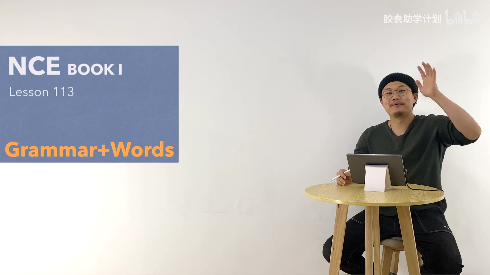

文字识别：胶囊助学计划 / NCE / BOOKI / Lesson 113 / Grammar+Words

### 画面 00:00:07

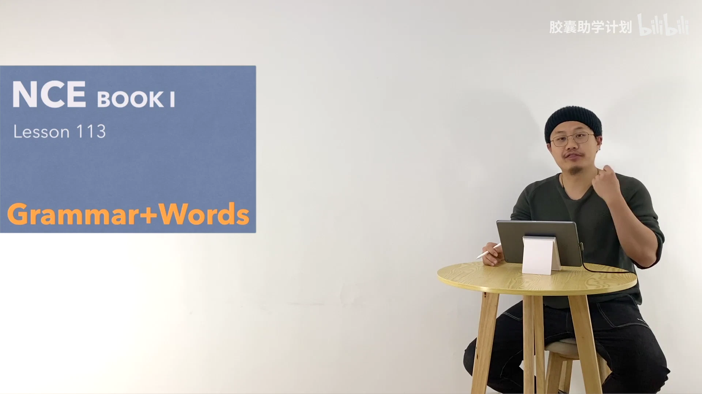

文字识别：胶囊助学计划 / NCE / BOOKI / Lesson 113 / Grammar+Words

### 画面 00:00:10

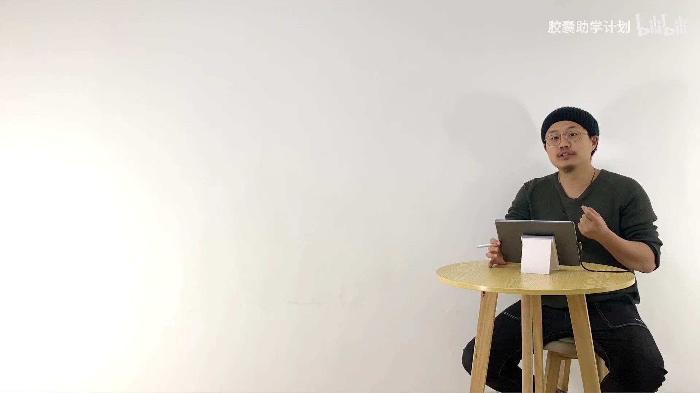

文字识别：胶囊助学计划

### 画面 00:00:12

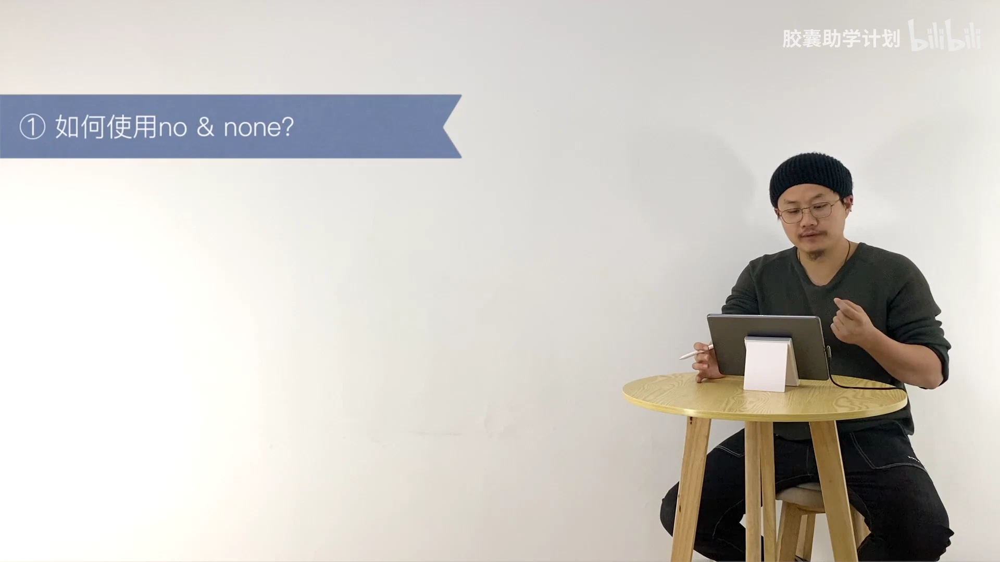

文字识别：胶囊助学计划 / ①如何使用no ＆ none？

### 画面 00:00:19

文字识别：胶囊助学计划bill / •

### 画面 00:00:23

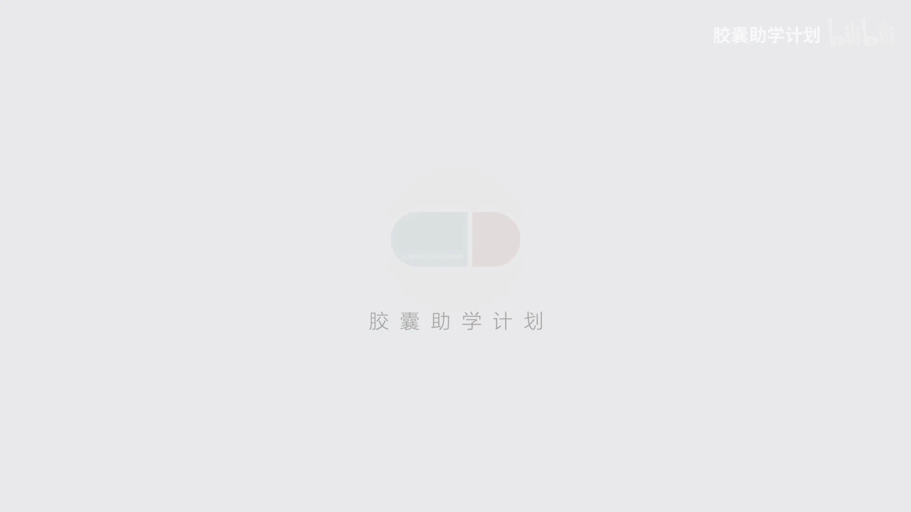

文字识别：胶囊助学计划

### 画面 00:00:25

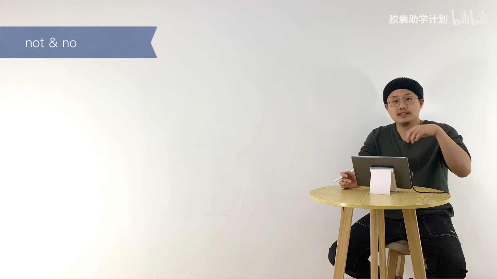

文字识别：胶囊助学计划 / not ＆ no

## 00:00:30–00:01:00

熟悉的就是 not 表否定，我们在很多的单词后边加 not 变成否定句，对不对？然后呢，那 no 这个单词对于各位来说简直就不是生词了。 Yes, no 是不是，对吧？那他们其实有一些相关性，比如说 not any 或者是 a an，它实际上等同于 no 加名词。什么意思？我们举个例子，比如说 I didn't see any cars in the street. 我没有看到任何

### 画面 00:00:44

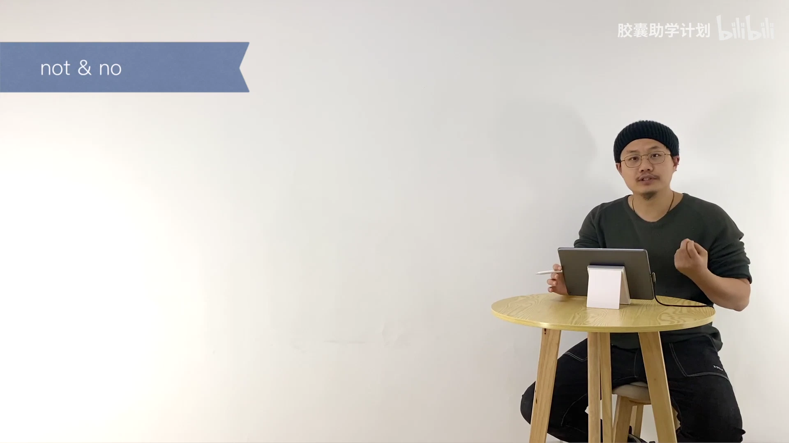

文字识别：胶囊助学计划 / not ＆ no

## 00:01:00–00:01:30

的汽车在街上。你我们在这里拆一下，not在这里，any在这里，名词在这里。我又说了，not any等于no加名词。那not实际上跟did是同时出现的，所以我们把did也取消掉。然后呢，我没有看到任何车在路上，那它就变成了叫做I saw no cars in the street。这个地方各位最容

### 画面 00:01:01

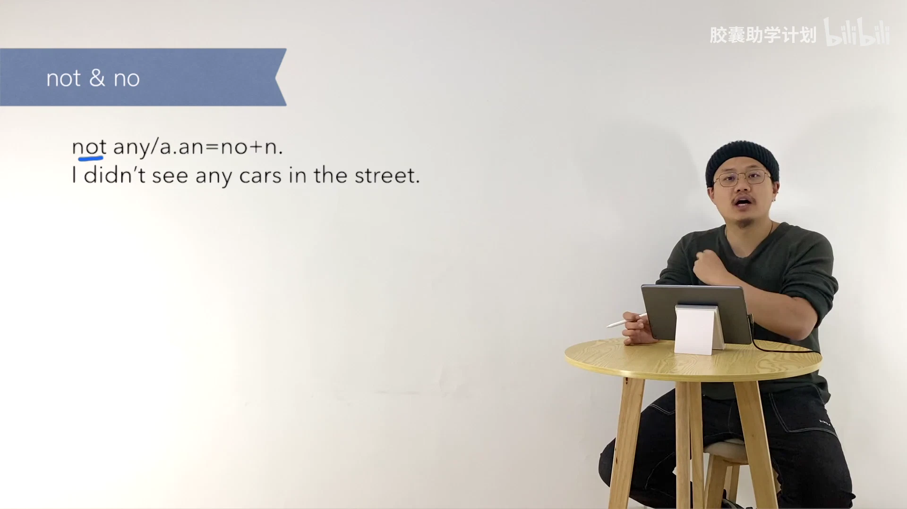

文字识别：胶囊助学计划 / not & no / not any/a.an=no+n. / I didn't see any cars in the street.

### 画面 00:01:03

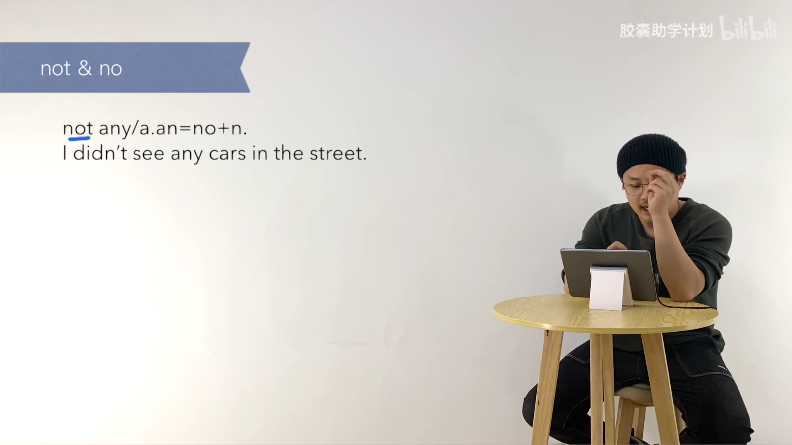

文字识别：胶囊助学计划 / Bilbi / not & no / not any/a.an=no+n. / I didn't see any cars in the street.

### 画面 00:01:06

文字识别：bilbil / 胶囊助学计划 / not & no / not any/a.an=no+n. / I didn't see any cars in the street.

### 画面 00:01:10

文字识别：bilbil / 胶囊助学计划 / not & no / not any/a.an=no+n. / I didn't see any carsin the street.

### 画面 00:01:13

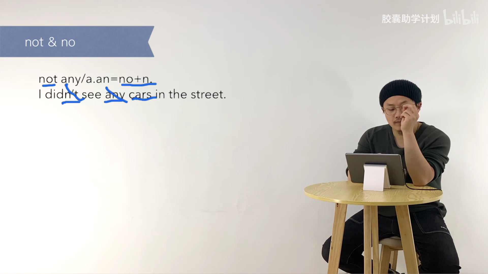

文字识别：Bilbil / 胶囊助学计划 / not & no / not any/a.an=no+n. / I didnt see any cars in the street.

## 00:01:30–00:02:00

易错的，其实反而不一定是 no 加 cars，反而可能是这个 saw。您可能会忘掉，您可能就会像刚才我那样，把它直接说成叫 I see no cars in the street。但是你要注意它的时态，前面是 didn't，所以你要把 see 换成 saw，对吧？我们再多来几个例子啊，比如说 I haven't got any time， haven't any 等于 no，那叫做 I

### 画面 00:01:32

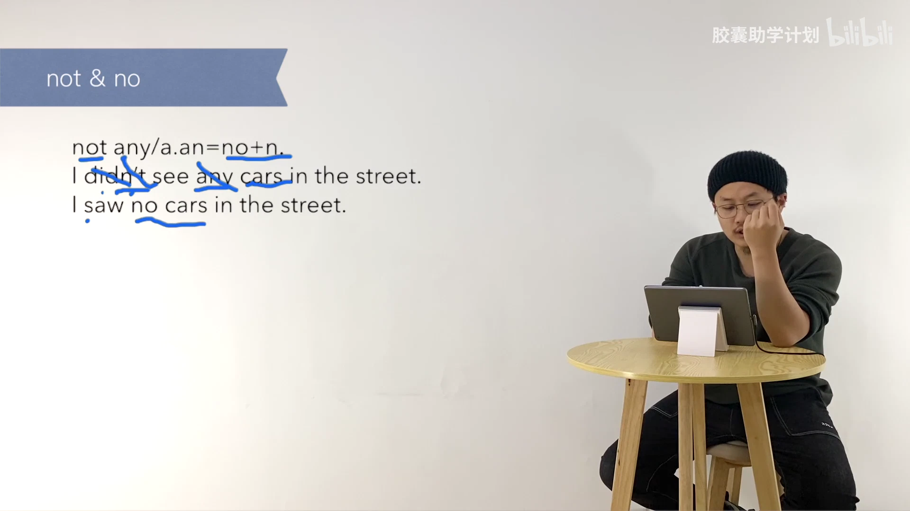

文字识别：bilibili / 胶囊助学计划 / not ＆ no / not any/a.an=no+n. / Iaidhet see av carsin t / the / street. / I saw no cars in the / street.

### 画面 00:01:36

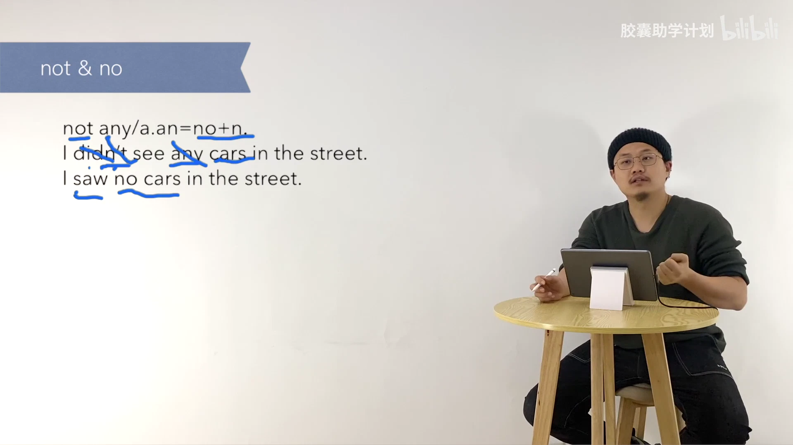

文字识别：胶囊助学计划 / not ＆ no / not any/a.an=no+n. / Iandht see anv cars in t / the / street. / I saw no cars in the / street.

### 画面 00:01:50

文字识别：胶囊助学计划 / not & no / not any/a.an=no+n.

### 画面 00:01:54

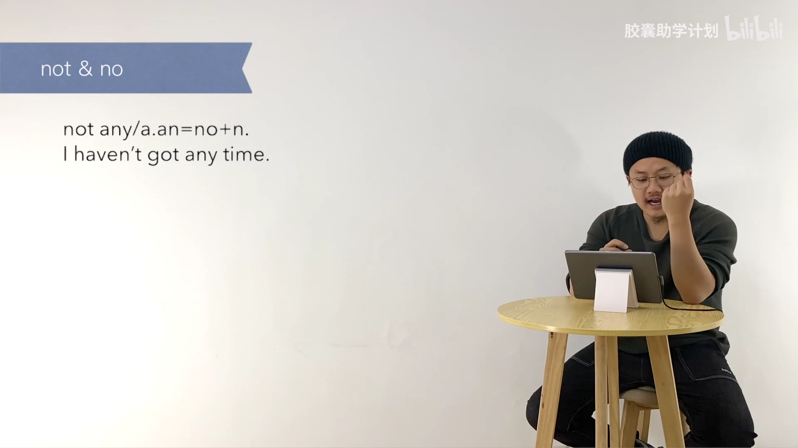

文字识别：Bilibi / 胶囊助学计划 / not & no / not any/a.an=no+n. / I haven't got any time.

### 画面 00:01:57

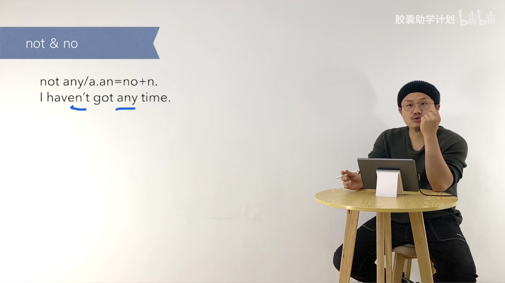

文字识别：胶囊助学计划 / SiliBi / not & no / not any/a.an=no+n. / I haven't got any time.

## 00:02:00–00:02:30

got no time，就我没有时间了，跟 I haven't got any time 一个意思。Not any 等于 no 加名词，好理解哈。比如说再来一个 I haven't got any money，同理，那叫做 I have got no money。我有的是没有钱啊，其实就是我没有钱。OK，一个道理啊。再来，比如说 There aren't any books， aren't

### 画面 00:02:07

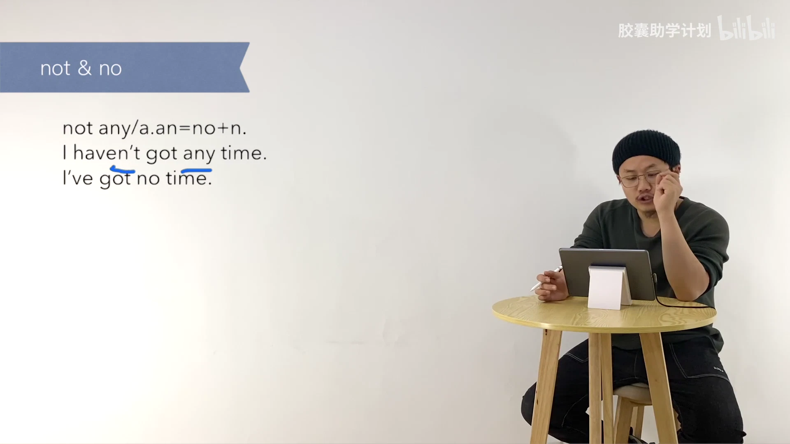

文字识别：bilbil / 胶囊助学计划 / not & no / not any/a.an=no+n. / I haven't got any t /  time. / I've got not / time.

### 画面 00:02:11

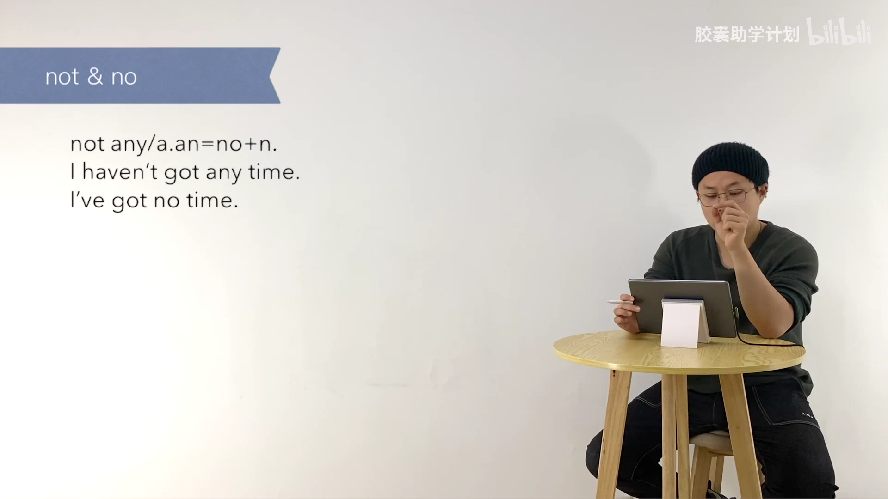

文字识别：bilbi / 胶囊助学计划 / not & no / not any/a.an=no+n. / I haven't got any time. / I've got no time.

### 画面 00:02:24

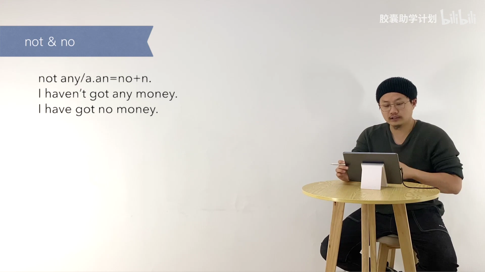

文字识别：b出b / 胶囊助学计划 / not & no / not any/a.an=no+n. / I haven't got any money. / I have got no money.

### 画面 00:02:28

文字识别：胶囊助学计划 / not & no / not any/a.an=no+n. / There aren't any books on the shelves.

## 00:02:30–00:03:00

any books on the shelf? 那您就这地方就特别简单了，就是 there are no books on the shelf. Not any等于no加名词，对不对？No后边加books嘛，那等同于 there are no books on the shelves. 架子上没有书。 Okay, 刚才我们讲到了 no, not, 跟 no, 我们再多来一个叫做 none, 还是没有的意思。那

### 画面 00:02:30

文字识别：Bilibili / 胶囊助学计划 / not & no / not any/a.an=no+n. / There aren't any books on the shelves.

### 画面 00:02:35

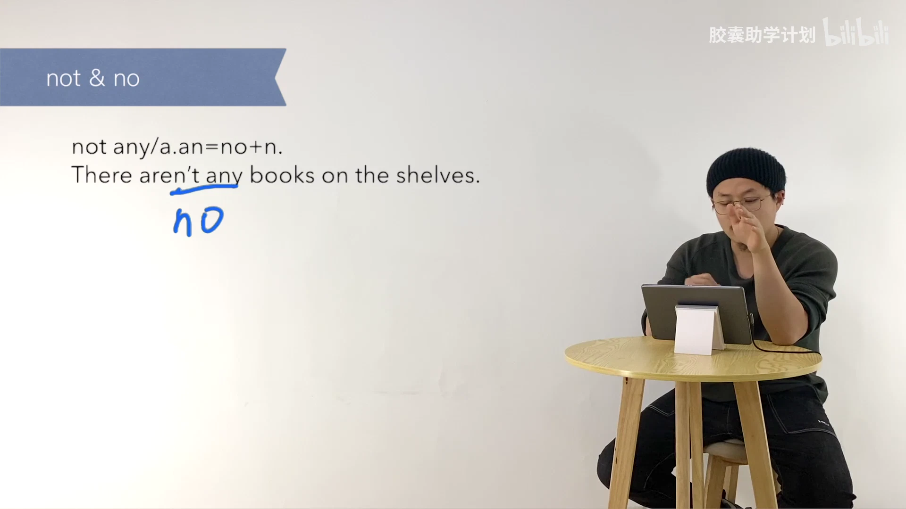

文字识别：bilbl / 胶囊助学计划 / not & no / not any/a.an=no+n. / There aren't any books on the shelves. / hO

### 画面 00:02:40

文字识别：Bilbili / 胶囊助学计划 / not & no / not any/a.an=no+n. / There aren't any books on the shelves. / hO

### 画面 00:02:43

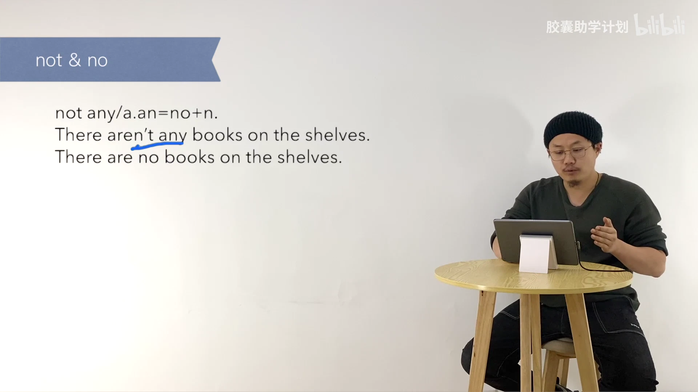

文字识别：胶囊助学计划 / not & no / not any/a.an=no+n. / There aren't any books on the shelves. / There are no books on the shelves.

### 画面 00:02:46

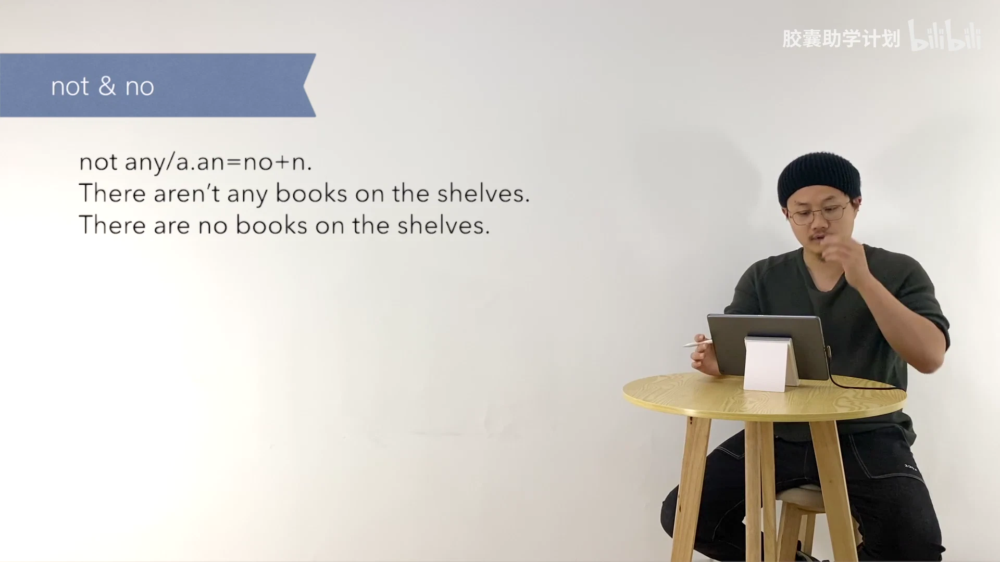

文字识别：胶囊助学计划 / not & no / not any/a.an=no+n. / There aren't any books on the shelves. / There are no books on the shelves.

### 画面 00:02:49

文字识别：bilib / 胶囊助学计划 / not &no & none

### 画面 00:02:51

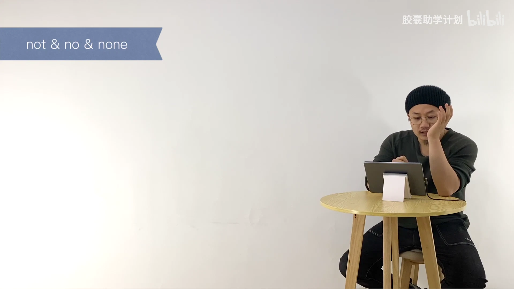

文字识别：Bilibi / 胶囊助学计划 / not &no & none

### 画面 00:02:53

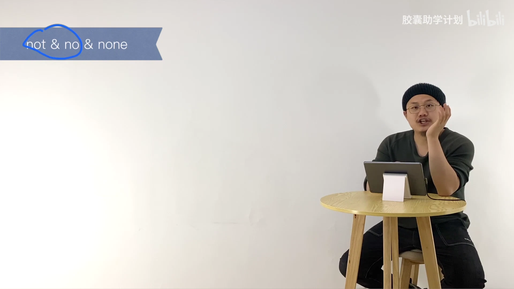

文字识别：Biibi / 胶囊助学计划 / not &no&none

### 画面 00:02:56

文字识别：Bilbil / 胶囊助学计划 / not &no&none

## 00:03:00–00:03:30

他们之间的联系又是什么呢？就是 no 加名词等于 none。我举个例子，Have you got any beer？啊，你问别人有啤酒吗？他说，We haven't got any beer。我们没有任何啤酒啊。比如说你去酒吧要买酒，你你说，哎，Have you got any beer？你这有酒吗？啤酒吗？他说，We haven't got any beer。我们这儿啊只卖洋酒，是吧？只卖什么 whiskey 啊，等等啊， tequila 啊，是吧？啊，

### 画面 00:03:02

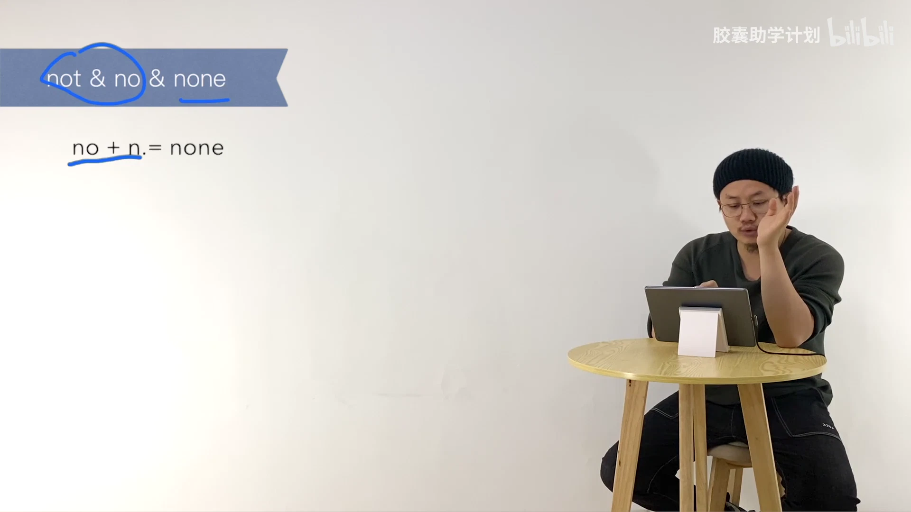

文字识别：Bilbill / 胶囊助学计划 / not&no&none / no +n.= none

### 画面 00:03:05

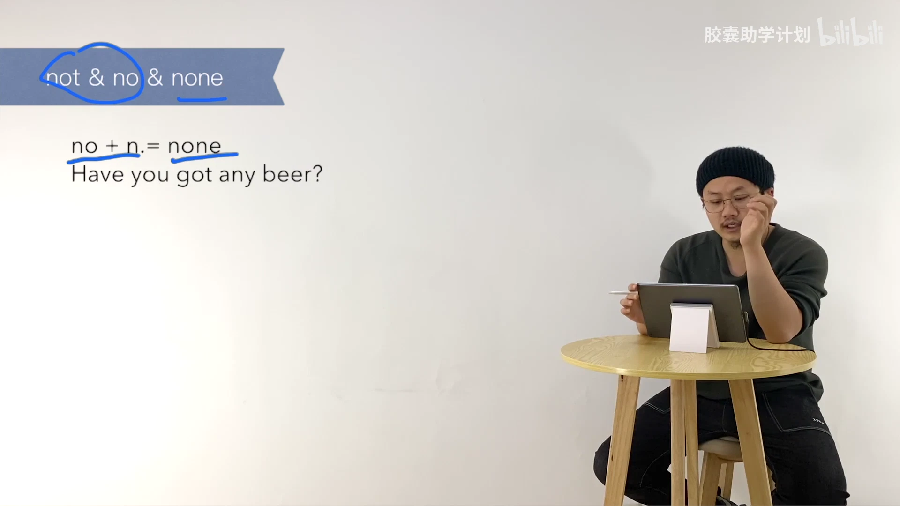

文字识别：bilbl / 胶囊助学计划 / not &no&none / no +n.= none / Have you got any beer?

### 画面 00:03:19

文字识别：胶囊助学计划 / not &no&none / no +n.= none / Have you got any beer? / We haven't got any beer.

## 00:03:30–00:04:00

mosquito啊，它不卖啤酒。那 haven't got any。那它等于首先叫 we've got no beer。那 no beer 就等于 none，叫做 we've got none。各位能看到 none 的使用的时候，有一个小的前提，你必须知道前后文语境当中出现这个名词。就像我现在说 I've got none，你会理解是什么？你会理解为第一，你会纳闷你没有什么呀。第二，你可能会理解为是不是他在表示我一无所有

### 画面 00:03:33

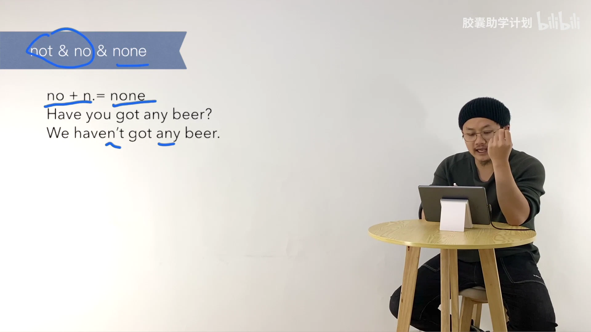

文字识别：bilbil / 胶囊助学计划 / not &no&none / no +n.= none / Have you got any beer? / We haven't got any / beer.

### 画面 00:03:38

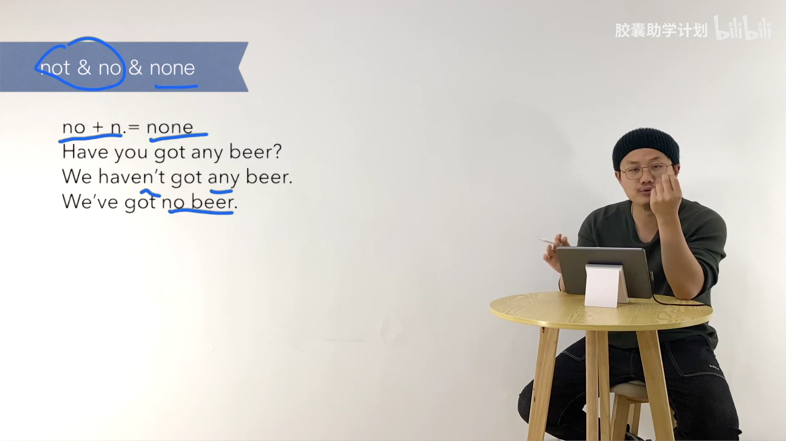

文字识别：Bilibi / 胶囊助学计划 / not &no&none / no+n.=1 / none / Have you got any beer? / We /  haven't got any / beer. / We've got no beer.

### 画面 00:03:43

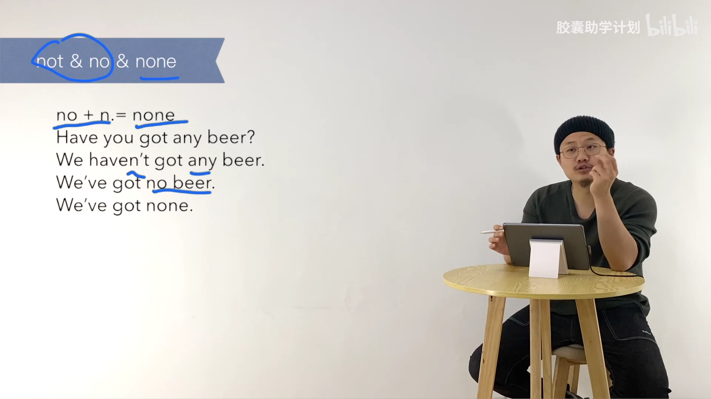

文字识别：胶囊助学计划 / not &no& none / no + n.= none / Have you got any beer? / We /  haven't got any / beer. / We've / got no beer. / We've / got none.

### 画面 00:03:49

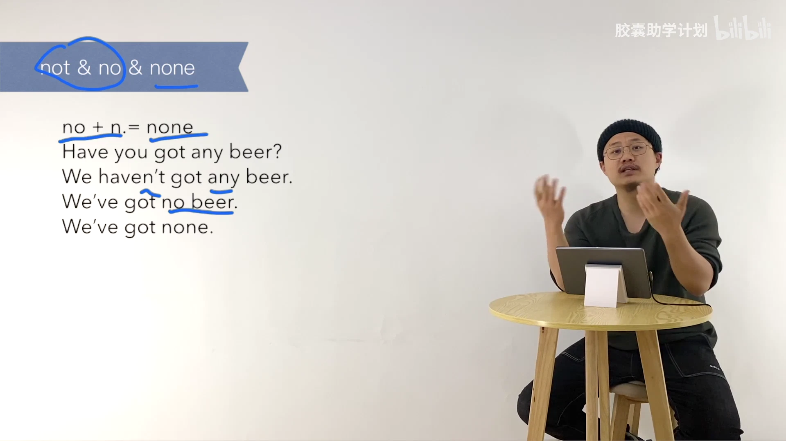

文字识别：胶囊助学计划 / not &no& none / no + n.= none / Have you got any beer? / We / e haven't got any / beer. / We've / got no beer. / We've / got none.

### 画面 00:03:56

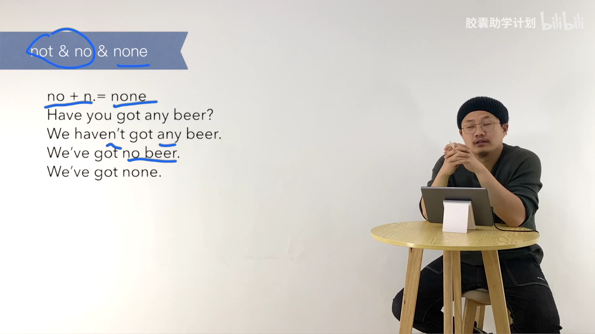

文字识别：胶囊助学计划 / not&no&none / no +n.= / none / Have you got any beer? / We /  haven't got any / beer. / We've / got no beer. / We've / got none.

## 00:04:00–00:04:30

啊？对吧？那我至少还有个帽子，对吧？我至少还有个衣服，那是不是我什么都没有啊？不是，是吧？Okay,所以none再去用的时候要记住那个名词前后文应该是出现了的啊。Okay,我们再来，比如说There aren't any students, not any等于no叫做There are no students in the classroom.教室里没有学生啊，也可以说There are none. Okay, one more good.好，比如说再来说He's got

### 画面 00:04:02

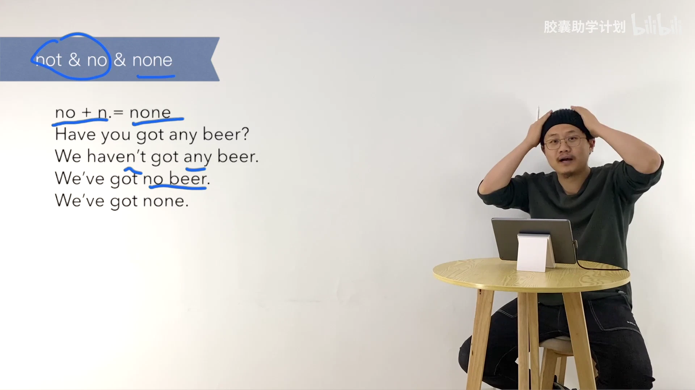

文字识别：胶囊助学计划 / not &no&none / no+n.= / none / Have you got any beer? / We /  haven't got any / beer. / We've / gotno beer. / We've / got none.

### 画面 00:04:13

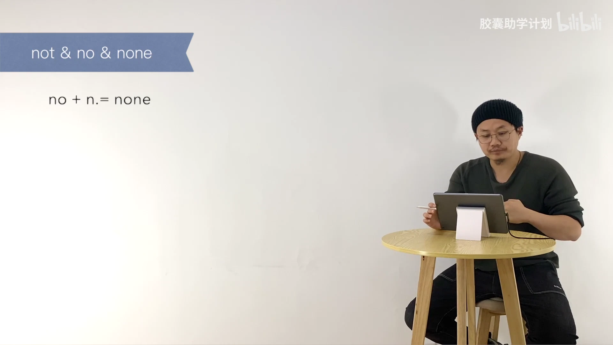

文字识别：胶囊助学计划 / not & no & none / no + n.= none

## 00:04:30–00:05:00

no money. He's got no girlfriend.您看，您读懂这句话特别容易，是吧？他没有钱，没有女朋友，no job，没有工作。He's got no car.他也没有车。He's got no house.他也没有房。He's got none.那这个none指的是什么？是不是就是这些名词了？Money, girlfriend, job, car, house.那就可以翻译成他一无所有了，是不是？OK, very good.呃，

### 画面 00:04:32

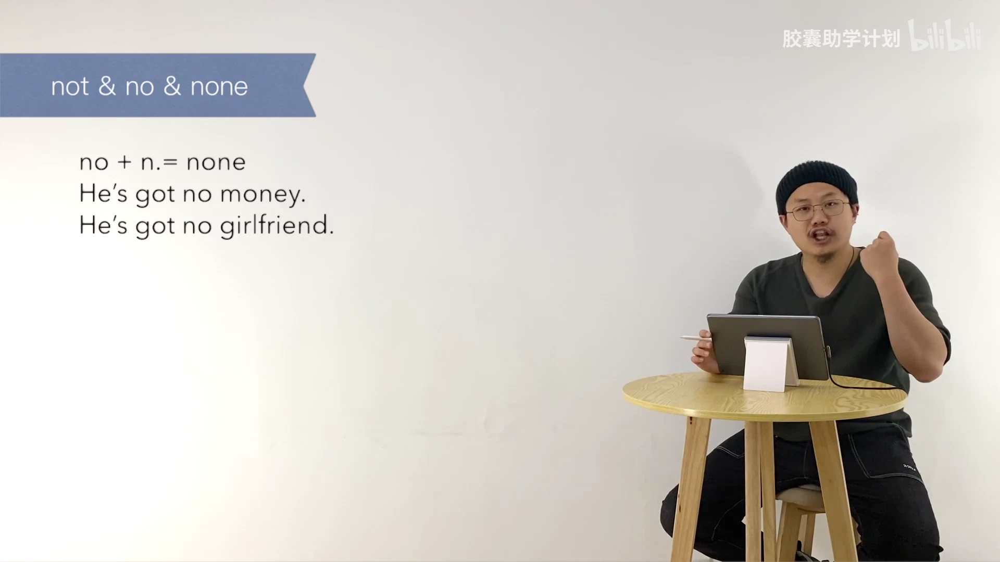

文字识别：胶囊助学计划 / not & no & none / no + n.= none / He's got no money. / He's got no girlfriend.

### 画面 00:04:46

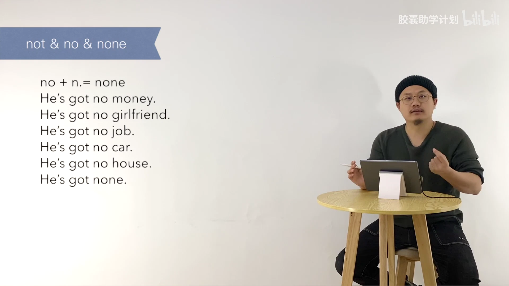

文字识别：胶囊助学计划 / not &no ＆none / no + n.= none / He's got no money. / He's got no girlfriend. / He's got no job. / He's got no car. / He's got no house. / He's got none.

### 画面 00:04:49

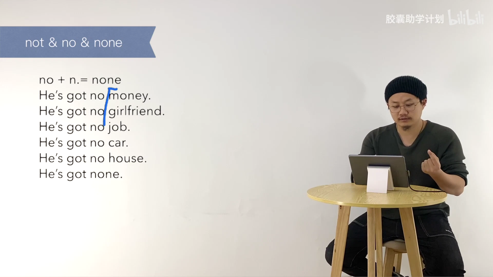

文字识别：胶囊助学计划 / not &no &none / no + n.= none / He's got nomoney. / He's got nogirlfriend. / He's got no job. / He's got no car. / He's got no house. / He's got none.

### 画面 00:04:51

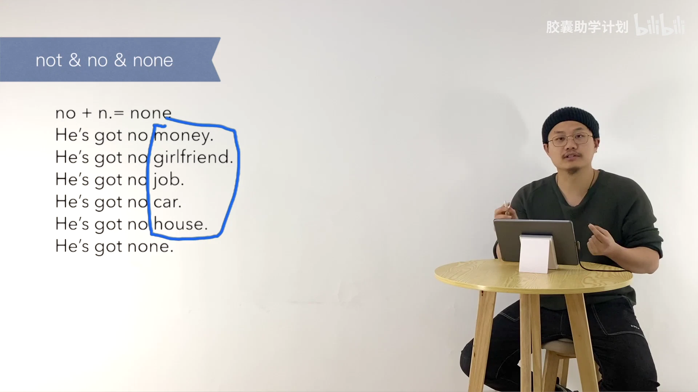

文字识别：胶囊助学计划 / not & no &none / no + n.= none / He's got nomoney. / He's got nogirlfriend. / He's got nojob. / He's got no / car. / He's got no / house. / He's got none.

### 画面 00:04:59

文字识别：胶囊助学计划 / /kan'dnkta/ / conductor

## 00:05:00–00:05:30

呃，本文的这个语法点很小，我们在文章当中还会再见到。那我们在处理它之前呢，我们先看一下本文的单词啊。第一个，售票员，来，conductor，conductor，售票员。那它明显是个名词。我们去造句的时候，它是一个人，就是一个名词。您就想想之前学过的各种语法学派，往里去联系联系就可以了。好吧，我随便写几个啊。我写几个我们刚刚学过的。说This conductor is taller than that one.

### 画面 00:05:05

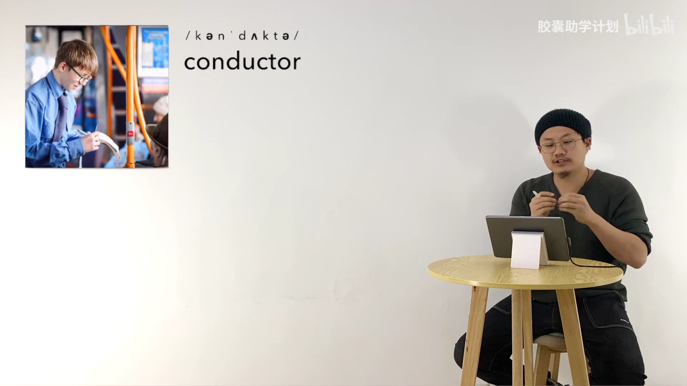

文字识别：胶囊助学计划 / biL / /kan'dakta/ / conductor

### 画面 00:05:09

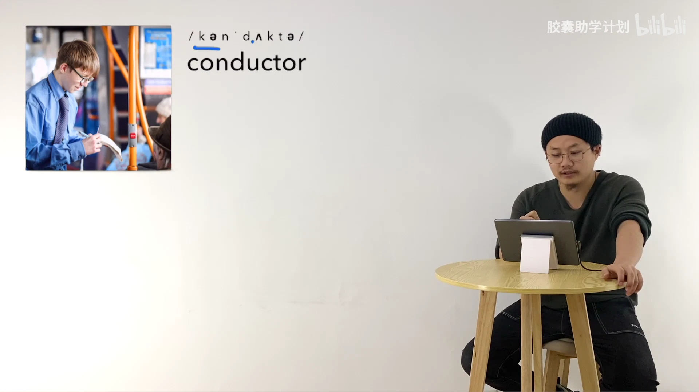

文字识别：bilb / 胶囊助学计划 / /kan'd.nkta/ / conductor

### 画面 00:05:11

文字识别：胶囊助学计划 / /kan'd.akta/ / conductor

### 画面 00:05:14

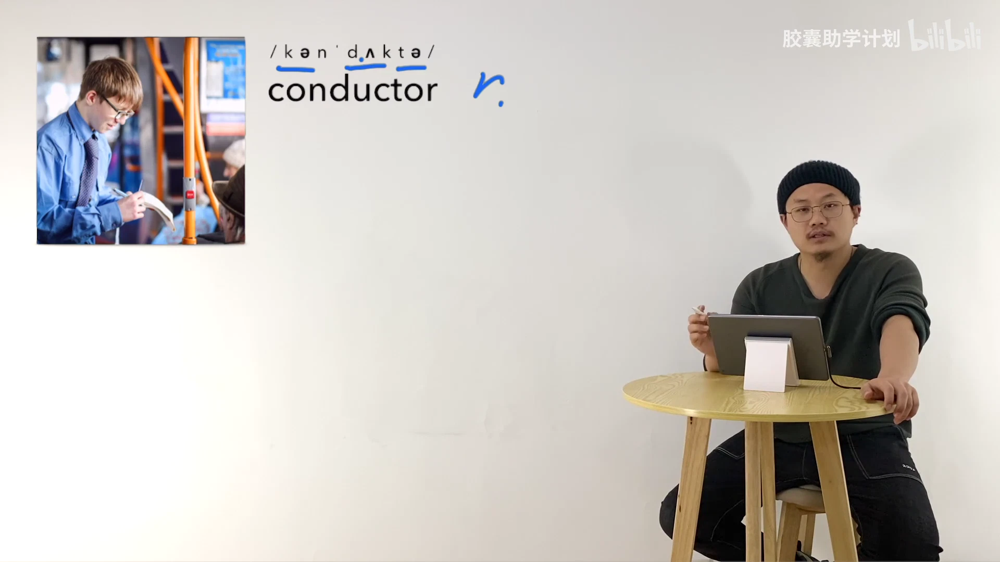

文字识别：Bitb / 胶囊助学计划 / /kan'd.akta/ / conductor

### 画面 00:05:18

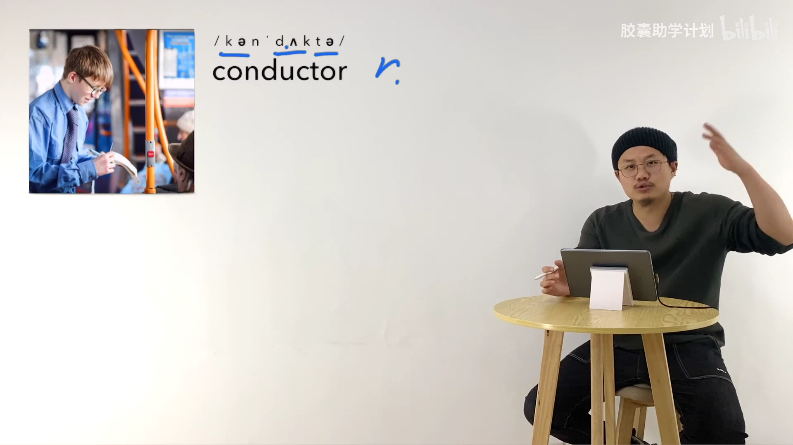

文字识别：胶囊助学计划 / /kan'd.nkta/ / conductor

### 画面 00:05:23

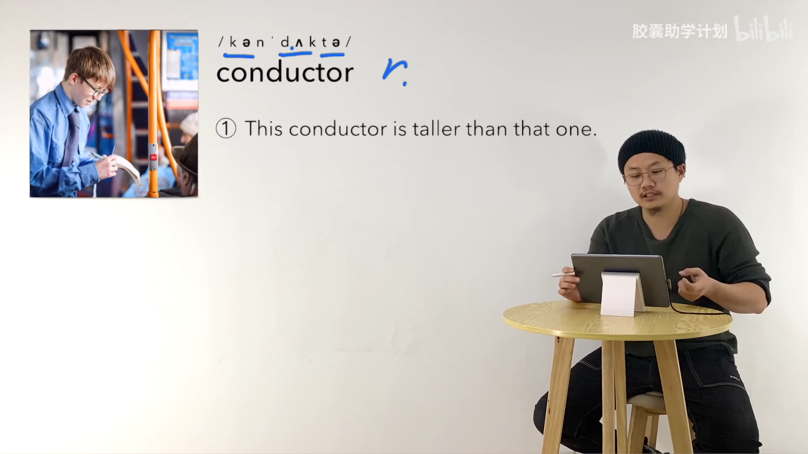

文字识别：胶囊助学计划 / / kan'd.akta / / conductor / ① This conductor is taller than that one.

### 画面 00:05:27

文字识别：胶囊助学计划 / / kan'd.akta / / conductor / ① This conductor is taller than that one.

### 画面 00:05:29

文字识别：胶囊助学计划 / / kan'd.akta / / conductor / ① This conductor is tallerthan that one,

## 00:05:30–00:06:00

说这个比那个高一百零七克，对不对？再来，比如说，this conductor is the kindest guy I've ever seen.说是我亲眼见过的最善良的一个人。OK，玩一个下一个单词，我们直接看一下就可以了。进入文章再说了，我们不拿它去造句，您课下试着去造一下。跟我一起读，叫做fare，fare叫做车票，对吧？当然了，对于各位来说，其实另一个比较熟悉的叫做ticket，

### 画面 00:05:35

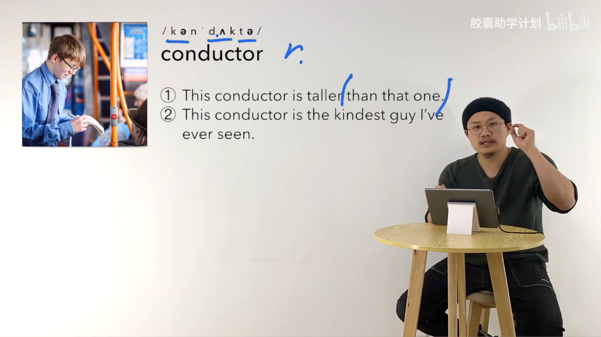

文字识别：胶囊助学计划 / / kan'd.akta / / conductor / ① This conductor is tallerthan that one, / This conductor is the kindest guy I've / ever seen.

### 画面 00:05:38

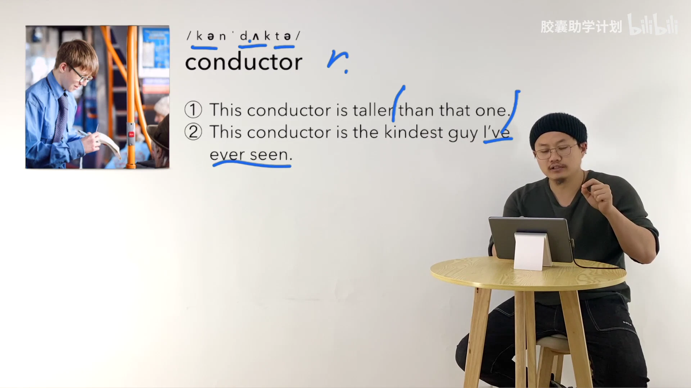

文字识别：胶囊助学计划 / 出 / / kan'd.akta / / conductor / ① This conductor is tallerthan that one. / This conductor is the kindest guy l've / ever seen.

### 画面 00:05:43

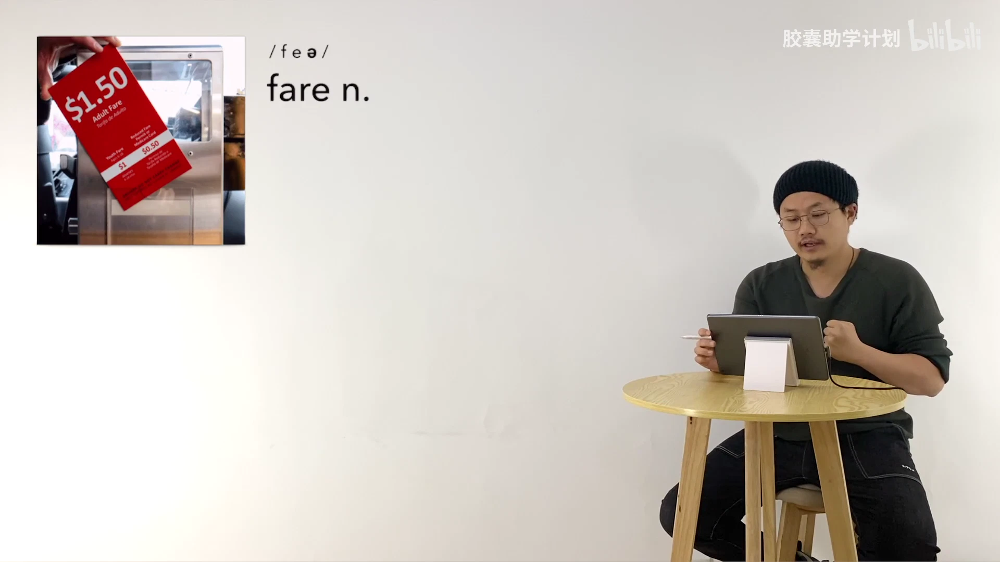

文字识别：BilD / 胶囊助学计划 / /feal / fare n. / $1.50 / S0.50

### 画面 00:05:46

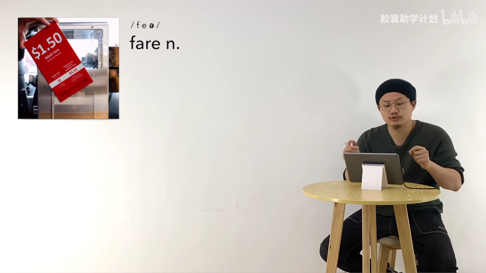

文字识别：bilbi / 胶囊助学计划 / /fea/ / fare n. / $1.50 / $0.50

### 画面 00:05:50

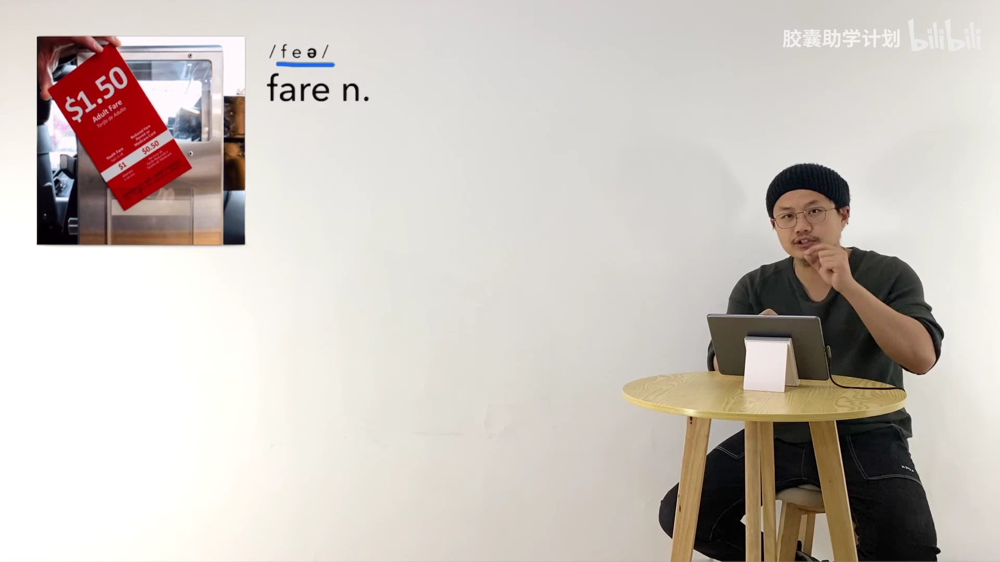

文字识别：胶囊助学计划 / /feal / fare n. / $1.50 / S0.50

### 画面 00:05:53

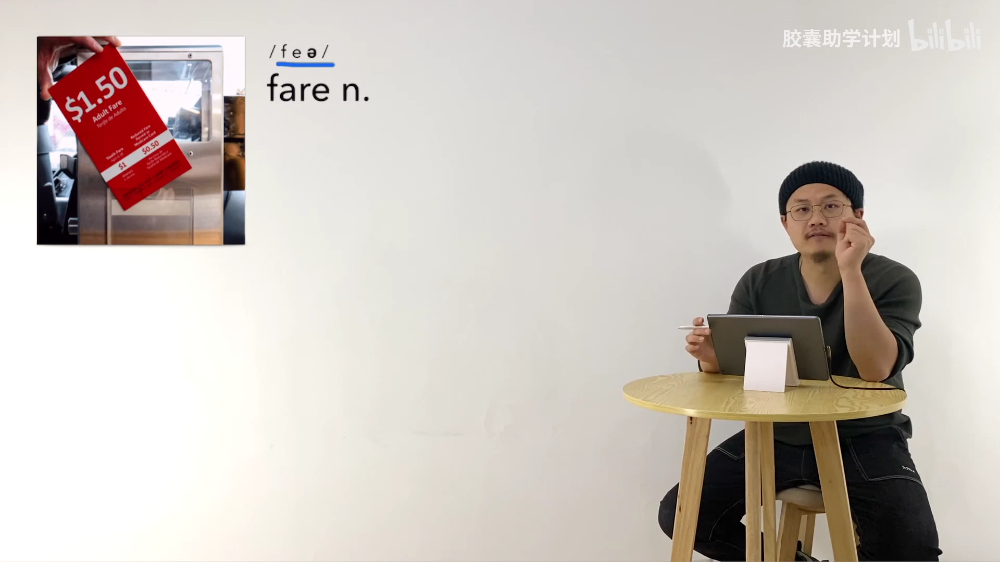

文字识别：bilibi / 胶囊助学计划 / /fea/ / fare n. / $1.50 / $0.50

### 画面 00:05:59

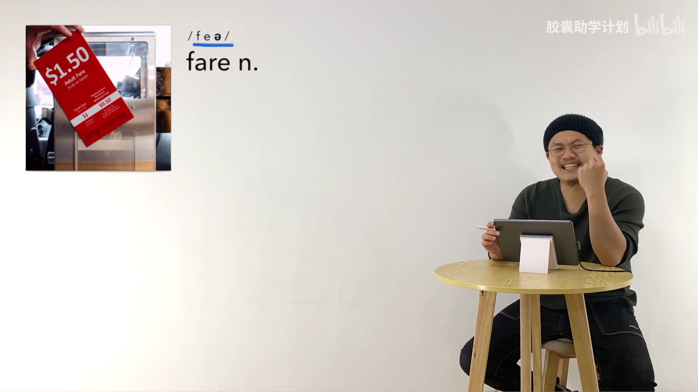

文字识别：bilbi / 胶囊助学计划 / /feal / fare n. / $1.50 / S0.50

## 00:06:00–00:06:30

对吧？ Fare 是偏英式的一个用法。 OK， next one，两个单词我们放到一起去讲。首先第一个单词跟我一起读，叫做 change。 change，我们原来学过它的名词，我没有记错的话是在五十九课、六十课，对吧？这两课当中我们学过叫 I want my change，叫零钱，我想要我的找回来的那个零钱。在这儿其实变成了动词，叫兑换零钱。那底下这个单词呢，叫做 note，

### 画面 00:06:02

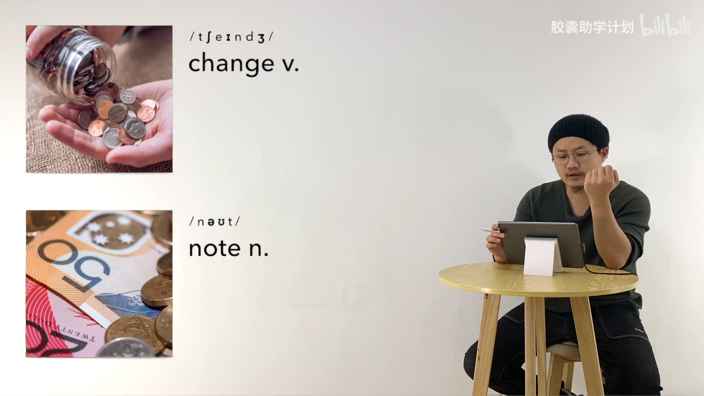

文字识别：bilibil / 胶囊助学计划 / /t∫eind3/ / change V. / /naut/ / note n.

### 画面 00:06:04

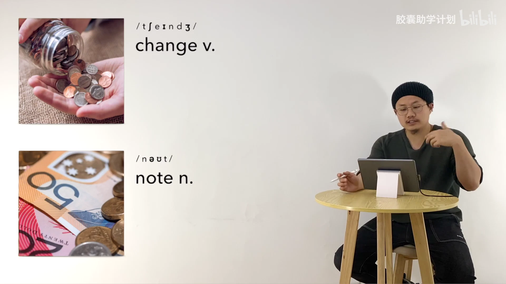

文字识别：BiL / 胶囊助学计划 / /t∫eind3/ / change V. / /naut/ / note n.

### 画面 00:06:07

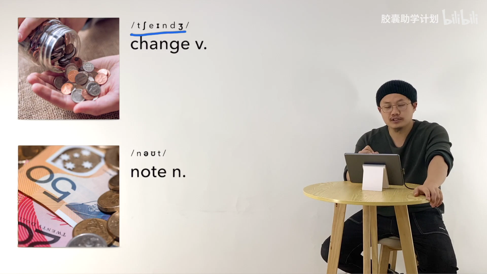

文字识别：Bilibi / 胶囊助学计划 / /tSeind3/ / change V. / oG / /naut/ / note n.

### 画面 00:06:11

文字识别：bilib / 胶囊助学计划 / /t∫eind3/ / change v. / n / og / /nautl / note n.

### 画面 00:06:14

文字识别：胶囊助学计划 / /tSeind3/ / change v.  / n. / oG / /naut/ / note n.

### 画面 00:06:19

文字识别：胶囊助学计划 / /tSeind3/ / change v. / n / og / /naut/ / note n.

### 画面 00:06:22

文字识别：胶囊助学计划 / /tSeind3/ / change v. / n. / /naut/ / note n. / LNaMI

### 画面 00:06:25

文字识别：胶囊助学计划 / /tSeind3/ / change v. / n. / /naut/ / note n.

### 画面 00:06:28

文字识别：胶囊助学计划 / /t∫eind3/ / change v. / n / og / /naut/ / note n.

## 00:06:30–00:07:00

指的是我们说用的这个硬币对应的那个叫纸币啊。OK，好，比如说 I want my change，那这里就是用的名词，对吧？OK，比如说 I can't change a ten pound note，我没有办法找开啊，有点像咱们汉语叫找开一个十磅的纸币啊，就是你十磅的这个纸币我找不开，叫 can't change，没有办法兑换这个零钱。否定句给你了，

### 画面 00:06:31

文字识别：胶囊助学计划 / /t∫eind3/ / change v. / n / og / /naut/ / note n.

### 画面 00:06:35

文字识别：bilb / 胶囊助学计划 / /t∫eind3/ / change v. / n / og / /naut/ / note n.

### 画面 00:06:41

文字识别：胶囊助学计划 / /tSeind3/ / change v. n. / ① I want my change. / ② I can't change a ten pound note. / og / /naut/ / note n.

### 画面 00:06:45

文字识别：胶囊助学计划 / /t∫eind3/ / change v. 1 / n. / ① I want my change. / ② I can't change a ten pound note. / og / /naut/ / note n.

### 画面 00:06:51

文字识别：胶囊助学计划 / /t∫eind3/ / change v. / n / ① I want my change. / ② I can't change a ten pound note. / og / /naut/ / note n.

### 画面 00:06:59

文字识别：胶囊助学计划 / /t∫eind3/ / change v. / n / ① I want my change. / ② I can't change a ten pound note. / og / /naut/ / note n.

## 00:07:00–00:07:30

你其实就可以把它变成肯定句，叫 I can change a ten pound note. 再变一般疑问句，叫 Can you change a ten pound note? Okay, very good. 那 note 就不多提了，就是在这个地方都用到了，叫做纸币，对吧？ Okay, 其实嗯，这个 pound 这个 note 在这加不加是无所谓的。您拿着那个东西，别人就明白它是纸币了。您想一下现实生活当中，对吧？ Okay, very good. 下一个单词读一下

### 画面 00:07:01

文字识别：胶囊助学计划 / /t∫eind3/ / change v. n. / ① I want my change. / ② I can't change a ten pound note. / Can you change a ten pound / 3 / note? / oG / /naut/ / note n. / INaML

### 画面 00:07:09

文字识别：胶囊助学计划 / /t∫eind3/ / change v. n. / ① I want my change. / ② I can't change a ten pound note. / 2 / Can you change a ten pound / note? / /naut/ / og / note n.

### 画面 00:07:13

文字识别：胶囊助学计划 / /t∫eind3/ / change v. n. / ① I want my change. / I can't change a ten pound note. / 2 / Can you change a ten pound / note? / /naut/ / og / note n.

### 画面 00:07:16

文字识别：胶囊助学计划 / /t∫eind3/ / change v. n. / ① I want my change. / I can't change a ten pound note. / 2 / Can you change a ten pound / note? / og / /naut/ / note n.

### 画面 00:07:21

文字识别：胶囊助学计划 / /t∫eind3/ / change v. n. / ① I want my change. /  I can't change a ten pound note. / 2 / Can you change a ten pound / note? / /naut/ / og / note n.

### 画面 00:07:26

文字识别：Bilibi / 胶囊助学计划 / / 'pæsand3a/ / passenger n.

### 画面 00:07:29

文字识别：Bilbi / 胶囊助学计划 / 'pæsand 3a/ / passenger n.

## 00:07:30–00:08:00

passenger passenger 叫乘客啊，火车飞机各种公共交通的乘客叫做 passenger，也是个名词。那它造句还是其实同理，您把之前的各种动词习惯用法拉过来就行了。这个我们在新概念二册第一课开始就会不停的带大家去教各位单词造句指南。其实新一我还没有提，对吧？说 this bus is full of young passengers. Be full of 我们刚刚学过的

### 画面 00:07:32

文字识别：bilibi / 胶囊助学计划 / 'pæsand3a/ / passenger n.

### 画面 00:07:41

文字识别：胶囊助学计划 / 'pæsand3a/ / passenger n. / D This bus is full of young passengers. / 1

### 画面 00:07:53

文字识别：Bilibil / 胶囊助学计划 / 'pæsand3a / / passenger n. / ) This bus is full of young passengers.

### 画面 00:07:55

文字识别：bilbili / 胶囊助学计划 / 'pæsand3a/ / passenger n. / This bus is full of young passengers.

### 画面 00:07:58

文字识别：Bilbili / 胶囊助学计划 / 'pæsand3a/ / passenger n. /  This bus is full of young passengers.

## 00:08:00–00:08:30

just learned, right? This letter is full of mistakes. 105课学的，对吧？ Next one, say these passengers are the most interesting people.刚刚111课学过，the most interesting people. 107课学过，叫I've ever seen. There you go. Next one, get off.两个单词放到一起，各位可以理解为是一个小的动词短语，叫下车。那既然是个动作，我们就可以加时态。比如说，Look, that

### 画面 00:08:05

文字识别：bilbl / 胶囊助学计划 / 'pæsand3a / / passenger n. / This bus is full of young passengers. / These passengers are the most / interesting people I've ever seen.

### 画面 00:08:07

文字识别：胶囊助学计划 / 'pæsand3a/ / passenger n. / This bus is full of young passengers. / These passengers are the most / interesting people I've ever seen.

### 画面 00:08:10

文字识别：胶囊助学计划 / 出 / 'pæsand3a / / passenger n. / This bus is full of young passengers. / These passengers are the most / interesting people I've ever seen.

### 画面 00:08:15

文字识别：bilibil / 胶囊助学计划 / 'pæsand3a / / passenger n. / This bus is full of young passengers. / These passengers a / are / the most / interesting people l've / ever seen.

### 画面 00:08:18

文字识别：bibi / 胶囊助学计划 / get off

### 画面 00:08:21

文字识别：Bilbi / 胶囊助学计划 / get off

### 画面 00:08:25

文字识别：胶囊助学计划 / BiL / V. / get off

## 00:08:30–00:09:00

little girl is getting off the bus. 说瞧那个小姑娘正在下这个公交车，对不对？好，也可以说 She got off the bus five minutes ago. 她五分钟之前下的这辆公交车，一般过去时。两个肯定句给您了，拿 get off 造五六个、七八个句子就不是难事儿了吧？哎，造句就是这么简单。OK，您当然也可以再换个句型了，比如说 You can get off the bus now. 你现在

### 画面 00:08:36

文字识别：胶囊助学计划 / V. / get off / ① Look, that litle girl is getting off the bus. / ) She got off the bus 5 minutes ago.

### 画面 00:08:40

文字识别：胶囊助学计划 / 出 / V. / get off / ① Look, that little girl is getting off the bus. / ) She got off the bus 5 minutes ago.

### 画面 00:08:45

文字识别：胶囊助学计划 / V. / get off / ① Look, that little girl is getting off the bus. / ) She got off the bus 5 minutes ago.

### 画面 00:08:50

文字识别：胶囊助学计划 / V. / get off / ① Look, that little girl is getting off the bus. / ) She got off the bus 5 minutes ago.

## 00:09:00–00:09:30

就可以下公交车了呀，对吧？OK，或者是 You must get off the bus right now. 你现在必须要下公交车了。我们换一些小的结构，OK，变了个一般疑问句，did提前，不多说了。对， five minutes 的提提问永问，对吧？OK，好，下一个单词跟我读一下，叫做 tramp. tramp，啊，它不是川普啊，它指的意思在这个地方是一个名词啊，我们管它叫做流浪汉。OK，

### 画面 00:09:01

文字识别：V. / 胶囊助学计划 / get off / ① Look, that litle girl is getting off the bus. / ) She got off the bus 5 minutes ago.

### 画面 00:09:09

文字识别：V. / 胶囊助学计划 / get off / ① Look, that little girl is getting off the bus. / ) She got off the bus 5 minutes ago.

### 画面 00:09:13

文字识别：胶囊助学计划 / V. / get off / ① Look, that little girl is getting off the bus. / She got off the bus 5 minutes ago. / Did she get off the bus 5 minutes ago? / When did she get off the bus?

### 画面 00:09:15

文字识别：胶囊助学计划 / V. / get off / ① Look, that little girl is getting off the bus. / She got off the bus 5 minutes ago. / Did she get off the bus 5 minutes ago? / When did she get off the bus?

### 画面 00:09:17

文字识别：BiL / 胶囊助学计划 / /træmp/ / tramp

### 画面 00:09:20

文字识别：Dib / 胶囊助学计划 / /træmp/ / tramp

### 画面 00:09:26

文字识别：胶囊助学计划 / /træmp/ / tramp

### 画面 00:09:28

文字识别：胶囊助学计划 / /træmp/ / tramp

## 00:09:30–00:10:00

好，那名词我们就造句呗，叫做 Can we help that tramp? 我们能帮那个流浪汉吗？还是我既然给大家出一个句子，您一定要有一个举一反三的能力。肯定句叫 We can help that tramp，对吧？哎，也可以说 Why can't we help that tramp? 为什么我没法帮助他呢？OK，再来 We can give him some food，或者 We can give that tramp some food.

### 画面 00:09:34

文字识别：胶囊助学计划 / /træmp/ / tramp / ① Can we help that tramp?

### 画面 00:09:44

文字识别：胶囊助学计划 / 价 / /træmp/ / tramp / ① Can we help that tramp?

## 00:10:00–00:10:30

give somebody something. Very good. One hundred and seven. This tramp is older than your dad or than my dad. So we should help him. We should help him.

### 画面 00:10:10

文字识别：胶囊助学计划 / /træmp/ / tramp / ① Can we help that tramp? / We can give him some food. / This tramp is older than your dad.

### 画面 00:10:17

文字识别：胶囊助学计划 / /træmp/ / tramp / ① Can we help that tramp? / We can give him some food. / This tramp is older than your dad.

### 画面 00:10:22

文字识别：Bilbi / 胶囊助学计划 / /ik'sept/ / except / No dogs / except / guide dogs

### 画面 00:10:25

文字识别：胶囊助学计划 / /ik'sept/ / except / No dogs / except / guide dogs

## 00:10:30–00:11:00

呃也不是那么容易造，但是它经常在这种标志当中出现。我给大家找了一个对吧，叫做 No dogs except guide dogs。啊，狗是禁止入内的，except叫除了 guide dogs 导盲犬。OK，Very good。Recap，本课呢单词不是特别的难，各位该处理还是要处理。那语法呢，其实就是这个非常小的点，Not any 等于 No

### 画面 00:10:34

文字识别：biltbil / 胶囊助学计划 / /ik'sept/ / except / No dogs / except / guide dogs

### 画面 00:10:50

文字识别：胶囊助学计划 / Recap / Patterns / not any/a.an=no+n. / no + n.=none / Grammar / Words / Expression

### 画面 00:10:56

文字识别：Biibi / 胶囊助学计划 / Recap / Patterns / not any/a.an=no+n. / no + n.=none / Grammar / Words / Expression

## 00:11:00–00:11:30

加名词 no 加名词又等于 not 一趟线儿 等号 等号 连等就过来就可以了 OK 好 那加上作业单词造句老习惯红皮书各位尝试去查找一下本课的这个语法，比如说 no，比如说 not OK，你要单独查 not 可能不太好查啊，然后给自己讲解一遍这个核心语法点，也就是 no 和 not OK。那如果大家喜欢我们的课程，欢迎大家关注订阅，一键三连，分享给那些需要的朋友来帮助我们快速成

### 画面 00:11:01

文字识别：bib / 胶囊助学计划 / Recap / Patterns / not any/a.an=no+n. / no + n.=none / Grammar / Words / Expression

### 画面 00:11:07

文字识别：biD / 胶囊助学计划

### 画面 00:11:11

文字识别：胶囊助学计划 / 单词造句3 / 2.初级红皮书查找语法

### 画面 00:11:22

文字识别：Bilb / 胶囊助学计划

### 画面 00:11:29

文字识别：胶囊助学计划 / A friend to all is a friend to none. / -Aristotle

## 00:11:30–00:11:52

长。最后，我们再来看一句亚里士多德的名人名言：A friend to all is a friend to none. OK, see you next time.

### 画面 00:11:40

### 画面 00:11:42

文字识别：CAPSULEACADEMY / 胶囊助学计划 / 小红书 / Lecturer / Leo / OE

### 画面 00:11:45

文字识别：CAPSULEACADEMY / 胶囊助学计划 / 『 / 小红书 / Editor / OE

### 画面 00:11:48

文字识别：CAPSULEACADEMY / 胶囊助学计划 / 『 / 小红书 / Creator / □ / Leo & Berlin / OE

### 画面 00:11:50

文字识别：bilibili / 胶囊助学计划 / 胶囊助学计划 / 小红书 / OE

### 画面 00:11:52

文字识别：bilibili / 胶囊助学计划

