# 113 语法 文章

快速机器解析：语音为单模型转写，未进行独立交叉校对或人工复核；画面每秒采样并按变化选帧，短时文字和标记可能遗漏。截图时间约有 1 秒误差。图片有损压缩；遇到疑点请按时间查看 Google Drive 原视频。

## 00:00:00–00:00:30

Hello everyone, welcome to Capsule Academy. This is Leo. Today we're going to learn New Concept English Book One, Lesson One Hundred and Thirteen, Grammar and Story. 那老习惯进入正式课程之前，我们先看两个问题：如何理解 Neither can I，以及如何理解 So have I。这是本课的一个小的重点语法。那带着这两个问题，Hope you guys enjoy. 那我们直接

### 画面 00:00:00

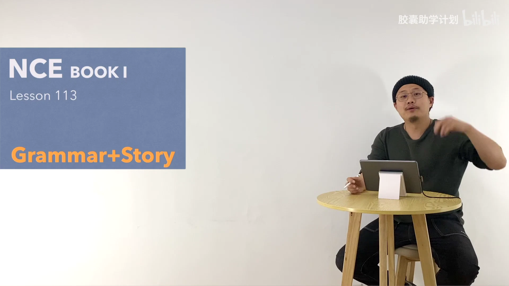

文字识别：胶囊助学计划 / NCE / BOOKI / Lesson 113 / Grammar+Story

### 画面 00:00:02

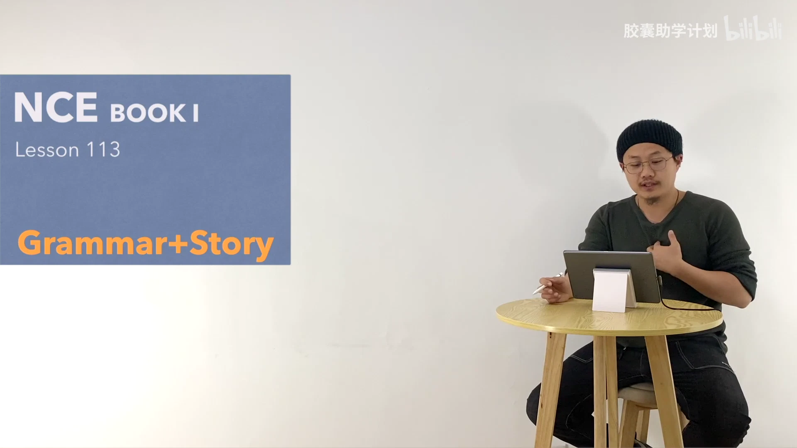

文字识别：胶囊助学计划 / NCE / BOOKI / Lesson 113 / Grammar+Story

### 画面 00:00:05

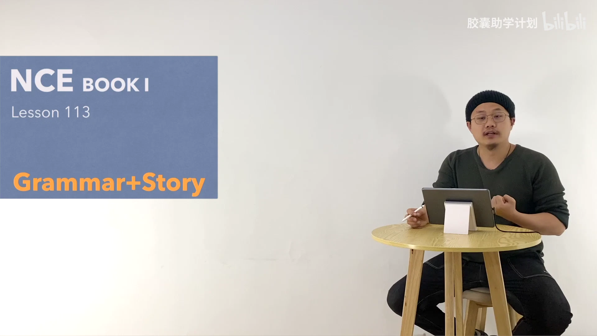

文字识别：胶囊助学计划 / NCE / BOOKI / Lesson 113 / Grammar+Story

### 画面 00:00:07

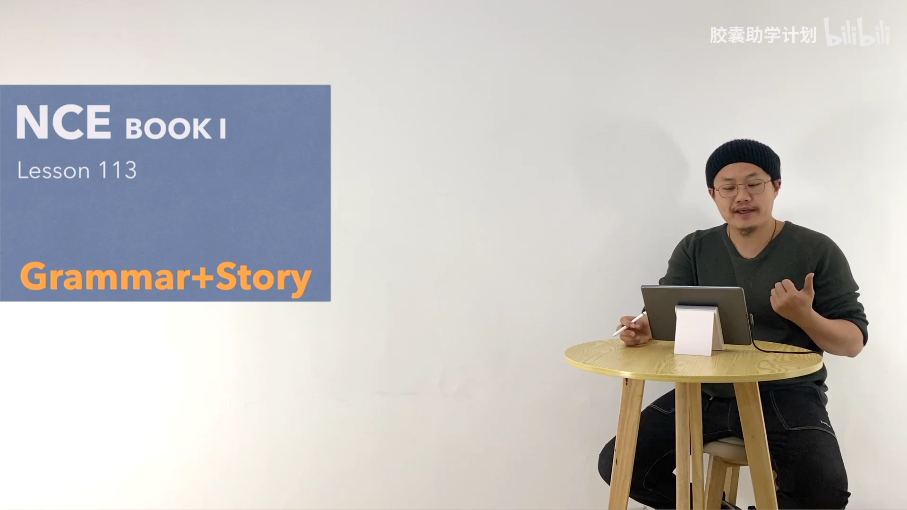

文字识别：胶囊助学计划 / NCE / BOOKI / Lesson 113 / Grammar+Story

### 画面 00:00:09

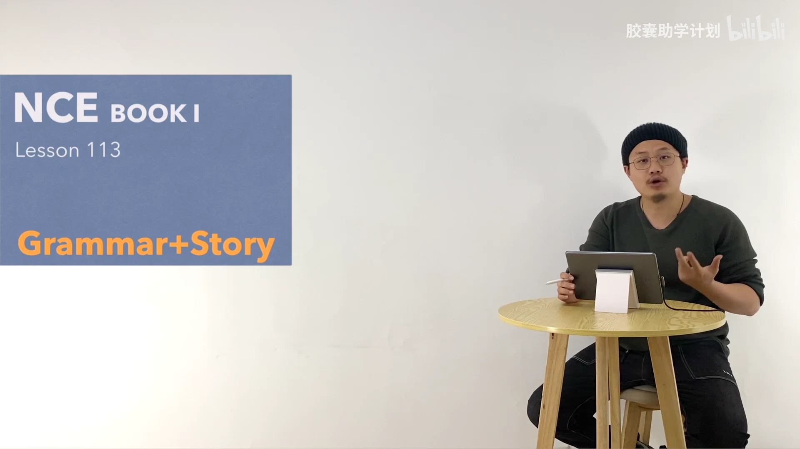

文字识别：胶囊助学计划 / NCE / BOOKI / Lesson 113 / Grammar+Story

### 画面 00:00:11

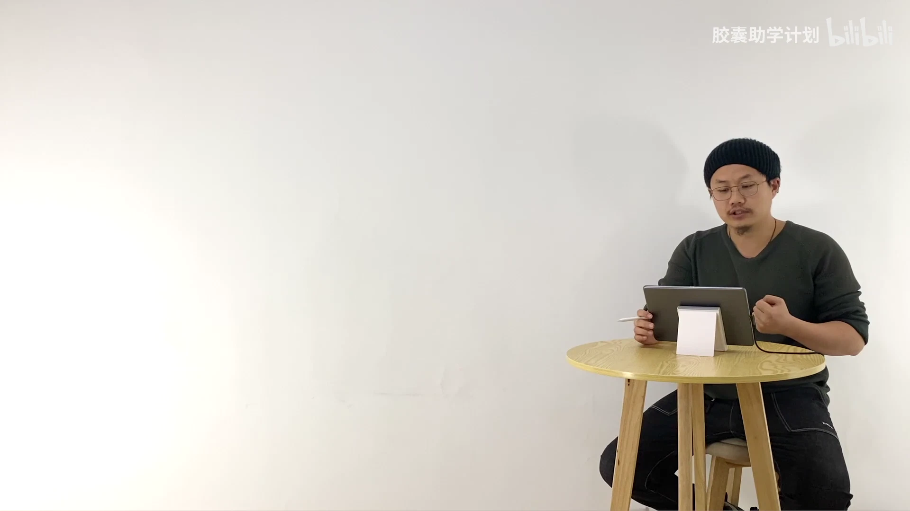

文字识别：胶囊助学计划 / 出

### 画面 00:00:13

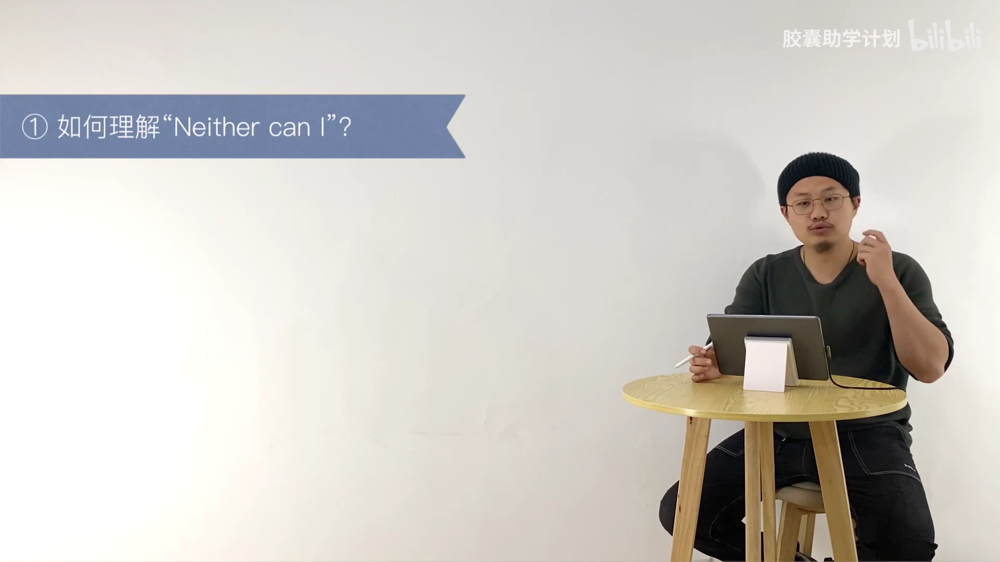

文字识别：胶囊助学计划 / ①如何理解“Neither can I”？

### 画面 00:00:15

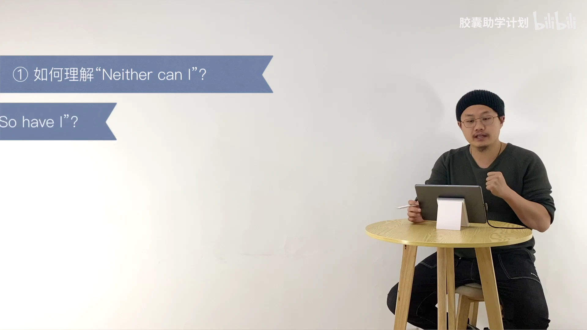

文字识别：胶囊助学计划 / ①如何理解“Neither Can I”? / So have I"?

### 画面 00:00:17

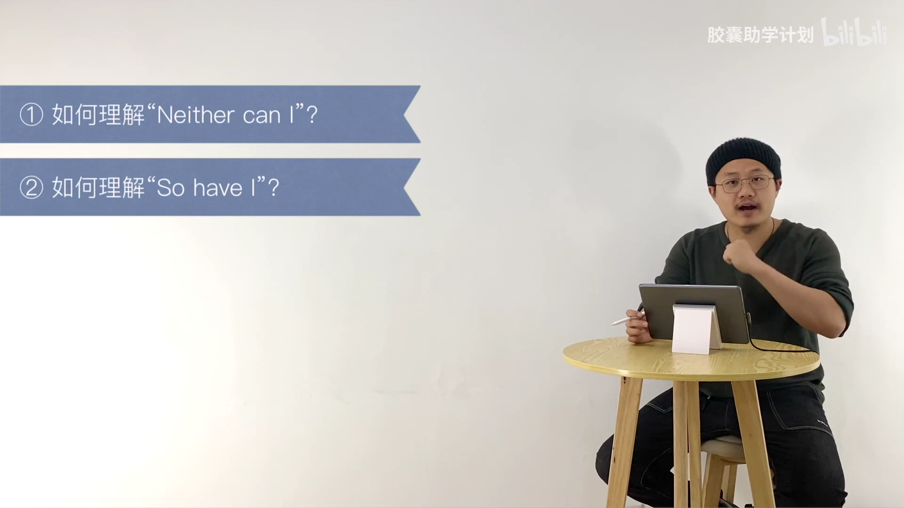

文字识别：胶囊助学计划 / ①如何理解“Neither Can I”? / 如何理解“So have I”?

### 画面 00:00:23

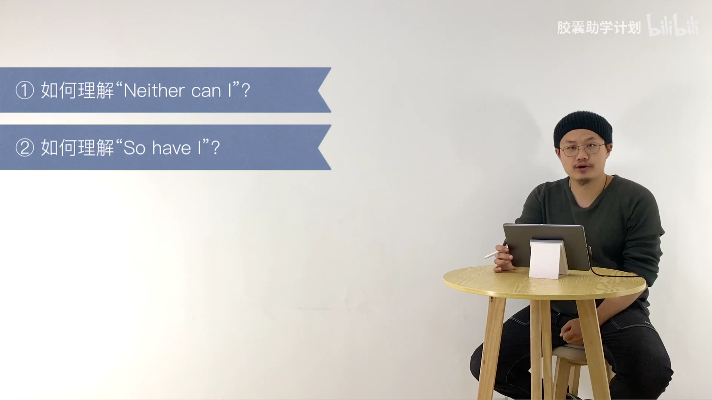

文字识别：胶囊助学计划 / ①如何理解“Neither Can I”? / 如何理解“So have I”?

### 画面 00:00:25

文字识别：胶囊助学计划 bilbl

### 画面 00:00:28

## 00:00:30–00:01:00

看单词吧，好吧，这直接看文章吧。来了啊，首先看一下这个场景，售票员 conductor 对吧？然后 ten pound note 十磅的一个纸币，然后有一个人要买车票，呃，售票员说 fares please 啊，买车票了啊，拜托买车票。然后这个 man 说 Trafalgar Square please 哎，伦敦非常有名的一个地标性的广场叫特拉法加广场是吧？Trafalgar Square，呃，他说这个地点， I'm sorry sir 很抱歉先生， I

### 画面 00:00:30

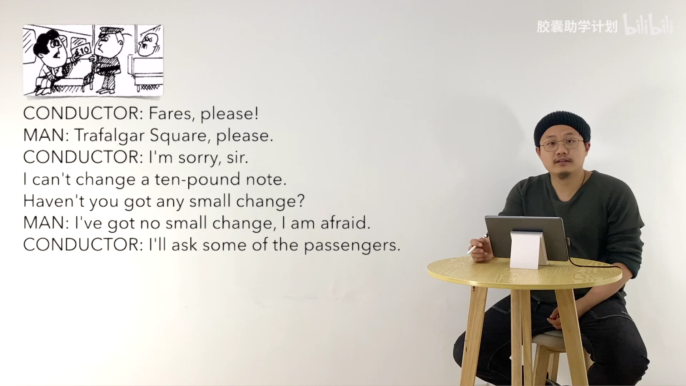

文字识别：胶囊助学计划 / CONDUCTOR: Fares, please! / MAN: Trafalgar Square, please. / CONDUCTOR: I'm sorry, sir. / I can't change a ten-pound note. / Haven't you got any small change? / MAN: I've got no small change, I am afraid. / CONDUCTOR: I'll ask some of the passengers.

### 画面 00:00:32

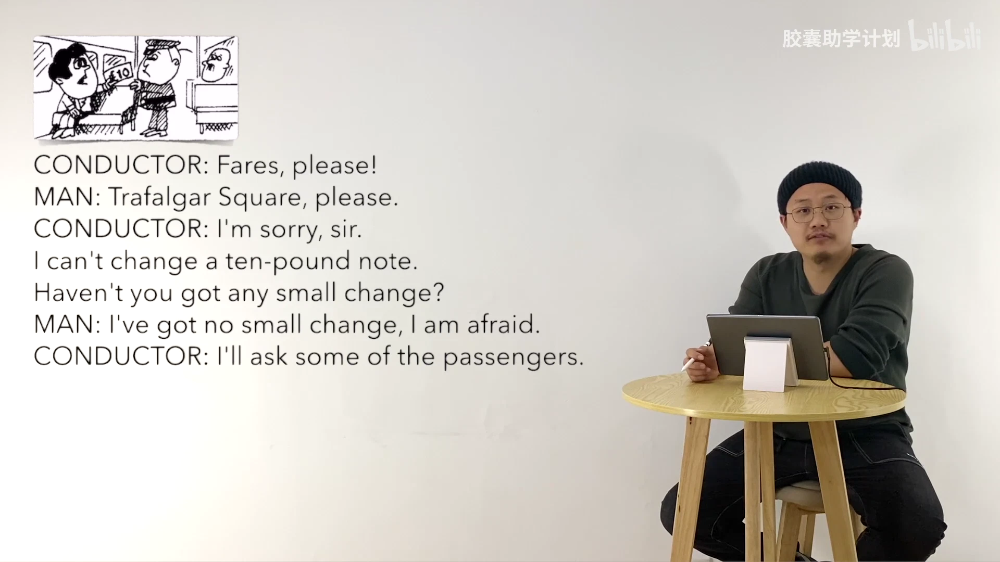

文字识别：胶囊助学计划 / CONDUCTOR: Fares, please! / MAN: Trafalgar Square, please. / CONDUCTOR: I'm sorry, sir. / I can't change a ten-pound note. / Haven't you got any small change? / MAN: I've got no small change, I am afraid. / CONDUCTOR: I'll ask some of the passengers.

### 画面 00:00:34

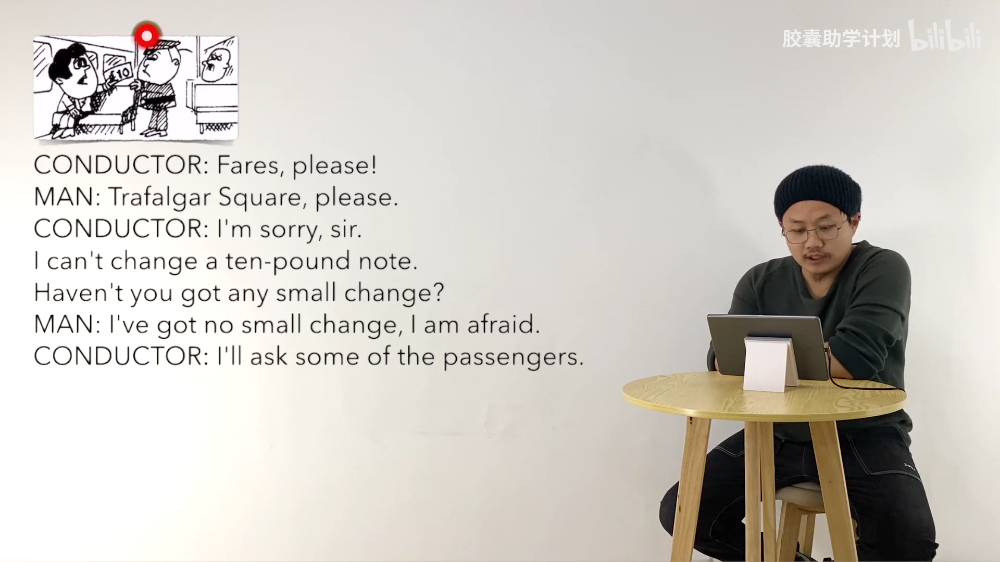

文字识别：胶囊助学计划 / CONDUCTOR: Fares, please! / MAN: Trafalgar Square, please. / CONDUCTOR: I'm sorry, sir. / I can't change a ten-pound note. / Haven't you got any small change? / MAN: I've got no small change, I am afraid. / CONDUCTOR: I'll ask some of the passengers.

### 画面 00:00:37

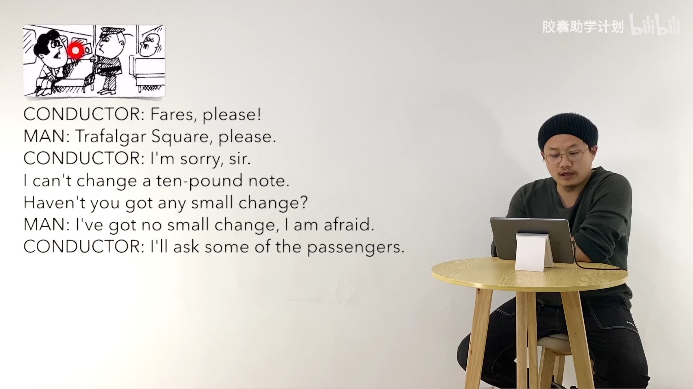

文字识别：胶囊助学计划 / CONDUCTOR: Fares, please! / MAN: Trafalgar Square, please. / CONDUCTOR: I'm sorry, sir. / I can't change a ten-pound note. / Haven't you got any small change? / MAN: I've got no small change, I am afraid. / CONDUCTOR: I'll ask some of the passengers.

## 00:01:00–00:01:30

change.我没有办法兑换a ten pound note.一个十磅的纸币。Haven't you?难道你就没有吗？Have got,对吧？哎，有。那难道否定疑问句？难道你就没有小一点的零钱吗？Any small change.小零钱，对吧？这个地方的change，你看它就不是动词了。Any small change，其实就是五十九课我们学过的那个I want my change那个change了，名

### 画面 00:01:07

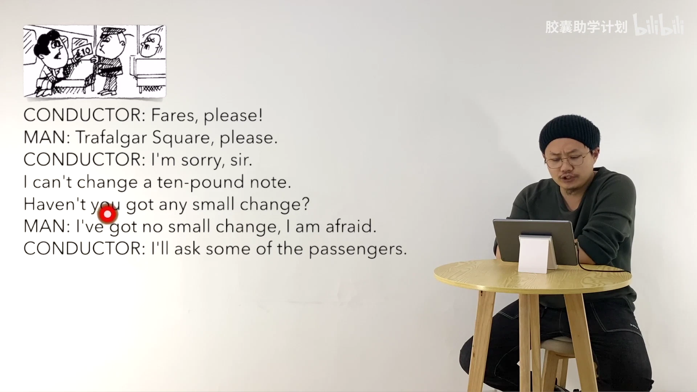

文字识别：胶囊助学计划 / CONDUCTOR: Fares, please! / MAN: Trafalgar Square, please. / CONDUCTOR: I'm sorry, sir. / I can't change a ten-pound note. / Haven't yoy got any small change? / MAN: I've got no small change, I am afraid. / CONDUCTOR: I'll ask some of the passengers.

### 画面 00:01:28

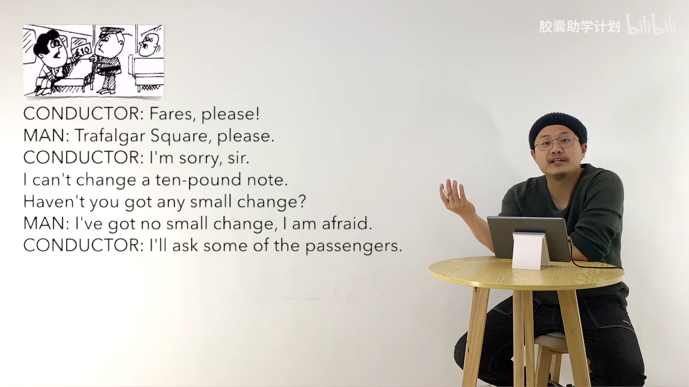

文字识别：胶囊助学计划 / CONDUCTOR: Fares, please! / MAN: Trafalgar Square, please. / CONDUCTOR: I'm sorry, sir. / I can't change a ten-pound note. / Haven't you got any small change? / MAN: I've got no small change, I am afraid. / CONDUCTOR: I'll ask some of the passengers.

## 00:01:30–00:02:00

词，对不对？那haven't you got？我没有记错，是六十七课咱们学的，对吧？Aren't you lucky？Okay.呃，I've got no small change.我哎，haven't got no small change.你看，no small change等于I haven't got any small change，对吧？Not any等于no加名词。I'm afraid，我恐怕啊，他这个恐怕其实本来应该是放前面啊，但是他放后面也无所谓，是吧？然后conductor说，那好吧，I'll ask some

### 画面 00:01:52

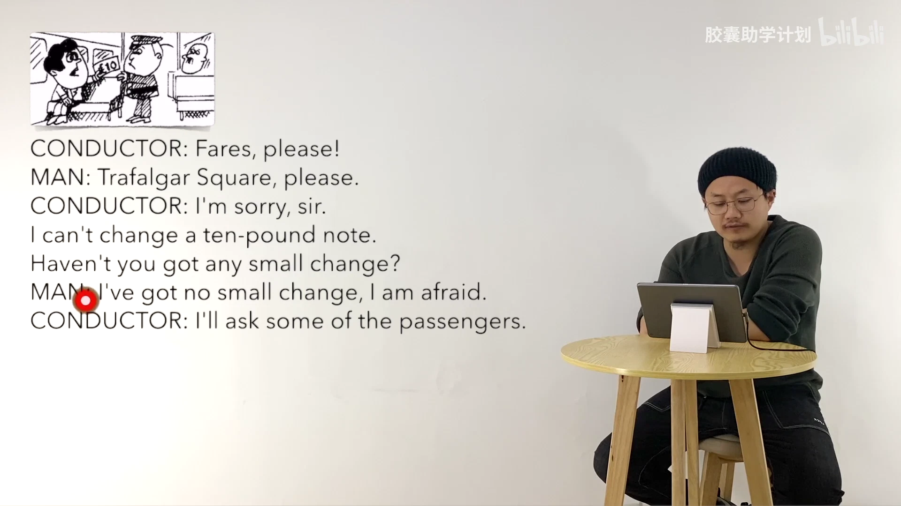

文字识别：胶囊助学计划 / CONDUCTOR: Fares, please! / MAN: Trafalgar Square, please. / CONDUCTOR: I'm sorry, sir. / I can't change a ten-pound note. / Haven't you got any small change? / MANbl've got no small change, I am afraid. / CONDuCTOR: I'll ask some of the passengers.

## 00:02:00–00:02:30

of the passengers. 那我会去问一些乘客，对吧？我去问一些乘客能不能找得开。您看这个地方的 will，如果您听了我们语法单项的那个视频讲 be going to do 和 will，那您在这儿就非常清楚，就是当机立断的一个决定。如果我在说这个的时候您不太清楚，那看完本课您赶紧去找一下我们那个语法单项的视频，补齐一下这一课，好吧？ Okay, continuing. 那 conductor 又说了，

### 画面 00:02:22

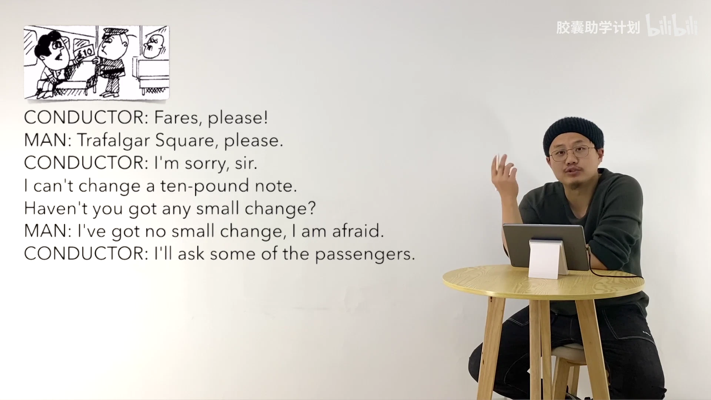

文字识别：胶囊助学计划 / CONDUCTOR: Fares, please! / MAN: Trafalgar Square, please. / CONDUCTOR: I'm sorry, sir. / I can't change a ten-pound note. / Haven't you got any small change? / MAN: I've got no small change, I am afraid. / CONDUCTOR: I'll ask some of the passengers.

### 画面 00:02:27

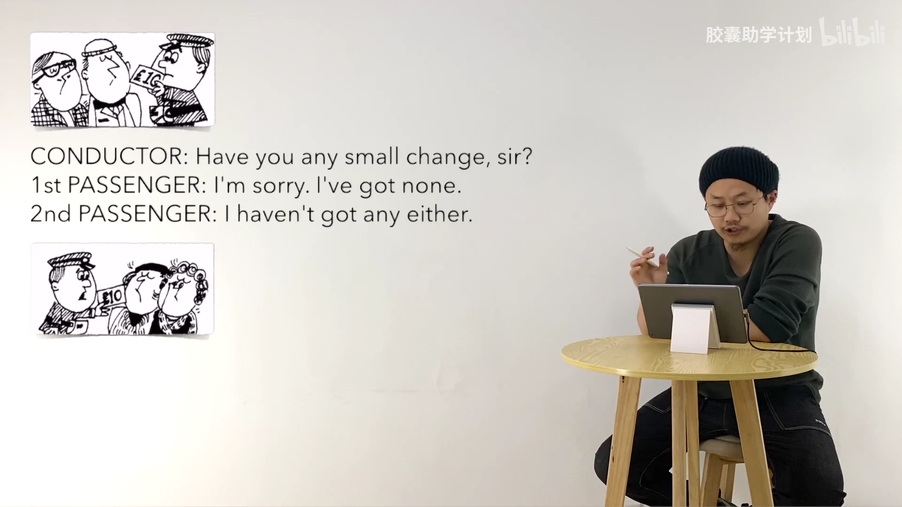

文字识别：胶囊助学计划 / CONDUCTOR: Have you any small change, sir? / 1st PASSENGER: I'm sorry.I've got none. / 2nd PASSENGER: I haven't got any either.

## 00:02:30–00:03:00

Have you any small change, sir? 那你有这个小的这个啊，你有这个小的零钱吗？你有这些小额的零钱吗？ Passenger, I'm sorry, I've got none. 我很抱歉，I've got none. None 等于 no small change, 对吧？ Okay, I've got none either. 我也没有。这个 either 跟 too 是一样，只不过肯定句 too，否定句 either, either 啊，两个发音。 Next one, conductor 又问了，说 Can you

### 画面 00:02:55

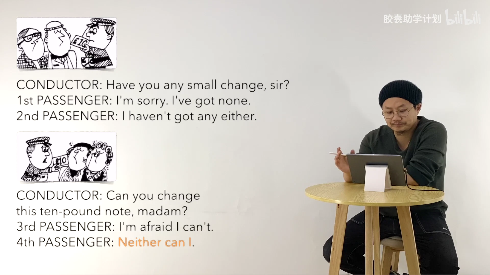

文字识别：胶囊助学计划 / CONDUCTOR: Have you any small change, sir? / 1st PASSENGER: I'm sorry. I've got none. / 2nd PASSENGER: I haven't got any either. / CONDUCTOR: Can you change / this ten-pound note, madam? / 3rd PASSENGER: I'm afraid I can't. / 4th PASSENGER: Neither can I.

## 00:03:00–00:03:30

change this ten pound note, madam? 她说你能找开这个十磅的纸币吗，女士们？第一个说 I'm afraid I can't. 我恐怕我不能。你注意下一个说的是 Neither can I. 这个是我们本课一个非常重要的语法。一会儿我跟 so害怕一起去讲。先告诉您意思叫做我也不能啊，其实就是 me too 啊 me either 是吧？Okay, conductor 说 I'm very sorry, sir. 我很抱歉。You must get off the bus.

### 画面 00:03:23

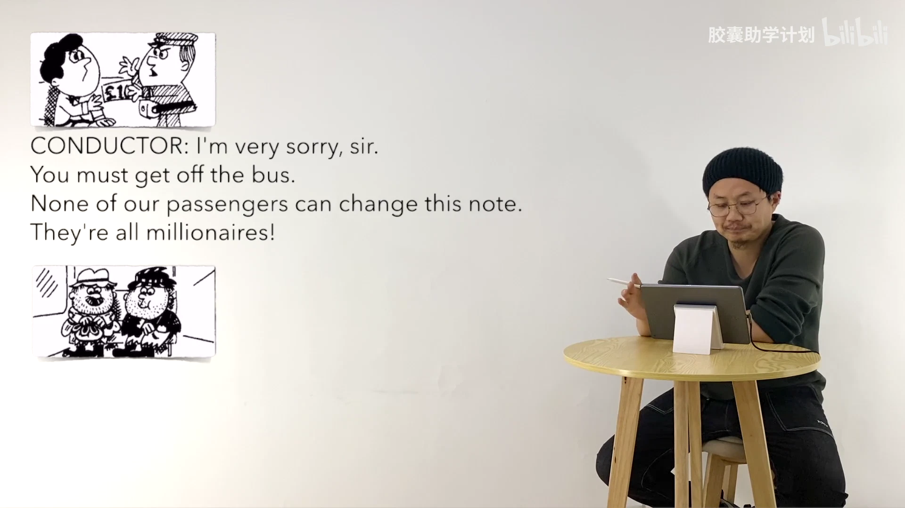

文字识别：胶囊助学计划 / CONDUCTOR: I'm very sorry, sir. / You must get off the bus. / None of our passengers can change this note. / They're all millionaires!

## 00:03:30–00:04:00

你必须要下这个公交车了。None没有，None of就没有。Our passengers没有我们的乘客。Can change this note.能找开这个纸币。They are all millionaires.啊，他们都是百万富翁啊，找不开你这十磅。然后您看图，两个流浪汉tramp对吧？流浪汉tramp，two tramps。他们异口同声的说，Except

### 画面 00:03:51

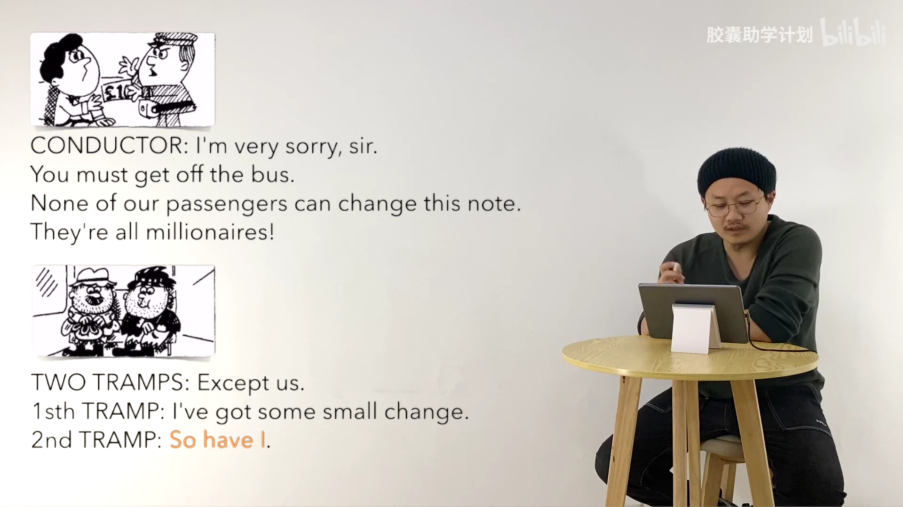

文字识别：胶囊助学计划 / CONDUCTOR: I'm very sorry, sir. / You must get off the bus. / None of our passengers can change this note. / They're all millionaires! / TWO TRAMPS: Except us. / 1sth TRAMP: I've got some small change. / 2nd TRAMP: So have I.

## 00:04:00–00:04:30

us，除了我们，I've got some small change，我有一些零钱，so have I，我也是。刚才那个叫做我也不能，这个叫我也是，叫me too，是吧？Okay，那接下来呢，我们一起看一下这个so跟neither这两个单词引导的语法应该如何去用这个小的句型。其实他们首先都很像，我们看一下，先看最前面的区别。So表示我也是，neither

### 画面 00:04:14

文字识别：胶囊助学计划 / so neither

### 画面 00:04:22

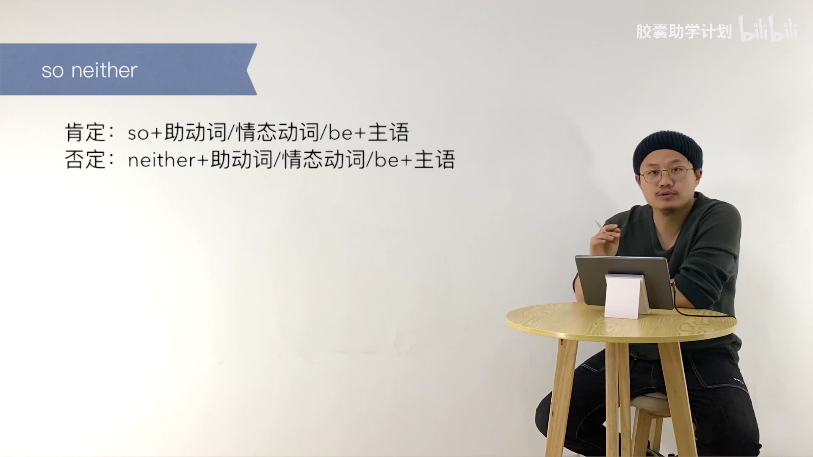

文字识别：胶囊助学计划 / so neither / 肯定：so+助动词/情态动词/be+主语 / 否定：neither+助动词/情态动词/be+主语

### 画面 00:04:27

文字识别：胶囊助学计划 / so neither / 肯定： / 助动词/情态动词/be+主语 / 否定：neither+助动词/情态动词/be+主语

## 00:04:30–00:05:00

表示否定，叫我也不是。所以，如果是我也是，第一个单词就是so；如果我也不是，那第一个单词就是neither或either，两个读音都可以啊，我都是混着读的，您随便啊，不存在对错，你也不用管谁是英式谁是美式，你去英国读neither neither都听得懂，你去美国读neither neither也都听得懂，放心就行了，好吧？OK，接下来呢，加上中间是一样的助动词情态动词be，这个玩意儿这么直接去讲，听上去

### 画面 00:04:30

文字识别：Biltbi / 胶囊助学计划 / so neither / 肯定: / 助动词/情态动词/be+主语 / 否定： / heither+助动词/情态动词/be+主语

### 画面 00:04:36

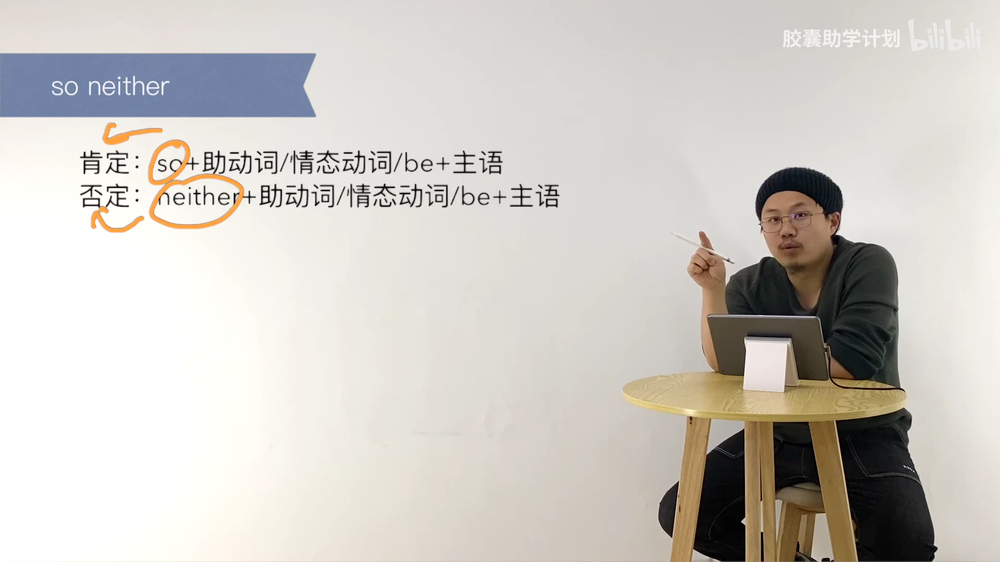

文字识别：胶囊助学计划 / so neither / 肯定: / 助动词/情态动词/be+主语 / 否定： / neither+助动词/情态动词/be+主语

### 画面 00:04:56

文字识别：Bilbil / 胶囊助学计划 / so neither / 肯定： / 助动词/情态动词/be+主语 / 否定： / neither+助动词/情态动词/be+主语

## 00:05:00–00:05:30

也有点懵。我简单说一句，您就懂了。就是您一般疑问句都提过哪些单词？Do, does, did, am, is, are, was, were, can, must, have, has，对吧？这些单词，这些单词就是助动词、情态动词和 be，好吧？然后再加上一个主语，主语很容易理解了。我也是，就是 I；他也是，就是 he，啊，对吧？就是那个男，他也是就是 he；女，他也是就是 she。这么讲还是有点抽象，我们拿一些

### 画面 00:05:00

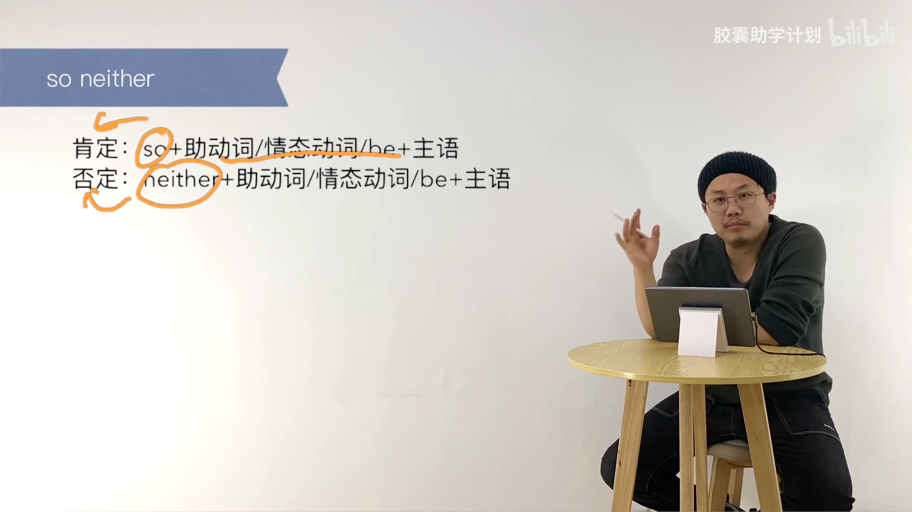

文字识别：Bilbi / 胶囊助学计划 / so neither / 肯定： / 助动词/情态动词/be+主语 / 否定： / heither+助动词/情态动词/be+主语

### 画面 00:05:19

文字识别：Bilibi / 胶囊助学计划 / so neither / 肯定： / 助动词/情态动词/be+ / 主语 / 否定： / neither+助动词/情态动词/be+主语

### 画面 00:05:21

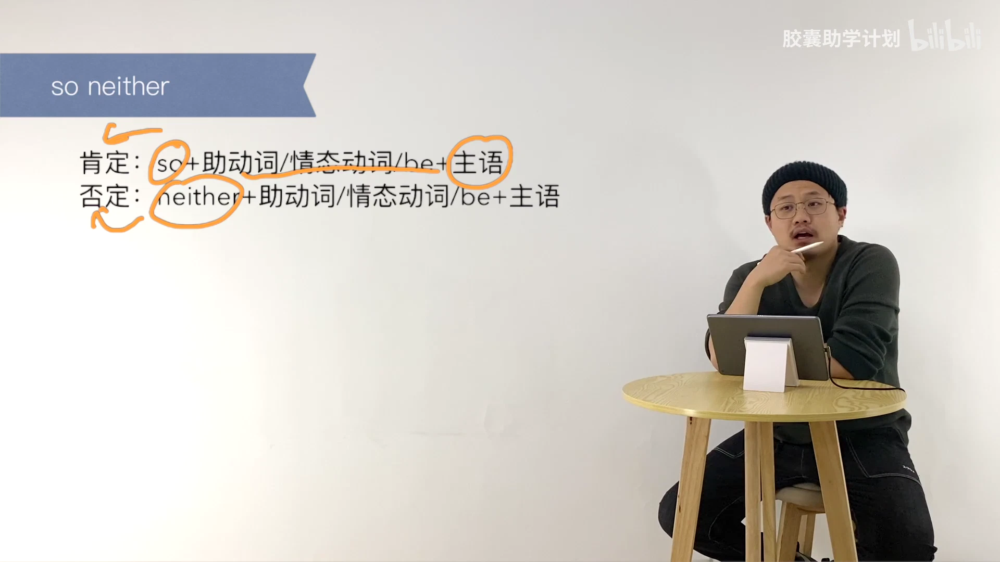

文字识别：Bilbi / 胶囊助学计划 / so neither / 肯定: / 助动词/情态动词/be+ / 主语 / 否定： / neither+助动词/情态动词/be+主语

## 00:05:30–00:06:00

例子去讲，然后还注意一个角叫时态一致、人称一致。这样讲比较抽象，我们拿一些例子来讲。比如说，I have a happy family. 我有一个很幸福的家庭。然后你现在想说，我也是。注意，好，第一，肯定否定，肯定用so，否定用neither。我也，是那就是肯定，对吧？哎，肯定。然后接下来这个地

### 画面 00:05:31

文字识别：胶囊助学计划 / so neither / 肯定： / 助动词/情态动词/be+主语 / 否定： / neither+助动词/情态动词/be+主语 / 时态一致，人称一致

### 画面 00:05:33

文字识别：胶囊助学计划 / so neither / 肯定：so+助动词/情态动词/be+主语 / 否定：neither+助动词/情态动词/be+主语 / 时态一致，人称一致

### 画面 00:05:44

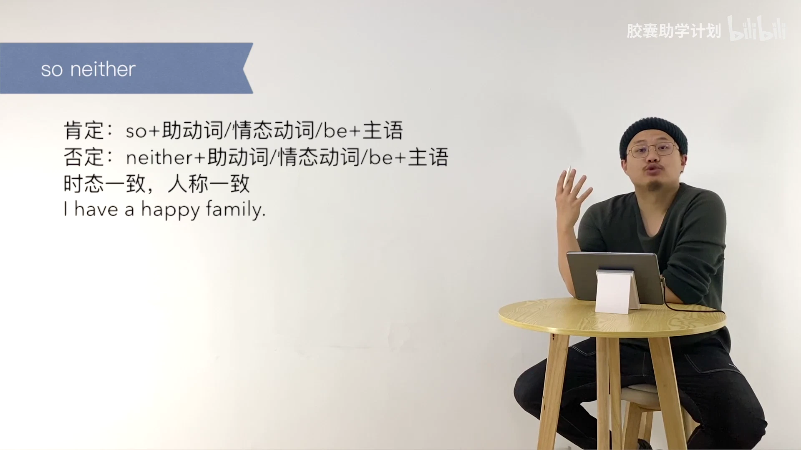

文字识别：胶囊助学计划 / so neither / 肯定：so+助动词/情态动词/be+主语 / 否定：neither+助动词/情态动词/be+主语 / 时态一致，人称一致 / I have a happy family.

### 画面 00:05:49

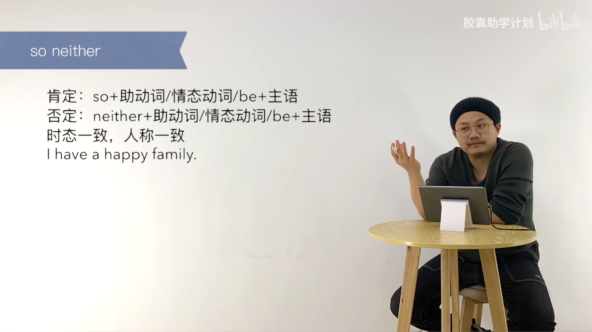

文字识别：胶囊助学计划 / so neither / 肯定：so+助动词/情态动词/be+主语 / 否定：neither+助动词/情态动词/be+主语 / 时态一致，人称一致 / I have a happy family.

### 画面 00:05:58

文字识别：胶囊助学计划 / so neither / 肯定：so+助动词/情态动词/be+主语 / 否定：neither+助动词/情态动词/be+主语 / 时态一致，人称一致 / I have a happy family.

## 00:06:00–00:06:30

方中间一共就三个单词，中间那个单词选谁呢？您就看你也是的那句话，一般疑问句提谁？I have a happy family，这就是变成了一个各位的基础学的好不好？谁提前变一般疑问句？Do Do you have a happy family？所以这个地方就用Do对吧？然后谁也是呢？如果是我也是，就是So do I。如果是他也是，就是So什么He对吧？

### 画面 00:06:00

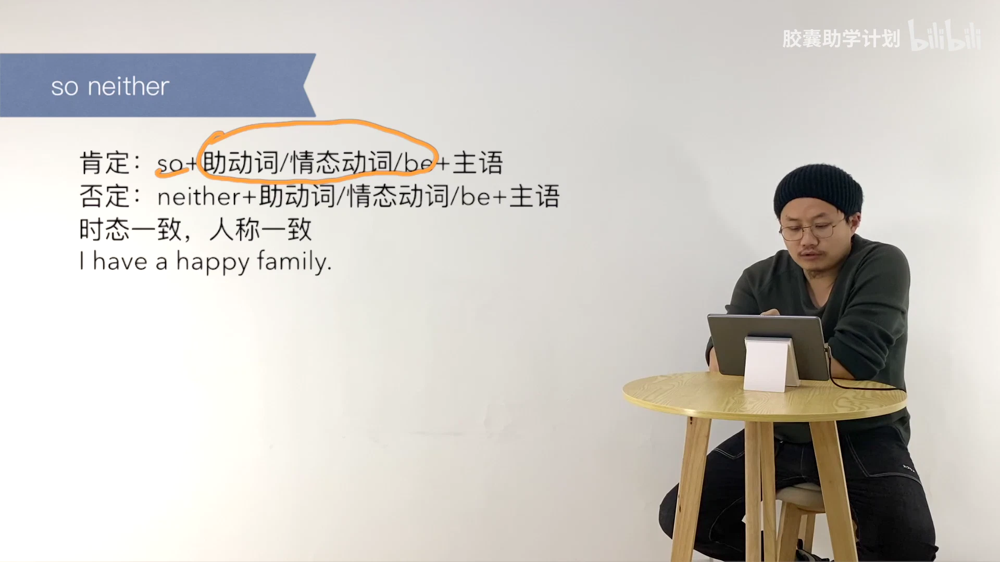

文字识别：bilbi / 胶囊助学计划 / so neither / 肯定：so+助动词/情态动词/be+主语 / 否定：neither+助动词/情态动词/be+主语 / 时态一致，人称一致 / I have a happy family.

### 画面 00:06:07

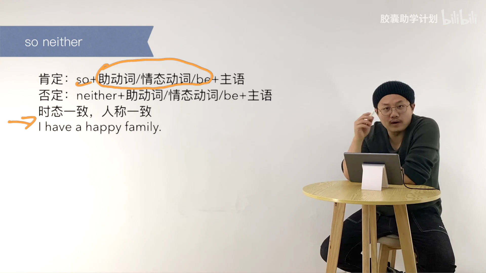

文字识别：Bilbi / 胶囊助学计划 / so neither / 肯定：so+助动词/情态动词/be+主语 / 否定：neither+助动词/情态动词/be+主语 / 时态一致，人称一致 / I have a happy family.

### 画面 00:06:19

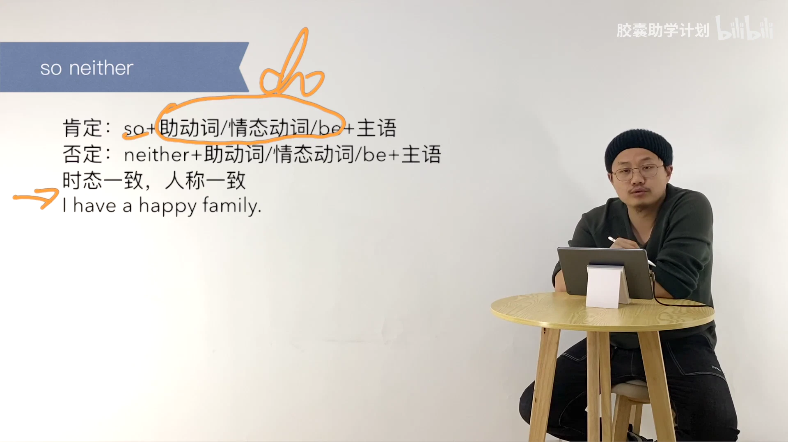

文字识别：Bilbi / 胶囊助学计划 / so neither / 肯定：so+助动词/情态动词/be+主语 / 否定：neither+助动词/情态动词/be+主语 / 时态一致，人称一致 / I have a happy family.

### 画面 00:06:22

文字识别：胶囊助学计划 / 出 / so neither / 肯定：so+助动词/情态动词/be+主语 / 否定：neither+助动词/情态动词/be+主语 / 时态一致，人称一致 / I have a happy family.

### 画面 00:06:29

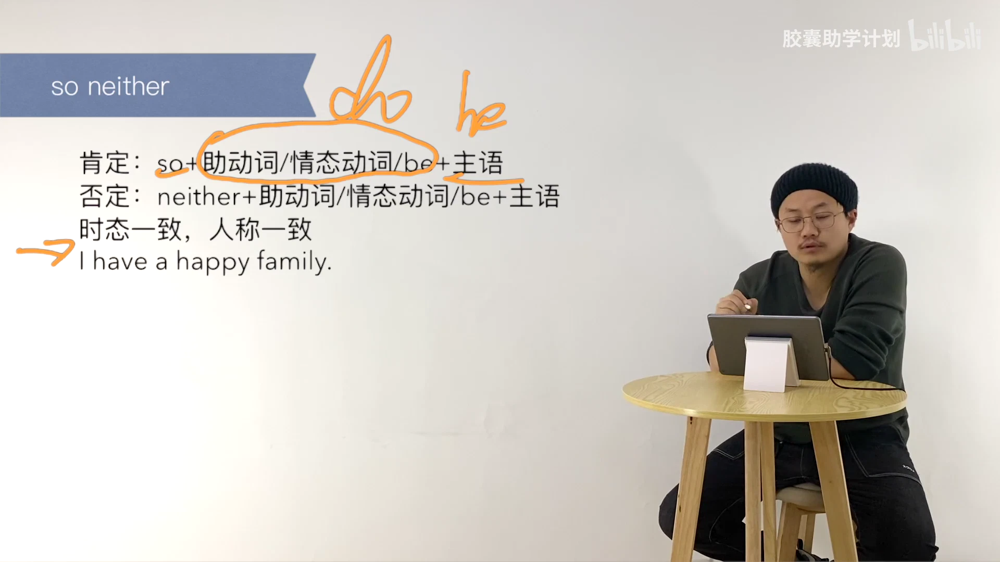

文字识别：胶囊助学计划 / 出 / so neither / 肯定：so+助动词/情态动词/be+主语 / 否定：neither+助动词/情态动词/be+主语 / 时态一致，人称一致 / I have a happy family.

## 00:06:30–00:07:00

那就不能是 so do he 了，应该是时态人称保持一致，对不对？应该就是 so does he。你不能说 so did he。如果你用 so did he，不是不对，那就变成了叫他曾经也是，那就说明他现在怎么样了，没了吗？对吧？没有 happy family，所以答案叫 so do I。好理解哈。再来一个，I don't want to work。我不想工作。如果我想回答说我也不想工作，你注意，我也不

### 画面 00:06:41

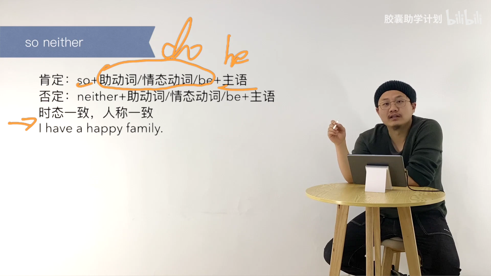

文字识别：胶囊助学计划 / 出 / so neither / 肯定：so+助动词/情态动词/be+主语 / 否定：neither+助动词/情态动词/be+主语 / 时态一致，人称一致 / I have a happy family.

### 画面 00:06:48

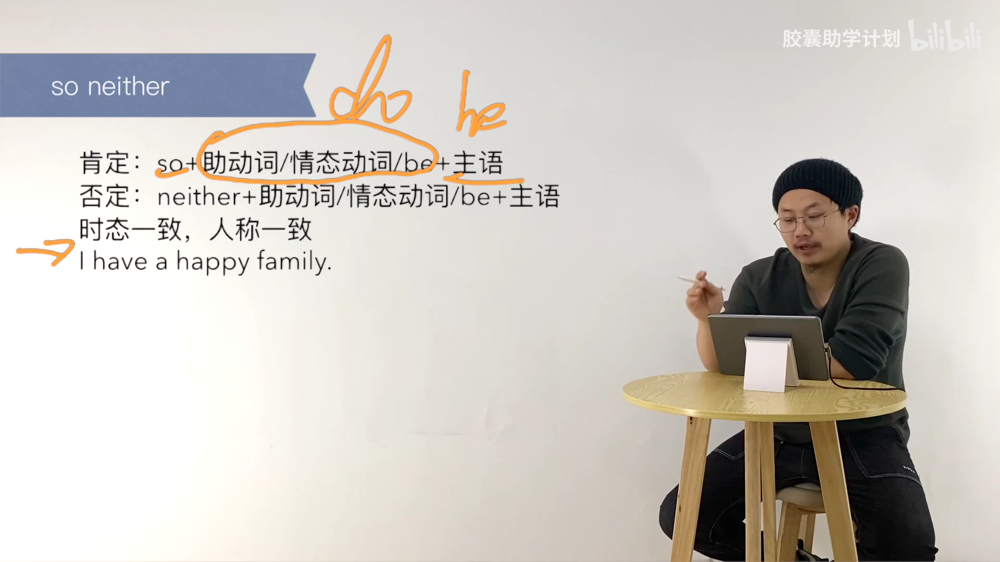

文字识别：胶囊助学计划 / so neither / 肯定：so+助动词/情态动词/be+主语 / 否定：neither+助动词/情态动词/be+主语 / 时态一致，人称一致 / I have a happy family.

### 画面 00:06:56

文字识别：胶囊助学计划 / so neither / 肯定：so+助动词/情态动词/be+主语 / 否定：neither+助动词/情态动词/be+主语 / 时态一致，人称一致 / I have a happy family. / So do l. / I don't want to work.

## 00:07:00–00:07:30

想工作是个否定，所以就不能是 so 提前，应该是 neither 提前，对不对？好，然后中间用谁呢？这句话谁变一般疑问句，中间一般就用谁，然后再换个人称时态什么的，对吧？是啊，时态不能换啊，人称你叫保持一致。如果是我也是，我也不是，那叫做 neither，中间那个叫 do，后边那个叫做 I，对吧？如果是他也不是，那就是 neither，后边肯定是 he 或 she，对吧？

### 画面 00:07:04

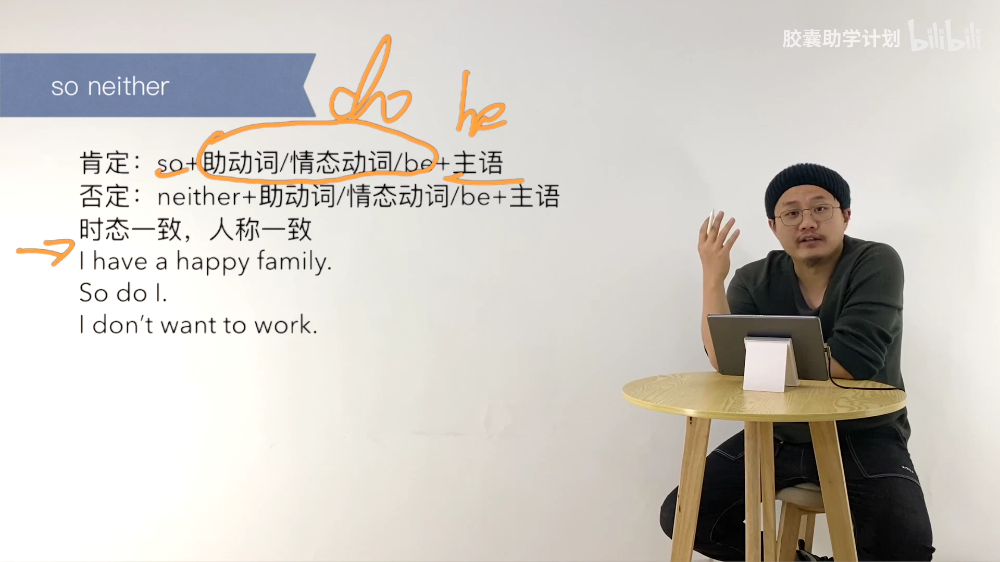

文字识别：胶囊助学计划 / so neither / 肯定：so+助动词/情态动词/be+主语 / 否定：neither+助动词/情态动词/be+主语 / 时态一致，人称一致 / I have a happy family. / So do I. / I don't want to work.

### 画面 00:07:07

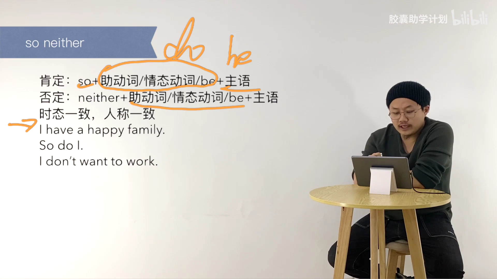

文字识别：胶囊助学计划 / so neither / 肯定：so+助动词/情态动词/be+主语 / 否定：neither+助动词/情态动词/be+主语 / 时态一致，人称一致 / I have a happy family. / So do l. / I don't want to work.

### 画面 00:07:09

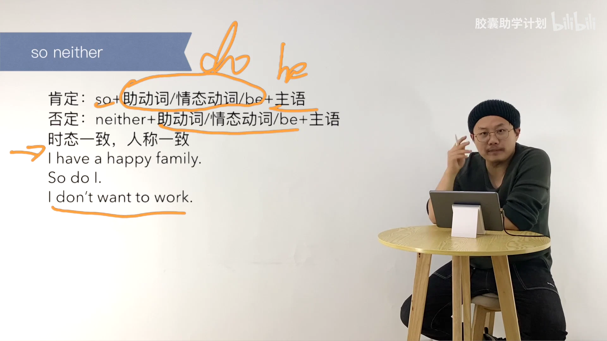

文字识别：胶囊助学计划 / so neither / 肯定：so+助动词/情态动词/be+主语 / 否定：neither+助动词/情态动词/be+主语 / 时态一致，人称一致 / I have a happy family. / So do l. / I don't want to work.

### 画面 00:07:11

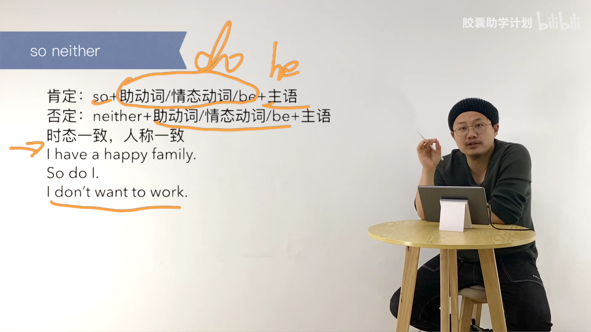

文字识别：胶囊助学计划 / so neither / 肯定：so+助动词/情态动词/be+主语 / 否定：neither+助动词/情态动词/be+主语 / 时态一致，人称一致 / I have a happy family. / So dol. / I don't want to work.

### 画面 00:07:15

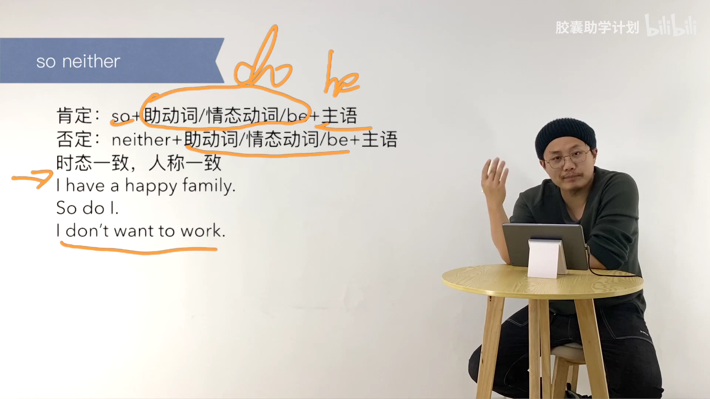

文字识别：Bilibi / 胶囊助学计划 / so neither / 肯定：so+助动词/情态动词/be+主语 / 否定：neither+助动词/情态动词/be+主语 / 时态一致，人称一致 / I have a happy family. / So do l. / I don't want to work.

### 画面 00:07:21

文字识别：胶囊助学计划 / so neither / 肯定：so+助动词/情态动词/be+主语 / 否定：neither+助动词/情态动词/be+主语 / 时态一致，人称一致 / I have a happy family. / So do l. / I don't want to work.

## 00:07:30–00:08:00

中间就是是不能是 do 了，就得是 does，叫 so does he 啊，时态人称要保持一致。好，就变成了 neither do I，或者是 neither does he。 OK，他也不是。 OK，玩一个。接下来呢，我们尝试做一些活动，我带大家做一部分，您自己把剩余的做完，好吧？比如说 I can swim，你可以回答说我也是。

### 画面 00:07:39

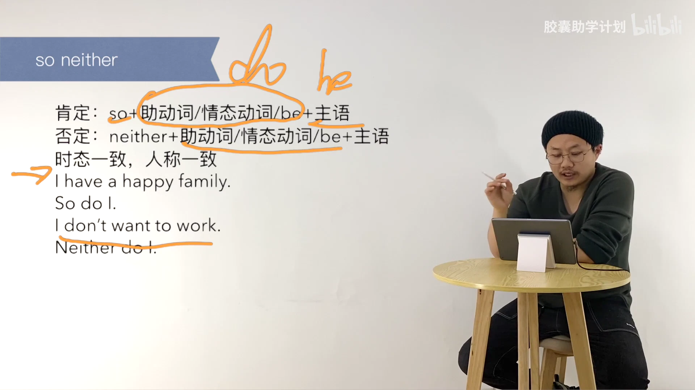

文字识别：胶囊助学计划 / so neither / 肯定：so+助动词/情态动词/be+主语 / 否定：neither+助动词/情态动词/be+主语 / 时态一致，人称一致 / I have a happy family. / So doI. / I don't want to work. / Neitnei

### 画面 00:07:41

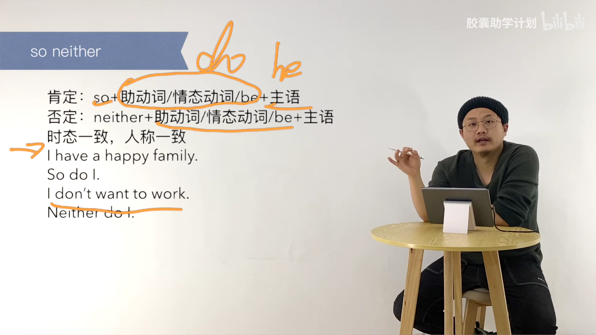

文字识别：胶囊助学计划 / so neither / 肯定：so+助动词/情态动词/be+主语 / 否定：neither+助动词/情态动词/be+主语 / 时态一致，人称一致 / I have a happy family. / So doI. / I don't want to work. / Neitnei

### 画面 00:07:46

文字识别：胶囊助学计划 / 活动

### 画面 00:07:51

文字识别：胶囊助学计划 / 出 / 活动 / 肯定：so+助动词/情态动词/be+主语 / 否定：neither+助动词/情态动词/be+主语

### 画面 00:07:59

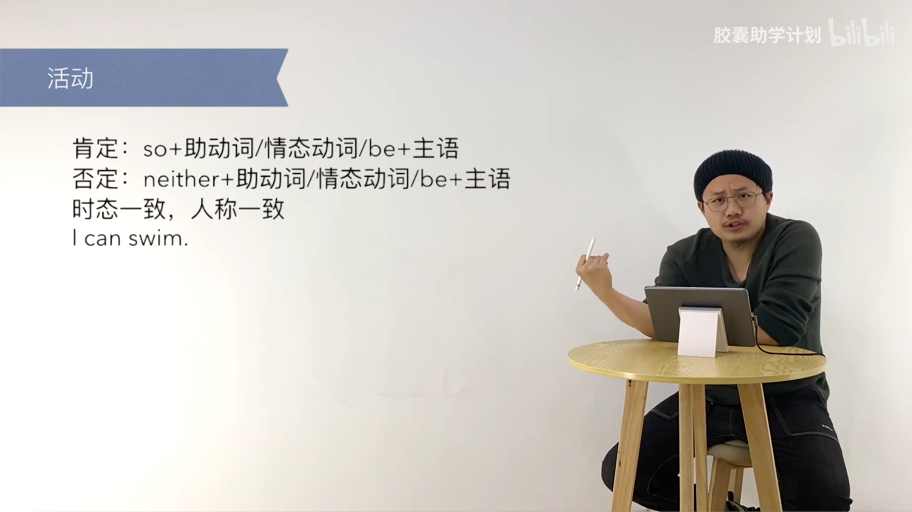

文字识别：胶囊助学计划 / 出 / 活动 / 肯定：so+助动词/情态动词/be+主语 / 否定：neither+助动词/情态动词/be+主语 / 时态一致，人称一致 / I can swim.

## 00:08:00–00:08:30

先选择 so 还是 neither， so 没问题，第一个单词保搞定了，最后一个单词我 I 搞定了，中间看这句话谁变一般疑问句， can 提前，于是就是 so can I，好理解吧？如果是他也是呢，就是 so 第一个单词搞定了，最后一个单词是 he，中间那个单词是谁呢？ can 这个单词是没有第三人称这个概念的，所以还是 so can he，叫他也是，好理解哈。好，比如说 I like ice cream，

### 画面 00:08:29

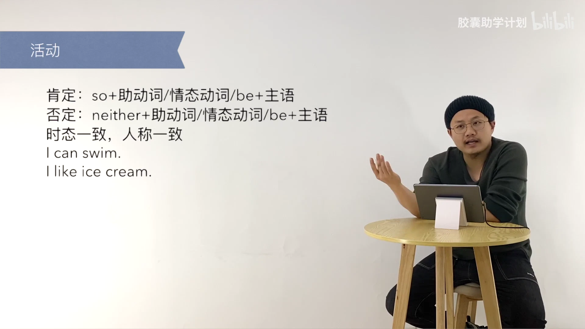

文字识别：胶囊助学计划 / 活动 / 肯定：so+助动词/情态动词/be+主语 / 否定：neither+助动词/情态动词/be+主语 / 时态一致，人称一致 / I can swim. / I like ice cream.

## 00:08:30–00:09:00

我喜欢冰淇淋。我也是，so 没问题了。中间是谁？最后一个是 I。我也是，so do I. Do 为什么用 do 呢？I like ice cream. Do 提前。Do you like ice cream? 对吧？好，剩下的我不多说，我给它打出来放到这儿，各位自己去截图，下课去练，好吧？OK，这是第一组。这是第二组。第二组各位能看到全是否

### 画面 00:08:42

文字识别：胶囊助学计划 / 活动 / 肯定：so+助动词/情态动词/be+主语 / 否定：neither+助动词/情态动词/be+主语 / 时态一致，人称一致 / I can swim. / Tlike ice cream.

### 画面 00:08:44

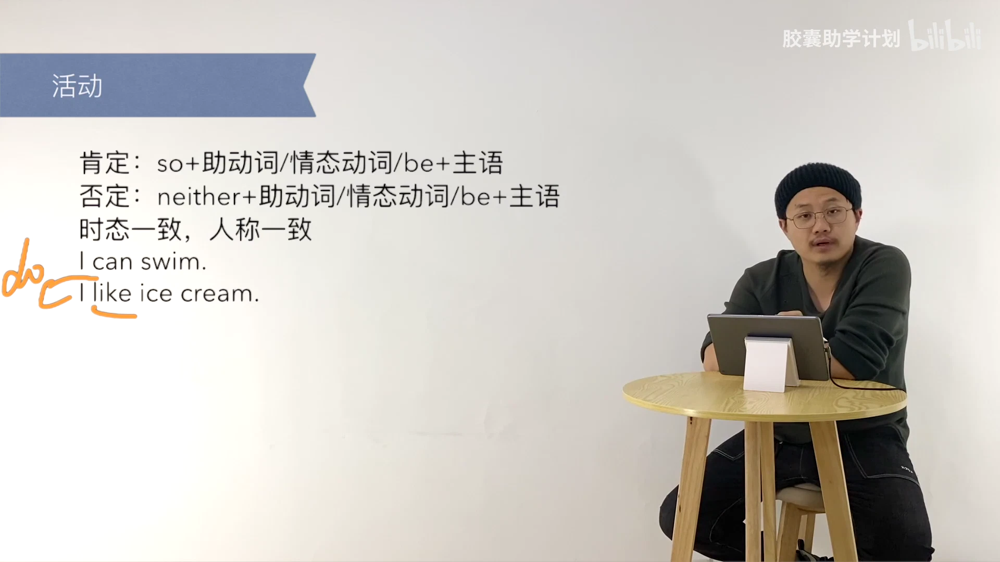

文字识别：胶囊助学计划 / 活动 / 肯定：so+助动词/情态动词/be+主语 / 否定：neither+助动词/情态动词/be+主语 / 时态一致，人称一致 / I can swim. / Tlike ice cream.

### 画面 00:08:47

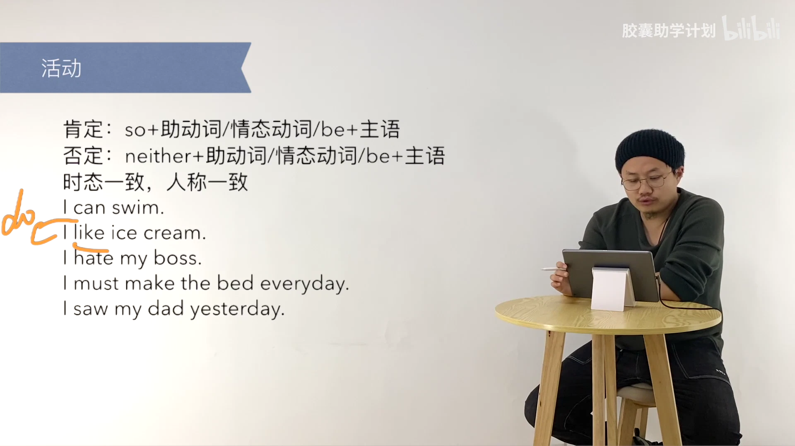

文字识别：胶囊助学计划 / 活动 / 肯定：so+助动词/情态动词/be+主语 / 否定：neither+助动词/情态动词/be+主语 / 时态一致，人称一致 / I can swim. / Tlike ice cream. / I hate my boss. / I must make the bed everyday. / I saw my dad yesterday.

### 画面 00:08:55

文字识别：Bilbili / 胶囊助学计划 / 活动 / 肯定：so+助动词/情态动词/be+主语

### 画面 00:08:57

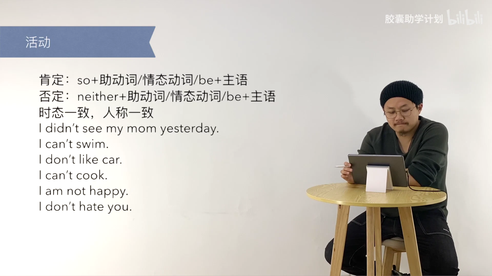

文字识别：胶囊助学计划 / 活动 / 肯定：so+助动词/情态动词/be+主语 / 否定：neither+助动词/情态动词/be+主语 / 时态一致，人称一致 / I didn't see my mom yesterday. / I can't swim. / I don't like car. / I can't cook. / I am not happy. / I don't hate you.

## 00:09:00–00:09:30

定，所以您下意识就应该用 neither 了。比如说我们看第一个，I didn't see my mom yesterday. 我昨天没看见我妈。你说，哎，巧了，我昨天也没见着我妈。他俩干啥去了？ Neither do, ah, neither did I, 对吧？你就不能用 do 了？为什么？I didn't see my mom yesterday. 这句话变一般疑问句是 did 提前，对吧？时人称时态要保持一致，叫做 neither did I. OK，玩一个。那这些呢，各位也是截图啊，然后去

### 画面 00:09:17

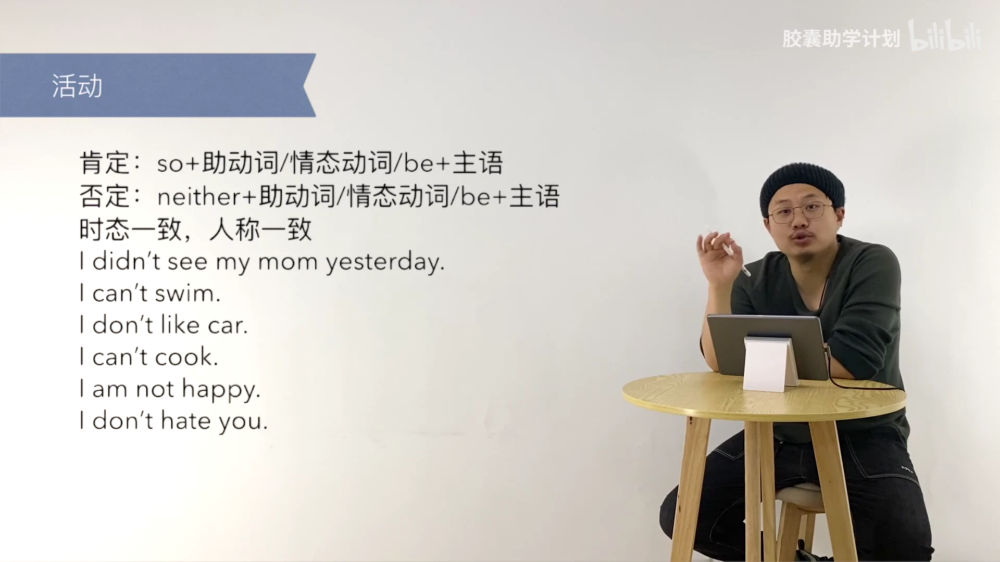

文字识别：胶囊助学计划 / 活动 / 肯定：so+助动词/情态动词/be+主语 / 否定：neither+助动词/情态动词/be+主语 / 时态一致，人称一致 / I didn't see my mom yesterday. / I can't swim. / I don't like car. / I can't cook. / I am not happy. / I don't hate you.

### 画面 00:09:27

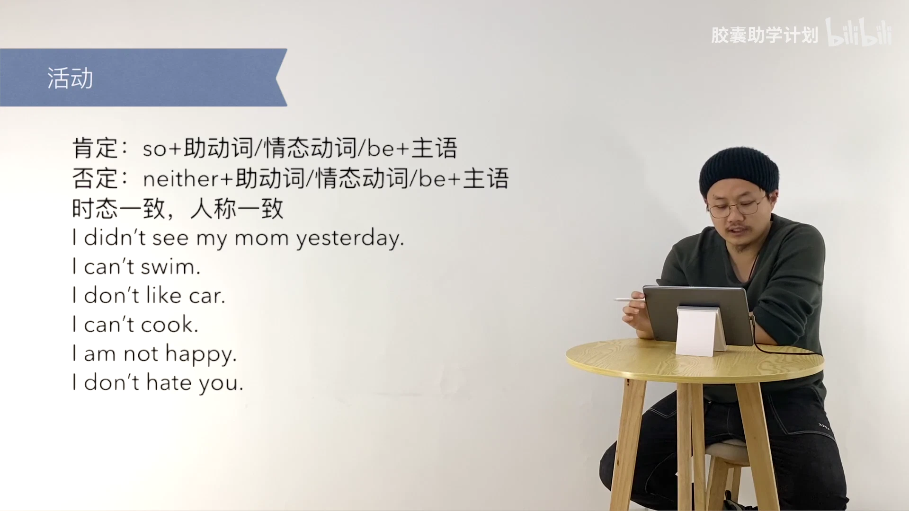

文字识别：胶囊助学计划 / 活动 / 肯定：so+助动词/情态动词/be+主语 / 否定：neither+助动词/情态动词/be+主语 / 时态一致，人称一致 / I didn't see my mom yesterday. / I can't swim. / I don't like car. / I can't cook. / I am not happy. / I don't hate you.

### 画面 00:09:29

文字识别：胶囊助学计划 / Comprehension

## 00:09:30–00:10:00

做这个练习。接下来我们口语能力训练啊，呃，我问您答来了。第一题，Where does the man want to go? He wants to go to Trafalgar Square. Next one, What does he give the conductor for his fare? A ten-pound note. 您说出来后边这些就可以了啊。Next one,

### 画面 00:09:31

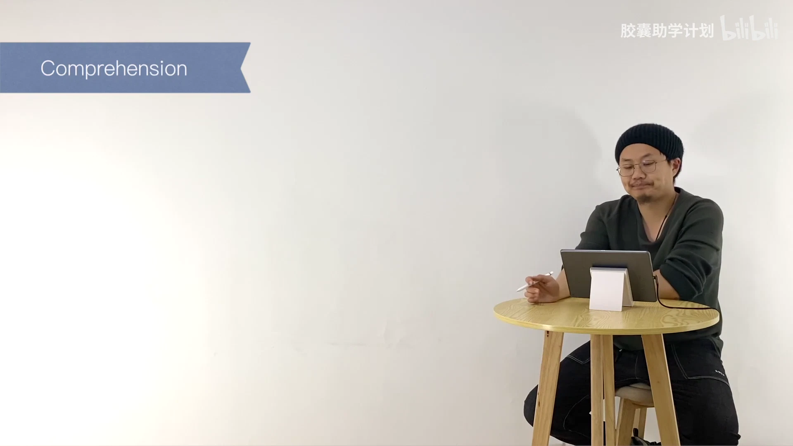

文字识别：胶囊助学计划 / Comprehension

### 画面 00:09:34

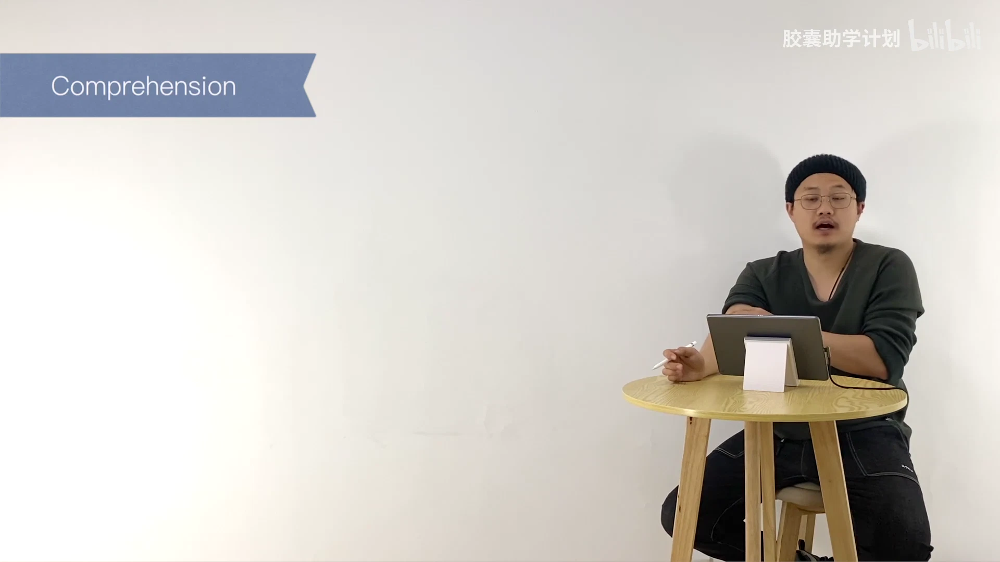

文字识别：胶囊助学计划 / Comprehension

### 画面 00:09:37

文字识别：胶囊助学计划 / Comprehension

### 画面 00:09:39

文字识别：胶囊助学计划 / Comprehension / 1 T: Where does the man want to go?

### 画面 00:09:41

文字识别：胶囊助学计划 / Comprehension / 1 T: Where does the man want to go?

### 画面 00:09:49

文字识别：胶囊助学计划 / Comprehension / 2 T: What does he give the conductor for his fare?

### 画面 00:09:52

文字识别：胶囊助学计划 / Comprehension / 2 T: What does he give the conductor for his fare?

### 画面 00:09:56

文字识别：胶囊助学计划 / Comprehension / 2 T: What does he give the conductor for his fare? / S: He gives the conductor a ten-pound note.

### 画面 00:09:58

文字识别：胶囊助学计划 / Comprehension / 2 T: What does he give the conductor for his fare? / S: He gives the conductor a ten-pound note.

## 00:10:00–00:10:30

Does the conductor have any small change? No, he doesn't. Next one. Has the man got any small change? No, he hasn't. Next one. What does the conductor say he will do? He says he will ask some of the passengers. Next one. Does the first passenger have

### 画面 00:10:00

文字识别：胶囊助学计划 / Comprehension / 3 T: Does the conductor have any small change?

### 画面 00:10:02

文字识别：胶囊助学计划 / Comprehension / 3 T: Does the conductor have any small change?

### 画面 00:10:05

文字识别：胶囊助学计划 / Comprehension / 3 T: Does the conductor have any small change? / S: No, he doesn't.

### 画面 00:10:07

文字识别：胶囊助学计划 / Comprehension / 4 T: Has the man got any small change?

### 画面 00:10:13

文字识别：胶囊助学计划 / Comprehension / 5 T: What does the conductor say he will do?

### 画面 00:10:15

文字识别：胶囊助学计划 / Comprehension / 5 T: What does the conductor say he will do?

### 画面 00:10:18

文字识别：胶囊助学计划 / Comprehension / 5 T: What does the conductor say he will do? / S: He says he will ask some of the passengers.

### 画面 00:10:20

文字识别：胶囊助学计划 / Comprehension / 5 T: What does the conductor say he will do? / S: He says he will ask some of the passengers. / -

### 画面 00:10:22

文字识别：胶囊助学计划 / Comprehension / 5 T: What does the conductor say he will do? / S: He says he will ask some of the passengers.

### 画面 00:10:24

文字识别：胶囊助学计划 / Comprehension / 5 T: What does the conductor say he will do? / S: He says he will ask some of the passengers.

### 画面 00:10:26

文字识别：胶囊助学计划 / Comprehension / 6 T: Does the first passenger have any small change?

## 00:10:30–00:11:00

any small change? No, he doesn't. Next one, does the second passenger have any small change? No, he doesn't have any either. Next one, what does the conductor asked man to do? 啊, ask somebody to do something叫要求某人去做某事儿，其实就是 want somebody to do something的一个理解为同样的一个结构是吧？叫想让某人做某事儿，那 ask somebody to do something就

### 画面 00:10:30

文字识别：胶囊助学计划 / Comprehension / 6 T: Does the first passenger have any small change?

### 画面 00:10:35

文字识别：胶囊助学计划 / Comprehension / 7 T: Does the second passenger have any small change?

### 画面 00:10:37

文字识别：胶囊助学计划 / Comprehension / 7 T: Does the second passenger have any small change?

### 画面 00:10:39

文字识别：胶囊助学计划 / Comprehension / 7 T: Does the second passenger have any small change? / S: No, he doesn't have any either.

### 画面 00:10:42

文字识别：胶囊助学计划 / Comprehension / 7 T: Does the second passenger have any small change? / S: No, he doesn't have any either.

### 画面 00:10:44

文字识别：胶囊助学计划 / Comprehension / 8 T: What does the conductor ask the man to do?

### 画面 00:10:48

文字识别：胶囊助学计划 / Comprehension / 8 T: What does the conductor ask the man to do?

## 00:11:00–00:11:30

要求某人做某事。 To get off the bus，对吧？下车啊。 Next one， Does anyone have any small change？ Yes， the two trams， two trams do。 Next one，那 asking questions，我给肯定句，一般疑问句，特殊疑问词，特殊疑问句啊来了。 Ask me if the man wants to go to Trafalgar Square。 Does the man

### 画面 00:11:01

文字识别：胶囊助学计划 / Comprehension / 8 T: What does the conductor ask the man to do? / S: He asks the man to get off the bus.

### 画面 00:11:05

文字识别：胶囊助学计划 / Comprehension

### 画面 00:11:08

文字识别：胶囊助学计划 / Comprehension / 9 T: Does anyone have any small change?

### 画面 00:11:11

文字识别：胶囊助学计划 / Comprehension / 9 T: Does anyone have any small change? / S: Yes, the two tramps do.

### 画面 00:11:15

文字识别：胶囊助学计划 / Asking questions / 1 T: Ask me if the man wants to go to Trafalgar Square.

### 画面 00:11:18

文字识别：胶囊助学计划 / Asking questions / 1 T: Ask me if the man wants to go to Trafalgar Square.

### 画面 00:11:28

文字识别：胶囊助学计划 / Asking questions / 1 T: Ask me if the man wants to go to Trafalgar Square. / S: Does the man want to go to Trafalgar Square?

## 00:11:30–00:12:00

want to go to Trafalgar Square? Where? Where does the man want to go? Ah,你看want to go你可以变成wanna go. Where does the man wanna go?一百零五课我讲过，对吧？Want to do something等于wanna do something，口语更常用。Next one, ask me if the conductor can change a ten-pound note. Can提前就行了。Can the conductor change a ten-pound note? Why can't?直接加前面。

### 画面 00:11:38

文字识别：胶囊助学计划 / Asking questions / 1 T: Ask me if the man wants to go to Trafalgar Square. / S: Does the man want to go to Trafalgar Square? / T:Where..? / S: Where does the man want to go?

### 画面 00:11:48

文字识别：胶囊助学计划 / Asking questions

### 画面 00:11:57

文字识别：胶囊助学计划 / Asking questions / 2 T: Ask me if the conductor can change a ten-pound note, / S: Can the conductor change a ten-pound note? / T: Why can't...?

## 00:12:00–00:12:30

Why can't the conductor change a ten pound note? Next one, ask me if the conductor will ask the passengers. Will the conductor ask the passengers? Who, who will the conductor ask? Next one, ask me if the man must get off the bus. Must the man get off the bus? Why, why

### 画面 00:12:04

文字识别：胶囊助学计划 / 出 / Asking questions

### 画面 00:12:15

文字识别：胶囊助学计划 / Asking questions / 3 T: Ask me if the conductor will ask the passengers. / S: Will the conductor ask the passengers? / T:Who..? / S: Who will the conductor ask?

### 画面 00:12:19

文字识别：胶囊助学计划 / 出 / Asking questions / 4T : Ask me if the man must get off the bus.

### 画面 00:12:29

文字识别：胶囊助学计划 / Asking questions / 4T : Ask me if the man must get off the bus. / S: Must the man get off the bus? / T：Why..? / S: Why must the man get off the bus?

## 00:12:30–00:13:00

must the man get off the bus?最后一个, ask me if the tramps have got some small change. Have got, 其实九课学的, 哎, 如果您忘了一定要回去看一下视频。在, have the tramps got some small change? Who, who have got some small change?互对主语提问,直接替代,不用变一般疑问句啊。Okay, recap.对于各位来说,本课比较

### 画面 00:12:33

文字识别：胶囊助学计划 / Asking questions

### 画面 00:12:41

文字识别：胶囊助学计划 / Asking questions / 5 T: Ask me if the tramps have got some / small change.

### 画面 00:12:43

文字识别：胶囊助学计划 / 出 / 7% / Asking questions / 5 T: Ask me if the tramps have got some / small change.

### 画面 00:12:49

文字识别：胶囊助学计划 / 79. / Asking questions / 5 T: Ask me if the tramps have got some / small change. / S: Have the tramps got some small change? / T: Who...? / S: Who have got some small change?

### 画面 00:12:52

文字识别：胶囊助学计划 / 77. / Asking questions / 5T: Ask me if / (he tramp / have got some / small change. / S: Have the tramps got some small change? / T: Who...? / S: Who have got some small change?

### 画面 00:12:54

文字识别：胶囊助学计划 / 77. / Asking questions / 5T: Ask me if / tne / Xramps I / have got some / small change. / S: Have the tramps got some small change? / T: Who...? / S: Who have got some small change?

### 画面 00:12:56

文字识别：胶囊助学计划 / Recap / Patterns / Neither can I. / So have I. / Grammar / Words / Expression

### 画面 00:12:58

文字识别：胶囊助学计划 / Recap / Patterns / Neither can I. / So have I. / Grammar / Words / Expression

## 00:13:00–00:13:30

重要的两个小语法其实是一个啊，Neither can I, so have I。各位去红皮书当中记得找一下 neither 和 so 这个这两个小的句型啊。OK，家庭作业绿皮书一百一十三课啊，文章要熟读成诵，红皮书去查找 so 和 neither，然后给自己讲解一遍核心知识点，也就是 so 和 neither，好吧？OK，那如果喜欢我们的课程呢，欢迎大家关注、订阅、一键三连，分享给身边需要的人。

### 画面 00:13:00

文字识别：胶囊助学计划 / Recap / Patterns / Neither can I. / So have / Grammar / Words / Expression

### 画面 00:13:06

文字识别：胶囊助学计划 / Recap / Patterns / Neither can I. / So have / Grammar / Words / Expression

### 画面 00:13:11

文字识别：胶囊助学计划

### 画面 00:13:16

文字识别：胶囊助学计划 / 绿皮书第113课的写作练习 / 文章跟读至熟读成诵 / 3.初级红皮书查找Sa Neither

### 画面 00:13:24

文字识别：胶囊助学计划

### 画面 00:13:26

文字识别：胶囊助学计划 / 不

## 00:13:30–00:13:51

最后，我们再来看一句名人名言：There is nothing permanent except change. Okay, see you next time.

### 画面 00:13:30

文字识别：胶囊助学计划 / There is nothing permanent except / change. / Heraclitus

### 画面 00:13:39

文字识别：There is nothing permanent / change. / Heraclitus

### 画面 00:13:41

文字识别：CAPSULEACADEMY / 胶囊助学计划 / 『 / 小红书 / Lecturer / Leo / OE

### 画面 00:13:44

文字识别：CAPSULEACADEMY / 胶囊助学计划 / 『 / 小红书 / Editor / OE

### 画面 00:13:47

文字识别：CAPSULEACADEMY / 胶囊助学计划 / 『 / 小红书 / Creator / □ / Leo & Berlin / OE

### 画面 00:13:49

文字识别：bilibili / 胶囊助学计划 / 胶囊助学计划 / 小红书 / OE

### 画面 00:13:51

文字识别：bilibili / 胶囊助学计划

