# 115 单词 语法

快速机器解析：语音为单模型转写，未进行独立交叉校对或人工复核；画面每秒采样并按变化选帧，短时文字和标记可能遗漏。截图时间约有 1 秒误差。图片有损压缩；遇到疑点请按时间查看 Google Drive 原视频。

## 00:00:00–00:00:30

Hello everyone, welcome to Capsule Academy. This is Leo. Today we're going to learn New Concept English Book One, Lesson One Hundred and Fifteen, Grammar and Words. 那老习惯进入正式课程之前呢，我们先看一个问题啊，如何使用不定代词？那带着这个问题，Hope you guys enjoy it. 好，那有问必有答，咱们立刻先去看一下不定代词，对吧？OK，首先各

### 画面 00:00:00

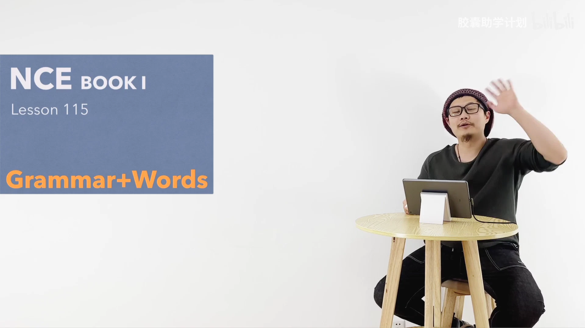

文字识别：NCE / BOOKI / Lesson 115 / Grammar+Words

### 画面 00:00:05

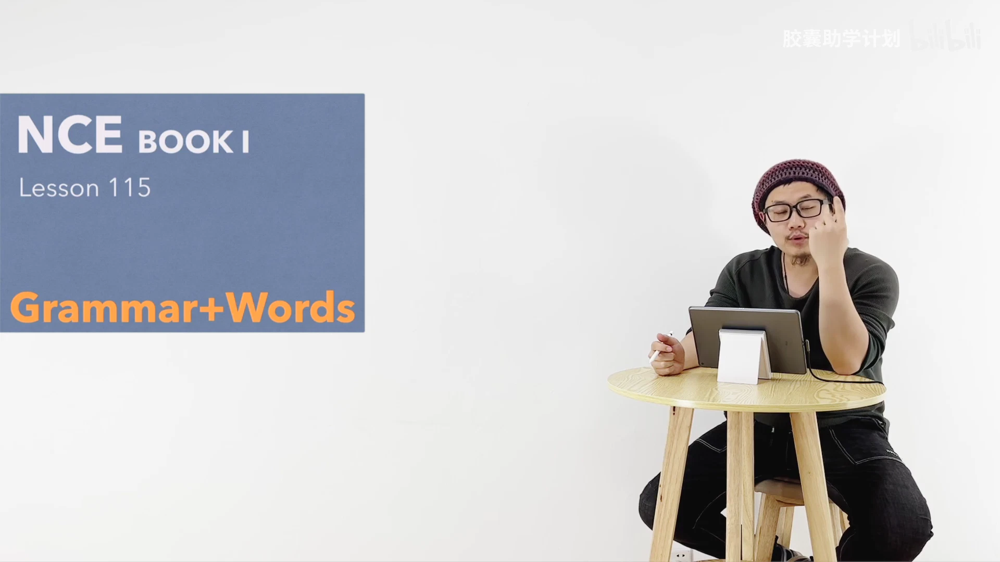

文字识别：NCE / BOOKI / Lesson 115 / Grammar+Words

### 画面 00:00:12

### 画面 00:00:14

文字识别：①如何使用不定代词？

### 画面 00:00:19

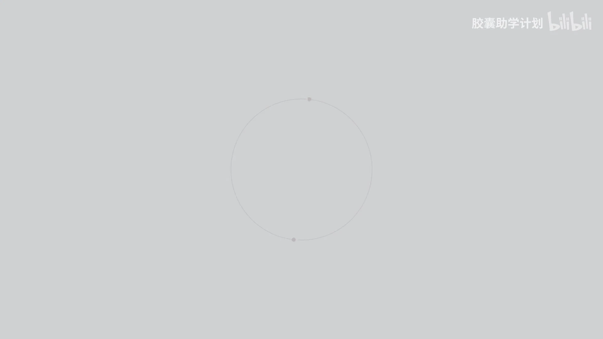

文字识别：胶囊助学计划 bilbl

### 画面 00:00:22

文字识别：胶囊助学计划 / 胶囊助学计划

### 画面 00:00:24

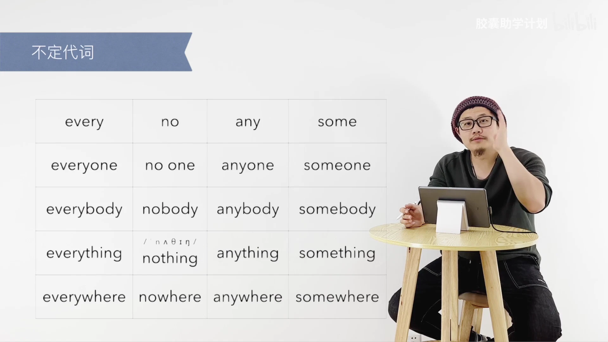

文字识别：不定代词 / every / no / any / some / everyone / no one / anyone / someone / everybody / nobody / anybody / somebody / / ^nλθⅠη1 / everything / anything / something / nothing / everywhere nowhere anywhere somewhere

## 00:00:30–00:01:00

位看到这个表格当中的所有单词，我们都可以管它叫不定代词啊。首先，我们先简单说一下什么叫代词啊。我们之前讲过了名词、形容词、动词还有副词，对吧？这是其实最常见的四类词性，也是我们需要好好去掌握的。那还有一类词性，其实我一直没有单独去提它，比如说代词。其实我们之前学过的你、我、他、他、他啊这些单词，它其实就叫做人称代词啊，

### 画面 00:00:31

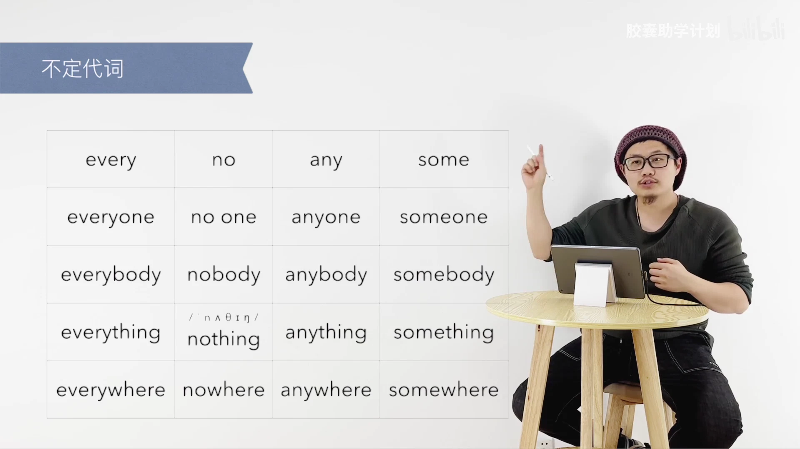

文字识别：不定代词 / every / no / any / some / everyone / no one / anyone / someone / everybody / nobody / anybody / somebody / 1^nλθⅠη1 / everything / anything / something / nothing / everywhere nowhere anywhere somewhere

### 画面 00:00:39

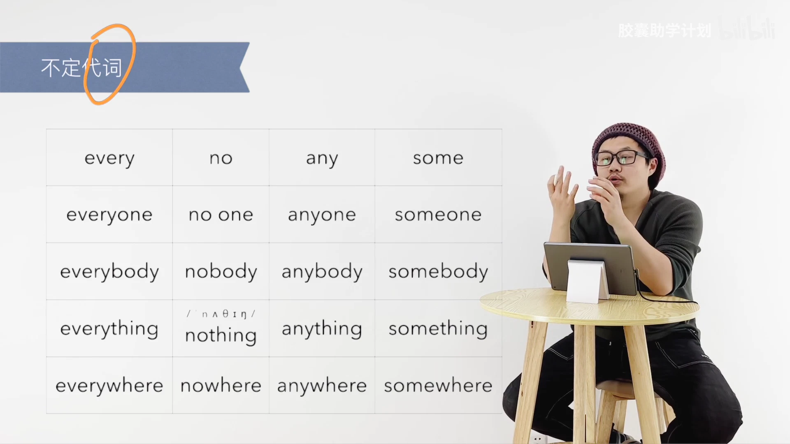

文字识别：不定代词 / every / no / any / some / everyone / no one / anyone / someone / everybody / nobody / anybody / somebody / / ^nλθⅠη1 / everything / anything / something / nothing / everywhere nowhere anywhere somewhere

## 00:01:00–00:01:30

代替的是人称，比如说我是Lyle，对吧？那能代替我可以用哪个人称呢？用he，对吧？用男他去代替我，OK？那代词我们就好理解了，对吧？OK？那不定代词其实它就是不一个确不太字面意思，我们去理解就是不太确定指向的一个代词。我们看一下为什么这么说，好吧？OK？我们看啊，这地方有几个单词，第一个是every，我们很熟，叫每一个；

### 画面 00:01:09

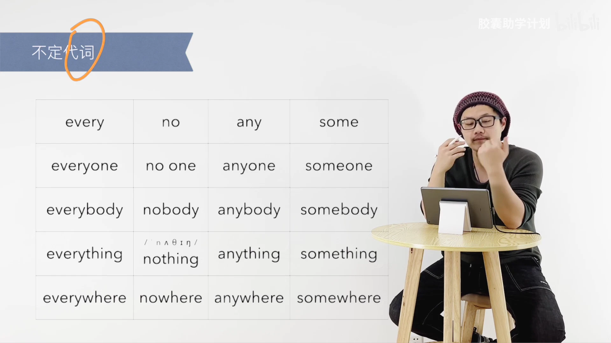

文字识别：不定代词 / every / no / any / some / everyone / no one / anyone / someone / everybody / nobody / anybody / somebody / / ^nλθⅠηl / everything / anything / something / nothing / everywhere nowhere anywhere somewhere

## 00:01:30–00:02:00

no叫没有；any叫任何；some叫做一些。这些单词都是我们在本课之前就应该学过的、见过的一些单词。然后我们看底下它的组成方式，我们先竖着看。比如说，everyone，one代表一，对吧？在这个地方，everyone在英语当中啊，它往往可以代表，比如说每一个人或每一个物件。你看，它不是一个确定性指

### 画面 00:01:35

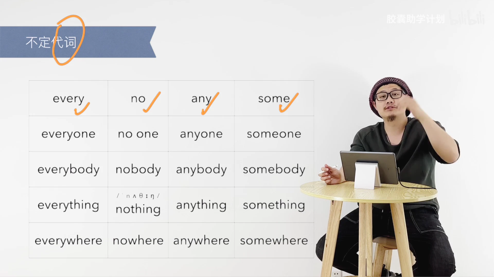

文字识别：不定代词 / every / no / any / some / everyone / no one / anyone / someone / everybody / nobody / anybody / somebody / 1^nΛθⅠη1 / everything / anything / something / nothing / everywhere nowhere anywhere somewhere

### 画面 00:01:55

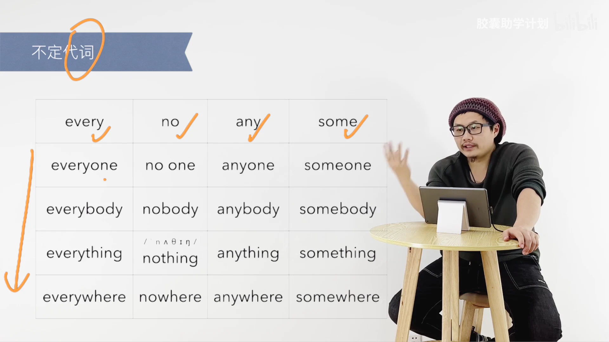

文字识别：不定代词 / every / no / any / some / everyone / no one / anyone / someone / everybody / nobody / anybody / somebody / / ^nλθⅠη1 / everything / anything / something / nothing / everywhere nowhere anywhere somewhere

## 00:02:00–00:02:30

向的。至于啊，就我们所以可以这样尝试去理解，管它叫不定代词，对吧？OK，那everyone啊，可以说每一个人在座的每一位啊，叫做everyone。那它和底下这个everybody，这个body，OK，它其实body的意思就是我们的身体，它也可以指人。那everybody就特指的是每一个人，OK。但everyone还有一个含义，就可以指的是每一个东西啊。那everybody呢，

### 画面 00:02:25

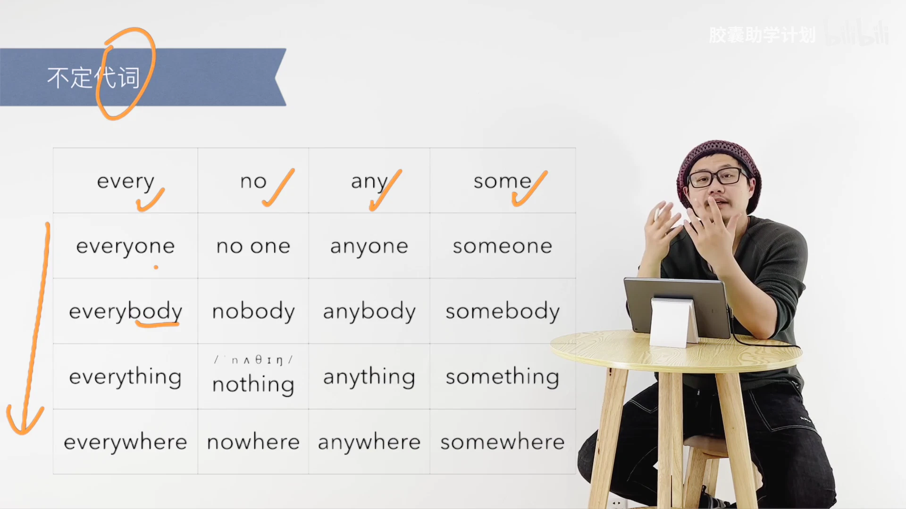

文字识别：不定代词 / every / no / any / some / everyone / no one / anyone / someone / everybody / nobody / anybody / somebody / /^nΛθⅠη1 / everything / anything / something / nothing / everywhere nowhere anywhere somewhere

## 00:02:30–00:03:00

是只能指每一个人，OK？好，那 everything thing 是东西的意思，那 everything 就是特指每一个东西，对吧？那 everywhere 各位字面意思应该就能理解了，叫每一个地方。这是我们竖着去看，然后我们现在横着去看一下，这样横着去看一下，好吧？Everyone 叫每一个人，那 no one 你是不是也能猜出来是什么意思了？叫做没有人，对吧？Anyone 就是任何人，那

### 画面 00:02:49

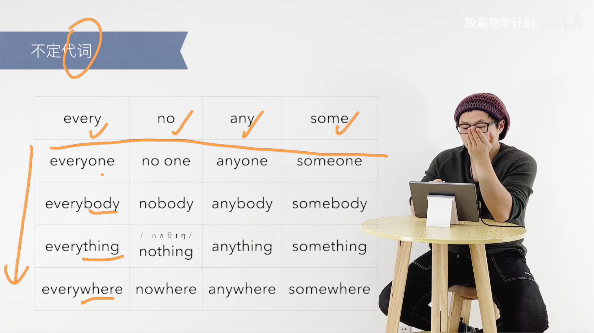

文字识别：不定代词 / every / no / any / some / everyone / no one / anyone / someone / everybody / nobody / anybody / somebody / 1^nΛθⅠηl / everything / anything / something / nothing / everywhere r / nowhere anywhere somewhere

## 00:03:00–00:03:30

someone 就是某些人，OK，一些人。我们再继续横着看第二行，everybody 叫每一个人，nobody 叫没有人，anybody 叫任何人，或者用在否定句当中，而 somebody 指的是某些人。你看它不是一个确定的指向，所以管它叫不定代词。OK，继续，everything 叫所有的事情，所有的东西。下一个单词不叫 nothing

### 画面 00:03:06

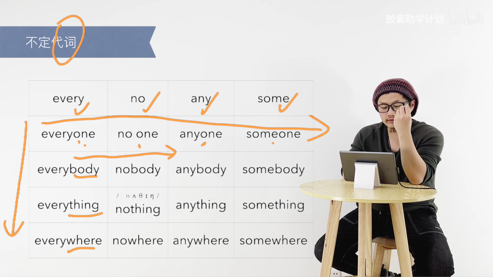

文字识别：不定代词 / every / no / any / some / everyone / no one / anyone / someone / everybody / nobody / anybody / somebody / /^nΛθⅠηl / everything / anything / something / nothing / everywhere / nowhere anywhere somewhere

## 00:03:30–00:04:00

啊，我们不管它叫 nothing。我们看一下音标，它叫 nothing。 Okay，再跟我读一遍 nothing。 Very good。就没有事啊，没事儿。 Anything 叫任何事情， something 叫做某些事情或者一些事情。 Continue。同理， everywhere 我们解释清楚了，叫每一个地方。那 nowhere 就是没有地方，而 anywhere 叫任何地方， somewhere 叫做某些地方。好，那他们如何去

### 画面 00:03:36

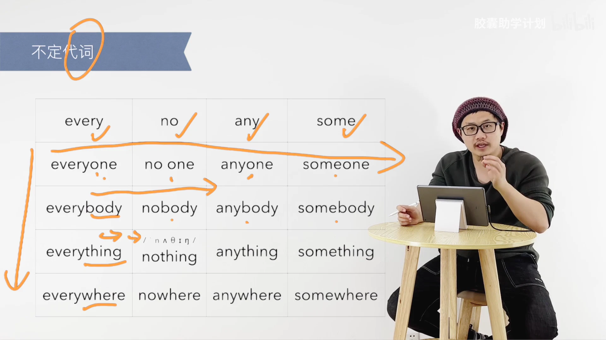

文字识别：不定代词 / every / no / any / some / everyone / no one / anyone / someone / everybody / nobody / anybody / somebody / nΛθⅠη1 / everything / anything / something / nothing / everywhere / nowhere anywhere somewhere

## 00:04:00–00:04:30

用呢？各位，首先字面意思很容易各位理解了之后，它如何去用？其实它，比如说在这个地方，我们最主要说一下any和some。所有底下的单词anyone、anybody啊、anything、anywhere这一列和some那一列，它的用法跟any和some本身是高度相同的，高度类似的。比如说any，我们往往用在否定句和一

### 画面 00:04:06

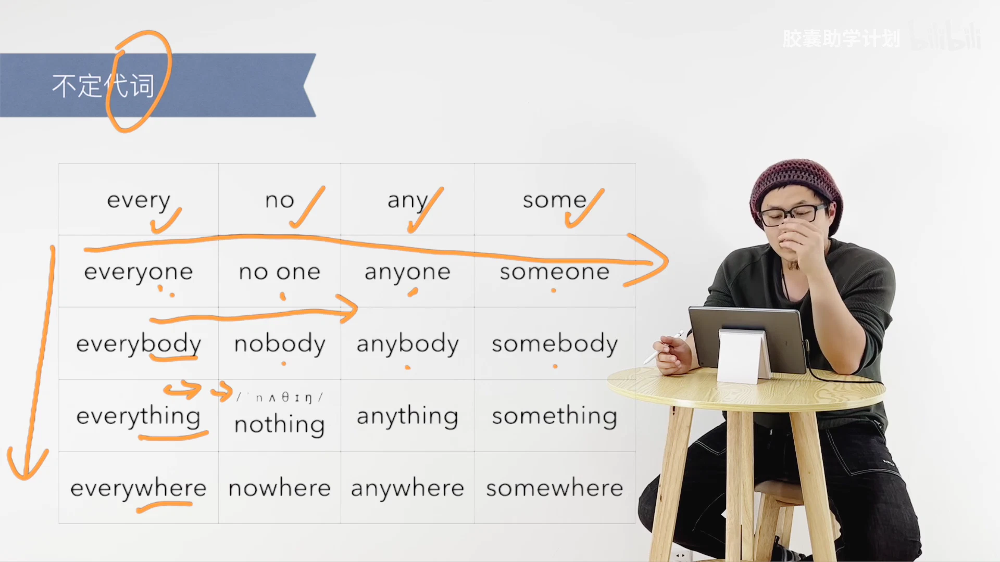

文字识别：不定代词 / every / no / any / some / everyone / no one / anyone / someone / everybody / nobody / anybody / somebody / nΛθⅠη1 / everything / anything / something / nothing / everywhere / nowhere anywhere somewhere

## 00:04:30–00:05:00

般疑问句当中，但偶尔也可以由含义决定出现在肯定句当中，对吧？那底下这一列同理，OK，好，some呢往往用在肯定句当中，偶尔也可以出现在比如说疑问句当中。那同理，底下这一列呢也是主要用在肯定句当中，偶尔也会出现在疑问句当中，好吧？那我们这么讲呢，还是稍微会有一些抽象。等我们进入文

### 画面 00:04:36

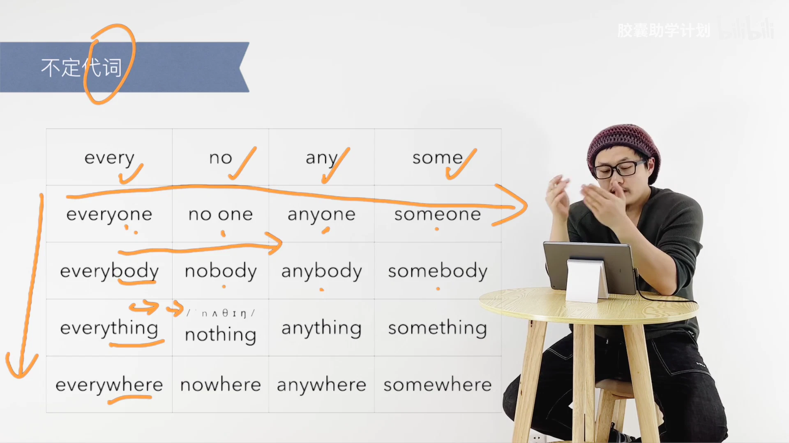

文字识别：不定代词 / every / no / any / some / everyone / no one / anyone / someone / everybody / nobody / anybody / somebody / nΛθⅠη/ / everything / anything / something / nothing / everywhere / nowhere anywhere somewhere

## 00:05:00–00:05:30

章和偶数课的练习的时候，我们再做更多的一个呃，大家我们拿例句去给大家去讲，好吧？那在这儿各位现在要本视频各位要记住的一个事情呢，就很简单，就您把这些单词先读一遍，然后呢，比如说重点它的每个含义大概都清楚，对吧？然后呢，确定你看 no one 在这中间是有一个空格的，剩下所有单词都是一个单词连起来，然后呢，这个单词不叫 nothing，叫 nothing 啊，基本上这些

### 画面 00:05:06

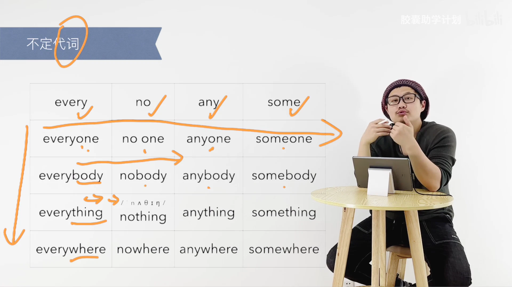

文字识别：不定代词 / every / no / any / some / everyone / no one / anyone / someone / everybody / nobody / anybody / somebody / @ / n^θⅠη1 / everything / anything / something / nothing / everywhere / nowhere anywhere / somewhere

## 00:05:30–00:06:00

东西各位掌握本课本视频就可以了，好吧？那我们就不再多说了。我们接下来看本课的单词，先跟我一起读一下。第一个单词 knock, knock, knock，就是敲门，很简单，是一个动词。我们造一句话，跟我一起读一下。来，Someone is knocking at the door. 哎，说某人啊，有这么一个人，某人正在敲门。哎，我们也不确定是一个人还是俩人，反正有人正在敲门。哎，对吧？

### 画面 00:05:34

文字识别：/ n ｕ k 1 / knock v.

### 画面 00:05:45

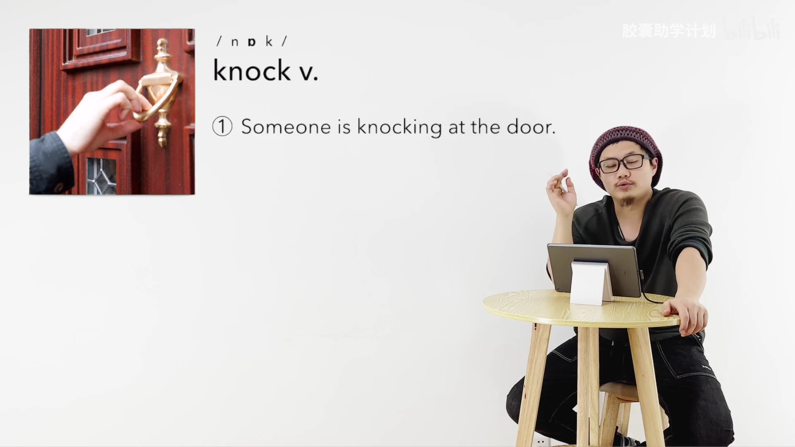

文字识别：/ n D k / / knock v. / ① Someone is knocking at the door.

## 00:06:00–00:06:30

OK，好，各位看几个小点。我们看刚才我们刚说嘛，首先 some 用在肯定句当中，然后 some 组成的那四个单词也往往最常出现在肯定句当中。首先这儿没问题，他没有说 anyone，对吧？没有说任何人正在敲门，这语句含义也不通。所以他说一些人正在敲门，对吧？某个人正在敲门，someone is knocking at the door。OK，其次各位注意一个小点，你看啊，当我们不确定是一

### 画面 00:06:15

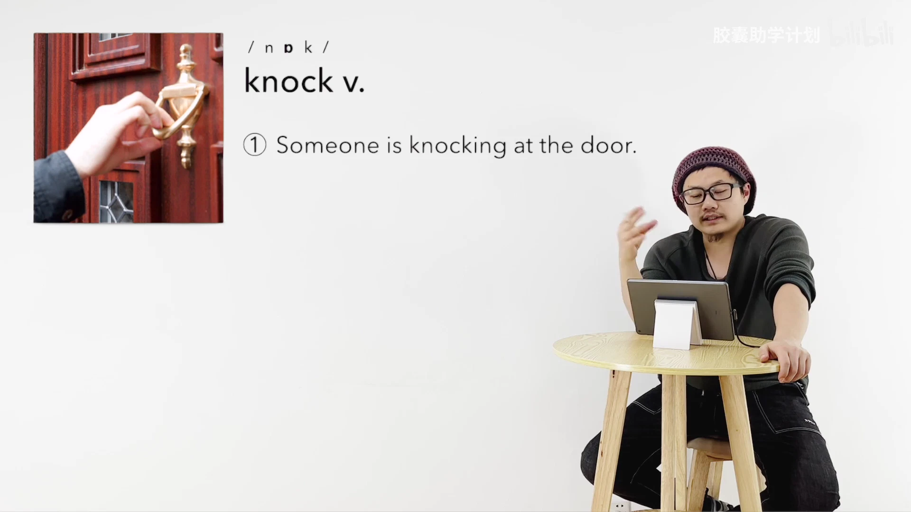

文字识别：/ n o k / / knock v. / ① Someone is knocking at the door.

## 00:06:30–00:07:00

一个人还是一些人的时候，只要你用了 someone，在英语当中，它就默认为这个地方要用单数，这是语法习惯，它不一定符合人类的逻辑，但人家就这么用，对吧？咱们就这么学就 OK 了。 Continue, say who is knocking at the door? That's very simple. I actually just took who as the subject for a question. Ah, someone who for someone question, very simple. Ah, not much to say. Let's come back and make another sentence with me.

### 画面 00:06:45

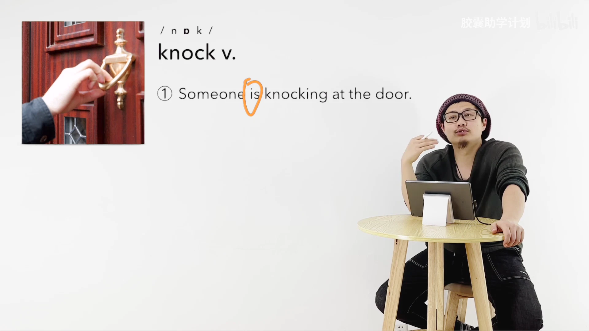

文字识别：/ n o k 1 / knock v. / ① Someoneisknocking at the door.

### 画面 00:06:58

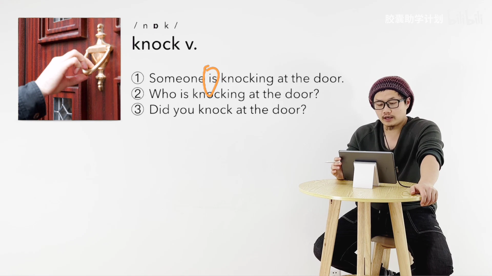

文字识别：/ n o k 1 / knock v. / ① Someoneis knocking at the door. / Who is kncking at the door? / Did you knock at the door?

## 00:07:00–00:07:30

再造一句话跟我读。Did you knock at the door？啊，一开门说，哎，刚才是不是你敲门？啊，你现在怎么站在那么远的地方，没在门旁边？Did you knock at the door？啊，刚才你看我用的是 did 一般过去时，very good，好。Continue，下一个单词跟我一起读一下，叫做 quiet，quiet，t，OK，quiet 连起来 quiet，哎，那我们就给大家补一个很小的短语就行了，这是非常常用的，叫做

### 画面 00:07:15

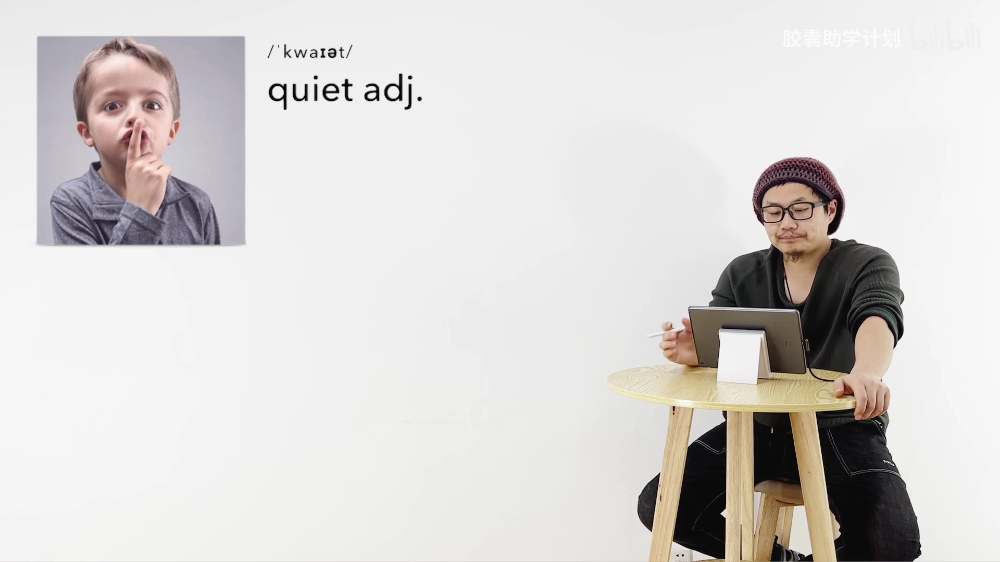

文字识别：/'kwaiat/ / quiet adj.

## 00:07:30–00:08:00

be quiet. Okay, be quiet. 叫做安静啊，安静. Be quiet, everyone. Very good. 你看，我说 be quiet, everyone. 你想一下，every 叫每一个，one 可以指人，那叫 be quiet, everyone. 叫做安大家安静一下，对吧？ Okay, very good. 接下来呢，我们看一个小的电影片段。这个电影片段当中出现了 quiet 这个单词。那同理，我们还能正好复习一下之前学过的一个语法。

### 画面 00:07:45

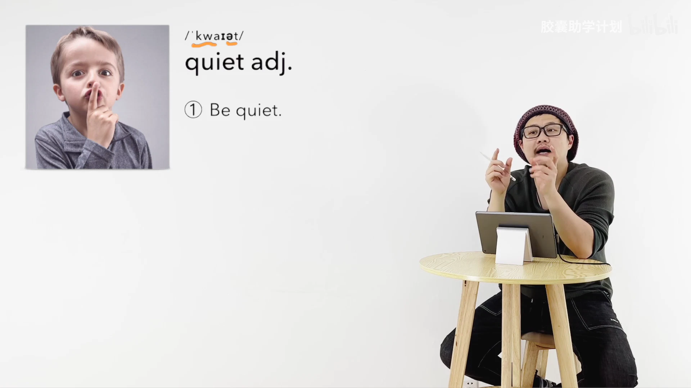

文字识别：/'kwaiat/ / quiet adj. / ① Be quiet.

### 画面 00:07:48

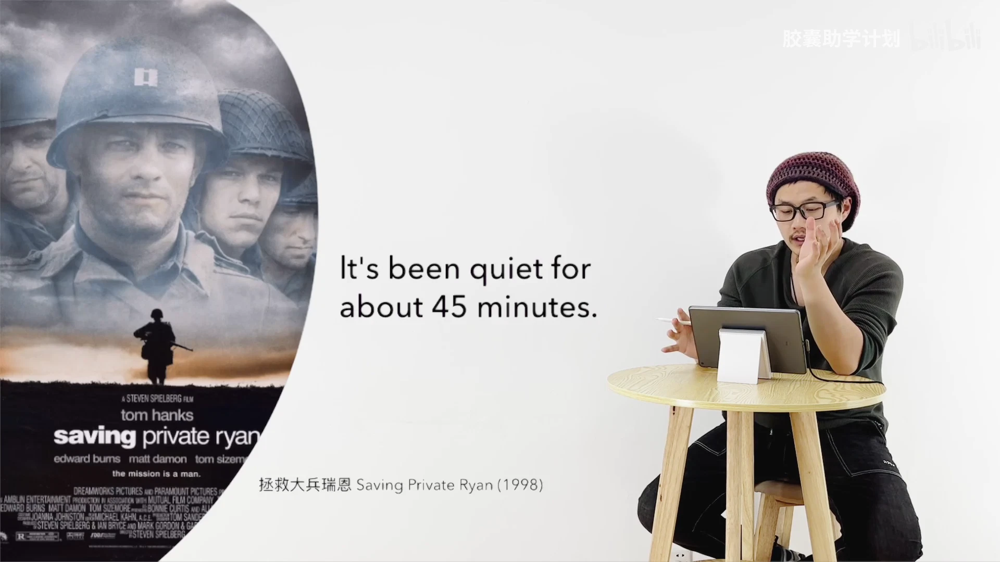

文字识别：It's been quiet for / about 45 minutes. / ASTEVENSPELBERG FUM / tom hanks / saving / private ryan / edward bums / matt damon / tom sizemy / the mission is a man. / 拯救大兵瑞恩 Saving Private Ryan (1998) / DREAMIWORKS PCTURESMDPAR / URES / SIEVE / SPELBER

## 00:08:00–00:08:30

这个撇 s 是 has，对吧？ It has been quiet for about forty five minutes. 好，从四十五分钟之前一直到现在，一直都很安静。这是一个非常典型的现在完成时的第二个用法啊。八十九课我们学过，对吧？已经安静了四十五分钟了。那接下来我们一起看一下这个小的视频片段。

### 画面 00:08:02

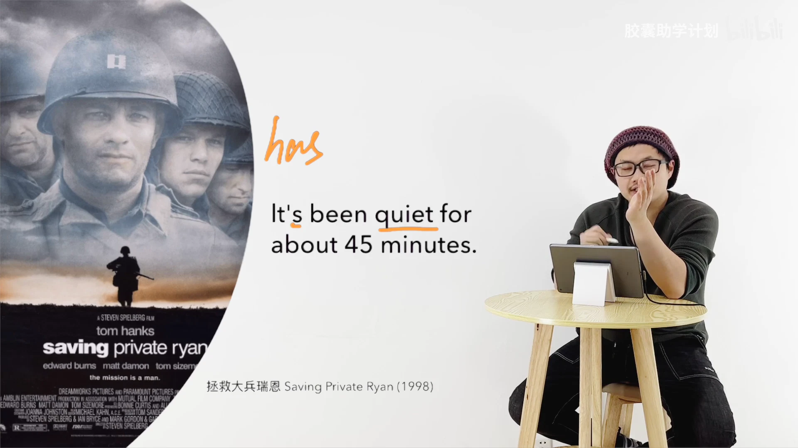

文字识别：hors / It's been c / quiet for / about 45 / minutes. / ASTEVEN SPELBERG FUM / tom hanks / saving / private / eryan / edward bums / matt damon / tom sizemy / the mission is a man. / 拯救大兵瑞恩 Saving Private Ryan (1998) / DREAMIWORKS PCTURES D PAR / SPELBE

### 画面 00:08:24

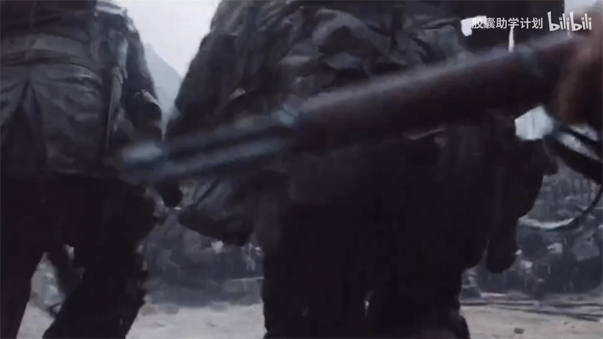

文字识别：Bilbili / 胶囊助学计划

### 画面 00:08:26

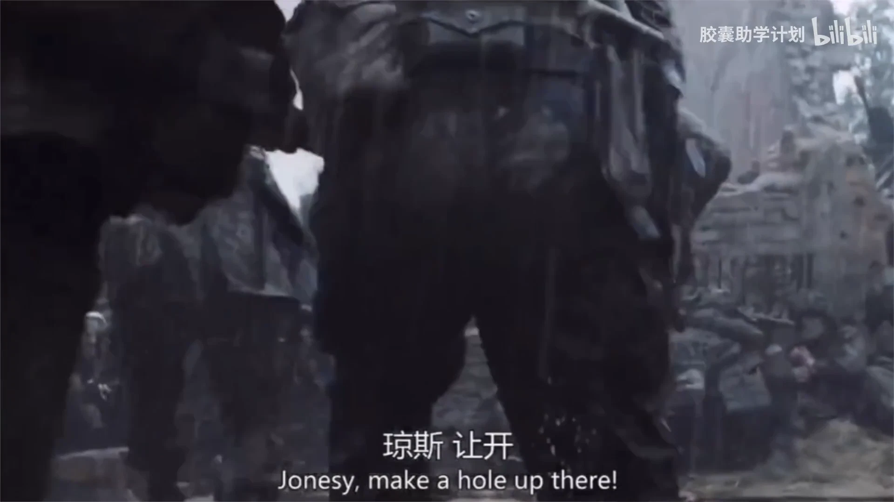

文字识别：biibil / 胶囊助学计划 / 琼斯让开 / Jonesy, make a hole up there!

### 画面 00:08:28

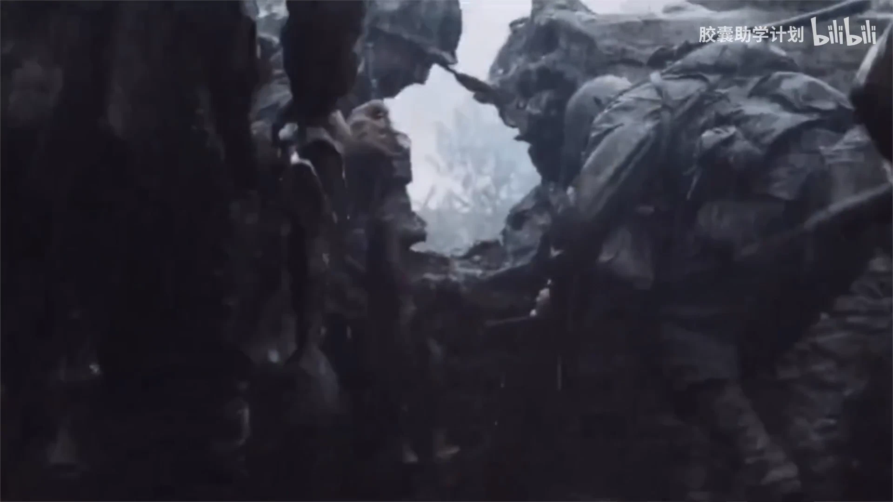

文字识别：bilbii / 胶囊助学计划

## 00:08:30–00:09:00

some intense rifle action from the eastward. The Germans have been reinforcing two regiments all day. Streets have been quiet for about forty-five minutes. Most of the German fire now is concentrated to the westward. Okay, ah, it's been quiet for about forty-five minutes. Ah,他说的不像我这么的清楚啊。Okay,那各位重点是这句话，你能看懂就就还不错是吧？Okay,那不多说，下一个单词跟我读一下，叫做impossible,

### 画面 00:08:30

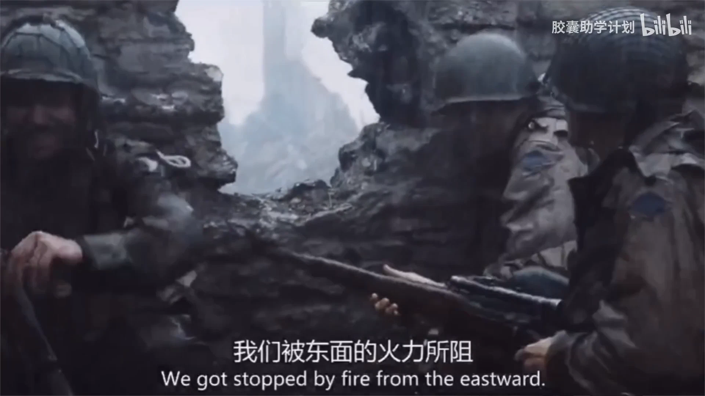

文字识别：Bilbili / 胶囊助学计划 / 我们被东面的火力所阻 / We got stopped by fire from the eastward.

### 画面 00:08:32

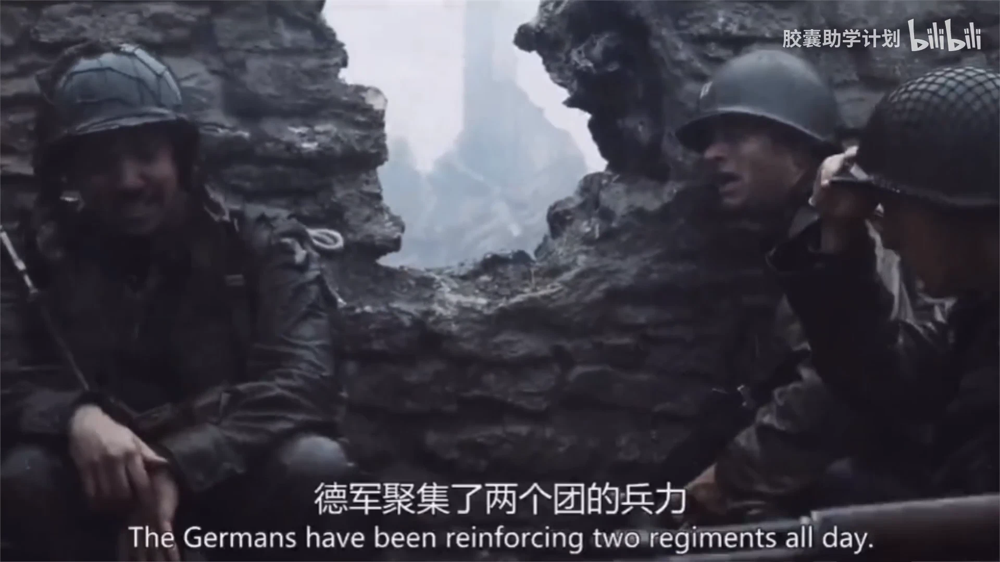

文字识别：bilbili / 胶囊助学计划 / 德军聚集了两个团的兵力 / The Germans have been reinforcing two regiments all day.

### 画面 00:08:34

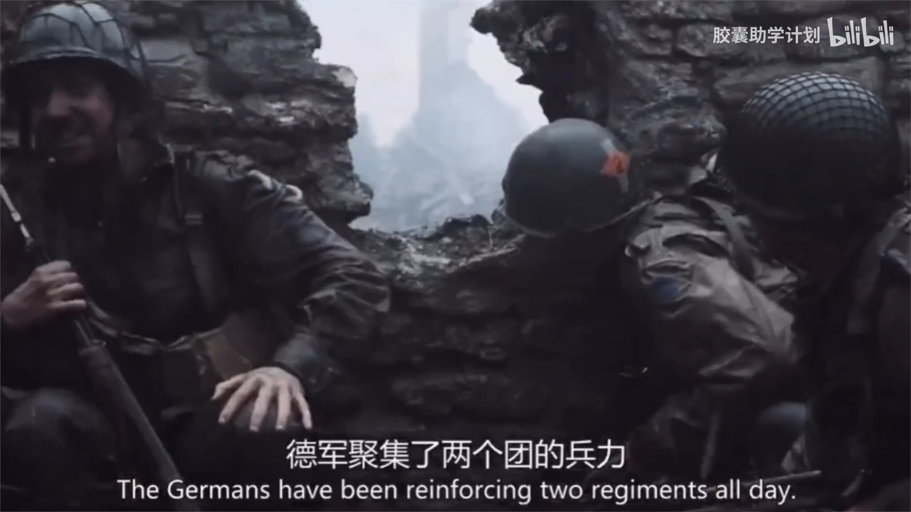

文字识别：bilibili / 胶囊助学计划 / 德军聚集了两个团的兵力 / The Germans have been reinforcing two regiments all day.

### 画面 00:08:36

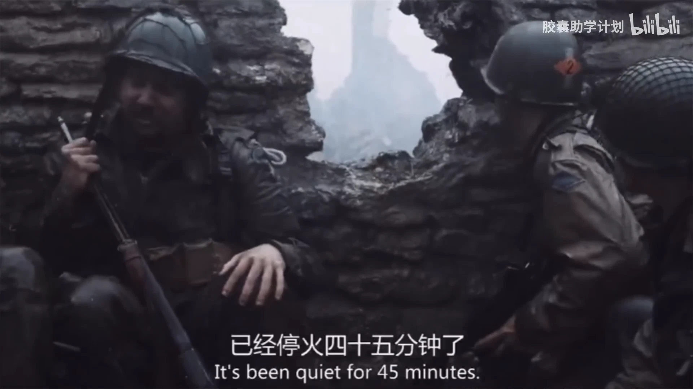

文字识别：Bilibili / 胶囊助学计划 / 已经停火四十五分钟了 / It's been quiet for 45 minutes.

### 画面 00:08:38

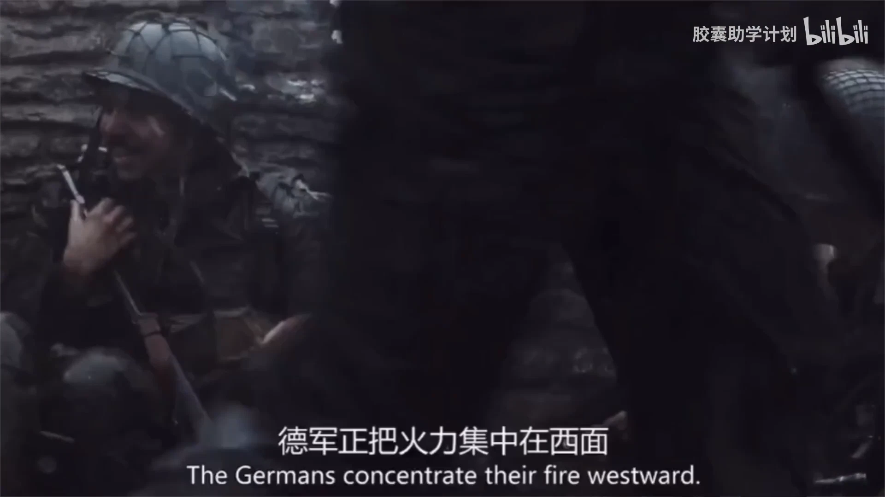

文字识别：bilibli / 胶囊助学计划 / 德军正把火力集中在西面 / The Germans concentrate their fire westward.

### 画面 00:08:40

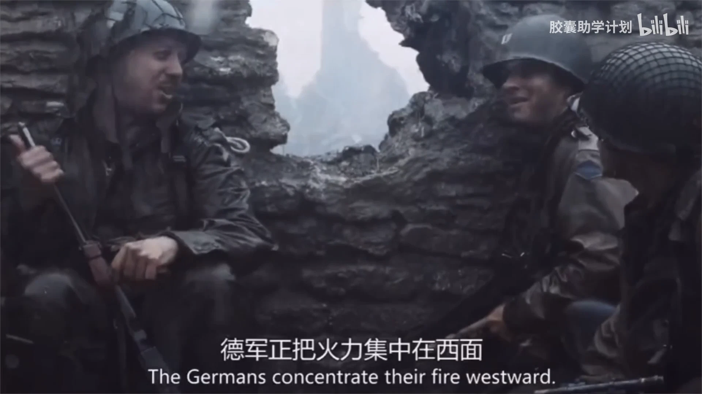

文字识别：ilibli / 胶囊助学计划 / 德军正把火力集中在西面 / The Germans concentrate their fire westward.

### 画面 00:08:42

文字识别：It's been quiet for / about 45 minutes. / ASTEVEN SPELBERG FUM / tom hanks / saving / private ryan / edward bums matt damon / tom sizemy / the mission is a man. / 拯救大兵瑞恩 Saving Private Ryan (1998) / DREAIMIWORKS PICTURESADP / RES / STEVEN / SPELBER

### 画面 00:08:54

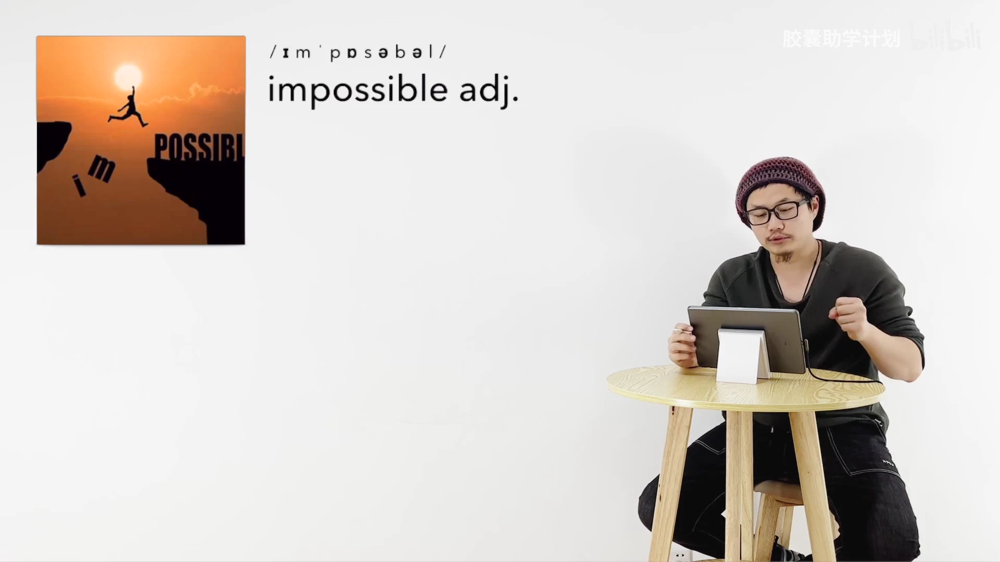

文字识别：/Im'ｐｐsａbａl/ / impossible adj. / POSSIRI

## 00:09:00–00:09:30

impossible,连起来impossible, OK,叫做不可能的啊impossible mission啊是吧不可能完成的任务impossible,那在讲impossible的时候，各位一定要把它拆开去学im加possible, impossible叫不可能的啊possible叫做可能的那im在这地方各位就要注意它实际上本身就是一个否定的前缀，这个我们进入新二的时候会更多的提到，

### 画面 00:09:14

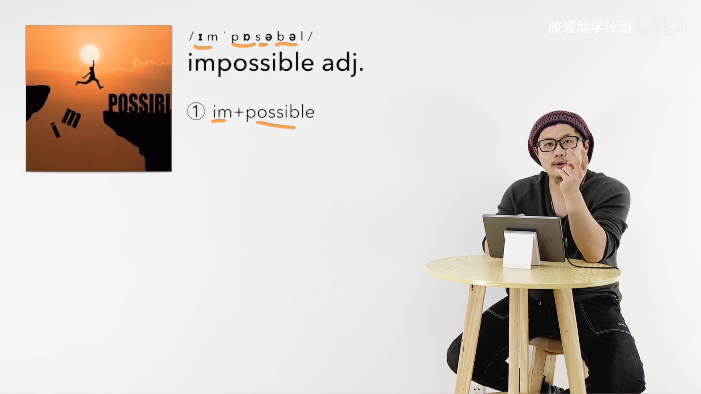

文字识别：/Im'ppsabal/ / impossible adj. / POSSIBI / ① im+possible

## 00:09:30–00:10:00

就是英文啊，跟我们汉语是有一些类似的啊。我只能说，呃，这个 loosely related，是吧？就是，呃，不是很严谨的去说。我们汉语不有偏旁部首吗？英语也有一些类似于偏旁部首的东西，叫前缀或后缀，对吧？比如说这个地方这个 b l e 啊 a b l e，对吧？它就类似于是形容词的后缀。那前面这个 i m 呢，它就是一个否定的前缀。各位可以这样去理解啊。所以

### 画面 00:09:44

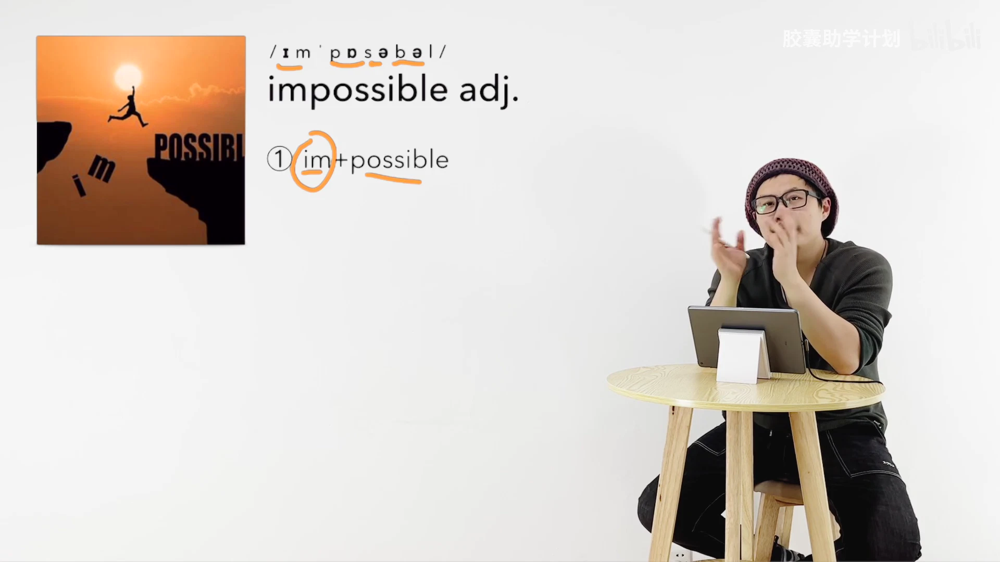

文字识别：/Ⅰm'ppsabal/ / impossible adj. / POSSIRI / 1 / imy / +possible

## 00:10:00–00:10:30

possible 叫做可能的，impossible 叫做不可能的。好，我们接下来往下看，造几个句子啊，各位自己去想这些句子，您见没见过，我就不提了，您很可能是见过，要不你查一下也行。叫 everything is possible 啊，叫一切皆有可能，对吧？另外一个叫做 nothing is impossible，叫没有事情是不可能的。您看，我们在这儿不管是 everything 还是 nothing 去做主语的时候，接下来连的都是 is 这个单

### 画面 00:10:04

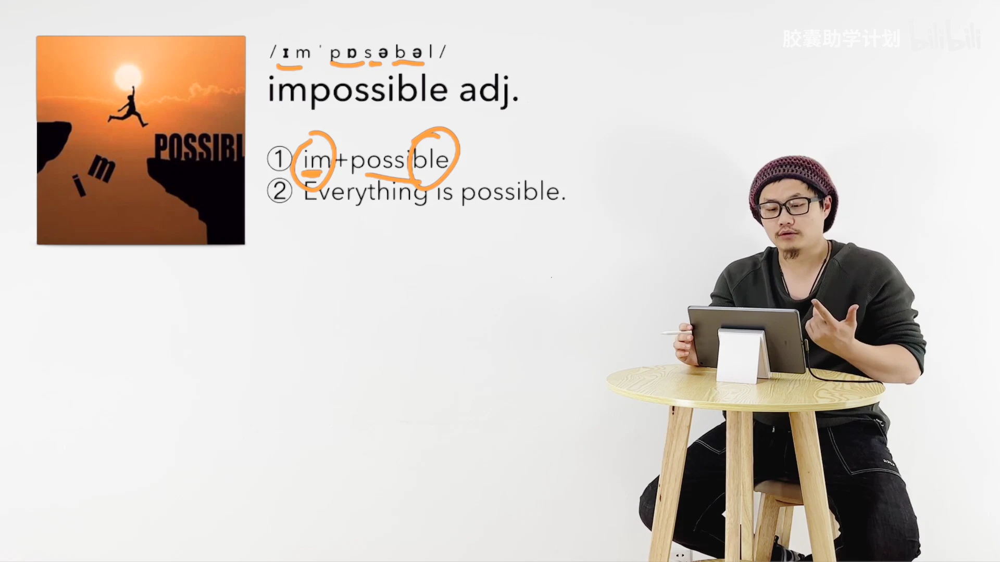

文字识别：/Im'ppsabal/ / impossible adj. / POSSIRI / ble / 1 / im / y+possi / EVerything is possible. / 2

### 画面 00:10:06

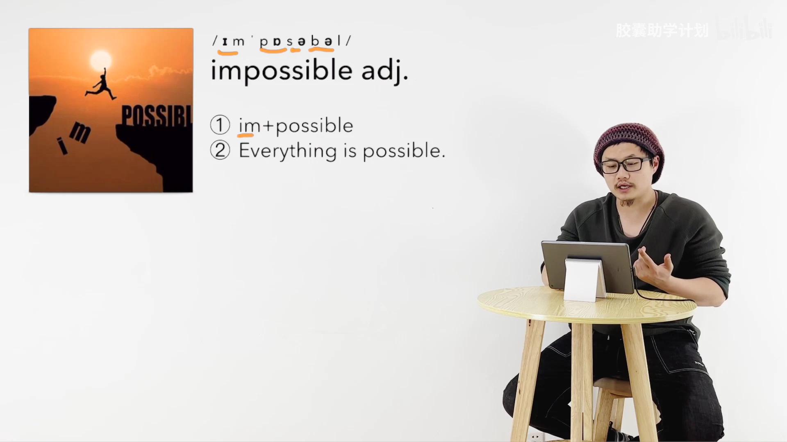

文字识别：/Im'ppsabal/ / impossible adj. / POSSIBI /  im+possible / ① / Everything is possible.

### 画面 00:10:09

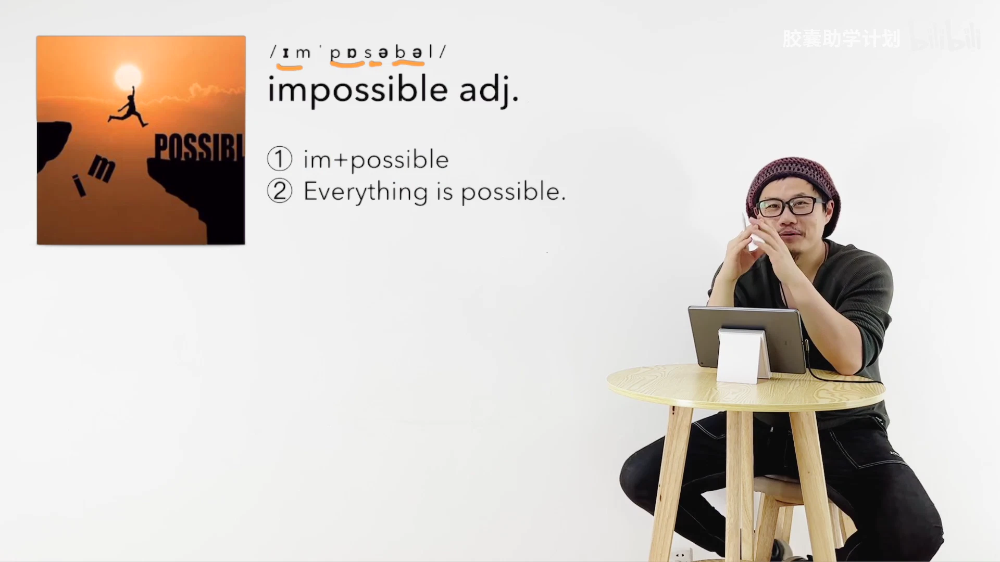

文字识别：/Im'ppsabal/ / impossible adj. / POSSIBI / ① im+possible / Everything is possible.

### 画面 00:10:14

文字识别：/Im'ppsabal/ / impossible adj. / POSSIBI / ① im+possible / Everything is possible.

### 画面 00:10:25

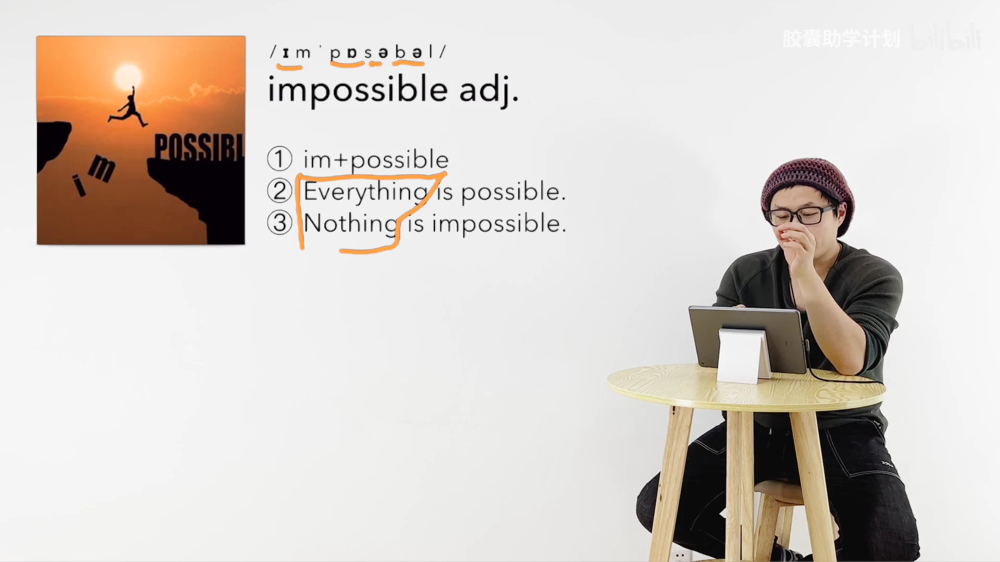

文字识别：/Im'ppsabal/ / impossible adj. / POSSIBI / im+possible / 1 / EverythingIs possible. / Nothingis impossible.

## 00:10:30–00:11:00

词，这个小点各位拿到好吧？ OK，接下来下一个单词，跟我们一起读，叫做 invite， invite 啊，叫做邀请，对吧？ OK，那我们造一句话说， they invited me to dinner。好，注意我用的时态，好，包括这有一个小的短语叫 invite somebody to dinner 去晚餐，其实就是邀请我去吃晚餐，对吧？邀请我去吃晚餐，我用的时态是一般过去时。那我

### 画面 00:10:32

文字识别：/in'vait/ / invite V.

### 画面 00:10:49

文字识别：/In'vait/ / invite v. / ① They invitedme / to dinner.

## 00:11:00–00:11:30

们来直接给它变成一般疑问句，张嘴跟我读，Did they invite you to dinner? Very good。那接下来呢，我们再来一个特殊疑问句，张嘴跟我读，Why did they invite you to dinner? OK， Very good。好，下一个单词，lemonade， lemonade，注意重音在后面叫 lemonade。 OK， Very good。那 lemonade 指的是这个东

### 画面 00:11:00

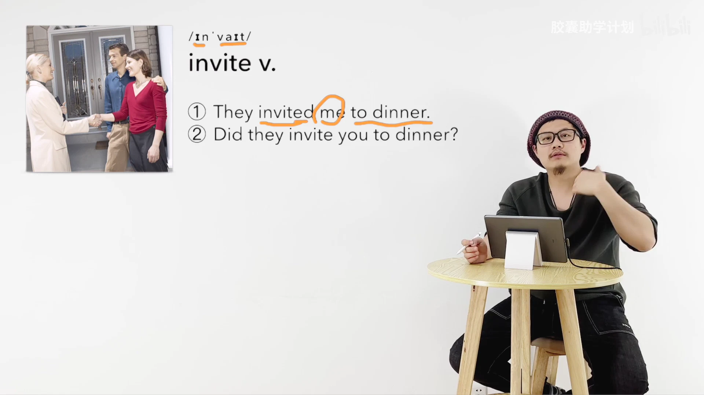

文字识别：/In'vait/ / invite V. / They invitedme / to dinner. / Did they invite you to dinner?

### 画面 00:11:09

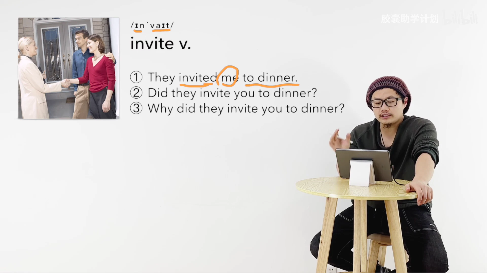

文字识别：/in'vait/ / invite V. / They invitedme / to dinner. / Did they invite you to dinner? / Why did they invite you to dinner?

### 画面 00:11:17

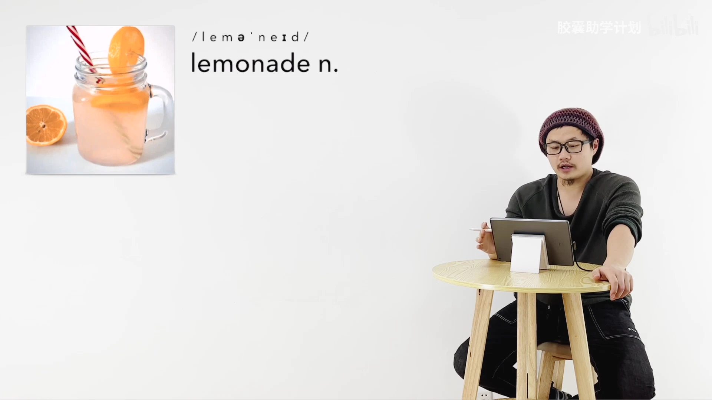

文字识别：/lema'neid/ / lemonade n.

### 画面 00:11:29

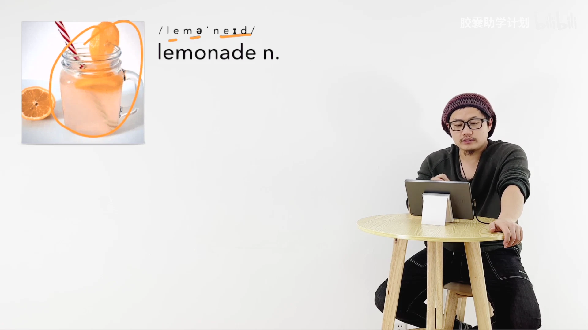

文字识别：/lema'neid/ / lemonade n.

## 00:11:30–00:12:00

西是吧？指的是柠檬水。那你看一下，这里面有一个单词叫 lemon，是吧？就是柠檬啊。OK，玩一个那 lemonade 就是柠檬水。那再来说， give me some lemonade。OK，玩一个，给我一些柠檬水。哎，包括 this lemonade is the best I've ever tasted。说这个柠檬水啊，是我喝过最棒的柠檬水。你想一下，这是我们多少课学的，对吧？一百一十一啊，我没有记错的话，包括 this lemonade

### 画面 00:11:56

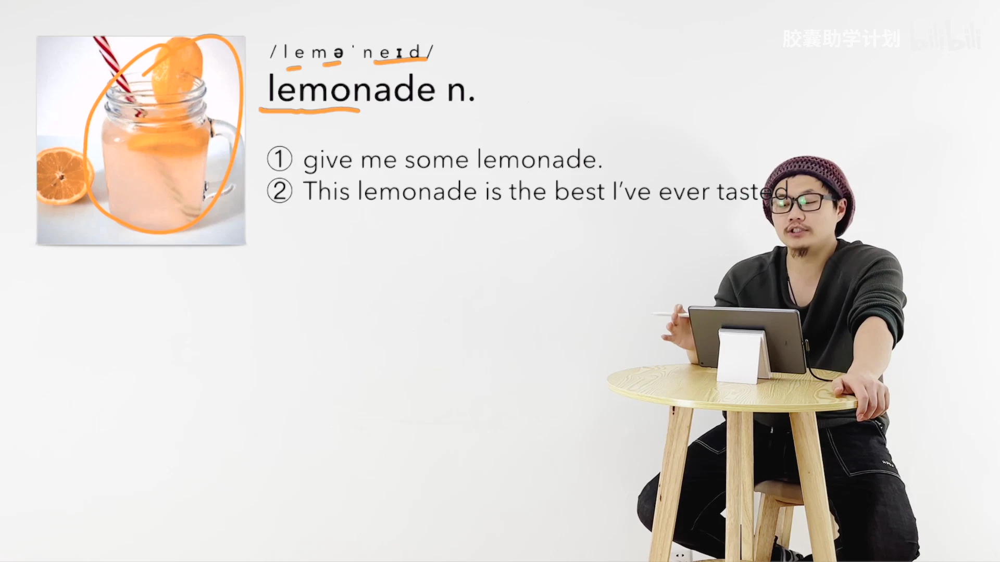

文字识别：/ lema'neid/ / lemonade n. / ① / give me some lemonade. / This lemonade is the best I've ever taste

## 00:12:00–00:12:30

is as good as that one. 我说哎，这个柠檬水和那个喝起来同样的棒。 OK，玩一个 as as 这个结构。我们复习一下之前学过的单词，对吧？啊，语法。 OK，接下来 continue 下一个单词，跟我一起读一下，叫做 joke joke. OK，那 joke 指的意思叫做开玩笑，它是一个动词。那我们就可以造句叫做 she's joking. OK，说她正开玩笑呢啊， don't be so serious，是吧？别

### 画面 00:12:12

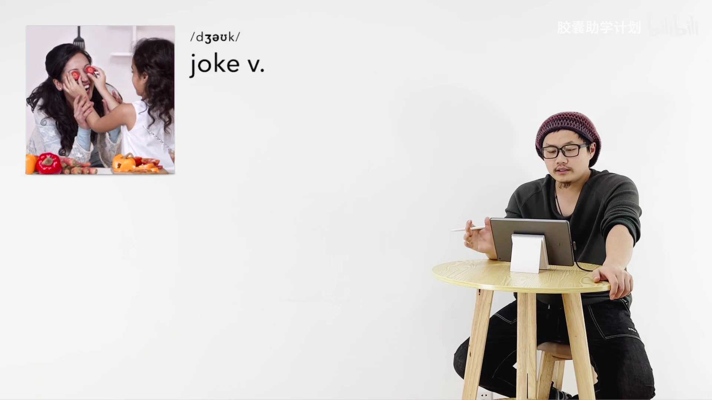

文字识别：/d3auk/ / joke v.

## 00:12:30–00:13:00

别太认真，他就是开一个玩笑，他就是在和你开玩笑。以及 Is she joking?他正在开玩笑吗？啊，我怎么感觉好像不是啊？Okay, very good.那很简单。再来说，You can't joke about this.好，这个地方 about something，我们可以当一个小的习惯用法，把它留下来，叫 joke about something，是吧？关于某件事情开玩笑。比如说，我不想你关

### 画面 00:12:42

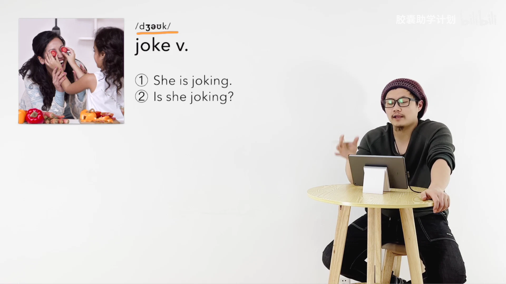

文字识别：/d3auk/ / joke v. / ① She is joking. / ② Is she joking?

### 画面 00:12:51

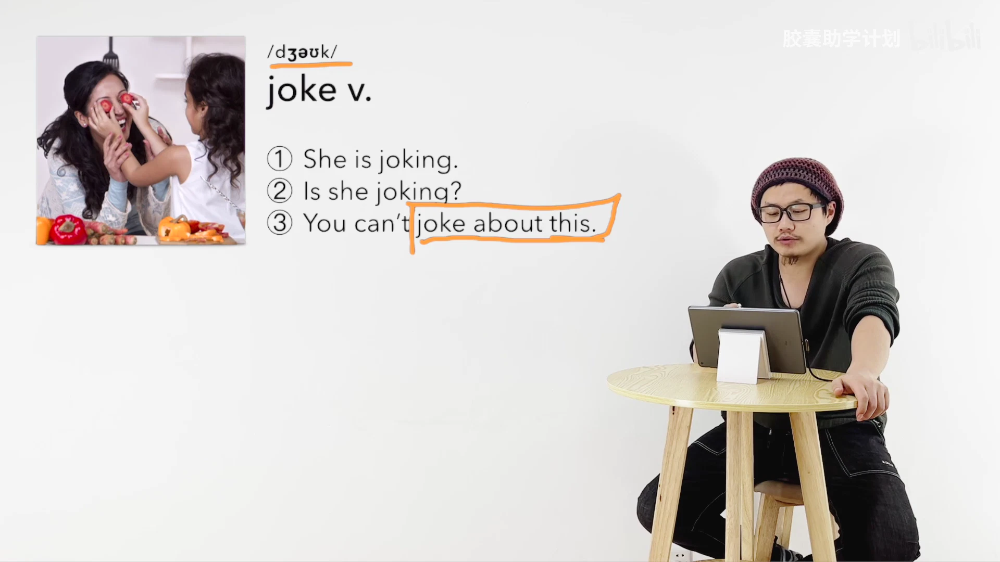

文字识别：/d3auk/ / joke v. / ① She is joking. / ② Is she joking? / ③ You can't joke about this.

## 00:13:00–00:13:30

于我的女朋友开玩笑，那你就说 you can't joke about my girlfriend. 那你不能关于我老公开玩笑，叫 you can't joke about my husband, 是吧？ Don't joke about my husband. Okay, very good. 好，那 recap 本课除了本课的语法啊单词以外，最重要的就是这些单词。别看多，是吧？但是是这个有迹可循的。其实我觉得您可能这个视频看完，很可能这些单词

### 画面 00:13:14

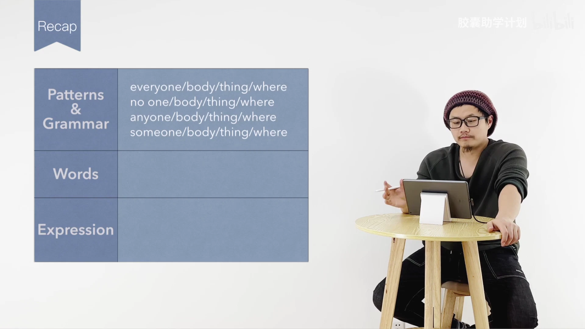

文字识别：Recap / everyone/body/thing/ / /where / Patterns / no / one/body/thing/ / /where / anyone/body/thing/ / /where / Grammar / someone/body/thing/where / Words / Expression

### 画面 00:13:21

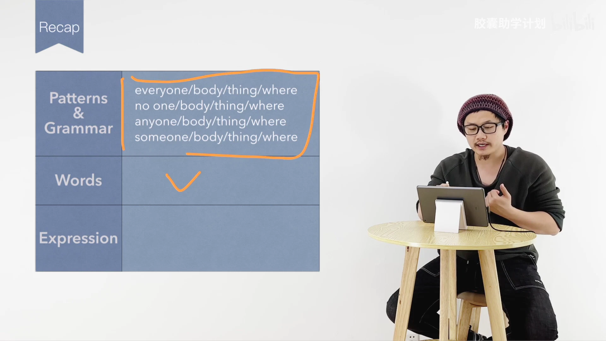

文字识别：Recap / everyone/body/thing/where / Patterns / no / one/body/thing/ / /where / & / anyone/body/thing/ / /where / Grammar / someone/body/thing/where / Words / Expression

## 00:13:30–00:14:00

大概模糊的，我们不说非常完美啊，可能就能记下来了，是吧？OK，那加上作业，单词造句，老习惯，对吧？OK，红皮书呢，各位试着查找一下本课的语法，在目录或者索引部分，您一定能找到。然后不妨呢，还是啊，我就如果您现在心有余力，对吧？然后左边的讲解看完了之后，做一下右边的练习，好吧？然后呢，给自己讲解一遍今天的核心知识点。呃，那如果大家

### 画面 00:13:34

### 画面 00:13:54

文字识别：单词造句3 / 初级红皮书查找本课语法 / 3.请给自己讲解一遍今天的 / 核心语法+知识点

### 画面 00:13:58

## 00:14:00–00:14:30

喜欢我们的课程呢，欢迎大家关注、订阅、一键三连，分享给那些需要的朋友，来帮助我们快速成长，好吧？那最后我们再来看一句名人名言。 It always seems impossible until it's done. See you next time.

### 画面 00:14:07

文字识别：lt always seems impossible until it's done. / -Nelson Mandela

### 画面 00:14:17

文字识别：It always seems impossible until it's done. / - Nelson Mandela

### 画面 00:14:19

文字识别：CAPSULEACADEMY / 胶囊助学计划 / 『 / 小红书 / Lecturer / □ / Leo / OE

### 画面 00:14:22

文字识别：CAPSULEACADEMY / 胶囊助学计划 / 小红书

### 画面 00:14:25

文字识别：CAPSULEACADEMY / 胶囊助学计划 / 『 / 小红书 / Creator / Leo & Berlin / OE

### 画面 00:14:27

文字识别：bilbili / 胶囊助学计划 / CAPSULEACADEMY / 胶囊助学计划 / 小红书 / 正 / OE

### 画面 00:14:29

文字识别：bilibili / 胶囊助学计划

## 00:14:30–00:14:30

