# 115 文章

快速机器解析：语音为单模型转写，未进行独立交叉校对或人工复核；画面每秒采样并按变化选帧，短时文字和标记可能遗漏。截图时间约有 1 秒误差。图片有损压缩；遇到疑点请按时间查看 Google Drive 原视频。

## 00:00:00–00:00:30

Hello everyone, welcome to Capsule Academy. This is Leo. Today we're going to learn New Concept English Book One Lesson One Hundred and Fifteen Story. Hope you gonna enjoy.那好，咱们直接看文章啊。呃，首先我们看这个女士叫 Helen，是吧？男士叫 Jim。然后两个人在门外正在敲门，对吧？然后我们看他们发生的对话。Helen 说，Isn't there anyone at

### 画面 00:00:00

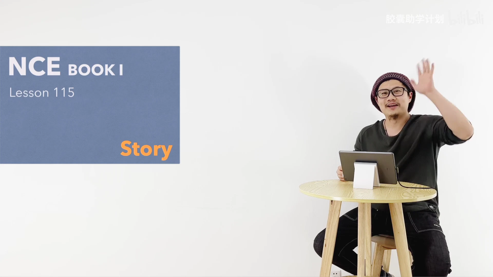

文字识别：NCE / BOOKI / Lesson 115 / Story

### 画面 00:00:09

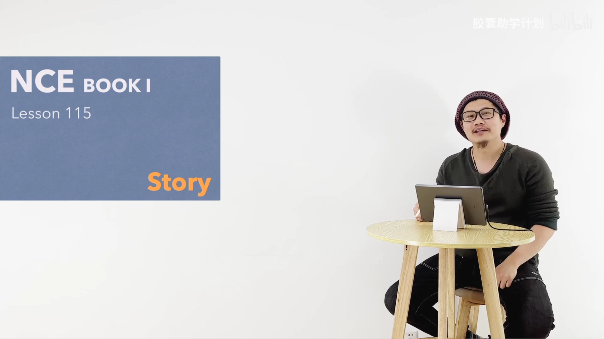

文字识别：NCE / BOOKI / Lesson 115 / Story

### 画面 00:00:11

文字识别：胶囊助学计划 bill

### 画面 00:00:14

文字识别：胶囊助学计划

### 画面 00:00:16

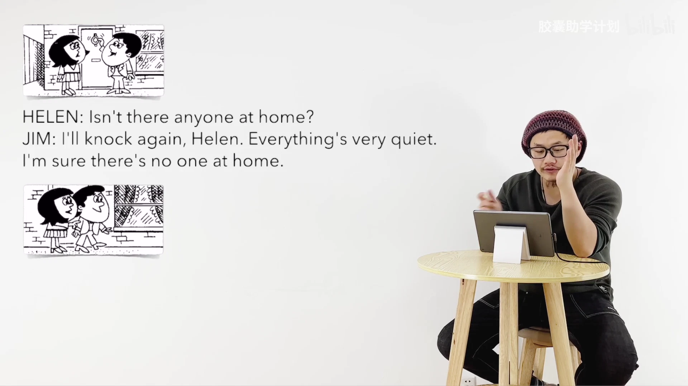

文字识别：HELEN: Isn't there anyone at home? / JIM: I'll knock again, Helen. Everything's very quiet. / I'm sure there's no one at home.

### 画面 00:00:21

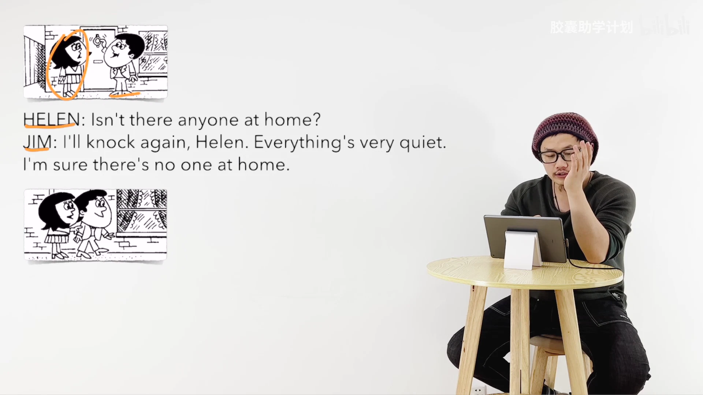

文字识别：HELEN: Isn't there anyone at home? / JlM: I'll knock again, Helen. Everything's very quiet. / I'm sure there's no one at home.

## 00:00:30–00:01:00

home?好，首先 isn't there 这是我们六十七课学过的否定疑问句，叫难道怎么怎么样，对吧？说难道就没有任何人在家吗？两个人可能敲了敲门，没人应答，对吧？好，然后注意几个小点。第一，首先它是一个很简单的 there be 句型。其次呢，各位可以看到它是一个疑问句，所以我们是用 anyone 而没有用 someone，对吧？OK。然后呢，anyone 去做这个

### 画面 00:00:51

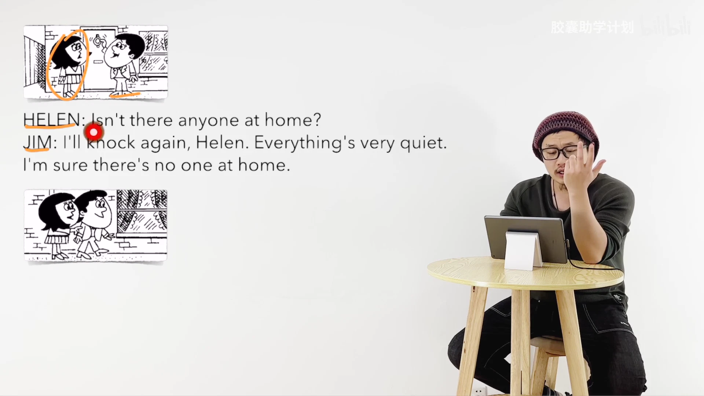

文字识别：HELEN: lsn't there anyone at home? / JIM: I'll Rnock again, Helen. Everything's very quiet. / I'm sure there's no one at home.

## 00:01:00–00:01:30

主语的时候呢，在这个地方我们用的是is，而没有用aren't，对吧？没有用are啊。这个几个小点都给各位简单的说一下。那对于各位来说呢，您就一遍一遍读这句话，理性上懂了之后，反复读这句话，读通它，读顺它啊就可以了。Jim说，I'll knock again啊，非常好，当机立断一个决定，说那我再敲一遍吧，Helen啊。Everything is very quiet.好，一切事情都

### 画面 00:01:21

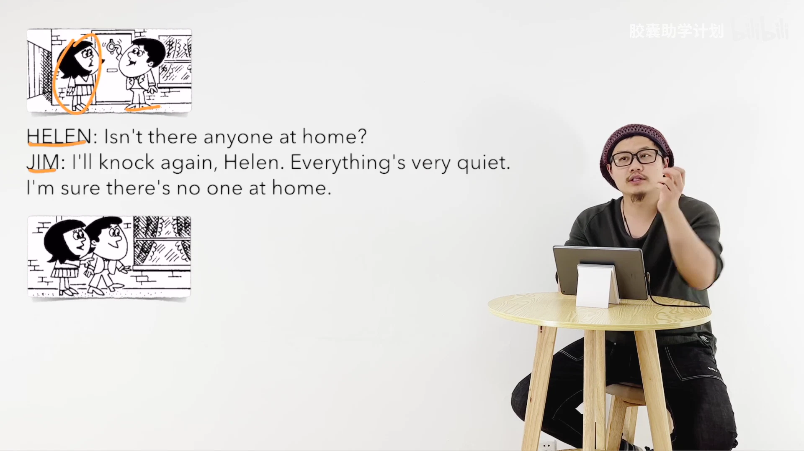

文字识别：HELEN: Isn't there anyone at home? / JIM: I'll knock again, Helen. Everything's very quiet. / I'm sure there's no one at home.

## 00:01:30–00:02:00

是那么的安静啊，一切都很安静。你看这个地方有一个 p s，就是 is，对吧？我们讲过了，他们不定代词去做主语的时候，这些不定代词去做主语的时候，后边一定要加 is。 OK，接下来说 I'm sure，我很确定。 There is no one at home。说没有，哎，注注意啊，说 there is 叫做有 no one，就是没有人啊，就是有没有人，就就是没有任何人啊。 OK，就没有任何

### 画面 00:01:51

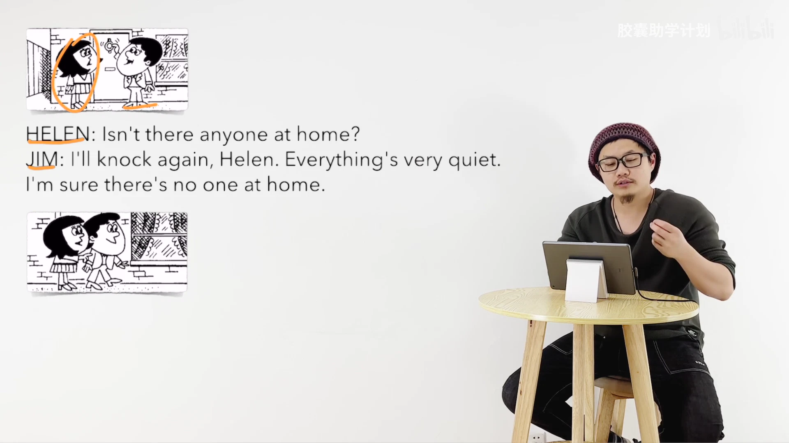

文字识别：HELEN: Isn't there anyone at home? / JIM: I'll knock again, Helen. Everything's very quiet. / I'm sure there's no one at home.

## 00:02:00–00:02:30

人at home叫在家，没有任何人在家，我很确定没有任何人在家。还有人说，But that's impossible，说但啊，那是不可能的呀。Carol and Tom invited us to lunch，说Carol和Tom邀请我们去来吃午饭啊，之前邀请的，对吧？一般过去时啊。Look through the window，好，through这个地方提一个小点，我们从某个东西穿过去

### 画面 00:02:03

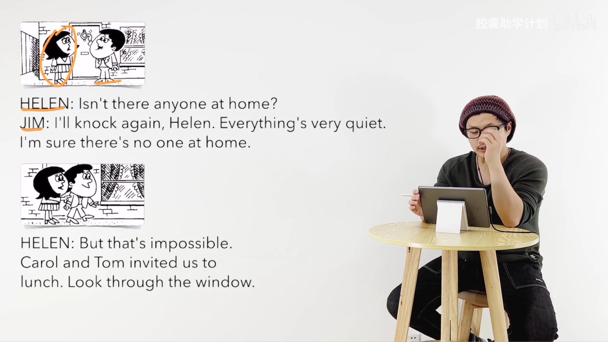

文字识别：HELEN: Isn't there anyone at home? / JlM: I'll knock again, Helen. Everything's very quiet. / I'm sure there's no one at home. / HELEN: But that's impossible. / Carol and Tom invited us to / lunch. Look through the window.

## 00:02:30–00:03:00

看，比如说穿过窗户去看，那一定要用这个小的介词叫做 through 啊。之前我们还学过一个穿过这个单词叫做 across，对吧？他们两个最直接的感受，比如说您穿过一片草坪，我们一般往往用的是 across，它不是从内部穿过。如果是一块玻璃，你从内部看过去，它往往用的是

### 画面 00:02:33

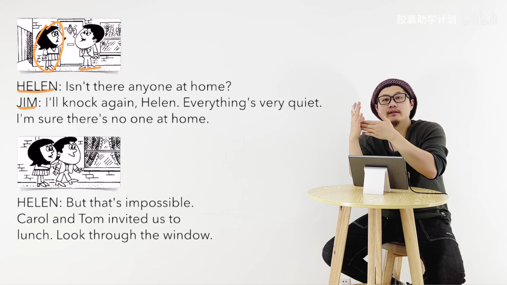

文字识别：HELEN: Isn't there anyone at home? / JIM: I'll knock again, Helen. Everything's very quiet. / I'm sure there's no one at home. / HELEN: But that's impossible. / Carol and Tom invited us to / lunch. Look through the window.

### 画面 00:02:42

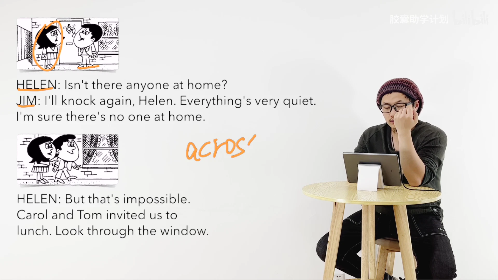

文字识别：HELEN: Isn't there anyone at home? / JIM: I'll knock again, Helen. Everything's very quiet. / I'm sure there's no one at home. / acrOS/ / HELEN: But that's impossible. / Carol and Tom invited us to / lunch. Look through the window.

## 00:03:00–00:03:30

through，这是英文的一个习惯。那 look through the window 就是从窗户看进去，好吧？ Continue， Can you see anything？好，注意你看 anything 用在了疑问句当中，你能看到任何东西吗？ Nothing at all。好，这个地方你看，同理，我们之前学过 not at all 叫一点也不。那 nothing at all 是什么意思？ Nothing 叫什么也没有，对吧？没东西。

### 画面 00:03:08

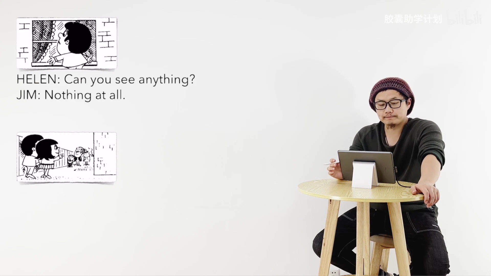

文字识别：H / 工 / HELEN: Can you see anything? / JIM: Nothing at all.

### 画面 00:03:18

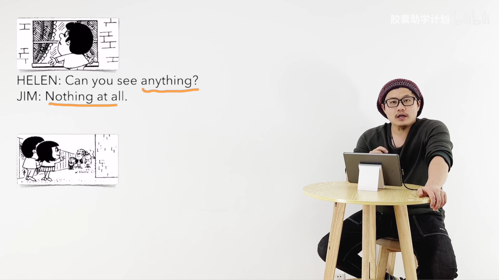

文字识别：HH / HELEN: Can you see anything? / JIM: Nothing at all.

## 00:03:30–00:04:00

nothing at all，就是一点儿啥也没有啊。其实就是加强了一下语气。那您不加 at all 是没有问题的，你直接说 nothing，完全对，好吧。 Continue，说 let's try the back door。说咱们试一下后门吧，back door，是吧？front door，前门，back door，后门，对吧？说 look，瞧，everyone's in the garden。说瞧，大家每一个人，everyone。你看，即使每一个人，他

### 画面 00:03:40

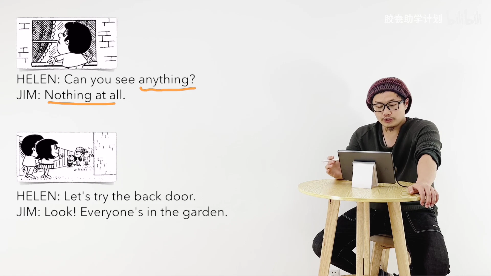

文字识别：HELEN: Can you see anything? / JIM: Nothing at all. / HELEN: Let's try the back door. / JIM: Look! Everyone's in the garden.

## 00:04:00–00:04:30

一定是复数，他在这个地方也是用单数去处理。但如果你现在把 everyone 换成了 they，后面就一定要用 are 了。这是英文的习惯，当然也很可能是各位如果去参加各种考试的一个小的考点，对吧？大家都在啊自己家的这个花园里边呢。OK，好，跟 Jenny 说，Hello Helen，Hello Jim，这就没什么说的了。像我们说，Everybody wants to，那 everybody dance now，让大家开始

### 画面 00:04:10

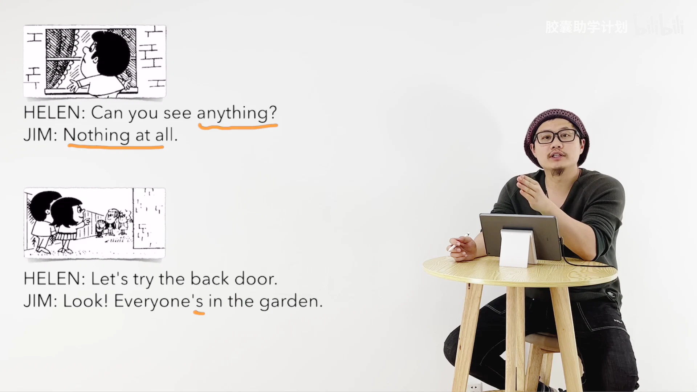

文字识别：工 / HELEN: Can you see anything? / JIM: Nothing at all. / HELEN: Let's try the back door. / JIM: Look! Everyone's in the garden.

### 画面 00:04:20

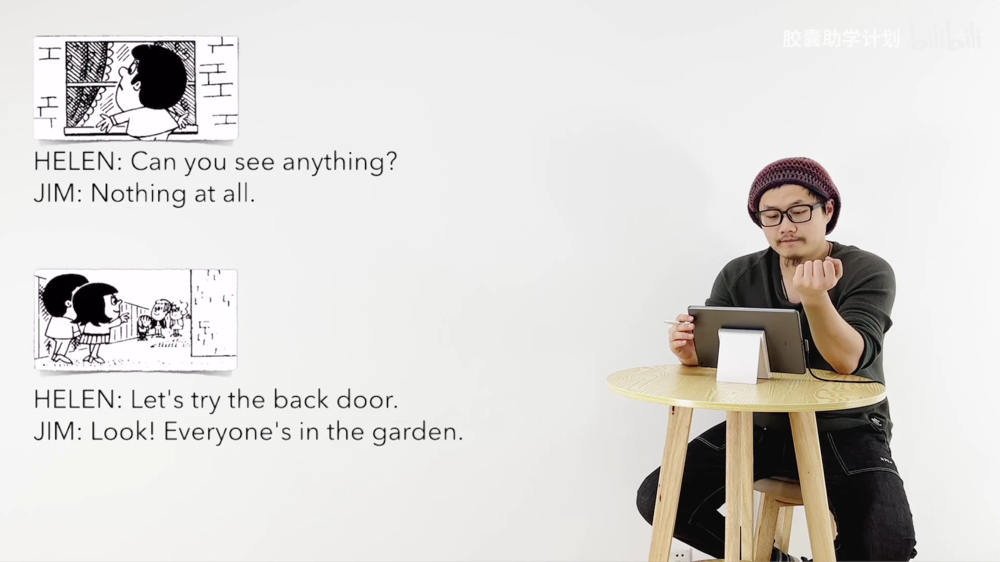

文字识别：HELEN: Can you see anything? / JIM: Nothing at all. / HELEN: Let's try the back door. / JIM: Look! Everyone's in the garden.

### 画面 00:04:22

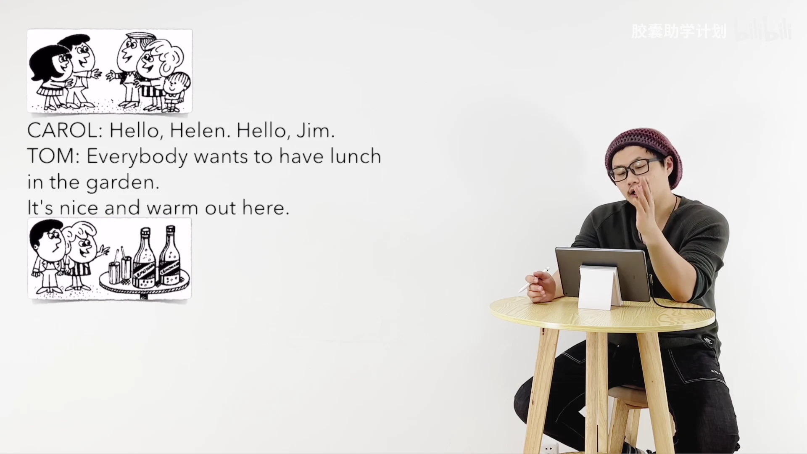

文字识别：CAROL: Hello, Helen. Hello, Jim. / TOM: Everybody wants to have lunch / in the garden. / It's nice and warm out here.

## 00:04:30–00:05:00

跳。那 everybody wants to have lunch in the garden.好，你看 wants 加了 s，为什么？就是刚才的 everybody，我们讲了后边加 is 单数。那如果是第三人称单数，那你就要把动词给它加上 s，对吧？叫 everybody wants to do something.大家呀都想在花园当中吃午饭。Is nice and warm out here?说这里非常的棒，然后非常的温暖。

### 画面 00:04:52

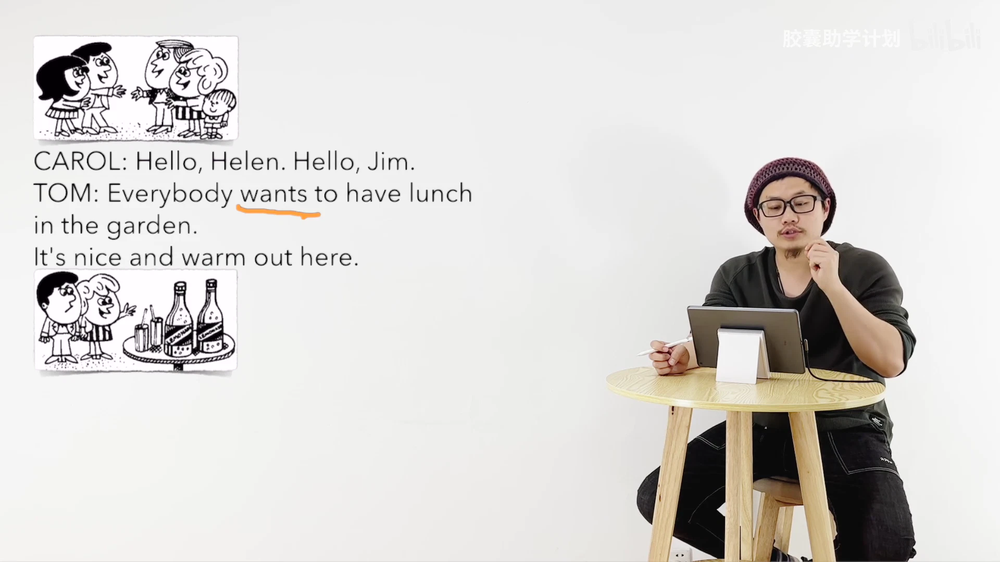

文字识别：CAROL: Hello, Helen. Hello, Jim. / TOM: Everybody wants to have lunch / in the garden. / It's nice and warm out here.

## 00:05:00–00:05:30

Out here, out叫外面，here叫这里啊，叫外面这个地方又好又暖和。Continue,说come and have something to drink. Come叫来这个地方，have something to drink.各位直接当一个习惯用法，在您的文章当中给它标出来，叫做来喝点东西，have something to drink. OK,那吃点东西，have something to eat,对吧？再来一个，

### 画面 00:05:00

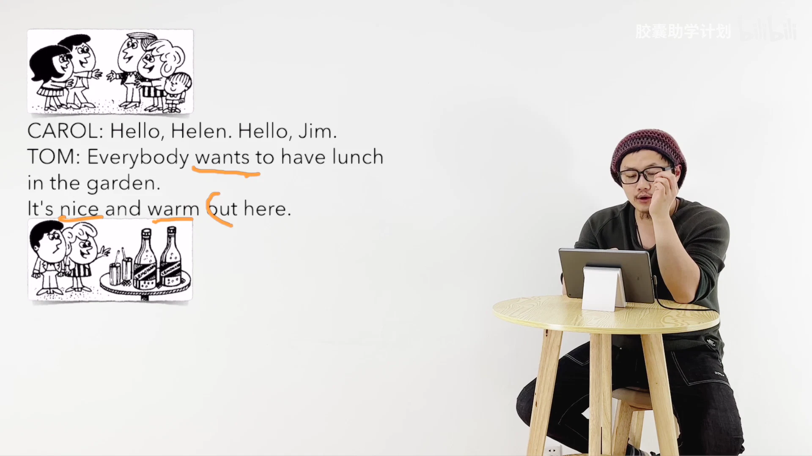

文字识别：CAROL: Hello, Helen. Hello, Jim. / TOM: Everybody wants to have lunch / in the garden. / It's nice and warm / 6ut here.

### 画面 00:05:02

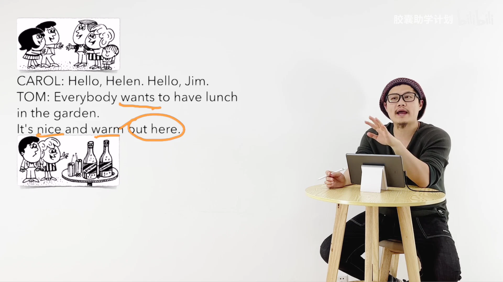

文字识别：CAROL: Hello, Helen. Hello, Jim. / TOM: Everybody wants to have lunch / in the garden. / It's nice and warn but here.

### 画面 00:05:08

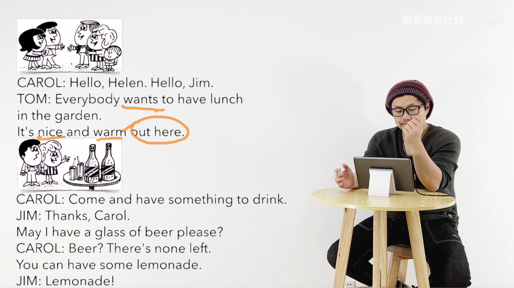

文字识别：CAROL: Hello, Helen. Hello, Jim. / TOM: Everybody wants to have lunch / in the garden. / It's nice and warn but here. / CAROL: Come and have something to drink. / JIM: Thanks, Carol. / May I have a glass of beer please? / CAROL: Beer? There's none left. / You can have some lemonade. / JIM: Lemonade!

### 画面 00:05:16

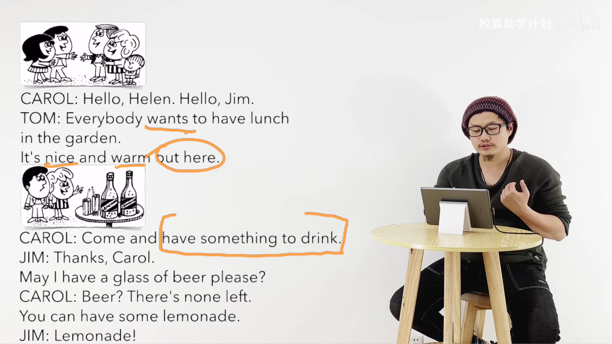

文字识别：CAROL: Hello, Helen. Hello, Jim. / TOM: Everybody wants to have lunch / in the garden. / It's nice and warn but here. / 2 / CAROL: Come and / have something to drink. / JIM: Thanks, Carol. / May I have a glass of beer please? / CAROL: Beer? There's none left. / You can have some lemonade. / JIM: Lemonade!

### 画面 00:05:18

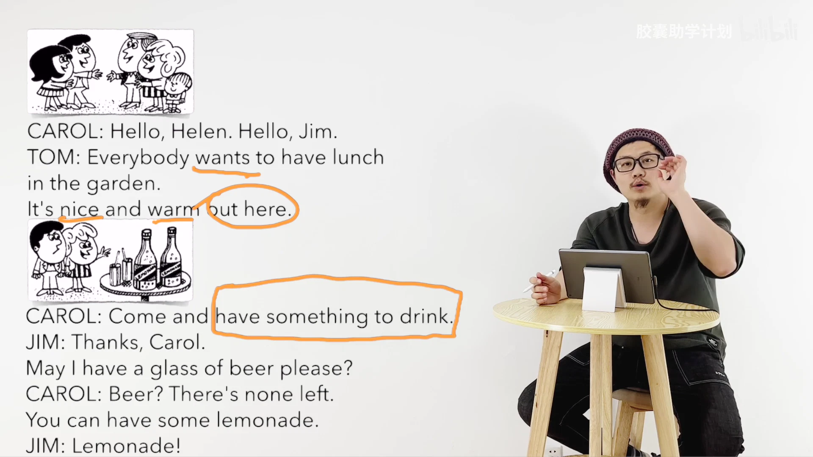

文字识别：CAROL: Hello, Helen. Hello, Jim. / TOM: Everybody wants to have lunch / in the garden. / It's nice and warn but here. / CAROL: Come and / have something to drink. / JIM: Thanks, Carol. / May I have a glass of beer please? / CAROL: Beer? There's none left. / You can have some lemonade. / JIM: Lemonade!

## 00:05:30–00:06:00

Thanks, Carol. 谢谢了。May I？之前我们学过了，其实跟 Can I 非常的像，对吧？就是基本是一个意思。我能吗？Have a glass of beer, please. 我能来杯喝一杯啤酒吗？Carol说Beer，说啤酒。There is none left. OK，好，这个地方其实就涉及到二册的语法了，而且不是二册第一单元，还是二册第二单元，二十八、二十九、三十的语法。所以

### 画面 00:05:35

文字识别：CAROL: Hello, Helen. Hello, Jim. / TOM: Everybody wants to have lunch / in the garden. / It's nice and warn but here. / CAROL: Come and / have something to drink. / JIM: Thanks, Carol. / May I have a glass of beer please? / CAROL: Beer? There's none left. / You can have some lemonade. / JIM: Lemonade!

### 画面 00:05:52

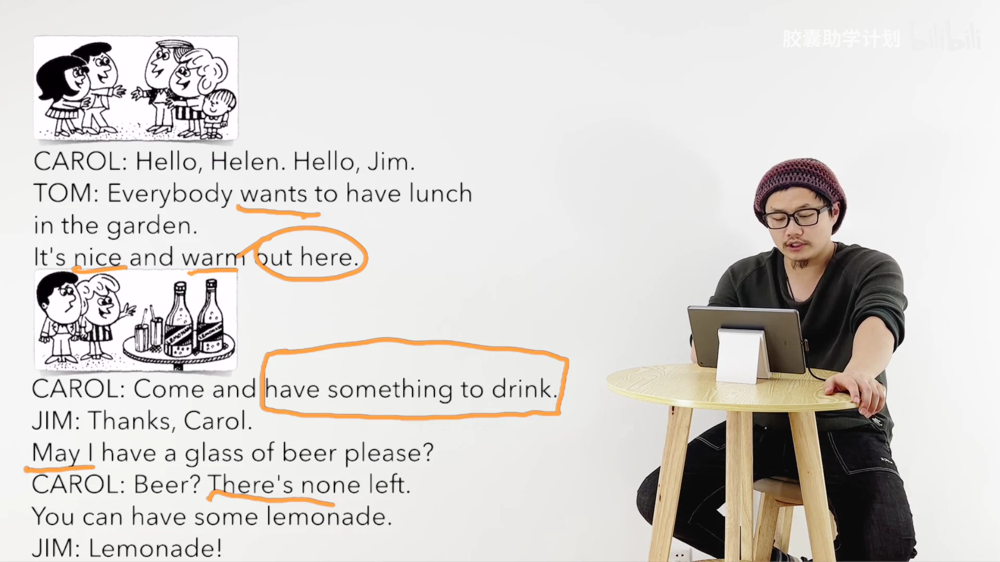

文字识别：CAROL: Hello, Helen. Hello, Jim. / TOM: Everybody wants to have lunch / in the garden. / It's nice and warn but here. / CAROL: Come and / have something to drink. / JIM: Thanks, Carol. / May I have a glass of beer please? / CAROL: Beer? There's none left. / You can have some lemonade. / JIM: Lemonade!

## 00:06:00–00:06:30

今天呢，我们先不给大家着急讲这个语法了，把这句话能看懂就可以了，好吧？说啤酒，There is none。我们先不管left，There is none这句话，各位应该是能看懂的。我们刚刚学过none啊，none等于no beer，There is no beer，对吧？等于There isn't any beer啊。各位想一下这个语法，我们是刚刚学过的啊。那There is none就没有啤酒了。Left这个单词，它实

### 画面 00:06:09

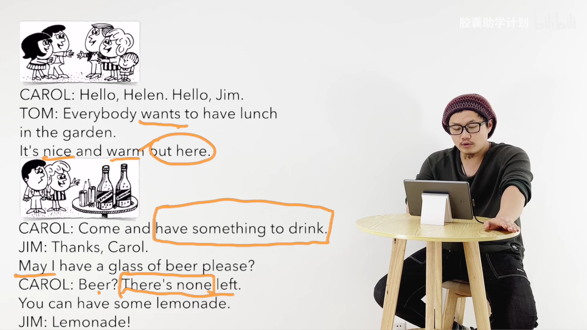

文字识别：CAROL: Hello, Helen. Hello, Jim. / TOM: Everybody wants to have lunch / in the garden. / It's nice and warn but here. / CAROL: Come and / have something to drink. / JIM: Thanks, Carol. / May I have a glass of beer please? / CAROL: Beer?There's none left. / You can have some lemonade. / JIM: Lemonade!

## 00:06:30–00:07:00

际上是 live 这个单词的过去分词，它是放到了后面啊。这个语法名字我就先不提了，我只告诉各位这个意思。 Live 不是有两个意思，一个叫留下，一个叫做离开嘛，在这儿是留下，就是没有任何啤酒留下来了，好吧？ Okay, you can have some lemonade. 说你呀能喝一些柠檬水儿哈。然后 James 说 lemonade 说啤酒啊这个柠檬水儿。 Okay,

### 画面 00:06:31

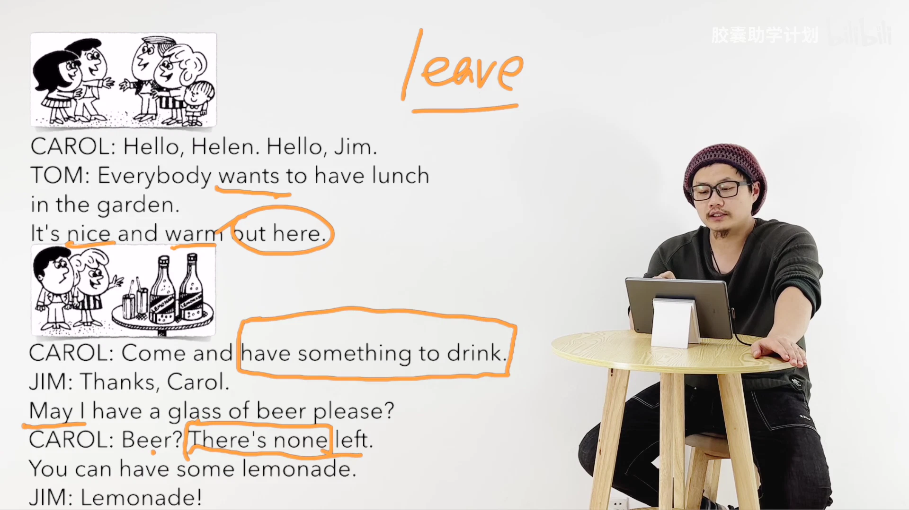

文字识别：eave / CAROL: Hello, Helen. Hello, Jim. / TOM: Everybody wants to have lunch / in the garden. / It's nice and warn but here. / CAROL: Come and / have something to drink. / JIM: Thanks, Carol. / May I have a glass of beer please? / CAROL: Beer?There's none left. / You can have some lemonade. / JIM: Lemonade!

### 画面 00:06:53

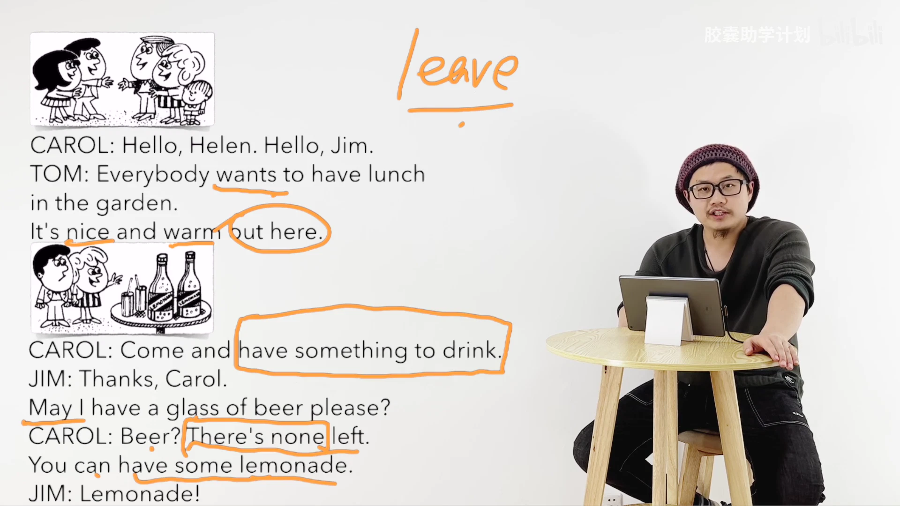

文字识别：eave / CAROL: Hello, Helen. Hello, Jim. / TOM: Everybody wants to have lunch / in the garden. / It's nice and warn but here. / CAROL: Come and / have something to drink. / JIM: Thanks, Carol. / May I have a glass of beer please? / CAROL: Beer?There's noneleft. / You can have some lemonade. / JIM: Lemonade!

### 画面 00:06:59

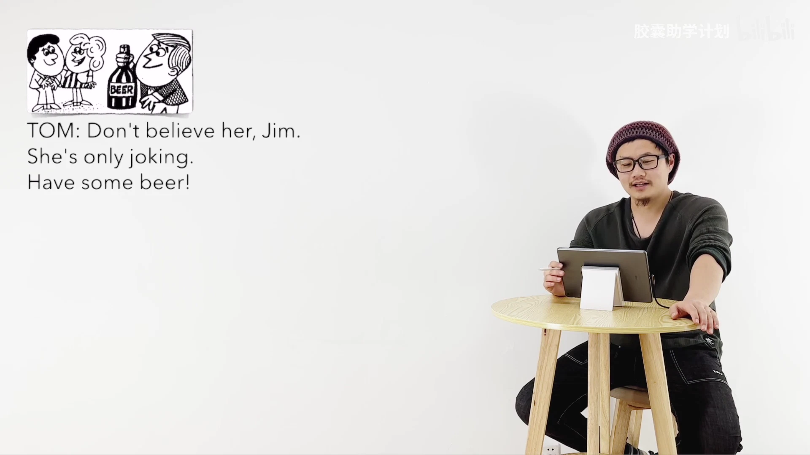

文字识别：BEER / TOM: Don't believe her, Jim. / She's only joking. / Have some beer!

## 00:07:00–00:07:30

然后Tom说，Don't believe her, Jim.啊，别相信她。She's only joking.啊，她仅仅是和你正在开玩笑呢。Only，仅仅是是吧？仅是。Have some beer.喝点啤酒吧。OK。玩一个。那我们学完了本课之后，进行一些口语听力练习。我问，你答来了。第一题。Why does Jim think

### 画面 00:07:02

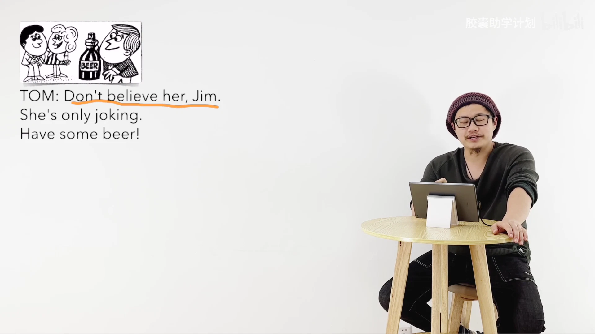

文字识别：.N / BEER / TOM: Don't believe her, Jim. / She's only joking. / Have some beer!

### 画面 00:07:06

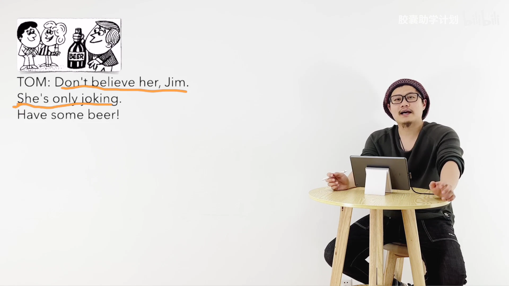

文字识别：BEER / TOM: Don't believe her, Jim. / She's onlvioking. / Have some beer!

### 画面 00:07:16

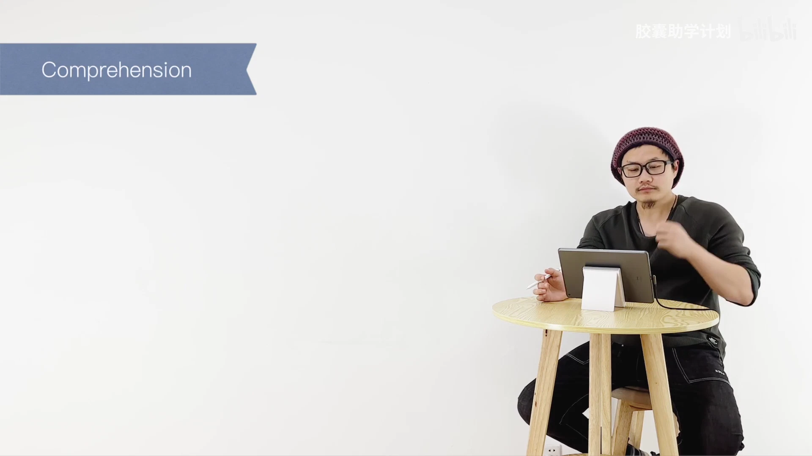

文字识别：Comprehension

### 画面 00:07:24

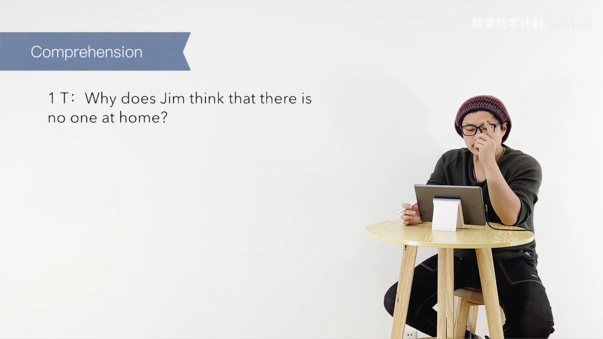

文字识别：Comprehension / 1 T: Why does Jim think that there is / no one at home?

## 00:07:30–00:08:00

there is no one at home? Because everything's very quiet. Next one, will Jim go away or will he knock again? He will knock again. There we go. Next one, why does Helen think it is impossible that there is no one at home? Because Carol and Tom invited

### 画面 00:07:38

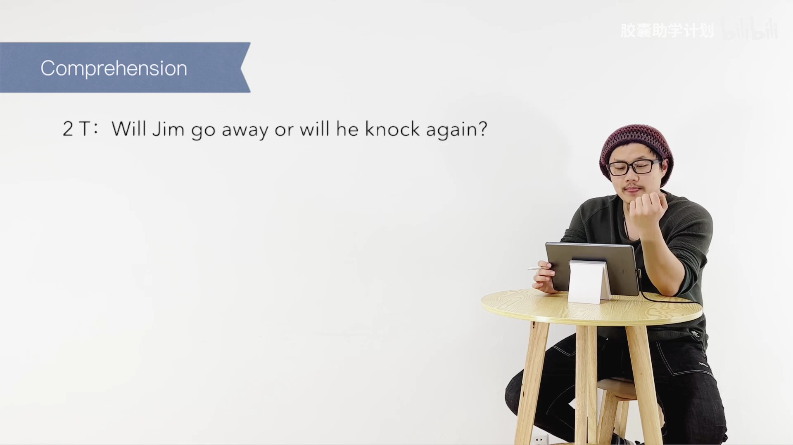

文字识别：Comprehension / 2 T: Will Jim go away or will he knock again? / 元

### 画面 00:07:48

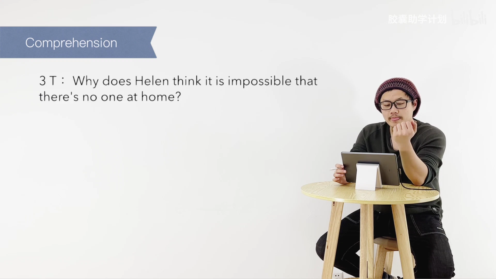

文字识别：Comprehension / 3 T: Why does Helen think it is impossible that / there's no one at home?

## 00:08:00–00:08:30

them to lunch? Next one. What does Helen ask Jim to do? She asks Jim to look through the window. Next one. Can Jim see anything? No, he can't. Next one. Where do they find their friends? In the garden, back door in the garden. Very good. Next one.

### 画面 00:08:03

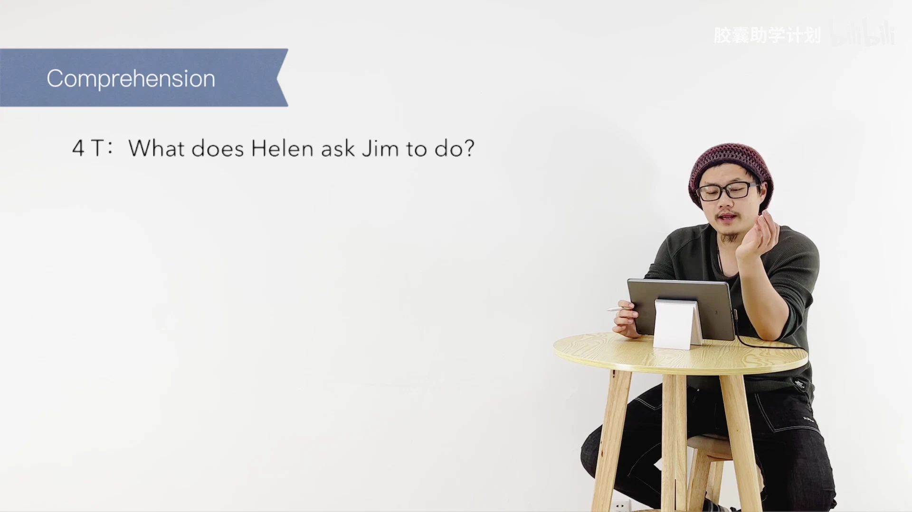

文字识别：Comprehension / 4 T: What does Helen ask Jim to do? / 元

## 00:08:30–00:09:00

Why is everyone in the garden? Because everybody wants to have lunch out there. Next one. What would Jim like to drink? He'd like a glass of beer. Next one. Is there any beer left? Yes, there is.好, asking questions.

### 画面 00:08:33

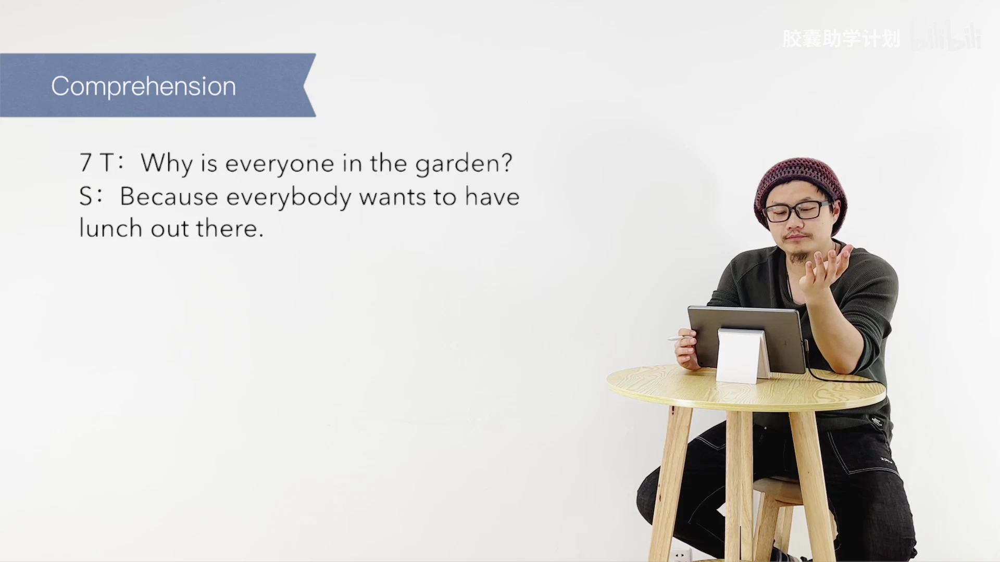

文字识别：Comprehension / 7 T: Why is everyone in the garden? / S: Because everybody wants to have / lunch out there.

### 画面 00:08:40

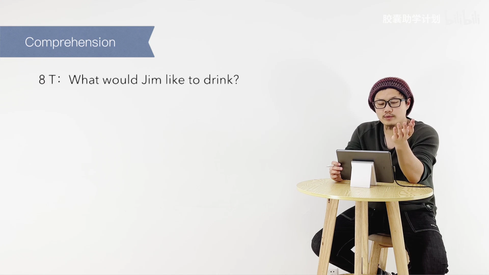

文字识别：Comprehension / 8 T: What would Jim like to drink?

### 画面 00:08:59

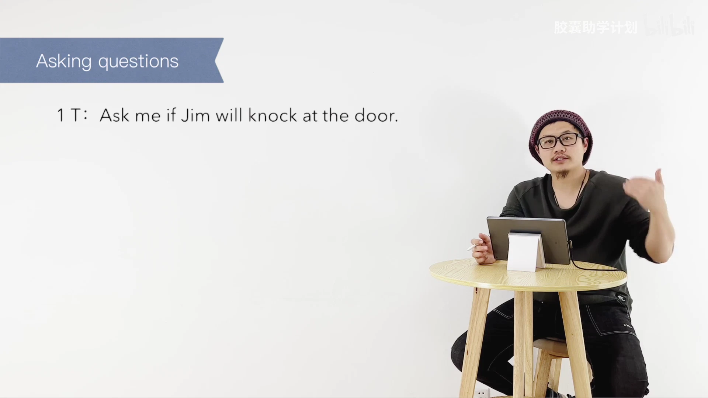

文字识别：Asking questions / 1 T: Ask me if Jim will knock at the door.

## 00:09:00–00:09:30

我给肯定句，你们变一般疑问句；我给特殊疑问词，你们变特殊疑问句。来了啊！第一题, ask me if Jim will knock at the door. Will Jim knock at the door? Who对主语提问直接替代, who will knock at the door? Next one, ask me if Tom and

### 画面 00:09:16

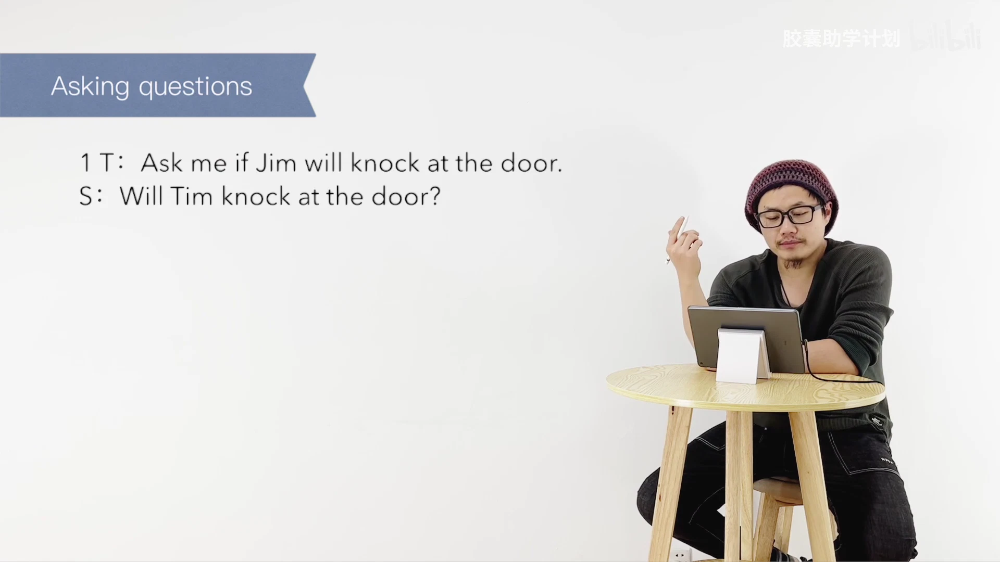

文字识别：Asking questions / 1 T: Ask me if Jim will knock at the door. / S: Will Tim knock at the door?

### 画面 00:09:25

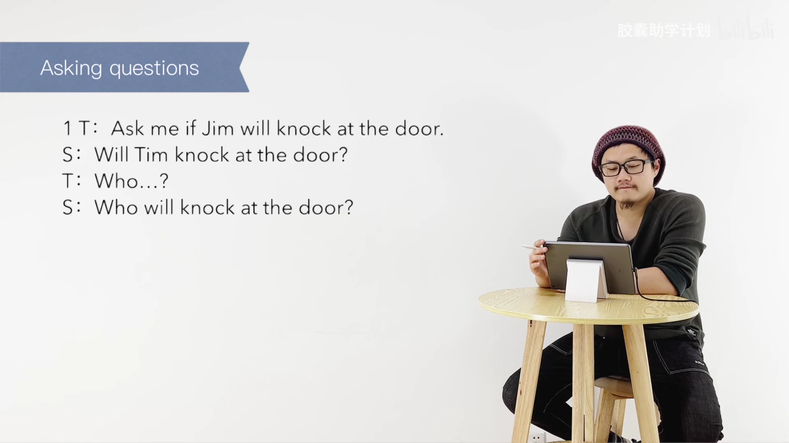

文字识别：Asking questions / 1 T: Ask me if Jim will knock at the door. / S: Will Tim knock at the door? / T: Who...? / S: Who will knock at the door?

### 画面 00:09:27

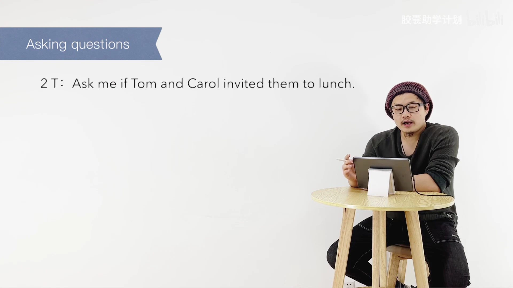

文字识别：Asking questions / 2 T: Ask me if Tom and Carol invited them to lunch.

## 00:09:30–00:10:00

Carol invited them to lunch, did Tom and Carol invite them to lunch? Who,哎，直接问主语提问就可以了。Who invited them to lunch?你看这里为什么没有did呢？对主语提问，对吧？Very good. Next one. Ask me if everyone is in the garden.一般疑问句Is everyone in

### 画面 00:09:41

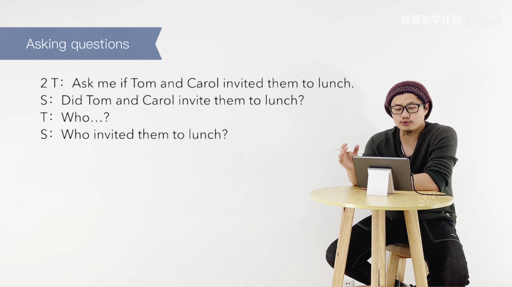

文字识别：Asking questions / 2 T: Ask me if Tom and Carol invited them to lunch. / S: Did Tom and Carol invite them to lunch? / T:Who...? / S: Who invited them to lunch?

### 画面 00:09:50

文字识别：Asking questions

## 00:10:00–00:10:30

the garden? Where, where is everyone? Next one, ask me if Jim can have some lemonade to drink. Can提前 can Jim have some lemonade to drink? What, what can Jim have to drink? Next one, ask me if Jim wants any beer.

### 画面 00:10:02

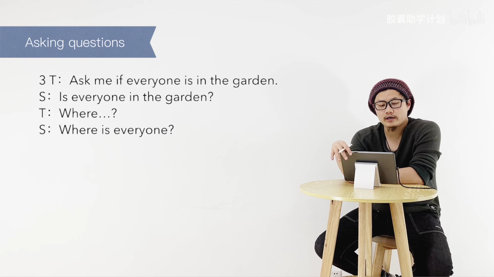

文字识别：Asking questions / 3 T: Ask me if everyone is in the garden. / S: Is everyone in the garden? / T: Where...? / S: Where is everyone?

### 画面 00:10:06

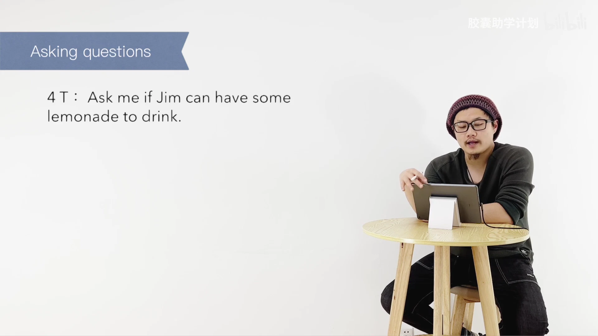

文字识别：Asking questions / 4 T: Ask me if Jim can have some / lemonade to drink.

### 画面 00:10:18

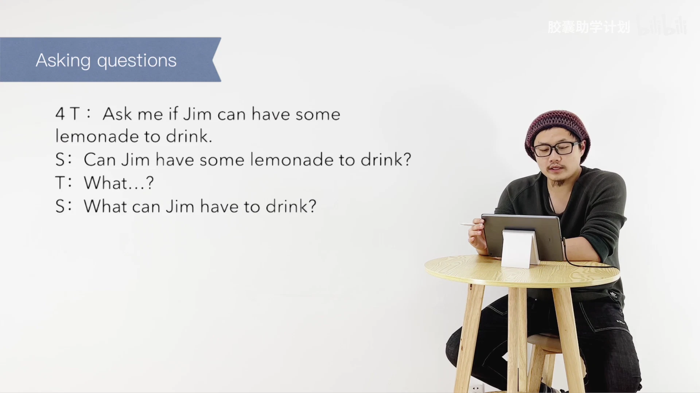

文字识别：Asking questions / 4 T : Ask me if Jim can have some / lemonade to drink. / S: Can Jim have some lemonade to drink? / T:What...? / S: What can Jim have to drink?

### 画面 00:10:24

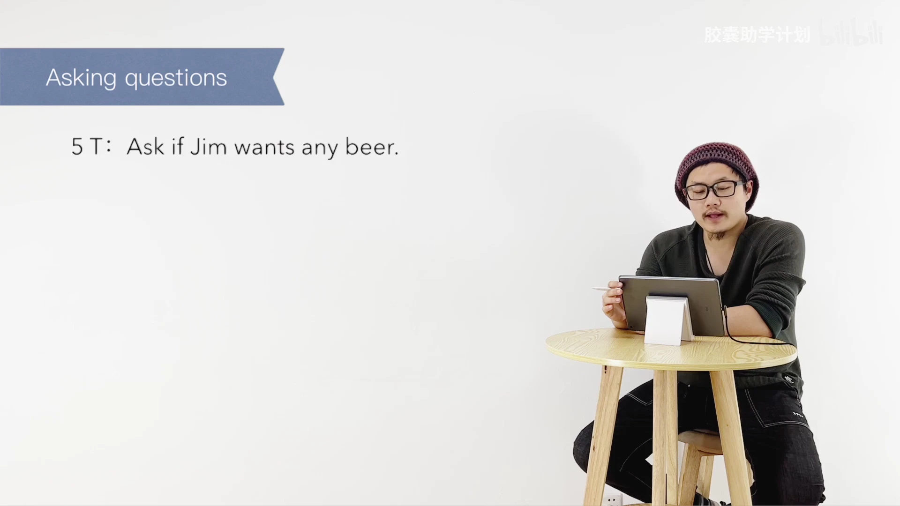

文字识别：Asking questions / 5 T: Ask if Jim wants any beer.

## 00:10:30–00:11:00

Does Jim want any beer? What? This is very simple, right? This is forty-nine lessons, we have learned, right? Okay, what does Jimmy want? Another one. Okay, let's recap. The key points of this lesson are actually these small words, right? Everyone, 115, 116, ah, are all around these small words. Let's familiarize with them. It's enough. It will appear again. Okay.

### 画面 00:10:42

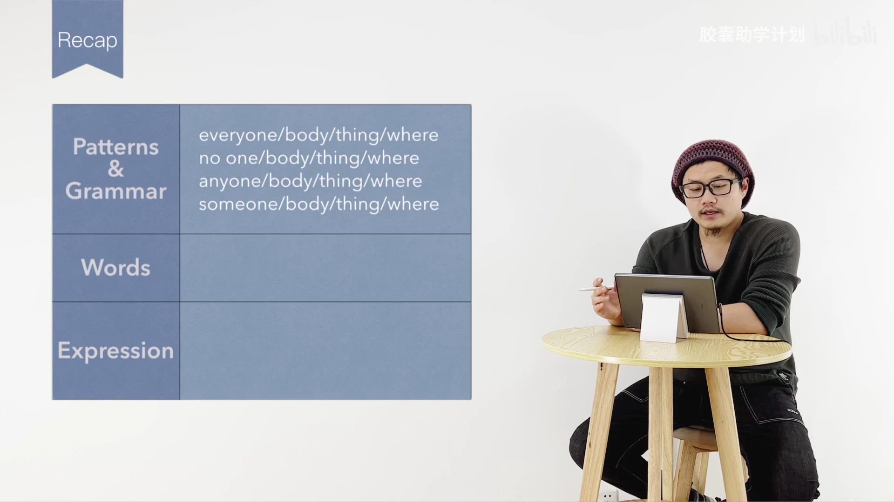

文字识别：Recap / everyone/body/thing/where / Patterns / no / one/body/thing/where / anyone/body/thing/where / Grammar / someone/body/thing/where / Words / Expression

### 画面 00:10:46

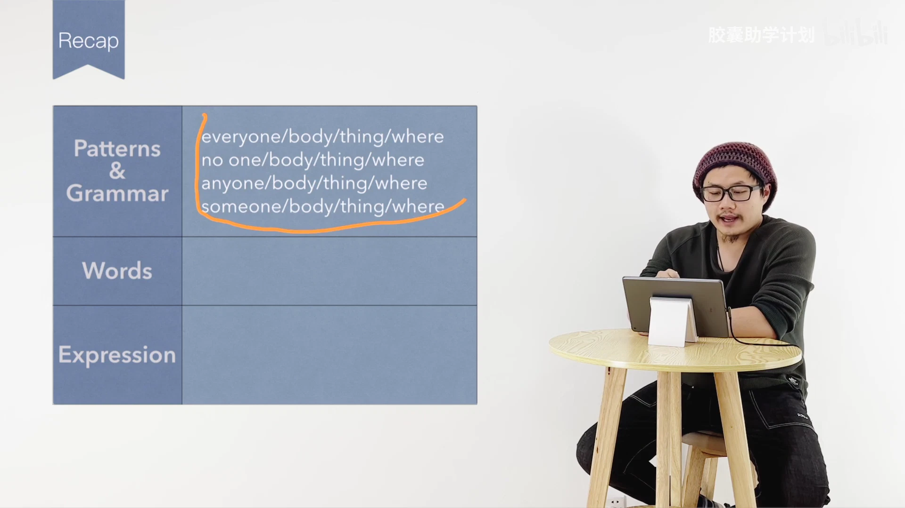

文字识别：Recap / everyone/body/thing/where / Patterns / no / one/ / /body/thing/where / anyone/body/thing/where / Grammar / someone/body/thing/where / Words / Expression

### 画面 00:10:48

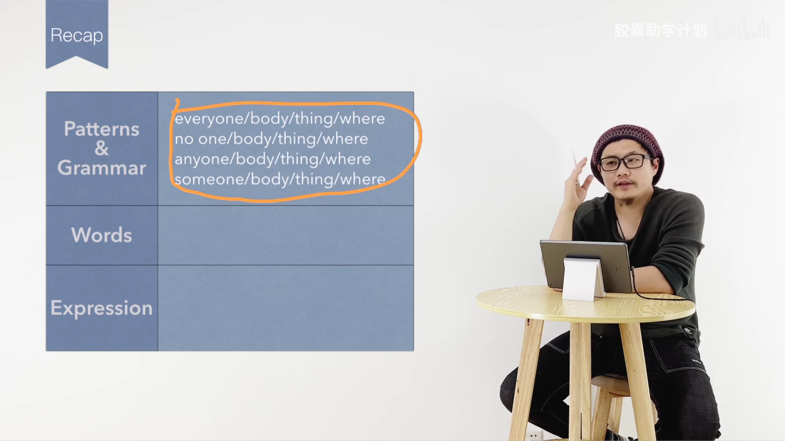

文字识别：Recap / everyone/body/thing/where / Patterns / no / one/body/thing/where / anyone/body/thing/where / Grammar / someone/body/thing/ / /where / Words / Expression

### 画面 00:10:57

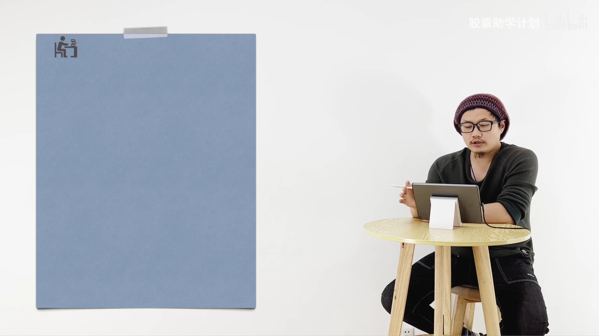

## 00:11:00–00:11:30

位可以写了。文章呢，跟读至熟读成诵，给自己讲解一遍今天的核心知识点。好，那如果大家喜欢我们的课程呢，欢迎大家关注、订阅、一键三连，分享给那些需要的朋友来啊，这个呃，支持我们快速成长，好吧？那最后呢，我们来看一句名人名言：Nothing in life is to be feared; it is only to be understood. Now is the time to understand more, so that we may

### 画面 00:11:07

文字识别：👍

### 画面 00:11:17

文字识别：Nothing in life is to be feared, it is only to / be understood. Now is the time to / understand more, so that we may fear less. / - Marie Curie

## 00:11:30–00:11:45

fear less. See you next time.

### 画面 00:11:33

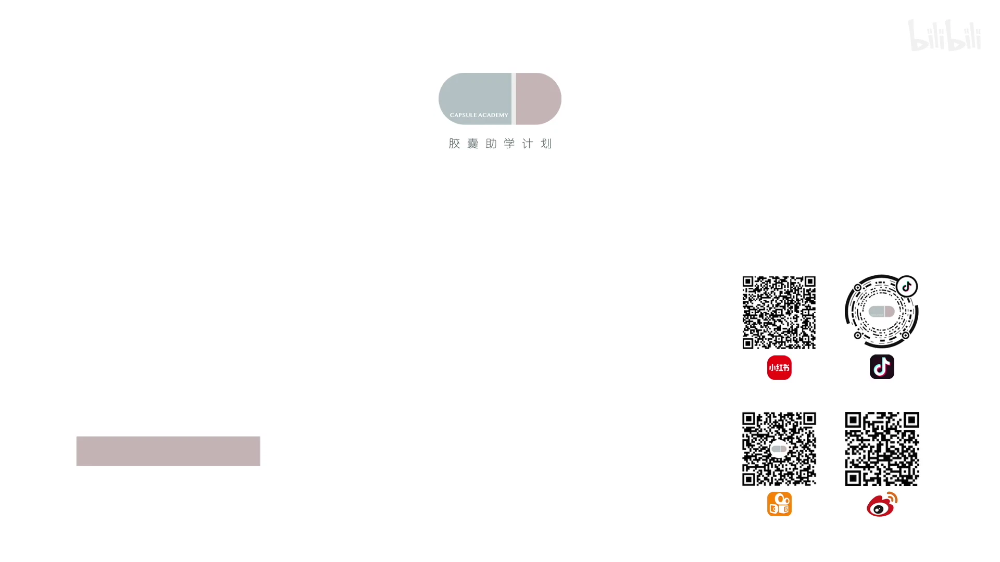

文字识别：CAPSULEACADEMY / 胶囊助学计划 / 小红书 / OE

### 画面 00:11:35

文字识别：CAPSULEACADEMY / 胶囊助学计划 / 『 / 小红书

### 画面 00:11:41

文字识别：CAPSULEACADEMY / 胶囊助学计划 / 『 / 小红书 / Creator / □ / Leo & Berlin / OE

### 画面 00:11:43

文字识别：bilibili / 胶囊助学计划

### 画面 00:11:44

文字识别：bilibili / 胶囊助学计划

