# 116 练习

快速机器解析：语音为单模型转写，未进行独立交叉校对或人工复核；画面每秒采样并按变化选帧，短时文字和标记可能遗漏。截图时间约有 1 秒误差。图片有损压缩；遇到疑点请按时间查看 Google Drive 原视频。

## 00:00:00–00:00:30

Hello everyone, welcome to Capsule Academy. This is Leo. Today we're going to learn New Concept English Book One Lesson One Hundred and Sixteen Practices. Hope you gonna enjoy it. 好的，我们先看第一个小的单词啊，跟我一起读一下，叫做 a sleep, a sleep. 注意重音在后面。这个单词很有意思。你看 sleep 这个单词咱学过，是动词，叫睡觉。然后前面

### 画面 00:00:00

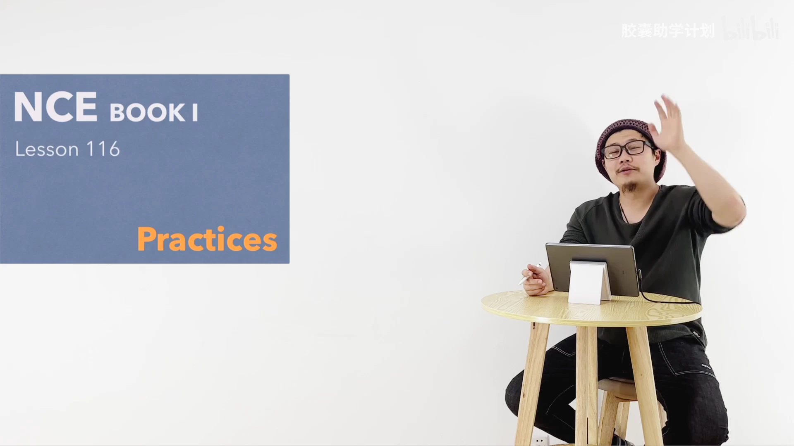

文字识别：NCE / BOOKI / Lesson 116 / Practices

### 画面 00:00:11

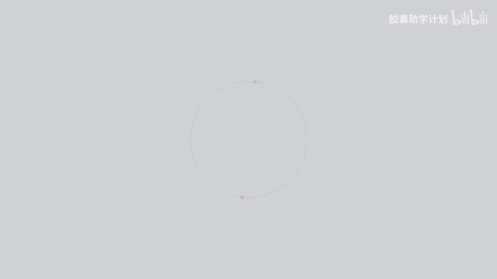

文字识别：胶囊助学计划bil出

### 画面 00:00:14

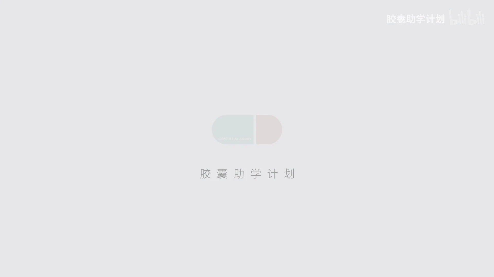

文字识别：胶囊助学计划

### 画面 00:00:16

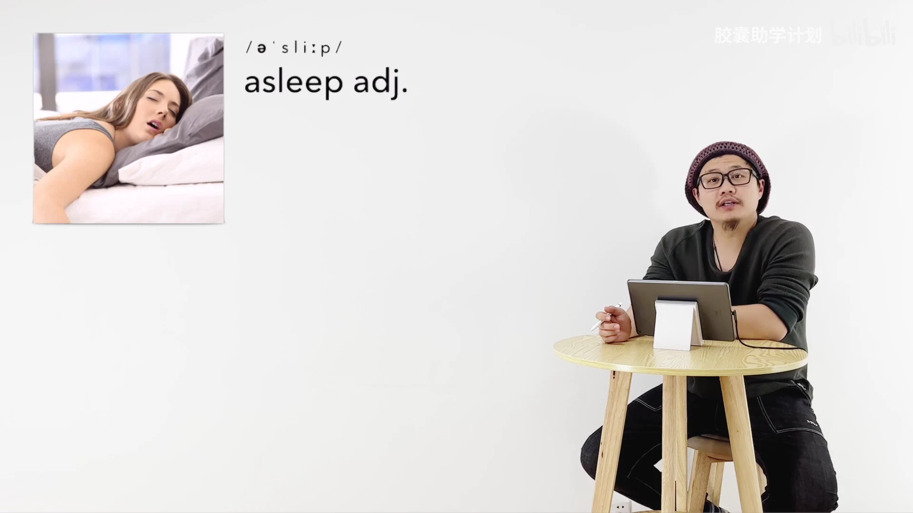

文字识别：/a'sli:p/ / asleep adj.

## 00:00:30–00:01:00

加上一个 a 这个字母，它读叫做 asleep，对吧？它变成了形容词的意思，什么意思呢？睡觉是吧？只是表示这时候不是动作了，是它保持睡觉这个状态。造句子呢也很简单，它就是形容词嘛。说 she is beautiful，叫她很漂亮。那她在睡觉，she is asleep，是吧？Very good。那每个人都在睡觉，叫做 everyone is asleep。那你想问大家都在睡觉吗？怎么问？

### 画面 00:00:46

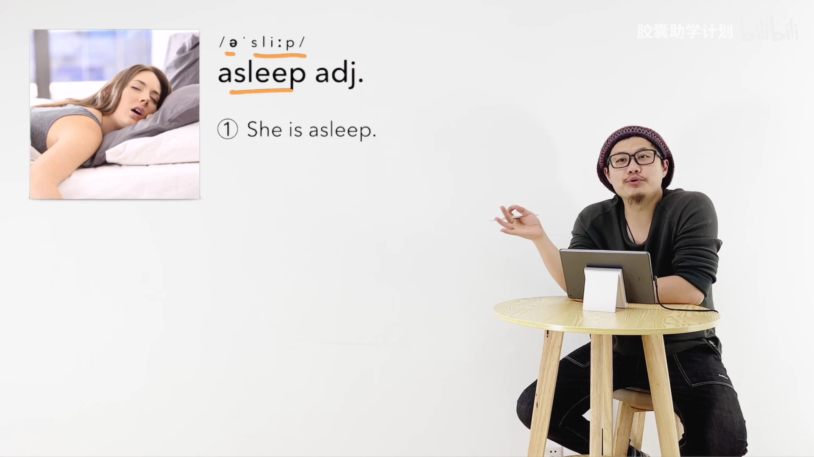

文字识别：/a^sli:p/ / asleep adj. / ① She is asleep.

## 00:01:00–00:01:30

你可以说 Is everyone sleeping right now? 啊，你也可以说 Is everyone asleep? 或者说他正在睡觉吗？Is she asleep? Okay, very good. 啊，这单词各位见到就行，是吧？见到能认识就可以了。 Okay, 好，下一个单词呢？眼镜啊，叫 glasses。注意它本身是个复数，对吧？Glasses. 那我们造句说 You are wearing your new glasses, 是吧？你正在哎戴着你这个

### 画面 00:01:16

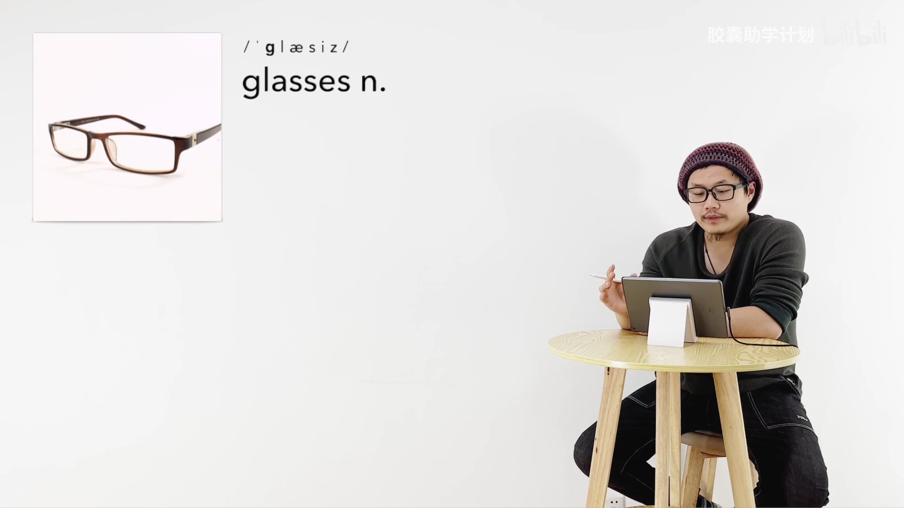

文字识别：/ g |æsiz / / glasses n.

## 00:01:30–00:02:00

新的眼镜，very good，好再来一句话说，I bought these new glasses last week啊，我上周买的这副新眼镜，very good，很简单。然后I bought这个肯定句出来了，您暂停个屏幕，把它变个一般疑问句，顺手变个一般疑问句和各种特殊疑问句，张嘴就来试试，您现在行不行？是吧？啊，这是我们练了这么长时间您的基本功了，very good，好，呃，我们接下来呢就是练习

### 画面 00:01:32

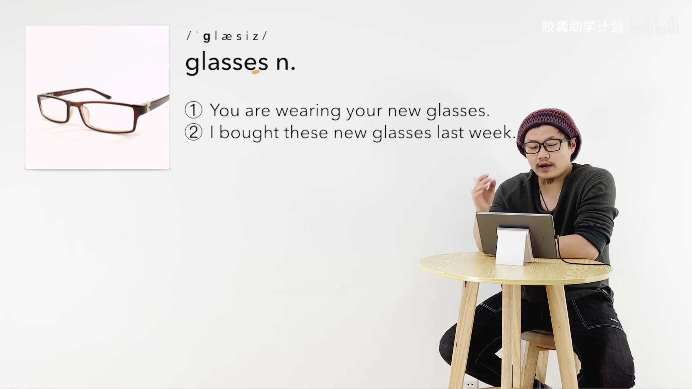

文字识别：/  g | æ si z / / glasses n. / ① You are wearing your new glasses. / ② I bought these new glasses last week.

### 画面 00:01:57

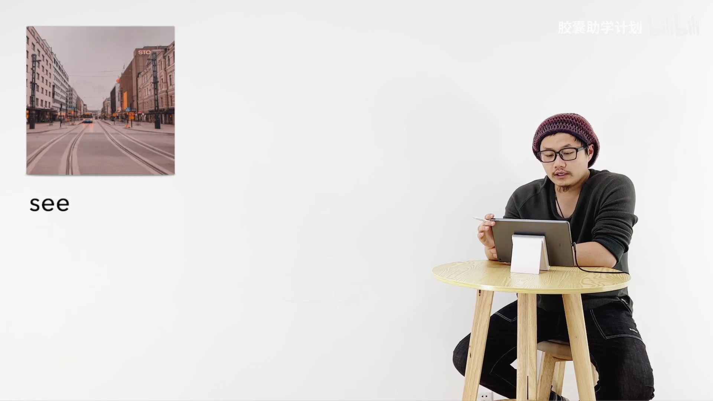

文字识别：see

## 00:02:00–00:02:30

练习啊，还是练习玩一个，各位张开嘴，大声跟我读就行了。来了，Did you see anyone yesterday? No, I saw no one. Next one, Did you hear anything? No, I heard nothing. Next one, Did anyone speak to you? No, no one spoke to me.

### 画面 00:02:10

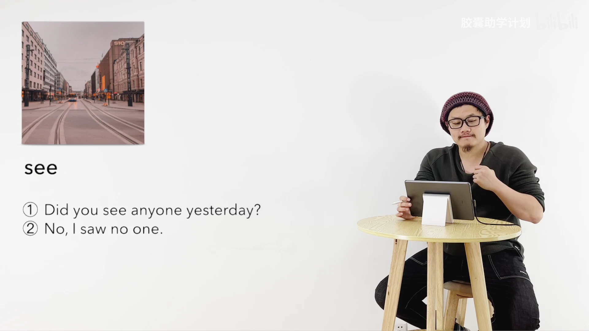

文字识别：see / ① Did you see anyone yesterday? / ② No, I saw no one.

### 画面 00:02:14

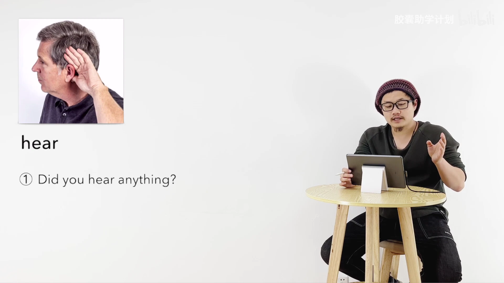

文字识别：hear / ① Did you hear anything?

### 画面 00:02:22

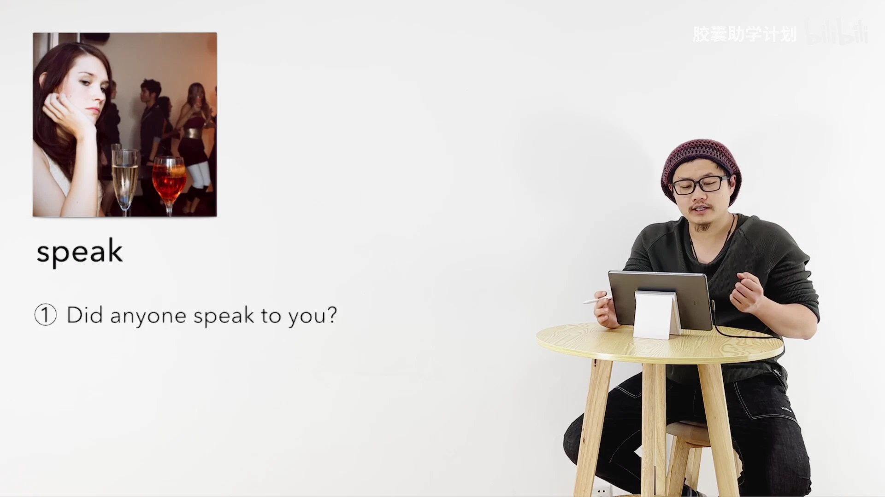

文字识别：speak / ① Did anyone speak to you?

### 画面 00:02:29

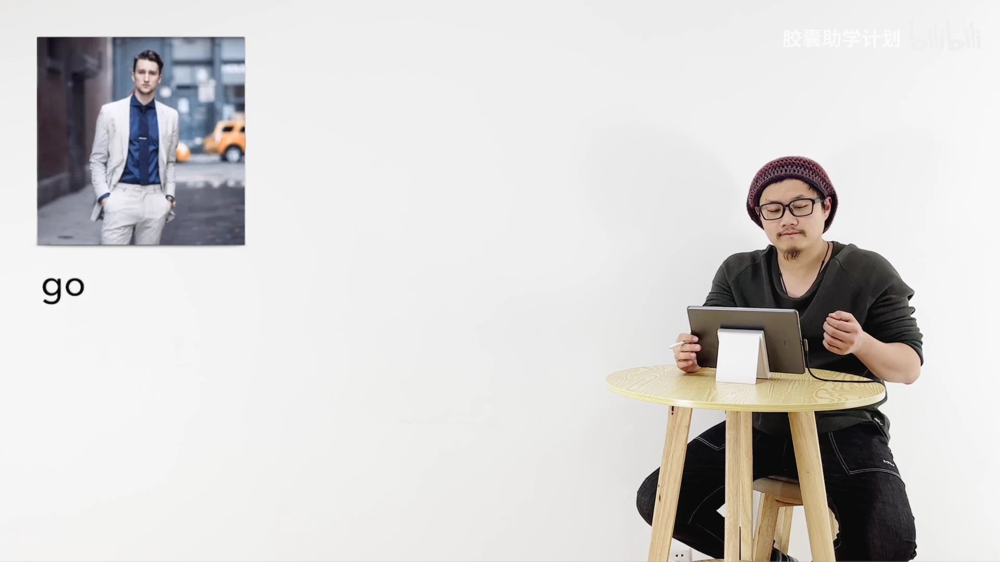

文字识别：go / 专

## 00:02:30–00:03:00

one. Did you go anywhere yesterday? No, I went nowhere. 我哪儿也没去，对吧？ I didn't go anywhere. 各位注意一个小点啊，这儿我们正好就着这儿讲，叫各位记不记得我们学过叫 not any 等于 no，这个取决于各位之前的基础了。 Not any 等于 no 加名词等于 not。啊，您想一下，回想一下这个语法点，我们应该是刚刚讲过不

### 画面 00:02:39

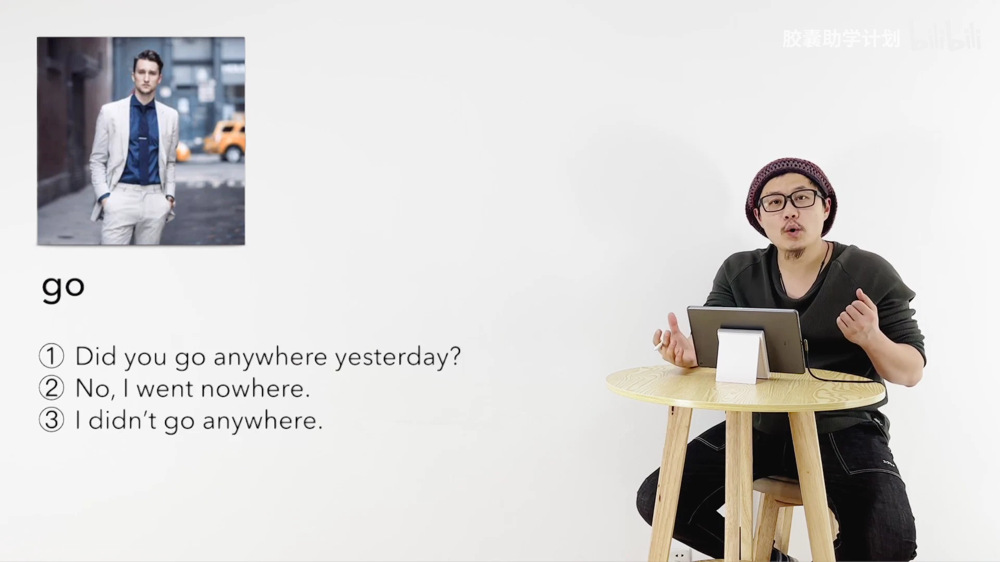

文字识别：go / ① Did you go anywhere yesterday? / No, I went nowhere. / 2 / ③ I didn't go anywhere.

## 00:03:00–00:03:30

久，同理，not anything, not anywhere等于nowhere, OK，好理解哈。There we go, continue. Did you buy anything this morning? No, I bought nothing. Next one. Did you write to anyone yesterday? No, I wrote to no one. Next one. Did anyone meet you at the station?

### 画面 00:03:08

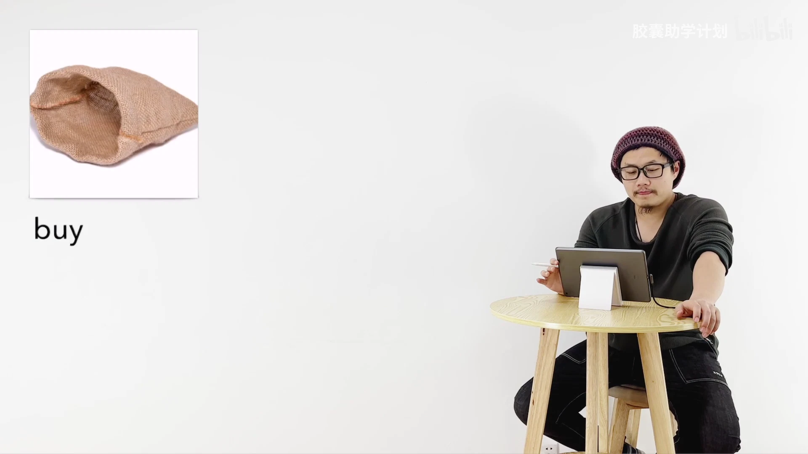

文字识别：buy

### 画面 00:03:16

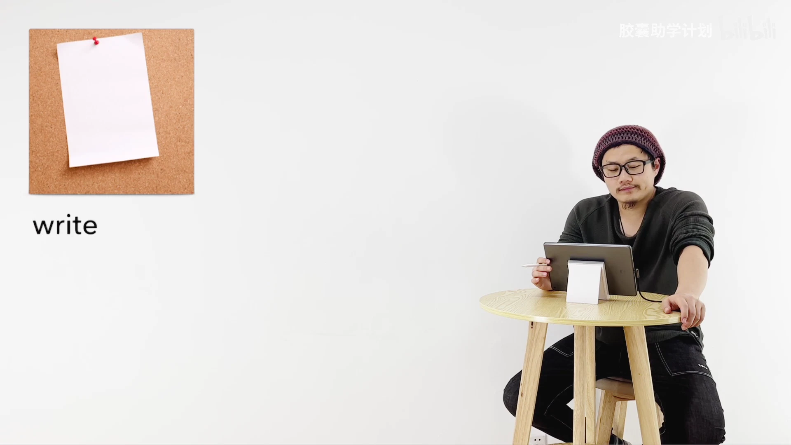

文字识别：write

### 画面 00:03:25

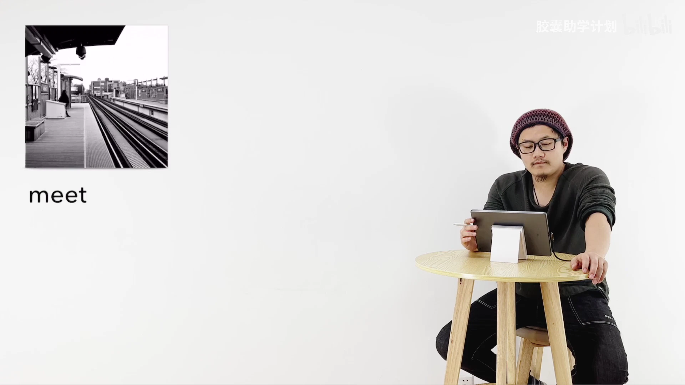

文字识别：meet

## 00:03:30–00:04:00

No, no one met me. Next one. Did anybody tell you? No, nobody told me. Good. Very good. Recap.幺幺五幺幺六三个视频全是围绕着这些单词展开的。好，交作业。绿皮书幺六，各位可以写了。继续红皮书，您如果还没有查这些单词，我还是建

### 画面 00:03:34

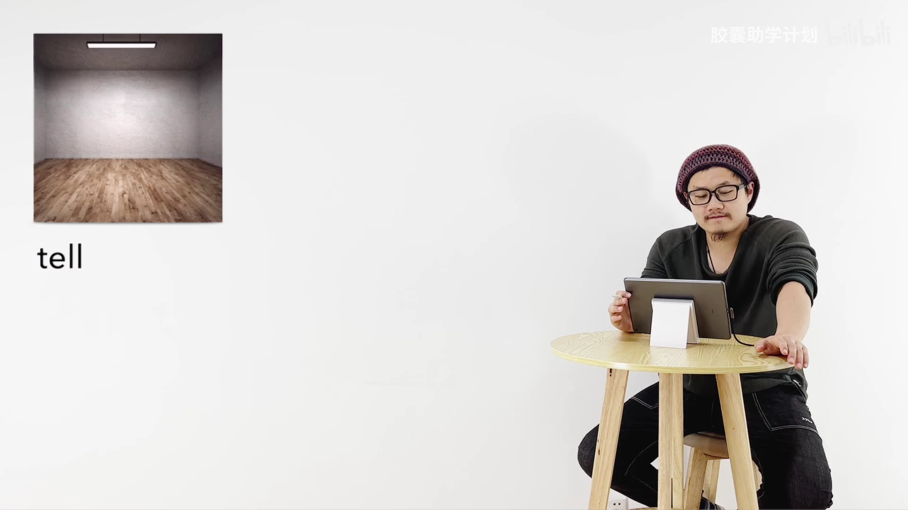

文字识别：tell

### 画面 00:03:43

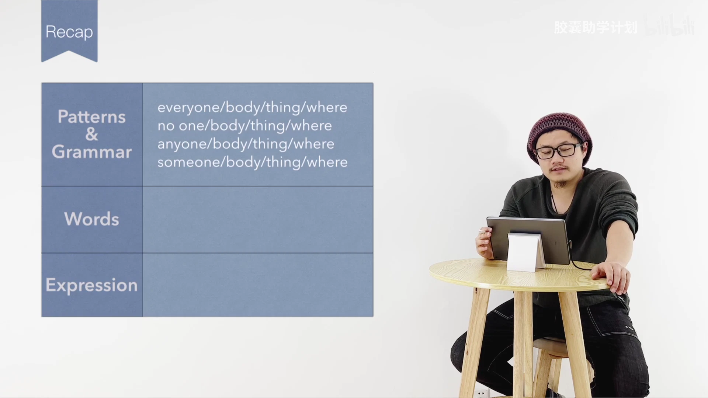

文字识别：Recap / everyone/body/thing/where / Patterns / no / one/body/thing/where / anyone/body/thing/where / Grammar / someone/body/thing/where / Words / Expression

### 画面 00:03:50

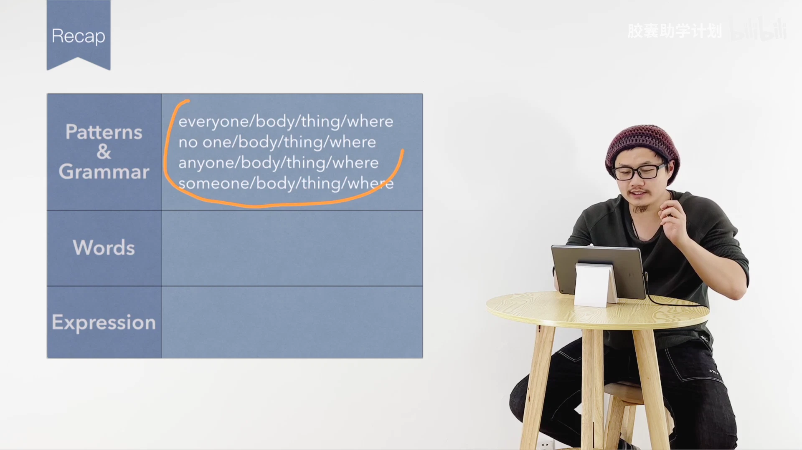

文字识别：Recap / everyone/body/thing/where / Patterns / no / one/body/thing/where / anyone/body/thing/where / Grammar / someone/body/thing/where / Words / Expression

### 画面 00:03:52

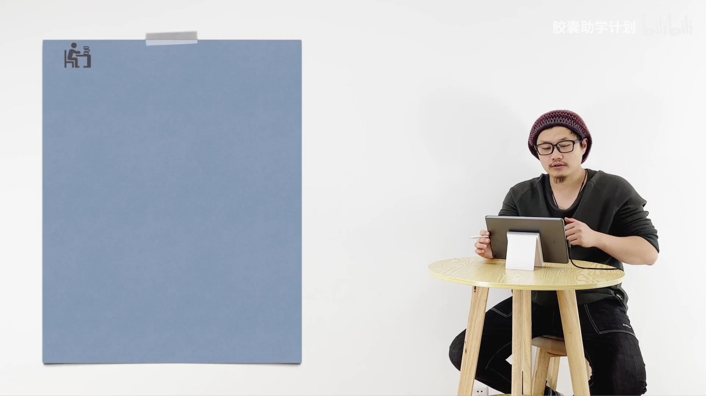

## 00:04:00–00:04:30

您再查一下啊。这些单词对于各位来说其实学起来并不难，重点是要多看例句，所以不妨拿红皮书去多看看那些讲解和练习啊，对大家理解这些单词是有好处的，对吧？OK，然后呢，给自己讲解一遍今天的核心知识点啊，Not any 等于 no，刚才那个点，Very good。呃，如果大家喜欢我们的课程呢，欢迎大家关注、订阅、一键三连，分享给那些需要的朋友来帮助我们快速成长。最后我们再来

### 画面 00:04:21

### 画面 00:04:29

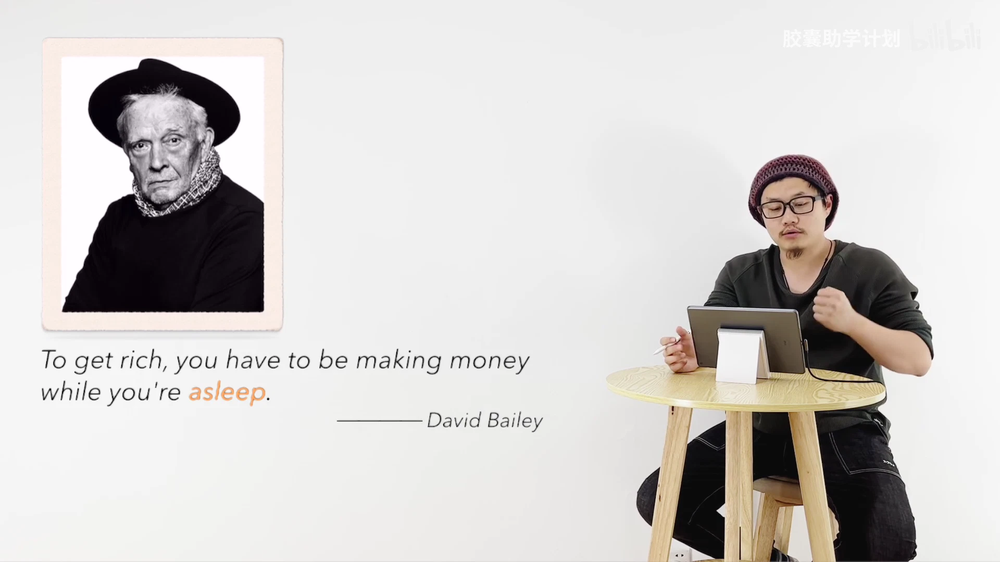

文字识别：To get rich, you have to be making money / while you're asleep. / David Bailey

## 00:04:30–00:04:53

看一句名人名言。To get rich, you have to be making money while you are asleep. See you next time.

### 画面 00:04:41

### 画面 00:04:43

文字识别：CAPSULEACADEMY / 胶囊助学计划 / 小红书 / Lecturer / □ / Leo / OE

### 画面 00:04:46

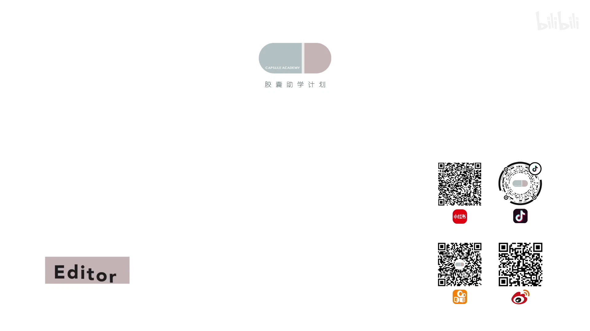

文字识别：CAPSULEACADEMY / 胶囊助学计划 / 小红书 / Editor / OE

### 画面 00:04:49

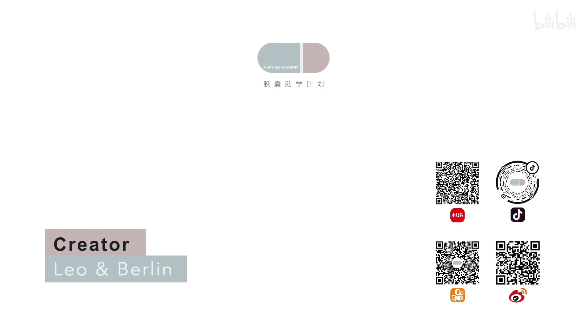

文字识别：CAPSULEACADEMY / 胶囊助学计划 / 小红书 / Creator / □ / Leo & Berlin / OE

### 画面 00:04:51

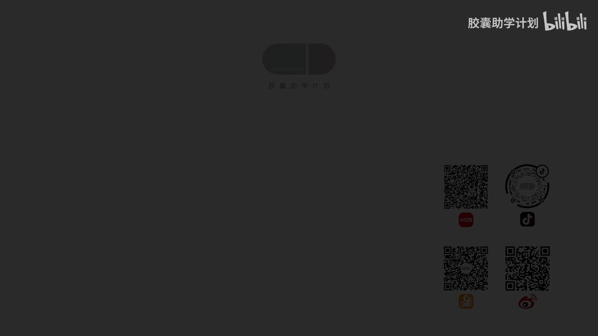

文字识别：Bilibili / 胶囊助学计划 / 胶囊助学计划 / 小红书

### 画面 00:04:53

文字识别：bilibili / 胶囊助学计划

