# 117 文章

快速机器解析：语音为单模型转写，未进行独立交叉校对或人工复核；画面每秒采样并按变化选帧，短时文字和标记可能遗漏。截图时间约有 1 秒误差。图片有损压缩；遇到疑点请按时间查看 Google Drive 原视频。

## 00:00:00–00:00:30

Hello, everyone. Welcome to Capsule Academy. This is Leo. Today we're going to learn New Concept English Book One, Lesson One Hundred and Seventeen, Story. Hope you gonna enjoy it.好，那我们上来直接看文章啊。还是图给我们提供的是什么呢？是场景啊。我们要通过想象力去想一下这个什么场景啊。我们看一个父亲进来，然后好像撒了一把

### 画面 00:00:00

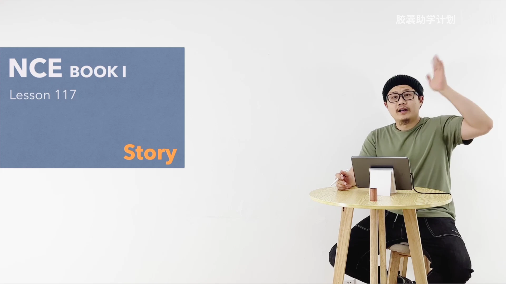

文字识别：NCE / BOOKI / Lesson 117 / Story

### 画面 00:00:02

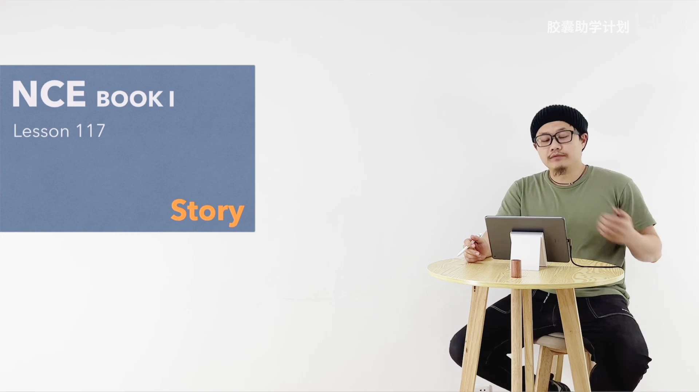

文字识别：NCE / BOOKI / Lesson 117 / Story

### 画面 00:00:11

文字识别：胶囊助学计划bll / •

### 画面 00:00:15

### 画面 00:00:17

文字识别：When my husband was going into the / dining room this morning, he dropped / some coins on the floor.

## 00:00:30–00:01:00

硬币在地上，是吧？我们看发生了什么。When my husband was going into the dining room this morning, how when叫做当什么什么时候？当我丈夫正在进入going into啊，早在三十五课咱们就学过，从一个空间进入另一个空间的时候叫做into，对吧？I go into the dining room,餐厅this morning，今天早晨，这是过去的事情。He dropped some coins on the floor.

### 画面 00:00:47

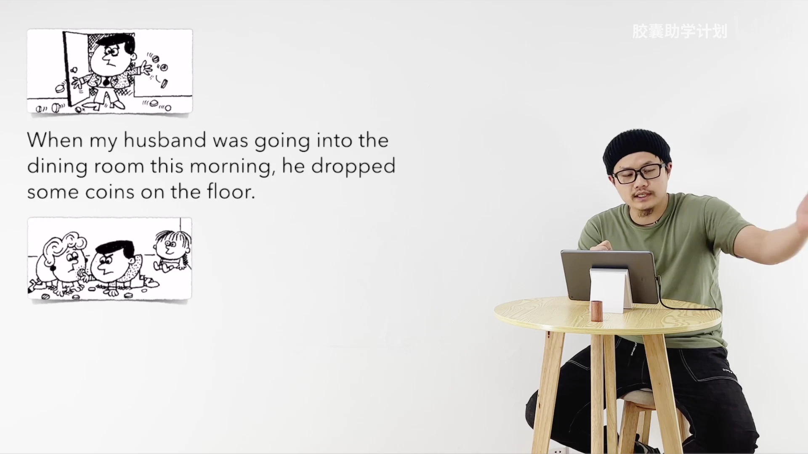

文字识别：When my husband was going into the / dining room this morning, he dropped / some coins on the floor.

## 00:01:00–00:01:30

dropped some coins. It doesn't look like it was thrown on purpose, right? It was just dropped accidentally. Maybe when you were taking your wallet or taking off your clothes, you dropped some coins on the floor. On the floor, on the floor. Okay. First, let's review the two grammar points we learned in the grammar and vocabulary video. The first one is "was going," which means past continuous. This morning, it means it was before this morning. So it means it's not this morning anymore. It might be in the evening.

### 画面 00:01:17

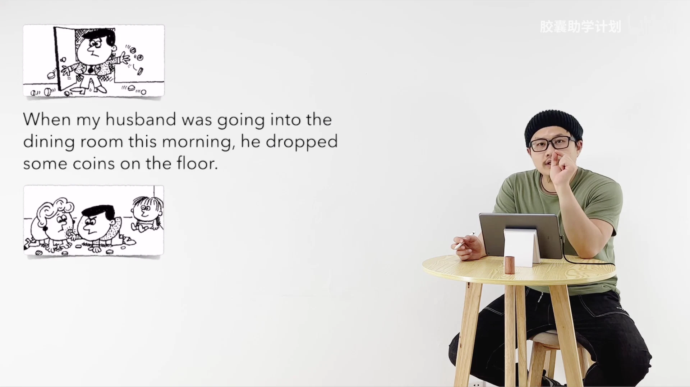

文字识别：When my husband was going into the / dining room this morning, he dropped / some coins on the floor.

## 00:01:30–00:02:00

是呃晚上了，应该是这个样子啊，或者下午了，至少是下午了。过去进行时，第二，when引导了引导了一个时间从句，也就是从when一直到morning，它都在尝试交代的是draw发生的时间。所以我举个例子啊，when一直到morning，您可以把这个地方直接变成，比如说早晨八点钟，他掉了一些硬币在地板上，对吧？但是你听一

### 画面 00:01:47

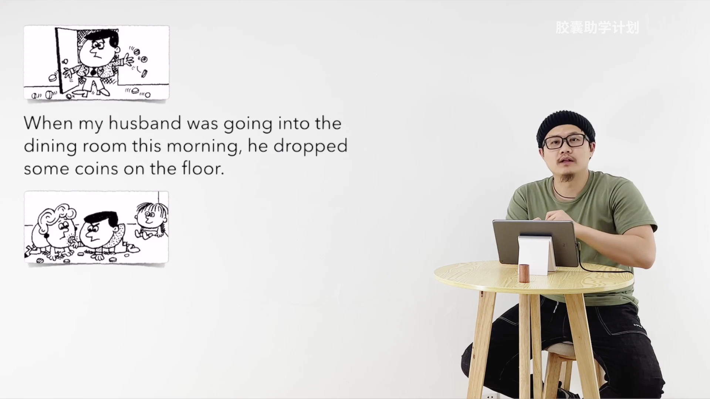

文字识别：When my husband was going into the / dining room this morning, he dropped / some coins on the floor.

## 00:02:00–00:02:30

下，这两者区别是不一样的。前者用 when 一直到 morning 提供了更多时间上的信息，对吧？所以当我去问你说他什么时候把硬币掉在地板上的呢？您的，你看我问的是时间，您也是用一句话去回答这个时间，叫做 When my husband was going to the dining room this morning，这叫时间从句，好吧？非常舒服啊！再来，There were coins everywhere. 好，there be 句型，

### 画面 00:02:17

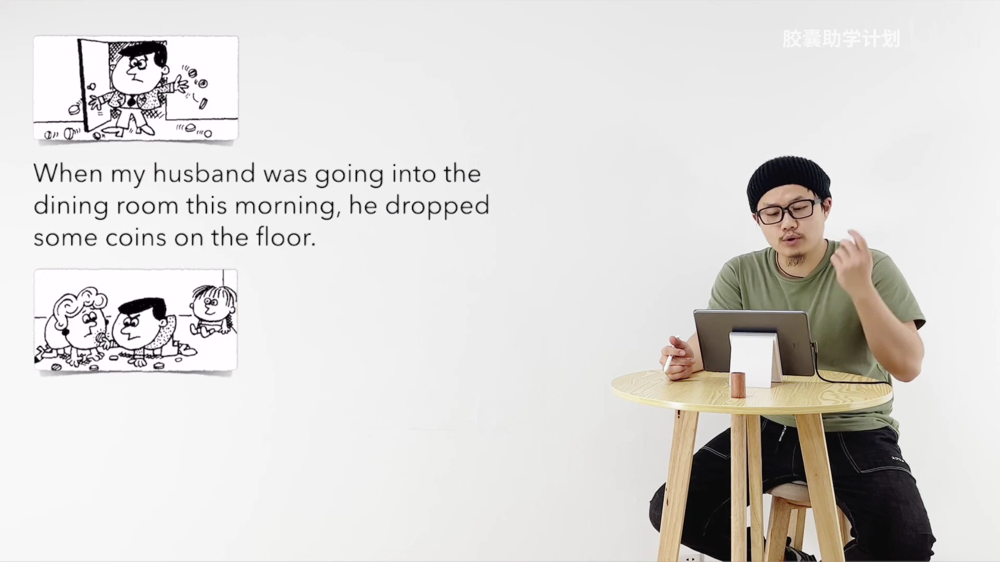

文字识别：When my husband was going into the / dining room this morning, he dropped / some coins on the floor.

### 画面 00:02:23

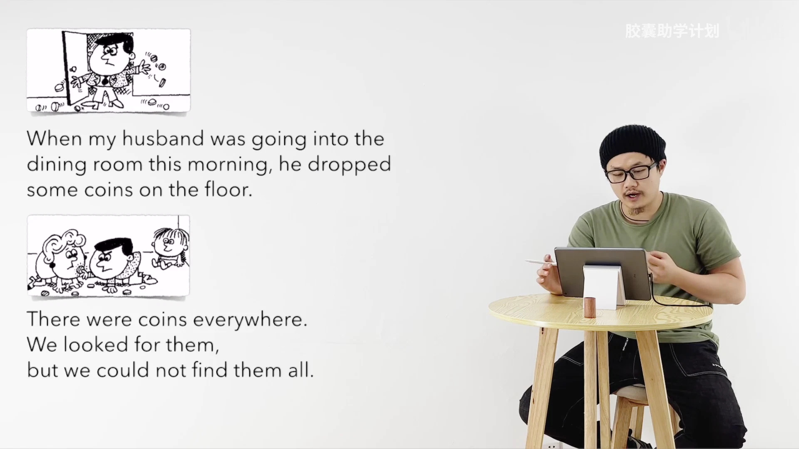

文字识别：①1① / When my husband was going into the / dining room this morning, he dropped / some coins on the floor. / There were coins everywhere. / We looked for them, / but we could not find them all.

## 00:02:30–00:03:00

coins叫硬币，everywhere我们刚刚学到的不定代词叫四处都是，对吧？四处都是。We looked for them，我们四处找他们，but但是we could not一百零三课学的could啊，跟can是类似的，对吧？但是它是过去。We could not find them all，叫做全部啊。那之前有学员就提到了说all是什么意思啊？这样的问题

### 画面 00:02:53

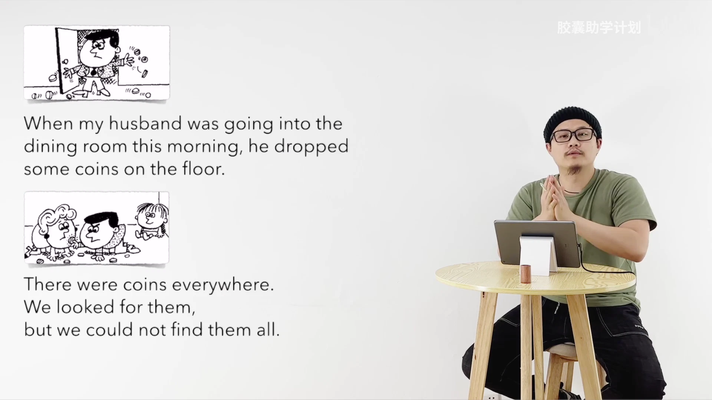

文字识别：①① / When my husband was going into the / dining room this morning, he dropped / some coins on the floor. / There were coins everywhere. / We looked for them, / but we could not find them all.

## 00:03:00–00:03:30

我往往不会直接回答各位，原因很简单，在开篇视频当中我就提到了，各位要去下一个字典，然后不懂的单词，您优先问的一定是字典，而不是老师。您可以问老师，最好的问题是哦，我查到了这个单词有三个意思，然后我在原文当中认为有两个意思好像都合适，您觉得哪个意思更好呢？这个是

### 画面 00:03:23

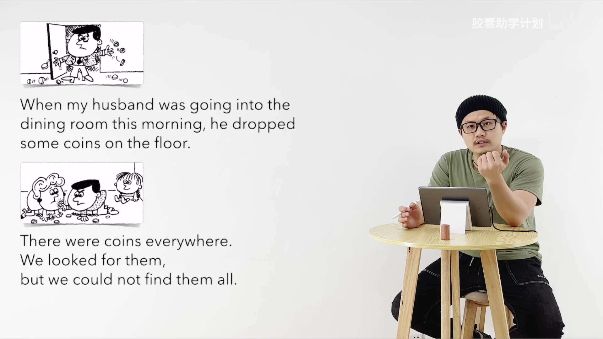

文字识别：①①" / When my husband was going into the / dining room this morning, he dropped / some coins on the floor. / There were coins everywhere. / We looked for them, / but we could not find them all.

## 00:03:30–00:04:00

各位自己付出了一些努力，然后再去问我。你如果直接问我哦是什么意思，这个就是你没有付出任何的努力，实际上对于各位学习效果是不好的。我相信几乎所有人都能认同一个客观事实，就是你学习越主动，效果越好。那越主动怎么展现出来呢？不是你直接问我问题，而是你先自己去查一些东西，然后再来问我，好吧？好，所以希望各

### 画面 00:03:53

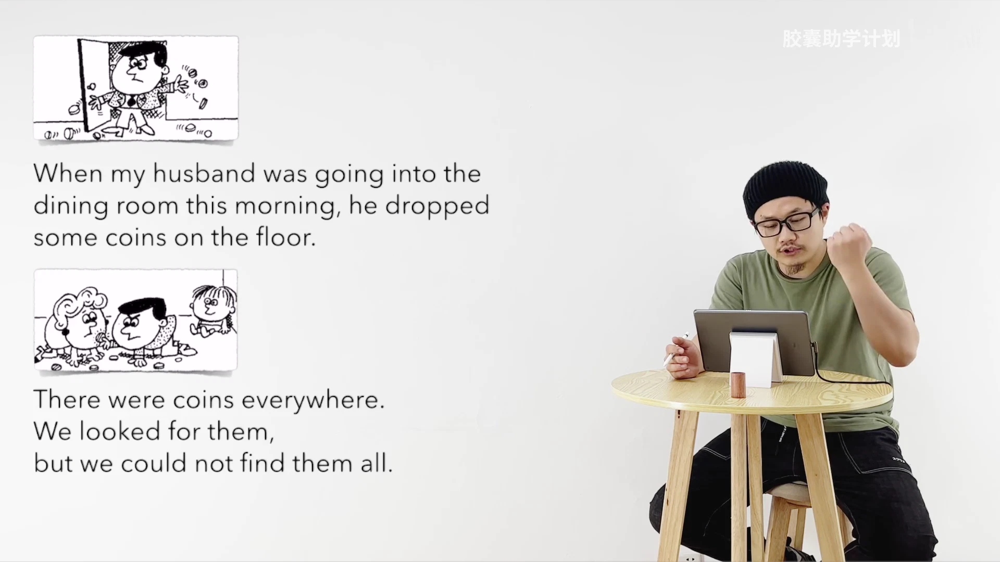

文字识别：①①" / When my husband was going into the / dining room this morning, he dropped / some coins on the floor. / There were coins everywhere. / We looked for them, / but we could not find them all.

## 00:04:00–00:04:30

位把这个字典下来，高效的利用起来啊。好，接下来，while叫做当什么什么时候，we were having breakfast，当我们正在吃早饭的时候呢，our little boy，哎，这儿呢是吧，在墙角呢，哎，发现了两个小的硬币，我们的小，哎，小儿子Tommy啊，Tommy find发现了two small coins on the floor，发现了两个小的硬币 on the floor，

### 画面 00:04:03

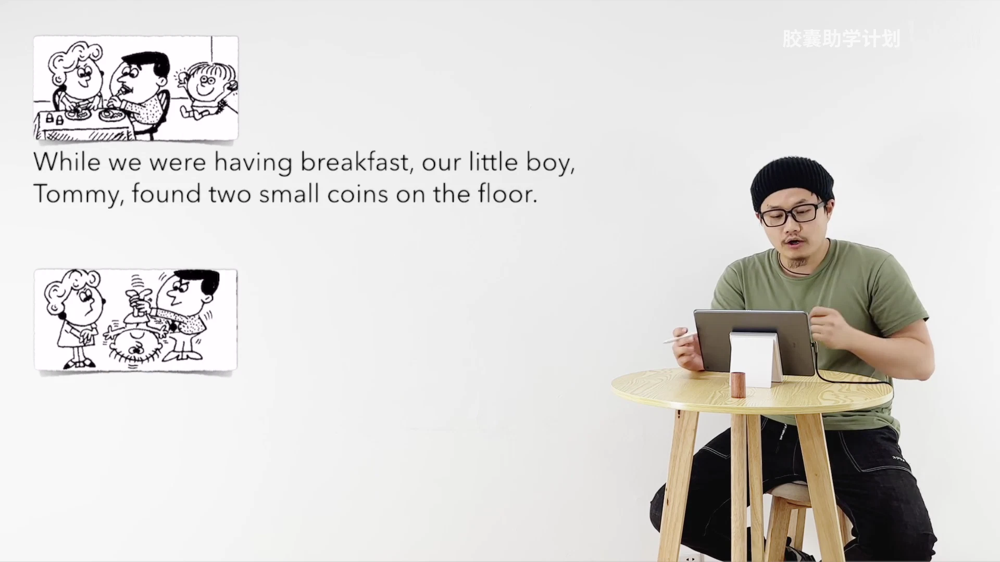

文字识别：While we were having breakfast, our little boy, / Tommy, found two small coins on the floor.

## 00:04:30–00:05:00

在地板上。好，这个地方我又不得不去提一个叫做 our little boy 和 Tommy。各位，你不需要懂他是什么语法，你也能明白这是一个人，不是两个人吧？不是说 our little boy and Tommy 这两个人，你能明白的是 our little boy 就是 Tommy，Tommy 就是 our little boy。就类似于我的英语老师 Leo，这不是一个人啊，这不是两个人，这是一个人，

### 画面 00:04:33

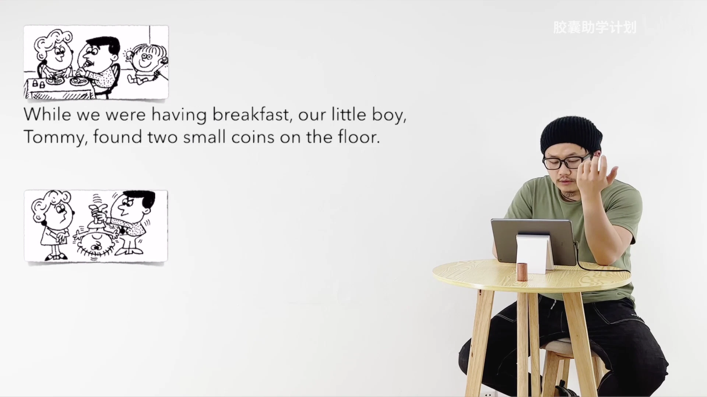

文字识别：While we were having breakfast, our little boy, / Tommy, found two small coins on the floor.

### 画面 00:04:36

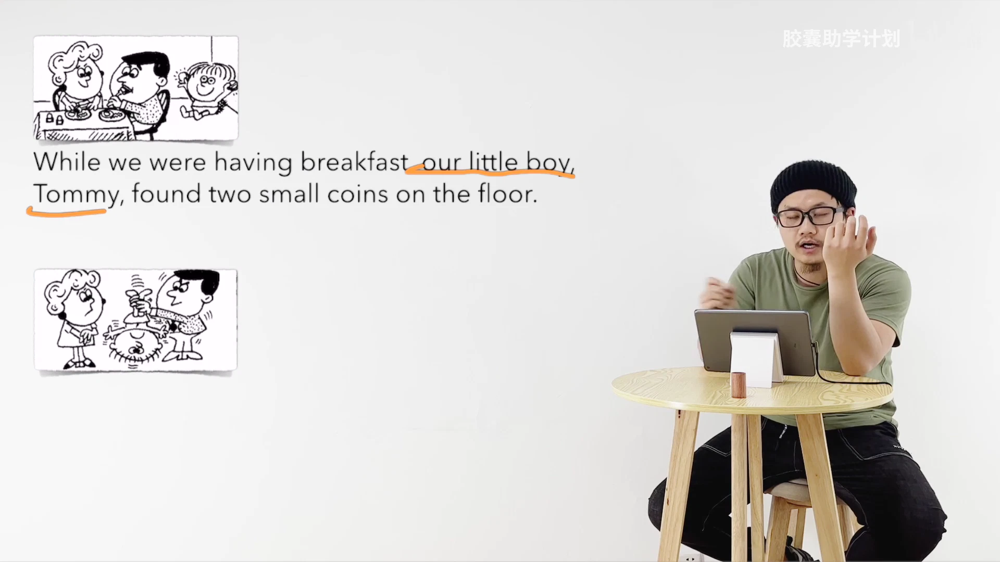

文字识别：While we were having breakfast our little boy. / Tommy, found two small coins on the floor.

### 画面 00:04:39

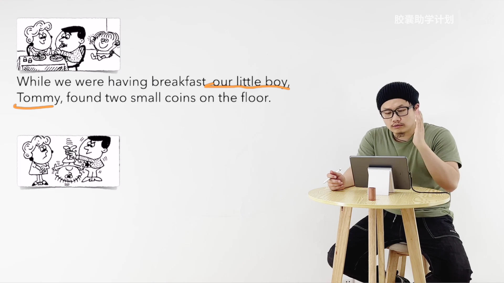

文字识别：While we were having breakfast our little boy / Tommy, found two small coins on the floor.

## 00:05:00–00:05:30

这说的是对吧？那英语当中管这个东西呢，语法上我们管它叫做同位语，处于相同位置，并且描述的是一个人的这样一个语言的在句子当中的语言成分。这个东西对于我们目前来说没有任何用处，直到有一天啊，我们进入新三的时候开始去学同位语从句，或者说新二下半册去学同位语从句的时候，它才开始变得重要起来。今天各位就当

### 画面 00:05:09

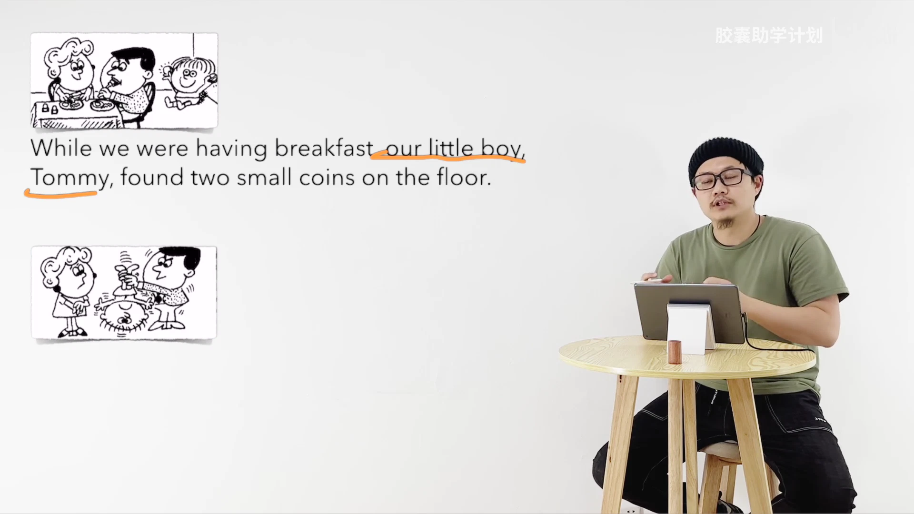

文字识别：While we were having breakfast our little boy, / Tommy, found two small coins on the floor.

## 00:05:30–00:06:00

说听过有这么个东西就可以了，好吧？接下来，He put them both into his mouth。他放置他们全都进入了他的嘴里面。好，注意这个地方的 put。我想问一个小的问题，各位可以留言告诉我，好吧？He 明明是三单，但是 put 为什么在这儿没有加 s 呢？他为什么貌似用了原形呢？这个地方

### 画面 00:05:33

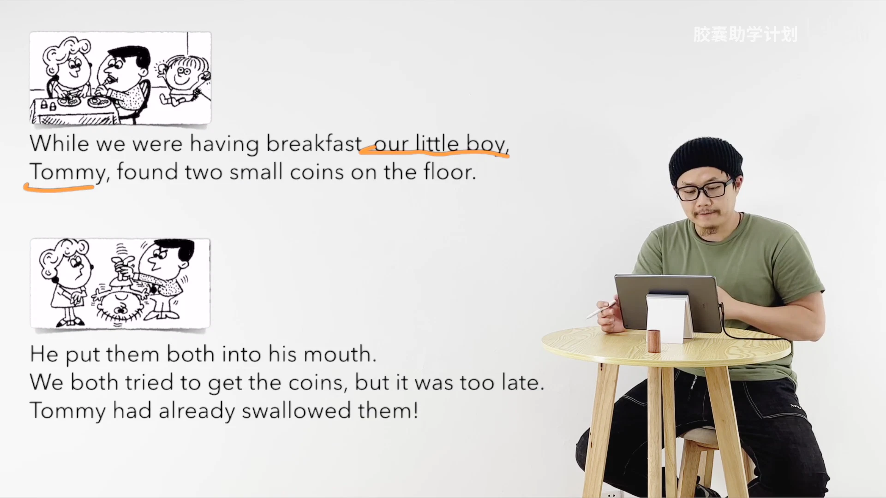

文字识别：While we were having breakfast our little boy, / Tommy, found two small coins on the floor. / He put them both into his mouth. / We both tried to get the coins, but it was too late. / Tommy had already swallowed them!

### 画面 00:05:40

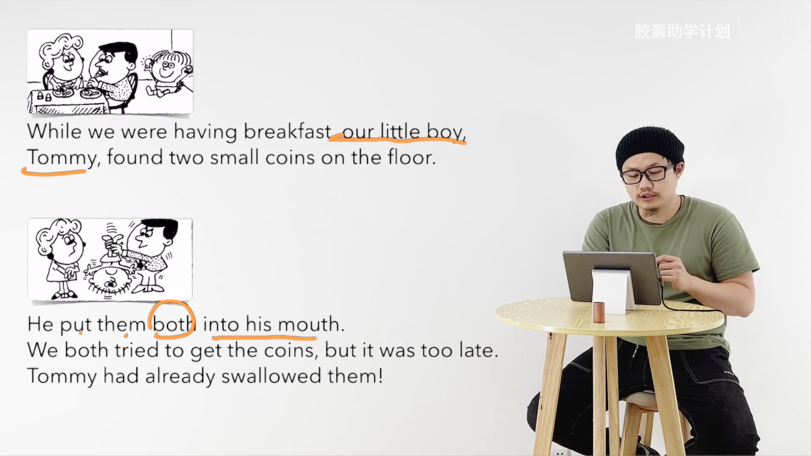

文字识别：日日 / While we were having breakfast our little boy, / Tommy, found two small coins on the floor. / He put them lboth into his mouth. / We both tried to get the coins, but it was too late. / Tommy had already swallowed them!

### 画面 00:05:53

文字识别：While we were having breakfast our little boy, / Tommy, found two small coins on the floor. / He put Zhem both into his mouth. / We both tried to get the coins, but it was too late. / Tommy had already swallowed them!

## 00:06:00–00:06:30

到底是不是它的原型呢？好，各位不妨把这个问题留言告诉我，好吧？这个问题我之前讲过啊。We both 我们都 try to get the coins，尝试去 get the coins。好，提一个小点，get 这个单词叫做获得，它有非常多的意思啊。这个我们管它叫万金油。进入新二，各位的感受会更深，包括各位将来进阶学到我们的人在

### 画面 00:06:11

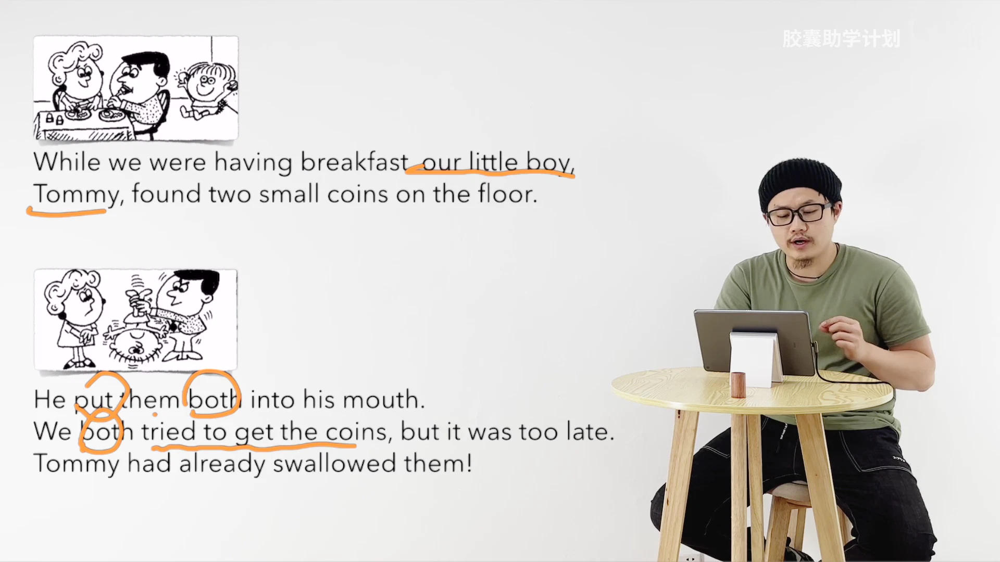

文字识别：While we were having breakfast our little boy, / Tommy, found two small coins on the floor. / He put lhem botl into his mouth. / We / both tried to get the coins, but it was too late. / Tommy had already swallowed them!

## 00:06:30–00:07:00

纽约课程的时候，你会发现 get 这个单词也经常出现。我们现在先记住它最基础的一个意思叫做获得啊。我们尝都尝试去拿到或获得这个硬币， but it was too late，但是一切都太晚了。to 一百零三课咱们刚刚学过，对吧？Tommy had already swallowed。好，这地方其实出现了一个小的语法，是我们下一课立刻会立刻会讲到的，叫 had

### 画面 00:06:41

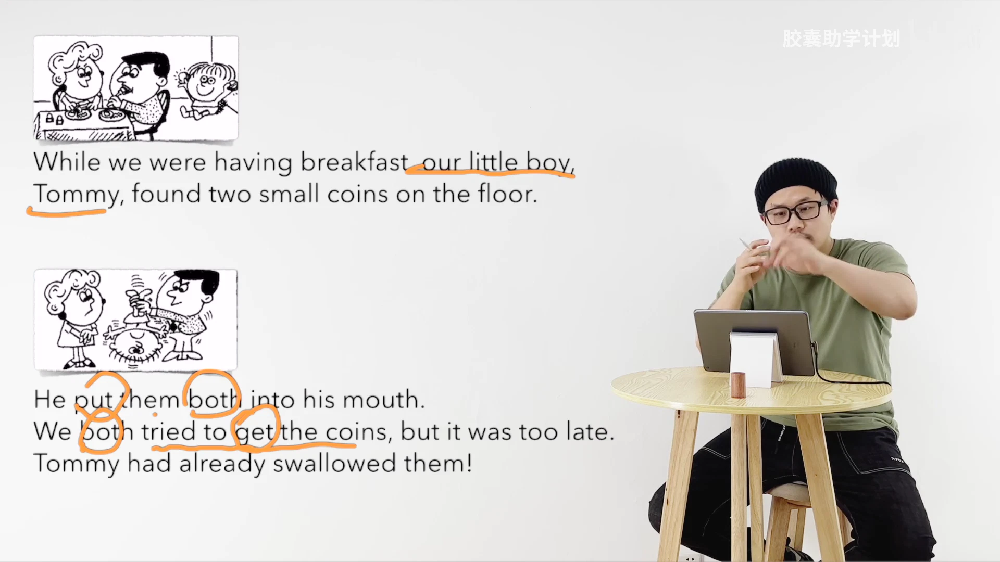

文字识别：While we were having breakfast our little boy / Tommy, found two small coins on the floor. / He put Zhem both into his mouth. / We / both tried to getthe coins, but it was too late. / Tommy had already swallowed them!

## 00:07:00–00:07:30

加 swallowed，好，这个时态叫过去完成时啊，叫做他已经把他们咽进去了。好，continue later that morning，啊，那个早晨稍晚一些时候，稍后，比如说八点钟发生这些事儿，那十点钟就是稍后，对吧？When 当 I was doing the housework，我正在做家务劳动的时候，my husband phoned me from the office，我老公 phoned me 给我打电

### 画面 00:07:03

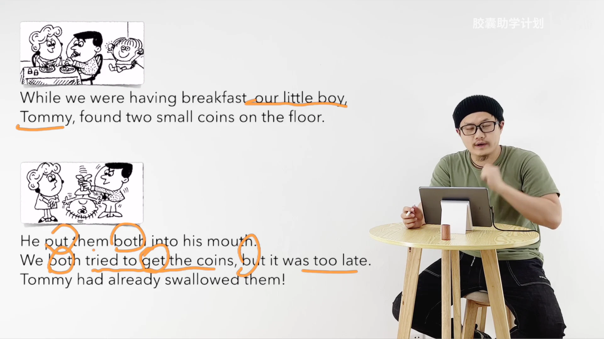

文字识别：While we were having breakfast our little boy, / Tommy, found two small coins on the floor. / He put Zhem both into his moutn. / We / both tried to get the coins, byt it was too late. / Tommy had already swallowed them!

### 画面 00:07:07

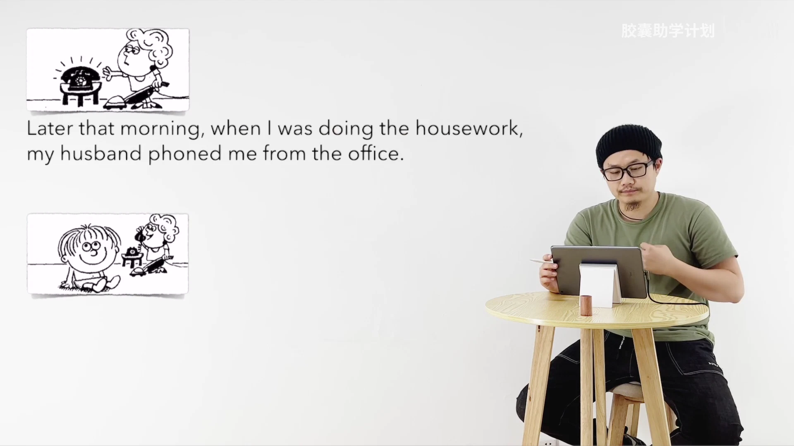

文字识别：Later that morning, when I was doing the housework, / my husband phoned me from the office.

## 00:07:30–00:08:00

from the office, from the office, gave me a call. How's Tommy? He asked. Tommy, how's he? He asked. How's Tommy? He asked. How's Tommy? He asked. How's Tommy? He asked. How's Tommy? He asked. How's Tommy? He asked. How's Tommy? He asked. How's Tommy? He asked. How's Tommy? He asked. How's Tommy? He asked. How's Tommy? He asked. How's Tommy? He asked. How's Tommy? He asked. How's Tommy? He asked. How's Tommy? He asked. How's Tommy? He asked. How's Tommy? He asked. How's Tommy? He asked. How's Tommy? He asked. How's Tommy? He asked. How's Tommy? He asked. How's Tommy? He asked. How's Tommy? He asked. How's

### 画面 00:07:33

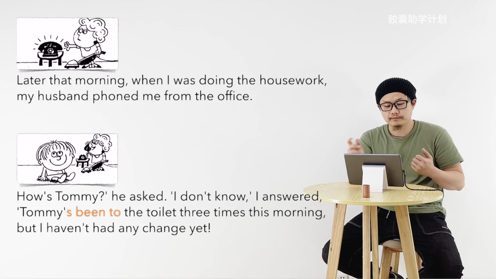

文字识别：Later that morning, when I was doing the housework, / my husband phoned me from the office. / How's Tommy?' he asked.'I don't know,'I answered, / 'Tommy's been to the toilet three times this morning, / but I haven't had any change yet!

## 00:08:00–00:08:30

toilet厕所 three times this morning. 已经今天早晨去厕所去了三回了。But但是 I haven't had any change yet. 我还没有得到任何的 change. 啊，就是那个零钱，兑换零钱就是那个 coins，就是那个硬币。我还没有拿到啊，还没有拿出来，对吧？OK，好，那文章讲完了，接下来口语听力练习，我问您答来了。第一个，

### 画面 00:08:03

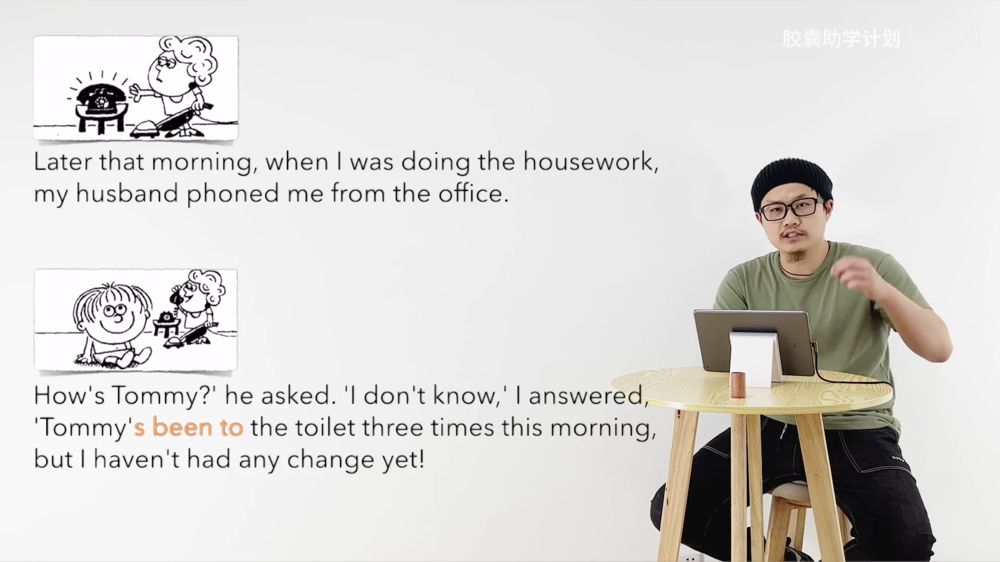

文字识别：Later that morning, when I was doing the housework, / my husband phoned me from the office. / How's Tommy?' he asked.' don't know,'I answered, / 'Tommy's been to the toilet three times this morning, / but I haven't had any change yet!

### 画面 00:08:23

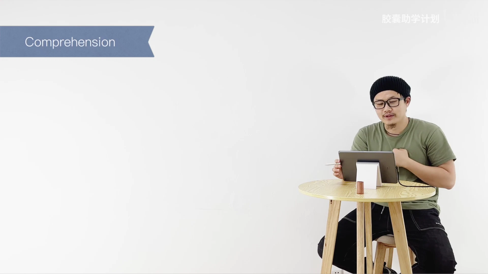

文字识别：Comprehension

### 画面 00:08:28

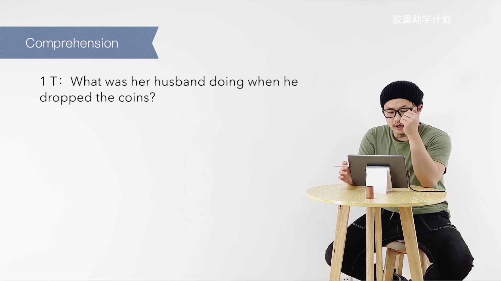

文字识别：Comprehension / 1 T: What was her husband doing when he / dropped the coins?

## 00:08:30–00:09:00

what was her husband doing when he dropped the coins? He was going into the dining room. Next one, where were the coins? Answer: They were everywhere. Next one, did they look for the coins? Yes, they did. Next one, could they find them all? No, they couldn't. Next one, who found

### 画面 00:08:39

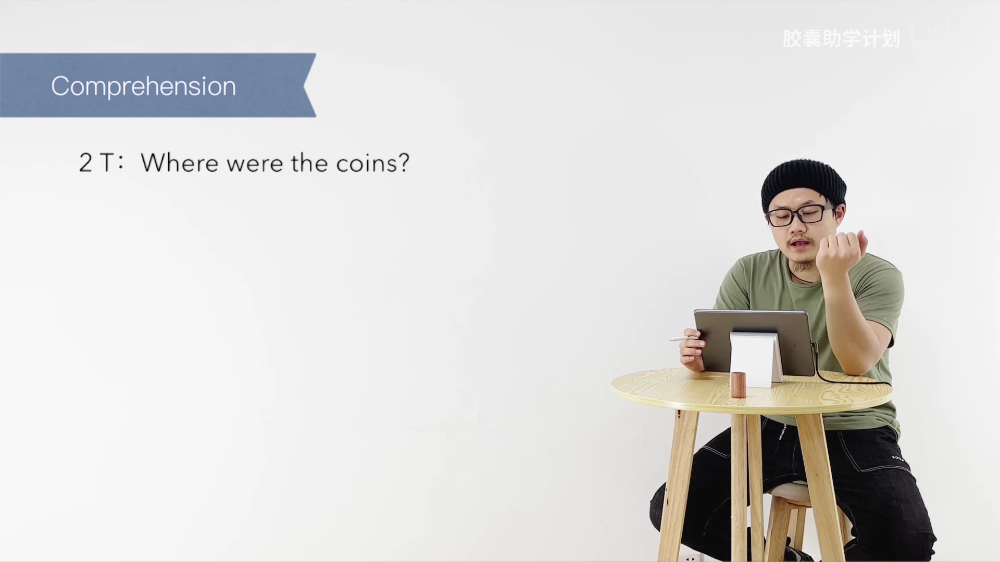

文字识别：Comprehension / 2 T: Where were the coins?

## 00:09:00–00:09:30

some small coins on the floor? Their son Tommy. Next one, what were they doing when Tommy found the coins? They were having breakfast. Next one, what did Tommy put in his mouth? Both coins,或者说two coins,对吧? Next one, why was it too late for them to get the

### 画面 00:09:09

文字识别：Comprehension / 6 T: What were they doing when Tommy / found the coins?

## 00:09:30–00:10:00

coins, cause Tommy had already swallowed them. Next one, what was Tommy's mother doing when her husband phoned? She was doing the housework. 好，asking questions，肯定句，一般疑问句，特殊疑问句来了。Did he ask me if he dropped some coins on the floor? 来，

### 画面 00:09:31

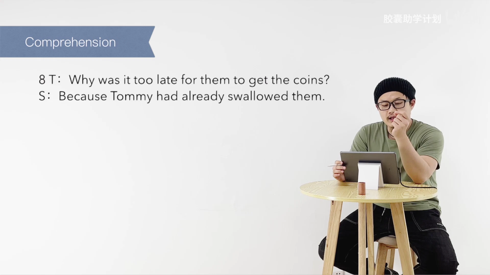

文字识别：Comprehension / 8 T: Why was it too late for them to get the coins? / S: Because Tommy had already swallowed them.

### 画面 00:09:37

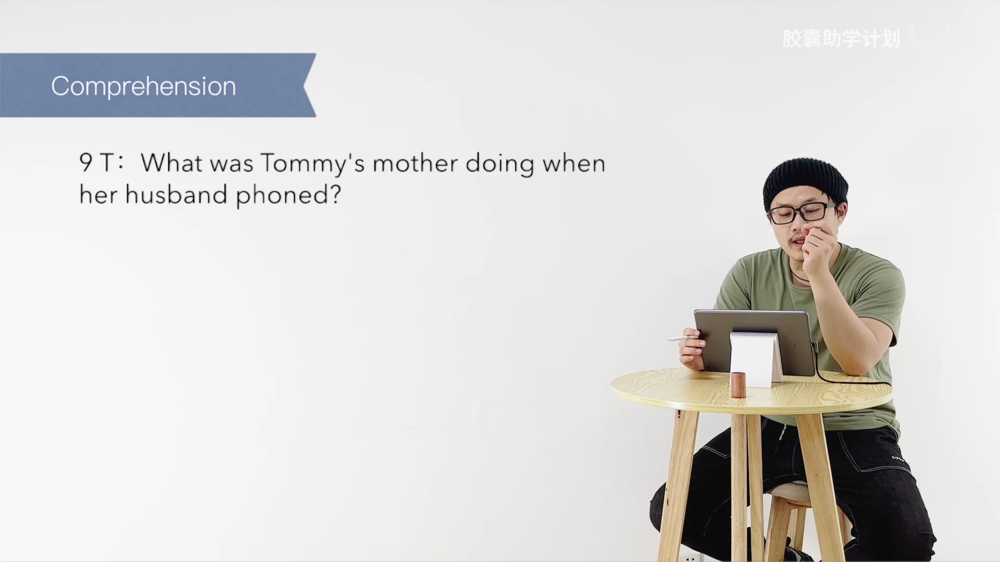

文字识别：Comprehension / 9 T: What was Tommy's mother doing when / her husband phoned?

### 画面 00:09:47

文字识别：Asking questions

### 画面 00:09:58

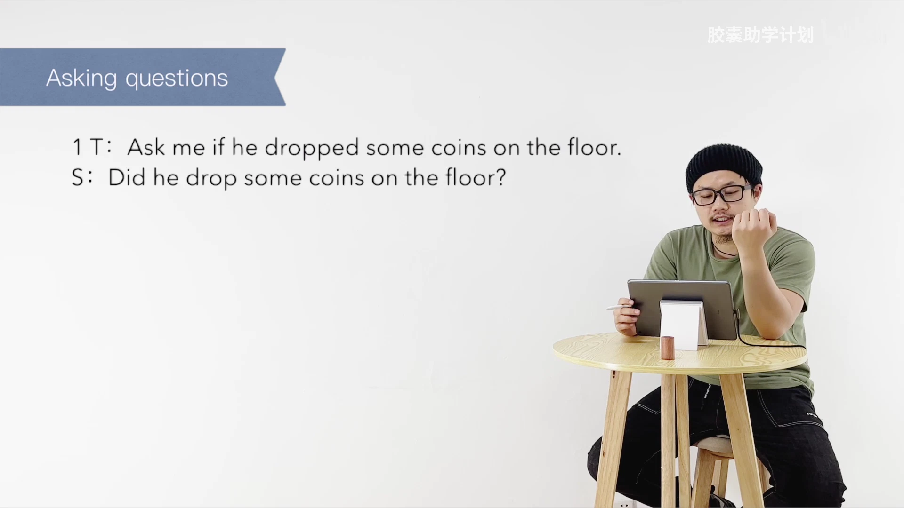

文字识别：Asking questions / 1 T: Ask me if he dropped some coins on the floor. / S: Did he drop some coins on the floor?

## 00:10:00–00:10:30

Did he drop some coins on the floor? What? What did he drop on the floor? Next one. Ask me if they could find them all. Could they find them all? Why couldn't? 哎，这个直接把 could 去掉，加前面就行了，对吧？ Why couldn't them? Why couldn't they find them all? 他们为什么没办法找到全部呢？啊， next one.

### 画面 00:10:08

文字识别：Asking questions / 2 T: Ask me if they could find them all.

### 画面 00:10:20

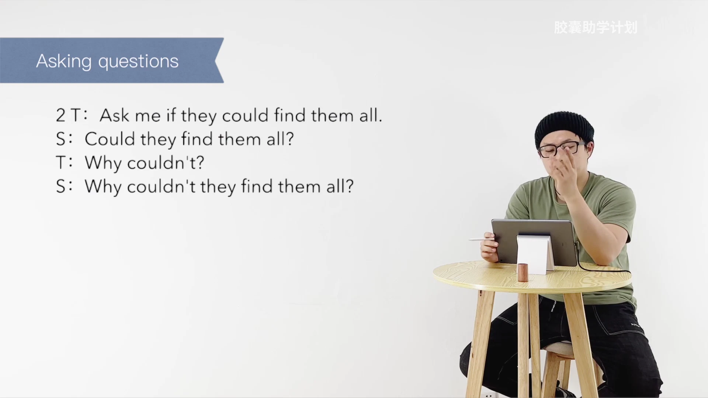

文字识别：Asking questions / 2 T: Ask me if they could find them all. / S: Could they find them all? / T:Why couldn't? / S: Why couldn't they find them all?

### 画面 00:10:29

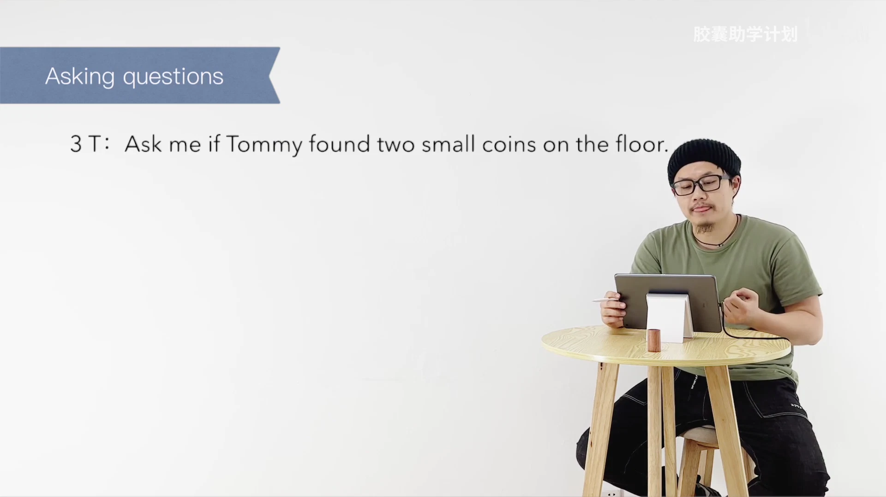

文字识别：Asking questions / 3 T: Ask me if Tommy found two small coins on the floor.

## 00:10:30–00:11:00

Ask me if Tommy found two small coins on the floor.一般疑问句. Did Tommy find two small coins on the floor? What What did Tommy find on the floor? Next one. Ask me if he put them both into his mouth. Did he put them into his mouth?好，在这儿应该回答了我们上

### 画面 00:10:42

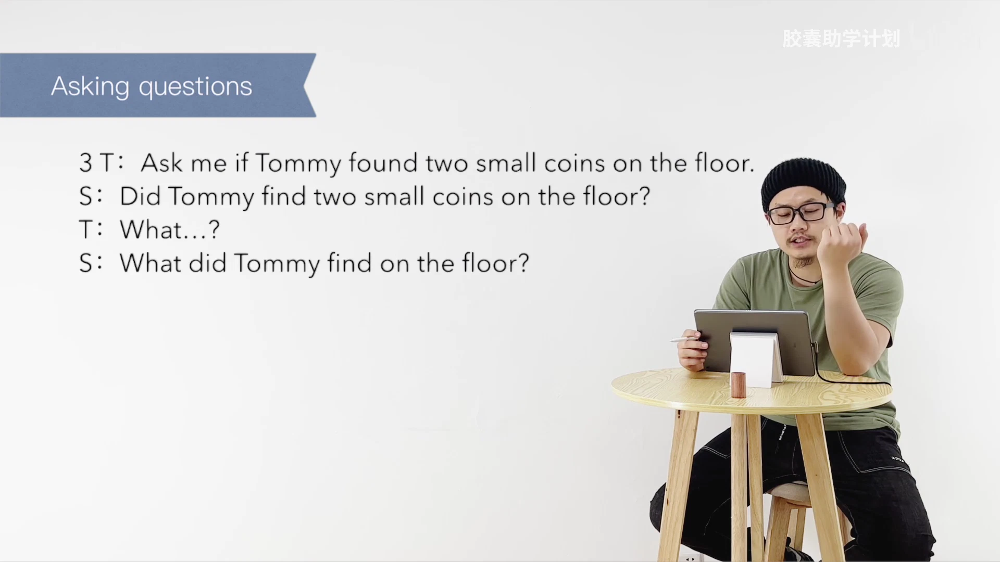

文字识别：Asking questions / 3 T: Ask me if Tommy found two small coins on the floor. / S: Did Tommy find two small coins on the floor? / T:What...? / S: What did Tommy find on the floor?

### 画面 00:10:47

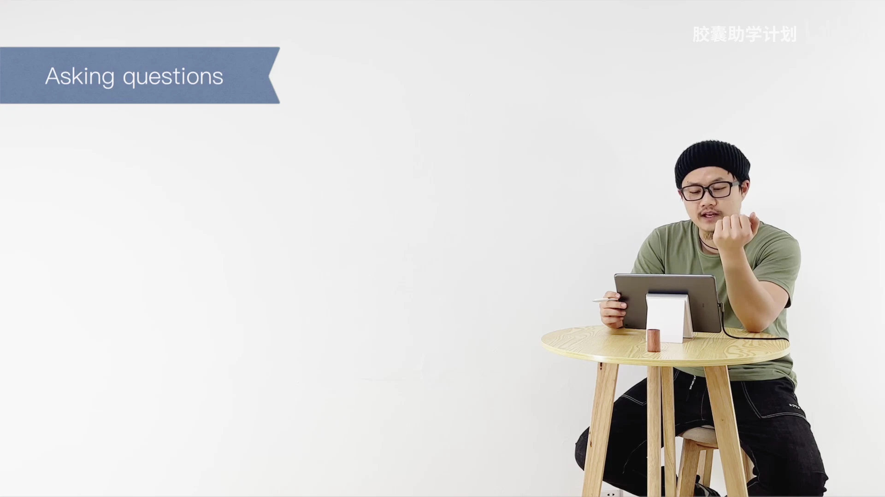

文字识别：Asking questions

### 画面 00:10:58

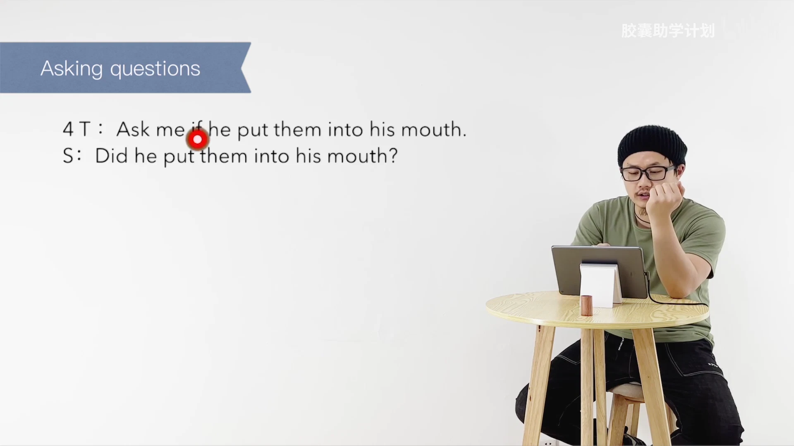

文字识别：Asking questions / 4T: Ask me ifhe put them into his mouth. / S: Did he put them into his mouth?

## 00:11:00–00:11:30

一啊本次视频问到的大家的那个问题，是吧？看看各位能不能想明白了啊！我现在还是不说答案。Where啊？对，into his mouth提问。Where did he put them? Okay, next one. Ask me if he has been to the toilet.啊，现在完成时很简单，谁提前对吧？Has he been to the toilet? How many times?直接加整句。How many times has he been to the toilet? Okay.

### 画面 00:11:10

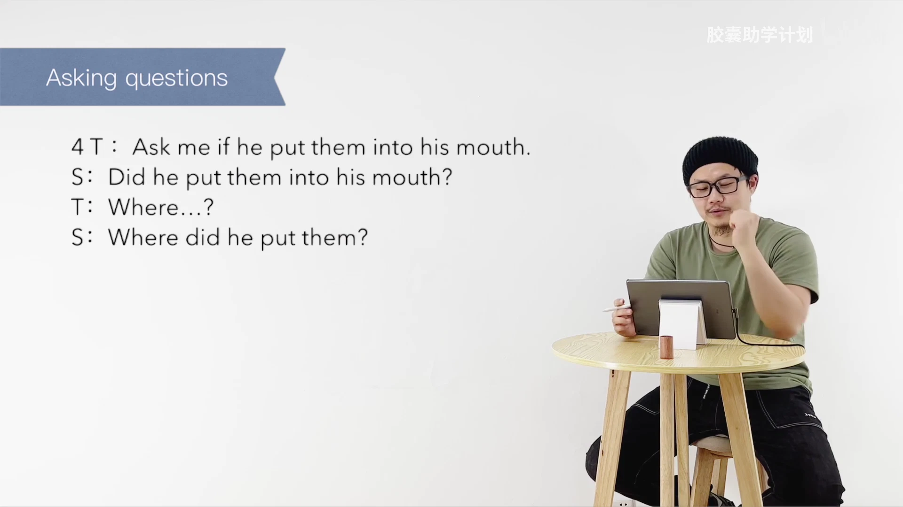

文字识别：Asking questions / 4T: Ask me if he put them into his mouth. / S: Did he put them into his mouth? / T: Where...? / S: Where did he put them?

### 画面 00:11:14

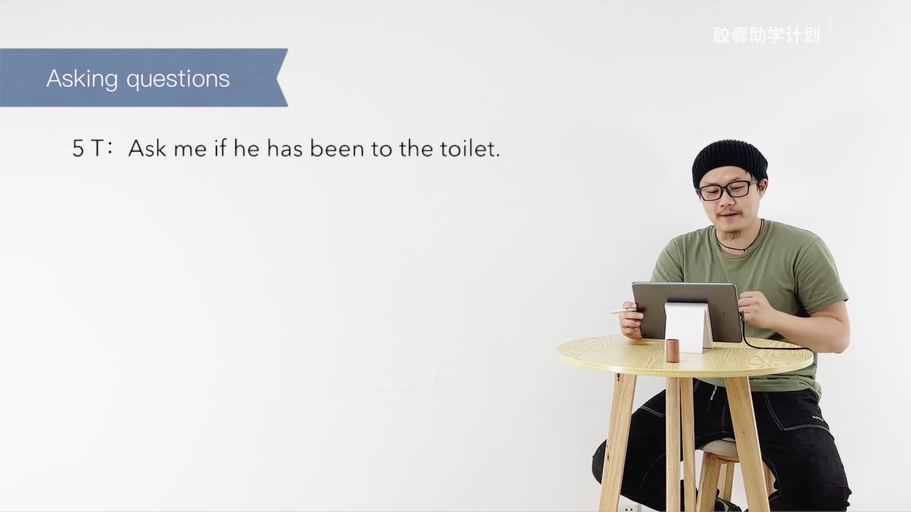

文字识别：Asking questions / 5 T: Ask me if he has been to the toilet.

### 画面 00:11:25

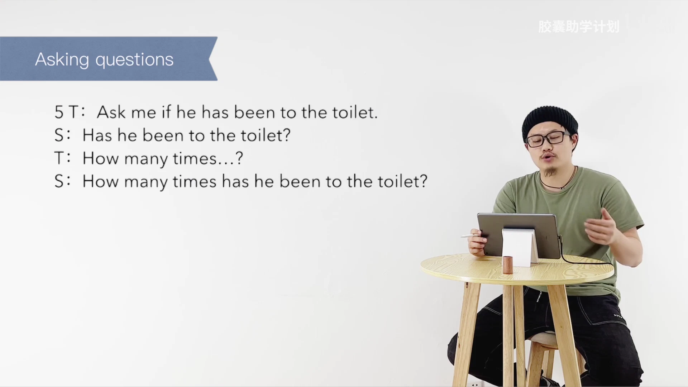

文字识别：Asking questions / 5 T: Ask me if he has been to the toilet. / S: Has he been to the toilet? / T: How many times...? / S: How many times has he been to the toilet?

## 00:11:30–00:12:00

好, recap本课的重点就是What were doing和When和Where.等我们进入新概念二册第七课的时候，依旧还会学到这个知识点啊。OK.那家庭作业呢？绿皮书一百一十七课，各位可以写了。文章一定是老习惯，熟读成诵。再然后给自己讲解一遍今天的核心知识点。OK。好。呃，如果大家喜欢我们的课程呢，欢迎大家关注

### 画面 00:11:30

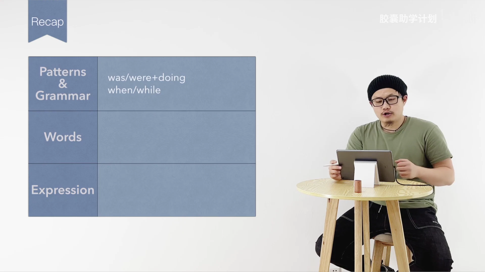

文字识别：Recap / Patterns / was/were+doing / when/while / Grammar / Words / Expression

### 画面 00:11:42

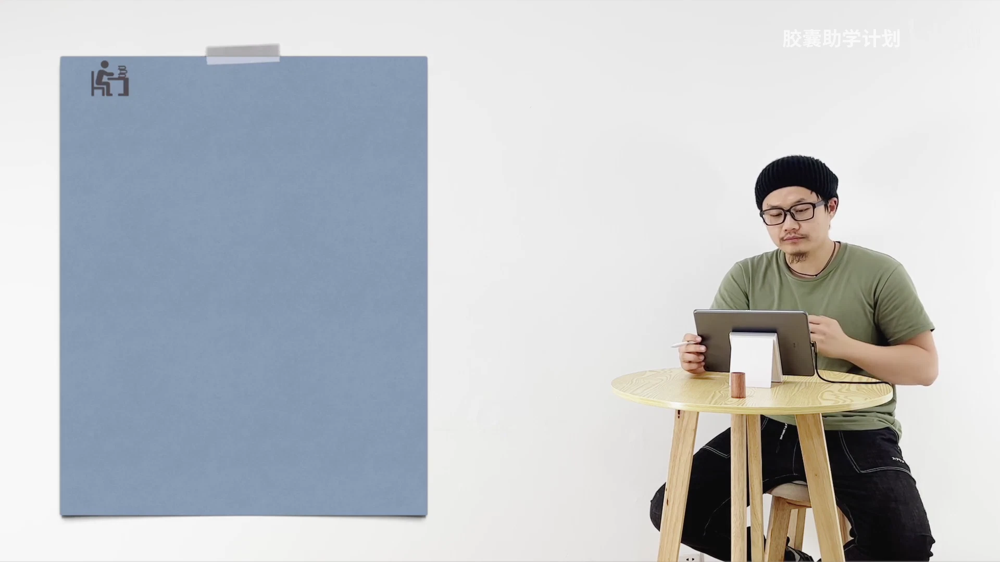

### 画面 00:11:55

## 00:12:00–00:12:30

订阅啊，一键三连，分享给那些需要的朋友，来帮助我们快速成长。最后呢，我们再来看一句名人名言：Leadership is the other side of the coin of loneliness, and he who is a leader must always act alone, and acting alone, accept everything alone. See you next time.

### 画面 00:12:06

文字识别：Leadership is the other side of the coin of / loneliness, and he who is a leader must / always act alone. And acting alone, accept / everything alone. / Ferdinand Marcos

### 画面 00:12:27

### 画面 00:12:29

文字识别：CAPSULEACADEMY / 胶囊助学计划 / 『 / 小红书 / Lecturer / □ / Leo / OE

## 00:12:30–00:12:39

### 画面 00:12:32

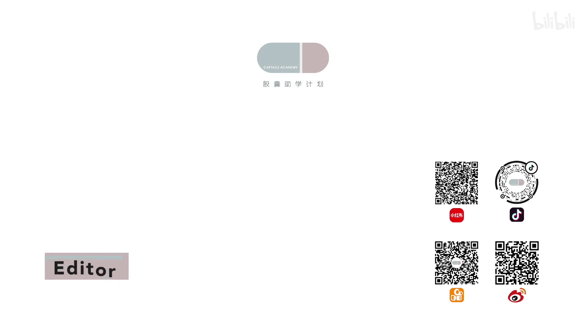

文字识别：CAPSULEACADEMY / 胶囊助学计划 / 『 / 小红书 / Editor

### 画面 00:12:35

文字识别：CAPSULEACADEMY / 胶囊助学计划 / 『 / 小红书 / Creator / Leo & Berlin / OE

### 画面 00:12:37

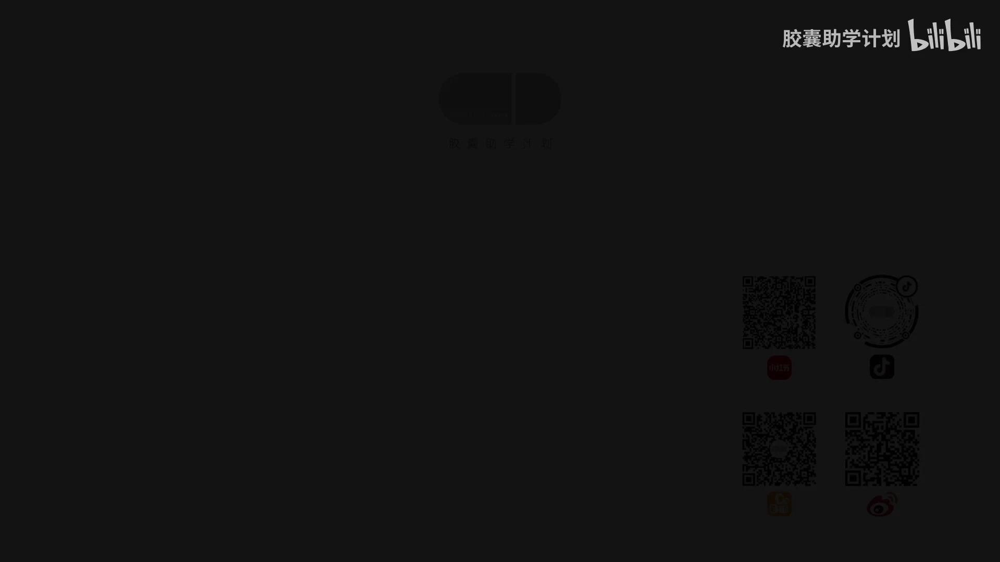

文字识别：Bilibili / 胶囊助学计划

### 画面 00:12:39

文字识别：bilibili / 胶囊助学计划

